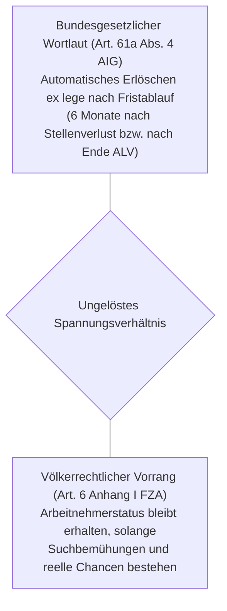



### Überblick und Bedeutung

Art. 61a AIG regelt das Erlöschen des Aufenthaltsrechts von Staatsangehörigen der Mitgliedstaaten der Europäischen Union (EU) und der Europäischen Freihandelsassoziation (EFTA), die im Besitz einer Kurzaufenthalts- (Bewilligung L EU/EFTA) oder Aufenthaltsbewilligung (Bewilligung B EU/EFTA) zur unselbständigen Erwerbstätigkeit sind und ihre Arbeitsstelle unfreiwillig verlieren. Die Bestimmung bildet ein zentrales Bindeglied zwischen dem nationalen Ausländerrecht, dem Freizügigkeitsabkommen mit der EU ([FZA; SR 0.142.112.681](https://fedlex.data.admin.ch/eli/cc/2002/243/de)) und dem Arbeitslosenversicherungsrecht (AVIG).

Die Norm knüpft an die Dauer des bisherigen Aufenthalts in der Schweiz (unter oder über zwölf Monate) an und normiert starre Fristen, nach deren ungenutztem Ablauf das Aufenthaltsrecht von Gesetzes wegen erlischt. Zugleich ordnet Abs. 3 für die Dauer der Übergangsfrist einen vollständigen Ausschluss von der wirtschaftlichen Sozialhilfe an.

#### Gesetzgeberische Entstehung, Ratio Legis und Revisionsgeschichte

1. **Missbrauchsbekämpfung und Umsetzung des Verfassungsauftrags:**  
   Art. 61a AIG wurde im Rahmen der Revision vom 16. Dezember 2016 («Steuerung der Zuwanderung und Vollzugsverbesserungen bei den Freizügigkeitsabkommen», in Kraft seit 1. Juli 2018; [AS 2018 733](https://www.fedlex.admin.ch/eli/oc/2018/93/de); [BBl 2016 3007](https://fedlex.data.admin.ch/eli/fga/2016/574)) in das Ausländergesetz (AuG, heute AIG) eingefügt. Die gesetzgeberische Initiative ging auf die Kontroverse um die Zuwanderungssteuerung nach Annahme von Art. 121a BV («Gegen Masseneinwanderung») sowie parlamentarische Vorstösse zurück (insb. Bericht der Geschäftsprüfungskommission des Nationalrats vom 4. April 2014; Postulat 14.3462 der FDP-Liberalen Fraktion; [BBl 2016 3007, S. 3041, 3054](https://fedlex.data.admin.ch/eli/fga/2016/574)). Ziel des Gesetzgebers war es, Fehlanreize zur Einwanderung in die schweizerischen Sozialsysteme zu unterbinden, kantonale Vollzugsunterschiede zu beseitigen und den Bezug von Sozialhilfe durch nichterwerbstätige Freizügigkeitsberechtigte strikt einzudämmen ([BBl 2016 3007, S. 3039, 3045](https://fedlex.data.admin.ch/eli/fga/2016/574)).

2. **Gesetzgeberische Absicht zur Kodifizierung der bundesgerichtlichen FZA-Praxis:**  
   Nach der Botschaft des Bundesrats sollte Art. 61a AIG die vom Bundesgericht entwickelte Rechtsprechung zur Freizügigkeit im nationalen Gesetzestext kodifizieren ([BBl 2016 3007, S. 3055, 3073](https://fedlex.data.admin.ch/eli/fga/2016/574)). Nach der damaligen Judikatur verlor eine freizügigkeitsberechtigte Person ihre Arbeitnehmereigenschaft und damit ihr Aufenthaltsrecht, wenn sie nach Eintritt der unfreiwilligen Arbeitslosigkeit während 18 Monaten arbeitslos geblieben war, ihren Anspruch auf Arbeitslosenentschädigung ausgeschöpft hatte und von der Sozialhilfe abhängig wurde ([BGE 141 II 1 E. 2.2.1](https://entscheidsuche.ch/docs/CH_BGE/CH_BGE_004_BGE-141-II-1_2015.html#consideration_2.2.1)). Der Gesetzgeber wollte diesen zeitlichen Rahmen in Art. 61a Abs. 4 AIG abbilden, indem er anordnete, dass das Aufenthaltsrecht sechs Monate nach Beendigung des Arbeitsverhältnisses bzw. sechs Monate nach dem Ende der Taggelder der Arbeitslosenversicherung erlischt.

3. **Kompetenzrechtliche Verankerung des Sozialhilfeausschlusses:**  
   Da dem Bund nach Art. 115 BV keine allgemeine Gesetzgebungskompetenz im Sozialhilferecht zukommt, stützte der Gesetzgeber den Sozialhilfeausschluss von Art. 61a Abs. 3 AIG auf seine Kompetenz zur Regelung von Aufenthalt und Niederlassung ausländischer Personen gemäss Art. 121 Abs. 1 BV ([BBl 2016 3007, S. 3071](https://fedlex.data.admin.ch/eli/fga/2016/574)).

4. **Neueste Klärung der Normgrenzen und Wiedererlangung des Status durch das Bundesgericht:**  
   In jüngster Zeit hat das Bundesgericht das Zusammenspiel von Art. 61a AIG mit dem Freizügigkeitsabkommen in drei bahnbrechenden Entscheiden massgeblich präzisiert:
   - Im Leitentscheid [BGE 151 II 277 E. 5.6](https://entscheidsuche.ch/docs/CH_BGE/CH_BGE_004_BGE-151-II-277_2025.html#consideration_5.6) stellte das Gericht klar, dass die blosse Gewährung von IV-Arbeitsvermittlungsmassnahmen nach Art. 18 IVG den Fortbestand der Arbeitnehmereigenschaft nicht zu begründen vermag und ein Statusverlust auch während krankheits- oder unfallbedingter Absenzen eintreten kann, wenn keine echte Perspektive auf dem Arbeitsmarkt besteht.
   - Mit Urteil [BGer 2C_152/2025 vom 8. Oktober 2025 E. 4.3–4.6](https://entscheidsuche.ch/docs/CH_BGer/CH_BGer_002_2C-152-2025_2025-10-08.html) bestätigte das Bundesgericht die analoge Anwendung der Sechsmonatsfrist von Art. 61a Abs. 4 AIG auf Personen, die nach einer vorübergehenden Arbeitsunfähigkeit (Abs. 5) wieder eine angepasste Tätigkeit ausüben könnten, dies jedoch unterlassen. Zugleich erteilte es der Umgehung über einen erwerbslosen Aufenthalt nach Art. 24 Anhang I FZA durch das Erwerbseinkommen des drittstaatsangehörigen Ehegatten eine Absage.
   - Im Grundsatzurteil [BGer 2C_355/2024 vom 19. August 2026](https://mcp.opencaselaw.ch/entscheid/bger_2C_355_2024) (Fünferbesetzung, publiziert am 26. Oktober 2026 auf *bger-update.ch*) entschied das Bundesgericht grundlegend über die **Wiedererlangung der Arbeitnehmereigenschaft nach Erlöschen des Aufenthaltsrechts gemäss Art. 61a Abs. 4 AIG**: Hat eine Person ihr Aufenthaltsrecht als Erwerbstätige infolge Langzeitarbeitslosigkeit und Aussteuerung verloren, kann sie die Arbeitnehmerstellung nach Art. 6 Abs. 1 Anhang I FZA durch eine öffentlich finanzierte Beschäftigungsmassnahme (wie dem Basler *Projekt Stöckli*) wiedererlangen, sofern die Tätigkeit marktüblich ist und quantitativ wie qualitativ einer echten wirtschaftlichen Leistung entspricht (E. 4.2–4.4).

#### Prüfschema: Struktur der Tatbestandsmerkmale

Die dogmatische Prüfung von Art. 61a AIG folgt folgendem Stufenaufbau:

| Prüfschritt | Tatbestandsmerkmal / Rechtsfrage | Gesetzliche Grundlage | Rechtsfolge bei Erfüllung / Beweislast | Leitentscheid |
|---|---|---|---|---|
| **1. Anwendungsbereich** | EU/EFTA-Staatsangehörige mit Bewilligung L oder B zwecks Erwerbstätigkeit | Art. 61a Abs. 1 AIG; Art. 2 Abs. 2 AIG | Anwendbarkeit von Art. 61a AIG; Vorliegen echter wirtschaftlicher Tätigkeit | [BGE 151 II 277 E. 5.3](https://entscheidsuche.ch/docs/CH_BGE/CH_BGE_004_BGE-151-II-277_2025.html#consideration_5.3) |
| **2. Art der Beendigung** | Unfreiwillige Beendigung vs. freiwillige Aufgabe der Stelle | Art. 61a Abs. 1 & 4 AIG vs. Art. 23 VFP | Bei Freiwilligkeit sofortiger Statusverlust; Beweislast bei Behörde/Partei | [ZH VG VB.2025.00208 E. 3.2.2](https://entscheidsuche.ch/docs/ZH_Verwaltungsgericht/ZH_VG_001_-VB-2025-00208_2025-11-12.html) |
| **3. Stellenverlust in den ersten 12 Monaten** | Unfreiwillige Beendigung vor Ablauf des ersten Aufenthaltsjahres | Art. 61a Abs. 1–3 AIG | Erlöschen 6 Monate nach Beendigung (bzw. nach Ende ALV); kein Sozialhilfeanspruch | [BGE 147 II 1 E. 2.4](https://entscheidsuche.ch/docs/CH_BGE/CH_BGE_004_BGE-147-II-1_2021.html#consideration_2.4) |
| **4. Stellenverlust nach den ersten 12 Monaten** | Unfreiwillige Beendigung nach mehr als zwölf Monaten Aufenthalt | Art. 61a Abs. 4 AIG | Erlöschen 6 Monate nach Beendigung (ohne ALV) bzw. 6 Monate nach Ende ALV | [BGer 2C_595/2024 E. 4.2](https://entscheidsuche.ch/docs/CH_BGer/CH_BGer_002_2C-595-2024_2025-06-27.html) |
| **5. Ausnahme: Vorübergehende Arbeitsunfähigkeit** | Beendigung infolge Krankheit, Unfall oder Invalidität | Art. 61a Abs. 5 Satz 1 AIG | Fristen von Abs. 1–4 gehemmt; Beweislast für Kausalität bei ausländischer Person | [BGer 2C_986/2020 E. 6.4](https://entscheidsuche.ch/docs/CH_BGer/CH_BGer_002_2C-986-2020_2021-11-05.html) |
| **6. Analoge Fristanwendung bei Genesung** | Wiedererlangung voller oder teilweiser Arbeitsfähigkeit (angepasste Arbeit) | Art. 61a Abs. 4 AIG analog | Sechsmonatsfrist läuft ab Zumutbarkeit der Arbeitsaufnahme; Beweislast bei Behörde | [BGer 2C_152/2025 E. 4.4](https://entscheidsuche.ch/docs/CH_BGer/CH_BGer_002_2C-152-2025_2025-10-08.html) |
| **7. Vorbehalt anderer Rechte** | Dauernde Erwerbsunfähigkeit / Verbleiberecht / FZA-Ansprüche | Art. 61a Abs. 5 Satz 2 AIG; Art. 4 Anhang I FZA | Bedingungsloses Verbleiberecht oder Familiennachzug schliesst Erlöschen aus | [BGE 144 II 121 E. 3.5](https://entscheidsuche.ch/docs/CH_BGE/CH_BGE_004_BGE-144-II-121_2018.html#consideration_3.5) |

---

### Kommentierung der Tatbestandsmerkmale

#### 1. Persönlicher und sachlicher Anwendungsbereich

Art. 61a AIG erfasst ausschliesslich Staatsangehörige der EU- und EFTA-Mitgliedstaaten, die ursprünglich eine Kurzaufenthaltsbewilligung EU/EFTA (Art. 4 FZA i.V.m. Art. 6 Abs. 1 bzw. Art. 2 Abs. 1 Anhang I FZA) oder eine Aufenthaltsbewilligung EU/EFTA (Art. 6 Abs. 1 Anhang I FZA) zur Ausübung einer unselbständigen Erwerbstätigkeit erhalten haben ([BBl 2016 3007, S. 3055](https://fedlex.data.admin.ch/eli/fga/2016/574)).

Voraussetzung für die Anwendung der Schutzfristen von Art. 61a AIG ist, dass die ausländische Person überhaupt je die freizügigkeitsrechtliche Arbeitnehmereigenschaft erlangt hat:
- Der Begriff des Arbeitnehmers bestimmt sich autonom nach dem FZA in Übereinstimmung mit der Rechtsprechung des Gerichtshofs der Europäischen Union (EuGH; Art. 16 Abs. 2 FZA; [BGE 151 II 277 E. 5.2](https://entscheidsuche.ch/docs/CH_BGE/CH_BGE_004_BGE-151-II-277_2025.html#consideration_5.2); [BGE 141 II 1 E. 2.2.3](https://entscheidsuche.ch/docs/CH_BGE/CH_BGE_004_BGE-141-II-1_2015.html#consideration_2.2.3)).
- Erforderlich ist eine tatsächliche und echte wirtschaftliche Tätigkeit unter Weisungsgebundenheit gegen Entgelt, die nicht rein marginal oder nebensächlich ist ([BGE 151 II 277 E. 5.3](https://entscheidsuche.ch/docs/CH_BGE/CH_BGE_004_BGE-151-II-277_2025.html#consideration_5.3); [BGer 2C_408/2024 vom 27. März 2025 E. 3.2.1](https://entscheidsuche.ch/docs/CH_BGer/CH_BGer_002_2C-408-2024_2025-03-27.html)).
- Beträgt die Tätigkeit nur wenige Tage oder handelt es sich um eine fiktive Gefälligkeitsanstellung (Scheinarbeitsvertrag), entsteht der Arbeitnehmerstatus von Beginn an nicht; Art. 61a AIG findet diesfalls keine Anwendung ([BGer 2C_152/2025 vom 8. Oktober 2025 E. 4.6.1](https://entscheidsuche.ch/docs/CH_BGer/CH_BGer_002_2C-152-2025_2025-10-08.html)).

Personen, die eine Bewilligung zu einem anderen Zweck (Ausbildung, Rentner, Verbleib nach Familiennachzug) innehaben, fallen nicht unter Art. 61a AIG ([BBl 2016 3007, S. 3055](https://fedlex.data.admin.ch/eli/fga/2016/574)).

> **Leitsatz.** Art. 61a AIG setzt das vorangehende Entstehen einer echten und tatsächlichen freizügigkeitsrechtlichen Arbeitnehmereigenschaft voraus; bei bloss fingierten oder auf wenige Tage beschränkten Arbeitsverhältnissen greifen die gesetzlichen Schutzfristen nicht.

---

#### 2. Qualifikation des Stellenverlusts: Unfreiwillige Beendigung vs. freiwillige Aufgabe

Sowohl Abs. 1 als auch Abs. 4 verlangen zwingend eine **unfreiwillige** Beendigung des Arbeitsverhältnisses.

1. **Unfreiwilligkeit:**  
   Unfreiwillig ist die Beendigung regelmässig dann, wenn die Kündigung von der Arbeitgeberseite ausgeht — sei es aus wirtschaftlichen, betrieblichen oder personellen Gründen. Das Bundesgericht und die Botschaft gehen davon aus, dass eine arbeitgeberseitige Entlassung vermutungsweise unfreiwillig erfolgt ([BBl 2016 3007, S. 3055](https://fedlex.data.admin.ch/eli/fga/2016/574); [ZH VG VB.2024.00067 vom 12. September 2024 E. 3.6](https://entscheidsuche.ch/docs/ZH_Verwaltungsgericht/ZH_VG_001_-VB-2024-00067_2024-09-12.html)). Selbst wenn die Entlassung durch Pflichtverletzungen oder unentschuldigte Absenzen mitverursacht wurde, schliesst dies die Unfreiwilligkeit der Arbeitslosigkeit nicht zwingend aus, solange die betroffene Person danach ernsthafte Suchbemühungen unternimmt ([ZH VG VB.2024.00067 E. 3.6](https://entscheidsuche.ch/docs/ZH_Verwaltungsgericht/ZH_VG_001_-VB-2024-00067_2024-09-12.html)).

2. **Freiwillige Aufgabe des Arbeitsverhältnisses:**  
   Kündigt die Arbeitnehmerin oder der Arbeitnehmer das Arbeitsverhältnis aus eigenem Antrieb ohne triftigen Grund (oder schliesst sie bzw. er eine einvernehmliche Aufhebungsvereinbarung ohne drohende Kündigung), liegt freiwillige Arbeitslosigkeit vor. Diesfalls endet die freizügigkeitsrechtliche Arbeitnehmereigenschaft unmittelbar mit der Beendigung des Arbeitsverhältnisses ([BGE 141 II 1 E. 2.2.1](https://entscheidsuche.ch/docs/CH_BGE/CH_BGE_004_BGE-141-II-1_2015.html#consideration_2.2.1)).
   
   Prozessual tritt das Erlöschen bei freiwilliger Arbeitsaufgabe jedoch **nicht automatisch ex lege nach Art. 61a AIG** ein: Da Art. 61a AIG ausschliesslich die unfreiwillige Beendigung erfasst, bleibt die Aufenthaltsbewilligung formal bis zum behördlichen Widerruf nach Art. 23 Abs. 1 VFP bestehen ([ZH VG VB.2025.00208 vom 12. November 2025 E. 3.2.2](https://entscheidsuche.ch/docs/ZH_Verwaltungsgericht/ZH_VG_001_-VB-2025-00208_2025-11-12.html)).

| Fallkonstellation | Rechtliche Einordnung | Anwendbarkeit von Art. 61a AIG | Entscheid |
|---|---|---|---|
| Kündigung durch Arbeitgeberin wegen Reorganisation | Unfreiwillige Beendigung | Art. 61a Abs. 1 bzw. Abs. 4 AIG anwendbar | [BGE 147 II 1 E. 2.1](https://entscheidsuche.ch/docs/CH_BGE/CH_BGE_004_BGE-147-II-1_2021.html#consideration_2.1) |
| Kündigung wegen Leistungsmängeln oder unentschuldigter Absenzen | Unfreiwillige Beendigung (trotz arbeitslosenversicherungsrechtlicher Einstelltage) | Art. 61a Abs. 4 AIG anwendbar; Frist läuft | [ZH VG VB.2024.00067 E. 3.6](https://entscheidsuche.ch/docs/ZH_Verwaltungsgericht/ZH_VG_001_-VB-2024-00067_2024-09-12.html) |
| Selbstkündigung der Arbeitnehmerin zwecks Neuausrichtung | Freiwillige Aufgabe | Art. 61a AIG **nicht** anwendbar; Widerruf nach Art. 23 Abs. 1 VFP erforderlich | [ZH VG VB.2025.00208 E. 3.2.2](https://entscheidsuche.ch/docs/ZH_Verwaltungsgericht/ZH_VG_001_-VB-2025-00208_2025-11-12.html) |
| Scheinarbeitsvertrag (2 Tage Präsenz ohne Lohnnachweis) | Keine echte wirtschaftliche Tätigkeit | Art. 61a AIG **nicht** anwendbar; Widerruf wegen Täuschung/Rechtsmissbrauchs | [BGer 2C_152/2025 E. 4.6.1](https://entscheidsuche.ch/docs/CH_BGer/CH_BGer_002_2C-152-2025_2025-10-08.html) |

---

#### 3. Stellenverlust innerhalb der ersten 12 Aufenthaltsmonate (Abs. 1–3)

Endet das Arbeitsverhältnis vor Ablauf der ersten zwölf Monate des Aufenthalts in der Schweiz unfreiwillig, gilt folgendes Regime:

1. **Erlöschen nach sechs Monaten (Abs. 1):**  
   - Bei Inhabern einer **Kurzaufenthaltsbewilligung L EU/EFTA** erlischt das Aufenthaltsrecht sechs Monate nach der Beendigung des Arbeitsverhältnisses (Abs. 1 Satz 1), selbst wenn die Bewilligung ursprünglich auf eine längere Dauer ausgestellt war.
   - Bei Inhabern einer **Aufenthaltsbewilligung B EU/EFTA** erlischt das Aufenthaltsrecht ebenfalls sechs Monate nach unfreiwilliger Beendigung des Arbeitsverhältnisses, sofern dieses vor Ablauf der ersten zwölf Monate des Aufenthalts endet (Abs. 1 Satz 2).
   - *Vereinbarkeit mit dem FZA:* Das Bundesgericht hat im Leitentscheid [BGE 147 II 1 E. 2.4](https://entscheidsuche.ch/docs/CH_BGE/CH_BGE_004_BGE-147-II-1_2021.html#consideration_2.4) bestätigt, dass Art. 61a Abs. 1 AIG vollständig mit dem FZA vereinbar ist. Nach Art. 2 Abs. 1 Unterabs. 2 Anhang I FZA haben Freizügigkeitsberechtigte bei Beendigung eines Arbeitsverhältnisses von weniger als einem Jahr Dauer Anspruch auf einen Verbleib von sechs Monaten zur Arbeitsplatzsuche. Diese staatsvertragliche Bestimmung geht als *lex specialis* dem allgemeinen Fortbestand nach Art. 6 Abs. 6 Anhang I FZA vor.

2. **Verlängerung bei Taggeldbezug (Abs. 2):**  
   Wird über die Frist von sechs Monaten hinaus weiterhin eine Arbeitslosenentschädigung (ALV-Taggelder) ausgerichtet, verlängert sich das Aufenthaltsrecht bis zum **Ende der Entschädigung** (Abs. 2). Massgebend ist die tatsächliche Auszahlung, nicht das blosse Bestehen einer theoretischen Rahmenfrist ([ZH VG VB.2022.00652 vom 8. Mai 2023 E. 3.2](https://entscheidsuche.ch/docs/ZH_Verwaltungsgericht/ZH_VG_001_-VB-2022-00652_2023-05-08.html)).

3. **Sozialhilfeausschluss (Abs. 3):**  
   Vom Zeitpunkt der Beendigung des Arbeitsverhältnisses bis zum Erlöschen des Aufenthaltsrechts nach den Absätzen 1 und 2 besteht **kein Anspruch auf wirtschaftliche Sozialhilfe**.
   - *Zweck:* Verhinderung des Einstiegs in die Fürsorgeabhängigkeit kurz nach der Einreise ([BBl 2016 3007, S. 3071](https://fedlex.data.admin.ch/eli/fga/2016/574)).
   - *Verfassungsrechtliche Schranke:* Der Ausschluss betrifft ausschliesslich bedarfsabhängige Sozialhilfeleistungen. Das unantastbare Grundrecht auf Nothilfe zur Überbrückung einer existentiellen Notlage gemäss Art. 12 BV (Obdach, Nahrung, medizinische Notversorgung) bleibt unberührt ([BGE 146 I 1 E. 5](https://entscheidsuche.ch/docs/CH_BGE/CH_BGE_004_BGE-146-I-1_2019.html)).

---

#### 4. Stellenverlust nach den ersten 12 Aufenthaltsmonaten (Abs. 4)

Endet das Arbeitsverhältnis nach den ersten zwölf Monaten des Aufenthalts in der Schweiz unfreiwillig, differenziert Abs. 4 nach dem Bezug von Arbeitslosenentschädigung:

1. **Fallgruppe 1: Kein Bezug von Arbeitslosenentschädigung (Abs. 4 Satz 1):**  
   Hat die betroffene Person keinen Anspruch auf Arbeitslosengelder (z.B. mangels Beitragszeit, wegen fehlender Vermittlungsfähigkeit oder Einstelltagen), erlischt das Aufenthaltsrecht **sechs Monate nach der Beendigung des Arbeitsverhältnisses**.
   - Das Bundesgericht wendet Abs. 4 Satz 1 strikt an: Hat eine Person keinen Anspruch auf Taggelder, erlischt ihr Recht nach sechs Monaten, sofern sie bis dahin keine neue, die Arbeitnehmereigenschaft begründende Stelle angetreten hat ([BGer 2C_595/2024 vom 27. Juni 2025 E. 4.2.1](https://entscheidsuche.ch/docs/CH_BGer/CH_BGer_002_2C-595-2024_2025-06-27.html); [ZH VG VB.2024.00067 vom 12. September 2024 E. 3.8](https://entscheidsuche.ch/docs/ZH_Verwaltungsgericht/ZH_VG_001_-VB-2024-00067_2024-09-12.html)).

2. **Fallgruppe 2: Bezug von Arbeitslosenentschädigung (Abs. 4 Satz 2):**  
   Werden nach Ablauf der ersten sechs Monate weiterhin Taggelder ausbezahlt, erlischt das Aufenthaltsrecht **sechs Monate nach dem Ende der Entschädigung** (Aussteuerung).
   - Diese Regelung bildet die gesetzliche Kodifizierung der 18-Monats-Praxis ([BBl 2016 3007, S. 3059 ff.](https://fedlex.data.admin.ch/eli/fga/2016/574); [BGer 2C_16/2023 vom 12. Juni 2024 E. 3.2](https://entscheidsuche.ch/docs/CH_BGer/CH_BGer_002_2C-16-2023_2024-06-12.html); [BGer 2C_321/2023 vom 2. Juli 2024 E. 3.3](https://entscheidsuche.ch/docs/CH_BGer/CH_BGer_002_2C-321-2023_2024-07-02.html)): Bei Ausschöpfung der Taggelder (in der Regel 12 bis 18 Monate) gewährt das Gesetz eine Nachlauffrist von sechs Monaten zur Stellensuche.
   - Werden während dieser Schutzfrist Sozialhilfeleistungen bezogen, ist dies nach Abs. 4 — im Gegensatz zu Abs. 3 — nicht von vornherein unzulässig, begründet nach Fristablauf jedoch das definitive Erlöschen des Aufenthaltsrechts.

3. **Verlust vor Fristablauf bei fehlenden realen Aussichten:**  
   Die Fristen nach Abs. 4 gewähren keine absolute Bestandsgarantie: Zeigt das Verhalten der ausländischen Person (mangelnde Suchbemühungen, fehlende Mitwirkung beim RAV, unqualifizierte Gelegenheitsjobs), dass **keine ernsthaften Aussichten mehr auf eine Anstellung** bestehen, geht die freizügigkeitsrechtliche Arbeitnehmereigenschaft nach Art. 6 Anhang I FZA bereits vor Ablauf der Fristen verloren ([BGer 2C_595/2024 E. 4.2.4](https://entscheidsuche.ch/docs/CH_BGer/CH_BGer_002_2C-595-2024_2025-06-27.html); [ZH VG VB.2024.00067 E. 4.5–4.6](https://entscheidsuche.ch/docs/ZH_Verwaltungsgericht/ZH_VG_001_-VB-2024-00067_2024-09-12.html)).

4. **Wiedererlangung des Arbeitnehmerstatus nach Erlöschen gemäss Art. 61a Abs. 4 AIG:**  
   Hat eine ausländische Person ihr Aufenthaltsrecht als Erwerbstätige nach Art. 61a Abs. 4 AIG infolge Langzeitarbeitslosigkeit und Erschöpfung der Taggelder verloren, ist dieser Verlust nicht zwingend endgültig:
   - Im Grundsatzentscheid [BGer 2C_355/2024 vom 19. August 2026 E. 4.2–4.4](https://mcp.opencaselaw.ch/entscheid/bger_2C_355_2024) (Fünferbesetzung, publiziert auf *bger-update.ch*) begründete das Bundesgericht eine wesentliche Praxislockerung: Auch eine Anstellung im Rahmen von **Programmen der kantonalen Arbeitslosenhilfe** (wie dem Basler *Projekt Stöckli*) vermag die Arbeitnehmereigenschaft nach Art. 6 Abs. 1 Anhang I FZA neu zu begründen.
   - Dem steht weder entgegen, dass der Arbeitsvertrag formell mit der kantonalen Amtsstelle (AWA) statt mit dem Einsatzbetrieb geschlossen wurde, noch dass die Entlöhnung vollständig aus dem kantonalen Arbeitslosenfonds finanziert wird ([E. 4.3](https://mcp.opencaselaw.ch/entscheid/bger_2C_355_2024)).
   - Ebenso schadet es nicht, dass die Massnahme personenspezifisch ausgestaltet ist und primär bezweckt, der betroffenen Person den Verbleib im Erwerbsleben bis zum Erreichen des Pensionsalters zu ermöglichen. Massgebend ist allein, dass die ausgeübten Funktionen (z.B. Kommunikationsmitarbeiterin eines gemeinnützigen Vereins) auf dem regulären Beschäftigungsmarkt üblich sind und das erzielte Einkommen die finanziellen Bedürfnisse abdeckt. Mit Antritt einer solchen Stelle lebt der Aufenthaltsanspruch als Erwerbstätige wieder auf.

---

#### 5. Ausnahmetatbestände und Gegenausnahmen (Abs. 5)

Abs. 5 statuiert zwei Ausnahmen, bei deren Vorliegen die Erlöschensfristen der Absätze 1 bis 4 nicht greifen:

##### A. Vorübergehende Arbeitsunfähigkeit (Abs. 5 Satz 1)

Wird das Arbeitsverhältnis aufgrund vorübergehender Arbeitsunfähigkeit infolge Krankheit, Unfall oder Invalidität beendet, bleibt das Aufenthaltsrecht vorerst gewahrt.

- **Kausalitätserfordernis:** Die ausländische Person trägt die Beweislast dafür, dass die Beendigung des Arbeitsverhältnisses *gerade wegen* der gesundheitlichen Beeinträchtigung erfolgte. Eine Krankschreibung, die erst nach Ausspruch einer Kündigung erfolgt, genügt nicht ([ZH VG VB.2024.00067 E. 3.7](https://entscheidsuche.ch/docs/ZH_Verwaltungsgericht/ZH_VG_001_-VB-2024-00067_2024-09-12.html)).
- **Analoge Fristanwendung bei Wiedererlangung der Arbeitsfähigkeit:**  
  Erlangt die betroffene Person ihre Arbeitsfähigkeit ganz oder teilweise wieder, sodass ihr die Ausübung einer **angepassten Tätigkeit** objektiv zumutbar ist, lebt der Schutzzweck von Art. 61a Abs. 4 AIG wieder auf:
  
  > «Ist es dem Vertragsausländer allerdings zumutbar, einer angepassten Tätigkeit nachzugehen, kommt Art. 61a Abs. 4 AIG analog zur Anwendung. Nimmt der Vertragsausländer mithin innerhalb der in Art. 61a Abs. 4 AIG statuierten Sechsmonatsfrist trotz Wiedererlangung der Fähigkeit, eine angepasste Erwerbstätigkeit auszuüben, keine solche Tätigkeit auf, verliert er die freizügigkeitsrechtliche Arbeitnehmereigenschaft und damit auch sein Aufenthaltsrecht.» ([BGer 2C_152/2025 vom 8. Oktober 2025 E. 4.4](https://entscheidsuche.ch/docs/CH_BGer/CH_BGer_002_2C-152-2025_2025-10-08.html); [BGE 151 II 277 E. 5.6.2](https://entscheidsuche.ch/docs/CH_BGE/CH_BGE_004_BGE-151-II-277_2025.html#consideration_5.6.2); [BGer 2C_986/2020 vom 5. November 2021 E. 6.4.1](https://entscheidsuche.ch/docs/CH_BGer/CH_BGer_002_2C-986-2020_2021-11-05.html)).
  
  Dies gilt erst recht bei vollständiger Genesung ([BGE 151 II 277 E. 5.6.4](https://entscheidsuche.ch/docs/CH_BGE/CH_BGE_004_BGE-151-II-277_2025.html#consideration_5.6.4)).

##### B. Dauernde Arbeitsunfähigkeit und FZA-Verbleiberecht (Abs. 5 Satz 2)

Führt eine Erkrankung oder ein Unfall zu einer dauernden Arbeitsunfähigkeit, erlischt das Aufenthaltsrecht nicht, sofern die Voraussetzungen des FZA-Verbleiberechts erfüllt sind:
- Gemäss Art. 4 Abs. 1 Anhang I FZA i.V.m. Art. 2 Abs. 1 lit. b der Verordnung (EWG) Nr. 1251/70 entsteht ein unbedingtes Verbleiberecht, wenn die Arbeitnehmerin oder der Arbeitnehmer nach mindestens zweijährigem ständigem Aufenthalt in der Schweiz eine Beschäftigung infolge dauernder Arbeitsunfähigkeit aufgibt ([BGE 144 II 121 E. 3.5](https://entscheidsuche.ch/docs/CH_BGE/CH_BGE_004_BGE-144-II-121_2018.html#consideration_3.5)).
- Bei Arbeitsunfall oder Berufskrankheit gilt das Verbleiberecht unabhängig von einer Aufenthaltsdauer, sofern Rentenansprüche gegen schweizerische Versicherungsträger bestehen (Art. 2 Abs. 1 lit. b Satz 2 VO 1251/70).
- *Abgrenzung:* Das Verbleiberecht setzt voraus, dass der Arbeitnehmerstatus im Zeitpunkt des Eintritts der dauernden Erwerbsunfähigkeit noch bestand; war die Arbeitnehmereigenschaft zuvor bereits wegen fehlender Aussichten auf dem Arbeitsmarkt erloschen, greift das Verbleiberecht nicht ([BGE 151 II 277 E. 6.1](https://entscheidsuche.ch/docs/CH_BGE/CH_BGE_004_BGE-151-II-277_2025.html#consideration_6.1); [BGer 2C_152/2025 E. 4.5](https://entscheidsuche.ch/docs/CH_BGer/CH_BGer_002_2C-152-2025_2025-10-08.html)).

##### C. Ausschluss des erwerbslosen Aufenthalts via Drittstaatsgatten (Art. 24 FZA)

In [BGer 2C_152/2025 E. 5.3](https://entscheidsuche.ch/docs/CH_BGer/CH_BGer_002_2C-152-2025_2025-10-08.html) stellte das Bundesgericht klar: Ein volljähriger, erwerbsfähiger EU-Bürger, der seine Arbeitnehmereigenschaft verloren hat, kann sich nicht auf Art. 24 Abs. 1 Satz 1 Anhang I FZA (Aufenthalt ohne Erwerbstätigkeit mit ausreichenden finanziellen Mitteln) berufen, indem er geltend macht, sein erwerbstätiger drittstaatsangehöriger Ehegatte komme für den Unterhalt auf. Da das Aufenthaltsrecht des Drittstaatsangehörigen akzessorisch vom Freizügigkeitsrecht des EU-Bürgers abhängt, würde dies auf einen verpönten «umgekehrten Nachzug» hinauslaufen.

---

### Judikaturdivergenz: Starres Fristenregime vs. FZA-Vorrang

In der Praxis besteht ein ungelöstes Spannungsverhältnis zwischen dem automatischen Erlöschen nach Art. 61a Abs. 4 AIG und dem materiellen Schutz von Art. 6 Abs. 1 und 6 Anhang I FZA.

#### Der dogmatische Widerspruch

- **Das bundesgesetzliche Konzept:** Art. 61a Abs. 4 AIG konstruiert ein formales, zeitbasiertes Erlöschen *ex lege*. Nach Ablauf von sechs Monaten ohne Taggelder oder sechs Monate nach Ende des Taggeldbezugs erlischt die Bewilligung kraft Gesetzes.
- **Die staatsvertragliche Garantie:** Nach Art. 6 Abs. 6 Anhang I FZA führt unfreiwillige Arbeitslosigkeit nicht zum Statusverlust. Nach ständiger EuGH-Rechtsprechung und dem früheren Bundesgerichtsstandard bleibt der Arbeitnehmerstatus solange erhalten, wie die Person aktiv sucht und reale Beschäftigungsaussichten bestehen.

#### Die Praxisentwicklung des Bundesgerichts

Das Bundesgericht vollzog eine schleichende Relativierung seiner Rechtsprechung:
1. **Ursprüngliche Gleichsetzung (2021):** Im Entscheid [BGE 147 II 1 E. 2.1.4](https://entscheidsuche.ch/docs/CH_BGE/CH_BGE_004_BGE-147-II-1_2021.html#consideration_2.1.4) hielt das Gericht noch unbesehen fest, der Gesetzgeber habe die bisherige FZA-Praxis in Art. 61a AIG kodifiziert.
2. **Abrücken und Zurückhaltung (2021–2025):** In den Entscheiden [BGer 2C_168/2021 vom 23. November 2021 E. 4.5.1](https://entscheidsuche.ch/docs/CH_BGer/CH_BGer_002_2C-168-2021_2021-11-23.html), [BGer 2C_471/2022 vom 20. Dezember 2023 E. 3.4](https://entscheidsuche.ch/docs/CH_BGer/CH_BGer_002_2C-471-2022_2023-12-20.html) und [BGer 2C_16/2023 vom 12. Juni 2024 E. 3.2](https://entscheidsuche.ch/docs/CH_BGer/CH_BGer_002_2C-16-2023_2024-06-12.html) formulierte das Gericht vorsichtiger, dass die Praxis mit Art. 61a AIG kodifiziert werden «sollte».
3. **Offenlassen der Vereinbarkeit:** In [BGer 2C_595/2024 vom 27. Juni 2025 E. 4.2.1](https://entscheidsuche.ch/docs/CH_BGer/CH_BGer_002_2C-595-2024_2025-06-27.html) und [ZH VG VB.2024.00067 vom 12. September 2024 E. 4.4](https://entscheidsuche.ch/docs/ZH_Verwaltungsgericht/ZH_VG_001_-VB-2024-00067_2024-09-12.html) liessen die Gerichte die Grundsatzfrage der Vereinbarkeit von Art. 61a Abs. 4 AIG mit Art. 6 Anhang I FZA ausdrücklich offen. Sie halfen sich mit einer **Doppelprüfung**: Das Erlöschen nach Art. 61a Abs. 4 AIG wurde nur deshalb geschützt, weil die Betroffenen aufgrund fehlender Suchbemühungen oder langer Absenzen auch nach den staatsvertraglichen Kriterien des FZA keine ernsthaften Aussichten auf Wiederanstellung mehr besassen.

> **Leitsatz.** Die Vereinbarkeit der Fristen von Art. 61a Abs. 4 AIG mit Art. 6 Anhang I FZA ist höchstrichterlich ungeklärt; die Gerichte stützen den Widerruf bzw. die Nichtverlängerung auf eine parallele Einzelfallprüfung der materiellen Stellenaussichten nach FZA.

---

### Fallvergleich: Reichweite der Fristen und Statusverlust

Die Grenzziehung zwischen Fortbestand und Erlöschen des Aufenthaltsrechts verdeutlicht die Gegenüberstellung zweier Urteile:

| Merkmal | [BGer 2C_355/2024 vom 19. August 2026](https://mcp.opencaselaw.ch/entscheid/bger_2C_355_2024) (Fünferbesetzung) — **Status wiedererlangt** | [BGer 2C_152/2025 vom 8. Oktober 2025](https://entscheidsuche.ch/docs/CH_BGer/CH_BGer_002_2C-152-2025_2025-10-08.html) — **Erloschen / Widerruf geschützt** |
|---|---|---|
| **Ausgangslage** | Langzeitarbeitslosigkeit; Status nach Art. 61a Abs. 4 AIG per August 2020 verloren | 2 Tage Anstellung als Bürogehilfin, danach 3 Monate Landwirtschaft |
| **Folgebeschäftigung** | Dreijährige Anstellung (80–100 %, CHF 3'507.– bis 4'441.–) im kantonalen Projekt Stöckli (AWA BS) | Nach Arbeitsunfall und Fehlgeburt keine nachweisbaren Stellenbemühungen |
| **Rechtliche Qualifikation** | Echte wirtschaftliche Tätigkeit; Lohn aus öffentlichen Mitteln schadet nicht | Unter 4 Monate Gesamtdauer; keine reale Anstellungschance mehr dargetan |
| **Auswirkung auf Bewilligung** | Wiedererlangung der Arbeitnehmereigenschaft (Art. 6 FZA); Aufenthaltsbewilligung B zu erteilen | Art. 61a Abs. 5 AIG greift nicht analog, da angepasste Tätigkeit nicht gesucht |
| **Ergebnis vor Bundesgericht** | Gutheissung; Aufhebung des vorinstanzlichen Bewilligungsumwandlungsentscheids | Abweisung; Bewilligung erloschen bzw. zu Recht widerrufen |

---

### Kantonale Praxisfragen

#### Frage 1: Wirkt das Erlöschen nach Art. 61a AIG ipso jure oder bedarf es einer förmlichen Feststellungsverfügung?

In der kantonalen Praxis stellt sich regelmässig die Frage, wie mit dem Begriff «erlischt» verfahrenstechnisch umzugehen ist:
- Der Wortlaut von Art. 61a AIG suggeriert ein automatisches Dahinfallen des Aufenthaltsrechts kraft Gesetzes (*ipso jure*).
- Da EU/EFTA-Aufenthaltsbewilligungen jedoch nach ständiger Rechtsprechung rein deklaratorischer Natur sind ([BGE 144 II 1 E. 3.1](https://entscheidsuche.ch/docs/CH_BGE/CH_BGE_004_BGE-144-II-1_2018.html#consideration_3.1)), verliert die ausländische Person ihr materielles Anwesenheitsrecht mit Ablauf der Fristen.
- Zur Durchsetzung der Ausreise und zur Beendigung des Rechtsscheins verlangt das Rechtsstaatsprinzip (Art. 29 BV) jedoch zwingend den Erlass einer anfechtbaren Verfügung der Migrationsbehörde: Die Behörde verfügt förmlich die **Nichtverlängerung bzw. den Widerruf der Bewilligung nach Art. 23 Abs. 1 VFP** und ordnet die Wegweisung nach Art. 64 AIG an ([ZH VG VB.2024.00067 E. 2.3](https://entscheidsuche.ch/docs/ZH_Verwaltungsgericht/ZH_VG_001_-VB-2024-00067_2024-09-12.html)).
- *Praxisfalle:* Stellt die Migrationsbehörde das Erlöschen erst Monate oder Jahre nach Fristablauf fest, während die betroffene Person weiterhin geduldet wurde oder Zwischenverdienste erzielte, ist im Verfügungszeitpunkt zu prüfen, ob die Arbeitnehmereigenschaft zwischenzeitlich wiederaufgelebt ist ([ZH VG VB.2023.00703 E. 3](https://entscheidsuche.ch/docs/ZH_Verwaltungsgericht/ZH_VG_001_-VB-2023-00703_2024-03-27.html)).

#### Frage 2: Lässt eine Zwischenbeschäftigung im Stundenlohn während der Arbeitslosigkeit die Fristen neu anlaufen?

EU/EFTA-Angehörige nehmen nach Kündigungen häufig kurzfristige Gelegenheitsarbeiten, temporäre Einsätze über Personalverleiher oder Arbeitseinsätze im Stundenlohn an. Umstritten ist, ob solche Einsätze die Fristen von Art. 61a Abs. 4 AIG unterbrechen:
- Die kantonalen Gerichte und das Bundesgericht wenden hier die bundesgerichtliche **Marginalitätsschwelle** an: Liegt der Monatslohn unter ca. CHF 600.– bis 800.– oder handelt es sich um unregelmässige, nicht existenzsichernde Einsätze auf Abruf, liegt keine «echte und tatsächliche wirtschaftliche Tätigkeit» vor ([BGer 2C_198/2024 vom 25. Juni 2024 E. 3.4](https://entscheidsuche.ch/docs/CH_BGer/CH_BGer_002_2C-198-2024_2024-06-25.html); [ZH VG VB.2024.00067 E. 3.9](https://entscheidsuche.ch/docs/ZH_Verwaltungsgericht/ZH_VG_001_-VB-2024-00067_2024-09-12.html)). Solche Marginaljobs unterbrechen den Lauf der Erlöschensfristen von Art. 61a Abs. 4 AIG nicht.
- **Abgrenzung zu substanziellen Beschäftigungsmassnahmen:** Im Grundsatzurteil [BGer 2C_355/2024 vom 19. August 2026 E. 4.2–4.3](https://mcp.opencaselaw.ch/entscheid/bger_2C_355_2024) stellte das Bundesgericht klar: Handelt es sich hingegen um eine längerfristige (z.B. dreijährige) Beschäftigung im Rahmen eines Programms der kantonalen Arbeitslosenhilfe mit marktüblichen Aufgaben und existenzsicherndem Lohn (ab 80 % Pensum), begründet diese Tätigkeit ungeachtet der Finanzierung aus dem kantonalen Arbeitslosenfonds eine echte wirtschaftliche Leistung, welche den Arbeitnehmerstatus vollumfänglich wiederbegründet.

---

### Prozessuale Realität: Beweislast und Substanziierung

1. **Beweislast für die Unfreiwilligkeit und Kausalität bei Krankheit:**  
   Behauptet die ausländische Person, das Arbeitsverhältnis sei krankheits- oder unfallbedingt beendet worden (Art. 61a Abs. 5 AIG), trägt sie hierfür nach Art. 8 ZGB analog und ihrer ausländerrechtlichen Mitwirkungspflicht (Art. 90 AIG) die volle Beweislast. Sie muss das Kündigungsschreiben, die Korrespondenz mit dem Arbeitgeber und zeitnahe ärztliche Zeugnisse vorlegen ([ZH VG VB.2024.00067 E. 3.7](https://entscheidsuche.ch/docs/ZH_Verwaltungsgericht/ZH_VG_001_-VB-2024-00067_2024-09-12.html)).

2. **Substanziierung von Stellensuchbemühungen:**  
   Die blosse Behauptung, man wolle arbeiten und bemühe sich um eine Stelle, genügt nicht, um den Fortbestand des Aufenthaltsrechts über die Fristen von Art. 61a AIG hinaus zu begründen ([BGer 2C_152/2025 E. 4.6.4](https://entscheidsuche.ch/docs/CH_BGer/CH_BGer_002_2C-152-2025_2025-10-08.html)). Erforderlich ist der lückenlose Nachweis quantitativ und qualitativ hinreichender Bewerbungen (Bewerbungsschreiben, Absagen, RAV-Nachweise; [BGer 2C_595/2024 E. 3.3](https://entscheidsuche.ch/docs/CH_BGer/CH_BGer_002_2C-595-2024_2025-06-27.html)).

3. **Beweisführung bei Taggeldansprüchen:**  
   Für die Verlängerung nach Abs. 2 und Abs. 4 Satz 2 AIG genügt nicht die theoretische Abrechnung der Arbeitslosenkasse. Einzureichen sind die monatlichen Auszahlungsbelege der Arbeitslosenkasse ([ZH VG VB.2022.00652 E. 3.2](https://entscheidsuche.ch/docs/ZH_Verwaltungsgericht/ZH_VG_001_-VB-2022-00652_2023-05-08.html)).

---

### Praxishinweise

**Für betroffene EU/EFTA-Staatsangehörige und ihre Rechtsvertretung:**

1. Bei Erhalt einer Kündigung im ersten Aufenthaltsjahr sofort am ersten Tag der Arbeitslosigkeit beim RAV anmelden und Taggeldantrag stellen. Nur die tatsächliche Auszahlung von ALV-Entschädigung schiebt das Erlöschen nach Art. 61a Abs. 2 AIG auf ([ZH VG VB.2022.00652 E. 3.2](https://entscheidsuche.ch/docs/ZH_Verwaltungsgericht/ZH_VG_001_-VB-2022-00652_2023-05-08.html)).
2. Während der Arbeitslosigkeit monatlich mindestens zehn bis zwölf nachweisbare Stellenbewerbungen dokumentieren und aufbewahren. Wer keine schriftlichen Absagen und Bewerbungsdossiers vorlegen kann, verliert vor Gericht die Rüge fehlender realer Chancen ([BGer 2C_152/2025 E. 4.6.4](https://entscheidsuche.ch/docs/CH_BGer/CH_BGer_002_2C-152-2025_2025-10-08.html); [BGer 2C_595/2024 E. 3.3](https://entscheidsuche.ch/docs/CH_BGer/CH_BGer_002_2C-595-2024_2025-06-27.html)).
3. Bei krankheitsbedingter Kündigung unverzüglich die Bestätigung des Arbeitgebers über den Kündigungsgrund einfordern. Ein Arztzeugnis, das erst nach Zugang der Kündigung ausgestellt wird, beweist die Ausnahme nach Art. 61a Abs. 5 AIG nicht ([ZH VG VB.2024.00067 E. 3.7](https://entscheidsuche.ch/docs/ZH_Verwaltungsgericht/ZH_VG_001_-VB-2024-00067_2024-09-12.html)).
4. Sobald eine ärztliche Restarbeitsfähigkeit für angepasste Tätigkeiten attestiert wird, sofort Bewerbungen für körperlich leichtere Tätigkeiten starten. Die Sechsmonatsfrist von Art. 61a Abs. 4 AIG läuft ab Zumutbarkeit der angepassten Arbeit analog an ([BGer 2C_152/2025 E. 4.4](https://entscheidsuche.ch/docs/CH_BGer/CH_BGer_002_2C-152-2025_2025-10-08.html); [BGE 151 II 277 E. 5.6.2](https://entscheidsuche.ch/docs/CH_BGE/CH_BGE_004_BGE-151-II-277_2025.html#consideration_5.6.2)).

**Für Migrationsbehörden und Sozialämter:**

1. Vor Verfügung der Nichtverlängerung oder des Widerrufs stets das rechtliche Gehör gewähren und das Bestehen anderer Aufenthaltsrechte prüfen (insb. Familiennachzug bei gefestigtem Konkubinat mit gemeinsamen Kindern, [SG DEP RDRM.2021.4 vom 15. März 2024](https://entscheidsuche.ch/docs/SG_Gerichte/SG_DEP_006_RDRM-2021-4_2024-03-15.pdf)).
2. Bei freiwilliger Beendigung des Arbeitsverhältnisses nicht auf Art. 61a AIG abstellen, sondern die Bewilligung förmlich gestützt auf Art. 23 Abs. 1 VFP wegen Wegfalls des Aufenthaltszwecks widerrufen ([ZH VG VB.2025.00208 E. 3.2.2](https://entscheidsuche.ch/docs/ZH_Verwaltungsgericht/ZH_VG_001_-VB-2025-00208_2025-11-12.html)).
3. Trotz des strikten Sozialhilfeausschlusses nach Art. 61a Abs. 3 AIG muss bei Bedürftigkeit jederzeit Nothilfe gemäss Art. 12 BV gewährt werden ([BGE 146 I 1 E. 5](https://entscheidsuche.ch/docs/CH_BGE/CH_BGE_004_BGE-146-I-1_2019.html)).
