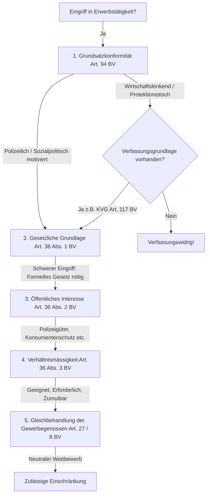

## Gesetzeswortlaut



## Überblick und Bedeutung

**N 1** Art. 27 BV gewährleistet die **individualrechtliche Dimension der Wirtschaftsfreiheit** als grundlegendes Freiheits- und Abwehrrecht des Einzelnen gegenüber staatlichen Interventionen in das Erwerbsleben. Nach Abs. 2 umfasst die Wirtschaftsfreiheit namentlich die freie Wahl des Berufes, den freien Zugang zu einer privatwirtschaftlichen Erwerbstätigkeit sowie deren freie Ausübung. Die Bestimmung schützt sowohl natürliche Personen als auch juristische Personen des Privatrechts, die im schweizerischen Wirtschaftsraum eine erwerbswirtschaftliche Tätigkeit ausüben ([BGE 131 I 223 E. 1.1](https://entscheidsuche.ch/docs/CH_BGE/CH_BGE_001_BGE-131-I-223_2005.html#consideration_1.1); [BGE 145 I 183 E. 4.1.1](https://entscheidsuche.ch/docs/CH_BGE/CH_BGE_001_BGE-145-I-183_2019.html)).

**N 2** **Historie und Revisionsmotive (BV 1999):** Die Verfassungsreform von 1999 hat die vormalige Gewährleistung von Art. 31 aBV strukturell entflochten. In der Botschaft vom 20. November 1996 zur Totalrevision der Bundesverfassung legte der Bundesrat dar, dass die bisherige Vermengung des subjektiven Individualrechts mit dem objektiven Grundsatz der marktwirtschaftlichen Wirtschaftsordnung dogmatisch unbefriedigend war (BBl 1997 I 1, S. 176 f., 284 f.). Mit der Revision wurde die subjektive Schutzwirkung in Art. 27 BV im Grundrechtskatalog verankert, während die institutionelle Wirtschaftsordnung als Leitprinzip der marktwirtschaftlichen Ausrichtung der staatlichen Politik in Art. 94 BV geregelt wurde.

**N 3** **Dogmatisches Zusammenspiel von Art. 27 und Art. 94 BV:**
1. **Art. 27 BV (Individualrecht)** schützt den einzelnen Marktteilnehmer vor unverhältnismässigen Eingriffen in seine Erwerbsentfaltung. Einschränkungen beurteilen sich nach den allgemeinen Schrankenkriterien von Art. 36 BV (gesetzliche Grundlage, öffentliches Interesse, Verhältnismässigkeit).
2. **Art. 94 BV (Wirtschaftsordnung)** verankert das institutionelle Prinzip der Wirtschaftsfreiheit: Bund und Kantone haben die freie Marktwirtschaft zu achten (Abs. 1). Abweichungen vom Grundsatz der Wirtschaftsfreiheit – namentlich Massnahmen, die den Wettbewerb strukturpolitisch, protektionistisch oder marktlenkend verzerren – sind gemäss Art. 94 Abs. 4 BV nur zulässig, wenn sie in der Bundesverfassung selbst ausdrücklich vorgesehen oder durch überkommene kantonale Regalrechte begründet sind ([BGE 138 I 378 E. 6.3](https://entscheidsuche.ch/docs/CH_BGE/CH_BGE_001_BGE-138-I-378_2012.html#consideration_6.3); [BGE 140 I 218 E. 6.2](https://entscheidsuche.ch/docs/CH_BGE/CH_BGE_001_BGE-140-I-218_2014.html#consideration_6.2)).
3. **Grundsatzkonforme Massnahmen** (z.B. polizeilich oder sozialpolitisch motivierte Regulierungen wie Gesundheitsschutz, Raumplanung oder Konsumentenschutz) berühren den Grundsatz von Art. 94 BV nicht und sind zulässig, wenn sie Art. 36 BV genügen ([BGE 140 I 218 E. 6.2](https://entscheidsuche.ch/docs/CH_BGE/CH_BGE_001_BGE-140-I-218_2014.html#consideration_6.2)).
4. **Grundsatzwidrige Massnahmen** (z.B. kantonale Bedürfnisprüfungen zur Erhaltung bestehender Betriebe, Quoten, Ein- und Ausfuhrverbote) sind per se verfassungswidrig, es sei denn, eine verfassungsrechtliche Spezialermächtigung greift ([BGE 130 I 26 E. 4.2](https://entscheidsuche.ch/docs/CH_BGE/CH_BGE_001_BGE-130-I-26_2004.html)).

---

## I. Schutzbereich und Trägerschaft

**N 4** Der sachliche Schutzbereich von Art. 27 BV umfasst jede gewerbsmässige, auf die Erzielung eines Gewinns oder Einkommens gerichtete privatwirtschaftliche Tätigkeit, unabhängig von ihrer Rechtsform oder ihrem Sektor ([BGE 135 I 130 E. 4.2](https://entscheidsuche.ch/docs/CH_BGE/CH_BGE_001_BGE-135-I-130_2009.html#consideration_3.2); [BGE 137 I 167 E. 4](https://entscheidsuche.ch/docs/CH_BGE/CH_BGE_001_BGE-137-I-167_2011.html#consideration_4.)). Geschützt sind:
- **Freie Berufswahl (Art. 27 Abs. 2 BV):** Recht auf ungehinderte Wahl eines erwerblichen Berufs oder einer Ausbildung ohne staatliche Lenkung.
- **Freier Berufszugang (Art. 27 Abs. 2 BV):** Recht auf Aufnahme einer Erwerbstätigkeit, Eröffnung eines Unternehmens und Markteintritt.
- **Freie Berufsausübung (Art. 27 Abs. 2 BV):** Freie Gestaltung der betrieblichen Organisation, Preisbildung, Vertragsgestaltung, Werbung sowie Wahl von Partnern und Lieferanten.

**N 5** **Keine sittliche Vorprüfung des Schutzbereichs:** Die Erwerbstätigkeit muss nicht zwingend einem anerkannten oder hochangesehenen Berufsbild entsprechen. Auch gesellschaftlich umstrittene oder marginalisierte Tätigkeiten wie das Prostitutionsgewerbe unterstehen der Wirtschaftsfreiheit; der Staat darf solche Tätigkeiten regulieren und Missstände bekämpfen, sie jedoch nicht unter Berufung auf reine Sittlichkeitsvorstellungen vollständig verbieten ([BGE 137 I 167 E. 4](https://entscheidsuche.ch/docs/CH_BGE/CH_BGE_001_BGE-137-I-167_2011.html#consideration_4.)).

**N 6** **Ausschluss des Schutzbereichs bei staatlichen Regalen und Monopolen:**
Der Schutzbereich von Art. 27 BV endet dort, wo eine Tätigkeit dem Staat vorbehalten und der privatwirtschaftlichen Erwerbsfreiheit von vornherein entzogen ist (Art. 94 Abs. 4 BV):
1. **Kantonale Regale:** Wo ein historisches oder verfassungsrechtlich anerkanntes kantonales Regal besteht – namentlich die Gewässerhoheit (Art. 76 Abs. 4 BV) –, ist die Erwerbstätigkeit der Wirtschaftsfreiheit entzogen ([BGE 142 I 99 E. 2.4.1](https://entscheidsuche.ch/docs/CH_BGE/CH_BGE_001_BGE-142-I-99_2016.html#consideration_2.4)). Die Erteilung einer Sondernutzungskonzession liegt im pflichtgemässen Ermessen des Kantons; ein Anspruch auf Erteilung lässt sich aus Art. 27 BV nicht ableiten ([BGE 142 I 99 E. 2.4.3](https://entscheidsuche.ch/docs/CH_BGE/CH_BGE_001_BGE-142-I-99_2016.html#consideration_2.4)).
2. **Rechtliche und faktische Monopole:** Überträgt das Gemeinwesen die Ausübung einer monopolisierten Tätigkeit auf Private, bedarf es einer Konzession. Nach Art. 2 Abs. 7 BGBM muss die Übertragung eines kantonalen oder kommunalen Monopols auf Private zwingend im Wege einer wettbewerblichen, diskriminierungsfreien Ausschreibung erfolgen ([BGE 143 II 598 E. 4.1](https://entscheidsuche.ch/docs/CH_BGE/CH_BGE_004_BGE-143-II-598_2017.html#consideration_4.1)).

**N 7** **Nutzung des öffentlichen Grundes und Verwaltungsvermögens:**
- Aus Art. 27 BV fliesst kein genereller Anspruch auf beliebige Benützung des öffentlichen Grundes zu kommerziellen Zwecken ([BGE 142 I 99 E. 2.4.2](https://entscheidsuche.ch/docs/CH_BGE/CH_BGE_001_BGE-142-I-99_2016.html#consideration_2.4); [BGE 143 I 37 E. 6.3](https://entscheidsuche.ch/docs/CH_BGE/CH_BGE_001_BGE-143-I-37_2017.html#consideration_6.3)).
- Für den **gesteigerten Gemeingebrauch** (z.B. Marktstände, Verkaufsstände, Boulevard-Gastronomie) besteht jedoch ein bedingter Verfassungsanspruch auf Erteilung einer Bewilligung nach Massgabe fairer, verhältnismässiger Kriterien und unter Wahrung der Konkurrentengleichbehandlung ([BGE 132 I 97 E. 2.2](https://entscheidsuche.ch/docs/CH_BGE/CH_BGE_001_BGE-132-I-97_2006.html#consideration_2.2)).
- Bei **Verwaltungsvermögen** (z.B. Parkhäuser eines öffentlichen Flughafens) darf der Staat die Nutzung gemäss der Zweckbestimmung regulieren und zweckfremde gewerbliche Aktivitäten (wie unbewilligtes Valet-Parking) grundsätzlich verbieten, ohne Art. 27 BV zu verletzen ([BGE 143 I 37 E. 6.3](https://entscheidsuche.ch/docs/CH_BGE/CH_BGE_001_BGE-143-I-37_2017.html#consideration_6.3)).

---

## II. Eingriffsvoraussetzungen und Prüfungsschema (Art. 36 BV)

**N 8** Einschränkungen der Wirtschaftsfreiheit müssen kumulativ die Voraussetzungen von Art. 36 BV sowie den Grundsatz der Wirtschaftsfreiheit (Art. 94 BV) wahren:

1. **Gesetzliche Grundlage (Art. 36 Abs. 1 BV):** Schwerwiegende Eingriffe (z.B. Berufsverbote, Kontingente, Bedarfsnachweise) erfordern eine klare Grundlage in einem formellen Gesetz. Leichtere Eingriffe (z.B. übliche Hygiene- oder Meldepflichten) können auf Verordnungsstufe geregelt sein.
2. **Öffentliches Interesse (Art. 36 Abs. 2 BV):** Anerkannt sind polizeiliche Schutzgüter (öffentliche Ordnung, Sicherheit, Ruhe, Gesundheit), Konsumentenschutz, Raumplanung ([BGE 142 I 162 E. 3.5](https://entscheidsuche.ch/docs/CH_BGE/CH_BGE_001_BGE-142-I-162_2016.html#consideration_3.5)) und Sozialpolitik. Nicht legitimiert sind rein fiskalische Interessen des Staates oder der Schutz lokaler Anbieter vor externer Konkurrenz.
3. **Verhältnismässigkeit (Art. 36 Abs. 3 BV):** Die Massnahme muss zur Zielerreichung geeignet, erforderlich (kein milderes Mittel wie Kennzeichnungspflichten oder Auflagen statt Verboten) und dem Betroffenen zumutbar sein.
4. **Kerngehaltsgarantie (Art. 36 Abs. 4 BV):** Der Kerngehalt der Wirtschaftsfreiheit verbietet die vollständige Abschaffung des Privateigentums und der privatwirtschaftlichen Erwerbsordnung (Zwang zur Planwirtschaft) oder den staatlichen Berufszwang.

---

## III. Gleichbehandlung der Gewerbegenossen

**N 9** Aus dem Zusammenspiel von Art. 27 BV und Art. 8 Abs. 1 BV fliesst der **Grundsatz der Gleichbehandlung der Gewerbegenossen (Konkurrentengleichbehandlung)**. Dieser stellt ein eigenständiges verfassungsrechtliches Schutzkriterium dar, das über das allgemeine Willkür- und Rechtsgleichheitsgebot hinausgeht ([BGE 143 I 37 E. 8.2](https://entscheidsuche.ch/docs/CH_BGE/CH_BGE_001_BGE-143-I-37_2017.html#consideration_8.2); [BGE 143 II 598 E. 5.1](https://entscheidsuche.ch/docs/CH_BGE/CH_BGE_004_BGE-143-II-598_2017.html#consideration_5.1)).

**N 10** **Begriff der Gewerbegenossen (direkte Konkurrenten):**
Als Gewerbegenossen gelten Angehörige derselben Branche, die sich mit vergleichbaren Angeboten an das gleiche Publikum wenden, um dieselben Bedürfnisse zu befriedigen ([BGE 143 I 37 E. 8.2](https://entscheidsuche.ch/docs/CH_BGE/CH_BGE_001_BGE-143-I-37_2017.html#consideration_8.2); [BGE 132 I 97 E. 2.1](https://entscheidsuche.ch/docs/CH_BGE/CH_BGE_001_BGE-132-I-97_2006.html#consideration_2.1)).
- Staatliche Regelungen müssen gegenüber Konkurrenten grundsätzlich **wettbewerbsneutral** ausgestaltet sein.
- Eine Ungleichbehandlung ist nur zulässig, wenn sie auf einer formell-gesetzlichen Grundlage beruht, durch sachliche und objektive Gründe (z.B. unterschiedliche Beanspruchung des öffentlichen Raums oder unterschiedliche Pflichtenbindungen) gerechtfertigt ist und sich im Rahmen der Systemgerechtigkeit hält ([BGE 143 II 598 E. 5.1](https://entscheidsuche.ch/docs/CH_BGE/CH_BGE_004_BGE-143-II-598_2017.html#consideration_5.1)).

**N 11** **Verpönte Differenzierungen:**
- Bevorzugung ortsansässiger Gewerbetreibender gegenüber ausserkantonalen oder auswärtigen Mitbewerbern bei der Vergabe von Standplätzen auf öffentlichem Grund ([BGE 132 I 97 E. 3](https://entscheidsuche.ch/docs/CH_BGE/CH_BGE_001_BGE-132-I-97_2006.html#consideration_3.)).
- Schaffung künstlicher Wettbewerbsverzerrungen zugunsten etablierter Marktteilnehmer zulasten von Neueinsteigern oder alternativen Geschäftsmodellen.

---

## IV. Staatliche Wirtschaftstätigkeit und Quersubventionierungsverbot

**N 12** Tritt das Gemeinwesen oder eine staatliche Anstalt als Anbieterin am Markt auf, wird die privatwirtschaftliche Konkurrenz berührt. Das Bundesgericht unterscheidet hierbei strikt zwischen der individualrechtlichen und der institutionellen Ebene ([BGE 138 I 378 E. 6.2](https://entscheidsuche.ch/docs/CH_BGE/CH_BGE_001_BGE-138-I-378_2012.html#consideration_6.2)):
- **Keine Verletzung von Art. 27 BV:** Tritt ein staatliches Unternehmen mit gleichen Rechten und Pflichten wie ein Privater am Markt auf, entsteht den privaten Marktteilnehmern lediglich ein weiterer Mitbewerber. Dies verletzt Art. 27 BV nicht, solange die private Konkurrenz nicht geradezu vom Markt verdrängt wird ([BGE 138 I 378 E. 6.2](https://entscheidsuche.ch/docs/CH_BGE/CH_BGE_001_BGE-138-I-378_2012.html#consideration_6.2)).
- **Massstab ist Art. 94 Abs. 4 BV:** Die Rechtmässigkeit staatlicher Unternehmenstätigkeit beurteilt sich nach dem Grundsatz der Wirtschaftsfreiheit.

**N 13** **Der Vierertest des Bundesgerichts (Glarnersach-Doktrin):**
Eine unternehmerische Tätigkeit des Staates im Wettbewerb ist verfassungsrechtlich nur zulässig, wenn kumulativ vier Voraussetzungen erfüllt sind ([BGE 138 I 378 E. 6.3](https://entscheidsuche.ch/docs/CH_BGE/CH_BGE_001_BGE-138-I-378_2012.html#consideration_6.3)):
1. **Formell-gesetzliche Grundlage:** Die unternehmerische Betätigung muss in einem Gesetz im formellen Sinn ausdrücklich vorgesehen sein.
2. **Öffentliches Interesse:** Es muss ein hinreichendes sachliches öffentliches Interesse vorliegen; rein fiskalische Gewinnstrebigkeit genügt nicht ([BGE 138 I 378 E. 8](https://entscheidsuche.ch/docs/CH_BGE/CH_BGE_001_BGE-138-I-378_2012.html#consideration_8.)).
3. **Verhältnismässigkeit:** Die Tätigkeit darf nicht weiter gehen, als zur Verfolgung des öffentlichen Zwecks erforderlich ist.
4. **Wettbewerbsneutralität:** Der Staat darf seine hoheitliche Macht, Steuergelder oder Monopolbereiche nicht nutzen, um den Markt zu verzerren.

**N 14** **Finanzieller Gehalt der Wettbewerbsneutralität:**
Wettbewerbsneutralität ist kein blosses Programmpostulat. Sie verpflichtet den Staat insbesondere zu:
- **Systematischem Quersubventionierungsverbot:** Gewinne aus Monopolbereichen (z.B. Gebäude-Monopolversicherung) dürfen nicht verwendet werden, um Dienstleistungen im wettbewerblichen Bereich unter den Gestehungskosten anzubieten ([BGE 138 I 378 E. 9.1](https://entscheidsuche.ch/docs/CH_BGE/CH_BGE_001_BGE-138-I-378_2012.html#consideration_9.1)).
- **Verbot von Privilegien:** Das staatliche Unternehmen hat im Wettbewerb dieselben regulatorischen und bundesprivatrechtlichen Pflichten zu tragen wie private Akteure (Unterstellung unter das VVG, zivilgerichtlicher Rechtsweg; [BGE 138 I 378 E. 11.2](https://entscheidsuche.ch/docs/CH_BGE/CH_BGE_001_BGE-138-I-378_2012.html#consideration_11.2)).

---

## V. Kasuistik: Schwellenwert-Gegenüberstellung

Die nachfolgende Tabelle veranschaulicht anhand konkreter Lebenssachverhalte aus der bundesgerichtlichen Rechtsprechung, bei welchen Konstellationen eine Verletzung der Wirtschaftsfreiheit bzw. des Grundsatzes der Wirtschaftsfreiheit bejaht oder verworfen wurde.

| Sachbereich / Lebenssachverhalt | Anwendungsfall (Verletzung bejaht) | Verwerfungsfall (Verfassungskonform / Eingriff verneint) |
|---|---|---|
| **Konzessionen und Monopole (Wasserkraft / Taxis)** | **Ausschreibungspflicht:** Interkommunales Taxireglement, das bestehenden Taxigesellschaften Standplatzbewilligungen ohne transparente Ausschreibung für bis zu 24 Jahre zusichert, verletzt Art. 2 Abs. 7 BGBM ([BGE 143 II 598 E. 4.1](https://entscheidsuche.ch/docs/CH_BGE/CH_BGE_004_BGE-143-II-598_2017.html#consideration_4.1)). | **Kantonale Regale:** Gewässerhoheit (Art. 76 Abs. 4 BV) ist kantonales Regal; kein verfassungsrechtlicher Anspruch Privater auf Wassernutzungskonzession aus Art. 27 BV ([BGE 142 I 99 E. 2.4](https://entscheidsuche.ch/docs/CH_BGE/CH_BGE_001_BGE-142-I-99_2016.html#consideration_2.4)). |
| **Gesteigerter Gemeingebrauch (Märkte / Parkplätze)** | **Diskriminierung Auswärtiger:** Gemeinde-Marktordnung, die Standplätze nach Herkunft vergibt und Einheimische bevorzugt, verletzt Art. 27 BV und das Binnenmarktgesetz ([BGE 132 I 97 E. 3](https://entscheidsuche.ch/docs/CH_BGE/CH_BGE_001_BGE-132-I-97_2006.html#consideration_3.)). | **Verwaltungsvermögen:** Flughafenbetreiber darf gewerbliches «Valet-Parking» auf seinen Kurzzeitparkplätzen zur Sicherung der Zweckbestimmung verbieten ([BGE 143 I 37 E. 6.3](https://entscheidsuche.ch/docs/CH_BGE/CH_BGE_001_BGE-143-I-37_2017.html#consideration_6.3)). |
| **Berufsausübung und Dienstleistungen** | **Generelles Prozessfinanzierungsverbot:** Kantonales Totalverbot der gewerbsmässigen Erfolgsbeteiligung für gewerbliche Prozessfinanzierer ist unverhältnismässig ([BGE 131 I 223 E. 4.6](https://entscheidsuche.ch/docs/CH_BGE/CH_BGE_001_BGE-131-I-223_2005.html#consideration_4.6)). | **Tätigkeitsnachweis im Taxiwesen:** Vorschrift, wonach Einzel-Taxifahrer für eine Standplatzbewilligung 1'500 Jahresarbeitsstunden nachweisen müssen, ist verhältnismässig ([BGE 143 II 598 E. 5.3](https://entscheidsuche.ch/docs/CH_BGE/CH_BGE_004_BGE-143-II-598_2017.html#consideration_5.3)). |
| **Sittlichkeit und Prostitution** | **Zustimmungspflicht der Hauseigentümer:** Kantonale Pflicht, wonach Prostitutionsbetriebe das Einverständnis der Liegenschaftseigentümer vorweisen müssen, verletzt Art. 27 BV ([BGE 137 I 167 E. 4](https://entscheidsuche.ch/docs/CH_BGE/CH_BGE_001_BGE-137-I-167_2011.html#consideration_4.)). | **Sicherheitspolizeiliche Regulierung:** Bewilligungspflichten und Registerführung für Prostitutionsbetriebe zur Wahrung von Ruhe und Ordnung sind verfassungskonform ([BGE 137 I 167 E. 6](https://entscheidsuche.ch/docs/CH_BGE/CH_BGE_001_BGE-137-I-167_2011.html#consideration_3.)). |
| **Gesundheitswesen und Medizinalberufe** | **Reine Wirtschaftslenkung:** Kantonaler Ausschluss von Leistungserbringern ohne bundesrechtliche Ermächtigung zur blossen Konkurrenzausschaltung verletzt Art. 94 Abs. 1 BV. | **Bedarfsklausel für Grossgeräte:** Kantonales Bewilligungsmoratorium für MRI- und CT-Geräte auch für Privatkliniken zur Dämpfung der Mengenausweitung ist verfassungskonform ([BGE 140 I 218 E. 6.7](https://entscheidsuche.ch/docs/CH_BGE/CH_BGE_001_BGE-140-I-218_2014.html#consideration_6.7)). |
| **Staatliche Wirtschaftstätigkeit** | **Quersubventionierung:** Systematischer Ausgleich von Verlusten im Wettbewerbsbereich aus Monopolgeldern verletzt Art. 94 Abs. 4 BV ([BGE 138 I 378 E. 9.1](https://entscheidsuche.ch/docs/CH_BGE/CH_BGE_001_BGE-138-I-378_2012.html#consideration_9.1)). | **Staat als Konkurrent:** Staatliche Sachversicherung darf im freien Wettbewerb Fahrhabe- und Sachversicherungen anbieten, wenn formelles Gesetz besteht ([BGE 138 I 378 E. 6.3](https://entscheidsuche.ch/docs/CH_BGE/CH_BGE_001_BGE-138-I-378_2012.html#consideration_6.3)). |
| **Kantonale Abgaben und Gewerbesteuern** | **Erdrosselnde Abgaben:** Abgaben, die eine privatwirtschaftliche Betätigung praktisch unrentabel machen oder gezielt verdrängen. | **Gemengsteuern:** Umsatzbezogene gastgewerbliche Patentabgabe ohne Bedürfnisprüfung stützt sich auf sachliche Gründe und ist zulässig ([BGE 128 I 102 E. 5](https://entscheidsuche.ch/docs/CH_BGE/CH_BGE_001_BGE-128-I-102_2002.html#consideration_5.)). |
| **Raumplanung und Tourismus** | **Konkurrenzschutz:** Zonenplanänderung, die rein dem Zweck dient, einen bestehenden Gewerbebetrieb vor neuem Mitbewerber zu schützen. | **Tourismuszone:** Zuweisung traditionsreicher Hotelparzellen in eine reine Tourismuszone zur Sicherung der Beherbergungsinfrastruktur verletzt Art. 27 BV nicht ([BGE 142 I 162 E. 3.6](https://entscheidsuche.ch/docs/CH_BGE/CH_BGE_001_BGE-142-I-162_2016.html#consideration_3.6)). |

---

## VI. Kantonale Praxisfragen

### 1. Kantonale Taxiregulative und Plattform-Vermittler (Uber)
**N 15** Das Taxiwesen bildet ein klassisches Spannungsfeld zwischen polizeilicher Regulierung des gesteigerten Gemeingebrauchs (Standplätze) und der freien Berufsausübung des Fahrpersonals:
- **Standplatz-Taxis (A-Taxis):** Benötigen gesteigerten Gemeingebrauch oder Sondernutzung. Das Bundesgericht verlangt eine transparente Ausschreibung nach Art. 2 Abs. 7 BGBM, verbietet «Erbhöfe» etablierter Funkzentralen, erachtet jedoch Mindestarbeitszeit-Auflagen zur Sicherstellung eines kontinuierlichen öffentlichen Dienstes als verhältnismässig ([BGE 143 II 598 E. 4.1](https://entscheidsuche.ch/docs/CH_BGE/CH_BGE_004_BGE-143-II-598_2017.html#consideration_4.1), [E. 5.3](https://entscheidsuche.ch/docs/CH_BGE/CH_BGE_004_BGE-143-II-598_2017.html#consideration_5.3)).
- **Bestell-Taxis / Plattformen (B-Taxis, Uber, VTC):** Agieren im reinen Gemeingebrauch des Strassenraums. Sie unterstehen der Wirtschaftsfreiheit. Kantonale Vorschriften, die ihnen Pflichten auferlegen (z.B. Arbeitszeitnachweis, Versicherung, Sozialversicherungsunterstellung), müssen verhältnismässig sein und dürfen keine verdeckte Standplatz-Monopolisierung bezwecken.

### 2. Kantonale Bedarfs- und Mengenkontingente im Gesundheitswesen
**N 16** Im Gesundheitswesen greifen Kantone wiederholt mit Bedarfsnachweisen in den Erwerbsbereich ein:
- **Zulassungsbeschränkungen zu Lasten der OKP (Art. 55a KVG):** Grundsatzwidrige Eingriffe bedürfen zwingend einer bundesgesetzlichen Grundlage im KVG ([BGE 130 I 26 E. 4.2](https://entscheidsuche.ch/docs/CH_BGE/CH_BGE_001_BGE-130-I-26_2004.html)).
- **Medizinische Grossgeräte (CT, MRI):** Kantone dürfen im Rahmen der Kostendämpfung und Qualitätssicherung auch für Privatkliniken ohne KVG-Spitalleistungsauftrag eine Bedürfnisprüfung für Grossgeräte vorschreiben, da das volkswirtschaftliche Kostenrisiko ungesteuerter Mengenausweitungen einen legitimen Eingriffsgrund bildet ([BGE 140 I 218 E. 6.7](https://entscheidsuche.ch/docs/CH_BGE/CH_BGE_001_BGE-140-I-218_2014.html#consideration_6.7)).

---

## VII. Judikaturdivergenzen und dogmatische Kontroversen

**N 17** **Divergenz: Staatliche Unternehmenstätigkeit vs. Chancengleichheit privater Anbieter:**
In der Lehre wird die Glarnersach-Rechtsprechung des Bundesgerichts ([BGE 138 I 378](https://entscheidsuche.ch/docs/CH_BGE/CH_BGE_001_BGE-138-I-378_2012.html)) intensiv kritisiert (u.a. von *Rhinow*, *Biaggini*, *Uhlmann*). Kritiker bemängeln:
1. **Faktische Wettbewerbsvorteile:** Selbst wenn der Staat formalprivatrechtlich auftritt, geniesst er erhebliche Refinanzierungsvorteile (Staatsgarantie, tiefere Zinsen) und hoheitliche Imagetransfers, die private Konkurrenten strukturell benachteiligen.
2. **Zu weites «öffentliches Interesse»:** Dass das Bundesgericht den blossen Willen des Gesetzgebers genügen liess, um ein hinreichendes öffentliches Interesse zu begründen ([BGE 138 I 378 E. 8](https://entscheidsuche.ch/docs/CH_BGE/CH_BGE_001_BGE-138-I-378_2012.html#consideration_8.)), schwäche die Schrankenfunktion von Art. 94 Abs. 4 BV ab. Praktiker müssen daher das Quersubventionierungsverbot und die Transparenz der Kostenrechnung gerichtlich rigoros einfordern.

---

## VIII. Praxishinweise

### 1. Für Anwältinnen und Unternehmensjuristen bei der Abwehr staatlicher Regulierungen
- **Rüge zweigleisig führen:** Stets sowohl die individualrechtliche Rüge nach Art. 27 BV (i.V.m. Art. 36 BV) als auch den Grundsatz der Wirtschaftsfreiheit nach Art. 94 BV rügen.
- **Wirtschaftspolitisches Motiv aufdecken:** Prüfen Sie minutiös, ob die angefochtene kantonale oder kommunale Vorschrift unter dem Vorwand des Gesundheitsschutzes oder der Raumplanung in Wahrheit den Schutz lokaler Marktteilnehmer oder bestehender Strukturen bezweckt (verpönte Grundsatzwidrigkeit gemäss [BGE 140 I 218 E. 6.2](https://entscheidsuche.ch/docs/CH_BGE/CH_BGE_001_BGE-140-I-218_2014.html#consideration_6.2)).
- **Konkurrentengleichbehandlung nutzen:** Bei Vergabeverfahren, Standplatzverteilungen oder Sondernutzungen stets die Gleichbehandlung der Gewerbegenossen anrufen (Art. 27 i.V.m. Art. 8 Abs. 1 BV). Verlangen Sie bei Monopolkonzessionen zwingend eine transparente Ausschreibung gemäss Art. 2 Abs. 7 BGBM ([BGE 143 II 598 E. 4.1](https://entscheidsuche.ch/docs/CH_BGE/CH_BGE_004_BGE-143-II-598_2017.html#consideration_4.1)).

### 2. Für Gemeinwesen und Behörden bei Regulierung und staatlicher Markttätigkeit
- **Formelle Gesetzesgrundlage schaffen:** Vor Aufnahme unternehmerischer Staatstätigkeit im Wettbewerb sicherstellen, dass die Kompetenz in einem formellen Gesetz ausdrücklich verankert ist ([BGE 138 I 378 E. 6.3](https://entscheidsuche.ch/docs/CH_BGE/CH_BGE_001_BGE-138-I-378_2012.html#consideration_6.3)).
- **Strikte Spartenrechnung einführen:** Monopolbereiche und Wettbewerbsbereiche buchhalterisch und organisatorisch sauber trennen, um den Vorwurf unzulässiger Quersubventionierung von vornherein auszuräumen ([BGE 138 I 378 E. 9.1](https://entscheidsuche.ch/docs/CH_BGE/CH_BGE_001_BGE-138-I-378_2012.html#consideration_9.1)).
- **Ortsansässigkeitsklauseln meiden:** Kriterien wie Wohnsitz oder Firmensitz im Kanton/in der Gemeinde sind bei der Vergabe von Nutzungsrechten am öffentlichen Grund verfassungswidrig ([BGE 132 I 97 E. 3](https://entscheidsuche.ch/docs/CH_BGE/CH_BGE_001_BGE-132-I-97_2006.html#consideration_3.)).

---

## Literatur

- **Biaggini Giovanni**, Bundesverfassung der Schweizerischen Eidgenossenschaft, Kommentar, 2. Aufl., Zürich 2017, Art. 27 und Art. 94 BV.
- **Müller Markus**, Praxiskommentar zum Grundsatz der Wirtschaftsfreiheit, Bern 2018.
- **Rhinow René / Schmid Gerhard / Biaggini Giovanni / Uhlmann Felix**, Öffentliches Wirtschaftsrecht, 2. Aufl., Bern 2011.
- **Uhlmann Felix**, Das Quersubventionierungsverbot im Lichte der Wirtschaftsfreiheit, ZBl 114/2013, S. 355 ff.
- **Vallender Klaus A.**, Die schweizerische Bundesverfassung, St. Galler Kommentar, 4. Aufl., Zürich 2023, Art. 27 und Art. 94 BV.
