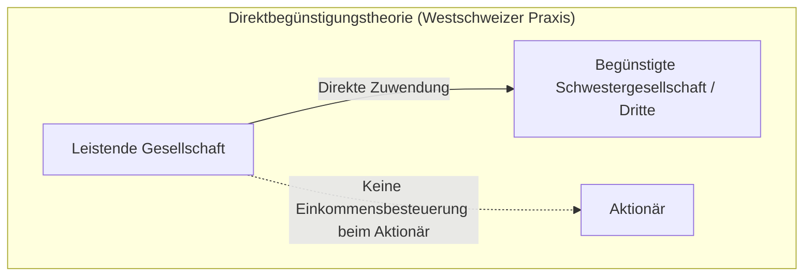

# Art. 20 DBG

## Gesetzeswortlaut



## Überblick und Bedeutung

Art. 20 DBG regelt die Besteuerung der **Erträge aus beweglichem Vermögen** natürlicher Personen bei der direkten Bundessteuer. Die Bestimmung konkretisiert die allgemeine Reinvermögenszugangstheorie (Art. 16 Abs. 1 DBG) und bildet das Gegenstück zum Grundsatz der Steuerfreiheit privater Kapitalgewinne gemäss Art. 16 Abs. 3 DBG. Während Wertsteigerungen von privaten Vermögenswerten (z.B. Kursgewinne beim Verkauf von Aktien oder Obligationen) steuerfrei anfallen, unterliegt jede Fruchtziehung aus dem Vermögensstamm (Zinsen, Dividenden, geldwerte Vorteile, Nutzungsentgelte) der Einkommenssteuer.

### Gesetzgeberische Konzeption und Reformgeschichte

Der Gesetzgeber konzipierte Art. 20 DBG als umfassenden Auffang- und Zurechnungstatbestand für mobile Vermögenserträge. Um Steuerumgehungsgestaltungen und die Umwandlung steuerbaren Ertrags in steuerfreie Kapitalgewinne zu unterbinden, wurde die Norm im Zuge mehrerer Revisionen schrittweise verfeinert:
1. **Stabilisierungsprogramm 1998 (in Kraft seit 1. Januar 2001; [BBl 1999 4](https://fedlex.data.admin.ch/eli/fga/1999/1_4__)):** Einführung der Kriterien für die steuerfreie Auszahlung rückkaufsfähiger Kapitalversicherungen mit Einmalprämie (Abs. 1 lit. a Satz 2 und 3: vollendetes 60. Altersjahr, mindestens fünfjährige Laufzeit, Begründung vor Vollendung des 66. Altersjahres).
2. **Unternehmenssteuerreform II (in Kraft seit 1. Januar 2009 bzw. 2011; [BBl 2005 4733](https://fedlex.data.admin.ch/eli/fga/2005/737)):** Einführung des **Teilbesteuerungsverfahrens** für Dividenden aus qualifizierten Beteiligungen von mindestens 10 % (Abs. 1bis) zur Milderung der wirtschaftlichen Doppelbelastung von Gesellschaft und Inhaber sowie Ablösung des Nennwertprinzips durch das **Kapitaleinlageprinzip** (Abs. 3: steuerfreie Rückzahlung von Agien und Einlagen).
3. **Bundesgesetz über die Steuerreform und die AHV-Finanzierung (STAF; in Kraft seit 1. Januar 2020; [BBl 2018 2527](https://fedlex.data.admin.ch/eli/fga/2018/1042)):** Vereinheitlichung der Teilbesteuerung auf Stufe Bund auf 70 % (Abs. 1bis) sowie Einführung der Rückzahlungsbeschränkung für Reserven aus Kapitaleinlagen bei an einer Schweizer Börse kotierten Gesellschaften (sogenannte Pro-Rata-Regel, Abs. 4–7).
4. **Aktienrechtsreform 2020 (in Kraft seit 1. Januar 2023; [BBl 2017 399](https://fedlex.data.admin.ch/eli/fga/2017/112)):** Ergänzung von Abs. 8 zur Koordination von Einlagen und Rückzahlungen im Rahmen des obligationenrechtlichen Kapitalbands (Art. 653s ff. OR).

### Prüfschema: Erträge aus beweglichem Vermögen nach Art. 20 DBG

| Rang | Tatbestandsmerkmal | Gesetzliche Grundlage | Prüfungsrichtung / Abgrenzung | Leitentscheid |
|---|---|---|---|---|
| 1 | **Zinsen aus Guthaben** | Abs. 1 lit. a Satz 1 | Fälligkeit, Zuflussprinzip, Abgrenzung zum Darlehensstamm | [BGE 151 II 418 E. 5](https://entscheidsuche.ch/docs/CH_BGE/CH_BGE_004_BGE-151-II-418_2025.html) |
| 2 | **Kapitalversicherungen mit Einmalprämie** | Abs. 1 lit. a Satz 2 & 3 | Erlebensfall/Rückkauf; Privilegierung bei Vorsorgezweck (60. Altersjahr, 5 Jahre Laufzeit) | [BGE 135 II 183 E. 3.2](https://entscheidsuche.ch/docs/CH_BGE/CH_BGE_004_BGE-135-II-183_2009.html) |
| 3 | **Obligationen mit Einmalverzinsung (IUP)** | Abs. 1 lit. b | Global- und Diskontobligationen; Besteuerung der aufgelaufenen Zinskomponente | [BGE 131 I 409 E. 4.2](https://entscheidsuche.ch/docs/CH_BGE/CH_BGE_001_BGE-131-I-409_2005.html) |
| 4 | **Dividenden, Gewinnanteile & Gratisaktien** | Abs. 1 lit. c Satz 1 | Gewinnverwendungsbeschluss der Generalversammlung; Abgrenzung zum Erwerbseinkommen (Lohn) | [BGE 134 V 297 E. 2](https://entscheidsuche.ch/docs/CH_BGE/CH_BGE_007_BGE-134-V-297_2008.html) |
| 5 | **Rückkauf eigener Beteiligungsrechte** | Abs. 1 lit. c Satz 2 | Teilliquidationstatbestand; Differenz zwischen Rückkaufspreis und Nennwert/KER; 6-Jahres-Frist | [BGE 149 II 158 E. 3](https://entscheidsuche.ch/docs/CH_BGE/CH_BGE_004_BGE-149-II-158_2023.html) |
| 6 | **Geldwerte Vorteile & verdeckte Gewinnausschüttung** | Abs. 1 lit. c Satz 1 | Drittvergleich; Missverhältnis Leistung/Gegenleistung; Bereicherung des Aktionärs oder Nahestehenden | [BGE 138 II 57 E. 3](https://entscheidsuche.ch/docs/CH_BGE/CH_BGE_004_BGE-138-II-57_2012.html); [BGE 147 II 209 E. 3](https://entscheidsuche.ch/docs/CH_BGE/CH_BGE_004_BGE-147-II-209_2021.html) |
| 7 | **Nutzung beweglicher Sachen und Rechte** | Abs. 1 lit. d | Miete, Pacht, Nutzniessung; Entgelt für Gebrauchsüberlassung | [BGE 131 I 409 E. 4.1](https://entscheidsuche.ch/docs/CH_BGE/CH_BGE_001_BGE-131-I-409_2005.html) |
| 8 | **Kollektive Kapitalanlagen** | Abs. 1 lit. e | Ausschüttungs- und Thesaurierungserträge; Ausscheidung von direktem Grundbesitz | [BGE 151 II 418 E. 4 & 5](https://entscheidsuche.ch/docs/CH_BGE/CH_BGE_004_BGE-151-II-418_2025.html) |
| 9 | **Immaterielle Güter** | Abs. 1 lit. f | Lizenzgebühren, Urheberrechte, Patente im Privatvermögen | [BGE 131 I 409 E. 4.1](https://entscheidsuche.ch/docs/CH_BGE/CH_BGE_001_BGE-131-I-409_2005.html) |
| 10 | **Teilbesteuerungsverfahren** | Abs. 1bis | Qualifizierte Beteiligung von mind. 10 %; Entlastung auf 70 % Bemessungsgrundlage | [BGE 150 II 369 E. 3.2](https://entscheidsuche.ch/docs/CH_BGE/CH_BGE_004_BGE-150-II-369_2024.html) |
| 11 | **Erlös aus Bezugsrechten** | Abs. 2 | Steuerfreier privater Kapitalgewinn, sofern zum Privatvermögen gehörend | [BGE 131 I 409 E. 5.1](https://entscheidsuche.ch/docs/CH_BGE/CH_BGE_001_BGE-131-I-409_2005.html) |
| 12 | **Kapitaleinlageprinzip (KER)** | Abs. 3–8 | Steuerfreie Rückzahlung von Agien und Zuschüssen; gesonderter Ausweis in Handelsbilanz und Meldepflicht | [BGE 151 II 827 E. 5–8](https://entscheidsuche.ch/docs/CH_BGE/CH_BGE_004_BGE-151-II-827_2025.html); [BGE 140 II 353 E. 3](https://entscheidsuche.ch/docs/CH_BGE/CH_BGE_004_BGE-140-II-353_2014.html) |

---

## Kommentierung

### A. Zinsen aus Guthaben (Abs. 1 lit. a Satz 1)

Der Begriff des Guthabens umfasst sämtliche Forderungen auf Geldleistung unabhängig von ihrer rechtlichen Einkleidung (Bankeinlagen, Sparkonti, Darlehen, feste Vorschüsse, Kontokorrente, Schuldbriefe oder private Darlehensforderungen). Steuerbar ist der vertragliche oder gesetzliche Zins in voller Höhe.

Die Besteuerung folgt dem **Zuflussprinzip**: Die Einkunft gilt in dem Zeitpunkt als realisiert, in dem die steuerpflichtige Person einen festen Rechtsanspruch erwirbt und tatsächlich darüber verfügen kann (Gutschrift auf dem Konto, Auszahlung oder Verrechnung). Aufgelaufene, aber noch nicht fällige Zinsen (Marchzinsen) werden beim privaten Gläubiger im Zeitpunkt der Veräusserung der Forderung nicht als Ertrag besteuert, es sei denn, es handelt sich um strukturierte Produkte nach lit. b.

> **Leitsatz.** Zinsen aus Guthaben stellen im Zeitpunkt ihrer Fälligkeit und tatsächlichen Gutschrift vollumfänglich steuerbaren Ertrag dar; ein Verzicht auf vereinbarte Zinsen zugunsten einer nahestehenden Gesellschaft kann eine steuerbare Vorteilszuwendung darstellen.

---

### B. Rückkaufsfähige Kapitalversicherungen mit Einmalprämie (Abs. 1 lit. a Satz 2 & 3)

Kapitalversicherungen mit Einmalprämie verbinden einen Sparanteil mit einer minimalen Risikoabsicherung (Todesfall). Bei Ablauf der Versicherungsdauer (Erlebensfall) oder bei vorzeitigem Rückkauf schüttet die Gesellschaft die aufgelaufenen Sparerträge aus.

Das Gesetz unterscheidet strikt zwischen steuerbarer Vermögensanlage und steuerfreier Selbstvorsorge:
1. **Regelfall der Steuerbarkeit:** Die Differenz zwischen der ausbezahlten Versicherungsleistung und der einbezahlten Einmalprämie unterliegt der Einkommenssteuer nach Art. 20 Abs. 1 lit. a DBG.
2. **Steuerfreie Vorsorge (Ausnahmetatbestand):** Die Erträge sind einkommenssteuerfrei, wenn kumulativ drei Voraussetzungen erfüllt sind:
   - Die Auszahlung erfolgt nach dem **vollendeten 60. Altersjahr** der versicherten Person;
   - Das Vertragsverhältnis dauerte **mindestens fünf Jahre**;
   - Der Versicherungsvertrag wurde **vor Vollendung des 66. Altersjahres** begründet.

Wird der Vertrag vor Ablauf der fünfjährigen Laufzeit oder vor Erreichen des 60. Altersjahres zurückgekauft, entfällt das Vorsorgeprivileg rückwirkend für die gesamte Auszahlungssumme.

#### Grenzkasuistik: Rückkauf einer Leibrentenversicherung ([BGE 135 II 183](https://entscheidsuche.ch/docs/CH_BGE/CH_BGE_004_BGE-135-II-183_2009.html))

* **Sachverhalt:** Ein Steuerpflichtiger schloss im Rahmen der ungebundenen Selbstvorsorge (Säule 3b) eine aufgeschobene Leibrentenversicherung («Zeitrente») mit Einmalprämie ab. Vor Fälligkeit der ersten Rentenzahlung kaufte er die Versicherung zurück und liess sich den Rückkaufswert von rund CHF 420'000 auszahlen. Die Steuerbehörde besteuerte den Rückkaufswert unter Abzug der Prämie nach Art. 20 Abs. 1 lit. a DBG als steuerbaren Vermögensertrag. Der Steuerpflichtige berief sich auf Art. 22 Abs. 3 DBG (Pauschalbesteuerung von Leibrenten zu 40 %).
* **Erwägung des Bundesgerichts:** Das Bundesgericht verwarf die 40-%-Besteuerung. Eine Kapitalabfindung aus dem vorzeitigen Rückkauf einer Leibrente vor Rentenbeginn stellt keine periodische Rentenleistung dar. Da die Auszahlung vor Vollendung des 60. Altersjahres stattfand, griff die Vorsorgebefreiung gemäss Art. 20 Abs. 1 lit. a Satz 2 DBG nicht. Der Ertragsanteil unterlag in voller Höhe der Einkommenssteuer ([E. 3.2–3.4](https://entscheidsuche.ch/docs/CH_BGE/CH_BGE_004_BGE-135-II-183_2009.html)).

---

### C. Obligationen mit überwiegender Einmalverzinsung (IUP) (Abs. 1 lit. b)

Bei klassischen Anleihen erfolgt die Entlöhnung des Kapitals über periodische Jahreszinsen (Coupon). Bei globalverzinslichen Obligationen, Zerobonds (Nullcouponanleihen) oder Diskontobligationen wird der Zins ganz oder überwiegend bei Fälligkeit bzw. Rückzahlung in einem Betrag vergütet (sogenannte **IUP-Produkte**; *interest underrepresented periodically*).

Ohne Sonderregelung könnte eine Anlegerin solche Papiere kurz vor Fälligkeit verkaufen und den Zinsbestandteil als steuerfreien privaten Kapitalgewinn (Art. 16 Abs. 3 DBG) deklarieren. Art. 20 Abs. 1 lit. b DBG durchbricht dies: Steuerbar ist bei Veräusserung oder Rückzahlung die rechnerisch aufgelaufene Einmalverzinsung (*marché secondaire* gemäss Kreisschreiben Nr. 15 der ESTV).

#### Grenzkasuistik: Abgrenzung Ertrag vs. Kursgewinn ([BGE 131 I 409](https://entscheidsuche.ch/docs/CH_BGE/CH_BGE_001_BGE-131-I-409_2005.html))

* **Sachverhalt:** Ein Anleger veräusserte strukturierte Finanzinstrumente mit einer garantierten Minimalrendite und einer variablen Optionskomponente. Die kantonale Steuerverwaltung rechnete den gesamten Mehrerlös gegenüber dem Erwerbspreis als Vermögensertrag auf.
* **Erwägung des Bundesgerichts:** Das Bundesgericht stellte klar, dass bei kombinierten Produkten eine strikte Aufspaltung vorzunehmen ist: Der im Voraus kalkulierbare Emissionsdiskont bzw. die Einmalverzinsung unterliegt nach Art. 20 Abs. 1 lit. b DBG der Einkommenssteuer; Wertschwankungen, die auf marktbedingten Zinsänderungen oder Währungskursveränderungen beruhen, stellen demgegenüber steuerfreie Kapitalgewinne nach Art. 16 Abs. 3 DBG dar ([E. 4.2–4.5](https://entscheidsuche.ch/docs/CH_BGE/CH_BGE_001_BGE-131-I-409_2005.html)).

---

### D. Dividenden, Gewinnanteile und Gratisaktien (Abs. 1 lit. c Satz 1)

Steuerbar sind alle ordentlichen und ausserordentlichen Dividenden, Liquidationserlöse sowie die Ausgabe von Gratisaktien oder Gratisnennwerterhöhungen durch Verrechnung mit frei verfügbaren Reserven der Gesellschaft. 

#### Abgrenzung: Dividende vs. massgebender AHV-Lohn ([BGE 134 V 297](https://entscheidsuche.ch/docs/CH_BGE/CH_BGE_007_BGE-134-V-297_2008.html))

In inhabergeführten Aktiengesellschaften neigen Aktionärs-Geschäftsführer dazu, sich einen sehr tiefen Lohn auszuzahlen und Gewinne primär als Dividende auszuschütten, um AHV-Beiträge zu sparen und von der Teilbesteuerung (Abs. 1bis) zu profitieren.

* **Sachverhalt:** Der alleinige Aktionär und Geschäftsführer einer Handels-AG bezog einen Jahreslohn von bloss CHF 36'000, liess sich jedoch eine Dividende von CHF 300'000 ausrichten. Die Ausgleichskasse rechnete einen Teil der Dividende in massgebenden Lohn um und verlangte AHV-Beiträge nach.
* **Erwägung des Bundesgerichts:** Das Bundesgericht hielt fest, dass Dividenden sozialversicherungsrechtlich als Arbeitsentgelt umqualifiziert werden können, wenn ein offensichtliches Missverhältnis zwischen Arbeitsleistung und Lohn vorliegt und die Dividende eine angemessene Eigenkapitalverzinsung (massgebend ist die SNB-Rendite zuzüglich Zuschlag) übersteigt. Die steuerrechtliche Qualifikation nach Art. 20 Abs. 1 lit. c DBG bindet die Ausgleichskassen nicht ([E. 2.2–2.5](https://entscheidsuche.ch/docs/CH_BGE/CH_BGE_007_BGE-134-V-297_2008.html)).

---

### E. Rückkauf eigener Beteiligungsrechte und Teilliquidation (Abs. 1 lit. c Satz 2)

Kauft eine Aktiengesellschaft eigene Beteiligungsrechte (Aktien, Stammanteile) von ihren Aktionären zurück, liegt gesellschaftsrechtlich ein Rechtsgeschäft eigener Art vor (Art. 659 OR). Steuerrechtlich behandelt Art. 20 Abs. 1 lit. c Satz 2 DBG den Vorgang als **Teilliquidation**:
1. Der Differenzbetrag zwischen dem Rückkaufspreis und dem Nennwert (zuzüglich allfälliger Reserven aus Kapitaleinlagen) stellt für den veräussernden Aktionär steuerbaren Liquidationsüberschuss dar.
2. **Realisationszeitpunkt:** Der Liquidationsüberschuss gilt in dem Jahr als realisiert, in dem die Verrechnungssteuerforderung entsteht (Art. 12 Abs. 1 und 1bis VStG i.V.m. Art. 4a VStG):
   - bei Rückkauf zwecks Kapitalherabsetzung: im Zeitpunkt des Herabsetzungsbeschlusses;
   - bei Rückkauf ohne Herabsetzungsabsicht: mit Ablauf der sechsjährigen Veräusserungsfrist nach Art. 4a Abs. 1 VStG.

#### Grenzkasuistik: Teilliquidation vs. steuerfreier Kapitalgewinn ([BGE 149 II 158](https://entscheidsuche.ch/docs/CH_BGE/CH_BGE_004_BGE-149-II-158_2023.html))

* **Sachverhalt:** Der Alleinaktionär A. verkaufte der von ihm beherrschten X. AG ein Aktienpaket von 2'000 eigenen Namenaktien zum Preis von CHF 1'200 pro Aktie (Nennwert CHF 100). A. deklarierte den gesamten Erlös von CHF 2.4 Mio. als steuerfreien privaten Kapitalgewinn nach Art. 16 Abs. 3 DBG. Die X. AG behielt die Aktien über sechs Jahre in ihren Büchern und vernichtete sie anschliessend im Rahmen einer Kapitalherabsetzung. Die kantonale Steuerverwaltung rechnete A. für das Steuerjahr des Ablaufs der Sechsjahresfrist einen Liquidationsüberschuss von CHF 2.2 Mio. auf.
* **Erwägung des Bundesgerichts:** Das Bundesgericht wies die Beschwerde des Aktionärs ab. Der Rückkauf eigener Aktien durch die emittierende Gesellschaft stellt keine steuerfreie Veräusserung an einen Dritten dar. Mit dem Ablauf der Verwahrungsfrist von sechs Jahren gemäss Art. 4a Abs. 1 VStG entsteht die Verrechnungssteuerforderung unwiderruflich; zeitgleich realisiert der veräussernde Aktionär den Liquidationsüberschuss nach Art. 20 Abs. 1 lit. c Satz 2 DBG als steuerbaren Vermögensertrag ([E. 3.2 und 4.1](https://entscheidsuche.ch/docs/CH_BGE/CH_BGE_004_BGE-149-II-158_2023.html)).

---

### F. Geldwerte Vorteile und verdeckte Gewinnausschüttung (Abs. 1 lit. c Satz 1)

Der Tatbestand der **geldwerten Vorteile** erfasst jede Leistung einer Kapitalgesellschaft an ihre Anteilsinhaber oder diesen nahestehende Personen, die sie einem unabhängigen Dritten unter gleichen Bedingungen nicht erbracht hätte (**Fremdvergleichsprinzip / Dealing at arm's length**).

Eine verdeckte Gewinnausschüttung setzt nach gefestigter Praxis drei Elemente voraus ([BGE 147 II 209 E. 3.1.1](https://entscheidsuche.ch/docs/CH_BGE/CH_BGE_004_BGE-147-II-209_2021.html); [BGE 138 II 57 E. 2.1](https://entscheidsuche.ch/docs/CH_BGE/CH_BGE_004_BGE-138-II-57_2012.html)):
1. Die Gesellschaft erbringt eine Leistung ohne angemessene wirtschaftliche Gegenleistung;
2. Die Zuwendung begünstigt direkt oder indirekt eine Anteilsinhaberin oder eine dieser nahestehende Person;
3. Die Leistung wäre einem unabhängigen Dritten nicht oder nicht im selben Umfang gewährt worden (Erkennbarkeit des Missverhältnisses für die handelnden Organe).

#### 1. Simuliertes Darlehen an den Aktionär

Gewährt die Gesellschaft ihrem Aktionär ein Darlehen, prüft die Praxis, ob ein echtes Darlehen oder eine simulierte Ausschüttung vorliegt. Ausschlaggebend ist das Fehlen von Rückzahlungswille und Rückzahlungsfähigkeit (*animus solvendi*):

| Kriterium | Echtes Darlehen (steuerneutral) | Simuliertes Darlehen (verdeckte Gewinnausschüttung) |
|---|---|---|
| **Vertrag & Bedingungen** | Schriftlicher Darlehensvertrag, feste Laufzeit, marktübliche Kündigungsfristen | Kein Vertrag, mündliche Absprache, unbefristet, fehlende Rückzahlungsmodalitäten |
| **Sicherheiten** | Realsicherheiten (Schuldbriefe, Faustpfänder) oder werthaltige Bürgschaften | Völlig ungesichert trotz beträchtlicher Darlehenssumme |
| **Verzinsung** | Tatsächliche periodische Zahlung gemäss ESTV-Rundschreiben | Zinslos oder Zinsen werden lediglich buchmässig zur Darlehensschuld geschlagen |
| **Amortisation** | Einhaltung vereinbarter Rückzahlungsraten | Keine Tilgung über Jahre hinweg; Darlehensstand wächst kontinuierlich an |
| **Bonität des Schuldners** | Schuldner verfügt über ausreichendes freies Einkommen/Vermögen zur Tilgung | Schuldner ist überschuldet oder verfügt über kein pfändbares Vermögen |

#### 2. Das simulierte Darlehen zwischen Schwestergesellschaften ([BGE 138 II 57](https://entscheidsuche.ch/docs/CH_BGE/CH_BGE_004_BGE-138-II-57_2012.html))

* **Sachverhalt:** Der Alleinaktionär X. beherrschte die A. AG und die B. AG. Die A. AG überwies der finanziell notleidenden B. AG über mehrere Jahre Darlehensbeträge von insgesamt CHF 1.5 Mio., ohne schriftlichen Vertrag, ohne Zinsen und ohne Sicherheiten. Die Mittel dienten der Verlustabdeckung der B. AG, welche wenig später in Konkurs fiel. Die Steuerbehörde qualifizierte die Zahlungen als verdeckte Gewinnausschüttung der A. AG an den Aktionär X. und rechnete ihm den Betrag nach Art. 20 Abs. 1 lit. c DBG als steuerbaren Beteiligungsertrag auf.
* **Erwägung des Bundesgerichts:** Das Bundesgericht schützte die Aufrechnung. Gewährt eine Gesellschaft einer Schwestergesellschaft Mittel, die ein vorsichtiger Geschäftsleiter einem fremden Dritten niemals überlassen hätte, liegt der Grund der Zuwendung ausschliesslich im gemeinsamen Beherrschungsverhältnis. Die Leistung ist wirtschaftlich dem beherrschenden Aktionär zuzuordnen ([BGE 138 II 57 E. 3–5](https://entscheidsuche.ch/docs/CH_BGE/CH_BGE_004_BGE-138-II-57_2012.html)).

#### 3. Echter Judikaturwiderspruch: Dreieckstheorie vs. Direktbegünstigungstheorie

Erfolgt eine Vorteilszuwendung nicht an den Aktionär selbst, sondern an eine nahestehende Person oder Schwestergesellschaft, kollidieren zwei gegensätzliche Zurechnungskonzepte:

* **Die Dreieckstheorie (Deutschschweizer Praxis & Bundesgericht):**  
  Die Leistung wird gedanklich als Ausschüttung an den beherrschenden Aktionär und anschliessende Einlage durch diesen in die Schwestergesellschaft behandelt. Folge: Der Vermögenswert unterliegt beim Aktionär vollumfänglich der Einkommenssteuer nach Art. 20 Abs. 1 lit. c DBG ([BGE 138 II 57 E. 5.1](https://entscheidsuche.ch/docs/CH_BGE/CH_BGE_004_BGE-138-II-57_2012.html); [BGE 140 II 88 E. 4.1](https://entscheidsuche.ch/docs/CH_BGE/CH_BGE_004_BGE-140-II-88_2014.html)).
* **Die Direktbegünstigungstheorie (Westschweizer Praxis / Kantone VD, GE):**  
  Die Westschweizer Behörden und Gerichte verneinten traditionell eine Besteuerung beim Aktionär, solange diesem die Mittel nicht physisch zugeflossen sind; besteuert wird allein die begünstigte Schwestergesellschaft (Gewinnsteuer bzw. Schenkungssteuer).
* **Bedeutung für die Praxis:** Das Bundesgericht hat im Bereich der direkten Bundessteuer und des Verrechnungssteuerrechts der Dreieckstheorie den Vorrang eingeräumt. In rein kantonalen Sachverhalten halten jedoch Teile der Lehre und Westschweizer Praxis die Besteuerung eines fiktiven Zuflusses beim Anteilsinhaber nach wie vor für dogmatisch verfehlt, weil dem Aktionär keine tatsächliche wirtschaftliche Verfügungsmacht zukommt.

> **Leitsatz.** Bei geldwerten Vorteilen zwischen Schwestergesellschaften gilt bei der direkten Bundessteuer die Dreieckstheorie: Die Zuwendung wird als verdeckte Gewinnausschüttung beim gemeinsamen Aktionär besteuert, selbst wenn diesem die Mittel nie direkt ausbezahlt wurden.

---

### G. Nutzung beweglicher Sachen und Rechte (Abs. 1 lit. d)

Unter Art. 20 Abs. 1 lit. d DBG fallen Entgelte für die Überlassung beweglicher körperlicher Sachen (z.B. Vermietung von Fahrzeugen, Booten, Kunstgegenständen, Maschinen des Privatvermögens) oder nutzbarer Rechte (Nutzniessung an Wertschriften oder Forderungen). 

Wird ein Nutzungsrecht unentgeltlich eingeräumt, kann beim Begünstigten ein steuerbarer Naturalertrag nach Art. 16 Abs. 2 DBG vorliegen; die entgeltliche Veräusserung des Stammrechts stellt demgegenüber bei Privatvermögen einen Kapitalgewinn dar ([BGE 131 I 409 E. 4.1](https://entscheidsuche.ch/docs/CH_BGE/CH_BGE_001_BGE-131-I-409_2005.html)).

---

### H. Kollektive Kapitalanlagen (Abs. 1 lit. e)

Einkünfte aus Anteilen an kollektiven Kapitalanlagen (vertragliche Anlagefonds, SICAV, SICAF, Kommanditgesellschaften für kollektive Kapitalanlagen nach KAG) unterliegen grundsätzlich der Einkommenssteuer beim Anleger. Das schweizerische Steuerrecht wendet hierbei das **Transparenzprinzip** an: Der Fonds gilt steuerlich als Durchlaufstation; die Erträge werden direkt den Anteilsinhabern zugerechnet.

* **Ausnahme für direkten Grundbesitz:** Erträge, die der kollektiven Kapitalanlage aus direktem Grundbesitz im Sinne von Art. 9 Abs. 1 KAG zufliessen, sind auf Stufe des Fonds selbst steuerpflichtig (Art. 49 Abs. 2 DBG). Beim Anteilsinhaber sind sie zur Vermeidung einer Doppelbelastung steuerfrei (Abs. 1 lit. e Halbsatz 2).
* **Zurechnungszeitpunkt bei Thesaurierungsfonds ([BGE 151 II 418](https://entscheidsuche.ch/docs/CH_BGE/CH_BGE_004_BGE-151-II-418_2025.html)):**  
  Schüttet ein Fonds seine Erträge nicht aus, sondern thesauriert er diese, stellte sich die Frage nach dem steuerlichen Zufluss. Im Leitentscheid BGE 151 II 418 entschied das Bundesgericht: Die Erträge eines ausländischen Thesaurierungsfonds (Art. 119 KAG) fallen unter Art. 20 Abs. 1 lit. e DBG und werden dem Schweizer Anleger im Zeitpunkt des Geschäftsabschlusses des Fonds einmal jährlich verbindlich als Ertrag zugerechnet ([E. 5.1–5.3](https://entscheidsuche.ch/docs/CH_BGE/CH_BGE_004_BGE-151-II-418_2025.html)).

---

### I. Immaterielle Güter (Abs. 1 lit. f)

Steuerbar sind Entgelte für die Verwertung oder Einräumung von Rechten an immateriellen Gütern des Privatvermögens (Lizenzgebühren für Urheberrechte, Patente, Marken, Muster oder Know-how). 

Wird das Immaterialgut selbst veräussert, liegt ein steuerfreier privater Kapitalgewinn vor; wiederkehrende Lizenzgebühren stellen demgegenüber dauerhaften Vermögensertrag dar.

---

### J. Teilbesteuerungsverfahren bei qualifizierten Beteiligungen (Abs. 1bis)

Um die wirtschaftliche Doppelbelastung (Gewinnsteuer auf Stufe Gesellschaft und Einkommenssteuer auf Stufe Aktionär) abzumildern, sieht Art. 20 Abs. 1bis DBG das **Teilbesteuerungsverfahren** vor.

Voraussetzungen:
1. **Qualifikationsschwelle:** Die Beteiligungsrechte (Aktien, GmbH-Stammanteile, Genossenschaftsanteile, Partizipationsscheine) müssen **mindestens 10 %** des Grund- oder Stammkapitals der Gesellschaft ausmachen.
2. **Rechtsfolge:** Dividenden, Liquidationsüberschüsse und geldwerte Vorteile sind im Umfang von **70 %** steuerbar (bis Ende 2019: 60 %).
3. **Erfassung verdeckter Gewinnausschüttungen:** Das Teilbesteuerungsprivileg greift nach ständiger Praxis auch bei geldwerten Vorteilen und simulierten Darlehen, sofern die 10-%-Schwelle erfüllt ist ([BGE 150 II 369 E. 3.2](https://entscheidsuche.ch/docs/CH_BGE/CH_BGE_004_BGE-150-II-369_2024.html)).

---

### K. Erlös aus Bezugsrechten im Privatvermögen (Abs. 2)

Werden einem Aktionär Bezugsrechte zur Zeichnung neuer Aktien eingeräumt und veräussert er diese an der Börse oder an Dritte, gilt der Erlös nach Art. 20 Abs. 2 DBG **nicht als Vermögensertrag**, sofern die Aktien zu seinem Privatvermögen gehören. Der Erlös teilt das Schicksal der Beteiligung und ist als steuerfreier privater Kapitalgewinn nach Art. 16 Abs. 3 DBG privilegiert ([BGE 131 I 409 E. 5.1](https://entscheidsuche.ch/docs/CH_BGE/CH_BGE_001_BGE-131-I-409_2005.html)).

---

### L. Das Kapitaleinlageprinzip (Abs. 3 bis 8)

Mit der Unternehmenssteuerreform II ersetzte der Bundesgesetzgeber das althergebrachte Nennwertprinzip durch das **Kapitaleinlageprinzip (KER)**: Die Rückzahlung von Einlagen, Aufgeldern (Agien) und Zuschüssen, die von den Anteilsinhabern nach dem 31. Dezember 1996 geleistet worden sind, wird steuerlich gleich behandelt wie die Rückzahlung von Grund- oder Stammkapital — sie ist beim privaten Aktionär **vollständig einkommenssteuerfrei** (Art. 20 Abs. 3 DBG) und unterliegt nicht der Verrechnungssteuer (Art. 5 Abs. 1bis VStG).

#### Formelle und materielle Voraussetzungen ([BGE 151 II 827](https://entscheidsuche.ch/docs/CH_BGE/CH_BGE_004_BGE-151-II-827_2025.html); [BGE 140 II 353](https://entscheidsuche.ch/docs/CH_BGE/CH_BGE_004_BGE-140-II-353_2014.html))

Die steuerfreie Rückzahlung verlangt kumulativ:
1. **Echte Einlage des Anteilsinhabers:** Eine offene oder verdeckte Einlage, die das handelsrechtliche Eigenkapital vermehrt hat (z.B. Barzuschuss, Sacheinlage, Agio, Vermächtnis des Aktionärs);
2. **Gesonderter Ausweis in der Handelsbilanz:** Die Reserven aus Kapitaleinlagen müssen vor der Rückzahlung in der handelsrechtskonformen Bilanz auf einem gesonderten Konto ausgewiesen sein ([BGE 151 II 827 E. 5 und 7](https://entscheidsuche.ch/docs/CH_BGE/CH_BGE_004_BGE-151-II-827_2025.html));
3. **Meldung an die ESTV:** Die Gesellschaft muss die Kapitaleinlagereserven mit dem amtlichen Formular fristgerecht der Eidgenössischen Steuerverwaltung gemeldet haben ([BGE 151 II 827 E. 9](https://entscheidsuche.ch/docs/CH_BGE/CH_BGE_004_BGE-151-II-827_2025.html)).

#### Judikaturwiderspruch: Zeitnahe Verbuchung bei offenen vs. verdeckten Einlagen

Ein langjähriger Streitpunkt zwischen der ESTV und der Doktrin betraf die Frage, ob eine Kapitaleinlage zwingend im Entstehungsjahr verbucht werden muss, um das KER-Privileg zu wahren:
* Die ESTV vertrat unter Berufung auf ihr Kreisschreiben Nr. 29c die Auffassung, Einlagen, die im Zeitpunkt der Leistung nicht sofort auf dem Sonderkonto erfasst wurden, verlören das Privileg endgültig.
* Im Grundsatzurteil **[BGE 151 II 827 E. 8](https://entscheidsuche.ch/docs/CH_BGE/CH_BGE_004_BGE-151-II-827_2025.html)** verwarf das Bundesgericht diese rigide Verwaltungspraxis für offene Kapitaleinlagen: Das Gesetz verlangt den gesonderten Ausweis erst im Zeitpunkt der Rückzahlung; eine umgehende Verbuchung im Entstehungsjahr ist keine gesetzliche Gültigkeitsvoraussetzung.

#### Die Pro-Rata-Regel bei kotierten Gesellschaften (Abs. 4 bis 7)

Mit der STAF-Revision 2018 schob der Gesetzgeber der vollständigen steuerfreien Ausschüttungspolitik börsenkotierter Gesellschaften einen Riegel vor: Schüttet eine an einer Schweizer Börse kotierte Gesellschaft KER aus, muss sie im gleichen Umfang übrige (steuerbare) Reserven ausschütten (50/50-Regel). Unterlässt sie dies, wird die Rückzahlung zur Hälfte als steuerbare Dividende qualifiziert (Abs. 4).

---

## Kantonale Praxisfragen

### 1. Steuerlicher Safe-Harbour bei Zinssätzen für Aktionärsdarlehen

In der Praxis prüfen kantonale Veranlagungsbehörden (z.B. Zürich, Bern, St. Gallen) die Verzinsung von Forderungen zwischen Gesellschaft und Beteiligten anhand des jährlichen ESTV-Rundschreibens «Steuerlich anerkannte Zinssätze»:
* **Zu tiefer Zins der Gesellschaft an den Aktionär:** Gewährt die Gesellschaft dem Anteilsinhaber ein Darlehen und verlangt sie weniger als den Mindestzinssatz der ESTV, wird die Differenz als geldwerter Vorteil aufgerechnet.
* **Gegenbeweis des Drittvergleichs:** Das Zürcher Steuerrekursgericht hält fest, dass die ESTV-Zinssätze blosse *Safe-Harbour-Regeln* (Widerlegbare Vermutungen) darstellen. Der Aktionär kann die Aufrechnung abwenden, wenn er substanziiert nachweist, dass ein unabhängiger Dritter (z.B. eine Bank) unter denselben Sicherheiten und Marktbedingungen denselben tieferen Zins gewährt hätte ([ZH StRG 2 DB.2023.45 vom 18.06.2024](https://entscheidsuche.ch)).

### 2. Nachweis und Anerkennung von Kapitaleinlagereserven bei Umstrukturierungen

Bei interkantonalen Fusionen oder Sitzverlegungen verweigern kantonale Steuerämter mitunter die Anerkennung von Kapitaleinlagereserven, wenn die Übertragung nicht von der Vorinstanz rechtskräftig bestätigt wurde:
* Die Praxis des Bundesgerichts verlangt einen lückenlosen urkundlichen Nachweis der Entstehung der Einlage seit 1997. Fehlen Gründungs- oder Kapitalerhöhungsbelege, gilt die Vermutung steuerbarer Gewinnreserven ([BGE 140 II 353 E. 4.2](https://entscheidsuche.ch/docs/CH_BGE/CH_BGE_004_BGE-140-II-353_2014.html)).

---

## Praxishinweise

**Für die steuerpflichtige Person und die Steuerberatung:**

1. Bei Darlehen zwischen Gesellschaft und Anteilsinhabern zwingend vorab einen schriftlichen Darlehensvertrag aufsetzen, Marktverzinsung gemäss ESTV-Rundschreiben vereinbaren, Rückzahlungsfristen stipulieren und werthaltige Sicherheiten stellen; ungesicherte, zinslose und nicht amortisierte Kontokorrente werden als simulierte Darlehen besteuert ([BGE 138 II 57 E. 3](https://entscheidsuche.ch/docs/CH_BGE/CH_BGE_004_BGE-138-II-57_2012.html)).
2. Rückkaufsfähige Kapitalversicherungen mit Einmalprämie (Säule 3b) niemals vor Vollendung des 60. Altersjahres oder vor Ablauf der fünfjährigen Haltedauer zurückkaufen, da ansonsten das gesamte Vorsorgeprivileg nach Art. 20 Abs. 1 lit. a Satz 2 DBG rückwirkend erlischt ([BGE 135 II 183 E. 3.2](https://entscheidsuche.ch/docs/CH_BGE/CH_BGE_004_BGE-135-II-183_2009.html)).
3. Eigene Aktien, die von der Gesellschaft zurückgekauft wurden, vor Ablauf der sechsjährigen Verwahrungsfrist veräussern oder herabsetzen; mit Fristablauf entsteht zwingend die Teilliquidation mit Steuerpflicht beim Anteilsinhaber ([BGE 149 II 158 E. 4](https://entscheidsuche.ch/docs/CH_BGE/CH_BGE_004_BGE-149-II-158_2023.html)).
4. Bei Einlagen und Zuschüssen in das Eigenkapital der Gesellschaft (Agio, Sanierungszuschüsse) darauf achten, dass diese in der Handelsbilanz auf dem Sonderkonto «Reserven aus Kapitaleinlagen» geführt und der ESTV formell gemeldet werden, um künftige steuerfreie Rückzahlungen nach Art. 20 Abs. 3 DBG zu sichern ([BGE 151 II 827 E. 5](https://entscheidsuche.ch/docs/CH_BGE/CH_BGE_004_BGE-151-II-827_2025.html)).
5. Inhaberinnen und Inhaber qualifizierter Beteiligungen (ab 10 %) müssen verdeckte Gewinnausschüttungen im Steuerverfahren stets hilfsweise unter dem Teilbesteuerungssatz (70 %) geltend machen ([BGE 150 II 369 E. 3.2](https://entscheidsuche.ch/docs/CH_BGE/CH_BGE_004_BGE-150-II-369_2024.html)).

**Für die Veranlagungsbehörde:**

1. Bei Dividenden von Inhaber-Geschäftsführern stets den Drittvergleich zur Lohnsumme prüfen; krasse Missverhältnisse (z.B. Tiefstlohn bei Höchstdividenden) sind für die AHV-Beitragspflicht an die Ausgleichskassen zu melden ([BGE 134 V 297 E. 2.4](https://entscheidsuche.ch/docs/CH_BGE/CH_BGE_007_BGE-134-V-297_2008.html)).
2. Vor der Aufrechnung fiktiver Zinsen auf Aktionärsdarlehen dem Steuerpflichtigen Gelegenheit geben, ungünstigere Marktverhältnisse nachzuweisen; die ESTV-Zinssätze sind Safe-Harbour-Regeln, keine starren Normen.
3. Bei der Überprüfung von Kapitaleinlagereserven (KER) nicht schematisch eine Verbuchung im Entstehungsjahr verlangen; massgebend ist der handelskonforme Ausweis und die Meldung vor der Rückzahlung ([BGE 151 II 827 E. 8](https://entscheidsuche.ch/docs/CH_BGE/CH_BGE_004_BGE-151-II-827_2025.html)).
4. Bei Transaktionen zwischen Schwestergesellschaften die Dreieckstheorie konsequent anwenden und geldwerte Leistungen beim gemeinsamen Aktionär als Beteiligungsertrag erfassen ([BGE 138 II 57 E. 5.1](https://entscheidsuche.ch/docs/CH_BGE/CH_BGE_004_BGE-138-II-57_2012.html)).

---

## Literatur

* **Basler Kommentar zum Schweizerischen Steuerrecht (DBG)**, Martin Zweifel / Michael Beusch (Hrsg.), 4. Aufl., Basel 2022, Art. 20 DBG.
* **Peter Locher**, Kommentar zum Bundesgesetz über die direkte Bundessteuer, I. Teil, 2. Aufl., Basel 2019, Art. 20 DBG.
* **Markus Reich**, Steuerrecht, 3. Aufl., Zürich 2020, § 13 (Einkünfte aus Vermögen).
* **Maja Bauer-Balmelli**, Die verdeckte Gewinnausschüttung im schweizerischen Steuerrecht, Zürich 2001.
* **Michael Bertschinger / Florian Regli**, Massgeblichkeit der handelsrechtlichen Bücher im schweizerischen Steuerrecht, in: FStR 2021/4, S. 280 ff.
* **ESTV**, Kreisschreiben Nr. 15 vom 7. Februar 2007: Besteuerung von Obligationen mit Einmalverzinsung.
* **ESTV**, Kreisschreiben Nr. 29c vom 23. Dezember 2022: Kapitaleinlageprinzip.
