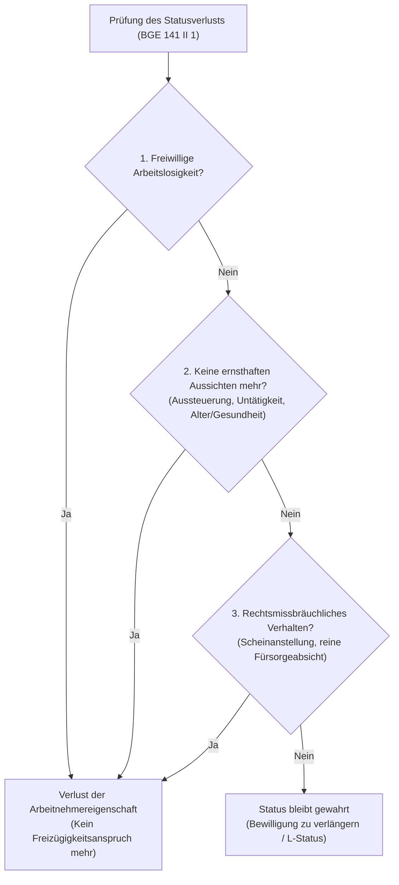



### Überblick und Bedeutung {#ueberblick-und-bedeutung}

Art. 6 Anhang I des Freizügigkeitsabkommens (FZA; SR 0.142.112.681) ist die operative Kernbestimmung für die Ausübung der unselbständigen Erwerbstätigkeit und das damit verbundene Aufenthaltsrecht von Staatsangehörigen der EU- und EFTA-Mitgliedstaaten in der Schweiz. Während Art. 4 FZA das Aufenthalts- und Erwerbsrecht im Grundsatz statuiert, regelt Art. 6 Anhang I FZA die Modalitäten: den Rechtsanspruch auf Erteilung und Verlängerung der Aufenthaltsbewilligung EU/EFTA (B-EG/EFTA bei Arbeitsverträgen von mindestens einem Jahr, Abs. 1) und der Kurzaufenthaltsbewilligung (L-EG/EFTA bei Arbeitsverträgen von mehr als drei Monaten bis zu einem Jahr, Abs. 2), die Bewilligungsfreiheit für Kurzzeitbeschäftigungen bis zu drei Monaten (Abs. 2 Unterabs. 2), die abschliessend zulässigen Einreichungsunterlagen (Abs. 3) sowie den Schutz vor Entzug bei vorübergehender Arbeitsunfähigkeit oder unfreiwilliger Arbeitslosigkeit (Abs. 6).

Historisch und teleologisch wurzelt die Bestimmung in den Verhandlungen zu den bilateralen sektoriellen Abkommen I von 1999. Wie der Bundesrat in seiner Botschaft darlegte ([BBl 1999 6128](https://fedlex.data.admin.ch/eli/fga/1999/1_6128_5440_5092), S. 6140 f., 6318 f.), bezweckte die Schweiz mit dem FZA die schrittweise Einführung der Personenfreizügigkeit auf der Grundlage des Prinzips der Nichtdiskriminierung (Art. 2 FZA) und der Angleichung an das sekundäre Unionsrecht (insbesondere die damalige Richtlinie 68/360/EWG und die Verordnung [EWG] Nr. 1612/68). Ziel des Abkommens war es, den gegenseitigen Arbeitsmarktzugang zu öffnen und den schweizerischen Unternehmen den rekrutierungsseitigen Zugang zu Fachkräften aus dem EU-Raum zu erleichtern, während zugleich durch kontrollierte Übergangsfristen und flankierende Massnahmen Lohndumping und Missbräuche verhindert werden sollten ([BBl 1999 6128, S. 6133](https://fedlex.data.admin.ch/eli/fga/1999/1_6128_5440_5092)). 

Die rechtliche Tragweite von Art. 6 Anhang I FZA ist fundamental: Die erteilte Bewilligung hat nach ständiger Rechtsprechung rein **deklaratorische** Bedeutung ([BGE 136 II 329 E. 2.2](https://entscheidsuche.ch/docs/CH_BGE/CH_BGE_004_BGE-136-II-329_2010.html#consideration_2.2); [BGE 141 II 1 E. 2.2.1](https://entscheidsuche.ch/docs/CH_BGE/CH_BGE_004_BGE-141-II-1_2015.html#consideration_2.2.1)). Das Aufenthaltsrecht entsteht direkt kraft Staatsvertrags bei Erfüllung der Tatbestandsmerkmale und geht bei deren Wegfall ipso iure unter, ohne dass es eines konstitutiven Verwaltungsaktes bedarf. Der Ausländerausweis dient lediglich als polizeiliche Bestätigung eines bereits bestehenden Rechts. Umgekehrt bedeutet dies aber auch, dass bei einem Verlust der freizügigkeitsrechtlichen Arbeitnehmereigenschaft keine Vorbehalte nach Art. 5 Anhang I FZA (Gefährdung der öffentlichen Ordnung) geprüft werden müssen: Wo kein Freizügigkeitsanspruch mehr besteht, kann die Anwesenheit nach rein innerstaatlichem Ausländerrecht (AIG) beendet werden ([BGE 141 II 1 E. 2.2.1](https://entscheidsuche.ch/docs/CH_BGE/CH_BGE_004_BGE-141-II-1_2015.html#consideration_2.2.1)).

---

### Prüfschema: Freizügigkeitsrechtlicher Anspruch auf Aufenthalt als Arbeitnehmer {#pruefschema}

Die Voraussetzungen eines Aufenthaltsanspruchs nach Art. 6 Anhang I FZA sowie dessen Fortbestehen sind in folgender Reihenfolge zu prüfen:

| Prüfschritt | Merkmal / Norm | Dogmatische Voraussetzung | Beweislast / Beweismass |
|---|---|---|---|
| **1. Geltungsbereich** | Persönlich: Staatsangehörigkeit (Abs. 1) Sachlich: Anstellung (Abs. 1–2) | Staatsangehörigkeit eines EU-/EFTA-Staates; Arbeitsverhältnis mit Arbeitgeber im Aufnahmestaat | Gesuchsteller (voller Beweis durch Reisepass und Arbeitsvertrag / Anstellungsbestätigung) |
| **2. Arbeitnehmerbegriff** | Echte wirtschaftliche Tätigkeit (Art. 4 FZA) | Weisungsgebundene Arbeitsleistung von bestimmter Dauer gegen Entlöhnung; keine marginale oder nebensächliche Aktivität | Gesuchsteller trägt Beweislast für Tatsachen; Behörde prüft von Amtes wegen nach objektiven Kriterien |
| **3. Entlöhnung & Working Poor** | Vergütung / wirtschaftlicher Wert (Abs. 1, 3) | Reeller Lohn; Unterschreiten des Existenzminimums schadet nicht per se, sofern Tätigkeit nicht rein symbolisch ist | Gesuchsteller (Lohnabrechnungen, Bankauszüge); Behörde trägt Beweislast für Rechtsmissbrauch |
| **4. Aufenthaltsunterbrüche** | Fortbestand bei Absenz (Abs. 5) | Unterbrüche bis zu 6 aufeinanderfolgenden Monaten oder Militärdienst berühren Bewilligungsgültigkeit nicht | Behörde behauptet Erlöschen; Gesuchsteller belegt Rechtzeitigkeit der Rückkehr |
| **5. Vorübergehende Arbeitsunfähigkeit** | Kündigungsschutz bei Krankheit/Unfall (Abs. 6 Alt. 1) | Vorübergehende Arbeitsunfähigkeit infolge Krankheit oder Unfall; Fortbestand des Arbeitsverhältnisses oder Status | Gesuchsteller (ärztliche Zeugnisse, Taggeldabrechnungen) |
| **6. Unfreiwillige Arbeitslosigkeit** | Kündigungsschutz bei Stellenverlust (Abs. 6 Alt. 2) | Bestätigung des zuständigen Arbeitsamts (RAV); Bemühen um Wiederbeschäftigung | Gesuchsteller (RAV-Bestätigung, ALV-Abrechnungen, Nachweis von Stellenbewerbungen) |
| **7. Verlängerung nach 5 Jahren** | Erste Erneuerung (Abs. 1 Satz 2–3) | Automatische Verlängerung um 5 Jahre; Beschränkung auf 1 Jahr nur bei >12 Monaten unfreiwilliger Arbeitslosigkeit | Behörde trägt Beweislast für mehr als 12 Monate ununterbrochene Arbeitslosigkeit |
| **8. Statusverlust** | Erlöschen des Freizügigkeitsstatus (Kasuistik) | (a) Freiwillige Arbeitslosigkeit, (b) fehlende reale Beschäftigungsaussichten (Aussteuerung), (c) Rechtsmissbrauch | Migrationsbehörde trägt Beweislast für die Tatsachen, die den Statusverlust begründen |
| **9. Wiedererlangung des Status** | Reintegration in Arbeitsmarkt (Art. 4 FZA) | Tatsächliche Wiederaufnahme einer echten Erwerbstätigkeit (auch befristet/Teilzeit) vor Ausreise | Gesuchsteller trägt Behauptungs- und Beweislast für die neue Erwerbstätigkeit |

---

### A. Persönlicher und sachlicher Anwendungsbereich (Abs. 1–4, 7) {#anwendungsbereich}

Art. 6 Anhang I FZA verlangt in persönlicher Hinsicht, dass die erwerbstätige Person Staatsangehörige einer Vertragspartei (EU-Mitgliedstaat oder EFTA) ist. In sachlicher Hinsicht setzt die Norm ein Arbeitsverhältnis mit einem Arbeitgeber des Aufnahmestaates voraus.

Die Dauer des Arbeitsvertrags bestimmt die Art der Bewilligung:
- Bei einer Vertragsdauer von **mindestens einem Jahr** oder bei einem unbefristeten Arbeitsverhältnis besteht ein strikter Rechtsanspruch auf die Erteilung einer Aufenthaltsbewilligung EU/EFTA mit einer Gültigkeitsdauer von **mindestens fünf Jahren** (B-EG/EFTA-Bewilligung; Abs. 1 Satz 1).
- Bei einer Vertragsdauer von **mehr als drei Monaten und weniger als einem Jahr** entspricht die Gültigkeitsdauer der Bewilligung exakt der vertraglich vereinbarten Dauer (L-EG/EFTA-Kurzaufenthaltsbewilligung; Abs. 2 Satz 1).
- Bei einer Beschäftigungsdauer von **höchstens drei Monaten** pro Kalenderjahr ist überhaupt keine Bewilligung erforderlich (Abs. 2 Satz 2); hier greift das rein deklaratorische Meldeverfahren nach dem Bundesgesetz über die Meldepflicht und die Nachprüfung der Arbeitsbedingungen von entsandten Arbeitnehmerinnen und Arbeitnehmern sowie über die flankierenden Massnahmen.

Für das Bewilligungsverfahren normiert Abs. 3 einen **abschliessenden Katalog** der Unterlagen, die die kantonalen Migrationsbehörden verlangen dürfen: lediglich einen gültigen Identitätsausweis (Pass oder Identitätskarte) sowie eine Einstellungserklärung des Arbeitgebers oder eine Arbeitsbescheinigung. Weitere Dokumente (wie Strafregisterauszüge oder Bonitätsauskünfte) dürfen im Erstbewilligungsverfahren nicht verlangt werden. Abs. 7 verbietet den Behörden zudem ausdrücklich, durch schleppende Formalitäten den vertragsgemässen Arbeitsantritt zu behindern.

Die erteilte Bewilligung gilt zwingend für das gesamte Hoheitsgebiet der Schweiz (Abs. 4). Kantonswechsel bedürfen keiner neuen materiellen Bewilligungsprüfung, sondern lediglich der administrativen Anmeldung am neuen Wohnort.

---

### B. Der unionsrechtliche Arbeitnehmerbegriff: Echte und tatsächliche Tätigkeit vs. marginale Beschäftigung {#arbeitnehmerbegriff}

Der Begriff des Arbeitnehmers im Sinne von Art. 6 Anhang I FZA ist ein **autonomer Begriff des europäischen Gemeinschaftsrechts**, der nicht nach den nationalen Bestimmungen der Art. 319 ff. OR ausgelegt werden darf ([BGE 131 II 339 E. 3.1](https://entscheidsuche.ch/docs/CH_BGE/CH_BGE_004_BGE-131-II-339_2005.html#consideration_3.1); [BGE 141 II 1 E. 2.2.3](https://entscheidsuche.ch/docs/CH_BGE/CH_BGE_004_BGE-141-II-1_2015.html#consideration_2.2.3)). Das Bundesgericht legt den Begriff in ständiger Praxis in Übereinstimmung mit der Judikatur des Gerichtshofs der Europäischen Union (EuGH) weit aus, während Ausnahmebestimmungen restriktiv zu interpretieren sind.

Als Arbeitnehmer gilt, wer (1) während einer bestimmten Zeit (2) für eine andere Person nach deren Weisungen Leistungen erbringt und (3) als Gegenleistung hierfür eine Vergütung erhält ([BGE 131 II 339 E. 3.1](https://entscheidsuche.ch/docs/CH_BGE/CH_BGE_004_BGE-131-II-339_2005.html#consideration_3.1)). Zentrales Wesensmerkmal ist, dass die ausgeübte Tätigkeit **quantitativ wie qualitativ eine echte und tatsächliche wirtschaftliche Tätigkeit** darstellt ([BGE 141 II 1 E. 2.2.4](https://entscheidsuche.ch/docs/CH_BGE/CH_BGE_004_BGE-141-II-1_2015.html#consideration_2.2.4); [BGE 152 II 157 E. 5.1.1](https://entscheidsuche.ch/docs/CH_BGE/CH_BGE_004_BGE-152-II-157_2026.html#consideration_5.1.1)). Tätigkeiten, die einen so geringen Umfang haben, dass sie sich als völlig untergeordnet und unwesentlich (marginal und akzessorisch) darstellen, begründen keine Arbeitnehmereigenschaft.

#### 1. Verwerfungsfall: Marginale Putztätigkeit bei sofortiger Sozialhilfeabhängigkeit
Eine 1948 geborene französische Staatsangehörige reiste im November 1999 in die Schweiz ein. Sie übte in der Folge lediglich minimale, stundenweise Reinigungsarbeiten bei Privathaushalten aus, die ihr monatlich wenige hundert Franken einbrachten. Bereits kurz nach ihrer Einreise beantragte sie Fürsorgeleistungen und bezog bis 2004 über Fr. 48'000.- Sozialhilfe. Das Migrationsamt des Kantons Waadt verweigerte die Bewilligungserteilung.
Das Bundesgericht hielt fest, dass es zwar grundsätzlich weder auf den zeitlichen Umfang noch auf die Höhe des Lohnes ankomme und auch Teilzeiterwerbstätige Arbeitnehmer sein können ([BGE 131 II 339 E. 3.2](https://entscheidsuche.ch/docs/CH_BGE/CH_BGE_004_BGE-131-II-339_2005.html#consideration_3.2)). Vorliegend war die Tätigkeit jedoch von derart geringem wirtschaftlichem Gehalt, dass sie als rein marginal und akzessorisch eingestuft werden musste. Wer in der Anfangsphase nach der Einreise seinen Lebensunterhalt zu fast 100 % aus öffentlichen Fürsorgemitteln bestreitet und nur symbolische Arbeitsleistungen erbringt, erfüllt die Arbeitnehmereigenschaft nicht ([E. 3.4](https://entscheidsuche.ch/docs/CH_BGE/CH_BGE_004_BGE-131-II-339_2005.html#consideration_3.4)).

#### 2. Verwerfungsfall: 12-Stunden-Woche bei massivem Fürsorgebezug
In einem neueren Entscheid prüfte das Bundesgericht die Situation eines EU-Bürgers, der ein wöchentliches Arbeitspensum von 12 Stunden leistete und damit einen Bruttomonatslohn von Fr. 950.- erzielte ([BGer 2C_16/2023 vom 12. Juni 2024](https://entscheidsuche.ch/docs/CH_BGer/CH_BGer_002_2C-16-2023_2024-06-12.html)). Zur Bestreitung des Lebensunterhalts für sich und seine Ehefrau bezog er monatlich zusätzlich über Fr. 3'000.- an Sozialhilfeleistungen. Das Bundesgericht entschied, dass eine wöchentliche Arbeitszeit von 12 Stunden bei einem Entgelt von Fr. 950.- in einer Gesamtschau, in der die Sozialhilfe rund drei Viertel der gesamten Existenzmittel ausmacht, nicht mehr als echte und tatsächliche Tätigkeit gewertet werden kann. Das Aufenthaltsrecht wurde mangels Arbeitnehmerstatus aberkannt.

#### 3. Verwerfungsfall: Beschäftigungsmassnahmen der Arbeitslosenversicherung (AVIG)
Ein langzeitarbeitsloser EU-Bürger nahm im Kanton Waadt an einem kantonalen Beschäftigungsprogramm der Arbeitslosenversicherung teil und machte geltend, dadurch stehe er in einem Arbeitsverhältnis nach Art. 6 Anhang I FZA ([BGer 2C_390/2013 vom 10. April 2014](https://entscheidsuche.ch/docs/CH_BGer/CH_BGer_002_2C-390-2013_2014-04-10.html)).
Das Bundesgericht verwarf die Arbeitnehmereigenschaft: Beschäftigungsmassnahmen nach Art. 59 ff. AVIG unterscheiden sich grundlegend von echter Erwerbstätigkeit auf dem ersten Arbeitsmarkt. Es fehlt an einem privatrechtlichen Arbeitsvertrag (die Zuweisung erfolgt öffentlich-rechtlich unter Androhung von Taggeldeinstellungen), die versicherte Person erhält keinen arbeitsrechtlichen Lohn, sondern Versicherungsleistungen (Taggelder), und der Zweck der Massnahme liegt in der Eingliederung, nicht in der Befriedigung eines betrieblichen Arbeitskräftebedarfs. AVIG-Programme vermögen die Arbeitnehmereigenschaft weder zu begründen noch fortbestehen zu lassen.

> **Leitsatz.** Die unionsrechtliche Arbeitnehmereigenschaft verlangt eine tatsächliche, weisungsgebundene Leistung gegen Entgelt auf dem regulären Beschäftigungsmarkt; öffentlich-rechtlich angeordnete Arbeitslosen- und Beschäftigungsmassnahmen sowie Aktivitäten von rein symbolischem oder marginalem Umfang erfüllen den Begriff nicht.

---

### C. Entlöhnung, Working Poor und Plattformarbeit (Uber-Kasuistik) {#entloehnung-working-poor}

Ein tiefes Einkommen oder ein Pensum unter 100 % schliesst die Arbeitnehmereigenschaft nicht automatisch aus. Das Freizügigkeitsrecht schützt ausdrücklich auch sogenannte *Working Poor*: Wer eine echte und tatsächliche unselbständige Tätigkeit ausübt, verliert seinen Status nicht dadurch, dass das erzielte Einkommen das betreibungsrechtliche oder sozialhilferechtliche Existenzminimum nicht deckt und daher ergänzende Sozialhilfeleistungen bezogen werden müssen ([BGE 131 II 339 E. 3.2](https://entscheidsuche.ch/docs/CH_BGE/CH_BGE_004_BGE-131-II-339_2005.html#consideration_3.2); [BGE 152 II 157 E. 5.1.2](https://entscheidsuche.ch/docs/CH_BGE/CH_BGE_004_BGE-152-II-157_2026.html#consideration_5.1.2)).

Die Grenzziehung zwischen zulässigem *Working Poor* und einer unzureichenden marginalen Beschäftigung bemisst sich nach einer **Gesamtwürdigung** aller Umstände (Arbeitsstunden, Regelmässigkeit, Lohnniveau, Branchenüblichkeit und Dauer).

| Entscheid | Arbeitszeit & Lohn | Sozialhilfebezug | Ergebnis & Würdigung |
|---|---|---|---|
| [ZH VGer VB.2023.00703](https://entscheidsuche.ch/docs/ZH_Verwaltungsgericht/ZH_VG_001_-VB-2023-00703_2024-03-27.html) | Teilzeitpensum, marktüblicher Stundenlohn | Ergänzend zur Deckung des Existenzminimums | **Arbeitnehmerstatus bejaht** (*Working Poor* geschützt; Reintegration gelungen) |
| [BL KG 810 23 21](https://entscheidsuche.ch/docs/BL_Gerichte/BL_KG_003_810-23-21_2023-09-20.pdf) | Substanzielles Pensum im Niedriglohnsektor | Ergänzende Fürsorgeabhängigkeit | **Arbeitnehmerstatus bejaht** (Kein Bewilligungswiderruf allein wegen Fürsorgeabhängigkeit) |
| [BGer 2C_16/2023](https://entscheidsuche.ch/docs/CH_BGer/CH_BGer_002_2C-16-2023_2024-06-12.html) | 12 Std./Woche, CHF 950.- Monatslohn | CHF 3'000.-/Monat (75 % des Bedarfs) | **Arbeitnehmerstatus verneint** (Marginale Tätigkeit; Missverhältnis Lohn/Fürsorge) |
| [BGer 2C_945/2021](https://entscheidsuche.ch/docs/CH_BGer/CH_BGer_002_2C-945-2021_2022-08-11.html) | Unregelmässige Einsätze, CHF 1'170.-/Mt. | Rund 60 % der Gesamteinkünfte aus Fürsorge | **Arbeitnehmerstatus verneint** (Akzessorische Tätigkeit; keine nachhaltige Existenzsicherung) |
| [ZH VGer VB.2021.00618](https://entscheidsuche.ch/docs/ZH_Verwaltungsgericht/ZH_VG_001_-VB-2021-00618_2022-04-06.html) | Vereinzelte stundenweise Einsätze | Über CHF 275'000.- durchgehender Bezug | **Arbeitnehmerstatus verneint** (Tätigkeit rein symbolisch; kein substanzieller Erwerbswille) |

#### Moderne Kasuistik: Plattformökonomie und Uber-Fahrer
Eine hochaktuelle Praxisfrage bildete die Einordnung von Plattformarbeitern unter Art. 6 Abs. 1 Anhang I FZA:
Im Entscheid [ZH VGer VB.2025.00221 vom 25. September 2025](https://entscheidsuche.ch/docs/ZH_Verwaltungsgericht/ZH_VG_001_-VB-2025-00221_2025-09-25.html) widerrief das Migrationsamt Zürich die Aufenthaltsbewilligung eines italienischen Staatsangehörigen, der seinen Lebensunterhalt in der Schweiz ausschliesslich durch Fahrten über die Uber-App bestritt. Die Behörde argumentierte, die Uber B.V. habe ihren statutarischen Sitz in den Niederlanden, weshalb kein Arbeitgeber des Aufnahmestaates im Sinne von Art. 6 Abs. 1 Anhang I FZA vorliege und die Tätigkeit allenfalls als grenzüberschreitende Dienstleistungserbringung qualifiziere.

Das Verwaltungsgericht Zürich hob den Widerruf auf und stellte fest:
1. Gestützt auf die Leitentscheide des Bundesgerichts zur arbeits- und sozialversicherungsrechtlichen Natur von Fahrdiensten sind Uber-Fahrer als **unselbständig Erwerbstätige** zu qualifizieren, die Weisungen der Plattform unterworfen sind.
2. Obwohl die Vertragspartnerin (Uber B.V.) ihren Sitz im Ausland hat, verfügt sie in der Schweiz über eine Betriebsstätte und ist bezüglich der Fahrerlöhne nach Art. 12 Abs. 2 AHVG beitragspflichtig. Damit weist der Arbeitgeber einen hinreichend engen wirtschaftlichen Bezug zur Schweiz auf, um als Arbeitgeber des Aufnahmestaates zu gelten.
3. Der Fahrer leistete ein substanzielles Pensum und bestritt seinen Unterhalt eigenständig. Er erfüllt daher sämtliche Merkmale von Art. 6 Abs. 1 Anhang I FZA.

> **Leitsatz.** Ein tiefes Einkommen schliesst den Arbeitnehmerstatus nicht aus, solange die Tätigkeit real und substanziell ist (*Working Poor*); unselbständige Tätigkeiten im Rahmen digitaler Plattformen (wie Fahrdienste) begründen ein Aufenthaltsrecht nach Art. 6 Abs. 1 Anhang I FZA, sofern die Plattform im Inland als beitragspflichtige Betriebsstätte gilt.

---

### D. Aufenthaltsunterbrüche und Abwesenheiten (Abs. 5) {#aufenthaltsunterbrueche}

Gemäss Art. 6 Abs. 5 Anhang I FZA berühren Aufenthaltsunterbrechungen, die **sechs aufeinanderfolgende Monate** nicht überschreiten, sowie Abwesenheiten zur Erfüllung von Militärdienstpflichten die Gültigkeit der erteilten Aufenthaltserlaubnis nicht.

In der Praxis führt diese Bestimmung zu folgenden Grundsätzen:
- **Erlöschen bei Ausreise:** Verlegt eine arbeitnehmende Person ihren tatsächlichen Lebensmittelpunkt dauerhaft ins Ausland oder hält sie sich länger als sechs ununterbrochene Monate ausserhalb der Schweiz auf, erlischt die Bewilligung ipso iure (analog zu Art. 61 Abs. 2 AIG). 
- **Zulässige Kurzabwesenheiten:** Vorübergehende Auslandsaufenthalte (z.B. Ferien, Entsendungen des Schweizer Arbeitgebers für wenige Wochen, familiäre Notfälle oder Studienaufenthalte unter sechs Monaten) unterbrechen die Gültigkeit nicht.
- **Beweislast:** Behauptet die Ausländerbehörde das Erlöschen der Bewilligung wegen Überschreitung der Sechsmonatsfrist, hat die betroffene Person das Recht, die Rechtzeitigkeit ihrer Rückkehr bzw. den bloss vorübergehenden Charakter der Abwesenheit (z.B. durch Flugtickets, Mietverträge im Inland, Arbeitszeiterfassung) nachzuweisen.

---

### E. Fortbestand des Status bei Krankheit und Unfall (Abs. 6 Alt. 1) {#krankheit-und-unfall}

Art. 6 Abs. 6 Anhang I FZA schützt Arbeitnehmer vor einem abrupten Verlust ihres Aufenthaltsrechts bei unverschuldetem Erwerbsausfall: Eine gültige Aufenthaltserlaubnis darf dem Arbeitnehmer nicht allein deshalb entzogen werden, weil er keine Beschäftigung mehr hat, sofern er infolge von Krankheit oder Unfall vorübergehend arbeitsunfähig ist.

Die Bestimmung erfordert zweierlei:
1. **Vorübergehende Natur:** Der Gesundheitsschaden muss vorübergehend sein. Bei einer dauernden vollen Arbeitsunfähigkeit greift Art. 6 Abs. 6 FZA nicht mehr; in diesen Konstellationen ist vielmehr zu prüfen, ob die betroffene Person ein **autonomes Verbleiberecht** nach Art. 4 Anhang I FZA i.V.m. der Verordnung (EWG) Nr. 1251/70 erworben hat ([BGE 141 II 1 E. 4.1](https://entscheidsuche.ch/docs/CH_BGE/CH_BGE_004_BGE-141-II-1_2015.html#consideration_4.1); [BGE 146 II 89 E. 4.](https://entscheidsuche.ch/docs/CH_BGE/CH_BGE_004_BGE-146-II-89_2020.html#consideration_4.)).
2. **Kausalität des Arbeitsplatzverlusts:** Das Arbeitsverhältnis muss infolge der Krankheit oder des Unfalls beendet worden sein bzw. ruhen. Wurde das Arbeitsverhältnis aus anderen Gründen (z.B. verhaltensbedingte Kündigung vor Eintritt der Krankheit) beendet, kann sich die Person nicht auf den Kündigungsschutz von Abs. 6 berufen.

Zeiten vorübergehender unfall- oder krankheitsbedingter Arbeitsunfähigkeit gelten freizügigkeitsrechtlich als vollwertige Beschäftigungszeiten ([BGE 141 II 1 E. 2.1.2](https://entscheidsuche.ch/docs/CH_BGE/CH_BGE_004_BGE-141-II-1_2015.html#consideration_2.1.2)).

---

### F. Unfreiwillige Arbeitslosigkeit und Beendigung des Aufenthaltsrechts (Abs. 1 Satz 3 und Abs. 6 Alt. 2 i.V.m. Art. 61a AIG) {#arbeitslosigkeit}

Der Schutz bei Stellenverlust ist in der Praxis der streitträchtigste Bereich von Art. 6 Anhang I FZA. Hier treffen das staatsvertragliche Freizügigkeitsrecht und die per 1. Juli 2019 revidierten innerstaatlichen Erlöschensregeln von Art. 61a AIG aufeinander.

#### 1. Die staatsvertragliche Regelung
Nach Art. 6 Abs. 6 Alt. 2 Anhang I FZA darf eine Bewilligung nicht entzogen werden, wenn die arbeitnehmende Person unfreiwillig arbeitslos geworden ist und dies vom zuständigen Arbeitsamt ordnungsgemäss bestätigt wird. 
Tritt der Fall der unfreiwilligen Arbeitslosigkeit während der fünfjährigen Laufzeit einer B-Bewilligung ein, behält die Bewilligung grundsätzlich bis zu ihrem regulären Ablaufdatum ihre Gültigkeit, sofern der Betroffene beim RAV gemeldet bleibt und echte Suchbemühungen unternimmt.

Bei der **ersten Verlängerung** nach Ablauf der fünf Jahre greift Art. 6 Abs. 1 Satz 3 Anhang I FZA:
- War die Person im Zeitpunkt des Verlängerungsgesuchs seit **mehr als zwölf aufeinanderfolgenden Monaten unfreiwillig arbeitslos**, darf die Gültigkeitsdauer der Bewilligung beschränkt werden.
- Die Verlängerungsdauer darf jedoch **ein Jahr nicht unterschreiten** (Zwang zur mindestens einjährigen Verlängerung).

#### 2. Das Zusammenspiel mit Art. 61a AIG (Leitentscheid BGE 147 II 1)
Mit der Revision des Ausländer- und Integrationsgesetzes (AIG) per 1. Juli 2019 schuf der Gesetzgeber spezifische Fristen für das Erlöschen des Aufenthaltsrechts bei Stellenverlust:
- **Art. 61a Abs. 1 AIG (unterjährige Beschäftigung):** Wurde das Arbeitsverhältnis nach weniger als zwölf Monaten unverschuldet aufgelöst, erlischt das Aufenthaltsrecht sechs Monate nach der Beendigung. Im Leitentscheid [BGE 147 II 1 E. 2.](https://entscheidsuche.ch/docs/CH_BGE/CH_BGE_004_BGE-147-II-1_2021.html#consideration_2.) bestätigte das Bundesgericht die Konformität dieser Frist mit dem FZA: Bei Personen, die weniger als ein Jahr gearbeitet haben, greift nicht der Kündigungsschutz von Art. 6 Abs. 6 FZA, sondern das subsidiäre Recht auf Stellensuche nach Art. 2 Abs. 1 Unterabs. 2 Anhang I FZA (sechsmonatige Frist).
- **Art. 61a Abs. 4 AIG (Langzeitarbeitslosigkeit nach überjähriger Tätigkeit):** Bei Personen, die nach mindestens einem Jahr Anstellung unfreiwillig arbeitslos werden, erlischt das Aufenthaltsrecht sechs Monate nach Ablauf des Anspruchs auf Taggelder der Arbeitslosenversicherung (Aussteuerung).

> **Leitsatz.** Bei unfreiwilliger Arbeitslosigkeit nach mehr als einjähriger Erwerbstätigkeit darf die Bewilligungsverlängerung gemäss Art. 6 Abs. 1 Satz 3 Anhang I FZA auf ein Jahr befristet werden; das Aufenthaltsrecht erlischt endgültig, wenn nach der Aussteuerung aus der ALV und Ablauf der Sechsmonatsfrist von Art. 61a Abs. 4 AIG keine ernsthaften Beschäftigungsaussichten mehr bestehen.

---

### G. Die drei Kriterien des Statusverlusts {#statusverlust}

Im Grundsatzentscheid [BGE 141 II 1 E. 2.2.1](https://entscheidsuche.ch/docs/CH_BGE/CH_BGE_004_BGE-141-II-1_2015.html#consideration_2.2.1) hat das Bundesgericht die drei kumulativ-alternativen Kriterien zusammengefasst, unter denen eine ehemals unselbständig erwerbstätige Person ihren freizügigkeitsrechtlichen Arbeitnehmerstatus verliert:

#### 1. Kriterium: Freiwillige Arbeitslosigkeit
Wer seine Anstellung grundlos selbst kündigt, eine zumutbare Stelle ablehnt oder die Kündigung durch schweres Fehlverhalten schuldhaft provoziert, ist nicht unfreiwillig arbeitslos im Sinne von Abs. 6. Der staatsvertragliche Kündigungsschutz entfällt sofort.

#### 2. Kriterium: Fehlende ernsthafte Aussichten auf Wiederbeschäftigung
Dauert die Arbeitslosigkeit über längere Zeit an und steht aufgrund des Verhaltens und der Gesamtsituation der Person fest, dass keinerlei realistische Chancen auf eine Reintegration in den ersten Arbeitsmarkt mehr bestehen, fällt der Status dahin ([BGE 141 II 1 E. 2.2.1](https://entscheidsuche.ch/docs/CH_BGE/CH_BGE_004_BGE-141-II-1_2015.html#consideration_2.2.1), unter Verweis auf das EuGH-Urteil *Tsiotras*, C-171/91).
- **Indizien für fehlende Aussichten:** Aussteuerung aus der Arbeitslosenversicherung, jahrelanger ausschliesslicher Sozialhilfebezug, Fehlen jeglicher substanziierter Bewerbungsbemühungen, mangelnde Sprachkenntnisse und schwere gesundheitliche Beeinträchtigungen ohne IV-Rentenanspruch ([BGer 2C_120/2017 vom 18. Juli 2017](https://entscheidsuche.ch/docs/CH_BGer/CH_BGer_002_2C-120-2017_2017-07-18.html)).
- **Substanziierungsobliegenheit:** Die betroffene Person trifft eine gesteigerte Mitwirkungspflicht: Sie muss lückenlos belegen, dass sie sich intensiv, zielgerichtet und unter Ausschöpfung aller realistischen Möglichkeiten (auch für einfache Hilfsarbeiten) um Anstellungen bewirbt.

#### 3. Kriterium: Rechtsmissbrauch
Das Freizügigkeitsabkommen darf nicht rechtsmissbräuchlich angerufen werden (Art. 2 Abs. 2 ZGB). Ein Rechtsmissbrauch liegt namentlich vor, wenn ein Arbeitsvertrag nur zum Schein abgeschlossen wurde, die Anstellung nach extrem kurzer Dauer einvernehmlich aufgelöst wird oder die Tätigkeit einzig zu dem Zweck eingegangen wurde, um von den grosszügigeren schweizerischen Sozialleistungen zu profitieren ([BGer 2C_412/2014 vom 27. Mai 2014](https://entscheidsuche.ch/docs/CH_BGer/CH_BGer_002_2C-412-2014_2014-05-27.html)).

> **Leitsatz.** Der freizügigkeitsrechtliche Arbeitnehmerstatus erlischt ohne Weiteres bei freiwilliger Arbeitslosigkeit, bei nachgewiesener Aussichtslosigkeit einer Wiederbeschäftigung nach Aussteuerung aus der ALV sowie bei rechtsmissbräuchlicher Konstruktion eines Arbeitsverhältnisses.

---

### H. Wiedererlangung der Arbeitnehmereigenschaft und Berufslehre {#wiedererlangung}

Wurde die Bewilligung gemäss Art. 6 Abs. 1 Satz 3 Anhang I FZA wegen Langzeitarbeitslosigkeit auf ein Jahr befristet, stellt sich die praxisrelevante Frage, ob und wie der Status wiedererlangt werden kann.

#### 1. Keine schematische Stichtagsbetrachtung
Das Bundesgericht verwarf im Leitentscheid [BGE 141 II 1 E. 3.2.1](https://entscheidsuche.ch/docs/CH_BGE/CH_BGE_004_BGE-141-II-1_2015.html#consideration_3.2.1) die bis dahin von kantonalen Instanzen oft angewandte Praxis, stur auf den Tag des Bewilligungsablaufs abzustellen: Wer während der einjährigen Bewilligungsverlängerung wieder eine echte und tatsächliche Tätigkeit ausübt (auch wenn diese befristet oder saisonal ist), lässt seinen Status wieder aufleben. Es ist unverhältnismässig und verstösst gegen das FZA, eine reelle Arbeitsmarktintegration unberücksichtigt zu lassen, bloss weil die Stelle kurz vor oder nach dem Stichtag endete.

#### 2. Das Lehrlingsurteil: BGE 152 II 157 (BGer 2C_699/2023)
Im wegweisenden Entscheid [BGE 152 II 157 vom 19. Mai 2025](https://entscheidsuche.ch/docs/CH_BGE/CH_BGE_004_BGE-152-II-157_2026.html) (publiziertes Urteil [2C_699/2023](https://entscheidsuche.ch/docs/CH_BGer/CH_BGer_002_2C-699-2023_2025-05-19.html)) klärte das Bundesgericht die Rechtsstellung von Auszubildenden und Lernenden:
- **Ausgangslage:** Ein italienischer Staatsbürger war nach mehrjährigem Aufenthalt und Aussteuerung aus der ALV seit September 2019 vollumfänglich fürsorgeabhängig (über Fr. 107'000.-). Im Mai 2020 schloss er einen vierjährigen Lehrvertrag als Elektroinstallateur mit einem Bruttolohn von Fr. 550.- (1. Lehrjahr) bis Fr. 1'200.- (4. Lehrjahr) ab. Daneben bezog er weiterhin monatlich über Fr. 1'500.- Sozialhilfe. Das Migrationsamt widerrief die Bewilligung wegen Verlusts des Arbeitnehmerstatus.
- **Entscheidung:** Das Bundesgericht hielt fest, dass Lernende mit Lehrvertrag nach Art. 344 ff. OR und Art. 1a Abs. 2 VZAE europarechtlich nicht per se vom Arbeitnehmerbegriff ausgeschlossen sind ([E. 7.1](https://entscheidsuche.ch/docs/CH_BGE/CH_BGE_004_BGE-152-II-157_2026.html#consideration_7.1)). Allerdings gelten auch für sie die allgemeinen Schwellenkriterien: Da der Lehrlingslohn derart niedrig war und die Sozialhilfe mehr als die Hälfte des gesamten Lebensbedarfs ausmachte, war die Tätigkeit in einer Gesamtbetrachtung marginal und akzessorisch. Der verlorene Arbeitnehmerstatus wurde durch die Lehre nicht wiedererlangt ([E. 7.2](https://entscheidsuche.ch/docs/CH_BGE/CH_BGE_004_BGE-152-II-157_2026.html#consideration_7.2)). Da dem Betroffenen als Auszubildendem nach Art. 24 Abs. 4 Anhang I FZA zudem die ausreichenden finanziellen Mittel fehlten, wurde die Wegweisung bestätigt.

| Kriterium | [ZH VGer VB.2023.00703](https://entscheidsuche.ch/docs/ZH_Verwaltungsgericht/ZH_VG_001_-VB-2023-00703_2024-03-27.html) — **Wiedererlangung bejaht** | [BGE 152 II 157](https://entscheidsuche.ch/docs/CH_BGE/CH_BGE_004_BGE-152-II-157_2026.html) — **Wiedererlangung verneint** |
|---|---|---|
| **Vorgeschichte** | Mehrjährige Arbeitslosigkeit & Fürsorge | Langzeitarbeitslosigkeit & Fr. 107'000.- Fürsorge |
| **Neue Tätigkeit** | Reguläre Teilzeitanstellung auf 1. Arbeitsmarkt | 4-jährige Berufslehre (Elektroinstallateur) |
| **Entlöhnung** | Marktüblicher Lohn; Deckung eines wesentlichen Teils des Bedarfs | Lehrlingslohn (Fr. 550.– bis 1'200.–/Mt.); Fürsorge dominiert massiv |
| **Fokus der Tätigkeit** | Erwerbsarbeit zur Existenzsicherung | Überwiegender Ausbildungscharakter |
| **Ergebnis** | Bewilligung verlängert (*Working Poor*) | Bewilligungswiderruf geschützt |

---

### Kantonale Praxisfragen {#kantonale-praxisfragen}

#### 1. Streitpunkt: Schwellenwert der Fürsorgeabhängigkeit bei Teilzeiterwerb (Zürich vs. Basel-Landschaft)
In der kantonalen Verwaltungspraxis ist umstritten, ab welchem prozentualen Anteil von Fürsorgegeldern am Gesamtbudget eine unselbständige Teilerwerbstätigkeit ihren freizügigkeitsrechtlichen Schutz als *Working Poor* verliert:
- **Zürcher Praxis (restriktiv):** Das Verwaltungsgericht Zürich stellt strenge quantitative Anforderungen auf. Macht die Fürsorge mehr als rund 50–60 % des Gesamtbedarfs aus und liegt das Pensum unter ca. 15 Wochenstunden, verneint das Gericht regelmässig eine echte wirtschaftliche Tätigkeit und qualifiziert den Einsatz als marginal ([ZH VGer VB.2021.00618](https://entscheidsuche.ch/docs/ZH_Verwaltungsgericht/ZH_VG_001_-VB-2021-00618_2022-04-06.html)).
- **Baselbieter Praxis (grosszügiger):** Das Kantonsgericht Basel-Landschaft betont demgegenüber den Vorrang der Erwerbstätigkeit: Solange eine Person einer geregelten, vertraglich fixierten Arbeit nachgeht und sich nachweislich um Pensumerhöhungen bemüht, schliesst auch ein substanzieller Fürsorgebezug im Niedriglohnsektor den Schutz von Art. 6 Anhang I FZA nicht aus ([BL KG 810 23 21 vom 20. September 2023](https://entscheidsuche.ch/docs/BL_Gerichte/BL_KG_003_810-23-21_2023-09-20.pdf)).
- **Praxisbedeutung:** Für die anwaltliche Praxis ist entscheidend, nicht allein Lohnabrechnungen vorzulegen, sondern die Branchenüblichkeit des Stundenlohns, die tatsächliche Arbeitszeiterfassung und aktive Bemühungen um Aufstockung des Pensums detailliert darzulegen.

#### 2. Streitpunkt: Behandlung ausländischer Arbeitgeber bei App- und Plattformtätigkeiten
Die Zunahme von Beschäftigungsverhältnissen über internationale Online-Plattformen führt in der kantonalen Praxis zu Abgrenzungsschwierigkeiten hinsichtlich des Merkmals «Arbeitgeber des Aufnahmestaates» (Abs. 1):
- Manche Migrationsämter qualifizierten Fahrer oder Kuriere internationaler Plattformen bisher mangels Schweizer Arbeitsvertrags als blosse Dienstleistungsempfänger oder selbständig Erwerbstätige (mit der Folge strenger Kapital- und Einkommensnachweise nach Art. 12 Anhang I FZA).
- Mit dem Urteil [ZH VGer VB.2025.00221](https://entscheidsuche.ch/docs/ZH_Verwaltungsgericht/ZH_VG_001_-VB-2025-00221_2025-09-25.html) wurde klargestellt, dass für Art. 6 Anhang I FZA die sozialversicherungsrechtliche Betriebsstätte im Inland genügt. Plattformbeschäftigte mit Weisungsbindung haben bei hinreichendem Pensum vollen Anspruch auf eine B- oder L-Bewilligung EU/EFTA.

---

### Praxishinweise {#praxishinweise}

**Für Gesuchsteller und ihre Rechtsvertretung:**

1. Bei drohendem Bewilligungswiderruf wegen Arbeitslosigkeit vor Ablauf der ALV-Taggelder jede zumutbare Teilzeit- oder Temporärarbeit annehmen. Eine echte wirtschaftliche Tätigkeit lässt den Status nach [BGE 141 II 1 E. 3.2.1](https://entscheidsuche.ch/docs/CH_BGE/CH_BGE_004_BGE-141-II-1_2015.html#consideration_3.2.1) wieder aufleben; die Behörde darf nicht schematisch auf einen Stichtag abstellen.
2. Bei ergänzendem Sozialhilfebezug (*Working Poor*) nachweisen, dass das Arbeitspensum substanziell ist (nach Möglichkeit mindestens 15–20 Wochenstunden) und der Lohn marktüblich entrichtet wird. Reine Symbol- oder Gefälligkeitsarbeiten genügen nach [BGer 2C_16/2023](https://entscheidsuche.ch/docs/CH_BGer/CH_BGer_002_2C-16-2023_2024-06-12.html) nicht.
3. Stellensuchbemühungen während der Arbeitslosigkeit lückenlos, datiert und mit Absageschreiben dokumentieren (mindestens 10 bis 12 qualifizierte Bewerbungen pro Monat). Wer nach Aussteuerung keine Bemühungen belegt, verliert den Status wegen fehlender Beschäftigungsaussichten nach [BGer 2C_120/2017](https://entscheidsuche.ch/docs/CH_BGer/CH_BGer_002_2C-120-2017_2017-07-18.html).
4. Beginn einer Berufslehre nach langjähriger Fürsorgeabhängigkeit schützt vor Wegweisung nur, wenn der Lebensunterhalt durch eigene Mittel oder Stipendien gesichert ist; ein überwiegender Fürsorgebezug während der Lehre führt nach [BGE 152 II 157 E. 7.2](https://entscheidsuche.ch/docs/CH_BGE/CH_BGE_004_BGE-152-II-157_2026.html#consideration_7.2) zum Bewilligungsverlust.
5. Die Verfallsanzeige zur Bewilligungsverlängerung zwingend fristgerecht vor Ablauf einreichen; die deklaratorische Wirkung entbindet nach [BGE 136 II 329 E. 3.](https://entscheidsuche.ch/docs/CH_BGE/CH_BGE_004_BGE-136-II-329_2010.html#consideration_3.) nicht von den kantonalen Meldepflichten.

**Für Migrationsbehörden und Arbeitsämter:**

1. Bei der ersten Fünfjahresverlängerung darf die Bewilligung nach Art. 6 Abs. 1 Satz 3 Anhang I FZA nur dann auf ein Jahr befristet werden, wenn die unfreiwillige Arbeitslosigkeit im Zeitpunkt des Entscheids seit mehr als zwölf aufeinanderfolgenden Monaten andauert.
2. Wurde während der Befristung eine Erwerbstätigkeit ausgeübt, ist zwingend eine Gesamtwürdigung vorzunehmen ([BGE 141 II 1 E. 3.2.1](https://entscheidsuche.ch/docs/CH_BGE/CH_BGE_004_BGE-141-II-1_2015.html#consideration_3.2.1)); eine schematische Beurteilung allein anhand des Status am Ablauftag ist rechtswidrig.
3. Im Erstbewilligungsverfahren dürfen ausschliesslich die in Art. 6 Abs. 3 Anhang I FZA genannten Unterlagen (Reisedokument, Arbeitsbescheinigung) eingefordert werden; Strafregisterauszüge oder Betreibungsauskünfte sind unzulässig.
4. Bei Plattformarbeitern (z.B. Fahrdiensten) prüfen, ob die Plattform in der Schweiz eine beitragspflichtige Betriebsstätte unterhält; trifft dies zu, gilt sie als inländischer Arbeitgeber ([ZH VGer VB.2025.00221](https://entscheidsuche.ch/docs/ZH_Verwaltungsgericht/ZH_VG_001_-VB-2025-00221_2025-09-25.html)).

**Für Arbeitgeber:**

1. Bei befristeten Arbeitsverträgen zwischen drei und zwölf Monaten erhält der EU/EFTA-Arbeitnehmer eine L-Bewilligung für die genaue Vertragsdauer (Abs. 2 Satz 1); bei Verträgen ab 365 Tagen besteht Anspruch auf die fünfjährige B-Bewilligung (Abs. 1 Satz 1).
2. Für Einsätze von bis zu 90 Arbeitstagen pro Kalenderjahr ist keine Bewilligung erforderlich; das Meldeverfahren muss jedoch vor dem tatsächlichen Arbeitsantritt abgeschlossen sein (Abs. 2 Satz 2).
