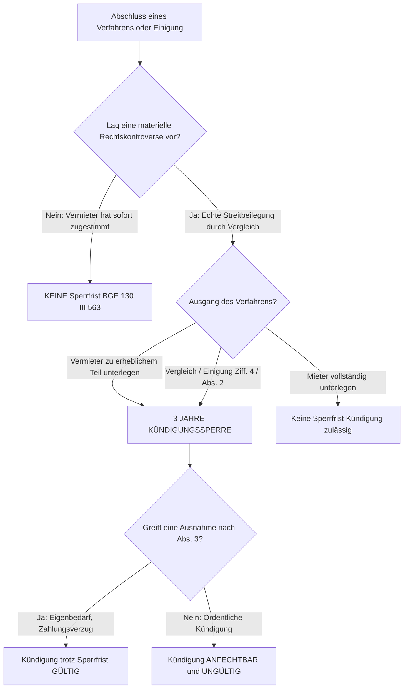

## Gesetzeswortlaut



### Die Fallgruppen im systematischen Überblick

| Absatz / Littera | Schutzrichtung | Rechtsfolge bei Erfüllung |
|---|---|---|
| **Abs. 1 lit. a** | Schutz vor **Vergeltungs- / Rachekündigung** nach Geltendmachung von Rechten in guten Treuen | Anfechtbarkeit der Kündigung (Ungültigerklärung) |
| **Abs. 1 lit. b, c** | Schutz vor **Druckkündigung** (Durchsetzung einseitiger Vertragsänderungen / Kaufzwang bei Eigentumswohnungen) | Anfechtbarkeit der Kündigung |
| **Abs. 1 lit. d** | **Absoluter Verfahrensschutz** während eines Schlichtungs- oder Gerichtsverfahrens | Anfechtbarkeit ohne Nachweis eines Kausalitätsmissbrauchs |
| **Abs. 1 lit. e** | **Dreijährige Kündigungssperrfrist** nach Abschluss eines Schlichtungs- oder Gerichtsverfahrens (Ziff. 1–4) | Kündigungsverbot für 3 Jahre; Anfechtbarkeit jeder Kündigung |
| **Abs. 1 lit. f** | Schutz vor Kündigung wegen **familiärer Veränderungen** ohne Benachteiligung des Vermieters | Anfechtbarkeit der Kündigung |
| **Abs. 2** | Ausdehnung der dreijährigen Sperrfrist auf **schriftlich nachgewiesene Einigungen** ausserhalb eines Verfahrens | Kündigungsverbot für 3 Jahre |
| **Abs. 3 lit. a–f** | **Abschliessende Gegenausnahmen**: Dringender Eigenbedarf, Zahlungsrückstand, schwere Pflichtverletzung etc. | Kündigungssperrfristen der lit. d und e sowie Abs. 2 entfallen |

---

## Überblick und Bedeutung

Art. 271a OR ist das operative Herzstück des schweizerischen Kündigungsschutzes bei der Wohn- und Geschäftsraummiete. Während Art. 271 Abs. 1 OR die allgemeine Generalklausel statuiert, wonach jede gegen den Grundsatz von Treu und Glauben verstossende Kündigung anfechtbar ist, konkretisiert Art. 271a OR dieses Missbrauchsverbot durch einen **nicht abschliessenden Katalog typisierter Missbrauchstatbestände** (Abs. 1 lit. a–f) und verankert den zeitlichen Verfahrensschutz samt dreijähriger Kündigungssperrfrist.

### Gesetzgeberische Motive und Schutzzweck

Mit der Gesamtrevision des Miet- und Pachtrechts von 1989/1990 bezweckte der Bundesgesetzgeber, das strukturelle Ungleichgewicht zwischen Vermieter und Mieter auszugleichen. Die Botschaft des Bundesrates hielt zum Kündigungsschutz fest:

> «Der Mieter darf nicht aus Furcht vor einer Kündigung davon abgehalten werden, berechtigte Ansprüche geltend zu machen oder die Angemessenheit des Mietzinses gerichtlich überprüfen zu lassen. Ein wirksamer Kündigungsschutz verlangt deshalb, dass die Ausübung vertraglicher und gesetzlicher Rechte nicht mit dem Verlust der Wohnung sanktioniert werden darf. Zudem muss dem Mieter für eine angemessene Zeit nach der gerichtlichen Austragung eines Konflikts Sicherheit vor Rachekündigungen geboten werden.»

([Botschaft zur Revision des Miet- und Pachtrechts vom 27. März 1985, BBl 1985 I 1389, S. 1438 ff.](https://fedlex.data.admin.ch/eli/fga/1985/1_1389_1369_1189)).

Dogmatisch zerfällt Art. 271a OR in zwei völlig unterschiedliche Schutzmechanismen:
1. **Motivschutz (Abs. 1 lit. a–c, f)**: Hier muss der Mieter nachweisen, dass der Vermieter aus einem verpönten Beweggrund gekündigt hat (Kausalitätsnachweis).
2. **Abstrakter zeitlicher Sperrfristschutz (Abs. 1 lit. d und e sowie Abs. 2)**: Hier knüpft das Gesetz die Anfechtbarkeit an rein objektive äussere Umstände (Anhängigkeit eines Verfahrens oder Verfahrensausgang). Der Mieter muss **kein verpöntes Motiv nachweisen**; die Kündigung ist bereits wegen des zeitlichen Moments anfechtbar ([BGE 131 III 33 E. 3](https://entscheidsuche.ch/docs/CH_BGE/CH_BGE_005_BGE-131-III-33_2005.html)).

### Prüfschema: Kündigungsanfechtung nach Art. 271a OR

| Nr. | Merkmal | Was zu prüfen ist | Behauptungs- und Beweislast / Beweismass | Abschnitt |
|---|---|---|---|---|
| 0 | **Vorfrage: 30-tägige Rüge- und Klagefrist** | Wurde die Kündigung innert 30 Tagen seit Empfang bei der Schlichtungsbehörde angefochten (Art. 273 Abs. 1 OR)? | Mieter; strikte Verwirkungsfrist | [A](#a-vorfrage-die-30-tägige-anfechtungsfrist-art-273-abs-1-or) |
| 1 | **Angriffslinie bestimmen** | Motivmissbrauch (lit. a–c, f) oder abstrakter Zeit-/Sperrfristschutz (lit. d, e, Abs. 2)? | Mieter wählt die Rügegründe | [B](#b-die-tatbestände-des-motivmissbrauchs-abs-1-lit-a-c-f) / [C](#c-der-abstrakte-zeitliche-verfahrensschutz-abs-1-lit-d) |
| 2 | **Vergeltungskündigung (lit. a)** | Kausalzusammenhang zwischen rechtmässiger Rechtsausübung und Kündigungsentschluss | Mieter für Geltendmachung und Kausalität (hohe Wahrscheinlichkeit) | [B.1](#1-vergeltungs--und-rachekündigung-abs-1-lit-a) |
| 3 | **Druckkündigung (lit. b, c)** | Kündigung zur Durchsetzung unzulässiger Vertragsänderungen oder Kaufzwang | Mieter für Druckabsicht | [B.2](#2-druckkündigung-abs-1-lit-b-und-c) |
| 4 | **Schutz während Verfahren (lit. d)** | Kündigung erfolgte nach Anhängigkeit und vor Rechtskraft des Schlichtungs-/Gerichtsverfahrens | Mieter (Datum Klageanhebung); Vermieter für Missbrauch | [C](#c-der-abstrakte-zeitliche-verfahrensschutz-abs-1-lit-d) |
| 5 | **Dreijährige Sperrfrist (lit. e, Abs. 2)** | Urteil/Vergleich/Einigung über materielle Mietrechtsfragen liegt weniger als 3 Jahre zurück | Mieter für Verfahrensabschluss/Vergleich; Vermieter für Ziff. 1–4 | [D](#d-die-dreijährige-kündigungssperrfrist-abs-1-lit-e-und-abs-2) |
| 6 | **Ausnahmetatbestände (Abs. 3)** | Dringender Eigenbedarf (lit. a), Zahlungsverzug (lit. b) oder schwere Pflichtverletzung (lit. c)? | **Vermieter trägt volle Beweislast** für die Ausnahme | [E](#e-die-gesetzlichen-gegenrechte-und-ausnahmen-abs-3) |
| 7 | **Streitwert und Rechtsfolge** | 3-jährige Kündigungssperre bestimmt den Streitwert (Art. 74 BGG); Ungültigkeit der Kündigung | Feststellung von Amtes wegen | [F](#f-prozessuale-aspekte-streitwert-und-ausweisungsverfahren) |

---

## Kommentierung

### A. Vorfrage: Die 30-tägige Anfechtungsfrist (Art. 273 Abs. 1 OR)

Die Geltendmachung der Anfechtungsgründe nach Art. 271a OR setzt voraus, dass der Mieter die Kündigung **innert 30 Tagen nach Empfang** bei der zuständigen Schlichtungsbehörde für Mietstreitigkeiten anficht (Art. 273 Abs. 1 OR).

- Die Frist ist eine **strikte Verwirkungsfrist**. Wird sie versäumt, ist die Kündigung rechtsgültig, selbst wenn sie nach Art. 271a Abs. 1 lit. d oder e während einer laufenden Sperrfrist ausgesprochen wurde.
- Die Missbräuchlichkeit führt nicht zur Nichtigkeit, sondern zur **Anfechtbarkeit** der Kündigung.
- Einzige Ausnahme ist die Kündigung mit schwersten Formmängeln (fehlendes amtliches Formular nach Art. 266l Abs. 2 OR, fehlende Unterschrift), welche absolut nichtig ist und jederzeit festgestellt werden kann.

---

### B. Die Tatbestände des Motivmissbrauchs (Abs. 1 lit. a–c, f)

#### 1. Vergeltungs- und Rachekündigung (Abs. 1 lit. a)

Anfechtbar ist eine Kündigung, die der Vermieter ausspricht, weil der Mieter «nach Treu und Glauben Ansprüche aus dem Mietverhältnis geltend macht».
- **Geschützte Ansprüche**: Mängelrügen, Gesuche um Beseitigung von Mängeln, Mietzinsherabsetzungsbegehren wegen Referenzzinssatzsenkungen, Einsichtnahme in Heiz- und Nebenkostenbelege, Begehren um Zustimmung zur Untermiete (Art. 262 OR).
- **In guten Treuen**: Der Anspruch muss nicht begründet sein; es genügt, dass der Mieter ihn in guten Treuen für berechtigt halten durfte. Schikanöse oder mutwillige Forderungen geniessen keinen Schutz.
- **Kausalzusammenhang**: Das Geltendmachen des Anspruchs muss das tragende Motiv für die Kündigung gebildet haben. Der Beweis kann aus Indizien (insb. unmittelbarer zeitlicher Nähe) abgeleitet werden.

#### Grenzkasuistik: Vergeltungskündigung vs. legitime Kündigung

| Sachverhalt | Ausgang vor Gericht | Tragende Erwägung & Fundstelle |
|---|---|---|
| Mieter fordert Heizkostenbelege ein; Vermieter kündigt 2 Wochen später ohne nachvollziehbaren Grund | **Kündigung aufgehoben** (lit. a bejaht) | Enge zeitliche Nähe begründet tatsächliche Vermutung für Rachemotiv ([BGer 4A_415/2022](https://entscheidsuche.ch/docs/CH_BGer/CH_BGer_004_4A-415-2022_2022-11-01.html)) |
| Mieter verlangt Zustimmung zur Untervermietung der ganzen Wohnung für unbestimmte Zeit | **Kündigung geschützt** (lit. a verneint) | Keine Geltendmachung in guten Treuen: Vage Absicht einer späteren Rückkehr deckt keine dauerhafte Untermiete ([BGE 138 III 59](https://entscheidsuche.ch/docs/CH_BGE/CH_BGE_005_BGE-138-III-59_2012.html)) |
| Vermieter kündigt nach Mängelrüge, beweist aber lang geplante und bewilligte Totalsanierung | **Kündigung geschützt** (Kausalität fehlt) | Das Sanierungsinteresse überwiegt; die Mängelrüge war nicht kausal für den Kündigungsentschluss ([BGE 142 III 91](https://entscheidsuche.ch/docs/CH_BGE/CH_BGE_005_BGE-142-III-91_2016.html)) |

#### Sachverhalt: Die verweigerte Untermiete (BGE 138 III 59)
Ein Mieter mietete 1993 ein Haus in Graubünden und verlegte seinen Wohnsitz 2004 nach Spanien. Er bat um Zustimmung zur Untervermietung an Feriengäste, da er «allenfalls im Alter» wieder zurückkehren wolle. Der Vermieter verweigerte die Zustimmung und kündigte das Mietverhältnis. Der Mieter focht die Kündigung gestützt auf Art. 271a Abs. 1 lit. a OR an. Das Bundesgericht verwarf die Anfechtung: Das Recht zur Untermiete nach Art. 262 OR setzt die konkrete Absicht voraus, die Wohnung in absehbarer Zeit wieder selbst zu nutzen. Eine bloss vage Möglichkeit berechtigt nicht zur Untervermietung; die Kündigung war daher keine verpönte Vergeltung ([BGE 138 III 59 E. 2.2](https://entscheidsuche.ch/docs/CH_BGE/CH_BGE_005_BGE-138-III-59_2012.html)).

#### 2. Druckkündigung (Abs. 1 lit. b und c)

- **Lit. b (Vertragsänderung / Mietzinserhöhung)**: Verpönt ist die Kündigung als Druckmittel, um eine einseitige Vertragsänderung zu Lasten des Mieters oder eine höhere Miete durchzusetzen, ohne das gesetzliche Formularverfahren nach Art. 269d OR einzuhalten.
- **Lit. c (Kaufzwang bei Eigentumswohnungen)**: Anfechtbar ist eine Kündigung, die ausschliesslich ausgesprochen wird, um den Mieter zum Kauf der gemieteten Wohnung zu zwingen.

#### 3. Veränderung der familiären Verhältnisse (Abs. 1 lit. f)

Lit. f schützt den Mieter vor Kündigungen, die wegen einer Heirat, Geburt eines Kindes, Scheidung oder Begründung einer Lebensgemeinschaft ausgesprochen werden, sofern dem Vermieter daraus keine wesentlichen Nachteile entstehen (z.B. gravierende Überbelegung der Wohnung).

---

### C. Der abstrakte zeitliche Verfahrensschutz (Abs. 1 lit. d)

#### 1. Schutz während des Verfahrens ohne Missbrauchsnachweis

Gemäss Art. 271a Abs. 1 lit. d OR ist eine Kündigung anfechtbar, wenn sie **während eines mit dem Mietverhältnis zusammenhängenden Schlichtungs- oder Gerichtsverfahrens** ausgesprochen wird.

Dies ist ein **rein abstrakter Schutz**:
- Die Kündigung ist unabhängig davon anfechtbar, ob sie tatsächlich missbräuchlich ist ([BGE 131 III 33 E. 3](https://entscheidsuche.ch/docs/CH_BGE/CH_BGE_005_BGE-131-III-33_2005.html)).
- Der Gesetzgeber stellt eine unwiderlegbare gesetzliche Vermutung auf, dass während eines hängigen Streits ausgesprochene Kündigungen vergeltungsbelastet sind.

#### 2. Zeitlicher Geltungsbereich: Beginn mit Klageanhebung

Der Schutz beginnt im exakten Moment der **Klageanhebung bei der Schlichtungsbehörde** (Einreichung des Schlichtungsgesuchs) und endet erst mit der rechtskräftigen Erledigung des Verfahrens ([BGE 141 III 101 E. 2](https://entscheidsuche.ch/docs/CH_BGE/CH_BGE_005_BGE-141-III-101_2015.html)).
- Es spielt **keine Rolle**, ob der Vermieter im Zeitpunkt der Kündigung bereits Kenntnis vom Schlichtungsgesuch hatte oder haben konnte. Kündigt der Vermieter am Tag nach Einreichung des Gesuchs, greift der Kündigungsschutz vollumfänglich.

#### 3. Einzige Ausnahme: Missbräuchliche Klageeinleitung

Der Schutz von lit. d entfällt nur dann, wenn der Mieter das Verfahren **missbräuchlich eingeleitet** hat (sog. Schikane- oder Schutzklage). Ein Rechtsmissbrauch liegt vor, wenn das Verfahren ausschliesslich zu dem Zweck angestrengt wurde, die Kündigungssperre herbeizuführen, ohne dass ein schutzwürdiges materielles Rechtsschutzinteresse bestand.

> **Leitsatz.** Der Kündigungsschutz während des Schlichtungs- oder Gerichtsverfahrens greift abstrakt und absolut mit der Einreichung des Schlichtungsbegehrens. Auf die Gutgläubigkeit oder Unkenntnis des Vermieters kommt es nicht an.

---

### D. Die dreijährige Kündigungssperrfrist (Abs. 1 lit. e und Abs. 2)

#### 1. Die vier gesetzlichen Auslösetatbestände (Abs. 1 lit. e Ziff. 1–4)

Nach Abschluss eines mit dem Mietverhältnis zusammenhängenden Schlichtungs- oder Gerichtsverfahrens darf der Vermieter während **dreier Jahre** grundsätzlich nicht ordentlich kündigen, wenn:
1. der Vermieter zu einem **erheblichen Teil unterlegen** ist (Ziff. 1);
2. der Vermieter seine Forderung oder Klage **zurückgezogen oder erheblich eingeschränkt** hat (Ziff. 2);
3. das Gericht eine **Feststellungsklage** geschützt hat (Ziff. 3);
4. die Parteien eine **Einigung erzielt oder einen Vergleich abgeschlossen** haben (Ziff. 4).

#### 2. Der Begriff der «Einigung» (BGE 130 III 563)

Ziff. 4 und Abs. 2 (aussergerichtliche Einigung) sind die in der Praxis streitanfälligsten Bestimmungen:
- Nach ständiger Rechtsprechung setzt eine rechtswirksame «Einigung» voraus, dass die Parteien eine **echte Kontroverse über eine strittige Rechtsfrage** durch gegenseitiges Nachgeben beigelegt haben ([BGE 130 III 563 E. 2](https://entscheidsuche.ch/docs/CH_BGE/CH_BGE_005_BGE-130-III-563_2004.html)).
- Entspricht der Vermieter einem Herabsetzungsbegehren des Mieters sofort und anstandslos, kommt es gar nicht erst zu einer Streitigkeit; eine solche Zustimmung löst **keine dreijährige Sperrfrist** aus!
- Dasselbe gilt, wenn die Parteien lediglich den Mietzins im gegenseitigen Einvernehmen an die Marktverhältnisse anpassen, ohne dass zuvor Streit bestand.

#### 3. Beginn und Ende der Dreijahresfrist

- **Dies a quo**: Die Dreijahresfrist beginnt mit dem Datum des **formellen Abschlusses** des Verfahrens (Datum des Entscheids der Schlichtungsbehörde, des gerichtlichen Urteils oder der Genehmigung des Vergleichs).
- **Kündigung kurz nach Fristablauf**: Spricht der Vermieter die Kündigung unmittelbar nach Ablauf der drei Jahre aus (z.B. am Tag 3 Jahre und 1 Tag), ist die Kündigung nicht mehr nach Art. 271a OR gesperrt. Sie kann jedoch ausnahmsweise nach der Generalklausel von Art. 271 Abs. 1 OR als rechtsmissbräuchliche Rachekündigung angefochten werden, wenn feststeht, dass der Vermieter bloss das Fristende abgewartet hat ([BGer 4C.253/2006 vom 26. September 2006](https://entscheidsuche.ch/docs/CH_BGer/CH_BGer_004_4C-253-2006_2006-09-26.html)).

---

### E. Die gesetzlichen Gegenrechte und Ausnahmen (Abs. 3)

Abs. 3 enthält eine abschliessende Liste von Ausnahmetatbeständen, bei deren Vorliegen die Kündigungssperrfristen während des Verfahrens (lit. d) und danach (lit. e sowie Abs. 2) **ausdrücklich nicht gelten**:

#### 1. Dringender Eigenbedarf (Abs. 3 lit. a)

Die praktisch bedeutsamste Ausnahme ist der **dringende Eigenbedarf** des Vermieters für sich, nahe Verwandte oder Verschwägerte.
- **Begriff der Dringlichkeit**: Dringend bedeutet nicht Wohnungsnot oder Zwangslage. Es genügt, dass es dem Vermieter aus ernsthaften wirtschaftlichen, persönlichen oder familiären Gründen nicht zuzumuten ist, auf die Nutzung der Wohnung zu verzichten ([BGE 118 II 50 E. 3](https://entscheidsuche.ch/docs/CH_BGE/CH_BGE_004_BGE-118-II-50_1992-01-21.html)).
- **Personenkreis**: Der Eigenbedarf ist beschränkt auf den Vermieter selbst sowie nahe Verwandte (Kinder, Eltern, Enkel, Geschwister) und Verschwägerte (Schwiegereltern). Eigenbedarf für entfernte Verwandte (Cousins) oder Bekannte durchbricht die Sperrfrist nicht.
- **Beweislast**: Der Vermieter trägt die volle Beweislast für die tatsächliche Dringlichkeit. Vorgeschobener Eigenbedarf führt zur Nichtigkeit der Kündigung und schadenersatzrechtlicher Haftung.

#### 2. Zahlungsrückstand des Mieters (Abs. 3 lit. b)

Wurde dem Mieter nach Art. 257d OR wegen ausstehender Mietzinse rechtsgültig gekündigt (schriftliche Zahlungsaufforderung mit 30-tägiger Androhung und Kündigung mit 30 Tagen Frist auf Monatsende), greift die Sperrfrist von Art. 271a OR nicht. Zahlungsunwillige Mieter können sich nicht hinter Schlichtungsverfahren verschanzen.

#### 3. Schwere Pflichtverletzung (Abs. 3 lit. c)

Verletzt der Mieter seine Sorgfalts- oder Rücksichtnahmepflicht nach Art. 257f Abs. 3 oder 4 OR schwerwiegend (z.B. massive Ruhestörungen, Drohungen gegen Nachbarn, vorsätzliche Sachbeschädigung), ist die Kündigung trotz laufender Sperrfrist zulässig.

---

### F. Prozessuale Aspekte: Streitwert und Ausweisungsverfahren

#### 1. Streitwertberechnung bei Kündigungsanfechtung (BGE 137 III 389)

Ficht der Mieter eine Kündigung an, bestimmt sich der Streitwert für das Beschwerdeverfahren an das Obergericht und das Bundesgericht nach dem Mietzins, der bis zu jenem Zeitpunkt geschuldet ist, auf den frühestens eine neue Kündigung ausgesprochen werden könnte:
- Erweist sich die Kündigung als ungültig, wird die dreijährige Kündigungssperrfrist nach Art. 271a Abs. 1 lit. e OR ausgelöst.
- Der Streitwert entspricht daher zwingend dem **Mietzins für mindestens drei Jahre** zuzüglich der ordentlichen Kündigungsfrist ([BGE 137 III 389 E. 1.1](https://entscheidsuche.ch/docs/CH_BGE/CH_BGE_005_BGE-137-III-389_2011.html)).
- Damit wird der bundesgerichtliche Streitwert von Fr. 30'000.- (Art. 74 Abs. 1 lit. a BGG) bei fast allen Wohnungsmieten mühelos erreicht.

#### 2. Abgrenzung zum summarischen Ausweisungsverfahren (Art. 257 ZPO)

Verlangt der Vermieter im Rechtsschutz in klaren Fällen (Art. 257 ZPO) die Ausweisung des Mieters, beläuft sich der Streitwert im Ausweisungsverfahren nach [BGE 144 III 346](https://entscheidsuche.ch/docs/CH_BGE/CH_BGE_005_BGE-144-III-346_2018.html) grundsätzlich nur auf sechs Monatsmieten, sofern die Kündigung nicht Gegenstand eines hängigen materiellen Kündigungsschutzprozesses ist. Tritt das Gericht auf das Ausweisungsgesuch mangels klaren Sachverhalts nicht ein, löst dieser Nichteintretensentscheid **keine dreijährige Sperrfrist** aus ([KG BL 410 2024 50](https://entscheidsuche.ch/docs/BL_Gerichte/BL_KG_001_410-2024-50_2024-05-07.pdf)).

---

## Kantonale Praxisfragen

### 1. Auslösung der Kündigungssperrfrist durch Nichteintreten im Ausweisungsverfahren
Vermieter stellen bei Ausweisung oft Gesuche nach Art. 257 ZPO (Rechtsschutz in klaren Fällen). Tritt der Ausweisungsrichter mangels Liquidation des Falles nicht ein, behaupten Mieter häufig, dieser Nichteintretensentscheid löse die dreijährige Kündigungssperre nach Art. 271a Abs. 1 lit. e OR aus.
- **Kantonale Praxis (Basel-Landschaft)**: Das Kantonsgericht Basel-Landschaft stellte klar, dass ein Nichteintretensentscheid im summarischen Ausweisungsverfahren keine materielle Rechtskraft entfaltet und keine materiellrechtliche Beurteilung der Beendigung des Mietverhältnisses darstellt. Ein solches Nichteintreten löst daher **keine Kündigungssperrfrist** aus ([Kantonsgericht Basel-Landschaft, 410 2024 50 vom 7. Mai 2024, E. 2.1](https://entscheidsuche.ch/docs/BL_Gerichte/BL_KG_001_410-2024-50_2024-05-07.pdf)).

### 2. Erfordernis einer materiellen Streitfrage bei Verfahrensausgang
Löst jede gerichtliche Einigung die dreijährige Sperrfrist aus, auch wenn es nur um Nebenpunkte ging?
- **Kantonale Praxis (Solothurn und Zürich)**: Die Sperrfrist nach Art. 271a Abs. 1 lit. e Ziff. 4 OR setzt voraus, dass der vorausgegangene Rechtsstreit **materielle mietrechtliche Fragen** (z.B. Mietzinshöhe, Mängel, Nebenkosten) betroffen hat. Ein blosser Vergleich über einen Zahlungsmodalitäten-Aufschub oder Verfahrenskosten ohne materielle Streitbeilegung begründet keine dreijährige Kündigungssperre ([Obergericht Solothurn, ZZ.1994.7 vom 25. Februar 1994](https://entscheidsuche.ch/docs/SO_Omni/SO_OG_003_ZZ-1994-7_1994-02-25.html); [Bezirksgericht Zürich, MB190012-L vom 12. Dezember 2019](https://entscheidsuche.ch/docs/ZH_Mietgerichte/ZH_BK_004_MB190012-L_2019-12-12.pdf)).

---

## Praxishinweise

### Für Vermieter

1. **Vor jeder Kündigung Verfahrenschronologie prüfen**: Prüfen Sie vor Ausspruch einer Kündigung, ob in den vergangenen drei Jahren ein Schlichtungs- oder Gerichtsverfahren stattfand oder eine schriftliche Streitbeilegung nach Art. 271a Abs. 2 OR erfolgte. Eine Kündigung während laufender Sperrfrist ist anfechtbar und wird aufgehoben ([BGE 130 III 563](https://entscheidsuche.ch/docs/CH_BGE/CH_BGE_005_BGE-130-III-563_2004.html)).
2. **Eigenbedarf detailliert substanziieren**: Machen Sie Eigenbedarf geltend (Abs. 3 lit. a), dokumentieren Sie die Dringlichkeit (Gesundheit, Familienzuwachs, finanzielle Notwendigkeit des Selbstbezugs) im Kündigungsschreiben oder spätestens im Schlichtungsverfahren akribisch. Ein pauschaler Hinweis genügt vor Gericht nicht ([BGE 118 II 50](https://entscheidsuche.ch/docs/CH_BGE/CH_BGE_004_BGE-118-II-50_1992-01-21.html)).
3. **Subsidiäre ordentliche Kündigung formulieren**: Kündigen Sie ausserordentlich (z.B. wegen Zahlungsverzug nach Art. 257d OR), sprechen Sie im selben Formular ausdrücklich eine *subsidiäre ordentliche Kündigung* für den Fall aus, dass die fristlose Kündigung unwirksam sein sollte ([BGE 137 III 389 E. 8.4](https://entscheidsuche.ch/docs/CH_BGE/CH_BGE_005_BGE-137-III-389_2011.html)).
4. **Vergleiche ohne Sperrfristklausel meiden**: Schliessen Sie vor der Schlichtungsbehörde einen Vergleich, vereinbaren Sie ausdrücklich den Verzicht auf die Kündigungssperrfrist oder befristen Sie das Mietverhältnis bis zum Auszugstermin.

### Für Mieter

1. **30-Tage-Frist zwingend wahren**: Reichen Sie das Anfechtungsbegehren innert 30 Tagen seit Empfang der Kündigung bei der Schlichtungsbehörde ein (Art. 273 Abs. 1 OR). Ein Verpassen der Frist führt zur absoluten Verwirkung; selbst eine Kündigung mitten in der Sperrfrist wird dadurch rechtskräftig.
2. **Schlichtungsverfahren schützt ab Tag der Klageanhebung**: Sobald Sie ein Schlichtungsgesuch (z.B. wegen unvollständiger Nebenkostenabrechnung oder Mängeln) bei der Post aufgeben, greift der absolute Kündigungsschutz nach Art. 271a Abs. 1 lit. d OR ([BGE 141 III 101](https://entscheidsuche.ch/docs/CH_BGE/CH_BGE_005_BGE-141-III-101_2015.html)).
3. **Schriftliche Einigungen sorgfältig aufbewahren**: Wenn Sie sich aussergerichtlich mit dem Vermieter über Mietzinsreduktionen oder Reparaturen einigen, halten Sie den Streit und die Einigung schriftlich fest. Nur ein schriftlicher Nachweis löst die dreijährige Sperrfrist nach Abs. 2 aus ([BGE 130 III 563](https://entscheidsuche.ch/docs/CH_BGE/CH_BGE_005_BGE-130-III-563_2004.html)).

---

## Literatur

- **Bohnet, François / Conod, Philippe**, *Droit du bail : fond et procédure*, Neuchâtel 2024.
- **Higi, Peter / Biderbost, Yvo**, *Zürcher Kommentar, Die Miete (Art. 253–273c OR)*, 5. Aufl., Zürich 2020, Art. 271a N. 1–280.
- **Lachat, David et al.**, *Das Mietrecht für die Praxis*, 9. Aufl., Zürich 2022, Kap. 29.
- **Strik, Manfred Konrad**, *Das Verfahrensrecht bei der Wohn- und Geschäftsraummiete nach der Schweizerischen Zivilprozessordnung (ZPO)*, Bern 2026.
- **Weber, Peter**, *Basler Kommentar, Obligationenrecht I (Art. 1–529 OR)*, 7. Aufl., Basel 2020, Art. 271a N. 1–42.
