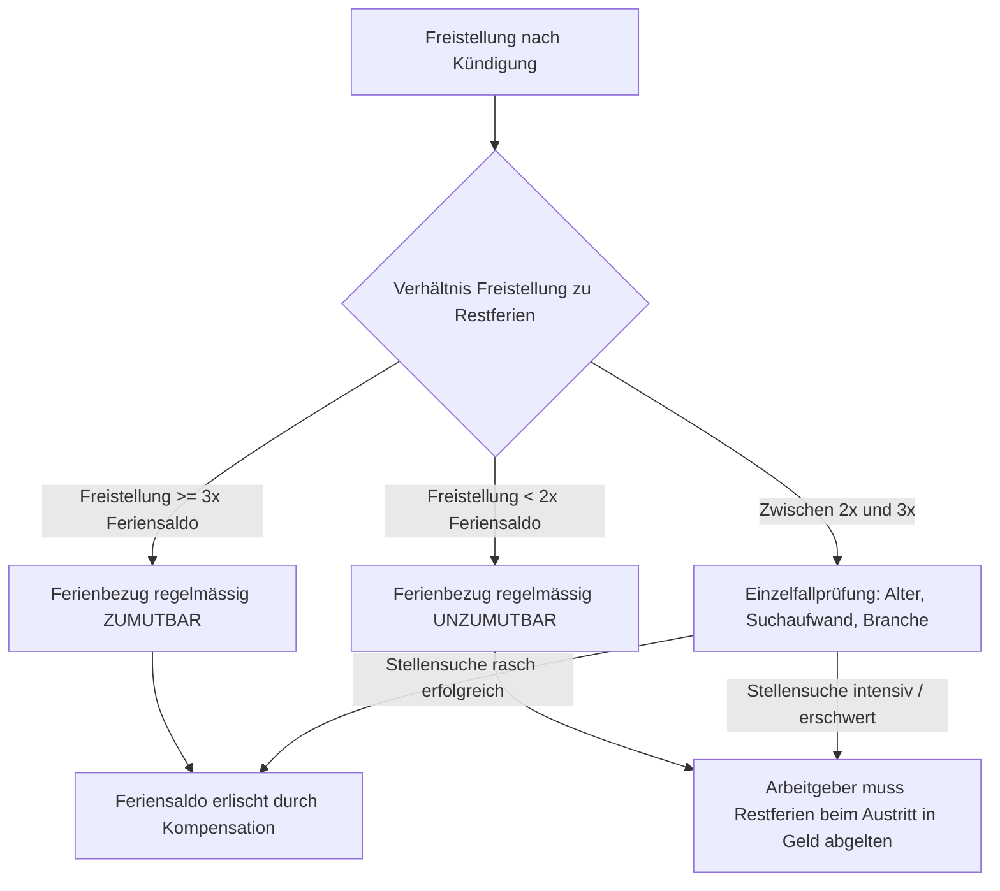

## Gesetzeswortlaut



### Die Absätze im systematischen Überblick

| Absatz | Regelungsgehalt | Normcharakter |
|---|---|---|
| **Abs. 1 Satz 1** | Mindestferienanspruch von 4 Wochen pro Dienstjahr für alle Arbeitnehmer ab dem 20. Altersjahr | Relativ zwingend zugunsten des Arbeitnehmers (Art. 362 OR) |
| **Abs. 1 Satz 2** | Mindestferienanspruch von 5 Wochen pro Dienstjahr für Jugendliche bis zum vollendeten 20. Altersjahr | Relativ zwingend zugunsten des Arbeitnehmers (Art. 362 OR) |
| **Abs. 2** | *(Aufgehoben durch Ziff. I des BG vom 16. Dez. 1983, AS 1984 580)* | – |
| **Abs. 3** | Pro-rata-temporis-Berechnung für unvollständige Dienstjahre (unterjähriger Ein- oder Austritt) | Relativ zwingend zugunsten des Arbeitnehmers (Art. 362 OR) |

---

## Überblick und Bedeutung

Art. 329a OR bildet das Fundament des schweizerischen Ferienrechts. Die Bestimmung statuiert einen gesetzlichen Mindestanspruch auf bezahlte Ferien, der dem Gesundheitsschutz und der physischen wie psychischen Regeneration der arbeitenden Person dient.

### Entstehungsgeschichte und gesetzgeberische Zwecke

Das Bundesgesetz über die Revision des Zehnten Titels des Obligationenrechts vom 25. Juni 1971 führte erstmals einen allgemeinen gesetzlichen Mindestferienanspruch von zwei Wochen (bzw. drei Wochen für Jugendliche) im Bundeszivilrecht ein. Die Botschaft des Bundesrates betonte damals den Erholungszweck als unabdingbares Element des arbeitsrechtlichen Persönlichkeits- und Gesundheitsschutzes:

> «Die Ferien bezwecken die physische und psychische Erholung des Arbeitnehmers. Dieser Zweck kann nur erreicht werden, wenn der Arbeitnehmer von seiner Arbeitspflicht befreit wird, ohne dadurch einen Lohnausfall zu erleiden.»

([Botschaft vom 25. August 1967, BBl 1967 II 249, S. 336](https://fedlex.data.admin.ch/eli/fga/1967/2_249_249_225)).

Mit der Volksinitiative «für eine Verlängerung der bezahlten Ferien» forderte die Gewerkschaftsbewegung in den späten 1970er-Jahren eine generelle Ausdehnung auf fünf Wochen. Der Bundesrat stellte der Initiative einen indirekten Gegenentwurf gegenüber, der den Mindestanspruch per 1. Juli 1984 auf **vier Wochen** (bzw. **fünf Wochen** für Arbeitnehmer bis zum vollendeten 20. Altersjahr) erhöhte ([Botschaft vom 27. September 1982, BBl 1982 III 201, S. 204 ff.](https://fedlex.data.admin.ch/eli/fga/1982/3_201_177_161)). Zugleich wurde Abs. 3 präzisiert, um die vormals strittige Frage der Entstehung und Bemessung bei unterjährigem Dienstantritt oder -austritt zweifelsfrei im Sinne des Prinzips *pro rata temporis* zu verankern ([BBl 1982 III 201, S. 231](https://fedlex.data.admin.ch/eli/fga/1982/3_201_177_161)).

### Dogmatische Einordnung und zwingende Natur

Gemäss Art. 362 Abs. 1 OR ist Art. 329a OR **einseitig zwingend** (relativ zwingend). Einzelarbeitsverträge, Normalarbeitsverträge (NAV) und Gesamtarbeitsverträge (GAV) dürfen den gesetzlichen Mindestanspruch von vier bzw. fünf Wochen nicht unterschreiten; eine Erhöhung zugunsten des Arbeitnehmers (z.B. fünf oder sechs Wochen) ist dagegen jederzeit zulässig. Abrede oder Klauseln, die weniger Ferien vorsehen, sind nach Art. 20 Abs. 2 OR teilnichtig und werden automatisch durch das gesetzliche Minimum ersetzt.

### Prüfschema: Der Ferienanspruch in seiner Prüfungsreihenfolge

| Nr. | Merkmal | Was zu prüfen ist | Behauptungs- und Beweislast / Beweismass | Abschnitt |
|---|---|---|---|---|
| 1 | **Geltungsbereich und Arbeitsvertrag** | Liegt ein privatrechtlicher Arbeitsvertrag vor (Vollzeit, Teilzeit, Aushilfe, Stundenlohn)? | Arbeitnehmer; Regelbeweismass | [A](#a-geltungsbereich-und-zwingender-mindestanspruch-abs-1-satz-1) |
| 2 | **Grunddauer (4 Wochen)** | Erreichen des 20. Altersjahres; Umrechnung in Arbeitstage anhand des individuellen Arbeitspensums | Arbeitnehmer für Vertragsbestand; Arbeitgeber für abweichende Tage | [A](#a-geltungsbereich-und-zwingender-mindestanspruch-abs-1-satz-1) |
| 3 | **Jugendurlaub (5 Wochen)** | Alter des Arbeitnehmers bis zum vollendeten 20. Altersjahr am Stichtag | Arbeitnehmer (Geburtsdatum) | [B](#b-erhöhter-anspruch-für-jugendliche-bis-20-jahre-abs-1-satz-2) |
| 4 | **Pro-rata-Kürzung bei unvollständigem Dienstjahr** | Vertragsdauer im Dienstjahr (Beginn/Ende unterjährig); exakte Monats- und Tagesberechnung (Abs. 3) | Rechnerische Ableitung aus Vertragsdaten | [C](#c-pro-rata-temporis-berechnung-bei-unvollständigem-dienstjahr-abs-3) |
| 5 | **Saldoabweichungen: Vorbezug und Zuwenigbezug** | Wurden mehr oder weniger Ferientage bezogen als pro rata geschuldet? Verrechnung oder Rückforderung | Arbeitgeber für Gewährung/Bezug; Arbeitnehmer für Guthaben | [D](#d-vorbezug-und-zuvielbezug-von-ferien-saldoabweichungen) |
| 6 | **Ferienbezug während Freistellung** | Verhältnis Freistellungsdauer zu Restsaldo (1:3-Regel); Zumutbarkeit und tatsächliche Stellensuche | Arbeitgeber für Zumutbarkeit; Arbeitnehmer für Suchaufwand | [E](#e-ferienbezug-während-der-freistellung) |
| 7 | **Ferienunfähigkeit bei Krankheit/Unfall** | Lag eine tatsächliche Vereitelung des Erholungszwecks vor (nicht bloss Arbeitsunfähigkeit)? | Arbeitnehmer für Erholungsvereitelung (voller Beweis) | [F](#f-ferienunfähigkeit-infolge-krankheit-oder-unfall) |
| 8 | **Verjährung und Verfall** | Ablauf der 5-jährigen Frist nach Art. 128 Ziff. 3 OR seit Ende des Dienstjahres | Arbeitgeber für Verjährungseinrede | [G](#g-verjährung-und-verfall) |

---

## Kommentierung

### A. Geltungsbereich und zwingender Mindestanspruch (Abs. 1 Satz 1)

#### 1. Begriff der «vier Wochen» Ferien

Art. 329a Abs. 1 OR gewährt wenigstens vier Wochen Ferien für jedes Dienstjahr. Unter einer «Ferienwoche» versteht das Gesetz eine arbeitsfreie Zeitspanne, die der normalen Wochenarbeitszeit des Arbeitnehmers entspricht:
- Bei einer regulären **5-Tage-Woche** entsprechen 4 Ferienwochen exakt **20 Arbeitstagen**.
- Bei einer **6-Tage-Woche** (z.B. im Gastgewerbe oder Detailhandel) beläuft sich der Anspruch auf **24 Arbeitstage**.
- Bei einer **4-Tage-Woche** umfasst der Anspruch **16 Arbeitstage**.

Der Anspruch entsteht nicht erst am Ende des Dienstjahres, sondern wächst fortlaufend mit der Dauer des Dienstverhältnisses an ([BGE 131 III 451 E. 2.2](https://entscheidsuche.ch/docs/CH_BGE/CH_BGE_005_BGE-131-III-451_2005.html)). Fällig wird der Anspruch jeweils im Verlauf des betreffenden Dienstjahres, da die Ferien gemäss Art. 329c Abs. 1 OR in der Regel im Verlauf des Dienstjahres gewährt werden müssen.

#### 2. Teilzeitarbeit und unregelmässige Pensen

Teilzeitbeschäftigte haben von Gesetzes wegen denselben Anspruch auf vier Wochen Ferien pro Jahr wie Vollzeitbeschäftigte. Die Umrechnung erfolgt zeitproportional:
- Arbeitet eine Mitarbeiterin regelmässig an zwei fixen Wochentagen (40 % Pensum), beträgt ihr Ferienanspruch 4 Wochen à 2 Tage = **8 Arbeitstage**.
- Schwankt die wöchentliche Arbeitszeit stark (Arbeit auf Abruf, unregelmässiger Stundenlohn), bemisst sich der Ferienanspruch in Stunden: Bei einem 4-Wochen-Anspruch entspricht dies einem Lohn- und Zeitzuschlag von **8,33 %** der gesamten geleisteten Arbeitsstunden (bzw. **10,64 %** bei 5 Wochen und **13,04 %** bei 6 Wochen).

> **Leitsatz.** Der gesetzliche Anspruch bemisst sich in Zeiteinheiten (Wochen und Tage), nicht in Geld. Eine Reduktion der Anzahl freier Tage wegen eines reduzierten Pensums ist unzulässig; die freizustellende Zeitspanne muss stets vier vollen Kalenderwochen entsprechen.

---

### B. Erhöhter Anspruch für Jugendliche bis 20 Jahre (Abs. 1 Satz 2)

#### 1. Anwendungsbereich und Stichtag

Arbeitnehmerinnen und Arbeitnehmer haben bis zum **vollendeten 20. Altersjahr** Anspruch auf wenigstens **fünf Wochen** (= 25 Arbeitstage bei 5-Tage-Woche) Ferien pro Dienstjahr.

Massgebender Stichtag ist das Erreichen des 20. Geburtstages:
- Solange der Arbeitnehmer das 20. Altersjahr noch nicht vollendet hat (d.h. bis zum Vortag seines 20. Geburtstags), steht ihm der erhöhte Anspruch von 5 Wochen zu.
- Vollendet der Arbeitnehmer das 20. Altersjahr im Verlaufe eines Dienstjahres, berechnet sich der Anspruch für dieses Übergangsjahr *pro rata temporis*: Bis zum Geburtstag gilt die Basis von 5 Wochen, ab dem Folgetag die Basis von 4 Wochen.

---

### C. Pro-rata-temporis-Berechnung bei unvollständigem Dienstjahr (Abs. 3)

#### 1. Grundsatz der zeitanteiligen Gewährung

Dauert das Arbeitsverhältnis kein volles Dienstjahr (weil es unterjährig begonnen hat oder vor Ablauf des Dienstjahres gekündigt wird), besteht der Anspruch nach Abs. 3 entsprechend der tatsächlichen Dauer des Arbeitsverhältnisses (*pro rata temporis*).

Die Berechnung erfolgt nach der Formel:

$$\text{Ferienguthaben} = \frac{\text{Jahresanspruch (Tage)}}{12} \times \text{Dauer des Arbeitsverhältnisses (Monate)}$$

Wird das Arbeitsverhältnis während eines laufenden Monats beendet, ist auf die Kalendertage abzustellen:

$$\text{Ferienguthaben} = \frac{\text{Jahresanspruch (Tage)}}{365} \times \text{Dauer des Arbeitsverhältnisses (Tage)}$$

#### 2. Rundung von Bruchteilen

Ergeben sich bei der Pro-rata-Berechnung Bruchteile von Ferientagen (z.B. 1,66 Tage nach einem Monat Beschäftigung bei 20 Jahrestagen), schreibt das Bundesrecht keine Aufrundung auf ganze Tage vor. In der Praxis und Lehre gilt:
- Bruchteile dürfen stundenweise bezogen oder am Vertragsende stundengenau ausbezahlt werden.
- Eine vertragliche Praxis, Bruchteile zugunsten des Arbeitnehmers aufzurunden, ist zulässig, kann aber nicht einseitig zuungunsten des Arbeitnehmers abgerundet werden.

---

### D. Vorbezug und Zuvielbezug von Ferien (Saldoabweichungen)

Endet das Arbeitsverhältnis und stellt sich heraus, dass der Arbeitnehmer mehr Ferientage bezogen hat, als ihm *pro rata temporis* zustanden (sog. negativer Feriensaldo oder Ferienvorbezug), stellt sich die Frage der Rückforderung bzw. Verrechnung mit dem Schlusslohn (Art. 323b Abs. 1 OR).

Hierzu hat die Rechtsprechung eine strikte Grenzkasuistik entwickelt, die darauf abstellt, **wer die Verursachung für den Vorbezug trägt**:

#### Grenzkasuistik: Rückforderung des zu viel bezogenen Ferienlohns

| Konstellation | Rückforderung / Lohnabzug | Begründung & Leitentscheid |
|---|---|---|
| **Vorbezug auf Wunsch des Arbeitnehmers**, anschliessende Eigenkündigung | **Zulässig** (Verrechnung geschützt) | Ungerechtfertigte Bereicherung (Art. 62 OR) bzw. Saldoausgleich; Arbeitnehmer hat eigenverantwortlich überzogen ([OGer LU OG 1993 11, LGVE 1993 I Nr. 11](https://entscheidsuche.ch/docs/LU_Gerichte/LU_OG_001_OG-1993-11_1993-01-14.html)) |
| **Arbeitgeber ordnet Vorbezug an** (Betriebsferien, Auftragsmangel), kündigt danach selbst | **Unzulässig** (Rückforderung verweigert) | Annahmeverzug des Arbeitgebers (Art. 324 OR); das Betriebsrisiko darf nicht via Ferienkürzung auf den Arbeitnehmer überwälzt werden |
| **Einvernehmlicher Vorbezug** bei unerwartetem Vertragsende (z.B. unverschuldete Invalidität) | **Unzulässig** (ausser bei explizitem Rückforderungsvorbehalt) | Vertrauensschutz; Arbeitnehmer durfte darauf vertrauen, die bezogenen Tage nicht nacherarbeiten zu müssen |

#### Sachverhalt: Der Ferienüberhang nach Eigenkündigung
In einem vom Obergericht Luzern beurteilten Fall bezog eine kaufmännische Angestellte im Einverständnis der Arbeitgeberin im Frühjahr drei Wochen Ferien am Stück. Kurz nach der Rückkehr kündigte sie das Arbeitsverhältnis per Ende Mai, wodurch ihr pro rata für das laufende Dienstjahr lediglich 8,3 Ferientage zugestanden hätten. Die Arbeitgeberin zog den Gegenwert von 6,7 Ferientagen vom Schlusslohn ab. Das Obergericht schützte den Lohnabzug: Wer auf eigenes Gesuch hin Ferien vorbeziehe und das Arbeitsverhältnis danach durch eigene Kündigung vorzeitig beende, sei ungerechtfertigt bereichert und müsse den zu viel bezogenen Ferienlohn erstatten ([OGer LU OG 1993 11, LGVE 1993 I Nr. 11 E. b](https://entscheidsuche.ch/docs/LU_Gerichte/LU_OG_001_OG-1993-11_1993-01-14.html)).

> **Leitsatz.** Hat der Arbeitnehmer auf eigenes Gesuch hin mehr Ferien bezogen, als ihm bis zum Austrittstermin zustehen, ist der zu viel bezahlte Ferienlohn grundsätzlich nach Bereicherungsrecht rückerstattungspflichtig und darf mit dem letzten Monatslohn verrechnet werden. Wurde der Ferienvorbezug hingegen vom Arbeitgeber veranlasst (z.B. durch Betriebsschliessung), trägt der Arbeitgeber das Lohnrisiko nach Art. 324 OR.

---

### E. Ferienbezug während der Freistellung

Wird der Arbeitnehmer nach Ausspruch einer Kündigung für die Dauer der Kündigungsfrist freigestellt, versucht die Arbeitgeberin regelmässig, verbleibende Ferienguthaben mit der Freistellungszeit zu verrechnen.

#### 1. Die Kriterien des Bundesgerichts (BGE 128 III 271)

Nach der Leitentscheidung [BGE 128 III 271 E. 4](https://entscheidsuche.ch/docs/CH_BGE/CH_BGE_005_BGE-128-III-271_2002.html) kann der Arbeitgeber den Ferienbezug während der Freistellung nur verlangen, wenn dies für den Arbeitnehmer **zumutbar** ist. Die Zumutbarkeit beurteilt sich nach einer Gesamtwürdigung dreier Faktoren:
1. **Dauer der Freistellung im Verhältnis zum Feriensaldo**: Als gefestigte Richtschnur (Faustregel) gilt ein Verhältnis von mindestens **3:1** (die Freistellungsdauer muss rund das Dreifache des verbleibenden Ferienanspruchs betragen).
2. **Erfordernis der Stellensuche**: Der Arbeitnehmer muss während der Freistellung ausreichend Zeit haben, um eine neue Stelle zu suchen (Bewerbungen, Vorstellungsgespräche).
3. **Schwierigkeit der Arbeitsmarktsituation**: Bei älteren Arbeitnehmern, spezialisierten Profilen oder schwieriger Konjunkturlage wiegt der Suchaufwand schwerer, was die Kompensationsmöglichkeit reduziert.

#### Grenzkasuistik: Freistellung und Ferienkompensation

#### Anwendungsfall (Ferienbezug bejaht / Klage auf Auszahlung abgewiesen):
- **Obergericht Solothurn, ZKBER.2022.67 vom 27. März 2023**: Ein Arbeitnehmer mit einer Kündigungsfrist von sechs Monaten wurde für die gesamte Dauer freigestellt. Sein Ferienguthaben betrug 24 Arbeitstage (rund 5 Wochen). Er verlangte am Ende die Barabgeltung mit dem Argument, er habe intensiv nach einer Stelle suchen müssen. Das Obergericht wies die Klage ab: Bei einer sechsmonatigen Freistellung verblieben neben dem 5-wöchigen Ferienbezug noch über vier Monate reine Zeit für die Stellensuche. Ein derart günstiges Verhältnis (rund 5:1) schliesst die finanzielle Abgeltung aus ([OGer SO ZKBER.2022.67 E. 5](https://entscheidsuche.ch/docs/SO_Omni/SO_OG_004_ZKBER-2022-67_2023-03-27.html)).

#### Verwerfungsfall (Ferienbezug verneint / Geldabgeltung geschützt):
- **Kantonsgericht Basel-Landschaft, 400 2024 74 vom 21. Mai 2024**: Ein Mitarbeiter wurde nach einer ungerechtfertigten fristlosen Kündigung für die zweimonatige hypothetische Kündigungsfrist entschädigt. Die Arbeitgeberin machte geltend, das Restferienguthaben von 16 Tagen sei in diesen zwei Monaten (rund 43 Arbeitstage) kompensiert worden. Das Kantonsgericht verwarf den Einwand: Bei einer Kündigungsfrist von nur zwei Monaten und einem Saldo von 16 Tagen betrage das Verhältnis weniger als 3:1. Angesichts der Notwendigkeit einer sofortigen und intensiven Stellensuche war ein Erholungsbezug unzumutbar; die Ferientage mussten in bar nach Art. 329d OR ausbezahlt werden ([KG BL 400 2024 74 E. 4.1](https://entscheidsuche.ch/docs/BL_Gerichte/BL_KG_001_400-2024-74_2024-05-21.pdf)).

> **Leitsatz.** Eine Kompensation von Restferien während der Freistellung setzt voraus, dass die Freistellungszeit die Feriendauer substanziell übersteigt (Faustregel 3:1). Findet der Arbeitnehmer rasch eine neue Stelle oder verzichtet er nachweislich auf Suchbemühungen, erhöht sich die Anrechenbarkeit zugunsten des Arbeitgebers.

---

### F. Ferienunfähigkeit infolge Krankheit oder Unfall

Fällt der Arbeitnehmer während bereits festgelegter Ferien in Krankheit oder verunfallt er, stellt sich die Frage, ob die Ferientage als bezogen gelten oder nachgewährt werden müssen.

#### 1. Keine Identität von Arbeitsunfähigkeit und Ferienunfähigkeit

In der Gerichtspraxis gilt der elementare Grundsatz: **Arbeitsunfähigkeit ist nicht gleich Ferienunfähigkeit.**
- Die *Arbeitsunfähigkeit* betrifft die Unfähigkeit, die geschuldete vertragliche Arbeitsleistung am konkreten Arbeitsplatz zu erbringen.
- Die *Ferienunfähigkeit* beurteilt sich ausschliesslich danach, ob die gesundheitliche Beeinträchtigung den **Erholungszweck** der Ferien vereitelt ([BGE 117 II 270 E. 3b](https://entscheidsuche.ch/docs/CH_BGE/CH_BGE_005_BGE-117-II-270_1991-06-19.html)).

Leichtere Beschwerden (z.B. leichte Erkältung, Unpässlichkeit, verstauchter Finger bei Büroangestellten) hindern die Erholung nicht und begründen keine Nachgewährung. Erforderlich ist eine erhebliche Beeinträchtigung, wie Bettlägerigkeit, Spitalaufenthalt, tägliche Arztbesuche oder starke Schmerzzustände.

#### 2. Das Verbot der «teilweisen Ferienunfähigkeit»

Im Gegensatz zur Arbeitsunfähigkeit (die 20 %, 50 % oder 80 % betragen kann) gibt es im schweizerischen Ferienrecht **keine Teil-Ferienunfähigkeit**. Das Verwaltungsgericht St. Gallen hat dies in einem grundlegenden Entscheid klargestellt:

> «Im Gegensatz zur Arbeitsunfähigkeit, die auch teilweise vorliegen kann, gibt es keine teilweise Ferienunfähigkeit. Entweder steht eine gesundheitliche Beeinträchtigung der Erholung entgegen, sodass eine Ferienunfähigkeit vorliegt, oder sie tut es nicht, und ein Ferienbezug ist möglich und die Ferien sind voll anzurechnen.»

([Verwaltungsgericht St. Gallen, K 2023/1 vom 2. April 2025, E. 3.2](https://entscheidsuche.ch/docs/SG_Gerichte/SG_VG_001_K-2023-1_2025-04-02.pdf)).

#### 3. Beweislast und ärztliche Atteste

Die Beweislast für die Ferienunfähigkeit liegt beim Arbeitnehmer (Art. 8 ZGB). Ein gewöhnliches Arbeitsunfähigkeitszeugnis reicht für diesen Nachweis **nicht** aus:
- Der Arbeitnehmer muss beweisen, welche konkreten körperlichen oder geistigen Einschränkungen vorlagen und weshalb diese jegliche Erholung verunmöglichten ([VGer ZH VB.2021.00677 E. 2.4](https://entscheidsuche.ch/docs/ZH_Verwaltungsgericht/ZH_VG_001_-VB-2021-00677_2021-12-03.html)).
- Reist ein wegen Depressionen oder Burnouts krankgeschriebener Mitarbeiter in die Ferien und unternimmt dort Freizeitaktivitäten, ist der Ferienzweck erfüllt; die Tage sind als Ferien anzurechnen ([Arbeitsgericht Zürich, AGer-Z 2015 Nr. 9 vom 22. Juli 2015](https://entscheidsuche.ch/docs/ZH_Mietgerichte/ZH_AG_001_AGer-Z-2015-Nr-9_2015-07-22.pdf)).

> **Leitsatz.** Ein Arztzeugnis über eine 100%ige Arbeitsunfähigkeit begründet keine gesetzliche Vermutung für das Vorliegen einer Ferienunfähigkeit. Der Arbeitnehmer hat im Streitfall detailliert darzulegen, inwiefern der Erholungszweck durch Bettlägerigkeit oder intensive Behandlungen vereitelt wurde.

---

### G. Verjährung und Verfall

#### 1. Fünfjährige Verjährungsfrist (Art. 128 Ziff. 3 OR)

Nach gefestigter bundesgerichtlicher Rechtsprechung unterliegt der Ferienanspruch nach Art. 329a OR der **fünfjährigen Verjährungsfrist** für periodische Leistungen gemäss Art. 128 Ziff. 3 OR ([BGE 136 III 94 E. 4.1](https://entscheidsuche.ch/docs/CH_BGE/CH_BGE_005_BGE-136-III-94_2010.html)).
- Die Verjährungsfrist beginnt jeweils am **Ende des Dienstjahres**, in welchem der Ferienanspruch entstanden ist (Art. 130 Abs. 1 OR).
- Nicht bezogene Ferientage werden in das folgende Dienstjahr übertragen; sie verfallen erst nach Ablauf von fünf Jahren seit ihrer Entstehung.

#### 2. Unzulässigkeit vertraglicher Verfallsklauseln

Klauseln in Arbeitsverträgen oder Personalreglementen, wonach nicht bezogene Ferientage per Ende des Kalenderjahres oder per 31. März des Folgejahres ersatzlos «verfallen», verletzen den zwingenden Charakter von Art. 329a OR i.V.m. Art. 362 OR und sind **nichtig** ([BGE 130 III 19 E. 3.2](https://entscheidsuche.ch/docs/CH_BGE/CH_BGE_005_BGE-130-III-19_2004.html)). Der Arbeitgeber kann den Verfall nur verhindern, indem er von seinem Weisungsrecht nach Art. 329c Abs. 2 OR Gebrauch macht und den rechtzeitigen Bezug der Ferien verbindlich anordnet.

---

## Kantonale Praxisfragen

### 1. Handschriftliche und lückenhafte Ferienkontrollen des Arbeitgebers
In personalrechtlichen Streitigkeiten stützen sich Arbeitgeber häufig auf formlose, handschriftliche Notizen oder Excel-Tabellen, deren Richtigkeit vom Arbeitnehmer bestritten wird.
- **Kantonale Praxis (Zürich)**: Das Arbeitsgericht Zürich hielt fest, dass der Arbeitgeber die Pflicht trägt, über die Ferientage Buch zu führen. Legt der Arbeitgeber lediglich unvollständige oder widersprüchliche handschriftliche Notizen vor, geht dies zu seinen Lasten; das Gericht stellt auf die substanziierten Angaben des Arbeitnehmers ab ([Arbeitsgericht Zürich, AGer-Z 2006 Nr. 14 vom 20. Dezember 2006](https://entscheidsuche.ch/docs/ZH_Mietgerichte/ZH_AG_001_AGer-Z-2006-Nr-14_2006-12-20.pdf)).

### 2. Ferienberechnung bei unterjähriger Kündigung und Überstundenkompensation
Häufig kumulieren sich bei Vertragsauflösung Überstunden und Ferienguthaben, wobei strittig ist, welche Guthaben vorrangig durch Freizeit abzubauen sind.
- **Kantonale Praxis (Wallis)**: Das Kantonsgericht Wallis bestätigte, dass der gesetzliche Ferienanspruch Vorrang vor vertraglichen Kompensationsabreden hat. Kann der Feriensaldo wegen einer kurzen Kündigungsfrist nicht mehr bezogen werden, darf der Arbeitgeber den Ferienbezug nicht fiktiv anrechnen, sondern muss die Ferientage am letzten Arbeitstag zwingend in bar vergüten ([Kantonsgericht Wallis, C3 23 47 vom 20. Juni 2024, E. 3](https://entscheidsuche.ch/docs/VS_Gerichte/VS_BZG_999_C3-23-47_2024-06-20.pdf)).

---

## Praxishinweise

### Für Arbeitgeber

1. **Ferienkontrolle lückenlos führen**: Führen Sie für jeden Mitarbeiter ein transparentes, elektronisches Feriensaldo-Konto und lassen Sie den Saldo periodisch (z.B. quartalsweise oder auf der Lohnabrechnung) schriftlich bestätigen. Die Beweislast für bezogene Ferientage liegt beim Arbeitgeber ([BGE 128 III 271 E. 2a](https://entscheidsuche.ch/docs/CH_BGE/CH_BGE_005_BGE-128-III-271_2002.html)).
2. **Kompensation bei Freistellung ausdrücklich anordnen**: Ordnen Sie bei einer Freistellung den Ferienbezug sofort und schriftlich an. Prüfen Sie vorab das Verhältnis zwischen Freistellungszeit und Restferien (Mindestverhältnis 3:1); bei kürzeren Fristen droht eine Nachzahlungspflicht ([KG BL 400 2024 74](https://entscheidsuche.ch/docs/BL_Gerichte/BL_KG_001_400-2024-74_2024-05-21.pdf)).
3. **Keine Verfallsklauseln stipulieren**: Streichen Sie Klauseln aus Arbeitsverträgen, wonach Restferien am Jahresende ersatzlos verfallen; diese sind absolut nichtig ([BGE 130 III 19 E. 3.2](https://entscheidsuche.ch/docs/CH_BGE/CH_BGE_005_BGE-130-III-19_2004.html)). Ordnen Sie stattdessen den Zwangsurlaub rechtzeitig an.
4. **Vorbezug nur mit schriftlichem Verrechnungsvorbehalt bewilligen**: Verlangt ein Mitarbeiter zu Jahresbeginn den Bezug seines gesamten Jahresurlaubs, vereinbaren Sie schriftlich, dass ein allfälliger Minussaldo bei vorzeitiger Vertragsbeendigung mit dem Schlusslohn verrechnet wird ([OGer LU OG 1993 11](https://entscheidsuche.ch/docs/LU_Gerichte/LU_OG_001_OG-1993-11_1993-01-14.html)).

### Für Arbeitnehmer

1. **Ferienunfähigkeit sofort attestieren lassen**: Wer in den Ferien erkrankt, muss unverzüglich einen Arzt konsultieren und ein Zeugnis verlangen, das explizit die *Ferienunfähigkeit* (Bettlägerigkeit, Reiseunfähigkeit) bescheinigt. Ein einfaches Arbeitsunfähigkeitszeugnis reicht vor Gericht nicht aus ([VGer SG K 2023/1](https://entscheidsuche.ch/docs/SG_Gerichte/SG_VG_001_K-2023-1_2025-04-02.pdf); [VGer ZH VB.2021.00677](https://entscheidsuche.ch/docs/ZH_Verwaltungsgericht/ZH_VG_001_-VB-2021-00677_2021-12-03.html)).
2. **Kompensation während kurzer Freistellung bestreiten**: Weisen Sie eine Ferienkompensation zurück, wenn die Freistellung weniger als das Dreifache des Feriensaldos beträgt und Sie intensive Bewerbungsbemühungen nachweisen können ([BGE 128 III 271 E. 4](https://entscheidsuche.ch/docs/CH_BGE/CH_BGE_005_BGE-128-III-271_2002.html)).
3. **Fünfjährige Verjährungsfrist wahren**: Machen Sie alte Ferienguthaben geltend, bevor fünf Jahre seit Ende des jeweiligen Dienstjahres verstrichen sind ([BGE 136 III 94 E. 4.1](https://entscheidsuche.ch/docs/CH_BGE/CH_BGE_005_BGE-136-III-94_2010.html)).

---

## Literatur

- **Aubert, Gabriel**, *Le droit des vacances : quelques problèmes pratiques*, in: Journée 1990 de droit du travail et de la sécurité sociale, Genf 1990, S. 45 ff.
- **Dunand, Jean-Philippe / Wyler, Rémy**, *Quelques implications du coronavirus en droit suisse du travail*, JAR 2020, S. 15 ff.
- **Portmann, Wolfgang / Rudolph, Roger**, *Basler Kommentar, Obligationenrecht I (Art. 1–529 OR)*, 7. Aufl., Basel 2020, Art. 329a N. 1–15.
- **Rehbinder, Manfred / Stöckli, Jean-Fritz**, *Berner Kommentar, Der Arbeitsvertrag (Art. 319–362 OR)*, Bern 2010, Art. 329a N. 1–12.
- **Streiff, Ullin / von Kaenel, Adrian / Rudolph, Roger**, *Arbeitsvertrag: Praxiskommentar zu Art. 319–362 OR*, 7. Aufl., Zürich 2012, Art. 329a N. 1–11.
