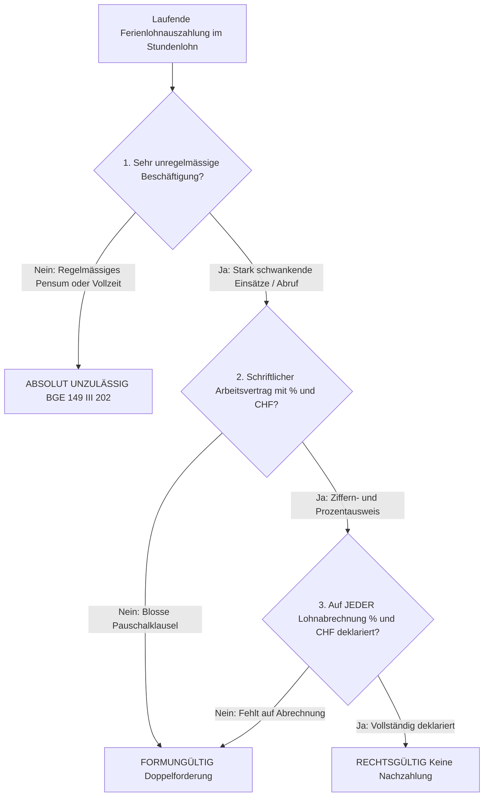

## Gesetzeswortlaut



### Die Absätze im systematischen Überblick

| Absatz | Regelungsgehalt | Normcharakter |
|---|---|---|
| **Abs. 1** | Anspruch auf den gesamten Ferienlohn nach dem Lohnausfallprinzip sowie angemessene Entschädigung für entfallenden Naturallohn | Relativ zwingend zugunsten des Arbeitnehmers (Art. 362 OR) |
| **Abs. 2** | Striktes Verbot der finanziellen Abgeltung der Ferien während des laufenden Arbeitsverhältnisses | **Absolut zwingend** (Art. 361 OR) |
| **Abs. 3** | Sanktion bei pflichtwidriger Erwerbsarbeit für Dritte während der Ferien (Lohnverweigerung und Rückforderung) | Dispositiv (Art. 361/362 OR e contrario) |

---

## Überblick und Bedeutung

Art. 329d OR ist die wirtschaftliche und gesundheitspolitische Schlüsselnorm des schweizerischen Ferienrechts. Während Art. 329a OR die Dauer der Freistellung von der Arbeitspflicht regelt, garantiert Art. 329d OR die materielle Basis dieser Freistellung: Der Arbeitnehmer soll während der Ferien wirtschaftlich exakt so dastehen, wie wenn er gearbeitet hätte (*Grundsatz des Lohnausfalls*).

### Gesetzgeberische Motive und Zweck des Abgeltungsverbots

In der Botschaft zur Revision des Arbeitsvertragsrechts hielt der Bundesrat fest, dass ein blosser Anspruch auf arbeitsfreie Zeit wertlos bliebe, wenn die arbeitende Person während dieser Tage keinen Lohn erhielte oder den Erholungsanspruch aus finanzieller Not gegen Einmalzahlungen verkaufen könnte:

> «Der Arbeitnehmer soll durch den Bezug von Ferien keinen wirtschaftlichen Nachteil erleiden. Würde der Ferienlohn nicht bezahlt oder dürfte er während des Dienstverhältnisses abgegolten werden, so bestünde die Gefahr, dass der Arbeitnehmer aus materiellen Gründen auf die ihm zustehende Erholung verzichtet. Die Ferien bezwecken aber die Regeneration der physischen und psychischen Kräfte des Arbeitnehmers und dienen damit auch dem allgemeinen Gesundheitsschutz.»

([Botschaft vom 25. August 1967, BBl 1967 II 249, S. 336 ff.](https://fedlex.data.admin.ch/eli/fga/1967/2_249_249_225)).

Aus diesem Grund gestaltete der Bundesgesetzgeber das Abgeltungsverbot in Abs. 2 als **absolut zwingende Bestimmung** im Sinne von Art. 361 Abs. 1 OR aus. Weder der Einzelarbeitsvertrag noch Gesamtarbeitsverträge (GAV) können das Abgeltungsverbot während des bestehenden Arbeitsverhältnisses einschränken oder beseitigen.

### Prüfschema: Ferienlohn und Abgeltungsverbot

| Nr. | Merkmal | Was zu prüfen ist | Behauptungs- und Beweislast / Beweismass | Abschnitt |
|---|---|---|---|---|
| 1 | **Bestandteile des Ferienlohns** | Erfassung des Grundlohns sowie regelmässiger Schicht-, Nacht-, Wochenendzulagen und variabler Lohnteile (Abs. 1) | Arbeitnehmer für regelmässige Ausrichtung und Höhe | [A](#a-das-lohnausfallprinzip-und-die-berechnung-des-ferienlohns-abs-1) |
| 2 | **Ersatz für Naturallohn** | Entfallen von Kost und Logis während der Ferienabwesenheit; geldwerte Festsetzung | Arbeitnehmer für Naturalanspruch; Arbeitgeber für Bewertung | [A.4](#4-entschädigung-für-ausfallenden-naturallohn) |
| 3 | **Strikte Geltung des Abgeltungsverbots** | Besteht das Arbeitsverhältnis fort? Jede Vereinbarung über Barabgeltung ist absolut nichtig (Abs. 2) | Von Amtes wegen zu beachten (Art. 361 OR i.V.m. Art. 20 OR) | [B](#b-das-absolut-zwingende-abgeltungsverbot-während-des-arbeitsverhältnisses-abs-2) |
| 4 | **Ausnahme: Unregelmässiger Stundenlohn** | Kumulative Prüfung: 1. Unregelmässigkeit, 2. Schriftliche Abrede mit % und CHF, 3. Ausweis auf jeder Abrechnung | Arbeitgeber für das Vorliegen sämtlicher Voraussetzungen | [C](#c-die-strenge-ausnahme-bei-unregelmässiger-teilzeitarbeit-im-stundenlohn) |
| 5 | **Sanktion bei Formmängeln (Doppelforderung)** | Klausel «Ferien inbegriffen» ist nichtig; Ferienlohn kann trotz erfolgter Zahlung nachgefordert werden | Arbeitnehmer verlangt Ferienlohn; Arbeitgeber bestreitet | [D](#d-rechtsfolgen-formungültiger-ferienlohnklauseln-und-doppelzahlungspflicht) |
| 6 | **Rechtsmissbrauchsschranke** | Hat der Arbeitnehmer die ungültige Klausel treuwidrig selbst herbeigeführt (Kaderperson)? | Arbeitgeber für Rechtsmissbrauch (hohe Hürde) | [D.3](#3-die-enge-rechtsmissbrauchsschranke-art-2-abs-2-zgb) |
| 7 | **Entgeltliche Drittarbeit (Abs. 3)** | Erwerbstätigkeit für Dritte während der Ferien mit Beeinträchtigung der Arbeitgeberinteressen | Arbeitgeber für Pflichtverletzung und Drittlohn | [E](#e-entgeltliche-drittarbeit-während-der-ferien-abs-3) |

---

## Kommentierung

### A. Das Lohnausfallprinzip und die Berechnung des Ferienlohns (Abs. 1)

#### 1. Der Grundsatz des Lohnausfalls

Art. 329d Abs. 1 OR verpflichtet die Arbeitgeberin, dem Arbeitnehmer für die Ferien «den gesamten darauf entfallenden Lohn» zu entrichten. Massstab ist der hypothetische Lohn, den der Arbeitnehmer verdient hätte, wenn er in der Ferienzeit normal gearbeitet hätte (*Lohnausfallprinzip*). Der Arbeitnehmer darf während der Ferien finanziell weder schlechter noch besser gestellt sein als während der Arbeit.

#### 2. Regelmässige Zulagen und Schichtzuschläge

Zum Ferienlohn gehört nicht bloss der nackte Grundlohn. Werden zusätzlich zum Grundlohn regelmässig Zuschläge ausgerichtet, sind diese zwingend in den Ferienlohn einzurechnen:
- **Schicht-, Nacht-, Wochenend- und Feiertagszulagen**: Werden solche Leistungen regelmässig und während einer gewissen Dauer ausgerichtet, müssen sie nach ständiger Rechtsprechung bei der Berechnung des Ferienlohnes berücksichtigt werden ([BGE 132 III 172 E. 3](https://entscheidsuche.ch/docs/CH_BGE/CH_BGE_005_BGE-132-III-172_2006.html)).
- **Unregelmässige Spesenersatzleistungen**: Echte Auslagenentschädigungen (z.B. Reisespesen, Benzingeld, Mittagessensentschädigung bei Aussendienst) entfallen während der Ferien, da dem Arbeitnehmer keine Auslagen entstehen. Repräsentieren Spesen jedoch verdeckte Lohnbestandteile (Pauschalspesen ohne Nachweispflicht), zählen sie zum Ferienlohn.

#### 3. Variable Lohnbestandteile (Provisionen, Umsatzbeteiligungen)

Bezieht der Arbeitnehmer ganz oder teilweise variable Vergütungen (z.B. Verkaufsprovisionen, Umsatzanteile), ist auf den **Durchschnittsverdienst** einer angemessenen Referenzperiode abzustellen ([BGE 130 III 19](https://entscheidsuche.ch/docs/CH_BGE/CH_BGE_005_BGE-130-III-19_2004.html)):
- In der Regel bildet das **letzte Dienstjahr (12 Monate)** vor dem Ferienbezug den massgebenden Berechnungszeitraum.
- Zeigt das Einkommen starke saisonale Ausschläge oder war das letzte Jahr ausserordentlich, kann eine längere oder kürzere Periode herangezogen werden.
- Echte freiwillige Gratifikationen, auf die kein Rechtsanspruch besteht (Art. 322d OR), werden nicht in den Ferienlohn eingerechnet; vertraglich geschuldete Boni oder 13. Monatslöhne hingegen schon (anteilig 1/12 bzw. 8,33 % pro Ferienwoche).

#### 4. Entschädigung für ausfallenden Naturallohn

Erhält der Arbeitnehmer neben dem Barlohn Kost und Logis (z.B. im Hotel- und Gastgewerbe oder in der Landwirtschaft), entfällt diese Leistung regelmässig, wenn er die Ferien andernorts verbringt. Art. 329d Abs. 1 OR ordnet hierfür ausdrücklich eine **angemessene Geldentschädigung** an. Massgebend sind die Ansätze der AHV-Beitragsverordnung oder die Festlegungen in einschlägigen GAVs (z.B. L-GAV des Gastgewerbes).

---

### B. Das absolut zwingende Abgeltungsverbot während des Arbeitsverhältnisses (Abs. 2)

#### 1. Grundsatz: Absolute Nichtigkeit der Auszahlung

Gemäss Art. 329d Abs. 2 OR dürfen Ferien während der Dauer des Arbeitsverhältnisses **nicht durch Geldleistungen oder andere Vergünstigungen abgegolten werden**. Die Norm ist nach Art. 361 Abs. 1 OR absolut zwingend.

Jede Vereinbarung zwischen Arbeitgeber und Arbeitnehmer, wonach auf Ferien verzichtet und stattdessen eine Abfindung bezahlt wird, ist **nichtig (Art. 20 Abs. 1 OR)**:
- Wurde dem Arbeitnehmer während des laufenden Dienstverhältnisses eine Geldentschädigung für Ferien bezahlt, befreit dies den Arbeitgeber nicht von seiner Pflicht, die Ferien in natura zu gewähren ([BGE 129 III 493 E. 3](https://entscheidsuche.ch/docs/CH_BGE/CH_BGE_005_BGE-129-III-493_2003.html)).
- Eine Vereinbarung, wonach der Arbeitnehmer das Risiko der Lohnkosten eines nötig werdenden Ferienvertreters selbst zu tragen hat oder dafür durch einen höheren Stundenlohn entschädigt wird, ist ebenfalls nichtig ([BGE 118 II 136 E. 3b](https://entscheidsuche.ch/docs/CH_BGE/CH_BGE_004_BGE-118-II-136_1992-06-16.html)).

#### 2. Zulässigkeit der Auszahlung bei Beendigung des Arbeitsverhältnisses

Das Abgeltungsverbot gilt strikt nur «während der Dauer des Arbeitsverhältnisses». Endet das Arbeitsverhältnis und stehen noch Ferientage offen, wandelt sich der Naturalanspruch in eine reine Geldforderung um, sofern der Bezug in natura bis zum Austrittsstichtag objektiv unmöglich oder unzumutbar ist ([BGE 131 III 451 E. 2](https://entscheidsuche.ch/docs/CH_BGE/CH_BGE_005_BGE-131-III-451_2005.html); [BGE 128 III 271 E. 4](https://entscheidsuche.ch/docs/CH_BGE/CH_BGE_005_BGE-128-III-271_2002.html)).
- Kann der Arbeitnehmer die Ferien wegen einer Freistellung, wegen Krankheit oder dringender Betriebsarbeiten bis zum Austrittstermin nicht beziehen, hat der Arbeitgeber die Ferientage am letzten Arbeitstag zwingend in bar mit dem Schlusslohn auszugleichen.

---

### C. Die strenge Ausnahme bei unregelmässiger Teilzeitarbeit im Stundenlohn

Die Rechtsprechung hat für eine einzige Sonderkonstellation eine eng begrenzte Ausnahme vom laufenden Abgeltungsverbot zugelassen: bei **unregelmässiger Teilzeitarbeit im Stundenlohn**.

Weil es bei schwankenden Einsätzen technisch schwierig ist, den Ferienlohn im Voraus zu ermitteln, darf der Ferienlohnzuschlag mit dem laufenden Lohn ausbezahlt werden — jedoch **ausschliesslich unter drei kumulativen Voraussetzungen** ([BGE 129 III 493 E. 3.1](https://entscheidsuche.ch/docs/CH_BGE/CH_BGE_005_BGE-129-III-493_2003.html)):

#### Die drei kumulativen Voraussetzungen im Detail:

1. **Sehr unregelmässige Beschäftigung (objektives Erfordernis)**:
   - Die Arbeitszeit muss von Monat zu Monat so stark variieren (z.B. Arbeit auf Abruf, saisonale Aushilfen), dass eine Vorausberechnung des auf die Ferien entfallenden Lohnes auf praktisch unüberwindbare Schwierigkeiten stösst.
   - **Strikter Ausschluss bei Vollzeitarbeit**: Bei einer Vollzeitbeschäftigung ist eine Abgeltung im Stundenlohn **kategorisch ausgeschlossen**, selbst wenn die Monatsarbeitszeit schwankt ([BGE 149 III 202 E. 2](https://entscheidsuche.ch/docs/CH_BGE/CH_BGE_005_BGE-149-III-202_2023.html); [BGer 4A_619/2019 vom 15. April 2020 E. 4.2](https://entscheidsuche.ch/docs/CH_BGer/CH_BGer_004_4A-619-2019_2020-04-15.html)). Dasselbe gilt für regelmässige Teilzeitanstellungen (z.B. fixe 20 Stunden pro Woche).
2. **Schriftlicher Arbeitsvertrag (formelles Erfordernis)**:
   - Im Arbeitsvertrag muss der Ferienlohnzuschlag klar und transparent sowohl **prozentual als auch betragsmässig in Schweizer Franken** separat ausgewiesen sein ([BGE 116 II 515](https://entscheidsuche.ch/docs/CH_BGE/CH_BGE_004_BGE-116-II-515_1990-07-26.html)).
   - *Muster*: «Grundlohn CHF 30.00 + 8,33 % Ferienentschädigung (CHF 2.50) = Bruttostundenlohn CHF 32.50».
3. **Laufende Deklaration in jeder Monatsabrechnung (Ausführungserfordernis)**:
   - Der Arbeitgeber muss auf **jeder einzelnen Lohnabrechnung** den Grundlohn und den Ferienlohnzuschlag getrennt nach Prozentsatz und Betrag in Franken aufführen ([BGE 129 III 493 E. 3.3](https://entscheidsuche.ch/docs/CH_BGE/CH_BGE_005_BGE-129-III-493_2003.html)).

#### Gesetzliche Prozentsätze für den Ferienlohnzuschlag:

| Gesetzlicher / vertraglicher Ferienanspruch | Zuschlagssatz auf den Grundlohn | Berechnungsformel |
|---|---|---|
| **4 Wochen** (gesetzliches Minimum ab 20 Jahren) | **8,33 %** | 4 Wochen / 48 Arbeitswochen = 8,333 % |
| **5 Wochen** (Jugendliche bis 20 Jahre / Vertrag) | **10,64 %** | 5 Wochen / 47 Arbeitswochen = 10,638 % |
| **6 Wochen** (vertraglich / altersbedingt) | **13,04 %** | 6 Wochen / 46 Arbeitswochen = 13,043 % |

---

### D. Rechtsfolgen formungültiger Ferienlohnklauseln und Doppelzahlungspflicht

#### 1. Die Sanktion: Unwirksamkeit und Nachzahlung

Erfüllt die Vereinbarung oder die Abrechnungspraxis die drei kumulativen Voraussetzungen von BGE 129 III 493 nicht, tritt eine drakonische Rechtsfolge ein:
- Die Klausel («Ferienlohn inbegriffen», «Ferienentschädigung im Stundenlohn enthalten») ist absolut **unwirksam**.
- Der gesamte ausbezahlte Betrag gilt von Gesetzes wegen als **reiner Grundlohn**.
- Der Arbeitnehmer kann die Ferien bei Fortdauer des Vertrages vollumfänglich in natura einfordern — oder bei Beendigung des Arbeitsverhältnisses den **gesamten Ferienlohn nochmals einfordern** (*Doppelzahlungspflicht des Arbeitgebers*).

#### 2. Grenzkasuistik: Nachforderung und Doppelzahlung

| Fallkonstellation | Ausgang vor Gericht | Tragende Erwägung & Fundstelle |
|---|---|---|
| **Pauschalklausel im Vertrag** («Ferien in Stundenlohn inkl.»), auf Lohnabrechnung nur Gesamtbetrag | **Klage geschützt**: Arbeitgeber muss 8,33 % für die gesamte Dauer nachzahlen | Verletzung des Spezifikationserfordernisses; Pauschalklauseln genügen nicht ([BGE 129 III 493 E. 3](https://entscheidsuche.ch/docs/CH_BGE/CH_BGE_005_BGE-129-III-493_2003.html); [KG VS C3 23 47](https://entscheidsuche.ch/docs/VS_Gerichte/VS_BZG_999_C3-23-47_2024-06-20.pdf)) |
| **Prozentangabe im Vertrag**, aber auf den Monatsabrechnungen kein Frankenausweis | **Klage geschützt**: Vollständige Nachzahlung geschützt | Das Erfordernis des separaten Ausweises auf jeder Abrechnung ist zwingend kumulativ ([KG LU 1B 14 13, LGVE 2014 I Nr. 4](https://entscheidsuche.ch/docs/LU_Gerichte/LU_KG_001_1B-14-13_2014-04-30.html)) |
| **Vollzeitarbeit im Stundenlohn** trotz formell perfekter Abrechnung | **Klage geschützt**: Laufende Auszahlung unzulässig; Ferienguthaben muss nachgewährt/abgegolten werden | Objektive Unüberwindbarkeit fehlt bei Vollzeitstellen; Art. 329d Abs. 2 OR ist absolut zwingend ([BGE 149 III 202 E. 2](https://entscheidsuche.ch/docs/CH_BGE/CH_BGE_005_BGE-149-III-202_2023.html)) |
| **Kaderangestellter verfasst Vertrag selbst** und klagt nach Austritt auf Doppelzahlung | **Klage abgewiesen**: Rechtsmissbrauch nach Art. 2 Abs. 2 ZGB bejaht | Widersprüchliches Verhalten (*venire contra factum proprium*); Schutznorm darf nicht zur Bereicherung missbraucht werden |

#### Sachverhalt: Der Stundenlohn bei Vollzeitanstellung (BGE 149 III 202)
Ein Mitarbeiter war bei einer Reinigungs- und Logistikfirma als Allrounder angestellt. Der Vertrag sah eine reguläre Arbeitszeit von 45 Stunden pro Woche vor und vereinbarte einen Stundenlohn von Fr. 18.00 zuzüglich 8,33 % Ferienentschädigung. Sowohl im Vertrag als auch auf den Monatsabrechnungen waren die 8,33 % in Franken und Prozent separat deklariert. Nach Beendigung verlangte der Mitarbeiter die Auszahlung sämtlicher nicht bezogener Ferientage. Das Bundesgericht hiess die Klage gut: Bei einer Vollzeitanstellung ist eine laufende Auszahlung des Ferienlohns von Bundesrechts wegen absolut unzulässig. Schwankungen in der Monatsarbeitszeit stellen keine «unüberwindbaren Schwierigkeiten» dar. Der Arbeitgeber musste die Ferientage ein zweites Mal vergüten ([BGE 149 III 202 E. 2.3](https://entscheidsuche.ch/docs/CH_BGE/CH_BGE_005_BGE-149-III-202_2023.html)).

#### 3. Die enge Rechtsmissbrauchsschranke (Art. 2 Abs. 2 ZGB)

Arbeitgeber wehren sich gegen die Nachforderung regelmässig mit dem Einwand des Rechtsmissbrauchs: Der Arbeitnehmer habe jahrelang gewusst, dass der Ferienlohn laufend bezahlt worden sei, und handle treuwidrig, wenn er den Betrag nach Vertragsende nochmals fordere.

Das Bundesgericht hat diesen Einwand in [BGE 129 III 493 E. 5](https://entscheidsuche.ch/docs/CH_BGE/CH_BGE_005_BGE-129-III-493_2003.html) mit Nachdruck verworfen:
- Die blosse Tatsache, dass der Arbeitnehmer während des Arbeitsverhältnisses widerspruchslos Lohnabrechnungen mit unzulässigen Klauseln entgegengenommen hat, begründet **keinen Rechtsmissbrauch**.
- Da Art. 329d Abs. 2 OR dem absolut zwingenden Schutz der Gesundheit dient, darf dieser Schutz nicht über Art. 2 Abs. 2 ZGB ausgehöhlt werden.
- Rechtsmissbrauch wird nur unter ganz ausserordentlichen Umständen bejaht: wenn der Arbeitnehmer als leitender Angestellter die mangelhafte Vertragsklausel selbst formuliert hat oder den Arbeitgeber bewusst und arglistig in eine Nachzahlungspflicht manövriert hat.

> **Leitsatz.** Die nachträgliche Geltendmachung des Ferienlohns bei formungültigen Abrechnungen ist grundsätzlich nicht rechtsmissbräuchlich. Der Arbeitgeber haftet für Formmängel uneingeschränkt und muss den Ferienlohn ein zweites Mal entrichten, wenn der Ausweis auf Vertrag oder Abrechnung fehlt.

---

### E. Entgeltliche Drittarbeit während der Ferien (Abs. 3)

Art. 329d Abs. 3 OR sanktioniert den Arbeitnehmer, der während der Ferien entgeltliche Arbeit für einen Dritten verrichtet.

#### 1. Voraussetzungen der Sanktion
1. **Entgeltliche Erwerbsarbeit**: Der Arbeitnehmer leistet gegen Bezahlung Dienste für einen Dritten (unentgeltliche Gefälligkeiten, Hobbys oder familiäre Mithilfe fallen nicht darunter).
2. **Verletzung berechtigter Arbeitgeberinteressen**: Die Drittarbeit muss die Interessen des eigenen Arbeitgebers beeinträchtigen. Dies ist der Fall, wenn:
   - eine **Konkurrenzierung** vorliegt (Treuepflichtverletzung nach Art. 321a Abs. 3 OR);
   - die Drittarbeit so anstrengend ist, dass der **Erholungszweck vereitelt** wird und der Arbeitnehmer erschöpft an den Arbeitsplatz zurückkehrt.

#### 2. Rechtsfolge
Liegen die Voraussetzungen vor, kann der Arbeitgeber:
- die Auszahlung des Ferienlohns verweigern;
- bereits bezahlten Ferienlohn für die betroffenen Tage zurückfordern (Art. 62 OR);
- bei schwerer Treuepflichtverletzung (insb. Konkurrenzierung) eine Verwarnung oder fristlose Kündigung nach Art. 337 OR aussprechen.

---

## Kantonale Praxisfragen

### 1. Ausweis auf Lohnabrechnung ohne schriftliche Vertragsklausel
Häufig weisen Arbeitgeber den Ferienlohn auf den monatlichen Lohnabrechnungen ziffernmässig aus, haben im Arbeitsvertrag aber lediglich einen Gesamstundenlohn ohne Spezifikation vereinbart.
- **Kantonale Praxis (Luzern)**: Das Kantonsgericht Luzern entschied, dass der Ausweis auf den monatlichen Lohnabrechnungen das Fehlen einer schriftlichen Vertragsabrede nicht heilen kann. Werden die drei kumulativen Voraussetzungen nicht von Anfang an erfüllt, liegt eine unzulässige Abgeltung vor; der Arbeitnehmer hat Anspruch auf nochmalige Auszahlung ([Kantonsgericht Luzern, 1B 14 13 vom 30. April 2014, LGVE 2014 I Nr. 4](https://entscheidsuche.ch/docs/LU_Gerichte/LU_KG_001_1B-14-13_2014-04-30.html)).

### 2. Ferienentschädigung bei öffentlich-rechtlichen Aushilfsverhältnissen
Im öffentlichen Personalrecht von Gemeinden und Kantonen wird für Hilfspersonal (z.B. Schulhortnerinnen, Bademeister) oft pauschal auf das OR verwiesen.
- **Kantonale Praxis (Zürich)**: Das Verwaltungsgericht Zürich stellte klar, dass bei einer dynamischen Verweisung des kantonalen oder kommunalen Personalrechts auf die Art. 319 ff. OR auch die strenge bundesgerichtliche Rechtsprechung zu Art. 329d OR vollumfänglich greift. Enthielt der Anstellungsbeschluss keinen Ziffernausweis des Ferienanteils, schuldet das Gemeinwesen die Nachzahlung der Ferienentschädigung für fünf Jahre rückwirkend ([Verwaltungsgericht Zürich, PB.1999.00027 vom 23. Februar 2000](https://entscheidsuche.ch/docs/ZH_Verwaltungsgericht/ZH_VG_001_-PB-1999-00027_2000-02-23.html)).

---

## Praxishinweise

### Für Arbeitgeber

1. **Keine Stundenlohnverträge bei Vollzeit- oder festen Teilzeitpensen**: Stellen Sie Mitarbeitende mit festem Pensum zwingend im Monatslohn an. Bei Vollzeitbeschäftigung ist die laufende Ferienlohnauszahlung nach [BGE 149 III 202](https://entscheidsuche.ch/docs/CH_BGE/CH_BGE_005_BGE-149-III-202_2023.html) absolut nichtig und löst eine doppelte Zahlungspflicht aus.
2. **Die «Zwei-Säulen-Formel» im Arbeitsvertrag**: Verwenden Sie bei unregelmässigen Stundenlöhnen stets folgende Formulierung im Vertrag: *«Der Basisstundenlohn beträgt CHF [XX.XX]. Zuzüglich 8,33 % Ferienentschädigung (CHF [X.XX]) ergibt sich ein Bruttostundenlohn von CHF [XX.XX].»* Die Angabe blosser Prozente ohne Frankenbetrag ist nach [BGE 116 II 515](https://entscheidsuche.ch/docs/CH_BGE/CH_BGE_004_BGE-116-II-515_1990-07-26.html) ungenügend.
3. **Ziffernmässiger Ausweis auf jeder einzelnen Monatsabrechnung**: Kontrollieren Sie Ihr Lohnbuchhaltungsprogramm. Auf jeder Lohnabrechnung müssen Basislohn, Prozentsatz (8,33 %) und der genaue Frankenbetrag der Ferienentschädigung auf einer separaten Zeile ausgewiesen sein ([BGE 129 III 493 E. 3.3](https://entscheidsuche.ch/docs/CH_BGE/CH_BGE_005_BGE-129-III-493_2003.html)).
4. **Schicht- und Nachtzulagen bei Ferienbezug weiterzahlen**: Werden Mitarbeitenden im Monatslohn regelmässig Schicht- oder Pikettzulagen ausbezahlt, müssen diese während der Ferienabwesenheit als Durchschnittszuschlag weiterbezahlt werden ([BGE 132 III 172](https://entscheidsuche.ch/docs/CH_BGE/CH_BGE_005_BGE-132-III-172_2006.html)).

### Für Arbeitnehmer

1. **Lohnabrechnungen bei Stundenlohn prüfen**: Prüfen Sie, ob in Ihrem Arbeitsvertrag und auf Ihren Monatsabrechnungen der Ferienlohnzuschlag in Prozent und Franken deklariert ist. Steht dort nur «inkl. Ferien» oder fehlt der Betrag in Franken, können Sie 8,33 % des gesamten Lohnes nachfordern ([BGE 129 III 493](https://entscheidsuche.ch/docs/CH_BGE/CH_BGE_005_BGE-129-III-493_2003.html)).
2. **Keine Angst vor dem Rechtsmissbrauchseinwand**: Die nachträgliche Einklagung der Ferienentschädigung nach Beendigung des Arbeitsverhältnisses ist nach gefestigter Bundesgerichtspraxis nicht rechtsmissbräuchlich ([BGE 129 III 493 E. 5](https://entscheidsuche.ch/docs/CH_BGE/CH_BGE_005_BGE-129-III-493_2003.html)).
3. **Verjährungsfrist von fünf Jahren beachten**: Die Nachforderung verjährt nach Art. 128 Ziff. 3 OR in fünf Jahren ab jeweiliger Fälligkeit der Monatszahlung.

---

## Literatur

- **Aubert, Gabriel**, *Le droit des vacances : quelques problèmes pratiques*, in: Journée 1990 de droit du travail et de la sécurité sociale, Genf 1990, S. 45 ff.
- **Portmann, Wolfgang / Rudolph, Roger**, *Basler Kommentar, Obligationenrecht I (Art. 1–529 OR)*, 7. Aufl., Basel 2020, Art. 329d N. 1–25.
- **Rehbinder, Manfred / Stöckli, Jean-Fritz**, *Berner Kommentar, Der Arbeitsvertrag (Art. 319–362 OR)*, Bern 2010, Art. 329d N. 1–20.
- **Streiff, Ullin / von Kaenel, Adrian / Rudolph, Roger**, *Arbeitsvertrag: Praxiskommentar zu Art. 319–362 OR*, 7. Aufl., Zürich 2012, Art. 329d N. 1–18.
- **Wyler, Rémy / Heinzer, Boris**, *Droit du travail*, 4. Aufl., Bern 2019, S. 430 ff.
