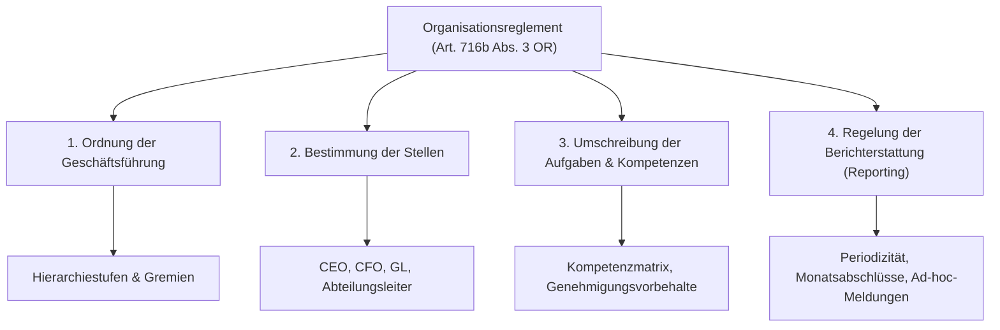

## Gesetzeswortlaut



---

## Historische Entwicklung, Gesetzgeberischer Zweck und Normkontinuität

Art. 716b OR bildet den zentralen Hebel zur Auslagerung der operativen Geschäftsführung aus dem Verwaltungsrat. Die Bestimmung regelt die formellen und materiellen Voraussetzungen, unter denen sich das oberste Leitungsorgan vom operativen Tagesgeschäft entlasten und in den Genuss des gesellschaftsrechtlichen Haftungsprivilegs (Art. 754 Abs. 2 OR) gelangen kann.

### 1. Rechtslage vor der Aktienrechtsreform von 1991 (aArt. 722 aOR)
Vor der grossen Revision von 1991 war die Übertragung der Geschäftsführung in **aArt. 722 Abs. 1 aOR** nur rudimentär geregelt. Der Verwaltungsrat führte die Geschäfte, sofern die Statuten oder Beschlüsse der Generalversammlung die Führung nicht einzelnen Mitgliedern oder Dritten (Direktoren) übertrugen. Das Gesetz stellte damals weder Anforderungen an die Form der Delegation noch verlangte es ein Organisationsreglement. In der Folge führten formlose Kompetenzübertragungen zu gravierenden Rechtsunsicherheiten: Im Konkursfall war oft nicht rekonstruierbar, wer welche Befugnisse innehatte, und Verwaltungsräte versuchten sich durch pauschale Behauptungen einer «faktischen Auslagerung» der Organverantwortung zu entziehen ([BGE 114 V 219 E. 4a](https://entscheidsuche.ch/docs/CH_BGE/CH_BGE_007_BGE-114-V-219_1988-09-29.html#consideration_4.)).

### 2. Kodifikation des Erfordernisses eines Organisationsreglements (Revision 1991)
Mit der Revision vom 4. Oktober 1991 ([AS 1992 733](https://www.fedlex.admin.ch/eli/oc/1992/733_733_733/de); Botschaft des Bundesrates vom 23. Februar 1983, [BBl 1983 II 745, S. 867 ff.](https://www.fedlex.admin.ch/eli/fga/1983/2_745_757_713/de)) schuf der Gesetzgeber Art. 716b OR als zwingende Delegationsnorm:
* **Statutarische Ermächtigung und Reglementspflicht**: Eine wirksame Delegation wurde zwingend an eine Ermächtigung in den Statuten und den Erlass eines schriftlichen Organisationsreglements geknüpft.
* **Transparenz für Dritte**: Zur Beseitigung intransparenter Machtverhältnisse wurde in Abs. 2 aOR (heute Abs. 4) ein schriftliches Auskunftsrecht für Aktionäre und Gesellschaftsgläubiger verankert ([BBl 1983 II 745, S. 868](https://www.fedlex.admin.ch/eli/fga/1983/2_745_757_713/de)).
* **Zusammenspiel mit dem Haftungsrecht**: Das Vorliegen eines gültigen Organisationsreglements wurde zur formellen Bedingung erhoben, damit der Verwaltungsrat das Haftungsprivileg nach Art. 754 Abs. 2 OR beanspruchen kann ([BGE 122 III 195 E. 3a](https://entscheidsuche.ch/docs/CH_BGE/CH_BGE_005_BGE-122-III-195_1996-05-28.html#consideration_3a)).

### 3. Aktienrechtsreform 2020 (in Kraft seit 1. Januar 2023)
Mit der am 1. Januar 2023 in Kraft getretenen Revision (Botschaft vom 23. November 2016, [BBl 2017 399, S. 526 ff.](https://www.fedlex.admin.ch/eli/fga/2017/112/de)) erfuhr Art. 716b OR bedeutsame Präzisierungen und eine neue Absatzgliederung:
* **Neuer Grundsatz in Abs. 1 («Opting-out» statt «Opting-in»)**: Während nach bisherigem Recht eine ausdrückliche statutarische Delegationsklausel verlangt wurde, gilt neu der umgekehrte Grundsatz: Der Verwaltungsrat kann die Geschäftsführung delegieren, *es sei denn*, die Statuten sehen ausdrücklich etwas anderes vor («Sehen die Statuten nichts anderes vor...»).
* **Absatz 2 (Börsenkotierte Gesellschaften & Vermögensverwaltung)**: Die Bestimmungen der früheren Verordnung gegen die betrügerischen Vergütungen bei börsenkotierten Aktiengesellschaften (VegüV) wurden in das OR überführt. Bei kotierten Gesellschaften darf die Geschäftsführung nur noch natürlichen Personen übertragen werden; juristische Personen sind als Geschäftsleiter ausgeschlossen, mit der einzigen Ausnahme der gewerbsmässigen Vermögensverwaltung.
* **Absatz 4 (Elektronische Auskunft)**: Die Orientierung von Aktionären und Gläubigern über die Organisation der Geschäftsführung kann neu formfrei auch in **elektronischer Form** (z. B. PDF per E-Mail) erfolgen.
* **Absatz 5 (Gesetzliche Auffangzuständigkeit)**: Die Klarstellung, dass die Geschäftsführung bei unterbliebener oder unvollständiger Delegation allen Verwaltungsratsmitgliedern gemeinsam zusteht, wurde als Absatz 5 gesetzlich verankert.

---

## Überblick und Bedeutung

### Systematische Einordnung und Schutzmechanismus
Art. 716b OR fungiert als Scharnier zwischen der obersten Leitungsebene (Verwaltungsrat; Art. 716a OR) und der operativen Führungsebene (Geschäftsleitung; *Management*). 

Die Norm erfüllt eine dreifache Schutzfunktion:
1. **Organisatorische Klarheit (Innenverhältnis)**: Durch die Verpflichtung zum Erlass eines Organisationsreglements werden Kompetenzstreitigkeiten zwischen Verwaltungsrat und Geschäftsleitung vermieden.
2. **Gläubiger- und Aktionärsschutz (Transparenz)**: Dritte müssen in Erfahrung bringen können, welche Führungsstellen existieren und wer für operative Fehlentscheide einzustehen hat.
3. **Fundament des Haftungsprivilegs (Art. 754 Abs. 2 OR)**: Nur wer die Geschäftsführung ordnungsgemäss reglementiert delegiert hat, wird von der Haftung für das operative Tagesgeschäft befreit und haftet lediglich für gehörige Auswahl, Instruktion und Überwachung (*cura in eligendo, in instruendo et in custodiendo*; [BGE 122 III 195 E. 3a](https://entscheidsuche.ch/docs/CH_BGE/CH_BGE_005_BGE-122-III-195_1996-05-28.html#consideration_3a)).

### Dogmatisches Prüfschema: Rechtmässigkeit der Delegation und Haftungsfolge

Die wirksame Übertragung der Geschäftsführung und die daran anknüpfenden Rechtsfolgen folgen einem festen Prüfungsmuster:

| Schritt | Tatbestandsmerkmal | Gesetzliche Grundlage | Behauptungs- und Beweislast (Art. 8 ZGB) | Beweismass |
|---|---|---|---|---|
| **A** | **Kein statutarischer Delegationsausschluss** | Art. 716b Abs. 1 OR | Partei, die Unzulässigkeit behauptet (Statutenfassung) | Urkundenbeweis (Handelsregisterakten) |
| **B** | **Zulässige Delegatspersonen** | Art. 716b Abs. 1 & 2 OR | Klagende Partei für Gesetzesverstoss (z.B. juristische Person bei kotierter AG) | Regelbeweismass (strikter Beweis) |
| **C** | **Gültiges Organisationsreglement (Form & Beschluss)** | Art. 716b Abs. 1 & 3 OR i.V.m. Art. 716a Abs. 1 Ziff. 2 OR | Beklagter Verwaltungsrat (VR-Beschluss, Schriftform) | Voller Beweis (Exkulpationsvoraussetzung) |
| **D** | **Erfüllung der gesetzlichen Mindestinhalte** | Art. 716b Abs. 3 OR | Beklagter Verwaltungsrat (Stellen, Aufgaben, Reporting) | Voller Beweis der inhaltlichen Dichte |
| **E** | **Grenze der unübertragbaren Aufgaben** | Art. 716b Abs. 1 i.V.m. Art. 716a Abs. 1 OR | Klagende Partei für Kompetenzüberschreitung (Nichtigkeit) | Regelbeweismass |
| **F** | **Rechtsfolge: Haftungsbefreiung oder Auffangzuständigkeit** | Art. 716b Abs. 5 i.V.m. Art. 754 Abs. 2 OR | Beklagter VR für *Cura*-Pflichten; Kläger für Vollhaftung bei Formmangel | Exkulpation des VR / Vollhaftung |

---

## Tatbestandsmerkmale und Kommentierung

### A. Kein statutarischer Delegationsausschluss (Abs. 1)

> **Leitsatz.** Nach neuem Aktienrecht ist die Befugnis zur Delegation der Geschäftsführung die gesetzliche Regel. Der Verwaltungsrat darf die Geschäftsführung delegieren, sofern die Statuten diese Übertragung nicht ausdrücklich verbieten oder einschränken.

* **Rechtslage seit 1. Januar 2023**: Vor der Revision 2020 verlangte das Gesetz eine Ermächtigung durch die Statuten («Ist der Verwaltungsrat durch die Statuten dazu ermächtigt...»). Nach Art. 716b Abs. 1 nOR gilt neu der Grundsatz der Delegationsfreiheit: Der Verwaltungsrat besitzt die organschaftliche Kompetenz zur Delegation von Gesetzes wegen, es sei denn, die Statuten schliessen dies explizit aus («Sehen die Statuten nichts anderes vor...»).
* **Statutarische Beschränkungen**: Die Statuten können die Delegation gänzlich untersagen (was bei kleinen Familien-AGs vorkommt, in denen zwingend der Gesamt-VR operativ handeln soll) oder modifizieren (z. B. Delegation nur an Verwaltungsratsmitglieder, nicht aber an aussenstehende Dritte; Vorbehalt der Zustimmung der Generalversammlung).

### B. Zulässige Delegatspersonen und Besonderheiten bei kotierten Gesellschaften (Abs. 1 und 2)

> **Leitsatz.** Bei nicht kotierten Gesellschaften kann die Geschäftsführung natürlichen oder juristischen Personen übertragen werden. Bei kotierten Gesellschaften ist die Delegation an juristische Personen – ausser für die reine Vermögensverwaltung – gesetzlich ausgeschlossen.

1. **Nicht kotierte Aktiengesellschaften (Abs. 1)**:
   * **Delegierte des Verwaltungsrats**: Einzelne Mitglieder des Gremiums, die neben dem Mandat operative Aufgaben übernehmen (Delegierte des VR, Exekutiv-Mitglieder).
   * **Dritte (Geschäftsleitung)**: Aussenstehende Nichtmitglieder (Direktoren, Geschäftsführer, CEO).
   * **Juristische Personen (Management-Gesellschaften)**: Bei privaten Gesellschaften ist die Übertragung der Geschäftsführung an eine andere Unternehmung (z. B. Konzerngesellschaft oder externe Management-AG) nach überwiegender Lehre zulässig. Die Management-Gesellschaft haftet diesfalls als materielles Organ nach Art. 754 OR.
2. **Kotierte Aktiengesellschaften (Abs. 2)**:
   * **Personeller Zwang zur Natürlichkeit**: Zur Verhinderung undurchsichtiger Vergütungs- und Haftungskonstruktionen (ehemals VegüV) bestimmt Abs. 2 Satz 1 zwingend, dass die Geschäftsführung nur natürlichen Personen übertragen werden darf.
   * **Ausnahme für Vermögensverwaltung (Abs. 2 Satz 2)**: Die Verwaltung von Finanzanlagen und Portfolio-Vermögen kann weiterhin an juristische Personen (Banken, regulierte Vermögensverwalter gemäss FINIG) übertragen werden. Diese Ausnahme betrifft ausschliesslich das Treasury- und Anlagegeschäft, nicht die unternehmerische Betriebsführung.

---

### C. Das Erfordernis eines Organisationsreglements (Abs. 1 und 3)

> **Leitsatz.** Ein Organisationsreglement ist eine zwingende Wirksamkeitsvoraussetzung der Delegation. Es bedarf der Schriftform und eines formellen Beschlusses des Gesamtverwaltungsrats; gelebte betriebliche Übungen oder blosse Organigramme ersetzen das Reglement nicht.

* **Rechtsnatur**: Das Organisationsreglement ist eine autonome Satzung der Gesellschaft (*autonome Binnenordnung*). Es steht im Stufenbau unter dem Gesetz und den Statuten, geht jedoch Beschlüssen der Geschäftsleitung und Einzelarbeitsverträgen vor.
* **Formvorschrift**: Das Reglement muss zwingend in **Schriftform** vorliegen. Zwar ist keine öffentliche Beurkundung erforderlich, doch muss der Text von den zuständigen Mitgliedern des Verwaltungsrats unterzeichnet und zu den Gesellschaftsakten genommen werden.
* **Zuständigkeit für den Erlass**: Der Erlass und die Revision des Organisationsreglements sind eine **unübertragbare und unentziehbare Kernaufgabe des Gesamtverwaltungsrats** (Art. 716a Abs. 1 Ziff. 2 OR). Der Verwaltungsrat kann diese Kompetenz weder an einen Ausschuss noch an die Geschäftsleitung delegieren ([BGE 145 III 229 E. 4.1](https://entscheidsuche.ch/docs/CH_BGE/CH_BGE_005_BGE-145-III-229_2019.html#consideration_4.1)).

---

### D. Gesetzlicher Mindestinhalt des Organisationsreglements (Abs. 3)

> **Leitsatz.** Ein Organisationsreglement, das keine verbindlichen Vorschriften über das Berichtswesen (Reporting) enthält, ist rechtlich ungenügend und vermag das Haftungsprivileg des Art. 754 Abs. 2 OR nicht auszulösen.

Gemäss Art. 716b Abs. 3 OR muss das Reglement mindestens vier Strukturmerkmale verbindlich festlegen:

1. **Ordnung der Geschäftsführung**: Festlegung der Führungsstruktur (z. B. Linien- oder Matrixorganisation, Kollegial-Geschäftsleitung mit Mehrheitsentscheid oder Direktorenmodell mit CEO-Entscheid).
2. **Bestimmung der Stellen**: Definition der Führungsinstanzen (CEO, CFO, COO, Bereichsleiter). Ein blosses Aufzählen von Namen genügt nicht; massgebend ist die organschaftliche Funktion.
3. **Umschreibung der Aufgaben und Kompetenzen**: Präzise Abgrenzung, welche Geschäfte die Geschäftsleitung selbständig abschliessen darf und welche Rechtsgeschäfte (z. B. Kreditaufnahmen über CHF 200'000, Grundstückskäufe, Anlageinvestitionen) zwingend der **Zustimmung des Verwaltungsrats** bedürfen (*Kompetenzmatrix* / Unterschriftenregelung).
4. **Regelung der Berichterstattung (*Reporting*)**: Dies ist das gesetzliche Herzstück der Aufsicht. Das Reglement muss vorschreiben:
   * **Periodische Berichte**: Monatliche oder quartalsweise schriftliche Reports über Geschäftsgang, Umsatz, Liquidität, Debitoren und Abweichungen vom Budget ([BGer 4A_675/2014 E. 3.2](https://entscheidsuche.ch/docs/CH_BGer/CH_BGer_002_4A-675-2014_2015-03-24.html)).
   * **Ad-hoc-Berichterstattung**: Pflicht zur unverzüglichen Meldung ausserordentlicher Ereignisse (z. B. Grossschadensfälle, drohende Insolvenzen von Schlüsselkunden, Rechtsstreitigkeiten).
   * **Rechtsfolge bei fehlendem Reporting**: Fehlt im Reglement eine Bestimmung über die Berichterstattung, ist die Delegation mangelhaft; der Verwaltungsrat kann sich im Schadensfall nicht darauf berufen, von Missständen nichts gewusst zu haben ([BGE 130 III 213 E. 2.2](https://entscheidsuche.ch/docs/CH_BGE/CH_BGE_005_BGE-130-III-213_2004.html#consideration_2.2); [BGer 4C.276/2006 E. 4.2](https://entscheidsuche.ch/docs/CH_BGer/CH_BGer_004_4C-276-2006_2007-01-25.html)).

---

### E. Zweiseitige Grenzkasuistik: Gültige Delegation vs. Form- und Inhaltsmängel

In der gerichtlichen Praxis entscheidet die Gültigkeit des Organisationsreglements über die Zurechnung von Millionenschäden:

| Sachverhalt / Reglementstyp | Gericht & Fundstelle | Qualifikation der Delegation | Haftungsrechtliche Konsequenz für den Verwaltungsrat |
|---|---|---|---|
| **Vollständiges Organisationsreglement mit Kompetenzmatrix & Monatsreporting** | BGer, [BGE 122 III 195 E. 3b](https://entscheidsuche.ch/docs/CH_BGE/CH_BGE_005_BGE-122-III-195_1996-05-28.html#consideration_3a) | **Rechtswirksam bejaht** | Haftungsbefreiung nach Art. 754 Abs. 2 OR greift. VR haftet nicht für Veruntreuungen der Direktion, da monatliche Finanzreports eingefordert und stichprobenweise geprüft wurden. |
| **Detaillierte Funktionendiagramme, aber keine Regeln über das Meldewesen an den VR** | BGer, [4C.276/2006 vom 25.1.2007 E. 4.2](https://entscheidsuche.ch/docs/CH_BGer/CH_BGer_004_4C-276-2006_2007-01-25.html) | **Mangelhaft (Delegation verwirkt)** | Formelle Kriterien von Art. 716b OR nicht erfüllt. VR haftet voll für eigenmächtige Spekulationsgeschäfte des Geschäftsführers, da er kein strukturiertes Berichtswesen eingerichtet hatte. |
| **Blosses mündliches Einvernehmen und «gelebte Praxis» ohne schriftliches Dokument** | AG OG, [HSU.2024.14 vom 21.5.2024 E. 2.2](https://entscheidsuche.ch/docs/AG_Gerichte/AG_OG_009_HSU-2024-14_2024-05-21.pdf) | **Rechtsunwirksam verneint** | Die Geschäftsführung gilt als nicht übertragen (Art. 716b Abs. 5 OR). Jedes VR-Mitglied haftet für Managementfehler wie für eigene Pflichtverletzungen. |
| **Übertragung von Finanzplanung und Liquiditätsüberwachung an die GL** | BGer, [BGE 139 III 24 E. 3.2](https://entscheidsuche.ch/docs/CH_BGE/CH_BGE_005_BGE-139-III-24_2013.html#consideration_3.2) | **Teilnichtigkeit der Delegation** | Unzulässige Delegation unübertragbarer Kernaufgaben (Art. 716a Abs. 1 Ziff. 3 OR). VR bleibt voll haftbar für das Übersehen der Zahlungsunfähigkeit. |
| **Zulässige Festlegung von Finanzlimiten (Kollektivunterschrift ab CHF 50'000)** | BGer, [4A_412/2020 vom 16.9.2020 E. 4.3](https://entscheidsuche.ch/docs/CH_BGer/CH_BGer_004_4A-412-2020_2020-09-16.html) | **Rechtswirksam bejaht** | Gültige Kompetenzabgrenzung im Innenverhältnis. Bei Missachtung durch den Geschäftsführer haftet dieser der Gesellschaft aus Auftrags- und Organrecht. |

---

### F. Auskunftsanspruch der Aktionäre und Gläubiger (Abs. 4)

> **Leitsatz.** Aktionäre und Gläubiger mit berechtigtem Interesse haben Anspruch auf Auskunft über die Organisation der Geschäftsführung und Einsicht in das Organisationsreglement; Geschäftsgeheimnisse berechtigen lediglich zur selektiven Schwärzung, nicht zur Totalverweigerung.

1. **Aktivlegitimation**:
   * **Aktionäre**: Haben kraft ihrer Mitgliedschaft stets ein schutzwürdiges Interesse daran zu wissen, wie ihre Gesellschaft geführt wird und wer für operative Entscheide zuständig ist.
   * **Gesellschaftsgläubiger**: Müssen ein «schutzwürdiges Interesse glaubhaft machen». Dies ist regelmässig der Fall, wenn die Forderung fällig oder gefährdet ist, Sanierungsmassnahmen im Raum stehen oder die Einleitung einer Verantwortlichkeitsklage (Art. 754 OR) geprüft wird.
2. **Form und Inhalt der Auskunft**:
   * **Form**: Schriftlich oder in elektronischer Form (z. B. PDF per E-Mail).
   * **Gegenstand**: Bekanntgabe der Führungsstruktur, der amtierenden Geschäftsleiter, der Funktionsteilung und Vorlage des Organisationsreglements ([AG OG HSU.2024.14 E. 2.2](https://entscheidsuche.ch/docs/AG_Gerichte/AG_OG_009_HSU-2024-14_2024-05-21.pdf)).
   * **Schranke des Geschäftsgeheimnisses (Art. 717 Abs. 1 OR)**: Enthalten Teile des Reglements sensible Fabrikations-, Betriebs- oder Kundeninformationen, darf der Verwaltungsrat diese Passagen schwärzen. Die Organisation als solche (Hierarchie, Zuständigkeiten, Reporting) unterliegt jedoch keinem Geheimnisschutz.

---

### G. Die gesetzliche Auffangzuständigkeit des Gesamtverwaltungsrats (Abs. 5)

> **Leitsatz.** Jede Kompetenz, die nicht durch ein formgültiges Organisationsreglement rechtswirksam übertragen wurde, verbleibt kraft Gesetzes beim Gesamtverwaltungsrat. In diesem Fall haften alle Verwaltungsratsmitglieder solidarisch für das operative Tagesgeschäft.

* **Grundsatz der Gesamtzuständigkeit**: Wurde kein Organisationsreglement erlassen oder ist die getroffene Delegation wegen Formmangels unwirksam, gilt die gesetzliche Vermutung von Art. 716b Abs. 5 OR: Die Geschäftsführung steht allen Mitgliedern des Verwaltungsrats gesamthaft zu (*Auffangkompetenz*).
* **Organisatorische Konsequenzen**: In einer Aktiengesellschaft ohne Organisationsreglement kann kein Mitglied – auch nicht der Präsident oder ein geschäftsführender Delegierter – im Innenverhältnis rechtswirksam allein entscheiden. Operative Beschlüsse müssen vom Gesamtkollegium gefasst werden ([ZH OG LA240007 E. 3.2](https://entscheidsuche.ch/docs/ZH_Obergericht/ZH_OG_001_LA240007_2025-02-12.pdf)).
* **Haftungsrechtliche Falle**: In KMU-Verwaltungsräten herrscht häufig die Fehlvorstellung vor, wer nicht operativ tätig sei, könne für Schäden aus dem Tagesgeschäft nicht belangt werden. Fehlt das Reglement, haftet das passive Mitglied vollumfänglich für die Versäumnisse seiner Kollegen, da Art. 754 Abs. 2 OR ohne formgültige Delegation unanwendbar ist.

---

## Judikaturdivergenzen und Streitfragen in der Doktrin

### 1. Auskunftsanspruch: blosse Zusammenfassung vs. Herausgabe des Reglementstextes
* **Restriktive Doktrin (Teile der Praxis)**: Einige Autoren vertreten, Art. 716b Abs. 4 OR begründe lediglich eine Pflicht des Verwaltungsrats, Aktionäre und Gläubiger *über* die Organisation zusammenfassend zu unterrichten; ein Anspruch auf physische Herausgabe oder Einsichtnahme in den vollständigen Reglementstext bestehe nicht.
* **Judikatur der kantonalen Gerichte und herrschende Lehre**: Die Gerichte (u. a. Obergericht Aargau, [AG OG HSU.2024.14 E. 2.2](https://entscheidsuche.ch/docs/AG_Gerichte/AG_OG_009_HSU-2024-14_2024-05-21.pdf)) sowie die neuere Doktrin (Böckli, Handschin) stellen klar, dass eine blosse mündliche oder pauschale Information dem Gesetzeszweck der Transparenz nicht genügt. Zur verlässlichen Beurteilung prozessualer Risiken vor Anhebung einer Verantwortlichkeitsklage muss der anfragenden Partei der Wortlaut des Organisationsreglements (unter Wahrung von Geschäftsgeheimnissen) zugänglich gemacht werden.

### 2. Gültigkeit der «Generaldelegation» an eine fremde juristische Person
* **Traditionelle Doktrin**: Bejaht die Delegation der gesamten operativen Geschäftsführung an eine Management-AG bei nicht kotierten Gesellschaften uneingeschränkt, solange Art. 716a OR gewahrt bleibt.
* **Kritische Stimmen (Böckli)**: Monieren, dass die Delegation an juristische Personen das Zurechnungssystem des Aktienrechts aushöhle, da die persönliche Treuepflicht (Art. 717 OR) an natürliche Träger anknüpfe. Bei kotierten Gesellschaften hat der Gesetzgeber mit Art. 716b Abs. 2 OR diesem Umstand Rechnung getragen und Management-Verträge mit juristischen Personen (ausser Vermögensverwaltung) verboten.

---

## Adressatenbezogene Praxishinweise

### Für Verwaltungsratsmitglieder
1. **Delegation zwingend auf ein formelles Organisationsreglement stützen**: Verlassen Sie sich niemals auf mündliche Vereinbarungen oder informelle Stellenbeschriebe. Ohne ein schriftliches, vom Gesamtverwaltungsrat förmlich beschlossenes Organisationsreglement entfällt das Delegationsprivileg nach Art. 754 Abs. 2 OR vollständig; Sie haften persönlich für jeden operativen Fehltritt der Geschäftsleitung wie für eigenes Handeln ([BGE 122 III 195 E. 3a](https://entscheidsuche.ch/docs/CH_BGE/CH_BGE_005_BGE-122-III-195_1996-05-28.html#consideration_3a)).
2. **Ein striktes, periodisches Berichtswesen festschreiben**: Verankern Sie im Reglement zwingend monatliche oder zumindest quartalsweise Finanz- und Geschäftsberichte (Soll/Ist-Vergleiche, Liquiditätsstatus, Debitorenspiegel). Ein Reglement ohne Berichterstattungsvorschriften ist rechtlich mangelhaft ([BGer 4C.276/2006 E. 4.2](https://entscheidsuche.ch/docs/CH_BGer/CH_BGer_004_4C-276-2006_2007-01-25.html)).
3. **Statuten auf Delegationsverbote prüfen**: Obwohl nach revidiertem Recht kein statutarischer Delegationsbefehl mehr nötig ist («Opting-out»), sollten Altstatuten daraufhin überprüft werden, ob sie veraltete Klauseln enthalten, die der modernen Delegationsstruktur widersprechen.
4. **Schutzwürdige Interessen bei Auskunftsbegehren ernst nehmen**: Verweigern Sie Aktionären oder Gläubigern bei Anfragen nach Art. 716b Abs. 4 OR nicht pauschal die Auskunft. Schwärzen Sie sensible Geschäftsgeheimnisse, stellen Sie aber die Bestimmungen über Kompetenz- und Organisationsstrukturen innert nützlicher Frist zur Verfügung, um teure summarische Gerichtsverfahren zu vermeiden ([AG OG HSU.2024.14 E. 2.2](https://entscheidsuche.ch/docs/AG_Gerichte/AG_OG_009_HSU-2024-14_2024-05-21.pdf)).

### Für Geschäftsleitende und Direktoren
1. **Kompetenzmatrix genau studieren und einhalten**: Achten Sie darauf, welche Rechtsgeschäfte Genehmigungsvorbehalte des Verwaltungsrats auslösen. Schliessen Sie Geschäfte oberhalb Ihrer Finanzlimite eigenmächtig ab, verletzen Sie Ihre organschaftliche Sorgfaltspflicht und haften der Gesellschaft für daraus resultierende Verluste persönlich.
2. **Berichterstattung pünktlich und unaufgefordert liefern**: Erfüllen Sie die reglementarischen Reporting-Pflichten unaufgefordert und vollständig. Mündliche Beschwichtigungen oder verzögerte Monatsabschlüsse verletzen das Reglement und zerstören im Krisenfall die Exkulpationsmöglichkeiten.

### Für Gläubiger- und Aktionärsvertreter
1. **Im Vorfeld einer Organhaftungsklage stets Art. 716b Abs. 4 OR anrufen**: Verlangen Sie vor Anhebung einer Klage nach Art. 754 OR gestützt auf Art. 716b Abs. 4 OR Einsicht in das Organisationsreglement. Kann die Gesellschaft kein formgültiges Reglement vorlegen, ist die Passivlegitimation und die Haftung aller Verwaltungsratsmitglieder für operative Handlungen nach Art. 716b Abs. 5 OR indiziert.
2. **Beweislastverteilung nutzen**: Behauptet der Verwaltungsrat, für den eingetretenen Schaden wegen befugter Delegation nicht einzustehen, weisen Sie darauf hin, dass er nach Art. 8 ZGB die strikte Beweislast für die formelle Gültigkeit des Reglements, dessen inhaltliche Vollständigkeit und die lückenlose Einhaltung der Kontrollpflichten trägt ([BGE 130 III 213 E. 2.2](https://entscheidsuche.ch/docs/CH_BGE/CH_BGE_005_BGE-130-III-213_2004.html#consideration_2.2)).

---

## Literatur und Doktrin

* **Basler Kommentar (BSK OR II)**: Wernhard Möschel / Rolf Watter, Art. 716b OR, 6. Aufl., Basel 2020.
* **Berner Kommentar (BK OR)**: Peter Böckli, Das neue Aktienrecht, 5. Aufl., Zürich/Basel/Genf 2024.
* **Zürcher Kommentar (ZK OR)**: Peter Forstmoser / René Küchler, Schweizerisches Aktienrecht, Art. 716b OR, Zürich 2022.
* **Peter Böckli**: Schweizer Aktienrecht, 4. Aufl., Zürich 2009.
* **Lukas Handschin**: Das unübertragbare Recht des Verwaltungsrates auf Geschäftsführung und die Delegation, AJP 2018, S. 1125–1138.
* **Rolf Watter / Katja Roth Pellanda**: Pflichten des Verwaltungsrates in der Krise, GesKR 2021, S. 44–58.
* **Martin Tanner**: Die Oberaufsicht des Verwaltungsrates nach Art. 716a Abs. 1 Ziff. 5 OR und das Organisationsreglement, Diss. Zürich 2015.
