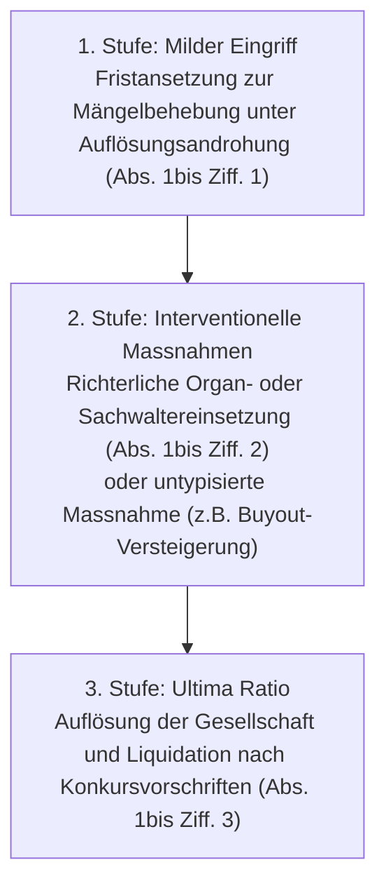

## Gesetzeswortlaut



### Die Tatbestände und Rechtsfolgen auf einen Blick

| Absatz | Gegenstand | Typische Konstellationen in der Praxis |
|---|---|---|
| **Abs. 1 Ziff. 1** | Fehlen eines vorgeschriebenen Organs | Verwaltungsrat nach Rücktritt verwaist; Amtsdauer ohne Generalversammlung nach sechs Monaten erloschen ([BGE 148 III 69](https://entscheidsuche.ch/docs/CH_BGE/CH_BGE_005_BGE-148-III-69_2022.html#consideration_3.5)); Revisionsstelle fehlt ohne gültiges Opting-out ([BGE 138 III 294](https://entscheidsuche.ch/docs/CH_BGE/CH_BGE_005_BGE-138-III-294_2012.html#consideration_3.1.1)). |
| **Abs. 1 Ziff. 2** | Mangelhafte Zusammensetzung | Unterschreiten der statutarischen Mindestmitgliederzahl; Fehlen einer Vertretung mit Wohnsitz in der Schweiz (Art. 718 Abs. 4 OR); unlösbare Pattsituation (Deadlock) im Aktionariat ([BGE 140 III 349](https://entscheidsuche.ch/docs/CH_BGE/CH_BGE_005_BGE-140-III-349_2014.html#consideration_2.1)). |
| **Abs. 1 Ziff. 3** | Mangelhafte Führung des Aktienbuchs | Missachtung der Eintragungsvorschriften nach Art. 686 OR; Nichteintragung von Erwerbern oder Berechtigten. |
| **Abs. 1 Ziff. 4** | Unzulässige Inhaberaktien | Ausgabe von Inhaberaktien ohne Börsenkotierung oder Bucheffektenausgestaltung (Verstoss gegen Art. 622 Abs. 1bis OR). |
| **Abs. 1 Ziff. 5** | Fehlendes Rechtsdomizil am Sitz | Kündigung des Domizils ohne Neueintragung; Postretouren; Scheindomizile ohne tatsächliche Erreichbarkeit. |
| **Abs. 1bis Ziff. 1** | Fristansetzung unter Auflösungsandrohung | Regelfall bei behebbaren formellen Mängeln (mildeste gerichtliche Interventionsmassnahme). |
| **Abs. 1bis Ziff. 2** | Einsetzung eines Organs oder Sachwalters | Wiederherstellung der Handlungsfähigkeit; Einberufung der Generalversammlung; Übergangsverwaltung ([BGE 148 III 69](https://entscheidsuche.ch/docs/CH_BGE/CH_BGE_005_BGE-148-III-69_2022.html)). |
| **Abs. 1bis Ziff. 3** | Auflösung und Konkursliquidation | Ultima Ratio bei gescheiterten milderen Massnahmen, passiver Gesellschaft oder unheilbarem Deadlock ([BGE 138 III 294](https://entscheidsuche.ch/docs/CH_BGE/CH_BGE_005_BGE-138-III-294_2012.html#consideration_3.1.4)). |
| **Abs. 2** | Befristung und Kostenvorschuss | Gericht bestimmt Amtsdauer des Sachwalters und verpflichtet die Gesellschaft zur Tragung der Kosten und Bevorschussung. |
| **Abs. 3** | Abberufung aus wichtigem Grund | Beendigung des richterlich angeordneten Mandats bei Pflichtverletzung oder Vertrauensverlust. |
| **Abs. 4** | Überschuldungsanzeige | Verpflichtung der Liquidatoren zur Benachrichtigung des Gerichts bei Überschuldung zwecks Konkurseröffnung ([BGE 148 IV 170](https://entscheidsuche.ch/docs/CH_BGE/CH_BGE_006_BGE-148-IV-170_2022.html#consideration_3.4.9)). |

---

## Überblick und Bedeutung

Art. 731b OR bildet das zentrale Instrument des schweizerischen Gesellschaftsrechts zur Behebung organisatorischer Mängel juristischer Personen. Die Bestimmung ist systematisch im 26. Titel des Obligationenrechts (Die Aktiengesellschaft) verankert, findet jedoch über Verweisungsnormen auch auf die Kommanditaktiengesellschaft (Art. 764 Abs. 2 OR), die Gesellschaft mit beschränkter Haftung (Art. 819 OR) sowie die Genossenschaft (Art. 901a OR i.V.m. [BGE 138 III 407 E. 2.4](https://entscheidsuche.ch/docs/CH_BGE/CH_BGE_005_BGE-138-III-407_2012.html)) direkte Anwendung. Bei Vereinen und Stiftungen greifen spezialgesetzliche bzw. zivilgesetzliche Bestimmungen (Art. 69c und Art. 83d ZGB), welche denselben Grundsätzen folgen.

### Gesetzgeberische Ratio und Revisionsgeschichte

1. **Schaffung der Norm per 1. Januar 2008**:  
   Mit dem Bundesgesetz vom 16. Dezember 2005 (GmbH-Recht sowie Anpassungen im Aktien-, Genossenschafts-, Handelsregister- und Firmenrecht; [AS 2007 4791](https://www.fedlex.admin.ch/eli/oc/2007/686/de); [BBl 2002 3148](https://www.fedlex.admin.ch/eli/fga/2002/444/de), bes. S. 3231 f.) schuf der Gesetzgeber eine einheitliche und griffige Ordnung zur gerichtlichen Behebung und Sanktionierung von Organisationsmängeln. Zuvor existierte lediglich die unzureichende Verordnungsbestimmung von Art. 86 aHRegV, welche dem Handelsregisterführer nur schwerfällige Eingriffsmöglichkeiten bot. Ziel der Einführung von Art. 731b OR war es, den Schutz des Rechtsverkehrs, der Gläubiger sowie der Minderheitsaktionäre zu gewährleisten und sogenannte «Geistergesellschaften» (führungslos gewordene oder verwaiste Rechtseinheiten) effizient aus dem Rechtsverkehr zu entfernen ([BGE 136 III 369 E. 11.4.1](https://entscheidsuche.ch/docs/CH_BGE/CH_BGE_005_BGE-136-III-369_2010.html#consideration_11.4.1)).

2. **Handelsregisterrechtsrevision per 1. Januar 2021**:  
   Mit dem Bundesgesetz vom 17. März 2017 ([AS 2020 957](https://www.fedlex.admin.ch/eli/oc/2020/178/de); [BBl 2015 3617](https://www.fedlex.admin.ch/eli/fga/2015/956/de), S. 3644, 3653) wurde das Verfahren bei Mängeln im Handelsregister neu austariert: Die direkte Antragsberechtigung des Handelsregisterführers in Art. 731b Abs. 1 OR wurde gestrichen. Seither fordert das Handelsregisteramt die Gesellschaft gestützt auf Art. 939 OR unter Fristansetzung zur Mängelbehebung auf und überweist die Sache bei fruchtlosem Fristablauf von Amtes wegen an das zuständige Gericht (Art. 939 Abs. 2 OR). Zudem wurde mit Abs. 4 eine ausdrückliche Anzeigepflicht der Konkursliquidatoren eingeführt: Stellen diese im Verlauf der Liquidation eine Überschuldung fest, haben sie das Gericht zu benachrichtigen, welches daraufhin formell den Konkurs eröffnet ([BBl 2015 3617, S. 3653](https://www.fedlex.admin.ch/eli/fga/2015/956/de)).

3. **Umsetzung der Empfehlungen des Global Forum (2019/2021)**:  
   Durch das Bundesgesetz vom 21. Juni 2019 ([AS 2019 3161](https://www.fedlex.admin.ch/eli/oc/2019/583/de); [BBl 2019 279](https://www.fedlex.admin.ch/eli/fga/2019/18/de), S. 299, 318) wurden die Mangeltatbestände in Abs. 1 Ziff. 3 (Führung des Aktienbuchs bzw. des Verzeichnisses über die wirtschaftlich berechtigten Personen), Ziff. 4 (unzulässige Inhaberaktien) und Ziff. 5 (fehlendes Rechtsdomizil) ausgedehnt. Der Massnahmenkatalog wurde redaktionell in den eigenständigen Abs. 1bis überführt.

4. **Bundesgesetz über die Transparenz juristischer Personen (TJPG) per 1. Oktober 2026**:  
   Mit dem TJPG vom 26. September 2025 ([AS 2026 323](https://www.fedlex.admin.ch/eli/oc/2026/323/de); [BBl 2024 1607](https://www.fedlex.admin.ch/eli/fga/2024/1607/de)) wurde Ziff. 3 an das neue Registerregime angepasst und der Verweis auf das separate Meldeverzeichnis gestrichen, da die Identifikation der wirtschaftlich berechtigten Personen seither im eidgenössischen Transparenzregister geführt wird.

### Dogmatische Einordnung und Schutzgüter

Art. 731b OR schützt vorrangig das **öffentliche Interesse an der Rechtssicherheit und dem Funktionieren des Rechtsverkehrs** ([BGE 138 III 294 E. 3.1.3](https://entscheidsuche.ch/docs/CH_BGE/CH_BGE_005_BGE-138-III-294_2012.html#consideration_3.1.3)). Dritte müssen sich darauf verlassen können, dass im Handelsregister eingetragene Gesellschaften über handlungsfähige Organe verfügen, die deren Willen bilden, im Aussenverkehr rechtlich verbindlich handeln und auf dem Postweg an ihrem Sitz tatsächlich erreichbar sind.

Gleichzeitig dient die Norm dem Schutz von Minderheitsaktionären und Gläubigern, indem sie diesen ein zivilprozessuales Interventionsrecht verleiht, wenn die Gesellschaftsorgane versagen oder durch interne Blockaden gelähmt sind. Art. 731b OR ist jedoch **kein Ersatz für die aktienrechtliche Auflösungsklage aus wichtigem Grund** nach Art. 736 Ziff. 4 OR: Ein Aktionär darf das Instrumentarium von Art. 731b OR nicht missbrauchen, um eine funktionierende, solvente Gesellschaft zur Liquidation zu bringen, ohne dass die strengen materiellen Voraussetzungen einer Auflösungsklage vorliegen ([BGE 138 III 294 E. 3.1.6](https://entscheidsuche.ch/docs/CH_BGE/CH_BGE_005_BGE-138-III-294_2012.html#consideration_3.1.6)).

### Prüfschema

| Schritt | Tatbestandsmerkmal / Voraussetzung | Prüffrage | Beweislast | Beweismass |
|---|---|---|---|---|
| **1.** | Zuständigkeit und Verfahrensart | Liegt ein Gesuch nach Art. 250 lit. c ZPO im summarischen Verfahren vor? | Von Amtes wegen zu prüfen (Art. 59 Abs. 2 lit. c ZPO) | Volle richterliche Kognition |
| **2.** | Aktivlegitimation | Ist der Gesuchsteller Aktionär, Gläubiger oder liegt eine behördliche Überweisung nach Art. 939 OR vor? | Gesuchsteller (Eigenschaft als Aktionär oder Gläubiger) | Glaubhaftmachen (Gläubiger) / Voller Beweis (Aktionär) |
| **3.** | Passivlegitimation | Ist das Gesuch formell gegen die betroffene Gesellschaft gerichtet? | Gesuchsteller (Bezeichnung der Gesellschaft als Partei) | Voller Beweis ([BGE 138 III 213 E. 2.1](https://entscheidsuche.ch/docs/CH_BGE/CH_BGE_005_BGE-138-III-213_2012.html#consideration_2.1)) |
| **4.** | Vorliegen eines Organisationsmangels | Fehlt ein Organ (Ziff. 1), ist es fehlerhaft besetzt bzw. gelähmt (Ziff. 2), fehlt das Domizil (Ziff. 5) oder liegt ein Registermangel vor (Ziff. 3/4)? | Gesuchsteller trägt die Behauptungslast; Gesellschaft trägt Gegenbeweislast für rechtmässigen Zustand | Voller Beweis / Regelbeweismass ([OG AR ERZ 21 6 E. 2.2](https://entscheidsuche.ch/docs/AR_Gerichte/AR_KG_005_OG-ERZ-21-6-ARGVP-20_2021-03-16.pdf)) |
| **5.** | Ausschlussgrund: Reine Binnenstreitigkeit | Betrifft der Streit nur die Ausübung der Geschäftsführung, Aktieneigentum oder missliebige Entscheide ohne Lähmung der Gesellschaft? | Gesellschaft (Einwand der fehlenden Organeigenschaft des Streits) | Voller Beweis ([KG LU 1B 23 64 E. 7.4](https://entscheidsuche.ch/docs/LU_Gerichte/LU_KG_001_1B-23-64_2024-06-25.html)) |
| **6.** | Stufenordnung und Verhältnismässigkeit | Welche Massnahme nach Abs. 1bis stellt den geringstmöglichen Eingriff zur Wiederherstellung der Legalität dar? | Von Amtes wegen (Offizialmaxime, Art. 58 Abs. 2 ZPO); Stufenverhältnis zwingend | Richterliches Ermessen ([BGE 138 III 294 E. 3.1.4](https://entscheidsuche.ch/docs/CH_BGE/CH_BGE_005_BGE-138-III-294_2012.html#consideration_3.1.4)) |
| **7.** | Rechtsfolge: Auflösung als Ultima Ratio | Sind mildere Massnahmen (Fristansetzung, Organ- oder Sachwaltereinsetzung, Aktienversteigerung) aussichtslos oder erfolglos geblieben? | Richterliche Feststellung der Aussichtslosigkeit milderer Mittel | Volle richterliche Überzeugung |

---

## Kommentierung

### A. Fehlen eines vorgeschriebenen Organs (Abs. 1 Ziff. 1)

Das Fehlen eines vorgeschriebenen Organs liegt vor, wenn die Aktiengesellschaft eines der gesetzlich zwingend vorgeschriebenen Organe überhaupt nicht bestellt hat oder das Organ durch Rücktritt, Abberufung, Tod, Amtsunfähigkeit oder Ablauf der Amtsdauer vollständig verwaist ist. Zwingende Organe der Aktiengesellschaft sind die **Generalversammlung** (Art. 698 ff. OR), der **Verwaltungsrat** (Art. 707 ff. OR) und — sofern kein gültiges Opting-out vorliegt — die **Revisionsstelle** (Art. 727 ff. OR). Zudem verlangt Art. 718 Abs. 4 OR zwingend, dass die Gesellschaft durch eine Person vertreten werden kann, die ihren Wohnsitz in der Schweiz hat.

#### 1. Verwaister Verwaltungsrat und Ablauf der Amtsdauer nach sechs Monaten

Ein Organisationsmangel liegt zweifellos vor, wenn der einzige Verwaltungsrat stirbt, sein Mandat niederlegt oder handlungsunfähig wird und die Generalversammlung keinen Nachfolger wählt. Genauso gravierend ist jedoch das schleichende Erlöschen der Organstellung durch Unterlassen der Generalversammlung.

> **Generalversammlung unterblieben: Die Rohrverbindungs-Joint-Venture-AG**  
> Die B. AG gründete 2017 zusammen mit zwei chinesischen Geschäftsleuten die A. AG mit Sitz in U. als Joint Venture zur Realisierung von Geschäften in der Volksrepublik China (Aktienkapital Fr. 100'000.-). Die B. AG hielt 51'000 Namenaktien, die beiden Geschäftspartner je 24'500 Aktien. Nach mehreren Wechseln traten im September 2019 zwei Verwaltungsräte zurück; im Handelsregister blieben G. als Präsident und C. als Mitglied eingetragen. In den Geschäftsjahren 2018 und 2019 führte die Gesellschaft nie eine ordentliche Generalversammlung durch. Mit Schreiben vom 12. April 2021 verlangte die Mehrheitsaktionärin B. AG vergeblich die Einberufung der Versammlungen und gelangte im Mai 2021 an das Handelsgericht des Kantons Zürich mit dem Antrag auf Einsetzung eines Sachwalters nach Art. 731b OR.  
> Die A. AG wandte ein, es liege kein Organisationsmangel vor, da sich das Mandat der eingetragenen Verwaltungsräte bei unterbliebener Generalversammlung stillschweigend bis zu einer Neuwahl verlängere.  
> **Das Bundesgericht verwarf die These der stillschweigenden Verlängerung:** Das Amt des Verwaltungsrats endet mit Ablauf des sechsten Monats nach Schluss des betreffenden Geschäftsjahres, wenn keine Generalversammlung nach Art. 699 Abs. 2 OR durchgeführt oder die Wahl des Verwaltungsrats nicht traktandiert wurde. Eine stillschweigende Mandatsverlängerung existiert im schweizerischen Aktienrecht nicht ([BGE 148 III 69 E. 3.5](https://entscheidsuche.ch/docs/CH_BGE/CH_BGE_005_BGE-148-III-69_2022.html#consideration_3.5)). Die Gesellschaft war damit per 1. Juli führungslos; das Handelsgericht hatte zu Recht gestützt auf Art. 731b Abs. 1bis Ziff. 2 OR einen Sachwalter mit dem Auftrag eingesetzt, die Generalversammlung einzuberufen und durchzuführen.

Handeln Verwaltungsräte nach Ablauf der Sechsmonatsfrist faktisch weiter, tun sie dies als **faktische Organe** ([BGE 148 III 69 E. 3.1.2](https://entscheidsuche.ch/docs/CH_BGE/CH_BGE_005_BGE-148-III-69_2022.html#consideration_3.1.2)). Dies begründet zwar ihre persönliche Haftung nach Art. 754 OR und schützt gutgläubige Dritte über den öffentlichen Registerglauben (Art. 936b Abs. 3 OR), heilt jedoch den gesellschaftsinternen Organisationsmangel nach Art. 731b OR nicht.

#### 2. Fehlen der Revisionsstelle (ungültiges Opting-out)

Jede Aktiengesellschaft muss ihre Jahresrechnung ordentlich oder eingeschränkt prüfen lassen (Art. 727 / Art. 727a OR). Auf eine eingeschränkte Revision kann nur verzichtet werden (sog. Opting-out), wenn die Gesellschaft nicht mehr als zehn Vollzeitstellen im Jahresdurchschnitt hat **und sämtliche Aktionäre dem Verzicht zustimmen** (Art. 727a Abs. 2 OR).

Verweigert auch nur ein einziger Aktionär seine Zustimmung zum Opting-out und kommt es infolgedessen nicht zu einer gültigen Wahl einer Revisionsstelle, fehlt der Gesellschaft ein zwingend vorgeschriebenes Organ ([BGE 138 III 294 E. 3.1.1](https://entscheidsuche.ch/docs/CH_BGE/CH_BGE_005_BGE-138-III-294_2012.html#consideration_3.1.1)). Das Handelsregisteramt setzt in diesem Fall von Amtes wegen das Mahnverfahren nach Art. 939 OR in Gang.

> **Leitsatz.** Das Amt des Verwaltungsrats erlischt eo ipso sechs Monate nach Ablauf des Geschäftsjahres, wenn bis dahin keine ordentliche Generalversammlung durchgeführt oder keine Neuwahl traktandiert wurde. Eine stillschweigende Mandatsfortdauer ist ausgeschlossen; die Gesellschaft weist ab diesem Zeitpunkt einen behebbaren Mangel im Sinne von Art. 731b Abs. 1 Ziff. 1 OR auf ([BGE 148 III 69 E. 3.5](https://entscheidsuche.ch/docs/CH_BGE/CH_BGE_005_BGE-148-III-69_2022.html#consideration_3.5)).

---

### B. Mangelhafte Zusammensetzung eines vorgeschriebenen Organs (Abs. 1 Ziff. 2)

Ein Organ ist mangelhaft zusammengesetzt, wenn es zwar existiert, aber den gesetzlichen oder statutarischen Anforderungen nicht genügt. Dies betrifft einerseits das Unterschreiten der statutarisch festgesetzten Mindestmitgliederzahl (z.B. Statuten verlangen drei Mitglieder, eingetragen ist nur eines) sowie das Fehlen einer zur Vertretung befugten Person mit Schweizer Wohnsitz (Art. 718 Abs. 4 OR).

Andererseits erfasst Abs. 1 Ziff. 2 nach gefestigter bundesgerichtlicher Rechtsprechung die **dauerhafte Funktions- und Beschlussunfähigkeit** eines formell besetzten Organs infolge unauflöslicher interner Blockaden (**Pattsituation / Deadlock**).

#### 1. Pattsituation im Aktionariat (Deadlock)

Hält bei einer Zweipersonen-Aktiengesellschaft jeder Aktionär genau 50 % der Stimmen und sind die Gesellschafter heillos zerstritten, kann die Generalversammlung keine Beschlüsse mehr fassen. Ist der Verwaltungsrat neu zu wählen oder eine Revisionsstelle zu bestellen, führt die Verweigerungshaltung beider Seiten zur totalen Lähmung der Gesellschaft.

> **Statutarische automatische Wiederwahl: Der blockierte Verwaltungsrat**  
> In einer zerstrittenen Aktiengesellschaft sahen die Statuten zur Vermeidung von Blockaden vor, dass die bisherigen Verwaltungsräte im Falle einer Nichtwahl durch die Generalversammlung bis zu einer Neuwahl automatisch im Amt verbleiben. Wegen einer 50:50-Pattsituation im Aktionariat konnte an der Generalversammlung keine Mehrheit für die Wahl der Verwaltungsräte erzielt werden.  
> Ein Aktionär berief sich darauf, dass infolge der Statutenklausel kein Mangel vorliege, da die bisherigen Mitglieder weiterhin amtierend seien.  
> **Das Bundesgericht erklärte die Statutenbestimmung für absolut nichtig:** Die Unmöglichkeit der Generalversammlung, mangels Stimmenmehrheit die Wahl der Verwaltungsräte vorzunehmen, stellt eine institutionelle Blockade dar, die dem Richter die Anordnung von Massnahmen nach Art. 731b OR gebietet. Eine Statutenbestimmung, die eine automatische Wiederwahl vorsieht, widerspricht dem unübertragbaren und unentziehbaren Recht der Generalversammlung, den Verwaltungsrat zu wählen (Art. 698 Abs. 2 Ziff. 2 OR), und ist nach Art. 706b Ziff. 3 OR nichtig ([BGE 140 III 349 E. 2.6](https://entscheidsuche.ch/docs/CH_BGE/CH_BGE_005_BGE-140-III-349_2014.html#consideration_2.6)).

#### 2. Revisionsstellenstreit bei der 50:50-Beteiligung

> **50:50-Streit um die Revisionsstelle: Die St. Galler X. AG**  
> Das Aktienkapital der X. AG (Fr. 150'000.-) war in 150 Namenaktien eingeteilt, die je zur Hälfte von A.X. und B. gehalten wurden. Beide waren Verwaltungsräte, B. zudem Präsident mit Einzelunterschrift. Seit mehreren Jahren herrschte Feindschaft. An der Generalversammlung vom 10. Dezember 2010 konnte kein einziger Beschluss gefasst werden; ein Opting-out scheiterte an A.X., eine Revisionsstelle wurde nicht gewählt.  
> Das Handelsregisteramt St. Gallen überwies die Sache an den Handelsgerichtspräsidenten. A.X. beantragte als Nebenintervenient die sofortige Auflösung und Konkursliquidation der X. AG (Art. 731b Abs. 1bis Ziff. 3 OR). B. beantragte die gerichtliche Ernennung einer Revisionsstelle (Art. 731b Abs. 1bis Ziff. 2 OR). Der Handelsgerichtspräsident löste die Gesellschaft auf, da mildere Massnahmen wegen der Unversöhnlichkeit der Aktionäre und der Weigerung von A.X., einen Kostenvorschuss zu unterzeichnen, aussichtslos seien.  
> **Das Bundesgericht hob die Auflösung auf:** Bei der finanziell gesunden und im Aussenverkehr durch den Präsidenten voll handlungsfähigen Gesellschaft verletzte die sofortige Liquidation das Verhältnismässigkeitsprinzip ([BGE 138 III 294 E. 3.3.1](https://entscheidsuche.ch/docs/CH_BGE/CH_BGE_005_BGE-138-III-294_2012.html#consideration_3.3.1)). Die Zahlungsblockade für den Kostenvorschuss war vorgeschoben, da das Gericht die Gesellschaft im Urteilsdispositiv direkt nach Abs. 2 zur Vorschussleistung verpflichten kann. Zudem darf ein blockierender Aktionär Art. 731b OR nicht missbrauchen, um die strengen Hürden einer Auflösungsklage nach Art. 736 Ziff. 4 OR zu umgehen ([E. 3.1.6](https://entscheidsuche.ch/docs/CH_BGE/CH_BGE_005_BGE-138-III-294_2012.html#consideration_3.1.6)).

---

### C. Gesetzliche Spezialmängel (Abs. 1 Ziff. 3–5)

Neben den klassischen Organmängeln normiert Art. 731b Abs. 1 OR drei spezialgesetzliche Tatbestände, die primär dem Anlegerschutz, der Bekämpfung von Geldwäscherei und der steuerlichen Transparenz dienen:

1. **Vorschriftswidrige Führung des Aktienbuchs (Abs. 1 Ziff. 3)**:  
   Jede Gesellschaft mit Namenaktien muss ein Aktienbuch führen (Art. 686 OR), in das Eigentümer und Nutzniesser mit Namen, Adresse und Staatsangehörigkeit eingetragen werden. Verweigert der Verwaltungsrat die ordnungsgemässe Führung oder verwehrt er berechtigten Aktionären den Eintrag, begründet dies einen Organisationsmangel.
2. **Ausgabe unzulässiger Inhaberaktien (Abs. 1 Ziff. 4)**:  
   Seit der Abschaffung der klassischen Inhaberaktie per 1. November 2019 dürfen nicht kotierte Aktiengesellschaften Inhaberaktien ausschliesslich dann ausgeben, wenn diese als Bucheffekten im Sinne des Bucheffektengesetzes ausgestaltet und bei einer Verwahrungsstelle in der Schweiz hinterlegt sind (Art. 622 Abs. 1bis und 2ter OR; [BBl 2019 279, S. 318](https://www.fedlex.admin.ch/eli/fga/2019/18/de)). Werden Inhaberaktien unter Missachtung dieser Vorschrift ausgegeben oder nicht rechtzeitig in Namenaktien umgewandelt, schreitet das Gericht nach Art. 731b OR ein.
3. **Fehlen des Rechtsdomizils am Sitz (Abs. 1 Ziff. 5)**:  
   Verliert eine Gesellschaft ihr Rechtsdomizil (z.B. nach Kündigung eines c/o-Domizilvertrags, Umzug ohne Registeranmeldung oder Geschäftsaufgabe), kann sie behördlich und gerichtlich nicht mehr erreicht werden. Dies stellt eine Gefährdung des Rechtsverkehrs dar. Das Handelsregisteramt leitet nach Art. 939 OR ein Aufforderungsverfahren ein; bleibt dieses erfolglos, überweist es die Akten an den Richter zur gerichtlichen Liquidation ([BBl 2015 3617, S. 3644](https://www.fedlex.admin.ch/eli/fga/2015/956/de)).

---

### D. Negative Grenzkasuistik: Was KEIN Organisationsmangel ist (Verwerfungsfälle)

In der Praxis versuchen Parteien häufig, gesellschaftsinterne Streitigkeiten, Erbstreitigkeiten oder Vorwürfe unredlicher Geschäftsführung im kostengünstigen und schnellen Summarverfahren nach Art. 731b OR auszutragen. Die Gerichte weisen solche Gesuche konsequent ab.

#### 1. Streit über das Eigentum an Aktienanteilen

> **25 %-Aktienstreit vor dem Bezirksgericht: Die Luzerner B. AG**  
> Aktionär A. verlangte vor dem Bezirksgericht die gerichtliche Einsetzung eines Sachwalters für die B. AG nach Art. 731b OR. Hintergrund war ein erbitterter Streit über das Eigentum an einem 25 %-Aktienpaket; im ordentlichen Verfahren war bereits eine Klage auf Wiedereintragung ins Aktienbuch hängig. A. machte geltend, wegen der unklaren Eigentumsverhältnisse an einem Viertel des Kapitals sei die Generalversammlung gelähmt und die Gesellschaft führungslos.  
> **Das Kantonsgericht Luzern wies das Gesuch ab:** Strittige oder unklare Eigentumsverhältnisse an Aktienanteilen begründen für sich allein keinen Organisationsmangel im Sinne von Art. 731b OR ([KG LU 1B 23 64 E. 7.4](https://entscheidsuche.ch/docs/LU_Gerichte/LU_KG_001_1B-23-64_2024-06-25.html)). Das summarische Verfahren mit beschränkten Beweismitteln ist ungeeignet, um komplexe materiellrechtliche Eigentumsfragen zu klären. Ein Organmangel liegt erst vor, wenn die Beschlussfähigkeit der Generalversammlung vollständig eliminiert ist (z.B. wenn überhaupt kein Aktionär mehr ermittelt werden kann oder eine 50:50-Blockade die Wahl von Exekutivorganen verunmöglicht). Da die übrigen 75 % der Stimmen unbestritten waren, blieb die Gesellschaft handlungsfähig.

#### 2. Pflichtverletzungen, Inkompetenz und schlechte Geschäftsführung

> **Vorwurf der Veruntreuung und Strafanzeigen gegen den Verwaltungsrat**  
> An einer Aktiengesellschaft hielt Minderheitsaktionär A. 48.33 % und C. 51.67 % des Kapitals. A. verlangte gestützt auf Art. 731b OR die Absetzung von C. und die Einsetzung eines neutralen Sachwalters. Zur Begründung brachte er vor, gegen C. laufe ein Strafverfahren wegen Veruntreuung und ungetreuer Geschäftsbesorgung zu Lasten der Gesellschaft; C. befinde sich in einem unlösbaren Interessenkonflikt und sei fachlich völlig unfähig, die Gesellschaft ordnungsgemäss zu führen.  
> **Das Bundesgericht wies die Beschwerde ab:** Mangelhafte Aufgabenerledigung, wirtschaftlich fragwürdige Entscheide, Pflichtverletzungen oder persönliche Zerwürfnisse begründen keinen Organisationsmangel nach Art. 731b OR ([BGer 4A_412/2020 E. 4.3.4](https://entscheidsuche.ch/docs/CH_BGer/CH_BGer_004_4A-412-2020_2020-09-16.html)). Für Pflichtwidrigkeiten stehen die aktienrechtliche Verantwortlichkeitsklage (Art. 754 OR) oder die Anfechtung von Beschlüssen (Art. 706 OR) zur Verfügung. Art. 731b OR zielt ausschliesslich auf das institutionelle Fehlen oder die formelle Unvollständigkeit gesetzlicher Organe, nicht auf die Überwachung der Geschäftsführung.

#### 3. Handlungsfähiger Mehrheitsrat trotz feindseliger Brüder

> **Der Bruderzwist in der Zuger Holding**  
> In einer Familienaktiengesellschaft hielten zwei zerstrittene Brüder 50.5 % bzw. 49.5 % der Aktien. Im Verwaltungsrat sassen die beiden Brüder sowie eine dritte Person (C.). Einer der Brüder verlangte die Absetzung von C. und die Einsetzung eines Sachwalters, da C. von der Gegenseite instrumentalisiert werde und sich gegen Entgelt angedient habe.  
> **Das Bundesgericht bestätigte die Abweisung des Gesuchs:** Da der Verwaltungsrat aus drei Mitgliedern bestand, konnten Mehrheitsbeschlüsse nach Art. 716 Abs. 2 OR jederzeit gefasst werden ([BGer 4A_207/2022 E. 3.3.2](https://entscheidsuche.ch/docs/CH_BGer/CH_BGer_004_4A-207-2022_2022-10-17.html)). Blosse Behauptungen von Loyalitätskonflikten oder gegenseitiges Misstrauen heben die Handlungsfähigkeit eines mehrköpfigen Organs nicht auf.

---

### E. Aktiv- und Passivlegitimation im Verfahren

#### 1. Aktivlegitimation (Gesuchsteller)

Antragsberechtigt nach Art. 731b Abs. 1 OR sind:
- **Jeder Aktionär**: unabhängig von der Höhe seiner Kapital- oder Stimmenbeteiligung (auch ein einzelner Kleinaktionär).
- **Gläubiger**: Jede Person, die eine fällige oder nicht fällige Forderung gegen die Gesellschaft glaubhaft macht. Das Gericht prüft die Gläubigereigenschaft nur prima facie.
- **Handelsregisteramt**: Überweisung an das Gericht von Amtes wegen nach erfolglosem Vorverfahren (Art. 939 OR).
- **Willensvollstrecker**: Gehören Aktien zum Nachlass einer Erbengemeinschaft, steht das Antragsrecht kraft amtlicher Prozessführungsbefugnis (Art. 518 Abs. 2 ZGB) ausschliesslich dem Willensvollstrecker zu ([BGE 147 III 537 E. 3.2](https://entscheidsuche.ch/docs/CH_BGE/CH_BGE_005_BGE-147-III-537_2021.html#consideration_3.2)).

#### 2. Passivlegitimation (Gesuchsgegnerin)

Das Gesuch nach Art. 731b OR muss **zwingend und ausschliesslich gegen die Gesellschaft** gerichtet werden ([BGE 138 III 213 E. 2.1](https://entscheidsuche.ch/docs/CH_BGE/CH_BGE_005_BGE-138-III-213_2012.html#consideration_2.1)). Richtet der Gesuchsteller seinen Antrag gegen andere Aktionäre oder einzelne Verwaltungsratsmitglieder, tritt das Gericht mangels Passivlegitimation nicht auf das Gesuch ein.

Ist die Gesellschaft infolge Fehlens jeglicher Organe handlungsunfähig, hat das Gericht ihr für das Verfahren vorab einen **Prozessbeistand bzw. Vertreter** zu bestellen (analog Art. 69 Abs. 1 ZGB bzw. Art. 392 Ziff. 1 ZGB; [BGE 138 III 213 E. 2.1](https://entscheidsuche.ch/docs/CH_BGE/CH_BGE_005_BGE-138-III-213_2012.html#consideration_2.1); [BGE 147 III 537 E. 3.1.2](https://entscheidsuche.ch/docs/CH_BGE/CH_BGE_005_BGE-147-III-537_2021.html#consideration_3.1.2)).

#### 3. Streitgenössische Nebenintervention von Aktionären und Erben

Da das Urteil über Organisationsmängel und eine allfällige Auflösung unmittelbare Rechtswirkungen gegenüber allen Aktionären entfaltet (Gestaltungswirkung mit Drittwirkung), reicht die gewöhnliche («abhängige») Nebenintervention nicht aus, um deren Rechtsschutz zu wahren.

> **Leitsatz.** Beteiligt sich ein Aktionär an einem Organisationsmängelverfahren nach Art. 731b OR, kommt ihm die Stellung eines **streitgenössischen Nebenintervenienten** zu. Er kann den Prozess unabhängig führen und rechtswirksam Rechtsmittel ergreifen, selbst wenn sich die von ihm unterstützte Hauptpartei (die Gesellschaft) seinen Handlungen widersetzt, das Urteil akzeptiert oder einen Vergleich geschlossen hat ([BGE 142 III 629 E. 2.3.7](https://entscheidsuche.ch/docs/CH_BGE/CH_BGE_005_BGE-142-III-629_2016.html#consideration_2.3.7)). Dasselbe Recht steht dem einzelnen Miterben in Bezug auf Nachlassaktien zu ([BGE 147 III 537 E. 3.3.2](https://entscheidsuche.ch/docs/CH_BGE/CH_BGE_005_BGE-147-III-537_2021.html#consideration_3.3.2)).

---

### F. Gerichtliche Massnahmen und das Verhältnismässigkeitsprinzip (Abs. 1bis und Abs. 2)

Der Katalog von Art. 731b Abs. 1bis OR ist exemplifikativ («insbesondere»). Dem Gericht steht ein weiter Ermessensspielraum zu, um die nach den Umständen des Einzelfalls sachgerechte Massnahme zu treffen. Die Massnahmen stehen jedoch in einem **zwingenden Stufenverhältnis (Verhältnismässigkeitsprinzip)**:

#### 1. Fristansetzung zur Wiederherstellung (Abs. 1bis Ziff. 1)
Dies ist die Regelmassnahme bei erstmals gerichtlich anhängig gemachten Mängeln. Das Gericht setzt der Gesellschaft eine Frist (in der Praxis meist 20 bis 30 Tage), um die fehlenden Organe zu wählen, das Revisionsstellenmandat nachzuweisen oder ein gültiges Rechtsdomizil anzumelden — verbunden mit der ausdrücklichen Androhung der Auflösung im Säumnisfall.

#### 2. Richterliche Organ- oder Sachwaltereinsetzung (Abs. 1bis Ziff. 2)
Ergibt die Fristansetzung keinen Erfolg oder ist die Gesellschaft wegen Pattsituationen blockiert, ernennt das Gericht ein fehlendes Organ oder einen Sachwalter:
- **Amtsdauer und Kostenvorschuss (Abs. 2)**: Das Gericht befristet das Mandat (z.B. bis zur Durchführung einer Generalversammlung) und verpflichtet die Gesellschaft im Dispositiv zwingend zur Bevorschussung und Tragung der Kosten ([BGE 138 III 294 E. 3.3.1](https://entscheidsuche.ch/docs/CH_BGE/CH_BGE_005_BGE-138-III-294_2012.html#consideration_3.3.1)).
- **Aufgabenkreis**: Der Sachwalter kann mit der blossen Einberufung und Leitung der Generalversammlung betraut werden oder als Verwaltungssachwalter mit umfassender Einzelzeichnungsberechtigung eingesetzt werden ([BGE 148 III 69 E. 3](https://entscheidsuche.ch/docs/CH_BGE/CH_BGE_005_BGE-148-III-69_2022.html)).
- **Abberufung (Abs. 3)**: Bei wichtigen Gründen (grobe Pflichtverletzung, Parteilichkeit) kann die Gesellschaft die Abberufung der eingesetzten Person verlangen.

#### 3. Gesetzlich nicht typisierte Massnahmen: Die richterliche Aktienversteigerung (Buyout)
Bei unheilbaren Blockaden in einer Zweipersonen-Aktiengesellschaft (50:50) muss das Gericht nicht zwingend liquidieren. Um den Fortführungswert des gesunden Unternehmens («going concern value») zu retten, kann das Gericht eine **interne Versteigerung der Aktien zwischen den zerstrittenen Aktionären** anordnen ([BGE 138 III 294 E. 3.3.3](https://entscheidsuche.ch/docs/CH_BGE/CH_BGE_005_BGE-138-III-294_2012.html#consideration_3.3.3); [BGE 142 III 629 E. 2.3.2](https://entscheidsuche.ch/docs/CH_BGE/CH_BGE_005_BGE-142-III-629_2016.html#consideration_2.3.2)). Der Höchstbietende übernimmt die Aktien des Partners; nur falls kein Gebot abgegeben wird, erfolgt die Liquidation.

#### 4. Auflösung und Konkursliquidation als Ultima Ratio (Abs. 1bis Ziff. 3)
Die Auflösung stellt das schärfste Mittel dar. Sie darf erst angeordnet werden, wenn alle milderen Massnahmen versagt haben oder von vornherein aussichtslos sind — namentlich wenn die Gesellschaft völlig passiv bleibt, behördliche Vorladungen unzustellbar sind oder keine Aktiven zur Deckung eines Sachwalters vorhanden sind ([BGE 141 III 43 E. 2.6](https://entscheidsuche.ch/docs/CH_BGE/CH_BGE_005_BGE-141-III-43_2015.html#consideration_2.6)).

- **Unwiderrufbarkeit des rechtskräftigen Auflösungsentscheids**:  
  Ein rechtskräftiger Auflösungsentscheid nach Art. 731b OR kann **unter keinen Umständen in analoger Anwendung von Art. 195 SchKG widerrufen werden** ([BGE 141 III 43 E. 2.5.5](https://entscheidsuche.ch/docs/CH_BGE/CH_BGE_005_BGE-141-III-43_2015.html#consideration_2.5.5)). Selbst wenn die Gesellschafter nachträglich alle Gläubiger vollständig befriedigen und die Organe ordnungsgemäss bestellen, bleibt die Liquidation definitiv.
- **Herausgabe des Aktivenüberschusses**:  
  Verbleibt nach Durchführung der Liquidation nach Konkursvorschriften ein Vermögensüberschuss, darf das Konkursamt diesen nicht einbehalten; der Betrag ist den früheren Organen der aufgelösten Gesellschaft zur Verteilung an die Aktionäre herauszugeben ([BGE 148 III 194 E. 5.2](https://entscheidsuche.ch/docs/CH_BGE/CH_BGE_005_BGE-148-III-194_2022.html#consideration_5.2)).
- **Überschuldungsanzeige und Konkursdelikte (Abs. 4)**:  
  Die Anordnung der Konkursliquidation nach Art. 731b OR erfüllt für sich allein noch nicht die objektive Strafbarkeitsbedingung für Konkursdelikte nach Art. 163–167 StGB ([BGE 148 IV 170 E. 3.4.8](https://entscheidsuche.ch/docs/CH_BGE/CH_BGE_006_BGE-148-IV-170_2022.html#consideration_3.4.8)). Erst wenn die Liquidatoren nach Abs. 4 eine materielle Überschuldung feststellen und das Gericht förmlich den Konkurs eröffnet, greift das Strafrecht.

---

### G. Kasuistiktabelle: Schwellenwerte und Grenzziehung

| Fallkonstellation / Lebenssachverhalt | Gerichtliche Beurteilung | Massgebender Entscheid |
|---|---|---|
| **Auslaufen der VR-Amtsdauer**: Seit über zwei Jahren keine Generalversammlung durchgeführt; VR führt Geschäfte weiter. | **Organisationsmangel bejaht.** Amt erlischt sechs Monate nach Geschäftsjahresende; keine stillschweigende Verlängerung. Sachwalter zur Durchführung der GV eingesetzt. | [BGE 148 III 69 E. 3.5](https://entscheidsuche.ch/docs/CH_BGE/CH_BGE_005_BGE-148-III-69_2022.html#consideration_3.5) |
| **50:50-Deadlock bei Revisionsstellenwahl**: Gesunde, operativ tätige AG mit einzelzeichnungsberechtigtem VR-Präsidenten. | **Auflösung verweigert (milderes Mittel).** Erstinstanzliche Auflösung war unverhältnismässig; Gericht hat Revisionsstelle zu ernennen und Kostenvorschuss anzuordnen. | [BGE 138 III 294 E. 3.3.1](https://entscheidsuche.ch/docs/CH_BGE/CH_BGE_005_BGE-138-III-294_2012.html#consideration_3.3.1) |
| **Statutenklausel über automatische Wiederwahl**: Statuten sehen Mandatsfortdauer bei Nichtwahl zur Umgehung von Pattsituationen vor. | **Organisationsmangel bejaht.** Statutenklausel verstösst gegen unentziehbare Wahlkompetenz der GV (Art. 698 Abs. 2 Ziff. 2 OR) und ist absolut nichtig (Art. 706b Ziff. 3 OR). | [BGE 140 III 349 E. 2.6](https://entscheidsuche.ch/docs/CH_BGE/CH_BGE_005_BGE-140-III-349_2014.html#consideration_2.6) |
| **Streit um 25 % des Aktienkapitals**: Ein Gesellschafter klagt im ordentlichen Prozess auf Aktienbucheintrag und verlangt Sachwalter nach Art. 731b OR. | **Organisationsmangel verneint.** Unklares Aktieneigentum ist kein Organmangel, solange die GV mit den unbestrittenen 75 % beschlussfähig bleibt. Summarverfahren unzulässig. | [KG LU 1B 23 64 E. 7.4](https://entscheidsuche.ch/docs/LU_Gerichte/LU_KG_001_1B-23-64_2024-06-25.html) |
| **Strafanzeigen und angebliche Veruntreuung des VR**: Minderheitsaktionär (48.33 %) verlangt Absetzung des Mehrheits-VR wegen Inkompetenz und Delikten. | **Organisationsmangel verneint.** Schlechte Geschäftsführung und Pflichtverletzungen sind Gegenstand der Verantwortlichkeitsklage (Art. 754 OR), nicht von Art. 731b OR. | [BGer 4A_412/2020 E. 4.3.4](https://entscheidsuche.ch/docs/CH_BGer/CH_BGer_004_4A-412-2020_2020-09-16.html) |
| **Nachträgliche Mängelbehebung nach Rechtskraft**: Gesellschaft tilgt alle Schulden und wählt neue Organe nach rechtskräftiger Konkursliquidation. | **Widerruf verweigert.** Art. 195 SchKG ist auf Art. 731b Abs. 1bis Ziff. 3 OR nicht analog anwendbar; der rechtskräftige Auflösungsentscheid ist endgültig. | [BGE 141 III 43 E. 2.5.5](https://entscheidsuche.ch/docs/CH_BGE/CH_BGE_005_BGE-141-III-43_2015.html#consideration_2.5.5) |
| **Neuwahl vor Urteil, aber Gericht nicht informiert**: Gesellschaft wählt zwei Wochen vor Entscheid neuen VR, teilt dies aber dem Gericht nicht mit. | **Auflösung geschützt.** Die Behauptungs- und Nachweislast liegt bei der Gesellschaft; keine Nachforschungspflicht des Gerichts beim Handelsregisteramt. | [OG AR ERZ 21 6 E. 2.2](https://entscheidsuche.ch/docs/AR_Gerichte/AR_KG_005_OG-ERZ-21-6-ARGVP-20_2021-03-16.pdf) |

---

### H. Verfahrensrechtliche Grundsätze und Prozessrealität

Das gerichtliche Organisationsmängelverfahren weist spezifische verfahrensrechtliche Besonderheiten auf, die in der Praxis häufig verkannt werden:

1. **Summarisches Verfahren (Art. 250 lit. c ZPO)**:  
   Jede auf die Behebung von Organisationsmängeln gerichtete Massnahme untersteht dem summarischen Verfahren ([BGE 138 III 166 E. 3.9](https://entscheidsuche.ch/docs/CH_BGE/CH_BGE_005_BGE-138-III-166_2012.html#consideration_3.9)). Der Beweis ist grundsätzlich durch Urkunden zu erbringen (Art. 254 Abs. 1 ZPO). Aufwändige Beweiserhebungen (wie Parteibefragungen im Ausland via Rechtshilfe) sind mit dem strikten Beschleunigungsgebot unvereinbar und unzulässig ([BGer 4A_207/2022 E. 3.3.8.1](https://entscheidsuche.ch/docs/CH_BGer/CH_BGer_004_4A-207-2022_2022-10-17.html)).
2. **Offizialmaxime (Art. 58 Abs. 2 ZPO)**:  
   Das Verfahren wird von der Offizialmaxime beherrscht ([BGE 138 III 294 E. 3.1.3](https://entscheidsuche.ch/docs/CH_BGE/CH_BGE_005_BGE-138-III-294_2012.html#consideration_3.1.3)). Wegen des Schutzes Dritter und des Rechtsverkehrs ist das Gericht nicht an Parteianträge gebunden; es kann eine mildere oder schärfere Massnahme anordnen als beantragt. Ein gerichtlicher Vergleich über das Vorliegen des Mangels oder die Auflösung ist ausgeschlossen.
3. **Behauptungs- und Beweislast (gemilderter Untersuchungsgrundsatz)**:  
   Auch im Anwendungsbereich der Offizialmaxime und eines allfälligen gemässigten Untersuchungsgrundsatzes gilt: Es obliegt der Gesellschaft, diejenigen Umstände substanziiert vorzutragen und mit Urkunden zu belegen, die gegen den Erlass der Massnahmen sprechen ([OG AR ERZ 21 6 E. 2.2](https://entscheidsuche.ch/docs/AR_Gerichte/AR_KG_005_OG-ERZ-21-6-ARGVP-20_2021-03-16.pdf)). Das Gericht trifft keine Nachforschungspflicht bei Behörden.
4. **Strenge Novenschranke im Berufungsverfahren (Art. 317 Abs. 1 ZPO)**:  
   Neue Tatsachen und Beweismittel werden vor der oberen kantonalen Instanz nur zugelassen, wenn sie ohne Verzug vorgebracht wurden und trotz zumutbarer Sorgfalt nicht bereits vor erster Instanz beigebracht werden konnten. Lässt eine Gesellschaft die vom Erstgericht angesetzte Wiederherstellungsfrist ungenutzt verstreichen, gilt eine nachträgliche Organbestellung als unechtes Novum, welches im Rechtsmittelverfahren verwirkt ist ([OG AR ERZ 21 6 E. 2.2](https://entscheidsuche.ch/docs/AR_Gerichte/AR_KG_005_OG-ERZ-21-6-ARGVP-20_2021-03-16.pdf); [BGer 4A_207/2022 E. 3.3.1](https://entscheidsuche.ch/docs/CH_BGer/CH_BGer_004_4A-207-2022_2022-10-17.html)).

---

## Kantonale Praxisfragen

### 1. Streitwertbemessung im Organisationsmängelverfahren

In der kantonalen Gerichtspraxis war lange umstritten, wie der Streitwert in Verfahren nach Art. 731b OR zu bemessen ist — eine Frage von erheblicher Tragweite für die Zulässigkeit der Berufung (Streitwertgrenze Fr. 10'000.- nach Art. 308 Abs. 2 ZPO) sowie der Beschwerde in Zivilsachen an das Bundesgericht (Streitwertgrenze Fr. 30'000.- nach Art. 74 Abs. 1 lit. b BGG).

- **Zürcher Obergerichtspraxis (Pauschalisierung)**:  
  Das Obergericht des Kantons Zürich qualifiziert das Organisationsmängelverfahren als vermögensrechtliche Streitigkeit, da im Verfahren stets — unabhängig von den Anträgen — die Auflösung der gesamten Rechtseinheit im Raum steht. Der Streitwert wird standardisiert und pauschaliert ermittelt nach dem **jeweils höchsten bekannten Betrag aus drei Kenngrössen**: (1) nominelles Grundkapital, (2) tatsächlicher Jahresumsatz und (3) tatsächlich vorhandene Aktiven ([OGer ZH LF200049 vom 11.12.2020 E. IV/4](https://entscheidsuche.ch/docs/ZH_Obergericht/ZH_OG_001_LF200049_2020-12-11.pdf); bestätigt in [LF240112 vom 28.11.2024](https://entscheidsuche.ch/docs/ZH_Obergericht/ZH_OG_001_LF240112_2024-11-28.pdf) und [LF250006 vom 26.02.2025](https://entscheidsuche.ch/docs/ZH_Obergericht/ZH_OG_001_LF250006_2025-02-26.pdf)).
- **Divergierende Praxis anderer Kantone**:  
  Andere Gerichte stellen bei isolierten Mängeln (z.B. Fehlen der Revisionsstelle) auf das wirtschaftliche Interesse an der konkreten Mängelbehebung ab (Kosten einer Revisionsstelle für die Dauer des Mandats) oder wenden die Auffangregel für nicht vermögensrechtliche Streitigkeiten an. Das Bundesgericht folgt der zürcherischen Linie insoweit, als es die Streitigkeit als vermögensrechtlich qualifiziert und bei drohender Auflösung auf das Gesellschaftsvermögen abstellt ([BGer 4A_412/2020 E. 2](https://entscheidsuche.ch/docs/CH_BGer/CH_BGer_004_4A-412-2020_2020-09-16.html); [BGer 4A_207/2022 E. 1](https://entscheidsuche.ch/docs/CH_BGer/CH_BGer_004_4A-207-2022_2022-10-17.html)).

### 2. Sanierung in extremis im Berufungsverfahren und Novenausschluss

Ein wiederkehrender Konflikt in der kantonalen Rechtsmittelpraxis betrifft Konstellationen, in denen die erste Instanz die Auflösung einer werthaltigen Gesellschaft angeordnet hat und die Gesellschaft erst mit Einreichung der Berufung den Nachweis erbringt, dass der Mangel nunmehr behoben ist (z.B. Vorlage des Revisionsberichts oder Handelsregisteranmeldung des neuen Verwaltungsrats).

- **Formstrenge Linie (u.a. Appenzell Ausserrhoden, Schwyz, Nidwalden)**:  
  Die Gerichte wenden Art. 317 Abs. 1 ZPO strikt an. Hatte die Erstinstanz eine formelle Nachfrist mit Auflösungsandrohung gesetzt, beruht das Versäumnis auf vorwerfbarer Nachlässigkeit der Gesellschaft. Die nachträgliche Behebung stellt ein unechtes Novum dar und bleibt im Berufungsverfahren unberücksichtigt; die erstinstanzliche Auflösung wird bestätigt ([OG AR ERZ 21 6 E. 2.2](https://entscheidsuche.ch/docs/AR_Gerichte/AR_KG_005_OG-ERZ-21-6-ARGVP-20_2021-03-16.pdf)).
- **Materiell-teleologische Gegenlinie**:  
  Teile der Lehre und Praxis betonen das übergeordnete Verhältnismässigkeitsprinzip: Steht fest, dass die Gesellschaft solvent ist, Arbeitnehmer beschäftigt und der Mangel tatsächlich vollständig beseitigt wurde, erweist sich die Vernichtung des Fortführungswerts als unverhältnismässig. Die Gerichte behelfen sich in Einzelfällen über echte Noven (z.B. erst nach Urteilsfällung vollzogene Registereintragung) oder auferlegen der Gesellschaft sämtliche Verfahrenskosten als Sanktion für das späte Handeln, heben die Auflösung im Ergebnis jedoch auf.

---

## Praxishinweise

### Für gesuchstellende Minderheitsaktionäre und Gläubiger:

1. **Keine internen Streitigkeiten in das Verfahren tragen**: Anträge nach Art. 731b OR scheitern zwingend, wenn damit Vorwürfe der Pflichtverletzung, schlechter Geschäftsführung oder streitiges Aktieneigentum geltend gemacht werden ([KG LU 1B 23 64 E. 7.4](https://entscheidsuche.ch/docs/LU_Gerichte/LU_KG_001_1B-23-64_2024-06-25.html); [BGer 4A_412/2020 E. 4.3.4](https://entscheidsuche.ch/docs/CH_BGer/CH_BGer_004_4A-412-2020_2020-09-16.html)). In solchen Fällen ist auf die Verantwortlichkeitsklage (Art. 754 OR) oder die Anfechtungsklage (Art. 706 OR) auszuweichen.
2. **Gesuch ausschliesslich gegen die Gesellschaft richten**: Das Gesuch darf niemals gegen Mitaktionäre oder Verwaltungsräte gerichtet werden, ansonsten Nichteintreten mangels Passivlegitimation droht ([BGE 138 III 213 E. 2.1](https://entscheidsuche.ch/docs/CH_BGE/CH_BGE_005_BGE-138-III-213_2012.html#consideration_2.1)).
3. **Bei 50:50-Blockaden vorsorglich Sachwalter oder Aktienversteigerung beantragen**: Nicht sogleich auf Auflösung klagen; das Gericht weist reine Auflösungsbegehren bei solventen Gesellschaften regelmässig als unverhältnismässig ab ([BGE 138 III 294 E. 3.3.1](https://entscheidsuche.ch/docs/CH_BGE/CH_BGE_005_BGE-138-III-294_2012.html#consideration_3.3.1)).
4. **Als Aktionär streitgenössische Nebenintervention erklären**: Im Verfahren der Gesellschaft stets selbständig intervenieren, um das Urteil im Bedarfsfall unabhängig von der Führung der Gesellschaft anfechten zu können ([BGE 142 III 629 E. 2.3.7](https://entscheidsuche.ch/docs/CH_BGE/CH_BGE_005_BGE-142-III-629_2016.html#consideration_2.3.7)).

### Für die betroffene Gesellschaft und deren Organe:

1. **Gerichtliche Fristen strikt einhalten**: Mängelbehebungen müssen zwingend vor Ablauf der vom Erstgericht angesetzten Frist direkt dem Richter angezeigt und belegt werden. Der blosse Antrag beim Handelsregisteramt genügt nicht ([OG AR ERZ 21 6 E. 2.2](https://entscheidsuche.ch/docs/AR_Gerichte/AR_KG_005_OG-ERZ-21-6-ARGVP-20_2021-03-16.pdf)).
2. **Rechtskraft der Auflösung unbedingt verhindern**: Ist der Auflösungsentscheid erst einmal in Rechtskraft erwachsen, kann er nicht mehr widerrufen werden — auch nicht nach Bezahlung aller Schulden und Behebung sämtlicher Mängel ([BGE 141 III 43 E. 2.5.5](https://entscheidsuche.ch/docs/CH_BGE/CH_BGE_005_BGE-141-III-43_2015.html#consideration_2.5.5)). Fristgerecht Berufung einlegen und aufschiebende Wirkung verlangen!
3. **Generalversammlung pünktlich innert sechs Monaten abhalten**: Wird die Wahl des Verwaltungsrats nicht innert sechs Monaten seit Geschäftsjahresende traktandiert und durchgeführt, endet das Organmandat automatisch; Organe haften ab diesem Zeitpunkt als faktische Organe ([BGE 148 III 69 E. 3.5](https://entscheidsuche.ch/docs/CH_BGE/CH_BGE_005_BGE-148-III-69_2022.html#consideration_3.5)).

### Für das Gericht und gerichtlich eingesetzte Sachwalter:

1. **Stufenverhältnis zwingend beachten**: Bei werthaltigen und im Aussenverkehr handlungsfähigen Gesellschaften darf die Auflösung nach Abs. 1bis Ziff. 3 OR erst angeordnet werden, wenn die Einsetzung eines Sachwalters oder eine Zwangsversteigerung nachweislich aussichtslos sind ([BGE 138 III 294 E. 3.1.4](https://entscheidsuche.ch/docs/CH_BGE/CH_BGE_005_BGE-138-III-294_2012.html#consideration_3.1.4)).
2. **Kostenvorschuss direkt im Urteilsdispositiv titulieren**: Bei Einsetzung von Organen oder Sachwaltern ist die Gesellschaft im Dispositiv gestützt auf Abs. 2 direkt zur Tragung und Bevorschussung der Kosten zu verpflichten, um Vollstreckungshürden zu vermeiden ([BGE 138 III 294 E. 3.3.1](https://entscheidsuche.ch/docs/CH_BGE/CH_BGE_005_BGE-138-III-294_2012.html#consideration_3.3.1)).
3. **Prozessbeistand bei verwaister Gesellschaft bestellen**: Verfügt die beklagte Gesellschaft über keine vertretungsberechtigten Organe mehr, ist ihr vor Erlass des Sachentscheids ein Beistand für das Verfahren zu bestellen, um das rechtliche Gehör zu wahren ([BGE 138 III 213 E. 2.1](https://entscheidsuche.ch/docs/CH_BGE/CH_BGE_005_BGE-138-III-213_2012.html#consideration_2.1)).
