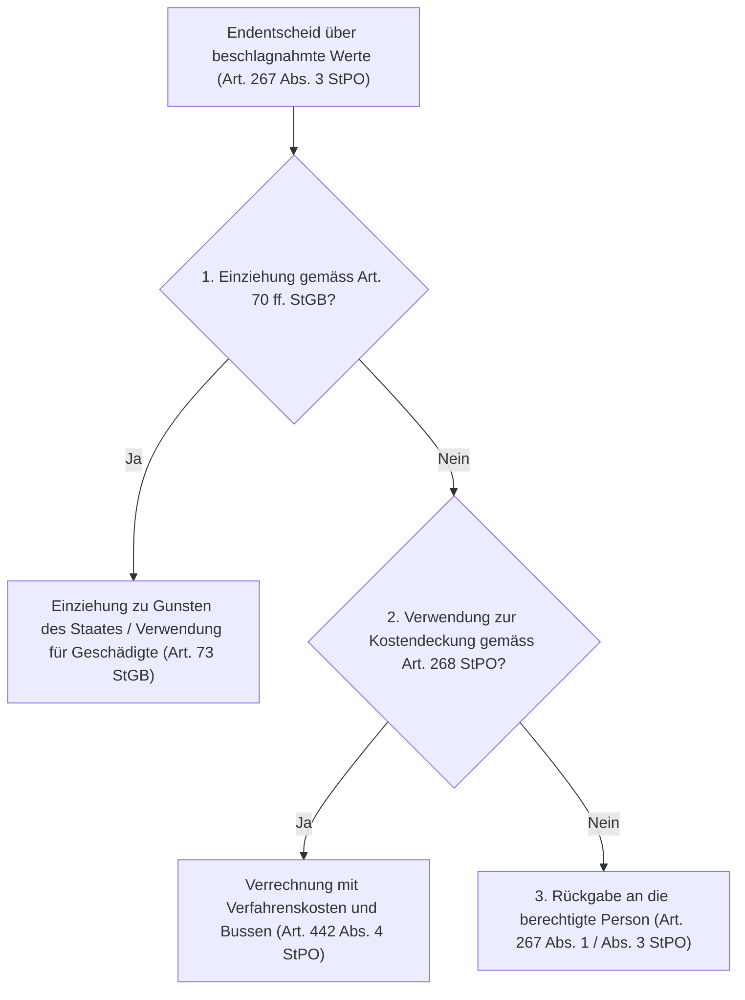

## Gesetzeswortlaut



## Überblick und Bedeutung

Art. 267 StPO bildet die zentrale Schluss- und Abwicklungsnorm des strafprozessualen Beschlagnahmerechts (Art. 263–268 StPO). Die Bestimmung regelt das Schicksal der während eines Strafverfahrens sichergestellten Sachen, Forderungen und Vermögenswerte in allen Stadien: bei vorzeitigem Dahinfallen des Beschlagnahmegrunds während des Vorverfahrens (Abs. 1), bei unbestritten unmittelbar entzogener Deliktsbeute (Abs. 2), beim verfahrenserledigenden Endentscheid (Abs. 3), bei konkurrierenden Ansprüchen mehrerer Prätendenten (Abs. 4 und 5) sowie bei unbekannter Berechtigung (Abs. 6).

### 1. Gesetzgeberische Zwecksetzung und Entstehungsgeschichte

Die gesetzgeberische Konzeption von Art. 267 StPO (im Vorentwurf Art. 266 E-StPO) beruht auf zwei tragenden Säulen, die der Bundesrat in der Botschaft zur Vereinheitlichung des Strafprozessrechts ausdrücklich hervorgehoben hat ([BBl 2006 1085, S. 1246 f.](https://fedlex.data.admin.ch/eli/fga/2006/124)):

1. **Umfassender Anwendungsbereich über alle behördlich verwahrten Güter**: Nach dem Willen des Gesetzgebers ist «nicht nur über Gegenstände und Vermögenswerte zu befinden, die den Berechtigten durch Zwang entzogen wurden, sondern auch über solche, welche auf Grund einer Aufforderung zur Herausgabe ohne Anwendung von Zwang ausgehändigt worden sind» ([BBl 2006 1085, S. 1246](https://fedlex.data.admin.ch/eli/fga/2006/124)).
2. **Entlastung der Strafjustiz von zivilrechtlichen Prätendentenstreitigkeiten**: Grundsätzlich sollen die Strafbehörden «nicht verpflichtet sein, über zivilrechtliche Ansprüche an beschlagnahmten Gegenständen oder Vermögenswerten zu urteilen» ([BBl 2006 1085, S. 1247](https://fedlex.data.admin.ch/eli/fga/2006/124)). Während das Gericht bei klarer Rechtslage endgültig entscheiden darf (Abs. 4), soll die Staatsanwaltschaft bei Streitigkeiten ausschliesslich nach Abs. 5 vorgehen, d.h. das Gut einer Person provisorisch zusprechen und den übrigen Ansprechern Frist zur Anhebung einer Zivilklage vor dem ordentlichen Zivilrichter ansetzen ([BBl 2006 1085, S. 1247](https://fedlex.data.admin.ch/eli/fga/2006/124)).

### 2. Dogmatische Einordnung und Eigentumsgarantie

Die strafprozessuale Beschlagnahme ist als provisorische Zwangsmassnahme (Art. 196 lit. c StPO) ein schwerer Eingriff in die verfassungsrechtliche Eigentumsgarantie (Art. 26 Abs. 1 BV). Sie verschafft dem Staat kein materielles Recht an den Objekten, sondern entzieht der betroffenen Person lediglich vorübergehend die tatsächliche Verfügungsmacht ([BGE 120 Ia 120 E. 2.b](https://entscheidsuche.ch/docs/CH_BGE/CH_BGE_002_BGE-120-IA-120_1994-07-13.html#consideration_2.); [BGer 6B_2/2012 vom 1. Februar 2013, E. 8.5](https://entscheidsuche.ch/docs/CH_BGer/CH_BGer_006_6B-2-2012_2013-02-01.html)).

Daraus folgt nach gefestigter Praxis die Vermutung, dass Gegenstände und Vermögenswerte bei Aufhebung der Zwangsmassnahme an diejenige Person herauszugeben sind, bei welcher sie sichergestellt wurden — gestützt auf die Vermutung des rechtmässigen Besitzes nach Art. 930 Abs. 1 ZGB ([BGE 120 Ia 120 E. 2.b](https://entscheidsuche.ch/docs/CH_BGE/CH_BGE_002_BGE-120-IA-120_1994-07-13.html#consideration_2.); [BGer 1B_270/2012 vom 7. August 2012, E. 4.4](https://entscheidsuche.ch/docs/CH_BGer/CH_BGer_001_1B-270-2012_2012-08-07.html); [BGer 6B_2/2012 vom 1. Februar 2013, E. 8.4](https://entscheidsuche.ch/docs/CH_BGer/CH_BGer_006_6B-2-2012_2013-02-01.html)).

### 3. Prüfschema

Die Bestimmung gliedert sich in ein mehrstufiges Prüfschema, das die Behörde je nach Verfahrensstadium und Anspruchskonstellation abzuarbeiten hat:

| Stufe | Absatz | Regelungsgehalt | Tatbestandliche Voraussetzung | Beweislast & Beweismass |
|---|---|---|---|---|
| **1** | **Abs. 1** | Aufhebung während des Verfahrens | Grund für die Beschlagnahme weggefallen (Beweis-, Einziehungs- oder Kostendeckungszweck entfallen) | Strafbehörde von Amtes wegen; bei Gesuch: Glaubhaftmachen des Wegfalls durch den Betroffenen |
| **2** | **Abs. 2** | Vorzeitige Restitution an Geschädigte | Gegenstand durch Straftat unmittelbar entzogen **und** Anspruch unbestritten (liquide Rechtslage) | Anspruchsteller muss unmittelbare Entziehung und Alleinberechtigung liquid nachweisen (voller Beweis) |
| **3** | **Abs. 3** | Entscheid im Endentscheid | Beschlagnahme noch aufrecht; Entscheidung über Einziehung (Art. 70 ff. StGB), Kostendeckung (Art. 268 StPO) oder Rückgabe | Strafbehörde / Sachgericht im Urteil oder der Einstellungsverfügung |
| **4** | **Abs. 4** | Gerichtliche Zuweisung bei mehreren Ansprechern | Mehrere Prätendenten; Sache spruchreif und Rechtslage materiell zweifelsfrei klar | Sachentscheid nur durch das Gericht (Kann-Vorschrift; voller Beweis des besseren Rechts) |
| **5** | **Abs. 5** | Provisorische Zuweisung mit Zivilklagefrist | Mehrere Prätendenten; zivilrechtliche Lage streitig oder Entscheid durch Staatsanwaltschaft | Prima-facie-Würdigung des besseren Rechts; Zivilkläger trägt Behauptungs- und Beweislast vor Zivilrichter |
| **6** | **Abs. 6** | Öffentliche Ausschreibung und Verfall | Berechtigte Person im Zeitpunkt der Aufhebung unbekannt (oder nicht feststellbar) | Untersuchungsbehörde von Amtes wegen; 5 Jahre Verwirkungsfrist ab Ausschreibung |

---

## Kommentierung

### A. Wegfall des Beschlagnahmegrundes und Aushändigung (Abs. 1)

#### 1. Dogmatische Grundlinie: Akzessorietät und Prüfung von Amtes wegen

Art. 267 Abs. 1 StPO ist eine Konkretisierung des verfassungsrechtlichen Verhältnismässigkeitsprinzips (Art. 36 Abs. 3 BV; Art. 197 Abs. 1 lit. c und d StPO). Eine Beschlagnahme darf nur so lange und in dem Umfang aufrechterhalten werden, wie der gesetzliche Sicherungszweck — sei es zur Beweissicherung (Art. 263 Abs. 1 lit. a StPO), zur Sicherungseinziehung (Art. 263 Abs. 1 lit. d StPO i.V.m. Art. 69 StGB), zur Einziehung von Vermögenswerten (Art. 70 ff. StGB) oder zur Kostendeckung (Art. 268 StPO) — fortdauert ([BGE 128 I 129 E. 3.1.2](https://entscheidsuche.ch/docs/CH_BGE/CH_BGE_001_BGE-128-I-129_2002.html#consideration_3.1.2); [BGer 1B_74/2022 vom 20. Mai 2022, E. 3.3](https://entscheidsuche.ch/docs/CH_BGer/CH_BGer_001_1B-74-2022_2022-05-20.html); [TG OG SW.2025.29 vom 27. Mai 2025, E. 1.3.1](https://entscheidsuche.ch/docs/TG_OG/TG_OG_001_RBOG-2025-Nr--37_2025.html)).

Die Strafbehörden sind verpflichtet, während des gesamten Verfahrens laufend von Amtes wegen zu prüfen, ob die Voraussetzungen für die Beschlagnahme noch erfüllt sind. Fällt der Grund weg oder zieht sich das Verfahren grundlos in die Länge, ist die Beschlagnahme aufzuheben und der Vermögenswert auszuhändigen ([BGer 1B_74/2022 E. 3.3](https://entscheidsuche.ch/docs/CH_BGer/CH_BGer_001_1B-74-2022_2022-05-20.html); [TG OG SW.2025.29 E. 1.3.1](https://entscheidsuche.ch/docs/TG_OG/TG_OG_001_RBOG-2025-Nr--37_2025.html)).

#### 2. Kasuistik: Forensische Daten-Spiegelung vs. unzulässiges Umschalten auf Einziehungsbeschlagnahme

In der Praxis beschlagnahmen Strafbehörden regelmässig Smartphones, Tablets und Laptops zur Beweissicherung. Sobald die Datenträger durch die Kriminalpolizei forensisch ausgelesen und gespiegelt wurden, entfällt der Beweiszweck. Die Weigerung der Staatsanwaltschaft, die Originalgeräte herauszugeben, führt zu scharfen Streitigkeiten.

> **Aus der Praxis: Der Laptop und das iPhone im Sexualstrafverfahren**  
> Die Staatsanwaltschaft eröffnete gegen eine Beschuldigte eine Strafuntersuchung wegen sexueller Nötigung und Drohung; sie warf ihr vor, dem Opfer Droh-Mails von verschiedenen Konten gesandt zu haben. Zur Beweissicherung beschlagnahmte die Staatsanwaltschaft ein MacBook und ein iPhone. Nach rund zwei Monaten verlangte die Beschuldigte die Herausgabe der Geräte, da diese durch die Kantonspolizei vollständig forensisch gespiegelt worden waren. Die Staatsanwaltschaft verweigerte die Rückgabe mit der Begründung, die Geräte seien Deliktswerkzeuge und unterlägen der Einziehung nach Art. 69 StGB, weshalb sie neu unter dem Titel der Einziehungsbeschlagnahme (Art. 263 Abs. 1 lit. d StPO) beschlagnahmt blieben.  
> **Das Obergericht des Kantons Thurgau hiess die Beschwerde gut und ordnete die sofortige Aushändigung an:** Das Gericht hielt fest, dass bei elektronischen Geräten kein Beweisverlust droht, wenn die Daten auf einem polizeilichen Speichermedium gesichert sind. Hypothetische Bedenken, das Sachgericht könnte später allenfalls den Zugriff auf das Originalgerät wünschen, genügen nicht. Das Umschalten auf die Einziehungsbeschlagnahme verwarf das Obergericht als unverhältnismässig:  
> > «Gemäss der Rechtsprechung des Bundesgerichts handelt es sich bei einem Mobiltelefon oder einem Laptop – anders als beispielsweise bei Waffen oder bei Drogen – nicht um zwingend einzuziehende illegale Deliktswerkzeuge, sondern um elektronische Geräte des alltäglichen Gebrauchs, die problemlos wiederbeschafft werden können; wobei von solchen Geräten selbst keine Gefährdung der Sicherheit von Menschen, der Sittlichkeit oder der öffentlichen Ordnung ausgehen.»  
> Da auf den Geräten keine illegalen Dateien (wie etwa verbotene Pornografie) gespeichert waren, sondern die Geräte lediglich als Kommunikationsmittel dienten, fehlte der Einziehungsbeschlagnahme jede Eignung zur Gefahrenabwehr. Die Geräte waren gestützt auf Art. 267 Abs. 1 StPO sofort an die Beschuldigte herauszugeben ([TG OG SW.2025.29 vom 27. Mai 2025, E. 2.2 und 2.3 = RBOG 2025 Nr. 37](https://entscheidsuche.ch/docs/TG_OG/TG_OG_001_RBOG-2025-Nr--37_2025.html)).

#### 3. Kasuistik: Zeitliche Schranken des Aufhebungsantrags im Rechtsmittelverfahren

Wird die Aufrechterhaltung einer Beschlagnahme in einem Urteil angeordnet, kann sie nicht beliebig durch ein Wiedererwägungsgesuch ausgehebelt werden.

> **Aus der Praxis: Das Freigabegesuch nach mündlicher Urteilseröffnung**  
> In einem langjährigen Strafverfahren wegen Widerhandlungen gegen das Spielbankengesetz waren Bankkonten des Beschuldigten über sieben Jahre lang gesperrt. Die Strafkammer des Obergerichts des Kantons Solothurn eröffnete ihr Berufungsurteil am 30. November 2021 mündlich und stellte das Urteilsdispositiv am 10. Dezember 2021 zu; darin wurde die Beschlagnahme bis zum Eintritt der Rechtskraft aufrechterhalten. Am 6. Januar 2022 — vor Zustellung der schriftlichen Urteilsbegründung — verlangte der Beschuldigte gestützt auf Art. 267 Abs. 1 StPO die unverzügliche Freigabe seiner Konten. Das Obergericht trat darauf nicht ein.  
> **Das Bundesgericht schützte das Nichteintreten:** Mit der mündlichen Urteilseröffnung war das Berufungsgericht an seinen Entscheid gebunden. Ein Antrag auf vorzeitige Aufhebung nach Art. 267 Abs. 1 StPO setzt voraus, dass sich die tatsächlichen Verhältnisse seit dem Urteilsentscheid wesentlich geändert haben oder erhebliche neue Tatsachen vorliegen. Da der Beschuldigte solche nicht dartun konnte, war sein Antrag unzulässig ([BGer 1B_74/2022 vom 20. Mai 2022, E. 3.4](https://entscheidsuche.ch/docs/CH_BGer/CH_BGer_001_1B-74-2022_2022-05-20.html)).

#### 4. Kasuistik: Staatshaftung bei pflichtwidriger Entwertung oder Zerstörung

Gelingt der Strafbehörde die Aushändigung nicht in natura, weil Gegenstände beschädigt, vernichtet oder veräussert wurden, entsteht ein staatshaftungsrechtlicher Entschädigungsanspruch.

> **Aus der Praxis: Die vernichteten Kleinfahrzeuge**  
> Nach der Aufhebung einer Beschlagnahme stellte sich heraus, dass sichergestellte Kleinfahrzeuge des Beschuldigten durch die Behörden zu Unrecht entsorgt bzw. vernichtet worden waren. Das kantonale Gericht kürzte den vom Beschuldigten geltend gemachten Schadenersatz pauschal um 50 bis 75 Prozent als angebliche Altersentwertung ab.  
> **Das Bundesgericht hob den Entscheid auf:** Nach Art. 267 Abs. 1 StPO ist die Behörde zur Herausgabe verpflichtet. Kann die Sache nicht mehr herausgegeben werden, gebietet der Untersuchungsgrundsatz (Art. 6 StPO) eine sorgfältige Ermittlung des effektiven Werts anhand der Akten und Kaufbelege; pauschale Schätzungen ins Blaue verletzen Bundesrecht ([BGer 6B_1462/2017 vom 8. August 2018, E. 1.3.1 f.](https://entscheidsuche.ch/docs/CH_BGer/CH_BGer_006_6B-1462-2017_2018-08-08.html)).

| Fallkonstellation | Rechtliche Würdigung nach Art. 267 Abs. 1 StPO | Entscheid |
|---|---|---|
| Datenträger (Laptop, Handy) forensisch gespiegelt; keine verbotenen Daten auf dem Gerät | **Aufhebung zwingend**: Beweiszweck entfallen; Einziehungsbeschlagnahme bei Alltagsgegenständen unzulässig | [TG OG SW.2025.29](https://entscheidsuche.ch/docs/TG_OG/TG_OG_001_RBOG-2025-Nr--37_2025.html) |
| Aufhebungsgesuch 5 Wochen nach mündlicher Urteilseröffnung des Berufungsgerichts | **Nichteintreten geschützt**: Bindung an das Urteilsdispositiv; keine wesentliche Änderung der Umstände | [BGer 1B_74/2022](https://entscheidsuche.ch/docs/CH_BGer/CH_BGer_001_1B-74-2022_2022-05-20.html) |
| Beschlagnahmte Sache durch Behörde vernichtet / entsorgt | **Herausgabepflicht verletzt**: Verpflichtung zu Schadenersatz; Wert muss nach Art. 6 StPO konkret ermittelt werden | [BGer 6B_1462/2017](https://entscheidsuche.ch/docs/CH_BGer/CH_BGer_006_6B-1462-2017_2018-08-08.html) |

> **Leitsatz.** Die Beschlagnahme elektronischer Alltagsgeräte (Smartphones, Computer) ist nach erfolgter forensischer Daten-Spiegelung mangels Beweisbedarfs aufzuheben. Ein Umschalten auf die Einziehungsbeschlagnahme nach Art. 263 Abs. 1 lit. d StPO i.V.m. Art. 69 StGB ist unzulässig, sofern das Gerät nicht Träger intrinsisch illegaler Inhalte ist.

---

### B. Unmittelbar entzogenes Deliktsgut und vorzeitige Restitution (Abs. 2)

#### 1. Dogmatische Grundlinie: Vorwegnahme des Endentscheids

Art. 267 Abs. 2 StPO enthält eine Sonderregelung für Gegenstände, die zwecks Rückgabe an die Geschädigten beschlagnahmt wurden (Art. 263 Abs. 1 lit. c StPO). Hier fällt der Beschlagnahmezweck nicht im Sinne von Abs. 1 weg, sondern die Beschlagnahme erfüllt sich gerade durch die Herausgabe an den Verletzten ([BBl 2006 1085, S. 1246](https://fedlex.data.admin.ch/eli/fga/2006/124)).

Die vorzeitige Rückgabe an den Verletzten stellt eine formelle Vorwegnahme des Endentscheids dar ([LU KG 2N 11 78 vom 12. Dezember 2011 = LGVE 2011 I Nr. 47](https://entscheidsuche.ch/docs/LU_Gerichte/LU_KG_002_2N-11-78_2011-12-12.html)). Sie verlangt zwei kumulative Voraussetzungen:
1. **Unmittelbare Entziehung durch die Straftat**: Es muss sich um Deliktsgut handeln, das dem Verletzten direkt durch die Tat abhandengekommen ist (z.B. Diebesgut, geraubte Sachen).
2. **Unbestrittene Berechtigung (liquide Rechtslage)**: Die Berechtigung der ansprechenden Person darf weder von der beschuldigten Person noch von Drittpersonen bestritten werden.

Besteht irgendein Zweifel oder erheben mehrere Personen Anspruch, ist die vorzeitige Restitution nach Abs. 2 ausgeschlossen; es ist nach den Absätzen 3 bis 5 vorzugehen ([BBl 2006 1085, S. 1246](https://fedlex.data.admin.ch/eli/fga/2006/124)).

#### 2. Kasuistik: Abgrenzung zu Abs. 1 — Beschlagnahmebetroffener vs. Bestohlener

> **Aus der Praxis: Der importierte Audi A5 mit manipulierter Fahrgestellnummer**  
> In einer Strafuntersuchung wegen Betrugs und Urkundenfälschung beschlagnahmte die Staatsanwaltschaft im Kanton Luzern diverse aus Italien importierte Luxusfahrzeuge, bei welchen die eingeschlagenen Fahrgestellnummern (Chassis-Nummern) nicht mit den Fahrzeugausweisen übereinstimmten. Der Beschwerdeführer — bei dem ein Audi A5 sichergestellt worden war — verlangte die sofortige Freigabe des Autos an sich unter Auflage eines Halterwechselverbots. Er berief sich auf Art. 267 Abs. 1 StPO und machte geltend, er sei gutgläubiger Erwerber.  
> **Das Obergericht des Kantons Luzern wies das Gesuch ab:** Das Gericht zog eine strikte Trennlinie zwischen Abs. 1 und Abs. 2:  
> > «Die vorzeitige Rückgabe an die berechtigte Person stellt die Vorwegnahme eines Endentscheids dar, der auf Aushändigung an den Verletzten zur Wiederherstellung des rechtmässigen Zustands lautet. Sie lässt sich nicht unter Art. 267 Abs. 1 StPO fassen, da in den dort geregelten Fällen eine vorzeitige Rückgabe nur an den Beschlagnahmebetroffenen in Frage käme, nicht an den Verletzten. Die vorzeitige Aushändigung setzt kumulativ voraus, dass die berechtigte Person unbestritten ist und dass das Objekt ihr bzw. einer bestimmten Person durch die Straftat unmittelbar entzogen wurde. Die Rechtslage muss hinreichend liquid sein. Bei Diebesgut erfolgt die vorzeitige Herausgabe an den Bestohlenen, der namentlich bekannt sein muss [...]. Eine vorzeitige Aushändigung an den Beschwerdeführer, der zwar Beschlagnahmebetroffener, nicht aber Bestohlener ist, fällt vor diesem Hintergrund unbestrittenermassen nicht in Betracht.»  
> Solange die deliktische Herkunft im Raum steht und ein Herausgabeanspruch des italienischen Eigentümers im Endentscheid möglich bleibt, darf die Sache weder vorzeitig an den Verletzten (fehlende Liquidität) noch an den Beschlagnahmebetroffenen (Gefahr der Vereitelung des Einziehungs-/Restitutionszwecks) ausgehändigt werden ([LU KG 2N 11 78 vom 12. Dezember 2011, LGVE 2011 I Nr. 47](https://entscheidsuche.ch/docs/LU_Gerichte/LU_KG_002_2N-11-78_2011-12-12.html)).

> **Leitsatz.** Die vorzeitige Restitution nach Art. 267 Abs. 2 StPO ist auf Konstellationen mit unbestrittener, liquider Eigentumslage der geschädigten Person beschränkt. Ist strittig, ob die Sache deliktisch entzogen wurde oder ob Dritte gutgläubig Rechte erworben haben, scheidet sowohl eine vorzeitige Restitution an den Geschädigten (Abs. 2) als auch eine Freigabe an den Beschlagnahmebetroffenen (Abs. 1) aus.

---

### C. Endentscheid über Rückgabe, Kostendeckung oder Einziehung (Abs. 3)

#### 1. Dogmatische Grundlinie: Die Trias der Verwendungsentscheide

Wurde die Beschlagnahme während der Strafuntersuchung nicht vorzeitig aufgehoben, ist im Endentscheid (Urteil, Strafbefehl oder Einstellungsverfügung; [BBl 2006 1085, S. 1247](https://fedlex.data.admin.ch/eli/fga/2006/124)) zwingend über deren Schicksal zu befinden. Das Gesetz sieht drei Verwendungszwecke vor, die in einer festen Rangordnung zueinander stehen:

1. **Einziehung (Art. 70–72 StGB)**: Hat Vorrang vor allen übrigen Verwendungsarten. Liegen deliktische Vermögenswerte vor, werden sie eingezogen oder Geschädigten zugesprochen (Art. 73 StGB).
2. **Kostendeckung (Art. 268 StPO)**: Wurde Vermögen zur Deckung von Verfahrenskosten, Geldstrafen oder Bussen beschlagnahmt, erfolgt im Endentscheid die Verrechnung.
3. **Rückgabe an die berechtigte Person**: Bleiben Vermögenswerte nach Einziehung und Kostendeckung übrig oder scheidet beides aus, sind sie dem Berechtigten auszuhändigen.

#### 2. Exklusive Kompetenz zur Verrechnung mit Verfahrenskosten

Häufig entsteht Streit darüber, wer für die Verrechnung von Verfahrenskosten mit beschlagnahmtem Geld zuständig ist: die kantonale Inkassobehörde oder das Strafgericht.

> **Aus der Praxis: Der angebliche Vorrang der kantonalen Inkassobehörde**  
> Eine verurteilte Partei focht die Verrechnung beschlagnahmter Gelder mit den Verfahrenskosten im Berufungsurteil an. Sie berief sich auf eine Passage der französischen Fassung der Botschaft ([BBl 2006 1085, S. 1318 Ziff. 2.11.2](https://fedlex.data.admin.ch/eli/fga/2006/124)), wonach ausschliesslich die Inkassobehörde zur Verrechnungserklärung befugt sei.  
> **Das Bundesgericht wies die Beschwerde ab:** Das Gericht klärte den Widerspruch zwischen den Sprachfassungen der Botschaft. Die deutsche und italienische Fassung sahen eine solche Ausschlusskompetenz nicht vor. Das Strafgericht ist bei beschlagnahmten Vermögenswerten nach Art. 267 Abs. 3 i.V.m. Art. 442 Abs. 4 StPO **allein zuständig**, die Verrechnung im Endentscheid anzuordnen ([BGE 143 IV 293 E. 1](https://entscheidsuche.ch/docs/CH_BGE/CH_BGE_006_BGE-143-IV-293_2017.html#consideration_1.)).

#### 3. Aufbewahrung und treuhänderische Anlagepflicht

Bis zum rechtskräftigen Endentscheid trifft die Strafbehörde eine strenge Sorgfalts- und Werterhaltungspflicht (Art. 266 Abs. 2 StPO). Beschlagnahmte Gelder sind so zu sichern und anzulegen, dass sie nicht an Wert einbüssen ([BGE 148 IV 74](https://entscheidsuche.ch/docs/CH_BGE/CH_BGE_006_BGE-148-IV-74_2022.html); Art. 1 der Verordnung über die Anlage beschlagnahmter Vermögenswerte, SR 312.057).

> **Leitsatz.** Bei beschlagnahmten Vermögenswerten ist die urteilende Strafbehörde nach Art. 267 Abs. 3 i.V.m. Art. 442 Abs. 4 StPO exklusiv zuständig, die Verrechnung mit Verfahrenskosten und Bussen im Endentscheid anzuordnen; die kantonale Vollstreckungs- und Inkassobehörde hat insoweit keine Vorrangkompetenz.

---

### D. Mehrere Ansprecher und Zivilklagefrist (Abs. 4 und 5)

#### 1. Dogmatische Grundlinie: Gerichtliche Kognition vs. staatsanwaltschaftliche Verweisung

Erheben mehrere Personen Anspruch auf dasselbe beschlagnahmte Gut (sog. Prätendentenstreit), differenziert das Gesetz strikt zwischen Gericht und Staatsanwaltschaft ([BBl 2006 1085, S. 1247](https://fedlex.data.admin.ch/eli/fga/2006/124); [BGer 6B_2/2012 E. 8.4](https://entscheidsuche.ch/docs/CH_BGer/CH_BGer_006_6B-2-2012_2013-02-01.html)):

- **Abs. 4 (Gerichtsentscheid)**: Das Gericht *kann* endgültig entscheiden. Wegen Art. 6 Ziff. 1 EMRK (Recht auf ein Zivilgericht) darf das Strafgericht einen solchen Sachentscheid aber nur fällen, wenn die Rechtslage völlig unzweifelhaft und liquide ist. Das Gericht ist hierzu nie verpflichtet; vermag es die zivilrechtliche Lage nicht zweifelsfrei zu klären, *muss* es nach Abs. 5 verfahren ([BBl 2006 1085, S. 1247](https://fedlex.data.admin.ch/eli/fga/2006/124)).
- **Abs. 5 (Strafbehörde / Staatsanwaltschaft)**: Die Staatsanwaltschaft kann **niemals** nach Abs. 4 entscheiden, sondern ausschliesslich nach Abs. 5 ([BBl 2006 1085, S. 1247](https://fedlex.data.admin.ch/eli/fga/2006/124); [BGer 6B_2/2012 E. 8.4](https://entscheidsuche.ch/docs/CH_BGer/CH_BGer_006_6B-2-2012_2013-02-01.html)). Sie weist die Sache einer Partei vorläufig zu und setzt den übrigen Ansprechern Frist zur Klageerhebung beim Zivilgericht.

#### 2. Rechtsnatur des Entscheids nach Abs. 5: Prima-facie-Würdigung und Rollenverteilung

Die Anordnung nach Art. 267 Abs. 5 StPO entscheidet nicht materiell über Eigentum oder Besitz. Sie hat zwei eng umgrenzte Zwecke:

1. **Verteilung der Parteirollen im Zivilprozess**: Wer die Sache vorläufig zugesprochen erhält, wird im Zivilprozess Beklagter (und profitiert von der Besitzvermutung nach Art. 930 ZGB); die übrigen Ansprecher erhalten die Klägerrolle und tragen die volle Behauptungs- und Beweislast ([BGer 1B_270/2012 E. 4.3](https://entscheidsuche.ch/docs/CH_BGer/CH_BGer_001_1B-270-2012_2012-08-07.html); [BGer 6B_2/2012 E. 8.4](https://entscheidsuche.ch/docs/CH_BGer/CH_BGer_006_6B-2-2012_2013-02-01.html)).
2. **Haftungsprivileg der Behörde**: Die Fristansetzung schützt die Strafbehörde vor dem zivil- oder staatshaftungsrechtlichen Vorwurf der unrechtmässigen Aushändigung. Läuft die Frist unbenutzt ab, darf die Behörde die Sache mit befreiender Wirkung aushändigen ([BGer 1B_270/2012 E. 4.3](https://entscheidsuche.ch/docs/CH_BGer/CH_BGer_001_1B-270-2012_2012-08-07.html)).

> «Im Verfahren nach Art. 267 Abs. 5 StPO erfolgt keine endgültige Zuweisung des Gegenstands oder Vermögenswerts. Es ist deshalb kein ausgedehntes Beweisverfahren durchzuführen, und es ist keine erschöpfende Abklärung der zivilrechtlichen Verhältnisse vorzunehmen. Mit der vorläufigen Zusprache nach Art. 267 Abs. 5 StPO werden einzig die Parteirollen in einem nachfolgenden Zivilprozess verteilt, ohne hierdurch dem Entscheid des erkennenden Zivilgerichts vorzugreifen [...]. Es besteht daher im Verfahren nach Art. 267 Abs. 5 StPO auch kein Anspruch auf Abnahme von Beweisen zum Nachweis des eigenen besseren Rechts. [...] Im Verfahren nach Art. 267 Abs. 5 StPO ist folglich einzig eine 'Prima-facie-Würdigung' der zivilrechtlichen Verhältnisse vorzunehmen.»
>
> ([BGer 1B_270/2012 vom 7. August 2012, E. 4.3](https://entscheidsuche.ch/docs/CH_BGer/CH_BGer_001_1B-270-2012_2012-08-07.html))

#### 3. Kasuistik: Der Prätendentenstreit um ein Leasingfahrzeug

> **Aus der Praxis: Der Audi RS6 zwischen Leasinggesellschaft und Autohaus**  
> Die Staatsanwaltschaft Aargau beschlagnahmte einen Audi RS6 unter dem Verdacht deliktischer Herkunft. Nachdem sich der Verdacht nicht erhärtete, hob sie die Beschlagnahme auf. Um das Fahrzeug stritten nun zwei Parteien: Die Leasinggesellschaft X. SA (ursprüngliche Eigentümerin) und die Autohandels-AG Y. (in Liquidation/Konkurs), welche das Fahrzeug nach vorzeitiger Kündigung des Leasingnehmers zurückgenommen hatte. Die Staatsanwaltschaft sprach das Fahrzeug der Leasinggesellschaft zu und setzte dem Konkursamt Frist zur Zivilklage. Das Obergericht Aargau drehte den Entscheid um: Es sprach das Auto dem Konkursamt der Autohandels-AG zu und verwies die Leasinggesellschaft auf den Zivilweg.  
> **Das Bundesgericht schützte den obergerichtlichen Entscheid:** Das Bundesgericht stellte klar, dass im Verfahren nach Abs. 5 keine vertieften Vertragsauslegungen vorgenommen werden dürfen. Da der Leasingnehmer das Fahrzeug vor der Beschlagnahme an die Autohandels-AG übergeben hatte, befand sich diese zuletzt im Besitz des Wagens. Gestützt auf die Eigentumsvermutung nach Art. 930 ZGB und die vertragliche Rückkaufsklausel durfte das Obergericht prima facie die Autohandels-AG als besser legitimiert einstufen und der Leasinggesellschaft die Klägerrolle für das Zivilverfahren zuweisen ([BGer 1B_270/2012 vom 7. August 2012, E. 4.4](https://entscheidsuche.ch/docs/CH_BGer/CH_BGer_001_1B-270-2012_2012-08-07.html)).

#### 4. Kasuistik: Kein Prätendentenstreit bei Betreibungsamtlicher Pfändung (SchKG)

Art. 267 Abs. 4 und 5 StPO greifen nur bei Streitigkeiten zwischen Privaten über materiellrechtliche Ansprüche. Tritt eine staatliche Zwangsvollstreckungsbehörde auf, gilt ein völlig anderes Regime.

> **Aus der Praxis: Der Casinogewinn von 7'000 Franken und das Betreibungsamt**  
> Die Staatsanwaltschaft Zürich beschlagnahmte bei einem Beschuldigten Fr. 7'000.- Bargeld. Es stellte sich rasch heraus, dass das Geld aus einem legalen Casinogewinn stammte. Da gegen den Beschuldigten offene Verlustscheine vorlagen, informierte die Staatsanwaltschaft gestützt auf Art. 96 Abs. 1 StPO das Betreibungsamt. Dieses erklärte daraufhin: «Somit pfänden wir den Betrag von Fr. 7'000.- bei der Staatsanwaltschaft ein und bitten sie höflich den Betrag auf unser Konto zu überweisen». Die Staatsanwaltschaft stellte das Verfahren teilweise ein und überwies das Geld dem Betreibungsamt. Der Beschuldigte verlangte die Herausgabe an seinen Verteidiger und rügte eine Verletzung von Art. 267 Abs. 4 und 5 StPO: Die Staatsanwaltschaft hätte das Geld nicht einfach überweisen dürfen, sondern ein Prätendentenverfahren durchführen müssen.  
> **Das Bundesgericht wies die Beschwerde ab:** Das Bundesgericht stellte klar, dass das Betreibungsamt kein materieller Ansprecher im Sinne von Art. 267 Abs. 4 und 5 StPO ist:  
> > «Belegt das Betreibungsamt einen aus der strafprozessualen Beschlagnahme zu entlassenden Vermögenswert mit zwangsvollstreckungsrechtlichem Beschlag, hat die Strafbehörde den Vermögenswert an das Betreibungsamt herauszugeben. Es ist nicht Sache der Strafbehörden, die Rechtmässigkeit bzw. Formgültigkeit des Pfändungsbeschlags zu beurteilen. Entsprechende Rügen sind im SchKG-Verfahren vorzubringen. Das Verfahren nach Art. 267 Abs. 4 und 5 StPO ist nur einschlägig, wenn mehrere Personen materiell begründete Ansprüche an den freizugebenden Vermögenswerten erheben.»  
> ([BGE 145 IV 80 E. 2.3](https://entscheidsuche.ch/docs/CH_BGE/CH_BGE_006_BGE-145-IV-80_2019.html#consideration_2.3)).

#### 5. Fehlende Legitimation des Beschuldigten zur Rüge fremder Drittrechte

Häufig versucht die beschuldigte Person, die Aufhebung einer Beschlagnahme mit dem Argument zu erzwingen, das beschlagnahmte Gut gehöre in Wahrheit Dritten (z.B. Familienangehörigen oder Geschäftspartnern). Eine solche Rüge ist unzulässig: Drittansprüche müssen von den betroffenen Personen selbst nach Art. 267 Abs. 4 und 5 StPO im Strafverfahren angemeldet werden; der Beschuldigte hat kein schutzwürdiges Interesse, fremde Eigentumsrechte im eigenen Namen geltend zu machen ([BGer 7B_161/2022 vom 5. Oktober 2023, E. 2.2](https://entscheidsuche.ch/docs/CH_BGer/CH_BGer_007_7B-161-2022_2023-10-05.html)).

| Konstellation | Anwendbare Norm | Rechtsfolge |
|---|---|---|
| Streit zweier Privater über Eigentum an beschlagnahmtem Auto (Leasing vs. Händler) | **Art. 267 Abs. 5 StPO** | Prima-facie-Zusprache an letzten Besitzer (Art. 930 ZGB); Fristansetzung zur Zivilklage an Prätendenten ([BGer 1B_270/2012](https://entscheidsuche.ch/docs/CH_BGer/CH_BGer_001_1B-270-2012_2012-08-07.html)) |
| Betreibungsamt pfändet freizugebenden Geldbetrag bei der Staatsanwaltschaft ein | **Kein Art. 267 Abs. 4/5 StPO** | Unverzügliche Herausgabe an das Betreibungsamt; Rechtmässigkeit ist ausschliesslich via SchKG-Beschwerde zu rügen ([BGE 145 IV 80](https://entscheidsuche.ch/docs/CH_BGE/CH_BGE_006_BGE-145-IV-80_2019.html#consideration_2.3)) |
| Beschuldigter verlangt Kontofreigabe mit der Behauptung, das Geld gehöre Dritten | **Art. 81 BGG / Nichteintreten** | Beschuldigter nicht legitimiert; Drittansprecher müssen Rechte selbstständig wahren ([BGer 7B_161/2022](https://entscheidsuche.ch/docs/CH_BGer/CH_BGer_007_7B-161-2022_2023-10-05.html)) |

> **Leitsatz.** Der Prätendentenstreit nach Art. 267 Abs. 4 und 5 StPO setzt konkurrierende, materiellrechtliche Ansprüche mehrerer Privater voraus. Erlangt das Betreibungsamt im Rahmen einer Zwangsvollstreckung Pfändungsbeschlag an einem freizugebenden Vermögenswert, hat die Strafbehörde das Gut ohne materielle Vorprüfung an das Betreibungsamt abzuliefern.

---

### E. Berechtigte unbekannt: Öffentliche Ausschreibung und Verfall (Abs. 6)

#### 1. Dogmatische Grundlinie: Voraussetzungen und Rechtsfolgen

Sind im Zeitpunkt der Aufhebung der Beschlagnahme die berechtigten Personen nicht bekannt, schreibt die Strafbehörde die Werte öffentlich aus. Die Vorschrift regelt Herrenlosigkeit, Funddelikte sowie Fälle, in denen die wahre wirtschaftliche Berechtigung im Strafverfahren im Dunkeln bleibt ([BStGer SK.2021.8 vom 9. November 2021, Ziff. 4.2](https://entscheidsuche.ch/docs/CH_BSTG/CH_BSTG_001_SK-2021-8_2021-11-09.pdf); [ZH OG SB240338 vom 19. Dezember 2024](https://entscheidsuche.ch/docs/ZH_Obergericht/ZH_OG_002_SB240338_2024-12-19.pdf)).

Die Bestimmung enthält zwei Phasen:
1. **Öffentliche Ausschreibung**: Publikation im kantonalen Amtsblatt oder im Schweizerischen Handelsamtsblatt (SHAB) mit Aufforderung zur Anmeldung von Ansprüchen.
2. **Fünfjährige Verwirkungsfrist**: Meldet sich innert fünf Jahren seit der Ausschreibung niemand mit berechtigtem Anspruch, verfällt der Vermögenswert kraft Gesetzes an das Gemeinwesen (Kanton oder Bund).

#### 2. Kasuistik: Dubiose Bargeldfunde und unkooperative Drittpersonen

Ein Berechtigter gilt nicht nur dann als unbekannt, wenn die Person physisch unauffindbar ist, sondern auch dann, wenn über die rechtmässige Berechtigung völlige Ungewissheit herrscht und angebliche Prätendenten den Nachweis verweigern.

> **Aus der Praxis: Die dubiosen 6'000 Euro im Drogenmilieu**  
> Bei einer Beschuldigten wurden EUR 6'000.- Bargeld beschlagnahmt. Sowohl die Beschuldigte als auch ein als Auskunftsperson befragter Dritter machten widersprüchliche Angaben zur Herkunft des Geldes. Der Dritte behauptete, das Geld stamme von seiner Mutter und sei von deren Bankkonto abgehoben worden. Obwohl ihn die Polizei ausdrücklich aufforderte, einen Bankauszug einzureichen, reagierte er nicht mehr und tauchte für die Justiz ab. Die Beschuldigte verlangte nach Verfahrensabschluss die Aushändigung des Geldes an sich.  
> **Das Appellationsgericht Basel-Stadt verweigerte die Herausgabe und ordnete die Ausschreibung nach Art. 267 Abs. 6 StPO an:**  
> Da die Aussagen völlig unglaubhaft waren und der angebliche Dritteinnahmezeuge trotz Belehrung untertauchte, konnte die tatsächliche wirtschaftliche Berechtigung nicht festgestellt werden. Eine Herausgabe an die Beschuldigte kam mangels glaubhaften Eigentumsnachweises nicht in Betracht. Die Staatsanwaltschaft hatte das Geld öffentlich auszuschreiben; nach Ablauf von fünf Jahren fällt es an den Kanton ([BS APG SB.2020.102 vom 18. Januar 2023, E. 5.2.2 = AG.2023.150](https://entscheidsuche.ch/docs/BS_Omni/BS_APG_001_SB-2020-102_2023-01-18.html)).

> **Leitsatz.** Bleibt die wirtschaftliche Berechtigung an beschlagnahmten Vermögenswerten aufgrund widersprüchlicher Aussagen ungeklärt und weigern sich Drittansprecher, den Nachweis der Herkunft durch zumutbare Belege zu erbringen, hat die Strafbehörde nach Art. 267 Abs. 6 StPO vorzugehen und die Werte öffentlich zur Verfallsausschreibung zu bringen.

---

## Kantonale Praxisfragen

### 1. Das Umschalten auf die Einziehungsbeschlagnahme bei gespiegelten Datenträgern

In der kantonalen Praxis der Staatsanwaltschaften (insb. in ZH, BE, AG und TG) ist die Tendenz zu beobachten, beschlagnahmte Datenträger (Smartphones, MacBooks, Tablets) auch nach vollständiger forensischer Extraktion nicht herauszugeben, indem formell auf eine Einziehungsbeschlagnahme (Art. 263 Abs. 1 lit. d StPO i.V.m. Art. 69 StGB) umgestellt wird.

Die kantonale Rechtsprechung hat dieser Praxis enge Grenzen gesetzt:
- Das Obergericht des Kantons Thurgau ([TG OG SW.2025.29 vom 27. Mai 2025 = RBOG 2025 Nr. 37](https://entscheidsuche.ch/docs/TG_OG/TG_OG_001_RBOG-2025-Nr--37_2025.html)) verlangt, dass von dem Endgerät selbst eine konkrete Gefahr ausgehen muss (wie bei verbotenen Waffen oder deliktisch generierten kinderpornografischen Dateien). Diente das Smartphone lediglich zum Versenden strafbarer Nachrichten (E-Mails, Drohungen, Nötigungen), fehlt der Einziehung jede präventive Eignung, weil sich die beschuldigte Person jederzeit ein neues Endgerät beschaffen kann.
- Für die Praxis bedeutet dies: Die Staatsanwaltschaft muss nach forensischer Datenextraktion das Originalgerät auf erstes Gesuch nach Art. 267 Abs. 1 StPO herausgeben, sofern die Datenintegrität auf dem behördlichen Speichermedium verbürgt ist.

### 2. Tragweite des Fristversäumnisses bei der Zivilklagefrist nach Abs. 5

Setzt die Staatsanwaltschaft nach Art. 267 Abs. 5 StPO eine Frist zur Anhebung der Zivilklage (in der kantonalen Praxis meist 20 bis 30 Tage), stellt sich die Frage nach den Rechtsfolgen eines unbenutzten Fristablaufs:
- **Keine materielle Verwirkung des Zivilanspruchs**: Das Versäumen der Frist nach Art. 267 Abs. 5 StPO führt nicht zum Untergang des materiellen Eigentumsanspruchs nach Art. 641 Abs. 2 ZGB. Der unterlassende Prätendent kann die Sache auch nach Herausgabe an die Gegenpartei noch vor dem ordentlichen Zivilrichter mit der Vindikations- oder Bereicherungsklage herausverlangen ([BGer 1B_270/2012 E. 4.3](https://entscheidsuche.ch/docs/CH_BGer/CH_BGer_001_1B-270-2012_2012-08-07.html)).
- **Vollständiger Verlust des Zugriffs im Strafverfahren**: Für das Strafverfahren wirkt der Fristablauf jedoch absolut: Die Strafbehörde händigt den Gegenstand an die im Entscheid bezeichnete Person aus und scheidet endgültig aus der Verantwortung aus. Ein behördlicher Rückruf ist ausgeschlossen.

---

## Praxishinweise

### Für die beschuldigte Person und ihre Verteidigung:

1. **Rückgabe elektronischer Geräte sofort nach Daten-Spiegelung verlangen**: Sobald Mobiltelefone oder Computer durch die Kriminalpolizei ausgelesen worden sind, unverzüglich ein förmliches Gesuch um Aufhebung der Beschlagnahme nach Art. 267 Abs. 1 StPO stellen. Das Argument der Staatsanwaltschaft, die Geräte dienten als «Tatwerkzeuge» der Einziehung, greift bei gewöhnlichen Kommunikationsdelikten nicht ([TG OG SW.2025.29 E. 2.3 = RBOG 2025 Nr. 37](https://entscheidsuche.ch/docs/TG_OG/TG_OG_001_RBOG-2025-Nr--37_2025.html)).
2. **Keine fremden Drittrechte im eigenen Namen geltend machen**: Liegen beschlagnahmte Vermögenswerte auf eigenen Konten oder in eigenen Räumlichkeiten, nicht behaupten, diese gehörten Dritten, um die Freigabe zu erzwingen. Dies führt mangels Legitimation zum Nichteintreten ([BGer 7B_161/2022 E. 2.2](https://entscheidsuche.ch/docs/CH_BGer/CH_BGer_007_7B-161-2022_2023-10-05.html)). Dritte müssen ihre Ansprüche zwingend selbstständig im Verfahren als Prätendenten anmelden.
3. **Im Rechtsmittelverfahren wesentliche Änderungen substanziieren**: Wurde die Beschlagnahme durch das Urteil des Berufungsgerichts bis zur Rechtskraft aufrechterhalten, kann nicht ohne Weiteres ein Freigabegesuch nach Art. 267 Abs. 1 StPO gestellt werden. Es müssen zwingend neue, erhebliche Tatsachen nachgewiesen werden; andernfalls bleibt nur der Antrag auf vorsorgliche Massnahmen nach Art. 104 BGG beim Bundesgericht ([BGer 1B_74/2022 E. 3.4](https://entscheidsuche.ch/docs/CH_BGer/CH_BGer_001_1B-74-2022_2022-05-20.html)).

### Für die geschädigte Person und die Privatklägerschaft:

1. **Vorzeitige Restitution nach Abs. 2 nur bei vollkommen liquider Beweislage beantragen**: Die vorzeitige Rückgabe von Deliktsbeute vor Verfahrensabschluss setzt voraus, dass die Alleinberechtigung unbestritten ist ([LU KG 2N 11 78](https://entscheidsuche.ch/docs/LU_Gerichte/LU_KG_002_2N-11-78_2011-12-12.html)). Bestreitet die beschuldigte Person den Diebstahl oder macht sie eigene Rechte geltend, wird das Gesuch abgewiesen; die Restitution erfolgt diesfalls erst im Endentscheid (Abs. 3) oder über eine Zuweisung nach Abs. 5.
2. **Rechte bei SchKG-Pfändung im Betreibungsverfahren wahren**: Hat das Betreibungsamt beschlagnahmte Gelder bei der Staatsanwaltschaft gepfändet, ist ein Vorgehen nach Art. 267 Abs. 4/5 StPO ausgeschlossen. Geschädigte müssen ihre Vorzugsrechte (z.B. Schadenersatzprivilegien) über das Widerspruchsverfahren nach Art. 106–109 SchKG oder Beschwerde nach Art. 17 SchKG beim Betreibungsamt durchsetzen ([BGE 145 IV 80 E. 2.3](https://entscheidsuche.ch/docs/CH_BGE/CH_BGE_006_BGE-145-IV-80_2019.html#consideration_2.3)).

### Für Drittansprecher und Leasinggesellschaften:

1. **Besitzverhältnisse im Zeitpunkt der Beschlagnahme dokumentieren**: Bei der Zuweisung nach Art. 267 Abs. 5 StPO stellt die Behörde prima facie auf die Vermutung des letzten Gewahrsamsinhabers ab (Art. 930 ZGB; [BGer 1B_270/2012 E. 4.4](https://entscheidsuche.ch/docs/CH_BGer/CH_BGer_001_1B-270-2012_2012-08-07.html)). Leasinggesellschaften müssen lückenlos belegen, ob und wann das Fahrzeug vor der Beschlagnahme rechtmässig an sie herausgegeben wurde.
2. **Zivilklagefrist nach Abs. 5 strikt einhalten**: Wird eine Frist zur Anhebung der Zivilklage angesetzt, muss die Klage (bzw. das Schlichtungsgesuch) zwingend vor Fristablauf anhängig gemacht werden. Zwar erlischt das materielle Eigentum nicht, doch wird die Sache nach Fristablauf unwiderruflich an den Gegner ausgehändigt ([BGer 1B_270/2012 E. 4.3](https://entscheidsuche.ch/docs/CH_BGer/CH_BGer_001_1B-270-2012_2012-08-07.html)).

### Für die Staatsanwaltschaft und die Gerichte:

1. **Kein Sachentscheid nach Abs. 4 durch die Staatsanwaltschaft**: Die Staatsanwaltschaft darf bei Prätendentenstreitigkeiten nie endgültig nach Abs. 4 entscheiden; sie hat zwingend nach Abs. 5 zu verfahren ([BBl 2006 1085, S. 1247](https://fedlex.data.admin.ch/eli/fga/2006/124); [BGer 6B_2/2012 E. 8.4](https://entscheidsuche.ch/docs/CH_BGer/CH_BGer_006_6B-2-2012_2013-02-01.html)).
2. **Keine behördliche Hinterlegung im StPO-System**: Im Gegensatz zu früheren kantonalen Prozessordnungen sieht Art. 267 StPO keine amtliche Hinterlegung vor ([BGer 6B_2/2012 E. 8.4](https://entscheidsuche.ch/docs/CH_BGer/CH_BGer_006_6B-2-2012_2013-02-01.html)). Bei unklarer Rechtslage ist das Gut einer Partei vorläufig zuzusprechen und den übrigen Frist zur Zivilklage anzusetzen.
3. **Verfallsausschreibung nach Abs. 6 bei unkooperativen Dritten**: Bleibt die wirtschaftliche Berechtigung an beschlagnahmtem Geld nach widersprüchlichen Aussagen ungeklärt und verweigern Beteiligte den Belegnachweis, nicht an die beschuldigte Person herausgeben, sondern im Amtsblatt ausschreiben ([BS APG SB.2020.102 E. 5.2.2](https://entscheidsuche.ch/docs/BS_Omni/BS_APG_001_SB-2020-102_2023-01-18.html)).

---

## Literatur

- **Bommer Felix / Goldschmid Peter**, in: Niggli/Heer/Wiprächtiger (Hrsg.), Basler Kommentar, Schweizerische Strafprozessordnung, 2. Aufl., Basel 2014, Art. 267 StPO N 1–32.
- **Heimgartner Stefan**, in: Donatsch/Lieber/Summers/Wohlers (Hrsg.), Kommentar zur Schweizerischen Strafprozessordnung (StPO), 3. Aufl., Zürich 2020, Art. 267 StPO N 1–15.
- **Heimgartner Stefan**, in: Frank/Eicker/Markwalder/Achermann (Hrsg.), Basler Kommentar, Verwaltungsstrafrecht, Basel 2020, Art. 46 VStrR N 1–18.
- **Lembo Patrick / Julen Berthod Valérie**, in: Jeanneret/Kuhn/Perrier Depeursinge (Hrsg.), Commentaire romand, Code de procédure pénale suisse, 2. Aufl., Basel 2019, Art. 267 CPP N 1–25.
- **Schmid Niklaus / Jositsch Daniel**, Praxiskommentar zur Schweizerischen Strafprozessordnung, 4. Aufl., Zürich 2023, Art. 267 StPO N 1–10.
- **Schmid Niklaus / Jositsch Daniel**, Handbuch des schweizerischen Strafprozessrechts, 4. Aufl., Zürich 2023, N. 1130–1135.
