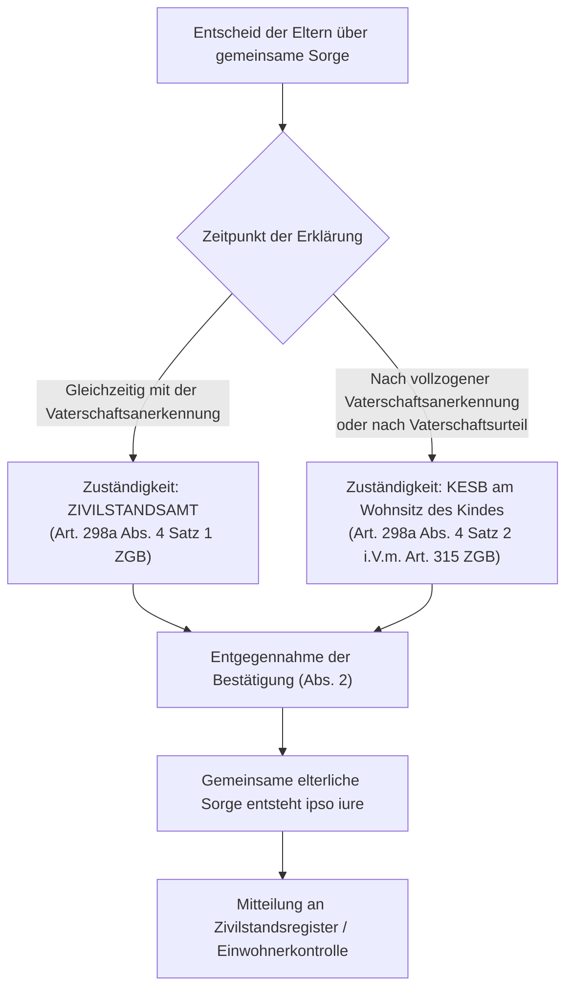

## Gesetzeswortlaut



---

## Überblick und Bedeutung

Art. 298a ZGB bildet das Fundament für das einvernehmliche Zustandekommen der gemeinsamen elterlichen Sorge nicht miteinander verheirateter Eltern. Die Bestimmung regelt den administrativ einfachen, behördenunabhängigen Primärpfad des schweizerischen Kindesrechts: Haben unverheiratete Eltern das Kindesverhältnis durch freiwillige Anerkennung des Vaters (Art. 260 ZGB) oder durch gerichtliches Vaterschaftsurteil (Art. 261 ZGB) begründet, erlangen sie die gemeinsame elterliche Sorge unmittelbar durch Abgabe einer übereinstimmenden gemeinsamen Erklärung ([BGE 141 III 472 E. 4.1](https://entscheidsuche.ch/docs/CH_BGE/CH_BGE_005_BGE-141-III-472_2015.html#consideration_4.1); [BGer 5A_550/2016 vom 3. Februar 2017 E. 4.1](https://entscheidsuche.ch/docs/CH_BGer/CH_BGer_005_5A-550-2016_2017-02-03.html)).

### Historische Entwicklung und gesetzgeberische Idee
Das Rechtsinstitut der gemeinsamen elterlichen Sorge für unverheiratete Eltern wurde erstmals im Rahmen der Scheidungsrechtsreform per 1. Januar 2000 im Zivilgesetzbuch geschaffen ([AS 1999 1118](https://www.fedlex.admin.ch/eli/oc/1999/149/de); [BBl 1996 I 1, S. 37](https://fedlex.data.admin.ch/eli/fga/1996/1_1_1_1)). Das damalige Recht (aArt. 298a ZGB) begegnete unverheirateten Paaren jedoch mit erheblichem institutionellem Misstrauen: Die gemeinsame Sorge setzte zwingend einen förmlichen Genehmigungsbeschluss der Vormundschaftsbehörde voraus, verbunden mit einer behördlichen Angemessenheitsprüfung einer detaillierten Betreuungs- und Unterhaltskonvention ([BBl 2011 9077, S. 9084, 9088](https://fedlex.data.admin.ch/eli/fga/2011/1580)).

Mit der am 1. Juli 2014 in Kraft getretenen Totalrevision des elterlichen Sorgerechts ([AS 2014 357](https://www.fedlex.admin.ch/eli/oc/2014/357/de); [BBl 2011 9077](https://fedlex.data.admin.ch/eli/fga/2011/1580)) vollzog der Gesetzgeber einen grundlegenden Systemwechsel:
1. **Gemeinsame Sorge als gesetzlicher Regelfall (Art. 296 Abs. 2 ZGB)**: Die gemeinsame elterliche Verantwortung gilt seither unabhängig vom Zivilstand der Eltern als Idealzustand für das Kindeswohl.
2. **Entlastung von behördlicher Vorabkontrolle**: Der Gesetzgeber schaffte das Erfordernis einer behördlichen Genehmigung für den Regelfall einvernehmlicher Eltern ab. Anstelle einer materiellen Prüfung durch die Kindesschutzbehörde genügt nunmehr eine blosse **Selbstdeklaration** der Eltern (Art. 298a Abs. 2 ZGB).
3. **Dezentrale Zuständigkeit (One-Stop-Shop)**: Erfolgt die Erklärung zeitgleich mit der Vaterschaftsanerkennung, kann sie direkt beim Zivilstandsamt protokolliert werden (Art. 298a Abs. 4 ZGB).

### Prüfschema: Zustandekommen der gemeinsamen Sorge nach Art. 298a ZGB

| Prüfstufe / Merkmal | Tatbestandsvoraussetzung & Dogmatik | Form & Zuständigkeit | Abschnitt |
|---|---|---|---|
| **1. Persönliche Voraussetzungen (Abs. 1)** | Eltern nicht miteinander verheiratet; rechtsgültiges Kindesverhältnis zum Vater (Art. 260 oder 261 ZGB); Urteilsfähigkeit beider Eltern | Keine Vertretung (höchstpersönliches Recht); Zivilstandsnachweis | [Abschnitt A](#a-persönliche-voraussetzungen-und-kindesverhältnis-abs-1) |
| **2. Kumulativer Erklärungsinhalt (Abs. 2)** | 1. Erklärung zur gemeinsamen Verantwortung; 2. Bestätigung der erfolgten Verständigung über Obhut, Verkehr/Betreuungsanteile und Unterhalt | Schriftform / amtliches Protokoll; blosse Deklaration, keine Einreichungspflicht der Verträge | [Abschnitt B](#b-inhalt-der-gemeinsamen-erklärung-und-selbstdeklaration-abs-2) |
| **3. Betreuungsregelung & Alternierende Obhut** | Abgrenzung zwischen Alleinobhut und alternierender Obhut; quantitative Schwellenwerte gemäss [BGer 5A_280/2025](https://entscheidsuche.ch/docs/CH_BGer/CH_BGer_005_5A-280-2025_2026-10-26.html): > 30 % Betreuung (mind. 13/42 Einheiten im Alltag) | Faktische Betreuungsverantwortung («Mental Load»); keine Entkopplung ohne Genehmigung | [Abschnitt C](#c-betreuungsregelung-und-die-neue-leitjudikatur-zur-alternierenden-obhut) |
| **4. Behördliche Beratung (Abs. 3)** | Fakultatives, niederschwelliges Beratungsangebot der KESB; Klärung von Unterhalts- und Betreuungsfragen | Auf Wunsch der Eltern; kein Obligatorium | [Abschnitt D](#d-beratungsanspruch-durch-die-kindesschutzbehörde-abs-3) |
| **5. Adressat und Verfahren (Abs. 4)** | Simultan mit Anerkennung: Zivilstandsamt; Nachträgliche Erklärung: KESB am Wohnsitz des Kindes (Art. 315 ZGB) | Formularmässige Beurkundung; Weiterleitung an Einwohnerkontrolle / KESB | [Abschnitt E](#e-zuständigkeit-und-verfahren-zivilstandsamt-vs-kesb-abs-4) |
| **6. Gesetzliche Auffangordnung (Abs. 5)** | Alleinige elterliche Sorge der Mutter *ex lege* bis zum Vorliegen der Erklärung oder gerichtlicher Zuteilung | Gesetzlicher Übergangszustand; Schutz der Handlungsfähigkeit des Kindes | [Abschnitt F](#f-alleinsorge-der-mutter-bis-zur-erklärung-abs-5) |
| **7. Rechtsnatur, Willensmängel & Scheitern** | Einseitig unwiderrufliche Erklärung; Anfechtung bei Drohung/Täuschung; Scheitern führt zu Art. 298b ZGB | Zivilgerichtliche Anfechtung bzw. KESB-Verfahren (Art. 298b / 298d ZGB) | [Abschnitt G](#g-rechtsnatur-willensmängel-und-verhältnis-zu-art-298b-zgb) |

---

## Kommentierung

### A. Persönliche Voraussetzungen und Kindesverhältnis (Abs. 1)

Das Verfahren nach Art. 298a ZGB setzt voraus, dass die Eltern im Zeitpunkt der Abgabe der Erklärung **nicht miteinander verheiratet** sind. Heiraten die Eltern einander nachträglich, entsteht die gemeinsame elterliche Sorge von Gesetzes wegen gemäss Art. 296 Abs. 2 ZGB, womit eine Erklärung nach Art. 298a ZGB gegenstandslos wird.

#### 1. Bestehen des Kindesverhältnisses
Grundlegende materielle Voraussetzung für das Entstehen der elterlichen Sorge des Vaters ist das rechtliche Kindesverhältnis (Art. 252 Abs. 2 ZGB):
- Entweder hat der Vater das Kind vor oder nach der Geburt durch Erklärung vor dem Zivilstandsamt förmlich anerkannt (Art. 260 ZGB);
- oder das Kindesverhältnis wurde durch gerichtliches Urteil im Vaterschaftsprozess förmlich festgestellt (Art. 261 ZGB), ohne dass das Gericht im selben Zug die elterliche Sorge nach Art. 298c ZGB abschliessend geregelt hat.

Fehlt es an einem wirksamen Kindesverhältnis zum Vater, ist eine Sorgeerklärung rechtlich inexistent.

#### 2. Höchstpersönlichkeit und Urteilsfähigkeit
Die Abgabe der Sorgeerklärung ist ein **relativ höchstpersönliches Recht**. Sie verlangt die Urteilsfähigkeit der Eltern im Sinne von Art. 16 ZGB bezüglich der Tragweite der elterlichen Verantwortung. Eine Stellvertretung durch Bevollmächtigte oder gesetzliche Vertreter ist absolut ausgeschlossen ([BGE 148 III 384 E. 5](https://entscheidsuche.ch/docs/CH_BGE/CH_BGE_005_BGE-148-III-384_2022.html#consideration_5)). 

Ist ein Elternteil minderjährig oder steht er unter umfassender Beistandschaft (Art. 398 ZGB), greift für die Zuteilung der elterlichen Sorge die zwingende Schutzordnung von Art. 298b Abs. 4 ZGB: Die Kindesschutzbehörde hat die elterliche Sorge dem volljährigen und handlungsfähigen Vater zuzuteilen oder für das Kind eine Vormundschaft (Art. 327a ZGB) zu errichten.

---

### B. Inhalt der gemeinsamen Erklärung und Selbstdeklaration (Abs. 2)

Art. 298a Abs. 2 ZGB umschreibt den Mindestinhalt der gemeinsamen Erklärung. Die Eltern müssen kumulativ zwei Bestätigungen abgeben:

1. **Bereitschaft zur gemeinsamen Verantwortung (Ziff. 1)**:  
   Die Eltern bestätigen förmlich ihren Willen, die elterliche Sorge gemeinsam auszuüben, für das Kind zu sorgen und wichtige Entscheidungen in Bezug auf Pflege, Erziehung, Ausbildung und Vermögensverwaltung einvernehmlich zu treffen (Art. 301 ff. ZGB).
2. **Verständigung über die Betreuungs- und Unterhaltsbelange (Ziff. 2)**:  
   Die Eltern bestätigen, dass sie sich über folgende Eckpunkte verständigt haben:
   - die **Obhut** (bei wem das Kind wohnt bzw. wie die Betreuung aufgeteilt wird);
   - den **persönlichen Verkehr** (Besuchsrecht) oder die **Betreuungsanteile**;
   - den **Unterhaltsbeitrag** für das Kind (Bar- und Betreuungsunterhalt gemäss Art. 276 ff. ZGB).

#### Die Tragweite der blossen «Verständigung» (Kein Genehmigungsvorbehalt)
Ein zentraler Streitpunkt in der Praxis betrifft die Frage, wie weit die behördliche Überprüfungspflicht bei Entgegennahme der Erklärung reicht. 

Die Materialien ([Botschaft 2011, BBl 2011 9077, S. 9103](https://fedlex.data.admin.ch/eli/fga/2011/1580)) und die einhellige Lehre halten fest: Art. 298a Abs. 2 ZGB verlangt **keine Vorlage schriftlicher Vereinbarungen** und keine Genehmigung durch die Behörde. Das Zivilstandsamt und die KESB nehmen eine reine Plausibilitätsprüfung vor: Bestätigen die Eltern, dass sie sich verständigt haben, ist die Erklärung entgegenzunehmen. 

> **Leitsatz.** Für das Zustandekommen der gemeinsamen elterlichen Sorge nach Art. 298a ZGB genügt die blosse Selbstdeklaration der Eltern, sich über Betreuung und Unterhalt geeinigt zu haben. Weder Zivilstandsamt noch KESB sind befugt, die materielle Angemessenheit oder Gesetzeskonformität dieser Absprachen von Amtes wegen zu überprüfen.

#### Wichtige Differenzierung: Unterhaltsvertrag bedarf der Genehmigung (Art. 287 ZGB)
In der Praxis führt diese gesetzliche Entlastung oft zu gefährlichen Missverständnissen unter Eltern: Die Bestätigung nach Art. 298a Abs. 2 Ziff. 2 ZGB führt zwar zum **Sorgerecht**, macht aber die privatrechtlich getroffene Unterhaltsabrede für das Kind **weder vollstreckbar noch zivilrechtlich definitiv verbindlich**.

Gemäss Art. 287 Abs. 1 ZGB wird ein Unterhaltsvertrag für das Kind erst dann verbindlich, wenn er von der Kindesschutzbehörde förmlich genehmigt wird ([Kantonsgericht St. Gallen, KES.2021.3-EZE2 vom 5. Mai 2021 E. 3](https://entscheidsuche.ch/docs/SG_Gerichte/SG_KG_002_KES-2021-3-EZE2_2021-05-05.pdf)). Bleibt es bei einer bloss formlosen Verständigung, liegt kein Vollstreckungstitel vor; der Unterhalt kann bei Zahlungsverzug des Pflichtigen weder über das Betreibungsamt mittels Rechtsöffnung (Art. 80 SchKG) noch via kantonale Alimentenhilfe (Art. 290 ZGB / Inkassohilfe und Bevorschussung) ohne vorherigen Zivilprozess durchgesetzt werden.

---

### C. Betreuungsregelung und die neue Leitjudikatur zur alternierenden Obhut

Unverheiratete Eltern vereinbaren bei Abgabe der Sorgeerklärung in der Praxis entweder ein klassisches Residenzmodell (Alleinobhut der Mutter mit Besuchsrecht des Vaters) oder eine geteilte Betreuung (alternierende Obhut).

#### 1. Die bundesgerichtlichen Richtlinien nach BGer 5A_280/2025
Bisher herrschte in der kantonalen Praxis erhebliche Rechtsunsicherheit darüber, ab wann eine Betreuungsregelung als «alternierende Obhut» gilt und welche Rechtsfolgen an diesen Begriff anknüpfen. Das Bundesgericht hat mit Grundsatzurteil der Fünferbesetzung **[BGer 5A_280/2025 vom 26. Oktober 2026, E. 5.4](https://entscheidsuche.ch/docs/CH_BGer/CH_BGer_005_5A-280-2025_2026-10-26.html)** (zur amtlichen Publikation vorgesehen) verbindliche quantitative und qualitative Richtlinien für den Normalfall festgelegt:

1. **Die 30-%-Mindestschwelle (13 von 42 Einheiten)**:  
   Auf einer zweiwöchigen Basis wird jeder Tag in drei Einheiten unterteilt: **Vormittag, Nachmittag und Nacht** (insgesamt 42 Einheiten). Eine alternierende Obhut liegt vor, wenn jeder Elternteil mindestens **13 von 42 Einheiten (über 30 %)** der Betreuungsverantwortung im Alltag trägt ([E. 5.4.5.2](https://entscheidsuche.ch/docs/CH_BGer/CH_BGer_005_5A-280-2025_2026-10-26.html#consideration_5.4.5.2), [E. 5.4.6](https://entscheidsuche.ch/docs/CH_BGer/CH_BGer_005_5A-280-2025_2026-10-26.html#consideration_5.4.6)).
2. **Fokus auf den gelebten Alltag (Nichtberücksichtigung der Ferien)**:  
   Die Obhut bezeichnet den Haushalt, in dem das Kind seinen Alltag verbringt. Ferienzeiten bleiben bei der Schwellenwertberechnung im Regelfall unberücksichtigt ([E. 5.4.5.3](https://entscheidsuche.ch/docs/CH_BGer/CH_BGer_005_5A-280-2025_2026-10-26.html#consideration_5.4.5.3)). Ein noch so langes Ferienrecht (im konkreten Fall 9 Wochen pro Jahr) vermag ein gewöhnliches Wochenendbesuchsrecht (6 von 42 Einheiten im Alltag) nicht in eine alternierende Obhut umzuwandeln ([E. 5.4.7](https://entscheidsuche.ch/docs/CH_BGer/CH_BGer_005_5A-280-2025_2026-10-26.html#consideration_5.4.7)).
3. **Massstab der mentalen Betreuungsverantwortung («Mental Load»)**:  
   Das Bundesgericht begründet die 30-%-Schwelle dogmatisch mit der mentalen und organisatorischen Beanspruchung: Nur wer das Kind im Alltag substanziell mitbetreut (Schularbeiten, Arztbesuche, Kleidung, soziale Kontakte), trägt echte Obhutspflichten. Wer das Kind primär am Wochenende und in den Ferien betreut, nimmt ein Besuchs- und Beziehungsrecht (Art. 273 ZGB) wahr, entlastet den Hauptbetreuenden im Alltag jedoch nicht massgeblich ([E. 5.4.5.2](https://entscheidsuche.ch/docs/CH_BGer/CH_BGer_005_5A-280-2025_2026-10-26.html#consideration_5.4.5.2)).

#### 2. Gegenüberstellung der Betreuungsmodelle bei Art. 298a ZGB

| Kriterium | Alleinobhut mit (erweitertem) Besuchsrecht | Alternierende Obhut (BGer 5A_280/2025) |
|---|---|---|
| **Betreuungsanteil (Alltag)** | Unter 30 % (unter 13 von 42 Einheiten auf Zweiwochenbasis) | **Mindestens 30 %** (mindestens 13 von 42 Einheiten auf Zweiwochenbasis) |
| **Typische Ausgestaltung** | Jedes 2. Wochenende (Fr–So = 6/42) evtl. plus 1 Tag/Woche (9–10/42) | Z.B. 2–3 Tage/Woche fix mit Übernachtungen oder wöchentlicher Wechsel (21/42) |
| **Ferienregelung** | 2 bis 5 Wochen pro Jahr; Ferien verändern den Obhutsstatus im Regelfall nicht | Hälftige Aufteilung der Schulferien |
| **Unterhaltsregelung** | Obhutsinhaber leistet Naturalunterhalt; Besuchsrechtsinhaber leistet Geldunterhalt (Bar- + Betreuungsunterhalt) | Barunterhalt wird anteilsmässig nach Betreuungsquoten und Einkommenskraft gesplittet ([BGE 147 III 265](https://entscheidsuche.ch/docs/CH_BGE/CH_BGE_005_BGE-147-III-265_2020.html)) |
| **Wohnsitz des Kindes** | Am Wohnsitz des Obhutsinhabers (Art. 25 Abs. 1 ZGB) | Formell an einem elterlichen Wohnsitz festzulegen |
| **AHV-Erziehungsgutschrift** | Steht vollumfänglich dem alleinigen Obhutsinhaber zu | Hälftige Teilung oder quotale Anrechnung (Art. 52fbis AHVV) |

---

### D. Beratungsanspruch durch die Kindesschutzbehörde (Abs. 3)

Art. 298a Abs. 3 ZGB räumt den unverheirateten Eltern einen gesetzlichen Anspruch ein, sich **vor der Abgabe der Erklärung kostenlos von der Kindesschutzbehörde beraten zu lassen**.

#### 1. Zweck und Reichweite der Beratung
Viele nicht verheiratete Paare sind sich bei der Geburt eines Kindes über die rechtlichen Konsequenzen der gemeinsamen elterlichen Sorge, die Pflichten zur gegenseitigen Information (Art. 275a ZGB) sowie über die Unterhalts- und Vorsorgeansprüche im Unklaren. 

Die KESB hat im Rahmen dieser Beratung:
- die Eltern über die Bedeutung der gemeinsamen elterlichen Sorge aufzuklären;
- bei der Erstellung von tragfähigen Betreuungs- und Besuchsmodellen beratend mitzuwirken;
- auf die Notwendigkeit eines schriftlichen, genehmigungsfähigen Unterhaltsvertrags (Art. 287 ZGB) hinzuweisen.

#### 2. Vorbehalt der Mediation und Konfliktprävention
Besteht zwischen den Eltern Uneinigkeit über Detailfragen (z.B. Höhe des Unterhalts oder Betreuungszeiten), kann die Behörde die Eltern an eine professionelle Familienmediationsstelle verweisen oder selbst Vermittlungsgespräche anbieten. Scheitert eine Einigung, kann die Behörde die gemeinsame Sorge nicht im Beratungsverfahren erzwingen; diesfalls greift das Verfahren nach Art. 298b ZGB Platz.

---

### E. Zuständigkeit und Verfahren: Zivilstandsamt vs. KESB (Abs. 4)

Art. 298a Abs. 4 ZGB unterscheidet hinsichtlich der sachlichen und örtlichen Zuständigkeit streng nach dem **Zeitpunkt der Abgabe**:

#### 1. Erklärung beim Zivilstandsamt (Abs. 4 Satz 1)
Wird die Erklärung **zusammen mit der Vaterschaftsanerkennung** abgegeben, ist das Zivilstandsamt zuständig. Örtlich zuständig ist jedes Zivilstandsamt in der Schweiz, bei dem die Anerkennung vorgenommen werden kann (Art. 10 ZStV). 
- Die Erklärung wird in die offizielle Anerkennungsurkunde aufgenommen oder auf einem amtlichen bundesweiten Formular («Gemeinsame Erklärung über die elterliche Sorge») protokolliert und von beiden Elternteilen eigenhändig unterschrieben.
- Das Zivilstandsamt beurkundet die gemeinsame Sorge direkt im Personenstandsregister (Infostar).
- Das Zivilstandsamt erhebt hierfür eine geringe Verwaltungsgebühr gemäss ZStGV.

#### 2. Erklärung bei der Kindesschutzbehörde (Abs. 4 Satz 2)
Erfolgt die Erklärung **zu einem späteren Zeitpunkt** (z.B. Monate oder Jahre nach der Geburt bzw. nach einem Vaterschaftsprozess vor Gericht), sind die Zivilstandsämter unzuständig. Die Erklärung ist zwingend an die **Kindesschutzbehörde am Wohnsitz des Kindes** (Art. 315 Abs. 1 ZGB) zu richten.
- Die Eltern können die Erklärung schriftlich gemeinsam einreichen oder persönlich vor der KESB zu Protokoll geben.
- Die KESB prüft formell das Bestehen des Kindesverhältnisses und die Bestätigungspunkte gemäss Abs. 2.
- Die Behörde stellt den Eltern eine Bestätigung über das Zustandekommen der gemeinsamen elterlichen Sorge aus und meldet die Änderung an die zuständigen Register.

---

### F. Alleinsorge der Mutter bis zur Erklärung (Abs. 5)

Art. 298a Abs. 5 ZGB statuiert eine klare gesetzliche Auffangregel: **Bis die Erklärung vorliegt, steht die elterliche Sorge allein der Mutter zu.**

#### 1. Dogmatischer Zweck und Lückenlosigkeit
Die Bestimmung stellt sicher, dass das Kind im Zeitpunkt seiner Geburt unmittelbar und ohne behördliche Zwischenschritte über eine gesetzliche Vertretung verfügt. Das Kindesverhältnis zur Mutter entsteht gemäss Art. 252 Abs. 1 ZGB automatisch durch die Geburt. Da das Kindesverhältnis zum Vater bei nicht miteinander verheirateten Eltern erst begründet werden muss, knüpft das Gesetz die Sorge bis zum Nachweis der Vaterschaft und der einvernehmlichen Erklärung exklusiv an die Kindsmutter.

#### 2. Wirkungen der Alleinsorge der Mutter
Solange die gemeinsame Erklärung nicht formgültig abgegeben wurde:
- vertritt die Mutter das Kind allein in allen Rechtsgeschäften und gegenüber Behörden, Ärzten und Schulen;
- übt die Mutter das alleinige Aufenthaltsbestimmungsrecht (Art. 301a ZGB) aus;
- verwaltet die Mutter das Kindesvermögen allein (Art. 318 ZGB).

Der Vater besitzt vor Abgabe der Erklärung weder Mitentscheidungsrechte noch ein Auskunftsrecht nach Art. 275a ZGB, solange nicht das Kindesverhältnis rechtskräftig festgestellt ist.

---

### G. Rechtsnatur, Willensmängel und Verhältnis zu Art. 298b ZGB

#### 1. Unwiderruflichkeit der abgegebenen Erklärung
Die Erklärung nach Art. 298a ZGB ist eine **gemeinsame Gestaltungserklärung**. Mit ihrer formgültigen Abgabe vor dem Zivilstandsamt oder der KESB tritt die Rechtsfolge (gemeinsame elterliche Sorge) **unmittelbar von Gesetzes wegen** ein ([BGer 5A_550/2016 E. 4.1](https://entscheidsuche.ch/docs/CH_BGer/CH_BGer_005_5A-550-2016_2017-02-03.html)). 

Ein einseitiger Widerruf durch einen Elternteil (z.B. Reue der Mutter wenige Tage nach der Beurkundung) ist rechtlich wirkungslos. Ist die gemeinsame Sorge einmal zustande gekommen, kann sie nur noch durch behördlichen Entscheid der KESB nach Art. 298d ZGB (Abänderung bei wesentlicher Veränderung der Verhältnisse) oder im Rahmen eines gerichtlichen Kindesschutzverfahrens wieder aufgehoben werden.

#### 2. Willensmängel und Zwangslagen
Wurde die Erklärung durch einen Willensmangel (Täuschung, wesentlicher Irrtum, Drohung oder physischen/psychischen Zwang) erwirkt, ist sie anfechtbar ([Obergericht Aargau, XBE.2021.79 vom 20. Januar 2022 E. 3.2.1](https://entscheidsuche.ch/docs/AG_Gerichte/AG_OG_001_XBE.2021.79_2022-01-20.pdf)):
- Erkennt die Urkundsperson des Zivilstandsamts oder der KESB bei der Verurkundung Anzeichen von Zwang, Drohungen oder massiver Urteilsunfähigkeit, hat sie die Protokollierung zu verweigern und die Eltern an die Kindesschutzbehörde zu verweisen.
- Wurde die Erklärung unter Zwang beurkundet, kann die betroffene Partei die Feststellung der Nichtigkeit bzw. Ungültigkeit der Erklärung auf dem Rechtsweg verlangen oder bei der KESB umgehend den Erlass superprovisorischer Massnahmen zur Sicherung des Kindeswohls und die Übertragung der Alleinsorge beantragen.

#### 3. Scheitern der Erklärung und Übergang zu Art. 298b ZGB
Verweigert ein Elternteil (in der Praxis meist die Mutter) die Abgabe der gemeinsamen Erklärung oder kann über Unterhalt und Betreuung keine Einigung erzielt werden, scheitert der Pfad von Art. 298a ZGB. Diesfalls öffnet sich das Streitverfahren: Der anerkennende Vater kann an die Kindesschutzbehörde am Wohnsitz des Kindes gelangen und gemäss **Art. 298b ZGB** die Zuteilung der gemeinsamen elterlichen Sorge verlangen ([BGE 141 III 472 E. 4.1](https://entscheidsuche.ch/docs/CH_BGE/CH_BGE_005_BGE-141-III-472_2015.html#consideration_4.1)).

---

## Praxisfragen

### 1. Reicht die Erklärung auf dem Zivilstandsamt aus, um Alimentenbevorschussung zu beantragen?
**Nein.** Kantonale Stellen für Alimentenhilfe und Bevorschussung verlangen zwingend einen **vollstreckbaren Rechtstitel**. Die blosse Erklärung nach Art. 298a Abs. 2 Ziff. 2 ZGB bestätigt lediglich deklaratorisch, dass die Eltern sich verständigt haben. Zahlt der barunterhaltspflichtige Elternteil nicht, können die Alimente erst bevorschusst oder amtlich eingetrieben werden, wenn die Vereinbarung von der KESB nach Art. 287 Abs. 1 ZGB genehmigt oder richterlich festgesetzt wurde ([Kantonsgericht St. Gallen, KES.2021.3-EZE2](https://entscheidsuche.ch/docs/SG_Gerichte/SG_KG_002_KES-2021-3-EZE2_2021-05-05.pdf)).

### 2. Können die Eltern nach Abgabe der Erklärung die Betreuungsregelung eigenmächtig umstellen?
**Faktisch ja, rechtlich bindend nur einvernehmlich.** Solange sich die Eltern einig sind, können sie die Betreuungsanteile jederzeit im Einvernehmen anpassen. Entsteht jedoch Streit (z.B. ein Elternteil verlangt die Rückkehr zum Residenzmodell oder will das Kind nicht mehr herausgeben), bedarf eine Neuzuteilung der Obhut eines Entscheids der Kindesschutzbehörde gemäss Art. 298d ZGB ([Obergericht Bern, KES 2018 842 E. 13.7](https://entscheidsuche.ch/docs/BE_ZivilStraf/BE_OG_001_KES-2018-842_2019-02-19.pdf)).

### 3. Was gilt, wenn ein Elternteil mit dem Kind ins Ausland oder in einen anderen Landesteil umziehen will?
Mit Zustandekommen der gemeinsamen elterlichen Sorge greift Art. 301a ZGB (Aufenthaltsort des Kindes). Der Wechsel des Aufenthaltsorts des Kindes ins Ausland oder an einen Ort mit wesentlichen Auswirkungen auf die Betreuung bedarf der **Zustimmung des anderen Elternteils** oder eines Entscheids der KESB bzw. des Gerichts. Die Abgabe der Erklärung nach Art. 298a ZGB schützt somit beide Elternteile vor einseitigen Wegzügen des Kindes.

---

## Literatur

- **AFFOLTER-FRINGELI KATHRIN / VOGEL URS**, Berner Kommentar zum Schweizerischen Privatrecht, Das Familienrecht: Die Wirkungen des Kindesverhältnisses, Art. 296–317 ZGB, Bern 2016.
- **SCHWENZER INGEBORG / COTTIER MICHELLE**, Basler Kommentar, Zivilgesetzbuch I, Art. 1–456 ZGB, 7. Aufl., Basel 2022.
- **BOHNET FRANÇOIS**, Le nouveau droit de l’entretien de l’enfant : procédure et mise en œuvre, Neuchâtel 2025 ([Open Access](https://libra.unine.ch/handle/123456789/28767)).
- **COTTIER MICHELLE / CLAUSEN SANDRO**, Obhut und Betreuung bei gemeinsamer elterlicher Sorge, in: Fankhauser/Büchler (Hrsg.), Neunte Schweizer Familienrecht§Tage, Bern 2018, S. 175 ff. ([Open Access](https://archive-ouverte.unige.ch/unige:106414)).
- **MAIER DAVID / GEIGER LORENZ**, Betreuen oder bezahlen? – Weshalb Obhut und Unterhalt untrennbar miteinander verknüpft sind, in: Anwaltsrevue 2023, S. 432 ff.
- **BÄHLER MANUELA**, in: Hausheer/Spycher (Hrsg.), Handbuch des Unterhaltsrechts, 3. Aufl., Bern 2023.

---

## Praxishinweise

### Für Rechtsberatung und Anwaltschaft
- **Unterhaltsvertrag sofort mitregeln und genehmigen lassen**: Weisen Sie unverheiratete Klienten mit Nachdruck darauf hin, dass die Erklärung beim Zivilstandsamt nach Art. 298a ZGB **keinen vollstreckbaren Unterhaltstitel** schafft. Setzen Sie stets zeitgleich eine schriftliche Unterhaltsvereinbarung nach den Grundsätzen von BGE 147 III 265 auf und reichen Sie diese bei der KESB zur Genehmigung nach Art. 287 ZGB ein.
- **Betreuungsanteile exakt im 42-Einheiten-Raster festlegen**: Soll eine alternierende Obhut vereinbart werden, prüfen Sie die Einheiten («Vormittag/Nachmittag/Nacht») auf Zweiwochenbasis sorgfältig gegen die **30-%-Schwelle (mindestens 13 Einheiten)** von BGer 5A_280/2025. Verlassen Sie sich nicht auf ausgedehnte Ferienabsprachen, um eine Alltagsunterdeckung auszugleichen.
- **Vorgehen bei Blockade**: Verweigert die Mutter die gemeinsame Erklärung, verlieren Sie keine Zeit mit fruchtlosen aussergerichtlichen Drohungen. Leiten Sie umgehend das Verfahren nach Art. 298b ZGB bei der KESB am Kindeswohnsitz ein und stellen Sie zugleich vorsorgliche Anträge auf Regelung des persönlichen Verkehrs.

### Für die Kindesschutzbehörde (KESB)
- **Niederschwellige Beratung nutzen (Abs. 3)**: Nutzen Sie das Beratungsverfahren, um Eltern über die zivilrechtliche Bedeutung des Sorgerechts und die Wichtigkeit stabiler Alltagsbetreuung aufzuklären. Trennen Sie strikt zwischen dem formalen Entgegennahmeverfahren der Erklärung (Abs. 4) und dem förmlichen Genehmigungsverfahren für Unterhaltsverträge (Art. 287 ZGB).
- **Sensibilität für Zwangslagen**: Achten Sie bei getrennt vorsprechenden oder sichtlich verunsicherten Elternteilen auf Anzeichen von Beziehungs- und Drohungsmustern. Liegen Verdachtsmomente auf Willensmängel vor, protokollieren Sie die Erklärung nicht vorschnell, sondern eröffnen Sie eine Abklärung nach Art. 446 ZGB.

### Für Zivilstandsbeamtinnen und Zivilstandsbeamte
- **Vollständigkeit der Selbstdeklaration prüfen**: Prüfen Sie bei gleichzeitiger Vaterschaftsanerkennung, ob beide Elternteile die Bestätigungspunkte gemäss Abs. 2 Ziff. 1 und Ziff. 2 persönlich und urteilsfähig bejahen und eigenhändig unterzeichnen.
- **Keine Rechtsberatung zur Unterhaltshöhe**: Verlangen Sie von den Eltern keine Unterhaltsverträge und beurteilen Sie die Angemessenheit von Geldbeträgen nicht materiell. Informieren Sie die Eltern standardisiert darüber, dass für die rechtliche Durchsetzbarkeit der Alimente die KESB zuständig ist.
