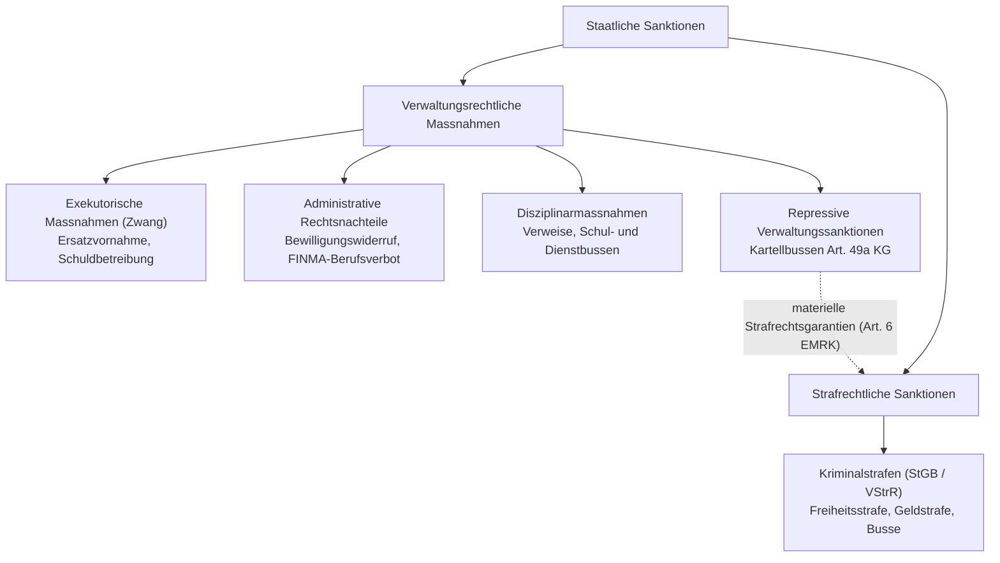

## Überblick {#ueberblick}

Staatliches Handeln zur Durchsetzung der Rechtsordnung bedient sich zweier grundlegender Schienen: des Verwaltungsrechts und des Strafrechts. Die Abgrenzung zwischen beiden Disziplinen zählt zu den klassischen und zugleich praktisch bedeutsamsten Grundfragen des schweizerischen öffentlichen Rechts. Beide Rechtsgebiete reagieren auf Pflichtverletzungen von Privatpersonen oder Unternehmen, verfolgen dabei jedoch grundverschiedene Zwecke und setzen an unterschiedlichen Zeithorizonten an.

Während das Strafrecht auf eine schuldhaft begangene Tat in der Vergangenheit reagiert und diese mit einem sozialethischen Tadel belegt, ist das Verwaltungsrecht zukunftsorientiert: Es bezweckt die Sicherstellung des rechtmässigen Zustands, die Gefahrenabwehr und die Verwirklichung gesetzlicher Gemeinwohlziele.

In der Praxis verschwimmt diese Trennung jedoch zusehends. Insbesondere im Wirtschaftsverwaltungsrecht (etwa bei Sanktionen der Wettbewerbskommission oder der Finanzmarktaufsicht), im Umweltrecht und im Disziplinarrecht sieht das Gesetz Sanktionen vor, die von Verwaltungsbehörden in einem Verwaltungsverfahren ausgesprochen werden, in ihrer Härte und pönalen Wirkung einer Kriminalstrafe aber in nichts nachstehen. Das Bundesgericht zieht deshalb in ständiger Rechtsprechung die sogenannten **Engel-Kriterien des Europäischen Gerichtshofs für Menschenrechte (EGMR)** heran: Weist eine Verwaltungssanktion materiellen Strafcharakter auf (*criminal charge*), müssen die elementaren Verfahrensgarantien von [Art. 6 EMRK](/kommentar/emrk/art-006/) und [Art. 32 BV](/kommentar/bv/art-032/) auch im Verwaltungsverfahren respektiert werden.

## Rechtsgrundlagen: Art. 6 EMRK und Art. 30/32 BV {#rechtsgrundlagen}

Die konventions- und verfassungsrechtlichen Leitplanken der Abgrenzung bilden die Verfahrensgarantien bei gerichtlichen Verfahren und strafrechtlichen Anklagen:







Sowohl Art. 6 Ziff. 1 EMRK als auch Art. 32 BV unterscheiden systematisch zwischen allgemeinen Rechtsstreitigkeiten (zivilrechtliche Ansprüche / Verwaltungsverfahren) und der **strafrechtlichen Anklage**. Die Tragweite dieser Unterscheidung ist fundamental: Nur bei einer strafrechtlichen Anklage greifen die strikte Unschuldsvermutung ([Art. 32 Abs. 1 BV](/kommentar/bv/art-032/)), das Verbot des Zwangs zur Selbstbelastung (*nemo tenetur se ipsum accusare*), das Verbot der Doppelbestrafung (*ne bis in idem*, Art. 4 Protokoll Nr. 7 zur EMRK) sowie das absolute Rückwirkungsverbot ([Art. 7 EMRK](/kommentar/emrk/art-007/) und [Art. 1 StGB](/kommentar/stgb/art-001/)).

## Die Formel des Bundesgerichts: Die Engel-Kriterien {#formel}

Das Bundesgericht folgt bei der Bestimmung, ob ein staatlicher Hoheitsakt strafrechtlicher Natur ist, der autonomen Auslegung des EGMR. In seiner jüngeren Rechtsprechung fasst das Bundesgericht die Formel wie folgt zusammen:

> «Gemäss ständiger Rechtsprechung liegt eine strafrechtliche Anklage im Sinne von Art. 6 EMRK vor, wenn alternativ entweder (1) das nationale Recht eine staatliche Massnahme dem Strafrecht zuordnet oder (2) die Natur des Vergehens bzw. dessen Art und Schwere oder (3) die Sanktion für einen strafrechtlichen Charakter der Massnahme sprechen».
>
> — [BGE 150 I 88](https://entscheidsuche.ch/docs/CH_BGE/CH_BGE_001_BGE-150-I-88_2024.html#consideration_5.2) E. 5.2

Die Kriterien gehen auf das Leit-Urteil des EGMR *Engel und andere gegen die Niederlande* vom 8. Juni 1976 zurück. Sie gelten **alternativ**, nicht kumulativ: Genügt bereits eines der Merkmale (insbesondere die Schwere oder der pönale Zweck), wird der strafrechtliche Schutzbereich eröffnet ([BGE 139 I 72](https://entscheidsuche.ch/docs/CH_BGE/CH_BGE_001_BGE-139-I-72_2013.html#consideration_2.2.2) E. 2.2.2). Kumulativ werden die Kriterien vom Gericht nur dann herangezogen, wenn eine isolierte Betrachtung kein eindeutiges Bild ergibt.

## Herkunft und Entwicklung der Abgrenzungstheorien {#herkunft-und-entwicklung}

Die wissenschaftliche Einordnung des Verhältnisses von Verwaltungs- und Strafrecht durchlief im 20. und 21. Jahrhundert einen grundlegenden Paradigmenwechsel:

### 1. Qualitative Theorien (Kriminalunrecht vs. Verwaltungsunrecht) {#qualitative-theorien}
Historisch versuchte die deutsche und schweizerische Doktrin (unter massgeblichem Einfluss von James Goldschmidt und Eberhard Schmidt), einen ontologischen Wesensunterschied nachzuweisen:
* Das Strafrecht ahnde echtes **Kriminalunrecht**: eine schuldhafte Verletzung von vorstaatlichen Rechtsgütern und ethischen Grundwerten.
* Das Verwaltungsrecht bzw. Verwaltungsstrafrecht sanktioniere blosses **Verwaltungsunrecht**: reine Pflichtverletzungen, Ungehorsam gegen behördliche Organisationsbefehle oder Störungen des staatlichen Verwaltungszwecks ohne inhärenten sittlichen Unwertgehalt.

### 2. Quantitative und funktionale Theorie (heute herrschend) {#quantitative-theorie}
Diese qualitative Wesenstrennung erwies sich als dogmatisch unhaltbar. Zahlreiche moderne Übertretungen und Fahrlässigkeitsdelikte im Nebenstrafrecht entbehren jedes spürbaren ethischen Vorwurfs, während umgekehrt schwere Verstösse gegen Umwelt-, Steuer- oder Finanzmarktgesetze gravierende Schäden an Gemeinschaftsgütern bewirken.

In der modernen schweizerischen Lehre (u. a. Ulrich Häfelin / Georg Müller / Felix Uhlmann, Pierre Tschannen / Markus Müller, Fritz Gygi, Hans Vest) gilt die Zuweisung eines Fehlverhaltens zum Straf- oder Verwaltungsrecht deshalb als **gesetzgebungspolitischer Entscheid**: Der Gesetzgeber wählt anhand von Zweckmässigkeitsüberlegungen, Interventionsintensität und gesellschaftlicher Sensibilität die Sanktionsform.

Zugleich stellte das Bundesgericht klar, dass repressive Massnahmen im Verwaltungsrecht eine eigenständige, historisch gewachsene Kategorie bilden:

> «Die unter dem Oberbegriff verwaltungsrechtliche Sanktionen zusammengefassten Instrumente dienen dem Staat zur Realdurchsetzung der verwaltungsrechtlichen Ordnung, woran ein erhebliches öffentliches Interesse besteht […]. Die repressiven verwaltungsrechtlichen Sanktionen sind als eigene Kategorie von verwaltungsrechtlichen Sanktionen in der Lehre zum schweizerischen Allgemeinen Verwaltungsrecht fest etabliert».
>
> — [BGE 147 I 57](https://entscheidsuche.ch/docs/CH_BGE/CH_BGE_001_BGE-147-I-57_2021.html#consideration_4.2) E. 4.2

Das Bundesgericht betont unter Hinweis auf die Standardwerke, dass nicht jede Massnahme mit repressivem Einschlag automatisch zur Kriminalstrafe mutiert: «Nicht jede Sanktion, die nicht exekutorisch oder restitutorisch wirkt, muss deswegen jedoch zwingend als strafrechtliche Sanktion qualifiziert werden» ([BGE 147 I 57](https://entscheidsuche.ch/docs/CH_BGE/CH_BGE_001_BGE-147-I-57_2021.html#consideration_4.3) E. 4.3).

## Die Prüfelemente der Abgrenzung {#elemente}

Zur Subsumtion eines Sachverhalts unter die Engel-Kriterien prüft die Praxis drei aufeinanderfolgende Stufen:

| Stufe | Prüffrage | Kriterien & Indizien |
| :--- | :--- | :--- |
| **1. Formelle Qualifikation** | Wie stuft das nationale Recht die Sanktion ein? | Gesetzliche Einordnung (z. B. StGB vs. Spezialverwaltungsgesetz), zuständige Behörde (Strafgericht vs. Verwaltungsbehörde). Dies dient lediglich als nationales Indiz; der Staat kann sich den Garantien nicht durch formelle Umbenennung (*Etikettenschwindel*) entziehen. |
| **2. Natur des Tatbestands** | Welcher Schutzzweck und Adressatenkreis liegt vor? | **Strafrechtlich**: Norm richtet sich an die Allgemeinheit; Sanktion bezweckt Vergeltung und Abschreckung (*retrospektiv*). **Administrativ**: Norm richtet sich an Personen in einem besonderen Rechtsverhältnis oder an einen regulierten Berufsstand; Zweck ist Realdurchsetzung, Berufsaufsicht oder Gefahrenabwehr (*prospektiv*). |
| **3. Art und Schwere der Sanktion** | Welches Übel wird angedroht? | Massgeblich ist der gesetzliche Strafrahmen. Freiheitsentzug oder die Möglichkeit der Ersatzfreiheitsstrafe bei Nichtbezahlung indizieren stets Strafrecht. Hohe finanzielle Einbussen (Pönale) begründen Strafrechtsähnlichkeit. |

## Typologie und Abgrenzung zu verwandten Rechtsfiguren {#abgrenzung-figuren}

Zur sauberen Einordnung unterscheidet das öffentliche Recht fünf typische Erscheinungsformen staatlicher Sanktionen:

### A. Exekutorische Verwaltungssanktionen (Verwaltungszwang) {#exekutorische-sanktionen}
Exekutorische Massnahmen dienen der **Realdurchsetzung** einer gesetzlichen oder verfügten Pflicht (Art. 41 VwVG). Dazu gehören die Ersatzvornahme, die antizipierte Ersatzvornahme sowie die Anwendung unmittelbaren Zwangs gegen Personen oder Sachen. Ihr Merkmal: Sie wollen ausschliesslich den rechtmässigen Zustand für die Zukunft herstellen. Sie enthalten keinerlei Unwerturteil über das Verhalten in der Vergangenheit und unterstehen nicht den Garantien der Art. 6 und 7 EMRK.

### B. Repressive Verwaltungssanktionen mit Strafrechtsähnlichkeit (Art. 49a KG) {#repressive-sanktionen}
Das Paradebeispiel einer echten Schnittstelle bilden die direkten Sanktionen nach [Art. 49a KG](/kommentar/kg/art-049a/): Die Wettbewerbskommission (WEKO) kann gegenüber Unternehmen, die an unzulässigen Wettbewerbsabreden beteiligt sind, Belastungen von bis zu 10 Prozent des in der Schweiz erzielten Dreijahresumsatzes verfügen.

In [BGE 139 I 72](https://entscheidsuche.ch/docs/CH_BGE/CH_BGE_001_BGE-139-I-72_2013.html#consideration_2.2.2) E. 2.2.2 hielt das Bundesgericht fest:
> «Die Massnahme nach Art. 49a KG zeichnet sich durch den ihr zugeschriebenen abschreckenden sowie vergeltenden Charakter […] und eine die Schwere des Vergehens belegende erhebliche Sanktionsdrohung aus, die zur Auferlegung einer finanziellen Belastung in der Höhe von etlichen Millionen Franken führen kann. Unabhängig davon, dass die Massnahme ihre Grundlage im Kartell- und nicht im (Kern-) Strafrecht findet, verfügt sie daher über einen strafrechtlichen bzw. "strafrechtsähnlichen" […] Charakter.»

### C. Disziplinarmassnahmen im Sonderstatusverhältnis {#disziplinarmassnahmen}
Disziplinarmassnahmen richten sich an Personen, die in einer gesteigerten Rechtsbeziehung zum Staat stehen (Beamte, Gefangene, Schüler sowie Angehörige freier Berufe unter staatlicher Aufsicht wie Rechtsanwälte und Medizinalpersonen). Sie bezwecken die Aufrechterhaltung des geordneten Betriebs oder die Wahrung des Standesansehens.

In [BGE 150 I 88](https://entscheidsuche.ch/docs/CH_BGE/CH_BGE_001_BGE-150-I-88_2024.html#consideration_5.5) verneinte das Bundesgericht den Strafcharakter einer kantonalen Ordnungsbusse im Schulrecht (bis zu 1'000 Franken bei Verletzung der elterlichen Schulpflicht):
* Die Busse wird als Verwaltungsmassnahme verhängt, um den Elternteil zur Einhaltung seiner Pflichten anzuhalten.
* Sie hat primär präventiven und erzieherischen Charakter zur Wahrung des Kindesinteresses, nicht Vergeltungscharakter.
* Der moderate Bussenrahmen ohne Umwandlungsmöglichkeit in eine Freiheitsstrafe spricht gegen ein Strafurteil im konventionsrechtlichen Sinn (E. 5.5.2 f.).

### D. Wirtschaftspolizeiliche Schutzmassnahmen (FINMAG-Berufsverbot) {#wirtschaftspolizeiliche-massnahmen}
Selbst gravierende Eingriffe in Grundrechte gelten nicht per se als Kriminalstrafe. In [BGE 142 II 243](https://entscheidsuche.ch/docs/CH_BGE/CH_BGE_004_BGE-142-II-243_2016.html#consideration_3.4) prüfte das Bundesgericht ein fünfjähriges Berufsverbot der FINMA gegen einen Bankmanager:
* Trotz der repressiven Elemente qualifiziert das Berufsverbot nach nationalem Recht als administrativ.
* Es richtet sich nicht an die Allgemeinheit, sondern an Organe beaufsichtigter Institute zur Durchsetzung aufsichtsrechtlicher Ordnung.
* Die Verringerung der Berufswahlmöglichkeiten qualifiziert hinsichtlich Art und Schwere als eine **wirtschaftspolizeilich motivierte, zeitlich limitierte Einschränkung der Wirtschaftsfreiheit** (Art. 27 i.V.m. Art. 36 BV) und nicht als strafrechtliche Anklage (E. 3.4).

### E. Art. 292 StGB als repressives Durchsetzungsinstrument des Verwaltungsrechts {#art-292-stgb}
Eine institutionelle Verzahnung bildet der Tatbestand des Ungehorsams gegen amtliche Verfügungen (Art. 292 StGB): Die Verwaltungsbehörde verbindet ihre Primärverfügung mit der Strafdrohung von Art. 292 StGB. Missachtet der Pflichtige die Verfügung, tritt das Strafrecht als Vollstreckungshilfe auf den Plan.

Bezüglich der Kognition des Strafrichters gilt eine differenzierte Bindungswirkung ([BGE 121 IV 29](https://entscheidsuche.ch/docs/CH_BGE/CH_BGE_006_BGE-121-IV-29_1995-01-25.html#consideration_2.) E. 2a):
* Stand gegen die Verwaltungsverfügung **kein Rechtsmittel** an ein Verwaltungsgericht offen, darf der Strafrichter die Rechtmässigkeit der Verfügung frei überprüfen.
* War ein Rechtsmittel an ein Verwaltungsgericht möglich, wurde aber nicht ergriffen, ist die Prüfung des Strafrichters auf **offensichtliche Rechtsverletzung und Ermessensmissbrauch** beschränkt.
* Hat ein Verwaltungsgericht die Rechtmässigkeit bereits rechtskräftig bejaht, ist der Strafrichter an diesen Entscheid gebunden.

## Verfahrensrechtliche Konsequenzen und Kognition {#verfahren-und-kognition}

Wird eine administrative Sanktion als strafrechtsähnlich qualifiziert, folgt daraus nicht zwingend die schematische Anwendung aller strafprozessualen Bestimmungen der StPO. Die bundesgerichtliche und konventionsrechtliche Praxis differenziert:

### 1. Abstufung ausserhalb des Kernstrafrechts (Jussila-Doktrin) {#abstufung-kernstrafrecht}
Nach der Rechtsprechung des EGMR (*Jussila gegen Finnland* vom 23. November 2006) und des Bundesgerichts gelten die Garantien von Art. 6 EMRK nur im **Kernstrafrecht** in uneingeschränkter Strenge. Ausserhalb des Kernstrafrechts (im Wettbewerbs-, Steuer-, Zoll- und Strassenverkehrsrecht) sind verfahrensökonomische Modifikationen zulässig:
* **Kompetenzbündelung bei der Behörde**: Die Vereinigung von Untersuchungs-, Anklage- und Entscheidfunktion bei einer Fachbehörde (z. B. WEKO) ist konventionskonform, sofern die Verfügung anschliessend vor einem unabhängigen Gericht angefochten werden kann.
* **Erfordernis voller Kognition**: Das überprüfende Gericht (in der Schweiz regelmässig das Bundesverwaltungsgericht) muss über volle Kognition in tatsächlicher und rechtlicher Hinsicht verfügen ([BGE 139 I 72](https://entscheidsuche.ch/docs/CH_BGE/CH_BGE_001_BGE-139-I-72_2013.html#consideration_4.5) E. 4.5). Eine blosse Willkürkognition genügt den Anforderungen von Art. 6 Ziff. 1 EMRK nicht.

### 2. Selbstbelastungsverbot (Nemo tenetur) vs. Mitwirkungspflichten {#selbstbelastungsverbot}
Im Verwaltungsverfahren gilt die gesetzliche Mitwirkungspflicht der Parteien (z. B. Art. 13 VwVG, Art. 40 KG). Im Strafverfahren gilt der Grundsatz *nemo tenetur se ipsum accusare* (Art. 113 StPO).
* Verhängt eine Verwaltungsbehörde strafrechtsähnliche Sanktionen, darf die betroffene Person grundsätzlich nicht unter Straf- oder Zwangsdrohung gezwungen werden, sich selbst zu belasten.
* Die Mitwirkungspflicht bleibt jedoch für die Feststellung formeller Tatsachen und die Herausgabe bereits bestehender Dokumente (Bücher, Geschäftskorrespondenz) bestehen; unzulässig ist der Zwang zur Abgabe eines Schuldeingeständnisses ([BGE 140 II 384](https://entscheidsuche.ch/docs/CH_BGE/CH_BGE_004_BGE-140-II-384_2014.html#consideration_3.2.1) E. 3.2 ff.).

### 3. Verkehrsrechtlicher Dualismus und Bindungswirkung {#verkehrsrechtlicher-dualismus}
Ein praktischer Dauerbrenner ist das Verhältnis zwischen dem Strafverfahren (Busse/Geldstrafe wegen Verkehrsregelverletzung nach Art. 90 SVG) und dem Verwaltungsverfahren (Führerausweisentzug nach [Art. 16 SVG](/kommentar/svg/art-016/)). Trotz des Doppelbestrafungsverbots (*ne bis in idem*) ist diese Zweispurigkeit zulässig, weil der Führerausweisentzug als behördliche Sicherungs- oder Warnungsmassnahme zur Hebung der Verkehrssicherheit und nicht als Kriminalstrafe qualifiziert wird.

Zur Vermeidung sich widersprechender Entscheide ist die Verwaltungsbehörde an die tatsächlichen Feststellungen des Strafrichters gebunden:
> «Die Verwaltungsbehörde darf von den tatsächlichen Feststellungen im Strafurteil nur abweichen, wenn sie Tatsachen feststellt und ihrem Entscheide zugrundelegt, die dem Strafrichter unbekannt waren, oder wenn sie zusätzliche Beweise erhebt, sowie wenn der Strafrichter bei der Rechtsanwendung auf den Sachverhalt nicht sämtliche Rechtsfragen abgeklärt hat».
>
> — [BGE 123 II 97](https://entscheidsuche.ch/docs/CH_BGE/CH_BGE_004_BGE-123-II-97_1997-01-09.html#consideration_3.) E. 3c/aa (bestätigt in [BGE 139 II 95](https://entscheidsuche.ch/docs/CH_BGE/CH_BGE_004_BGE-139-II-95_2013.html) E. 3.2 ff. und gesetzlich verankert in Art. 16 Abs. 2 SVG)

## Stand der Gesetzgebung {#stand-der-gesetzgebung}

Das Verhältnis von Nebenstrafrecht, Verwaltungsstrafrecht und allgemeinem Verwaltungsrecht beschäftigt Gesetzgeber und Politik seit Jahren:

* **Totalrevision des Bundesgesetzes über das Verwaltungsstrafrecht (VStrR):** Das aus dem Jahr 1974 stammende VStrR regelt die Verfolgung von Straftaten in Bundesverwaltungsgesetzen (Zoll, Steuern, Subventionen) durch Bundesbehörden. Gestützt auf die parlamentarisch angenommene Motion von Andrea Caroni ([14.4122 – Für ein modernes Verwaltungsstrafrecht](https://www.parlament.ch/de/ratsbetrieb/suche-curia-vista/geschaeft?AffairId=20144122)) leitete der Bundesrat eine umfassende Gesetzesrevision ein. Nach Abschluss der Vernehmlassung beauftragte der Bundesrat im Mai 2026 das Eidgenössische Justiz- und Polizeidepartement (EJPD), eine Botschaft auszuarbeiten (Stand November 2026). Ziel der Reform ist es, das Verfahren vor den Verwaltungsstrafbehörden an die Standards der Eidgenössischen Strafprozessordnung (StPO) anzugleichen und das Spannungsverhältnis zwischen verwaltungsrechtlichen Auskunftspflichten und strafprozessualen Beschuldigtenrechten transparent zu harmonisieren.

## Praxishinweise {#praxishinweise}

* **Verfahrensstrategie bei Sanktionsandrohung:** Sobald eine Verwaltungsbehörde ein Verfahren eröffnet, in dem hohe pekuniäre Einbussen oder faktische Berufsverbote drohen, müssen die Rechtsvertreter frühzeitig prüfen, ob die Massnahme unter die Engel-Kriterien fällt. Ist dies der Fall, sollte formell die Wahrung der Garantien von Art. 6 EMRK (Recht auf Aussageverweigerung, Akteneinsicht ohne Vorabwertung) verlangt werden.
* **Gefahr des Selbstbelastungs-Dilemmas:** Bei parallelen oder aufeinanderfolgenden Verwaltungsverfahren und Strafverfahren (z. B. FINMA-Enforcement und Strafuntersuchung der Bundesanwaltschaft) besteht die Gefahr, dass im Verwaltungsverfahren erzwungene Auskünfte unzulässigerweise in das Strafverfahren einfliessen. Aufsichtsrechtliche Mitwirkungshandlungen sollten daher stets mit dem Vorbehalt der Unverwertbarkeit im Strafverfahren versehen werden.
* **Koordinationspflicht im Strassenverkehr:** Im Verfahren um den Führerausweisentzug muss der Betroffene seine Verteidigungsrechte vorrangig im strafrechtlichen Verfahren (gegen Strafbefehl oder Anklage) ausschöpfen. Wer den Strafbefehl unangefochten rechtskräftig werden lässt, kann die dort festgehaltenen Tatsachen im nachfolgenden Entzugsverfahren vor der Administrativbehörde in aller Regel nicht mehr bestreiten.
* **Rechtsmittelweg beachten:** Da Verwaltungsbehörden nicht die richterlichen Unabhängigkeitsanforderungen von Art. 30 BV / Art. 6 EMRK erfüllen, kommt es auf den Rechtsschutz an: Bei strafrechtsähnlichen Verwaltungssanktionen muss sichergestellt sein, dass das anrufbare Gericht (Bundesverwaltungsgericht oder kantonales Verwaltungsgericht) den Fall frei von Kognitionsschranken in Sachverhalts- und Rechtsfragen überprüfen darf.

## Leitentscheide {#leitentscheide}

| Entscheid | Gegenstand | Bedeutung für die Abgrenzung |
| :--- | :--- | :--- |
| [BGE 150 I 88](https://entscheidsuche.ch/docs/CH_BGE/CH_BGE_001_BGE-150-I-88_2024.html#consideration_5.2) | Kantonale Ordnungsbusse im Schulrecht (Disziplinarmassnahme) | Bestätigung der Engel-Kriterien; die disziplinarische Ordnungsbusse dient der zukunftsorientierten Pflichtendurchsetzung und hat keinen Strafcharakter nach Art. 6 EMRK. |
| [BGE 147 I 57](https://entscheidsuche.ch/docs/CH_BGE/CH_BGE_001_BGE-147-I-57_2021.html#consideration_4.3) | FINMA-Publikationsanordnung (Naming and Shaming) | Repressive Verwaltungssanktionen stellen eine fest etablierte eigene Kategorie dar; nicht jede Massnahme mit repressivem Zweck ist zwingend Kriminalstrafrecht. |
| [BGE 142 II 243](https://entscheidsuche.ch/docs/CH_BGE/CH_BGE_004_BGE-142-II-243_2016.html#consideration_3.4) | FINMA-Berufsverbot gegen Bankorgane | Das Berufsverbot qualifiziert ungeachtet repressiver Wirkungen als wirtschaftspolizeiliche Aufsichtsmassnahme und nicht als strafrechtliche Anklage; kein Aussagerechtsverstoss. |
| [BGE 140 II 384](https://entscheidsuche.ch/docs/CH_BGE/CH_BGE_004_BGE-140-II-384_2014.html#consideration_3.2.1) | Verwaltungssanktion gegen Casinobetreiberin | Fällt zwar unter Art. 6 EMRK, die Erhebung von Unterlagen im Aufsichtsverfahren verletzte jedoch nicht das Selbstbelastungsverbot, da kein unzulässiger Zwang vorlag. |
| [BGE 139 I 72](https://entscheidsuche.ch/docs/CH_BGE/CH_BGE_001_BGE-139-I-72_2013.html#consideration_2.2.2) | Kartellrechtliche Sanktionen nach Art. 49a KG | Grundsatzentscheid: Kartellbussen haben strafrechtsähnlichen Charakter und unterstehen Art. 6 EMRK; volle Kognition der gerichtlichen Vorinstanz erforderlich (E. 4.5). |
| [BGE 123 II 97](https://entscheidsuche.ch/docs/CH_BGE/CH_BGE_004_BGE-123-II-97_1997-01-09.html#consideration_3.) | Führerausweisentzug und Strafurteil (Dualismus) | Die Verwaltungsbehörde ist an die tatsächlichen Feststellungen des Strafrichters gebunden; Abweichungen sind nur bei neuen Tatsachen oder unvollständiger Prüfung zulässig. |
| [BGE 121 IV 29](https://entscheidsuche.ch/docs/CH_BGE/CH_BGE_006_BGE-121-IV-29_1995-01-25.html#consideration_2.) | Ungehorsam gegen amtliche Verfügungen (Art. 292 StGB) | Prüfungskognition des Strafrichters bei der strafrechtlichen Durchsetzung verwaltungsrechtlicher Verfügungen (volle Prüfung vs. Willkürprüfung). |

## Literatur {#literatur}

Die Lehrmeinungen und Zitate folgen den in [BGE 147 I 57](https://entscheidsuche.ch/docs/CH_BGE/CH_BGE_001_BGE-147-I-57_2021.html#consideration_4.2) E. 4.2 f. und [BGE 139 I 72](https://entscheidsuche.ch/docs/CH_BGE/CH_BGE_001_BGE-139-I-72_2013.html#consideration_2.2.2) E. 2.2.2 angeführten Werken:

* **Gygi Fritz**, *Verwaltungsrecht, Eine Einführung*, Bern 1986.
* **Häfelin Ulrich / Müller Georg / Uhlmann Felix**, *Allgemeines Verwaltungsrecht*, 7. Aufl., Zürich/St. Gallen 2016 (insb. Rz. 1440 ff. zu den verwaltungsrechtlichen Sanktionen).
* **Häner Isabelle**, *Mindestgarantien für Strafverfahren und ihre Bedeutung für verwaltungsrechtliche Sanktionen*, in: Popp/Schindler (Hrsg.), Verwaltungsstrafrecht und sanktionierendes Verwaltungsrecht, Zürich 2010.
* **Jaag Tobias / Häggi Furrer Markus**, *Kommentar zu Art. 41 VwVG*, in: Auer/Müller/Schindler (Hrsg.), Praxiskommentar Verwaltungsverfahrensgesetz, 2. Aufl., Zürich 2016.
* **Locher Alexander**, *Verwaltungsrechtliche Sanktionen – Rechtliche Ausgestaltung, Abgrenzung und Anwendbarkeit der Verfahrensgarantien*, Diss. Zürich, Zürich/Basel/Genf 2013.
* **Moor Pierre / Poltier Etienne**, *Droit administratif, Bd. II: Les actes administratifs et leur contrôle*, 3. Aufl., Bern 2011.
* **Niggli Marcel Alexander**, *Strafrecht & strafrechtliche Anklage – Kann der Begriff der strafrechtlichen Anklage (Art. 6 EMRK) definieren, was Strafrecht ist?*, in: ContraLegem 2018/2, S. 51 ff.
* **Waldmann Bernhard**, *Das Disziplinarwesen*, in: Popp/Schindler (Hrsg.), Verwaltungsstrafrecht und sanktionierendes Verwaltungsrecht, Zürich 2010.
