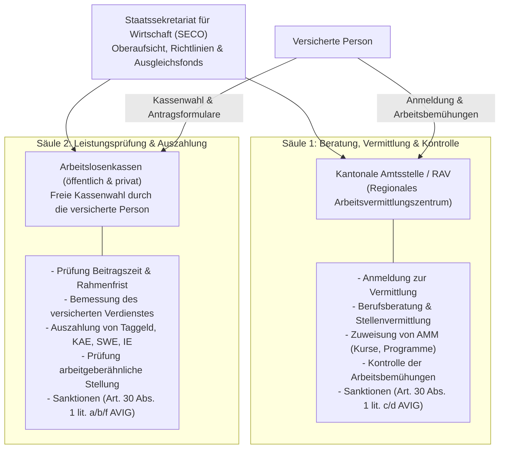
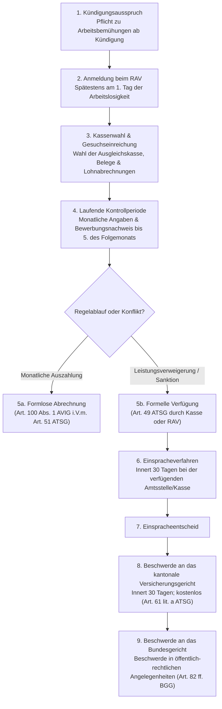

## Überblick {#ueberblick}

Die obligatorische Arbeitslosenversicherung (ALV) ist der zentrale Pfeiler der sozialen Sicherheit bei Störungen im Arbeitsleben. Als Kausalversicherung schützt sie die versicherten Arbeitnehmerinnen und Arbeitnehmer vor den wirtschaftlichen Folgen des Erwerbsausfalls bei Arbeitslosigkeit, Kurzarbeit, schlechtem Wetter und Zahlungsunfähigkeit des Arbeitgebers. Ihr sozialpolitischer Auftrag erschöpft sich indessen nicht in der reinen Geldleistung: Das schweizerische Modell verknüpft den passiven Einkommensersatz zwingend mit aktiven Instrumenten zur raschen und dauerhaften beruflichen Wiedereingliederung.

Das Gesetz definiert den Zweck und den Leistungsfächer der Versicherung in Art. 1a AVIG:



Die Arbeitslosenversicherung umfasst demnach **fünf eigenständige Leistungszweige**:

| Leistungszweig | Zweck und Gegenstand | Rechtsgrundlage |
|---|---|---|
| **Arbeitslosenentschädigung** | Ersatz des Erwerbsausfalls bei Ganz- oder Teilarbeitslosigkeit (Taggelder) | [Art. 8–30 AVIG](/kommentar/avig/art-008/#1-sperrcharakter-und-kumulativität) |
| **Kurzarbeitsentschädigung (KAE)** | Vorübergehender Teillohnersatz bei wirtschaftlich bedingtem oder behördlich verordnetem Arbeitsausfall zur Verhinderung von Kündigungen | Art. 31–41 AVIG |
| **Schlechtwetterentschädigung (SWE)** | Teillohnersatz bei witterungsbedingtem Arbeitsausfall in wetterabhängigen Branchen (Bau, Gartenbau) | Art. 42–50 AVIG |
| **Insolvenzentschädigung (IE)** | Deckung offener Lohnforderungen der Arbeitnehmer für geleistete Arbeit bei Konkurs oder Nachlassstundung des Arbeitgebers | [Art. 51–58 AVIG](/kommentar/avig/art-051/#kommentierung) |
| **Arbeitsmarktliche Massnahmen (AMM)** | Bildungs-, Beschäftigungs- und Spezialmassnahmen zur Förderung der Vermittelbarkeit und Wiedereingliederung | Art. 59–75 AVIG |

Den quantitativ und praktisch bedeutsamsten Bereich bildet die **Arbeitslosenentschädigung (Taggeld)**. Der Leistungsanspruch beruht auf einem ausgeprägten Gegenseitigkeitsverhältnis: Dem Anspruch auf angemessenen Erwerbsersatz steht die gesetzliche **Schadenminderungspflicht** der versicherten Person gegenüber. Wer Leistungen der Versicherung beanspruchen will, muss alles Zumutbare unternehmen, um Arbeitslosigkeit zu vermeiden oder zu verkürzen ([Art. 17 Abs. 1 AVIG](/kommentar/avig/art-017/#i-überblick-und-dogmatische-bedeutung)). Diese Pflicht setzt nicht erst mit der Anmeldung oder dem tatsächlichen Arbeitsplatzverlust ein, sondern bindet die betroffene Person ab Kenntnis der Kündigung ([BGE 139 V 524 E. 2.1.2](https://entscheidsuche.ch/docs/CH_BGE/CH_BGE_007_BGE-139-V-524_2013.html#consideration_2.1.2)).

## Rechtsgrundlagen {#rechtsgrundlagen}

Die rechtliche Architektur der Arbeitslosenversicherung ruht auf Bundesrecht, völkerrechtlichen Verträgen und koordinationsrechtlichen Bestimmungen:

- **Bundesverfassung (Art. 114 BV)**: Statuiert die Gesetzgebungskompetenz des Bundes über die obligatorische Arbeitslosenversicherung für alle unselbstständig Erwerbenden und verpflichtet den Bund zur Errichtung einer Entschädigung bei Zahlungsunfähigkeit des Arbeitgebers.
- **Bundesgesetz über die obligatorische Arbeitslosenversicherung und die Insolvenzentschädigung (AVIG, SR 837.0)** und **Arbeitslosenversicherungsverordnung (AVIV, SR 837.02)**: Bilden das materielle und formelle Kernrecht.
- **Bundesgesetz über den Allgemeinen Teil des Sozialversicherungsrechts (ATSG, SR 830.1)**: Gilt für die ALV, soweit das AVIG nicht ausdrücklich abweicht (Art. 1 Abs. 1 AVIG). Relevante Abweichungen bestehen insbesondere beim vereinfachten, formlosen Abrechnungsverfahren im Massenverkehr ([BGE 132 V 412 E. 5](https://entscheidsuche.ch/docs/CH_BGE/CH_BGE_007_BGE-132-V-412_2006.html#consideration_5.)) sowie bei den spezialgesetzlichen Sanktionsbestimmungen.
- **Staatsverträge (IAO-Übereinkommen Nr. 168, SR 0.822.726.8)**: Das Übereinkommen der Internationalen Arbeitsorganisation über Beschäftigungsförderung und den Schutz gegen Arbeitslosigkeit setzt staatsvertragliche Mindeststandards für die Zumutbarkeit von Arbeit und die Verhältnismässigkeit von Leistungskürzungen ([BGE 124 V 234 E. 3](https://entscheidsuche.ch/docs/CH_BGE/CH_BGE_007_BGE-124-V-234_1998-03-17.html#consideration_3.)).
- **Freizügigkeitsabkommen (FZA) und europäisches Koordinationsrecht**: Verordnung (EG) Nr. 883/2004 und Verordnung (EG) Nr. 987/2009 regeln die zwischenstaatliche Zuständigkeit und die Berücksichtigung von Versicherungszeiten bei Grenzgängern und Wanderarbeitnehmern ([BGE 148 V 209 E. 5.1](https://entscheidsuche.ch/docs/CH_BGE/CH_BGE_007_BGE-148-V-209_2022.html#consideration_5.1)).

Die Finanzierung erfolgt paritätisch durch Lohnbeiträge der Arbeitnehmer und Arbeitgeber; der Beitragssatz beträgt für beitragspflichtige Löhne bis zum UVG-Höchstbetrag (CHF 148'200.-) 2,2 Prozent (je 1,1 Prozent für Arbeitgeber und Arbeitnehmer; Art. 2 und 3 AVIG).

## Aufbau und Zuständigkeiten {#organisation}

Die Durchführung der Arbeitslosenversicherung zeichnet sich durch ein in der Schweizer Sozialversicherungslandschaft einzigartiges **duales Vollzugssystem** aus. Das Verfahren ist strikt zwischen zwei Behördenzweigen aufgeteilt: den Vermittlungs- und Beratungsorganen (kantonale Amtsstellen / RAV) einerseits und den Auszahlungsorganen (Arbeitslosenkassen) andererseits.

### Die zwei Pfeiler des Vollzugs {#vollzugspfeiler}

1. **Kantonale Amtsstellen und Regionale Arbeitsvermittlungszentren (RAV, Art. 85 ff. AVIG)**:
   - Die Kantone errichten die Regionalen Arbeitsvermittlungszentren.
   - Sie sind zuständig für die persönliche Arbeitsvermittlung, Standortbestimmung, Beratung, Zuweisung und Überwachung arbeitsmarktlicher Massnahmen (AMM) sowie die Durchsetzung der Kontrollvorschriften.
   - Das RAV prüft die quantitativen und qualitativen Arbeitsbemühungen der versicherten Person und verfügt Einstellungsverfügungen bei ungenügender Stellensuche oder Missachtung von Weisungen (Art. 30 Abs. 2 Satz 1 AVIG).

2. **Arbeitslosenkassen (Art. 76 ff. AVIG)**:
   - Das Gesetz unterscheidet zwischen **öffentlichen Kassen** (jeder Kanton führt mindestens eine kantonale Arbeitslosenkasse) und staatlich anerkannten **privaten Kassen** (von Gewerkschaften oder Wirtschaftsverbänden getragen).
   - Die versicherte Person besitzt die **freie Kassenwahl** (Art. 78 AVIG). Die gewählte Kasse bleibt für die gesamte zweijährige Rahmenfrist für den Leistungsbezug zuständig; ein Kassenwechsel während laufender Rahmenfrist ist unzulässig (Art. 20 Abs. 2 AVIV).
   - Die Kasse prüft die materiellen versicherungsrechtlichen Voraussetzungen (Beitragszeit, versicherter Verdienst, Lohnfortzahlungsansprüche, arbeitgeberähnliche Stellung), berechnet die Taggelder, wickelt die monatlichen Zahlungen ab und verfügt Sanktionen bei Pflichtverletzungen im Zusammenhang mit der Beendigung des Arbeitsverhältnisses (selbstverschuldete Arbeitslosigkeit, Lohnverzicht; Art. 30 Abs. 2 Satz 2 AVIG).

Die Aufsicht über das gesamte Vollzugssystem führt das **Staatssekretariat für Wirtschaft (SECO)** (Art. 83 AVIG), welches durch Weisungen und Kreisschreiben (namentlich die AVIG-Praxis ALE) eine einheitliche Rechtsanwendung in der Eidgenossenschaft sicherstellt.

## Versicherte Personen und Versicherungspflicht {#versicherte}

Obligatorisch versichert sind alle Arbeitnehmerinnen und Arbeitnehmer, die nach dem Bundesgesetz über die Alters- und Hinterlassenenversicherung (AHVG) beitragspflichtig sind (Art. 2 Abs. 1 AVIG). 

- **Keine Versicherung für Selbstständigerwerbende**: Selbstständig Erwerbende sind in der Schweiz nicht gegen Arbeitslosigkeit versichert. Sie entrichten keine ALV-Beiträge und können keine Arbeitslosenentschädigung beanspruchen. Allerdings unterstützt die ALV arbeitslose Personen, die eine dauerhafte selbstständige Erwerbstätigkeit aufnehmen wollen, durch die Ausrichtung von bis zu 90 Taggeldern während der Planungsphase (Art. 71a AVIG).
- **Altersgrenzen (Art. 8 Abs. 1 lit. d AVIG)**: Der Versicherungsschutz beginnt mit dem Ende der obligatorischen Schulpflicht und endet zwingend mit dem Erreichen des ordentlichen Referenzalters der AHV (Art. 21 Abs. 1 AHVG; nach der Reform AHV 21 Alter 65).
- **Ausschluss bei Rentenvorbezug**: Bezieht eine versicherte Person vorzeitig eine Altersrente der AHV (Art. 40 AHVG), erlischt der Anspruch auf Arbeitslosenentschädigung ab Rentenbeginn definitiv; eine Kumulation von vorbezogener Rente und Taggeld ist gesetzlich ausgeschlossen.

## Die Anspruchsvoraussetzungen für das Taggeld (Art. 8 AVIG) {#anspruchsvoraussetzungen}

Art. 8 Abs. 1 AVIG regelt die materiellen Tatbestandsmerkmale für den Bezug von Arbeitslosentaggeldern abschliessend. Die Norm hat **strikten Sperrcharakter**: Sämtliche sieben Voraussetzungen müssen **kumulativ** an jedem Tag vorliegen, für den eine Leistung beansprucht wird ([Kommentar zu Art. 8 AVIG](/kommentar/avig/art-008/#1-sperrcharakter-und-kumulativität)).

Fehlt auch nur ein einziges Kriterium, entsteht kein Leistungsanspruch, und die zweijährige Rahmenfrist für den Leistungsbezug beginnt nicht zu laufen. Das Bundesgericht hat in ständiger Praxis bekräftigt, «dass die in Art. 30 AVIG geregelte Einstellung in der Anspruchsberechtigung eben nur möglich ist, wenn sämtliche gesetzlichen Anspruchsvoraussetzungen gegeben sind» ([BGE 126 V 520 E. 4](https://entscheidsuche.ch/docs/CH_BGE/CH_BGE_007_BGE-126-V-520_2000-12-07.html#consideration_4.)). Eine Sanktion nach Art. 30 AVIG setzt demnach begriffsnotwendig einen bestehenden Grundanspruch voraus.

### Die sieben Voraussetzungen im Überblick {#sieben-voraussetzungen}

| Kriterium | Norm | Dogmatischer Inhalt | Beweislast & Praxis |
|---|---|---|---|
| **1. Arbeitslosigkeit** | Art. 8 Abs. 1 lit. a i.V.m. Art. 10 | Ganz- oder Teilarbeitslosigkeit; kein fortbestehendes Arbeitsverhältnis oder voller Freistellungslohn | Arbeitgeberbescheinigung / Kündigung |
| **2. Anrechenbarer Ausfall** | Art. 8 Abs. 1 lit. b i.V.m. Art. 11 | Mindestens 2 zusammenhängende Tage Arbeits- und Lohnausfall; keine arbeitgeberähnliche Stellung | Versicherte Person; Kasse prüft Handelsregister |
| **3. Wohnsitz** | Art. 8 Abs. 1 lit. c i.V.m. Art. 12 | Wohnsitz und tatsächlicher Aufenthalt in der Schweiz; Sonderregelungen für Grenzgänger | Einwohnerkontrolle / Aufenthaltsbewilligung |
| **4. Schulzeit & Alter** | Art. 8 Abs. 1 lit. d | Obligatorische Schule erfüllt; Referenzalter AHV (65) noch nicht erreicht; kein AHV-Rentenvorbezug | Amtliche Ausweise |
| **5. Beitragszeit / Befreiung** | Art. 8 Abs. 1 lit. e i.V.m. Art. 13/14 | Mindestens 12 Monate beitragspflichtige Beschäftigung in der Rahmenfrist oder Vorliegen eines Befreiungstatbestands | Lohnabrechnungen; effektiver Lohnfluss ([BGE 131 V 444 E. 1.2](https://entscheidsuche.ch/docs/CH_BGE/CH_BGE_007_BGE-131-V-444_2005.html#consideration_1.2)) |
| **6. Vermittlungsfähigkeit** | Art. 8 Abs. 1 lit. f i.V.m. Art. 15 | Bereit, in der Lage und berechtigt, zumutbare Arbeit anzunehmen (mind. 20 % Pensum) | Ärztliche Zeugnisse, Betreuungsnachweise ([BGE 146 V 210 E. 3.1](https://entscheidsuche.ch/docs/CH_BGE/CH_BGE_007_BGE-146-V-210_2020.html#consideration_3.1)) |
| **7. Kontrollvorschriften** | Art. 8 Abs. 1 lit. g i.V.m. Art. 17 | RAV-Anmeldung, Wahrnehmung von Beratungsterminen, persönliche Arbeitsbemühungen ab Kündigung | Bewerbungsjournal ([BGE 139 V 524 E. 2.1.2](https://entscheidsuche.ch/docs/CH_BGE/CH_BGE_007_BGE-139-V-524_2013.html#consideration_2.1.2)) |

### Kernfragen der einzelnen Voraussetzungen {#kernfragen-voraussetzungen}

#### 1. Arbeitslosigkeit und anrechenbarer Ausfall (Art. 10 und 11 AVIG)
Ganz arbeitslos ist, wer in keinem Arbeitsverhältnis steht und eine Vollzeitbeschäftigung sucht. Teilarbeitslos ist, wer keine Vollbeschäftigung hat und eine Teilzeitbeschäftigung oder den Ausbau eines bestehenden Teilzeitpensums um mindestens 20 Prozent anstrebt (Art. 10 Abs. 2 AVIG, Art. 5 AVIV). 

Der Arbeitsausfall ist nicht anrechenbar, solange der Arbeitgeber zur Lohnfortzahlung verpflichtet ist (Art. 11 Abs. 3 AVIG; [BGE 125 V 197](https://entscheidsuche.ch/docs/CH_BGE/CH_BGE_007_BGE-125-V-197_1999-04-19.html)). Wird die versicherte Person während der Kündigungsfrist unter voller Lohnfortzahlung freigestellt, entsteht kein anrechenbarer Ausfall; Taggelder fliessen erst nach Ablauf der Kündigungsfrist.

#### 2. Das Negativmerkmal: Keine arbeitgeberähnliche Stellung
Ein gravierendes Hindernis für den Leistungsbezug bildet die in ständiger Rechtsprechung entwickelte Übertragung von Art. 31 Abs. 3 lit. c AVIG auf die Arbeitslosenentschädigung ([BGE 123 V 234 E. 7](https://entscheidsuche.ch/docs/CH_BGE/CH_BGE_007_BGE-123-V-234_1997-09-04.html#consideration_7.); [Kommentar zu Art. 8 AVIG](/kommentar/avig/art-008/#e-anrechenbarer-arbeitsausfall-und-arbeitgeberähnliche-stellung-abs-1-lit-b-ivm-art-11-avig)):
- **Rechtsfolge**: Personen, die als Gesellschafter, Verwaltungsräte oder massgeblich Beteiligte die Entscheidungen des Arbeitgebers bestimmen oder massgeblich beeinflussen können – sowie deren mitarbeitende Ehegatten –, haben keinen Anspruch auf Arbeitslosentaggelder.
- **Zweck**: Verhinderung von Rechtsmissbrauch. Organe könnten sich sonst in wirtschaftlich schwachen Zeiten kündigen, Taggelder beziehen und die Gesellschaft bei besserer Auftragslage reaktivieren.
- **Strikte Praxis bei der GmbH**: Nach [BGE 145 V 200 E. 4.1](https://entscheidsuche.ch/docs/CH_BGE/CH_BGE_007_BGE-145-V-200_2019.html#consideration_4.1) führt die Gesellschafterstellung bei einer GmbH kraft Gesetzes unwiderlegbar zum Ausschluss vom Taggeldbezug, unabhängig davon, ob die Person eine Geschäftsführerfunktion ausübt oder wie hoch ihre Stammanteile sind. Der Ausschluss entfällt erst mit dem definitiven Ausscheiden aus der Gesellschaft (Handelsregistereintrag) oder bei nachweislicher Eröffnung des Konkurses bzw. Liquidation der Unternehmung.

#### 3. Beitragszeit und Beitragsbefreiung (Art. 13 und 14 AVIG)
Der Anspruch setzt voraus, dass die versicherte Person innerhalb der zweijährigen Rahmenfrist für die Beitragszeit (RBB) während mindestens **zwölf Monaten** eine beitragspflichtige unselbstständige Erwerbstätigkeit ausgeübt hat (Art. 13 Abs. 1 AVIG).
- **Effektiver Lohnfluss**: Nach ständiger Rechtsprechung begründet ein Arbeitsverhältnis nur dann anrechenbare Beitragszeit, wenn der Lohn tatsächlich ausbezahlt wurde ([BGE 131 V 444 E. 1.2](https://entscheidsuche.ch/docs/CH_BGE/CH_BGE_007_BGE-131-V-444_2005.html#consideration_1.2)). Reine Lohnabrechnungen ohne Zahlungsnachweis genügen bei Zweifeln nicht.
- **Befreiungstatbestände (Art. 14 AVIG)**: Wer die Beitragszeit nicht erfüllen konnte, ist unter eng definierten Umständen befreit, wenn die Erfüllung während mehr als zwölf Monaten wegen Schulausbildung, Weiterbildung, Krankheit, Unfall, Mutterschaft, Scheidung, Trennung, Invalidität oder Wegfall einer Rente unmöglich war ([Kommentar zu Art. 14 AVIG](/kommentar/avig/art-014/#i-überblick-und-dogmatische-bedeutung)).

#### 4. Vermittlungsfähigkeit (Art. 15 AVIG)
Als vermittlungsfähig gilt eine arbeitslose Person, wenn sie **bereit**, **in der Lage** und **berechtigt** ist, eine zumutbare Arbeit anzunehmen und an Eingliederungsmassnahmen teilzunehmen (Art. 15 Abs. 1 AVIG; [BGE 146 V 210 E. 3.1](https://entscheidsuche.ch/docs/CH_BGE/CH_BGE_007_BGE-146-V-210_2020.html#consideration_3.1)).
- **Subjektiver Wille**: Echte Bereitschaft, die Arbeitskraft im Rahmen des Gesetzes zur Verfügung zu stellen. Übermässige Einschränkungen hinsichtlich Arbeitsort, Branche oder Arbeitszeiten schliessen die Vermittlungsfähigkeit aus ([BGE 125 V 51 E. 6](https://entscheidsuche.ch/docs/CH_BGE/CH_BGE_007_BGE-125-V-51_1999-02-01.html#consideration_6.)).
- **Objektive Fähigkeit**: Körperliche und geistige Arbeitsfähigkeit im Umfang von mindestens 20 Prozent eines Normalarbeitspensums. Bei Zweifeln an der Gesundheit greift die Koordination mit der Invalidenversicherung: Wer sich bei der IV angemeldet hat und nicht offensichtlich vermittlungsunfähig ist, gilt bis zum IV-Entscheid als vermittlungsfähig (Vorleistungspflicht der ALV nach Art. 15 Abs. 2 AVIG, Art. 15 Abs. 3 AVIV und [BGE 136 V 95 E. 5.1](https://entscheidsuche.ch/docs/CH_BGE/CH_BGE_007_BGE-136-V-95_2010.html#consideration_5.1)).
- **Rechtliche Berechtigung**: Erfordernis einer Arbeitsbewilligung bei ausländischen Staatsangehörigen.
- **Kein gradueller Begriff**: Die Vermittlungsfähigkeit als Anspruchsvoraussetzung kennt keine graduellen Abstufungen ([BGE 146 V 210 E. 3.2](https://entscheidsuche.ch/docs/CH_BGE/CH_BGE_007_BGE-146-V-210_2020.html#consideration_3.2)): Entweder ist eine Person für ein definiertes Pensum vermittlungsfähig oder nicht.

#### 5. Kontrollvorschriften und Arbeitsbemühungen (Art. 17 AVIG)
Versicherte müssen sich persönlich zur Arbeitsvermittlung melden, Beratungsgespräche wahrnehmen und den Nachweis gezielter Arbeitsbemühungen erbringen ([Kommentar zu Art. 17 AVIG](/kommentar/avig/art-017/#i-überblick-und-dogmatische-bedeutung)).
- **Vorfeldpflicht**: Die Schadenminderungspflicht verlangt unaufgeforderte Bewerbungen bereits während der Kündigungsfrist ([BGE 139 V 524 E. 2.1.2](https://entscheidsuche.ch/docs/CH_BGE/CH_BGE_007_BGE-139-V-524_2013.html#consideration_2.1.2)).
- **Quantität**: Die Rechtsprechung verlangt in der Regel zehn bis zwölf Stellenbewerbungen pro Monat ([BGE 141 V 365 E. 4.1](https://entscheidsuche.ch/docs/CH_BGE/CH_BGE_007_BGE-141-V-365_2015.html#consideration_4.1)).
- **Fristenfalle**: Die Nachweise über die Bemühungen müssen für jede Kontrollperiode spätestens am 5. Tag des Folgemonats eingereicht werden (Art. 26 Abs. 2 AVIV); verpasste Fristen führen zur Sanktionierung nach Art. 30 Abs. 1 lit. c AVIG.

## Leistungen, Taggeldbemessung und Rahmenfristen {#taggeld-und-leistungen}

### Das Rahmenfristensystem (Art. 9 AVIG) {#rahmenfristen}
Die Leistungen der ALV werden innerhalb eines zweistufigen Fristensystems gewährt:
- **Rahmenfrist für den Leistungsbezug (RLB)**: Sie dauert zwei Jahre und beginnt am ersten Tag, für den alle Anspruchsvoraussetzungen nach Art. 8 AVIG erfüllt sind (Art. 9 Abs. 2 AVIG).
- **Rahmenfrist für die Beitragszeit (RBB)**: Sie umfasst die zwei Jahre unmittelbar vor Beginn der Rahmenfrist für den Leistungsbezug (Art. 9 Abs. 3 AVIG); in diesem Zeitraum müssen die zwölf Beitragsmonate liegen.
- **Verlängerung der Rahmenfristen**: Für Personen, die sich der Erziehung von Kindern gewidmet haben (Erziehungsrahmenfrist von vier Jahren, Art. 9b AVIG), oder für Personen, die kurz vor Erreichen des Referenzalters arbeitslos werden (Art. 9c AVIG), gelten gesetzliche Verlängerungen.

### Taggeldhöhe und Höchstanspruch (Art. 22 und 27 AVIG) {#taggeldhoehe}
Das Taggeld wird für fünf Wochentage pro Woche ausgerichtet (monatlich durchschnittlich 21,7 Taggelder).

1. **Bemessungssatz (Art. 22 AVIG)**:
   - **80 Prozent** des versicherten Verdienstes erhalten Versicherte mit Unterhaltspflichten gegenüber Kindern (unter 18 Jahren bzw. bis 25 in Ausbildung), Versicherte mit einem versicherten Verdienst von maximal CHF 3'797.- pro Monat sowie Personen mit einer Invalidität von mindestens 40 Prozent.
   - **70 Prozent** des versicherten Verdienstes erhalten alle übrigen Versicherten ([Kommentar zu Art. 22 AVIG](/kommentar/avig/art-022/#kommentierung)).
   - **Versicherter Verdienst (Art. 23 AVIG)**: Bemisst sich nach dem Durchschnittslohn der letzten sechs (oder auf Antrag zwölf) Beitragsmonate. Der versicherte Höchstverdienst liegt synchron zum UVG bei CHF 148'200.- pro Jahr (CHF 12'350.- pro Monat).

2. **Höchstzahl der Taggelder (Art. 27 AVIG)**:
   Innerhalb der zweijährigen Bezugsrahmenfrist besteht Anspruch auf ein begrenztes Kontingent:

| Beitragszeit | Alter / Kriterien | Maximale Taggeldzahl |
|---|---|---|
| mind. 12 Monate | bis 25 Jahre (ohne Unterhaltspflichten) | **200 Taggelder** |
| mind. 12 Monate | ab 25 Jahre | **260 Taggelder** |
| mind. 18 Monate | alle Altersgruppen | **400 Taggelder** |
| mind. 22 Monate | ab 55 Jahren oder Bezug einer IV-Rente | **520 Taggelder** |
| Beitragsbefreite | je nach Befreiungsgrund (Art. 14 AVIG) | **90 bzw. 200 Taggelder** |

### Zwischenverdienst (Art. 24 AVIG) {#zwischenverdienst}
Erzielt eine versicherte Person während der Arbeitslosigkeit ein Einkommen aus unselbstständiger oder selbstständiger Arbeit, liegt ein **Zwischenverdienst** vor. Die Versicherung bezahlt als **Kompensationszahlung** 70 bzw. 80 Prozent der Differenz zwischen dem versicherten Verdienst und dem erzielten Zwischenverdienst. Dieses System setzt einen starken finanziellen Anreiz zur Annahme auch gering entlöhnter Tätigkeiten, da das Gesamteinkommen stets höher ist als das reine Taggeld.

### Kurzarbeits-, Schlechtwetter- und Insolvenzentschädigung {#kae-swe-ie}

- **Kurzarbeitsentschädigung (KAE, Art. 31 ff. AVIG)**: Ermöglicht Arbeitgebern bei vorübergehenden wirtschaftlichen Auftragsrückgängen oder behördlichen Massnahmen eine Reduktion der Arbeitszeit. Die ALV vergütet dem Arbeitgeber 80 Prozent des anrechenbaren Verdienstausfalls der betroffenen Arbeitnehmer.
- **Schlechtwetterentschädigung (SWE, Art. 42 ff. AVIG)**: Fängt Arbeitsausfälle auf, die ausschliesslich auf Witterungsgründe zurückzuführen sind, sofern die Fortführung der Arbeiten technisch unmöglich oder für die Gesundheit der Arbeitnehmer unzumutbar ist.
- **Insolvenzentschädigung (IE, Art. 51 ff. AVIG)**: Deckt Lohnforderungen von Arbeitnehmern für tatsächlich geleistete Arbeit während maximal der letzten vier Monate des Arbeitsverhältnisses vor der Konkurseröffnung über das Vermögen des Arbeitgebers ([BGE 142 V 488 E. 5.1](https://entscheidsuche.ch/docs/CH_BGE/CH_BGE_007_BGE-142-V-488_2016.html#consideration_5.1); [Kommentar zu Art. 51 AVIG](/kommentar/avig/art-051/#kommentierung)). Der Anspruch muss innert einer Verwirkungsfrist von 60 Tagen nach Veröffentlichung des Konkurses bei der zuständigen öffentlichen Kasse geltend gemacht werden (Art. 53 Abs. 1 AVIG).

## Sanktionen: Einstellung in der Anspruchsberechtigung (Art. 30 AVIG) {#sanktionen}

Die Einstellung in der Anspruchsberechtigung nach Art. 30 AVIG ist das zentrale Sanktionsinstrument der Arbeitslosenversicherung ([Kommentar zu Art. 30 AVIG](/kommentar/avig/art-030/#überblick-und-bedeutung)). Sie führt nicht zum Erlöschen des Grundanspruchs, sondern bewirkt eine **befristete Sistierung der Auszahlung**. Nach Art. 30 Abs. 3 Satz 2 AVIG werden die Einstelltage auf die Höchstzahl der Taggelder angerechnet: Die versicherte Person verliert die Entschädigung für diese Tage endgültig, ohne dass sich die Rahmenfrist verlängert.

### Die Sanktionstatbestände im System {#sanktionstatbestaende}

| Gesetzestatbestand | Typische Pflichtverletzung | Zuständige Behörde |
|---|---|---|
| **Art. 30 Abs. 1 lit. a** | Selbstverschuldete Arbeitslosigkeit: Eigenkündigung ohne Neustelle, Aufhebungsvertrag ohne zwingenden Grund, Kündigung durch Arbeitgeber wegen Pflichtverletzung ([BGE 122 V 34 E. 4](https://entscheidsuche.ch/docs/CH_BGE/CH_BGE_007_BGE-122-V-34_1996-01-24.html#consideration_4.)) | **Arbeitslosenkasse** |
| **Art. 30 Abs. 1 lit. b** | Verzicht auf Lohnansprüche gegenüber dem bisherigen Arbeitgeber zu Lasten der Versicherung | **Arbeitslosenkasse** |
| **Art. 30 Abs. 1 lit. c** | Ungenügende persönliche Arbeitsbemühungen während der Kündigungsfrist oder der Arbeitslosigkeit | **RAV / kantonale Amtsstelle** |
| **Art. 30 Abs. 1 lit. d** | Ablehnung einer zumutbaren Stelle, Nichtbefolgen von Kontrollvorschriften, Abbruch oder Nichtantritt einer AMM | **RAV / kantonale Amtsstelle** |
| **Art. 30 Abs. 1 lit. e** | Verletzung der Auskunfts- und Meldepflicht, unwahre oder unvollständige Angaben | **Kasse oder RAV** je nach Empfänger |
| **Art. 30 Abs. 1 lit. f** | Rechtswidriges Erwirken oder Erwirkenversuch von Leistungen (Vorsatzerfordernis) | **Arbeitslosenkasse** |

### Verschuldensstufen und Bemessung (Art. 45 AVIV) {#verschuldensstufen}
Die Dauer der Einstellung bemisst sich nach der Schwere des Verschuldens (Art. 30 Abs. 3 AVIG; [BGE 141 V 365 E. 4.1](https://entscheidsuche.ch/docs/CH_BGE/CH_BGE_007_BGE-141-V-365_2015.html#consideration_4.1)):
- **Leichtes Verschulden**: 1 bis 15 Einstelltage (z. B. einmaliges Versäumen eines RAV-Gesprächs, leicht ungenügende Bewerbungen).
- **Mittleres Verschulden**: 16 bis 30 Einstelltage (wiederholte Pflichtverletzungen, ungenügende Bemühungen über längere Zeit).
- **Schweres Verschulden**: 31 bis 60 Einstelltage (Aufgabe einer zumutbaren Stelle ohne Neuanstellung [Art. 45 Abs. 4 lit. a AVIV], Ablehnung einer zumutbaren Stelle [Art. 45 Abs. 4 lit. b AVIV], Leistungsbetrug).

### Die sechsmonatige Vollzugsfrist (Art. 30 Abs. 3 Satz 4 AVIG) {#vollzugsfrist}
Eine Besonderheit von eminenter Praxisrelevanz stellt die Vollzugsfrist dar: Der Vollzug der Einstellung fällt dahin, wenn er nicht innert **sechs Monaten** seit Beginn der Einstellungsfrist erfolgt ist. Verzögert sich der Erlass einer Einstellungsverfügung durch Behördenüberlastung oder langwierige Abklärungen, verfällt die Sanktion ex lege.

## Das Verwaltungsverfahren und der Rechtsschutz {#verfahren}

Das Verfahren in der Arbeitslosenversicherung gliedert sich in eine Folge genau geregelter Schritte von der Erstmeldung bis zum gerichtlichen Rechtsschutz.

### Der Verfahrensablauf Schritt für Schritt {#verfahrensschritte}

| Schritt | Phase / Handlung | Zuständige Stelle | Frist / Form |
|---|---|---|---|
| **1. Stellenverlust** | Aufnahme persönlicher Arbeitsbemühungen | Versicherte Person | Ab Erhalt der Kündigung (Vorfeldpflicht) |
| **2. RAV-Anmeldung** | Persönliche oder digitale Anmeldung zur Vermittlung (job-room.ch) | RAV / kantonale Amtsstelle | Spätestens am ersten Tag, für den Taggeld beansprucht wird |
| **3. Leistungsantrag** | Antrag auf Arbeitslosenentschädigung und Arbeitgeberbescheinigung | Gewählte Arbeitslosenkasse | Zu Beginn der Rahmenfrist; Kassenwahl ist bindend |
| **4. Monatliche Kontrolle** | Formular *Angaben der versicherten Person* und Nachweis der Arbeitsbemühungen | Kasse (Abrechnung) / RAV (Bemühungen) | Bemühungsnachweis strikt bis 5. Tag des Folgemonats (Art. 26 Abs. 2 AVIV) |
| **5. Entscheid** | Formlose Abrechnung oder formelle Verfügung | Kasse oder RAV | Formlose Abrechnung bei Einverständnis; formelle Verfügung bei Streitigkeiten |
| **6. Einsprache** | Schriftliche Einsprache gegen formelle Verfügung | Verfügende Stelle (Kasse oder RAV) | 30 Tage seit Eröffnung (Art. 52 ATSG) |
| **7. Gerichtliche Beschwerde** | Beschwerde gegen Einspracheentscheid | Kantonales Versicherungsgericht | 30 Tage seit Zustellung (Art. 56 ff. ATSG, Art. 100 AVIG) |
| **8. Bundesgericht** | Beschwerde in öffentlich-rechtlichen Angelegenheiten | Bundesgericht (Sozialrechtliche Abteilungen) | 30 Tage seit Eröffnung (Art. 90 ff., 100 BGG) |

### Formloses Verfahren vs. Verfügungspflicht (Art. 100 Abs. 1 AVIG) {#formloses-verfahren}
Im Massengeschäft der monatlichen Taggeldauszahlungen weicht das AVIG bewusst vom allgemeinen Sozialversicherungsrecht ab: Gestützt auf Art. 100 Abs. 1 AVIG in Verbindung mit Art. 51 ATSG erfolgt die monatliche Abrechnung und Auszahlung im **formlosen Verfahren** ([BGE 132 V 412 E. 5](https://entscheidsuche.ch/docs/CH_BGE/CH_BGE_007_BGE-132-V-412_2006.html#consideration_5.)). 
- Ist die versicherte Person mit der Abrechnung (etwa der Höhe des versicherten Verdienstes oder Abzügen) nicht einverstanden, muss sie innert angemessener Überlegungsfrist den Erlass einer anfechtbaren **formellen Verfügung** nach Art. 49 ATSG verlangen.
- Alle belastenden Anordnungen – namentlich die Ablehnung des Grundanspruchs, Rückforderungen unrechtmässiger Leistungen (Art. 95 AVIG) und Einstellungen in der Anspruchsberechtigung (Art. 30 AVIG) – müssen zwingend von Amtes wegen als schriftliche, begründete Verfügung mit Rechtsmittelbelehrung erlassen werden.

### Das Einspracheverfahren (Art. 52 ATSG) {#einspracheverfahren}
Gegen Verfügungen des RAV oder der Kasse kann innert **30 Tagen** schriftlich **Einsprache** bei der erlassenden Behörde erhoben werden. Das Einspracheverfahren ist kostenlos, rasch und ermöglicht der Verwaltung eine umfassende Selbstkontrolle in tatsächlicher und rechtlicher Hinsicht. Der Einspracheentscheid bildet das Anfechtungsobjekt für das nachfolgende Gerichtsverfahren.

### Der gerichtliche Instanzenzug {#instanzenzug}
1. **Kantonales Versicherungsgericht (Art. 56 ff. ATSG i.V.m. Art. 100 Abs. 1 AVIG)**:
   - Die Beschwerde ist innert 30 Tagen beim Versicherungsgericht desjenigen Kantons einzureichen, dessen Amtsstelle oder Ausgleichskasse den Einspracheentscheid erlassen hat.
   - **Kostenlosigkeit**: Anders als in der Invalidenversicherung (Art. 69 Abs. 1bis IVG) ist das kantonale Beschwerdeverfahren in Arbeitslosenversicherungssachen für die Parteien **grundsätzlich kostenlos** (Art. 61 lit. a ATSG; vorbehalten bleibt mutwillige Prozessführung).
   - Das Gericht wendet das Recht von Amtes wegen an und stellt den Sachverhalt unter Mitwirkung der Parteien von Amtes wegen fest (Untersuchungsmaxime).

2. **Bundesgericht (Art. 82 ff. BGG)**:
   - Gegen den Entscheid des kantonalen Versicherungsgerichts steht die Beschwerde in öffentlich-rechtlichen Angelegenheiten an das Bundesgericht (I. oder II. Sozialrechtliche Abteilung in Luzern) offen.
   - Geht es um die Zusprechung oder Verweigerung von Geldleistungen (Taggelder, Einstelltage), ist das Bundesgericht nicht an die Sachverhaltsfeststellung der Vorinstanz gebunden (Art. 97 Abs. 2 BGG); es prüft den Sachverhalt und das Bundesrecht frei.

## Praxishinweise {#praxishinweise}

### Für versicherte Personen und Arbeitnehmer {#hinweise-versicherte}
- **Sofort bewerben ab Kündigung**: Warten Sie keinesfalls bis zum ersten Tag der Arbeitslosigkeit oder dem RAV-Erstgespräch. Die Rechtsprechung sanktioniert fehlende Bemühungen während der Kündigungsfrist ausnahmslos ([BGE 139 V 524 E. 2.1.2](https://entscheidsuche.ch/docs/CH_BGE/CH_BGE_007_BGE-139-V-524_2013.html#consideration_2.1.2)). Als Richtwert gelten 10 bis 12 gezielte Bewerbungen pro Monat ([BGE 141 V 365 E. 4.1](https://entscheidsuche.ch/docs/CH_BGE/CH_BGE_007_BGE-141-V-365_2015.html#consideration_4.1)).
- **Strikte Frist am 5. Tag des Folgemonats wahren**: Das Formular für den Nachweis der Arbeitsbemühungen muss bis zum 5. des Folgemonats beim RAV eintreffen (Art. 26 Abs. 2 AVIV). Verpassen Sie diese Frist nicht; die Gerichte anerkennen ein vergessenes Absenden nicht als Entschuldigungsgrund.
- **Keine vorschnellen Aufhebungsverträge unterzeichnen**: Die einvernehmliche Auflösung eines Arbeitsverhältnisses ohne zwingenden Grund oder ohne unterschriftsreifen Anschlussvertrag gilt als selbstverschuldete Arbeitslosigkeit und wird regelmässig mit 31 bis 60 Einstelltagen (schweres Verschulden) geahndet ([BGE 122 V 34 E. 4](https://entscheidsuche.ch/docs/CH_BGE/CH_BGE_007_BGE-122-V-34_1996-01-24.html#consideration_4.)).
- **Keinen AHV-Rentenvorbezug ohne genaue Prüfung auslösen**: Wer eine AHV-Altersrente vorzeitig bezieht, scheidet unwiderruflich aus der Arbeitslosenversicherung aus (Art. 8 Abs. 1 lit. d AVIG).

### Für Inhaber, Organe und GmbH-Gesellschafter {#hinweise-organe}
- **GmbH-Beteiligungen rechtzeitig regeln**: Wer Stammanteile an einer GmbH hält (selbst minimale Minderheitsanteile ohne Geschäftsführung), ist vom Bezug von Arbeitslosentaggeld absolut ausgeschlossen ([BGE 145 V 200 E. 4.1](https://entscheidsuche.ch/docs/CH_BGE/CH_BGE_007_BGE-145-V-200_2019.html#consideration_4.1)). Vor einer Anmeldung zur Arbeitslosigkeit müssen die Anteile nachweisbar abgetreten oder die Liquidation der Gesellschaft im Handelsregister publiziert sein.
- **Verwaltungsratsmandate niederlegen**: Verwaltungsräte einer Aktiengesellschaft müssen ihr Mandat vor Eintritt der Arbeitslosigkeit formgültig niederlegen und im Handelsregister löschen lassen, um den Vorwurf der arbeitgeberähnlichen Stellung abzuwenden ([BGE 123 V 234 E. 7](https://entscheidsuche.ch/docs/CH_BGE/CH_BGE_007_BGE-123-V-234_1997-09-04.html#consideration_7.)).

### Für Arbeitgeber {#hinweise-arbeitgeber}
- **Arbeitgeberbescheinigung rasch ausstellen**: Verzögerungen bei der Ausstellung der Arbeitgeberbescheinigung blockieren die Leistungsprüfung der Kasse und können Schadenersatzpflichten nach sich ziehen.
- **Voraussetzungen bei Kurzarbeit strikt einhalten**: Kurzarbeit muss vor Beginn der kantonalen Amtsstelle vorangemeldet werden (Voranmeldefrist nach Art. 36 AVIG). Eine rückwirkende Bewilligung ist gesetzlich ausgeschlossen.

## Leitentscheide {#leitentscheide}

| Entscheid | Gegenstand | Bedeutung |
|---|---|---|
| [BGE 126 V 520](https://entscheidsuche.ch/docs/CH_BGE/CH_BGE_007_BGE-126-V-520_2000-12-07.html#consideration_4.) E. 4 | Sperrwirkung von Art. 8 AVIG gegenüber Art. 30 AVIG | Fehlt eine Anspruchsvoraussetzung (wie die Vermittlungsfähigkeit), entsteht kein Grundanspruch; eine Sanktionierung durch Einstellung ist begrifflich ausgeschlossen. |
| [BGE 146 V 210](https://entscheidsuche.ch/docs/CH_BGE/CH_BGE_007_BGE-146-V-210_2020.html#consideration_3.1) E. 3.1 & 3.2 | Begriff der Vermittlungsfähigkeit (Art. 15 AVIG) | Dreiteilung in Bereitschaft, Fähigkeit und Berechtigung; die Vermittlungsfähigkeit ist unteilbar und schliesst graduelle Abstufungen aus. |
| [BGE 145 V 200](https://entscheidsuche.ch/docs/CH_BGE/CH_BGE_007_BGE-145-V-200_2019.html#consideration_4.1) E. 4.1 | Arbeitgeberähnliche Stellung bei der GmbH | Absolute Ausschlusswirkung: GmbH-Gesellschafter haben kraft ihrer gesellschaftsrechtlichen Stellung keinen Anspruch auf Arbeitslosenentschädigung. |
| [BGE 123 V 234](https://entscheidsuche.ch/docs/CH_BGE/CH_BGE_007_BGE-123-V-234_1997-09-04.html#consideration_7.) E. 7 | Arbeitgeberähnliche Stellung bei der AG | Analoge Anwendung von Art. 31 Abs. 3 lit. c AVIG; Alleinaktionäre und Verwaltungsräte sind vom Leistungsbezug ausgeschlossen. |
| [BGE 139 V 524](https://entscheidsuche.ch/docs/CH_BGE/CH_BGE_007_BGE-139-V-524_2013.html#consideration_2.1.2) E. 2.1.2 | Pflicht zur Stellensuche während Kündigungsfrist | Die Schadenminderungspflicht nach Art. 17 Abs. 1 AVIG verlangt unaufgeforderte Bewerbungen bereits ab Ausspruch der Kündigung. |
| [BGE 131 V 444](https://entscheidsuche.ch/docs/CH_BGE/CH_BGE_007_BGE-131-V-444_2005.html#consideration_1.2) E. 1.2 | Beitragszeitnachweis und Lohnfluss (Art. 13 AVIG) | Beitragszeiten setzen den Nachweis einer effektiven Lohnzahlung voraus, um missbräuchliche Scheinvereinbarungen abzuwehren. |
| [BGE 141 V 365](https://entscheidsuche.ch/docs/CH_BGE/CH_BGE_007_BGE-141-V-365_2015.html#consideration_4.1) E. 4.1 | Bemessung der Einstellungsdauer (Art. 30 AVIG) | Gesamtbeurteilung des Verschuldens; Bestätigung der Praxis von 10 bis 12 Stellenbewerbungen pro Monat als Orientierungsrahmen. |
| [BGE 148 V 209](https://entscheidsuche.ch/docs/CH_BGE/CH_BGE_007_BGE-148-V-209_2022.html#consideration_5.1) E. 5.1 | Wohnsitz und Wahlrecht unechter Grenzgänger | Unechte Grenzgänger ohne wöchentliche Rückkehr haben ein Wahlrecht zwischen Leistungsbezug in der Schweiz oder im Wohnsitzstaat (Art. 65 VO 883/2004). |
| [BGE 136 V 95](https://entscheidsuche.ch/docs/CH_BGE/CH_BGE_007_BGE-136-V-95_2010.html#consideration_5.1) E. 5.1 | Vorleistungspflicht der ALV bei IV-Anmeldung | Ein gesundheitlich beeinträchtigter Versicherter gilt bis zum Entscheid der IV als vermittlungsfähig, wenn er nicht offensichtlich vermittlungsunfähig ist. |
| [BGE 132 V 412](https://entscheidsuche.ch/docs/CH_BGE/CH_BGE_007_BGE-132-V-412_2006.html#consideration_5.) E. 5 | Formloses Verfahren in der ALV (Art. 100 AVIG) | Im Massengeschäft der Taggeldauszahlung gilt abweichend von Art. 49 ATSG das formlose Verfahren; belastende Akte müssen formell verfügt werden. |
| [BGE 124 V 234](https://entscheidsuche.ch/docs/CH_BGE/CH_BGE_007_BGE-124-V-234_1998-03-17.html#consideration_3.) E. 3 | Zumutbare Arbeit und IAO-Übereinkommen Nr. 168 | Staatsvertragskonforme Auslegung der Zumutbarkeitsgrenzen und Sanktionen im Lichte von Art. 20 IAO-168. |
| [BGE 125 V 51](https://entscheidsuche.ch/docs/CH_BGE/CH_BGE_007_BGE-125-V-51_1999-02-01.html#consideration_6.) E. 6 | Subjektive Vermittlungsbereitschaft | Die Vermittlungsfähigkeit erfordert neben objektiver Arbeitsfähigkeit auch den tatsächlichen Willen zum Einsatz der Arbeitskraft zu marktüblichen Bedingungen. |
| [BGE 122 V 34](https://entscheidsuche.ch/docs/CH_BGE/CH_BGE_007_BGE-122-V-34_1996-01-24.html#consideration_4.) E. 4 | Selbstverschulden bei Aufhebungsverträgen | Wer ohne Not einen Aufhebungsvertrag schliesst, hat seine Arbeitslosigkeit selbst verschuldet (Sanktion nach Art. 30 Abs. 1 lit. a AVIG). |
| [BGE 125 V 197](https://entscheidsuche.ch/docs/CH_BGE/CH_BGE_007_BGE-125-V-197_1999-04-19.html#consideration_6.) E. 6 | Anrechenbarer Ausfall und Lohnfortzahlung | Kein anrechenbarer Arbeitsausfall (Art. 11 AVIG), solange ein arbeitsvertraglicher Lohnanspruch oder Lohnersatz besteht. |
| [BGE 142 V 488](https://entscheidsuche.ch/docs/CH_BGE/CH_BGE_007_BGE-142-V-488_2016.html#consideration_5.1) E. 5.1 | Insolvenzentschädigung (Art. 51 AVIG) | Sicherung offener Lohnforderungen bei Zahlungsunfähigkeit des Arbeitgebers; strenge Verwirkungsfristen bei der Geltendmachung. |
| [BGE 132 V 357](https://entscheidsuche.ch/docs/CH_BGE/CH_BGE_007_BGE-132-V-357_2006.html#consideration_3.1) E. 3.1 | Rückforderung unrechtmässiger Leistungen (Art. 95 AVIG) | Rückforderungspflicht bei fehlender Anspruchsberechtigung und Voraussetzungen für den Erlass bei Gutgläubigkeit und grosser Härte. |

## Literatur {#literatur}

- **Thomas Nussbaumer**, Arbeitslosenversicherung, in: Ulrich Meyer (Hrsg.), Schweizerisches Bundesverwaltungsrecht (SBVR), Band XIV: Soziale Sicherheit, 3. Aufl., Basel 2016.
- **Barbara Kupfer Bucher**, Bundesgesetz über die obligatorische Arbeitslosenversicherung und Insolvenzentschädigung (AVIG), 5. Aufl., Zürich/Basel/Genf 2019.
- **Guy Longchamp / Boris Rubin**, Commentaire de la loi sur l'assurance-chômage (LACI), Genf/Zürich/Basel 2024.
- **Gerhard Gerhards**, Kommentar zum Arbeitslosenversicherungsgesetz (AVIG), Band I (Art. 1–58) und Band II (Art. 59–122), Bern 1987/1988.
- **Boris Rubin**, Assurance-chômage et service de l'emploi: Droit suisse et intercantonal, 2. Aufl., Zürich 2019.
- **Ueli Kieser**, ATSG-Kommentar: Kommentar zum Bundesgesetz über den Allgemeinen Teil des Sozialversicherungsrechts, 4. Aufl., Zürich/Basel/Genf 2020.
