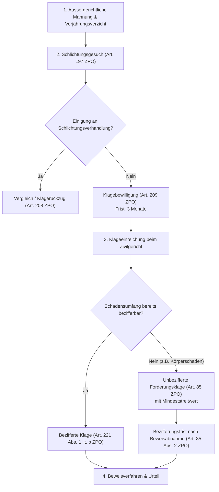

## Überblick {#ueberblick}

Das schweizerische ausservertragliche Haftpflichtrecht beruht auf dem Grundsatz, dass jeder erlittene Schaden grundsätzlich dort verbleibt, wo er eingetreten ist (*casum sentit dominus*). Eine Überwälzung der Vermögenseinbusse auf eine andere Person verlangt einen besonderen gesetzlichen Rechtfertigungsgrund. Die primäre Generalklausel des Privatrechts bildet die Haftung aus unerlaubter Handlung nach [Art. 41 OR](/kommentar/or/art-041/): Wer einem andern widerrechtlich Schaden zufügt, sei es mit Absicht, sei es aus Fahrlässigkeit, wird ihm zum Ersatze verpflichtet.

Neben der allgemeinen Verschuldenshaftung kennt das Obligationenrecht einfache Kausalhaftungen für vermutetes Überwachungs- oder Organisationsverschulden (wie die Geschäftsherrenhaftung nach Art. 55 OR und die Tierhalterhaftung nach Art. 56 OR) sowie strenge Kausalhaftungen für die Erstellung fehlerhafter Sachen (Werkeigentümerhaftung nach Art. 58 OR). Hinzu treten spezialgesetzliche Gefährdungshaftungen ausserhalb des OR (etwa für Motorfahrzeughalter nach Art. 58 SVG oder für fehlerhafte Produkte nach Art. 1 PrHG).

Die Durchsetzung eines Schadenersatzanspruchs erfordert nicht nur die lückenlose Erfüllung der materiellrechtlichen Anspruchsvoraussetzungen, sondern stellt die rechtsuchende Partei auch vor anspruchsvolle zivilprozessuale Hürden: die Wahl des zutreffenden Gerichtsstands (Art. 36 ZPO), das Durchlaufen des obligatorischen Schlichtungsverfahrens (Art. 197 ff. ZPO), die strikte Substanziierung der Schadensposten (Art. 221 Abs. 1 lit. d ZPO) sowie die sachgerechte Formulierung der Rechtsbegehren bei noch nicht abgeschlossener Schadensentwicklung (unbezifferte Forderungsklage nach Art. 85 ZPO).

| Haftungstyp | Rechtsgrundlage | Zurechnungskriterium | Entlastungsbeweis möglich? |
|---|---|---|---|
| **Allgemeine Verschuldenshaftung** | Art. 41 Abs. 1 OR | Eigenes Verschulden (Vorsatz oder Fahrlässigkeit) | Nein (Verschulden ist Anspruchsvoraussetzung) |
| **Sittenwidrigkeitshaftung** | Art. 41 Abs. 2 OR | Absichtliche Schädigung gegen die guten Sitten | Nein (Direktvorsatz zwingend) |
| **Geschäftsherrenhaftung** | Art. 55 OR | Organisiertes Betriebsrisiko / Hilfspersoneneinsatz | Ja (Sorgfaltsbeweis: *cura in eligendo, instruendo, custodiendo*) |
| **Tierhalterhaftung** | Art. 56 OR | Halterschaft an einem Tier | Ja (Sorgfaltsbeweis für Verwahrung und Beaufsichtigung) |
| **Werkeigentümerhaftung** | Art. 58 OR | Eigentum an einem mangelhaften Werk | Nein (Kausalhaftung ohne Exkulpationsmöglichkeit) |
| **Motorfahrzeughalterhaftung** | Art. 58 SVG | Betrieb eines Motorfahrzeugs (Gefährdungshaftung) | Nur bei höherer Gewalt oder grobem Dritt-/Selbstverschulden |

---

## Systematik und Ausgangslage {#systematik-und-ausgangslage}

Im schweizerischen Haftungsrecht stehen vertragliche und ausservertragliche Ansprüche selbständig nebeneinander. Liegt zwischen den Parteien eine vertragliche Vereinbarung vor, greift für Pflichtverletzungen die vertragliche Haftung nach [Art. 97 ff. OR](/kommentar/or/art-097/). Die vertragliche Haftung bietet dem Gläubiger erhebliche Vorteile: Das Verschulden des Schuldners wird gesetzlich vermutet (Art. 97 Abs. 1 OR), für Hilfspersonen wird ohne Befreiungsbeweis gehaftet (Art. 101 Abs. 1 OR), und die regelmässige Verjährungsfrist beträgt zehn Jahre (Art. 127 OR).

Trotzdem kommt es häufig zur **Anspruchskonkurrenz**: Verletzt ein Verhalten zugleich eine vertragliche Pflicht und ein absolutes Rechtsgut oder eine deliktsrechtliche Schutznorm, kann die geschädigte Person ihre Klage alternativ oder kumulativ auf Vertrag (Art. 97 OR) und auf unerlaubte Handlung (Art. 41 OR) stützen.

Demgegenüber schliesst das öffentlich-rechtliche Staatshaftungsrecht (Art. 61 OR) das Bundeszivilrecht grundsätzlich aus: Fügt eine Beamtin oder ein Beamter in Ausübung amtlicher Verrichtungen einem Dritten Schaden zu, bestimmt sich die Haftung ausschliesslich nach dem einschlägigen eidgenössischen oder kantonalen Staatshaftungsgesetz (z. B. Verantwortlichkeitsgesetz des Bundes, VG).

---

## Die vier allgemeinen Haftungsvoraussetzungen (Art. 41 OR) {#allgemeine-haftungsvoraussetzungen}

Jede Schadenersatzklage nach Art. 41 Abs. 1 OR verlangt den kumulativen Nachweis von vier Tatbestandsmerkmalen:
1. **Schaden** (Vermögenseinbusse)
2. **Widerrechtlichkeit** (Verletzung eines absoluten Rechts oder einer Schutznorm)
3. **Kausalzusammenhang** (natürliche und adäquate Kausalität zwischen Handlung und Schaden)
4. **Verschulden** (Vorsatz oder Fahrlässigkeit bei Urteilsfähigkeit)

Fehlt auch nur eine dieser Voraussetzungen, weist das Gericht die Klage vollumfänglich ab. Die Beweislast für sämtliche vier Merkmale trägt nach Art. 8 ZGB die geschädigte klagende Partei.

### 1. Schaden (Differenzhypothese) {#schaden-differenzhypothese}

Der Schaden bildet den Ausgangspunkt jeder Haftungsprüfung. Das schweizerische Recht folgt dem normativen Schadensbegriff der **Differenzhypothese**:

> «Nach dem allgemeinen Schadensbegriff, wie er in der Praxis des Bundesgerichts verwendet wird, ist der Schaden eine unfreiwillige Vermögensverminderung, der in einer Verminderung der Aktiven, einer Vermehrung der Passiven oder im entgangenen Gewinn bestehen kann. Er entspricht der Differenz zwischen dem gegenwärtigen Vermögensstand und dem Stand, den das Vermögen ohne das schädigende Ereignis hätte» ([BGE 144 III 155](https://entscheidsuche.ch/docs/CH_BGE/CH_BGE_005_BGE-144-III-155_2018.html#consideration_2.2) E. 2.2).

Der Schaden kann auftreten als:
- **Verminderung der Aktiven** (*damnum emergens*): Zerstörung oder Beschädigung einer Sache, Heilbehandlungskosten, verauslagte Reparaturkosten.
- **Vermehrung der Passiven**: Begründung neuer Verbindlichkeiten gegenüber Dritten (z. B. Spitalrechnungen, Pflegeaufwand).
- **Entgangener Gewinn** (*lucrum cessans*): Ausfall künftigen Erwerbseinkommens, entgangene Geschäftsgewinne, die ohne das Ereignis mit überwiegender Wahrscheinlichkeit erzielt worden wären.

Dabei gilt das strikte **Bereicherungsverbot**:
> «Zu ersetzen ist der erlittene Schaden. Das im Haftpflichtrecht als allgemeines Prinzip anerkannte Bereicherungsverbot schliesst es aus, dem Geschädigten eine Entschädigung zuzugestehen, die den durch das schädigende Ereignis erlittenen Schaden übersteigt» ([BGE 132 III 321](https://entscheidsuche.ch/docs/CH_BGE/CH_BGE_005_BGE-132-III-321_2006.html#consideration_2.2.1) E. 2.2.1).

Nach schweizerischem Recht sind blosse *Frustrationsschäden* (z. B. verfallene Theaterkarten wegen Unfalls) oder *Kommerzialisierungsschäden* (der blosse Verlust von Nutzungsmöglichkeiten ohne konkrete finanzielle Vermögenseinbusse) nicht als ersatzfähiger Schaden anerkannt. Ebenso ist der blosse *Reflexschaden* (finanzielle Nachteile, die eine Drittperson infolge der Schädigung des Primäropfers erleidet) vorbehältlich gesetzlicher Ausnahmen (wie dem Versorgerschaden nach Art. 45 Abs. 3 OR) nicht ersatzfähig.

### 2. Widerrechtlichkeit und Schutznormlehre {#widerrechtlichkeit-schutznormlehre}

Die Widerrechtlichkeit beurteilt sich nach der vom Bundesgericht praktizierten **objektiven Widerrechtlichkeitstheorie**. Das Gericht unterscheidet strikt zwischen Erfolgsunrecht und Verhaltensunrecht:

> «Nach der Rechtsprechung des Bundesgerichts ist die Schadenszufügung im Sinne von Art. 41 Abs. 1 OR widerrechtlich, wenn sie gegen eine allgemeine gesetzliche Pflicht verstösst, d.h. wenn entweder ein absolutes Recht des Geschädigten verletzt (Erfolgsunrecht) oder eine reine Vermögensschädigung durch Verstoss gegen eine einschlägige Schutznorm bewirkt wird (Verhaltensunrecht). Da das Vermögen kein absolutes subjektives Rechtsgut darstellt, ist eine reine Vermögensschädigung nur rechtswidrig, wenn sie auf einen Verstoss gegen eine Verhaltensnorm zurückgeht, die dem Schutz vor solchen Schädigungen dient.» ([BGE 141 III 527](https://entscheidsuche.ch/docs/CH_BGE/CH_BGE_005_BGE-141-III-527_2015.html#consideration_3.2) E. 3.2).

#### A. Erfolgsunrecht
Ein Erfolgsunrecht liegt vor, wenn direkt in ein **absolutes Recht** der geschädigten Person eingegriffen wird:
- Leib und Leben (Tötung, Körperverletzung, Beeinträchtigung der Gesundheit)
- Eigentum und sonstige dingliche Rechte (Beschädigung, Zerstörung, Entzug einer Sache)
- Persönlichkeitsrechte nach Art. 28 ZGB (Ehre, Privatsphäre, Recht am eigenen Bild)
- Immaterialgüterrechte (Urheber-, Patent-, Marken- und Designrechte)

Liegt ein solcher Eingriff vor, wird die Widerrechtlichkeit ohne weiteres indiziert, es sei denn, der Schädiger weist einen **Rechtfertigungsgrund** nach (Notwehr, Notstand oder berechtigte Selbsthilfe gemäss Art. 52 OR, wirksame Einwilligung des Verletzten oder überwiegende öffentliche Interessen).

#### B. Verhaltensunrecht bei reinen Vermögensschäden
Wird weder ein absolutes Recht noch das Eigentum verletzt, sondern erleidet der Geschädigte eine Vermögenseinbusse ohne vorangehenden Eingriff in ein Rechtsgut (*reiner Vermögensschaden*), ist das Verhalten nur dann widerrechtlich, wenn eine geschriebene oder ungeschriebene **Verhaltensnorm** verletzt wurde, die bezweckt, genau vor derartigen Vermögensschäden zu schützen (**Schutznormtheorie**).

Als Schutznormen kommen insbesondere Straftatbestände gegen das Vermögen in Betracht (Betrug nach Art. 146 StGB, Veruntreuung nach Art. 138 StGB, Erpressung nach Art. 156 StGB, ungetreue Geschäftsbesorgung nach Art. 158 StGB). Zivilrechtliche Schutznormen finden sich u. a. im Gesellschaftsrecht (Organverantwortlichkeit nach Art. 754 OR), im Wettbewerbsrecht (UWG) oder im Konsumentenschutzrecht. Fehlt eine Schutznorm, scheidet eine Haftung nach Art. 41 Abs. 1 OR aus, selbst wenn dem Geschädigten ein ruinöser Verlust entstanden ist.

#### C. Gefahrensatz bei Unterlassungen
Ein widerrechtliches Verhalten kann auch in einem Unterlassen bestehen. Eine Unterlassung ist jedoch nur dann widerrechtlich, wenn eine rechtliche Pflicht zum Handeln bestand. Eine solche Pflicht begründet namentlich der richterrechtliche **Gefahrensatz**:
> «celui qui crée un état de fait dangereux doit prendre les mesures de précaution commandées par les circonstances pour éviter la survenance d'un accident» ([BGE 126 III 113](https://entscheidsuche.ch/docs/CH_BGE/CH_BGE_005_BGE-126-III-113_2000-01-18.html#consideration_2.) E. 2.).

Wer einen Zustand schafft oder aufrechterhält, der geeignet ist, andere Personen oder Sachen zu gefährden, ist verpflichtet, alle nach den Umständen gebotenen und zumutbaren Schutz- und Sicherungsmassnahmen zu ergreifen, um einen Schadenseintritt zu verhindern.

#### D. Die Sittenwidrigkeitshaftung (Art. 41 Abs. 2 OR)
Erleidet eine Person einen reinen Vermögensschaden, ohne dass eine formelle Schutznorm verletzt ist, greift Art. 41 Abs. 2 OR als ausnahmsweiser Auffangtatbestand: Wer einem andern in einer gegen die guten Sitten verstossenden Weise absichtlich Schaden zufügt, wird ersatzpflichtig. Dieser Tatbestand verlangt kumulativ:
- **Verstoss gegen die guten Sitten**: Das Verhalten verstösst gegen das ethische Anstandsgefühl aller billig und gerecht Denkenden (z. B. gezielte Schikane, missbräuchliche Boykotte, vorsätzliche Ausnutzung einer Notlage).
- **Absicht**: Der Schädiger muss mit direktem Schädigungsvorsatz gehandelt haben. Blosse Fahrlässigkeit oder Eventualvorsatz genügen unter Abs. 2 nicht.

### 3. Kausalzusammenhang und Unterbrechungsgründe {#kausalzusammenhang-unterbrechung}

Der Schadenersatzanspruch setzt voraus, dass die widerrechtliche Handlung für den eingetretenen Schaden ursächlich war. Das Gesetz verlangt das kumulative Vorliegen von natürlicher und adäquater Kausalität.

#### A. Natürliche Kausalität
> «Die natürliche Kausalität ist gegeben, wenn ein Handeln […] Ursache im Sinn einer conditio sine qua non für den Eintritt eines Schadens ist.» ([BGE 132 III 715](https://entscheidsuche.ch/docs/CH_BGE/CH_BGE_005_BGE-132-III-715_2006.html#consideration_2.2) E. 2.2).

Das Ereignis kann nicht weggedacht werden, ohne dass auch der Erfolg entfiele. Bei Unterlassungen wird nach der hypothetischen Kausalität gefragt: Hätte die gebotene Handlung den Eintritt des Schadens mit überwiegender Wahrscheinlichkeit verhindert? Die natürliche Kausalität ist eine Tatfrage, die der Beweiswürdigung der kantonalen Sachgerichte unterliegt.

#### B. Adäquate Kausalität
Die adäquate Kausalität schränkt die uferlose Kette natürlicher Ursachen nach Wertungsgesichtspunkten ein:
> «Il y a causalité adéquate lorsque le comportement incriminé était propre, d'après le cours ordinaire des choses et l'expérience générale de la vie, à entraîner un résultat du genre de celui qui s'est produit» ([BGE 143 III 242](https://entscheidsuche.ch/docs/CH_BGE/CH_BGE_005_BGE-143-III-242_2017.html#consideration_3.7) E. 3.7).

Das Verhalten muss nach dem gewöhnlichen Lauf der Dinge und der allgemeinen Lebenserfahrung an sich geeignet sein, einen Erfolg von der Art des eingetretenen herbeizuführen oder mindestens massgeblich zu begünstigen. Die Adäquanz ist eine vom Bundesgericht frei überprüfbare Rechtsfrage.

#### C. Unterbrechung des Kausalzusammenhangs
Der adäquate Kausalzusammenhang wird unterbrochen, wenn eine andere, vom Schädiger unabhängige Ursache hinzutritt, die eine derart überragende Intensität entfaltet, dass die ursprüngliche Ursache rechtlich völlig in den Hintergrund gedrängt wird:

> «Danach unterbricht eine vom Geschädigten gesetzte Ursache den adäquaten Kausalzusammenhang zwischen der vom Schädiger gesetzten Ursache und dem Schaden nur, wenn sie einen derart hohen Wirkungsgrad aufweist, dass die vom Schädiger gesetzte Ursache nach wertender Betrachtungsweise als rechtlich nicht mehr beachtlich erscheint […] Entscheidend ist die Intensität der beiden Ursachen. Erscheint die eine bei wertender Betrachtung als derart intensiv, dass sie die andere gleichsam verdrängt und als unbedeutend erscheinen lässt, wird eine Unterbrechung des Kausalzusammenhangs angenommen» ([BGE 130 III 182](https://entscheidsuche.ch/docs/CH_BGE/CH_BGE_005_BGE-130-III-182_2004.html#consideration_5.4) E. 5.4).

Als Unterbrechungsgründe kommen in Betracht:
- **Höhere Gewalt**: Ein unvorhersehbares, ausserordentliches Naturereignis oder elementares Geschehen, das auch mit grösster Sorgfalt nicht abgewendet werden konnte (z. B. Jahrhunderterdrutsch, aussergewöhnliches Erdbeben).
- **Grobes Selbstverschulden des Geschädigten**: Ein Verhalten des Geschädigten, das elementare Vorsichtsmassregeln missachtet, die jeder vernünftige Mensch in der gleichen Lage beachtet hätte.
- **Grobes Drittverschulden**: Ein völlig unvorhersehbares und unvernünftiges Handeln einer Drittperson.

Leichte oder mittlere Fahrlässigkeit des Geschädigten oder eines Dritten unterbricht den Kausalzusammenhang nicht, sondern führt lediglich zu einer Herabsetzung des Schadenersatzes nach Art. 44 Abs. 1 OR.

### 4. Verschulden und Zurechnungsgründe {#verschulden-zurechnung}

Die Haftung nach Art. 41 Abs. 1 OR setzt schuldhaftes Verhalten voraus. Das Verschulden umfasst eine subjektive und eine objektive Komponente:

#### A. Subjektive Komponente: Urteilsfähigkeit
Verschuldensfähig ist nur, wer im Zeitpunkt der Tat urteilsfähig im Sinne von Art. 16 ZGB war (Fähigkeit, vernunftgemäss zu handeln, d. h. Einsicht in die Gefährlichkeit des Tuns und Beherrschung des Willens). Urteilsunfähige Personen haften grundsätzlich nicht aus Art. 41 OR; das Gericht kann sie jedoch aus Billigkeit zu partiellem oder vollem Schadenersatz verurteilen (Art. 54 Abs. 1 OR). Wer sich vorübergehend selbst in den Zustand der Urteilsunfähigkeit versetzt hat (z. B. durch Alkohol- oder Drogenkonsum), haftet nach Art. 54 Abs. 2 OR für den verursachten Schaden, sofern er nicht beweist, dass er unverschuldet in diesen Zustand geraten ist.

#### B. Objektive Komponente: Vorsatz oder Fahrlässigkeit
In objektiver Hinsicht verlangt das Verschulden ein pflichtwidriges Abweichen vom gebotenen Verhalten:
- **Vorsatz**: Der Schädiger will den rechtswidrigen Erfolg oder nimmt ihn für den Fall seines Eintritts bewusst in Kauf (Eventualvorsatz).
- **Fahrlässigkeit**: Der Schädiger lässt diejenige Sorgfalt ausser Acht, die von einer vernünftigen, gewissenhaften und besonnenen Person in derselben Lage nach den gesamten Umständen erwartet werden durfte (*objektivierter Fahrlässigkeitsmassstab*).

Das schweizerische Deliktsrecht unterscheidet bei der Haftungsbegründung nicht nach Graden des Verschuldens: **Jede Fahrlässigkeit** – auch die leichteste Nachlässigkeit – begründet die Haftung dem Grundsatz nach vollumfänglich. Der Grad des Verschuldens (leicht, mittel, grob) spielt erst bei der Bemessung der Ersatzsumme nach Art. 43 und 44 OR eine Rolle.

---

## Abgrenzung: Verschuldenshaftung vs. Kausalhaftungen {#kausalhaftungen}

Neben der Verschuldenshaftung nach Art. 41 OR begründen zahlreiche Normen des Privatrechts Schadenersatzansprüche unabhängig von einem individuellen Verschulden der beklagten Partei (**Kausalhaftungen**).

### Einfache Kausalhaftungen (Geschäftsherr, Tierhalter) {#einfache-kausalhaftungen}

Die einfachen Kausalhaftungen knüpfen an eine Unregelmässigkeit in der Beaufsichtigung, Organisation oder Haltung an, räumen dem Inhaber aber die Möglichkeit eines **Sorgfalts- und Befreiungsbeweises** ein:

#### 1. Geschäftsherrenhaftung (Art. 55 OR)
> «Gemäss Art. 55 Abs. 1 OR haftet der Geschäftsherr für den Schaden, den seine Arbeitnehmer oder andere Hilfspersonen in Ausübung ihrer dienstlichen oder geschäftlichen Verpflichtungen verursacht haben, wenn er nicht nachweist, dass er alle nach den Umständen gebotene Sorgfalt zur Schadenverhütung angewendet hat, oder dass der Schaden auch bei Anwendung dieser Sorgfalt eingetreten wäre. Der Appellationshof weist zutreffend darauf hin, dass es sich dabei um eine Kausalhaftung handelt, die kein Verschulden der Hilfsperson oder des Geschäftsherrn voraussetzt» ([BGE 110 II 456](https://entscheidsuche.ch/docs/CH_BGE/CH_BGE_004_BGE-110-II-456_1984-10-09.html#consideration_2.) E. 2.).

Der Geschäftsherr haftet für Schäden, die Hilfspersonen in Ausübung ihrer dienstlichen Verrichtungen Dritten zufügen. Er kann sich nur befreien, wenn er den dreifachen Sorgfaltsnachweis erbringt: sorgfältige Auswahl (*cura in eligendo*), sorgfältige Instruktion (*cura in instruendo*) und sorgfältige Überwachung (*cura in custodiendo*) sowie zweckmässige Organisation der Arbeit.

#### 2. Tierhalterhaftung (Art. 56 OR)
Der Tierhalter haftet für den durch das Tier angerichteten Schaden, wenn er nicht nachweist, dass er die nach den Umständen gebotene Sorgfalt in der Verwahrung und Beaufsichtigung angewendet hat oder dass der Schaden auch bei Anwendung dieser Sorgfalt eingetreten wäre.

### Strenge Kausal- und Gefährdungshaftungen (Werkeigentümer, SVG) {#strenge-kausalhaftungen}

Bei den strengen Kausalhaftungen haftet der Ersatzpflichtige für einen Mangel oder für die von ihm geschaffene Betriebsgefahr – ein Entlastungsbeweis durch Nachweis eigener Sorgfalt ist **ausgeschlossen**:

#### 1. Werkeigentümerhaftung (Art. 58 OR)
> «Nach Art. 58 Abs. 1 OR haftet der Werkeigentümer für den Schaden, der durch fehlerhafte Anlage oder Herstellung oder durch mangelhaften Unterhalt des Werks verursacht wird. Ob ein Werk fehlerhaft angelegt oder mangelhaft unterhalten ist, hängt vom Zweck ab, den es zu erfüllen hat. Ein Werkmangel liegt vor, wenn das Werk beim bestimmungsgemässen Gebrauch keine genügende […] Sicherheit bietet» ([BGE 130 III 736](https://entscheidsuche.ch/docs/CH_BGE/CH_BGE_005_BGE-130-III-736_2004.html#consideration_1.3) E. 1.3).

Der Werkeigentümer haftet für Schäden, die auf Mängel des Gebäudes oder eines anderen stabil mit dem Erdboden verbundenen Werkes zurückzuführen sind. Er kann sich nicht damit entlasten, dass er von dem Mangel nichts wusste oder dass er Fachleute mit dem Unterhalt betraut hatte.

#### 2. Motorfahrzeughalterhaftung (Art. 58 SVG)
Wird durch den Betrieb eines Motorfahrzeugs ein Mensch getötet, verletzt oder ein Sachschaden verursacht, haftet der Halter nach Art. 58 Abs. 1 SVG kausal für die vom Fahrzeug ausgehende Betriebsgefahr. Befreien kann er sich nach Art. 59 SVG ausschliesslich bei Nachweis von höherer Gewalt oder grobem Verschulden des Geschädigten oder eines Dritten, ohne dass ihn selbst oder seine Hilfspersonen ein Verschulden trifft und ohne dass ein fehlerhafter Zustand des Fahrzeugs mitgewirkt hat.

---

## Schadensbemessung, Reduktionsgründe und Genugtuung (Art. 42–49 OR) {#schadensbemessung-reduktion}

Steht die Haftung dem Grunde nach fest, bestimmt das Gericht in einem zweiten Schritt die Höhe der zuzusprechenden Geldleistung (Schadenersatzbemessung).

### Schadensbeweis und richterliche Schätzung (Art. 42 OR) {#schadensbeweis-schaetzung}



Nach Art. 42 Abs. 1 OR hat die geschädigte Person den Schaden ziffernmässig exakt zu belegen (durch Rechnungen, Lohnausweise, Arztberichte, Gutachten). Kann der Schaden seiner Natur nach nicht ziffernmässig nachgewiesen werden oder ist der Beweis unzumutbar, ermittelt das Gericht den Schaden nach freiem Ermessen mit Rücksicht auf den gewöhnlichen Lauf der Dinge (Art. 42 Abs. 2 OR).

Die Bestimmung von Art. 42 Abs. 2 OR ist eine gesetzliche Beweiserleichterung auf das Beweismass der **überwiegenden Wahrscheinlichkeit**. Sie befreit die geschädigte Partei jedoch nicht von ihrer Substanziierungslast: Sie muss alle tatsächlichen Anhaltspunkte behaupten und beweisen, die dem Gericht eine Schätzung ermöglichen:
> «so wird namentlich auch in Anwendungsfällen von Art. 42 Abs. 2 OR verlangt, dass der Geschädigte alle Umstände, die für den Eintritt eines Schadens sprechen und dessen Abschätzung erlauben oder erleichtern, soweit möglich und zumutbar behauptet und beweist» ([BGE 140 III 409](https://entscheidsuche.ch/docs/CH_BGE/CH_BGE_005_BGE-140-III-409_2014.html#consideration_4.3.1) E. 4.3.1).

### Reduktionsgründe und Vorteilsanrechnung (Art. 43 und 44 OR) {#reduktionsgruende-vorteilsanrechnung}





Bei der Festsetzung der Ersatzpflicht berücksichtigt das Gericht nach Art. 43 Abs. 1 und Art. 44 Abs. 1 OR die Umstände des Einzelfalls sowie die Schwere des Verschuldens. Folgende Reduktionsgründe führen regelmässig zu einer prozentualen Kürzung des Schadenersatzes:
- **Selbstverschulden / Mitverschulden des Geschädigten**: Hat die geschädigte Person in die Entstehung oder Vergrösserung des Schadens eingewilligt oder durch eigenes fahrlässiges Verhalten mitgewirkt (z. B. Nichttragen des Sicherheitsgurtes, Missachtung elementarer Sicherheitsregeln), wird die Ersatzsumme gekürzt.
- **Konstitutionelle Prädisposition**: Bestand beim Geschädigten eine vorbestehende gesundheitliche Anfälligkeit, die den Schaden erst ermöglicht oder unverhältnismässig verschlimmert hat, kann dies zu einer Herabsetzung führen.
- **Handeln auf eigene Gefahr**: Wer sich freiwillig einer bekannten, besonderen Gefahrenquelle aussetzt (z. B. Mitfahrt bei einem offensichtlich betrunkenen Fahrer, Ausübung von Extremsportarten), muss sich eine Reduktion anrechnen lassen.
- **Notlage des Schädigers (Art. 44 Abs. 2 OR)**: Hat der Ersatzpflichtige den Schaden weder absichtlich noch grobfahrlässig verursacht und würde ihn die Bezahlung der vollen Summe in eine schwere wirtschaftliche Notlage stürzen, kann der Richter den Ersatz mässigen.

Gleichzeitig greift die **Vorteilsanrechnung** (*compensatio lucri cum damno*): Vorteile, die dem Geschädigten adäquat kausal durch das schädigende Ereignis zugeflossen sind (z. B. Ersparnis von Lebenshaltungskosten während eines Spitalaufenthalts oder anrechenbare Versicherungsleistungen), werden vom Schaden abgezogen, um eine ungerechtfertigte Bereicherung zu verhindern.

### Genugtuung bei Körperverletzung und Tötung (Art. 47 und 49 OR) {#genugtuung}



Neben dem reinen Vermögensschaden gewährt das Gesetz bei Tötung eines Menschen oder bei schwerer Körperverletzung einen Anspruch auf **Genugtuung** (Art. 47 OR): eine Geldsumme als Ausgleich für erlittene körperliche Schmerzen, seelisches Leiden, Beeinträchtigung der Lebensfreude und Verlust der körperlichen Integrität.

Bei der Bemessung der Genugtuungssumme steht dem kantonalen Sachgericht ein weiter Ermessensspielraum nach Art. 4 ZGB zu:
> «Hinsichtlich der Bemessung der Genugtuungssumme nahm die Vorinstanz an, zu den besonderen Umständen, unter denen eine angemessene Geldsumme zugesprochen werde, gehörten auch Fragen des wirtschaftlichen und sozialen Umfeldes sowie der Kaufkraft am Ort, wo die Genugtuungsberechtigten lebten.» ([BGE 123 III 10](https://entscheidsuche.ch/docs/CH_BGE/CH_BGE_005_BGE-123-III-10_1997-01-10.html#consideration_4.) E. 4a).

Massgebend sind die Schwere der Verletzung, Intensität und Dauer der Schmerzen, Dauer der Spitalaufenthalte, bleibende Entstellungen oder Invaliditätsfolgen sowie das Verschulden des Schädigers.

---

## Mehrheit von Schändigern: Solidarität und Regress (Art. 50 und 51 OR) {#solidaritaet-regress}

Haben mehrere Personen gemeinsam einen Schaden verursacht oder haften sie aus verschiedenen Rechtsgründen nebeneinander, bestimmt sich das Verhältnis nach den Regeln der Solidarität.

### 1. Echte Solidarität (Art. 50 OR) {#echte-solidaritaet}
Haben mehrere den Schaden gemeinsam verschuldet (als Mittäter, Anstifter oder Gehilfen), haften sie dem Geschädigten gegenüber **solidarisch für den ganzen Schaden** (Art. 50 Abs. 1 OR). Der Geschädigte kann nach seiner Wahl von jedem einzelnen Ersatzpflichtigen die vollständige Bezahlung verlangen (Art. 144 OR). Im internen Regress bestimmt der Richter den Rückgriff nach Massgabe des Verschuldens (Art. 50 Abs. 2 OR).

### 2. Unechte Solidarität und interne Kaskade (Art. 51 OR) {#unechte-solidaritaet-kaskade}
Haften mehrere Personen aus verschiedenen Rechtsgründen (z. B. der eine aus unerlaubter Handlung nach Art. 41 OR, der zweite aus Vertrag nach Art. 97 OR, der dritte aus Werkeigentümerhaftung nach Art. 58 OR) für denselben Schaden, greift die unechte Solidarität.

Im Aussenverhältnis haften alle Beteiligten dem Geschädigten solidarisch. Im Innenverhältnis stellt Art. 51 Abs. 2 OR eine **feste Kaskadenordnung für den Regress** auf:
1. In erster Linie trägt derjenige den Schaden, der ihn durch **unerlaubte Handlung** verschuldet hat.
2. In zweiter Linie haftet derjenige, der aus **Vertrag** verpflichtet ist.
3. In letzter Linie haftet derjenige, der lediglich aus **gesetzlicher Kausalhaftung** ohne eigenes Verschulden haftet.

---

## Verjährung des Anspruchs (Art. 60 OR) {#verjaehrung}



Die Verjährungsfristen für deliktische Schadenersatz- und Genugtuungsansprüche wurden mit dem Bundesgesetz über die Revision des Verjährungsrechts grundlegend modernisiert (in Kraft seit 1. Januar 2020).

### Dreijährige relative Verjährung und Schadenskenntnis {#relative-verjaehrung}
Nach Art. 60 Abs. 1 OR verjährt der Anspruch relativ mit Ablauf von **drei Jahren** (vor 2020: ein Jahr) von dem Tag an gerechnet, an welchem die geschädigte Person Kenntnis vom Schaden und von der Person des Ersatzpflichtigen erlangt hat.

An die fristauslösende Kenntnis stellt das Bundesgericht strenge Massstäbe:
> «Fristauslösende Schadenskenntnis […] liegt vor, wenn der Geschädigte die Existenz eines Schadens sowie dessen Beschaffenheit und wesentlichen Merkmale, d.h. alle tatsächlichen Umstände kennt, die geeignet sind, eine Klage zu veranlassen und zu begründen» ([BGE 136 III 322](https://entscheidsuche.ch/docs/CH_BGE/CH_BGE_005_BGE-136-III-322_2010.html#consideration_4.1) E. 4.1).

Dabei kommt es auf die **tatsächliche Kenntnis** an, nicht auf fahrlässige Unkenntnis:
> «Die Frist beginnt mit dem Zeitpunkt, in dem der Geschädigte tatsächlich Kenntnis vom Schaden hat, nicht mit demjenigen, in welchem er bei Anwendung der nach den Umständen gebotenen Aufmerksamkeit ausreichende Kenntnis vom Schaden hätte erlangen können» ([BGE 136 III 322](https://entscheidsuche.ch/docs/CH_BGE/CH_BGE_005_BGE-136-III-322_2010.html#consideration_4.1) E. 4.1).

Sobald die anspruchsberechtigte Person die wesentlichen Parameter des Schadens zuverlässig abschätzen kann, läuft die Frist. Ein Zuwarten bis zur mathematisch exakten Bezifferung ist unzulässig.

### Absolute Verjährungsfristen (10 vs. 20 Jahre) {#absolute-verjaehrung}
Unabhängig von der Kenntnis des Schadens greift eine absolute Verjährungsgrenze ab dem Tag, an welchem das schädigende Verhalten erfolgte oder aufhörte:
- **Regelfall (Sach- und reine Vermögensschäden)**: Die absolute Verjährungsfrist beträgt **10 Jahre** (Art. 60 Abs. 1 OR).
- **Personenschäden (Tötung und Körperverletzung)**: Die absolute Frist beträgt **20 Jahre** (Art. 60 Abs. 1bis OR). Diese Verdoppelung trug namentlich Spätschäden durch Asbest und medizinische Behandlungen Rechnung.

### Strafrechtliche Verjährung {#strafrechtliche-verjaehrung}
Stellt das schädigende Verhalten zugleich eine strafbare Handlung dar, für welche das Strafrecht eine längere Verfolgungsverjährung vorsieht (z. B. bei fahrlässiger Tötung oder schwerer Körperverletzung), verjährt der zivilrechtliche Anspruch frühestens mit dem Eintritt der strafrechtlichen Verfolgungsverjährung (Art. 60 Abs. 2 OR).

---

## Gerichtliche Durchsetzung: Wie man den Schadenersatz einklagt (ZPO) {#gerichtliche-durchsetzung}

Die materielle Begründetheit eines Anspruchs führt nur dann zum Erfolg, wenn der Anspruch im Einklang mit der Schweizerischen Zivilprozessordnung (ZPO) korrekt geltend gemacht wird.

### 1. Das Schlichtungsverfahren (Art. 197 ff. ZPO) {#schlichtungsverfahren}





Jeder Zivilklage geht zwingend ein Schlichtungsversuch vor einer Schlichtungsbehörde (Friedensrichteramt, Vermittleramt) voraus (Art. 197 ZPO). 

Ausnahmen vom Schlichtungszwang bestehen nur in eng begrenzten Fällen:
- Einseitiger Verzicht der klagenden Partei bei Streitwerten ab CHF 100'000 (Art. 199 Abs. 1 ZPO)
- Gemeinsamer Verzicht beider Parteien bei Streitwerten ab CHF 30'000 (Art. 199 Abs. 2 ZPO)
- Direkte Zuständigkeit des Handelsgerichts (Art. 198 lit. f ZPO)

Das Verfahren wird durch Einreichung eines formlosen **Schlichtungsgesuchs** (Art. 202 ZPO) eingeleitet. Kommt an der Verhandlung keine Einigung zustande, stellt die Schlichtungsbehörde die **Klagebewilligung** aus (Art. 209 Abs. 1 ZPO). Die klagende Partei muss die Klage innerhalb einer **nicht erstreckbaren Verwirkungsfrist von drei Monaten** beim zuständigen Sachgericht einreichen (Art. 209 Abs. 3 ZPO).

### 2. Örtliche und sachliche Zuständigkeit (Art. 36 ZPO) {#zustaendigkeit}



Für Klagen aus unerlaubter Handlung eröffnet Art. 36 ZPO der geschädigten Person ein **mehrfaches Wahlrecht (Schutzgerichtsstand)**. Sie kann nach Belieben wählen zwischen:
1. Dem Gericht am **Wohnsitz oder Sitz der geschädigten Person**
2. Dem Gericht am **Wohnsitz oder Sitz der beklagten Partei**
3. Dem Gericht am **Handlungsort** (Ort, an dem die schädigende Handlung vorgenommen oder pflichtwidrig unterlassen wurde)
4. Dem Gericht am **Erfolgsort** (Ort, an dem die Rechtsgutsverletzung oder der Primärschaden eingetreten ist)

Die **sachliche Zuständigkeit** regelt das kantonale Recht (Bezirksgericht, Regionalgericht, Zivilgericht). Handeln beide Parteien als im Handelsregister eingetragene Rechtseinheiten im Rahmen ihrer geschäftlichen Tätigkeit und übersteigt der Streitwert CHF 30'000, ist in den Kantonen Zürich, Bern, St. Gallen und Aargau das **Handelsgericht** als einzige kantonale Instanz zwingend zuständig (Art. 6 ZPO).

### 3. Verfahrensart und Streitwert (Art. 243 ff. ZPO) {#verfahrensart-streitwert}



Die Verfahrensart richtet sich primär nach dem Streitwert:
- **Vereinfachtes Verfahren (Art. 243 Abs. 1 ZPO)**: Bei einem Streitwert bis zu **CHF 30'000**. Gekennzeichnet durch formlosere Klagebegründung, vereinfachten Schriftenwechsel und verstärkte gerichtliche Fragepflicht (eingeschränkte Untersuchungsmaxime gemäss Art. 247 Abs. 1 ZPO).
- **Ordentliches Verfahren (Art. 219 ff. ZPO)**: Bei einem Streitwert über **CHF 30'000**. Gekennzeichnet durch strenge Formvorschriften für Klageschrift und Klageantwort (Art. 221, 222 ZPO), reinen Verhandlungsgrundsatz und strenge Novenbeschränkung (Art. 229 ZPO).

### 4. Die Formulierung der Rechtsbegehren (Art. 84 vs. Art. 85 ZPO) {#rechtsbegehren-art-85}



Im Zivilprozess gilt das Bestimmtheitsgebot: Rechtsbegehren auf Geldzahlung müssen grundsätzlich auf einen exakten Frankenbetrag beziffert sein (Art. 84 Abs. 2 ZPO).

Bei Haftpflichtklagen – insbesondere bei schweren Körperverletzungen mit noch laufender medizinischer Behandlung oder unklarer Erwerbsentwicklung – ist der geschädigten Person eine exakte Bezifferung zu Beginn des Prozesses jedoch unmöglich oder unzumutbar. Hier ermöglicht Art. 85 Abs. 1 ZPO die **unbezifferte Forderungsklage**:

> «Nach Art. 85 Abs. 1 ZPO kann die klagende Partei eine unbezifferte Forderungsklage erheben, wenn es ihr unmöglich oder unzumutbar ist, ihre Forderung bereits zu Beginn des Prozesses zu beziffern. Sie muss dabei einen Mindeststreitwert angeben, der als vorläufiger Streitwert gilt.» ([BGE 140 III 409](https://entscheidsuche.ch/docs/CH_BGE/CH_BGE_005_BGE-140-III-409_2014.html#consideration_4.3.1) E. 4.3.1).

Die Klagepartei muss zwingend einen **Mindestwert** angeben (z. B. "mindestens CHF 50'000"), der über die sachliche Zuständigkeit, die Verfahrensart und die Höhe des Kostenvorschusses entscheidet. Nach Abschluss des Beweisverfahrens oder nach Auskunftserteilung setzt das Gericht den Parteien eine Frist zur definitiven Bezifferung (Art. 85 Abs. 2 ZPO in der Fassung vom 17. März 2023, in Kraft seit 1. Januar 2025). Das angerufene Gericht bleibt zuständig, selbst wenn die definitive Bezifferung die sachliche Zuständigkeit übersteigt.

Typisches unbeziffertes Rechtsbegehren:
> Die beklagte Partei sei zu verpflichten, der klagenden Partei einen nach Durchführung des Beweisverfahrens richterlich zu bestimmenden, CHF 40'000 übersteigenden Schadenersatz- und Genugtuungsbetrag nebst Zins zu 5 % seit dem 15. März 2024 zu bezahlen.

### 5. Substanziierung der Schadensposten und Beweislast {#substanziierung-beweislast}

Die Klagepartei trifft nach Art. 221 Abs. 1 lit. d ZPO eine strenge **Substanziierungslast**:
> «En vertu de l' art. 221 al. 1 let . d CPC, respectivement de l' art. 222 al. 2 CPC , les faits doivent être allégués en principe dans la demande, respectivement dans la réponse pour les faits que doit alléguer le défendeur.» ([BGE 144 III 519](https://entscheidsuche.ch/docs/CH_BGE/CH_BGE_005_BGE-144-III-519_2018.html#consideration_5.2.1) E. 5.2.1).

Ein pauschales Einklagen eines Gesamtbetrags unter Verweis auf Beilagenmappen ist unzulässig. Jeder Schadensposten muss im Rechtsschriftentext nach Grund und Betrag detailliert aufgeschlüsselt und mit den dazugehörigen Beweismitteln verknüpft werden:
- **Heilungskosten**: Jede Arztrechnung, Spitalabrechnung, Medikamentenauslage und Therapiekosten separat auflisten, unter Ausscheidung des von der Krankenkasse oder Unfallversicherung bereits gedeckten Anteils.
- **Erwerbsausfallschaden**: Konkrete Gegenüberstellung des hypothetischen Einkommens ohne Unfall (Valideneinkommen) mit dem tatsächlich erzielten oder zumutbaren Erwerbseinkommen (Invalideneinkommen).
- **Haushaltsführungsschaden**: Konkreter Ausfall bei der Haushaltsführung nach standardisierten Tabellen oder Abklärungsberichten (unabhängig davon, ob eine Ersatzkraft angestellt wurde).
- **Sachschaden**: Reparaturkosten, Minderwert der Sache oder Wiederbeschaffungswert abzüglich Restwert.
- **Vorprozessuale Anwaltskosten**: Detaillierte Darlegung, weshalb der Beizug eines Anwalts vor dem Prozess notwendig und angemessen war und inwiefern die Aufwendungen nicht bereits Parteientschädigungscharakter für das spätere Verfahren tragen.

### 6. Schadenszins und Fälligkeit {#schadenszins-faelligkeit}
Der Schadenersatzanspruch wird im Zeitpunkt des schädigenden Ereignisses bzw. mit Eintritt der Vermögenseinbusse fällig. Auf den Schadenersatzbetrag schuldet die haftpflichtige Partei einen **Schadenszins von 5 %** (Art. 73 Abs. 1 OR) ab dem Tag des Schadenseintritts (bzw. bei fortlaufendem Schaden ab einem mittleren Verfalltag), ohne dass eine vorgängige Mahnung erforderlich wäre. Das Zinsbegehren muss zwingend ausdrücklich in das Rechtsbegehren aufgenommen werden.

### 7. Alternative: Adhäsionsklage im Strafprozess {#adhaesionsklage-strafprozess}
Liegt der Schädigung ein Straftatbestand zugrunde (z. B. fahrlässige Körperverletzung nach Art. 125 StGB, Sachbeschädigung nach Art. 144 StGB), kann die geschädigte Person ihre Zivilansprüche nach Art. 122 ff. StPO als **Zivilklägerin im Strafverfahren (Adhäsionsklage)** adhäsionsweise geltend machen. Dies bietet den Vorteil, dass die Strafverfolgungsbehörden den Sachverhalt von Amtes wegen ermitteln (Untersuchungsmaxime) und für die geschädigte Person vorerst kein Zivilgerichtskostenvorschuss anfällt. Verweist das Strafgericht die Zivilklage jedoch auf den Zivilweg (Art. 126 Abs. 2 StPO, z. B. bei komplexer Schadensberechnung), muss die Klage innert Frist zivilrechtlich eingereicht werden.

---

## Praxishinweise {#praxishinweise}

### Für Anspruchsberechtigte (Klägerseite) {#praxishinweise-klaeger}
1. **Verjährungsverzichtserklärungen frühzeitig einholen:** Da die relative Verjährungsfrist drei Jahre beträgt und Vergleichsverhandlungen mit Haftpflichtversicherungen oft Jahre beanspruchen, sollte frühzeitig eine schriftliche Verjährungsverzichtserklärung verlangt werden. Sie verhindert, dass unter Verhandlungsdruck überstürzt geklagt werden muss.
2. **Die Gerichtsstandswahl nach Art. 36 ZPO taktisch nutzen:** Kläger sollten ihr Wahlrecht nutzen und das Verfahren vorzugsweise an ihrem eigenen Wohnsitzgericht anhängig machen, um Reiseaufwand zu minimieren und vor dem heimatlichen Gericht zu verhandeln.
3. **Bei Körperschäden zwingend unbeziffert klagen:** Ist die medizinische Genesung nicht definitiv abgeschlossen oder droht ein Rentenschaden, darf die Klage keinesfalls vorzeitig voll beziffert werden. Die unbezifferte Forderungsklage nach Art. 85 ZPO mit Angabe eines realistischen Mindeststreitwerts wahrt alle Ansprüche und begrenzt das Kostenrisiko bei Teilunterliegen.
4. **Schadensbelege lückenlos sammeln und chronologisch ordnen:** Ohne substanziierte Darlegung jedes einzelnen Rechnungsbetrags im Rechtstext droht die Klageabweisung wegen Verletzung der Behauptungslast. Belege müssen dem Gericht strukturiert mit genauer Zuordnung zu den Klageziffern vorgelegt werden.
5. **Schadenszins ab Unfalltag nicht vergessen:** Bei langwierigen Verfahren über mehrere Jahre macht der gesetzliche Zins von 5 % pro Jahr einen erheblichen Teil der Gesamtforderung aus. Das Zinsbegehren muss zwingend ab dem Tag des Ereignisses gestellt werden.

### Für Haftpflichtige und Versicherer (Beklagtenseite) {#praxishinweise-beklagte}
1. **Verjährungseinrede als erste Verteidigungslinie prüfen:** Vor jedem Eintreten auf materielle Tatfragen ist zu prüfen, wann der Kläger Kenntnis von Schaden und Schädiger erlangt hat. Liegt das Datum mehr als drei Jahre zurück und wurde die Verjährung nicht wirksam unterbrochen (Art. 135 OR), ist sofort die Einrede der Verjährung zu erheben.
2. **Schutznorm bei reinem Vermögensschaden bestreiten:** Klagt die Gegenseite eine reine Vermögenseinbusse ein (ohne Körper- oder Sachschaden), muss die Widerrechtlichkeit sofort bestritten werden. Kann der Kläger keine spezifische Verhaltensschutznorm nachweisen, ist die Klage mangels Rechtswidrigkeit abzuweisen.
3. **Kausalitätsunterbrechung und Mitverschulden einwenden:** Es ist penibel zu prüfen, ob der Geschädigte die Schädigung durch grobe Fahrlässigkeit selbst herbeigeführt oder vergrössert hat (Art. 44 Abs. 1 OR) oder ob eine Kausalitätsunterbrechung durch höhere Gewalt vorliegt.
4. **Substanziierungsrüge erheben:** Verweist der Kläger zur Schadenshöhe lediglich pauschal auf eingereichte Rechnungen oder Beilagenmappen, ist die mangelhafte Substanziierung der Klagebehauptungen zu rügen.

---

## Leitentscheide {#leitentscheide}

| Entscheid | Gegenstand | Kernaussage / Bedeutung |
|---|---|---|
| [BGE 144 III 155](https://entscheidsuche.ch/docs/CH_BGE/CH_BGE_005_BGE-144-III-155_2018.html#consideration_2.2) E. 2.2 | Schadensbegriff und Differenzhypothese | Bestätigung der Differenzhypothese: Schaden ist die unfreiwillige Vermögensverminderung (Differenz zwischen gegenwärtigem und hypothetischem Stand ohne Ereignis). |
| [BGE 132 III 321](https://entscheidsuche.ch/docs/CH_BGE/CH_BGE_005_BGE-132-III-321_2006.html#consideration_2.2.1) E. 2.2.1 | Bereicherungsverbot und Haushaltschaden | Das Bereicherungsverbot schliesst Entschädigungen aus, die den tatsächlichen Schaden übersteigen; Grundsätze zum normativen Haushaltschaden. |
| [BGE 141 III 527](https://entscheidsuche.ch/docs/CH_BGE/CH_BGE_005_BGE-141-III-527_2015.html#consideration_3.2) E. 3.2 | Widerrechtlichkeit und Schutznormtheorie | Objektive Widerrechtlichkeitstheorie: Reine Vermögensschäden sind nur bei Verletzung einer Verhaltensschutznorm widerrechtlich. |
| [BGE 132 III 715](https://entscheidsuche.ch/docs/CH_BGE/CH_BGE_005_BGE-132-III-715_2006.html#consideration_2.2) E. 2.2 | Natürliche Kausalität | Die natürliche Kausalität (*conditio sine qua non*) ist eine Tatfrage; Abgrenzung zur Rechtsfrage der adäquaten Kausalität. |
| [BGE 143 III 242](https://entscheidsuche.ch/docs/CH_BGE/CH_BGE_005_BGE-143-III-242_2017.html#consideration_3.7) E. 3.7 | Adäquate Kausalität | Leitformel der Adäquanz: Das Verhalten muss nach dem gewöhnlichen Lauf der Dinge und der allgemeinen Lebenserfahrung an sich geeignet sein, den Erfolg herbeizuführen. |
| [BGE 130 III 182](https://entscheidsuche.ch/docs/CH_BGE/CH_BGE_005_BGE-130-III-182_2004.html#consideration_5.4) E. 5.4 | Unterbrechung des Kausalzusammenhangs | Eine Drittursache oder Selbstverschulden unterbricht die Kausalität nur bei ausserordentlich hohem Wirkungsgrad, der die Erstursache völlig verdrängt. |
| [BGE 126 III 113](https://entscheidsuche.ch/docs/CH_BGE/CH_BGE_005_BGE-126-III-113_2000-01-18.html#consideration_2.) E. 2. | Gefahrensatz bei Unterlassungen | Wer einen gefährlichen Zustand schafft oder unterhält, muss zumutbare Schutzmassnahmen zur Schadensverhinderung treffen. |
| [BGE 110 II 456](https://entscheidsuche.ch/docs/CH_BGE/CH_BGE_004_BGE-110-II-456_1984-10-09.html#consideration_2.) E. 2. | Geschäftsherrenhaftung (Art. 55 OR) | Kausalhaftung des Geschäftsherrn; Umfang des Sorgfaltsbeweises bei Auswahl, Instruktion und Überwachung von Hilfspersonen. |
| [BGE 130 III 736](https://entscheidsuche.ch/docs/CH_BGE/CH_BGE_005_BGE-130-III-736_2004.html#consideration_1.3) E. 1.3 | Werkeigentümerhaftung (Art. 58 OR) | Definition des Werkmangels: Fehlende genügende Sicherheit des Werkes bei bestimmungsgemässem Gebrauch. |
| [BGE 123 III 10](https://entscheidsuche.ch/docs/CH_BGE/CH_BGE_005_BGE-123-III-10_1997-01-10.html#consideration_4.) E. 4. | Genugtuung (Art. 47 OR) | Bemessungskriterien für die richterliche Festsetzung der Genugtuungssumme nach Ermessen (Art. 4 ZGB). |
| [BGE 136 III 322](https://entscheidsuche.ch/docs/CH_BGE/CH_BGE_005_BGE-136-III-322_2010.html#consideration_4.1) E. 4.1 | Verjährung und Schadenskenntnis | Fristauslösende Schadenskenntnis setzt tatsächliches Wissen um Existenz, Beschaffenheit und Merkmale des Schadens voraus; Kennenmüssen genügt nicht. |
| [BGE 140 III 409](https://entscheidsuche.ch/docs/CH_BGE/CH_BGE_005_BGE-140-III-409_2014.html#consideration_4.3.1) E. 4.3.1 | Unbezifferte Forderungsklage (Art. 85 ZPO) | Voraussetzungen der unbezifferten Forderungsklage bei Beweisnot (Art. 42 Abs. 2 OR) und Pflicht zur Angabe eines Mindeststreitwerts. |
| [BGE 144 III 519](https://entscheidsuche.ch/docs/CH_BGE/CH_BGE_005_BGE-144-III-519_2018.html#consideration_5.2.1) E. 5.2.1 | Substanziierungslast (Art. 221 ZPO) | Pflicht zur detaillierten Substanziierung der Klagebehauptungen im Rechtsschriftentext; blosser Verweis auf Beilagen genügt nicht. |
