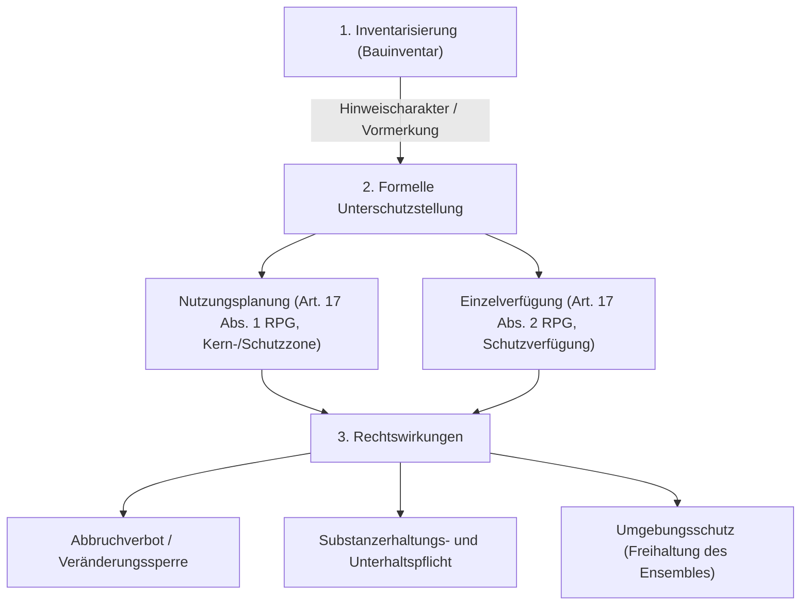

## Überblick {#ueberblick}

Der Denkmalschutz (häufig als *Denkmalpflege* oder *Heimatschutz* bezeichnet) bezweckt die Bewahrung von Zeugen der Bau-, Kunst- und Kulturgeschichte vor Zerstörung, Verfall oder verunstaltenden Eingriffen. Als integraler Bestandteil des öffentlichen Bau- und Planungsrechts berührt der Denkmalschutz fundamentale Grundrechte – allen voran die Eigentumsgarantie ([Art. 26 BV](/kommentar/bv/art-026/)) – und steht in einem steten Spannungsverhältnis zu gesellschaftlichen und raumplanerischen Entwicklungszielen wie der Siedlungsverdichtung nach innen oder der energetischen Transformation des Gebäudeparks.

Das schweizerische Denkmalschutzsystem ist durch eine zweistufige Kompetenzordnung und das Zusammenspiel unterschiedlicher Schutzinstrumente geprägt:
- **Kantonale Hoheit als Regelfall**: Gemäss Art. 78 Abs. 1 BV ist der Natur- und Heimatschutz Sache der Kantone. Die materielle Ausgestaltung der Unterschutzstellung von Baudenkmälern, die Inventarisierung sowie die Organisation der kantonalen Denkmalpflegen und Fachkommissionen richten sich primär nach kantonalem Recht.
- **Bundesrechtliche Durchgriffswirkung bei Bundesaufgaben**: Nimmt ein Bundesorgan oder eine kantonale Behörde eine *Bundesaufgabe* wahr (Art. 2 NHG, etwa bei raumplanungsrechtlichen Ausnahmebewilligungen nach [Art. 24 RPG](/kommentar/rpg/art-024/) oder bei der Bewilligung von Solaranlagen auf Denkmälern nach Art. 18a Abs. 3 RPG), greifen die bundesrechtlichen Schutzvorschriften der Art. 3 ff. NHG unmittelbar. Hier entfaltet das Bundesinventar der schützenswerten Ortsbilder der Schweiz von nationaler Bedeutung (ISOS) eine gesteigerte Schutzwirkung nach Art. 6 NHG, und es wird das ideelle Verbandsbeschwerderecht (Art. 12 NHG) eröffnet.
- **Eigentumsbeschränkung versus Entschädigung**: Denkmalschutzmassnahmen (Abbruchverbote, Renovationsauflagen, Substanzerhaltungspflichten) stellen in der Regel entschädigungslose öffentlich-rechtliche Eigentumsbeschränkungen dar. Ein Anspruch auf Entschädigung wegen materieller Enteignung ([Art. 26 Abs. 2 BV](/kommentar/bv/art-026/)) besteht nur unter aussergewöhnlich restriktiven Voraussetzungen. Um unverhältnismässige Härten zu vermeiden, verlangt das Verfassungsrecht jedoch die Beachtung der *wirtschaftlichen Zumutbarkeit*.

Dieses Thema erläutert den Aufbau, die Instrumente, die Grenzen und die bundesgerichtliche Praxis des Denkmalschutzes in der Schweiz.

## Rechtsgrundlagen {#rechtsgrundlagen}

### Verfassungsrechtlicher Rahmen: Art. 78 BV {#verfassung-art-78}

Die bundesverfassungsrechtliche Grundordnung des Natur- und Heimatschutzes ist in Art. 78 BV verankert:



Die Verfassungsnorm etabliert eine differenzierte Zuständigkeitsverteilung:
1. **Abs. 1 (Kantonale Grundzuständigkeit)**: Das Bundesgericht hält in [BGE 147 I 308 E. 4.1](https://entscheidsuche.ch/docs/CH_BGE/CH_BGE_001_BGE-147-I-308_2021.html#consideration_4.1) fest: «Nach Art. 78 Abs. 1 BV sind die Kantone für den Natur- und Heimatschutz zuständig.» Zugleich «kann Art. 78 Abs. 1 BV auch als Aufforderung zum Handeln verstanden werden bzw. soll im Sinne eines Appells die Kantone zu Leistungen im Bereich des Natur- und Heimatschutzes anspornen» ([BGE 147 I 308 E. 4.2](https://entscheidsuche.ch/docs/CH_BGE/CH_BGE_001_BGE-147-I-308_2021.html#consideration_4.2)).
2. **Abs. 2 (Rücksichtsnahmepflicht des Bundes)**: Der Bund ist verfassungsunmittelbar verpflichtet, bei der Erfüllung seiner Aufgaben Landschaften, Ortsbilder sowie geschichtliche Stätten und Kulturdenkmäler zu schonen und ungeschmälert zu erhalten, wenn das öffentliche Interesse überwiegt.
3. **Abs. 3 (Unterstützung und Bundessicherung)**: Der Bund kann Bestrebungen der Kantone und Dritter finanziell unterstützen und Objekte von gesamtschweizerischer Bedeutung vertraglich oder durch Enteignung sichern.

### Völkerrechtliche Schutzstandards: Das Granada-Übereinkommen {#voelkerrecht-granada}

Auf internationaler Ebene ist das Übereinkommen vom 3. Oktober 1985 zum Schutz des architektonischen Erbes Europas (sog. *Granada-Übereinkommen*, SR 0.440.4) für die Schweiz verbindlich.

Wie das Bundesgericht in [BGE 147 I 308 E. 5.1](https://entscheidsuche.ch/docs/CH_BGE/CH_BGE_001_BGE-147-I-308_2021.html#consideration_5.1) darlegt, verlangt das Abkommen den staatlichen Schutz von Baudenkmälern: «Das Granada-Übereinkommen verlangt den Erlass geeigneter Vorschriften zum Schutz von Baudenkmälern». Es verpflichtet die Vertragsstaaten, Denkmäler zu inventarisieren und wirksame Genehmigungsverfahren für Eingriffe vorzusehen. Da sich das Übereinkommen an die Gesetzgeber richtet, entfaltet es im Regelfall keine direkte Anwendbarkeit (*self-executing*) für rechtsanwendende Behörden im Einzelfall ([BGE 147 I 308 E. 5.2](https://entscheidsuche.ch/docs/CH_BGE/CH_BGE_001_BGE-147-I-308_2021.html#consideration_5.1)), bindet jedoch kantonale Gesetzgeber bei Erlass und Revision kantonaler Denkmalschutzgesetze.

### Bundesgesetzliche Verankerung im Natur- und Heimatschutzgesetz (NHG) {#bundesrecht-nhg}

Das Bundesgesetz vom 1. Juli 1966 über den Natur- und Heimatschutz (NHG, SR 451) konkretisiert die Pflichten des Bundes:







Das NHG regelt insbesondere das Instrument der Bundesinventare (Art. 5 f. NHG), das Fachgutachtenwesen durch eidgenössische Kommissionen (Art. 7 f. NHG) sowie die Beschwerdebefugnis gesamtschweizerischer Schutzorganisationen (Art. 12 NHG).

### Raumplanungsrechtliche Schutznormen (RPG) {#raumplanung-rpg}

Auf Bundesebene verpflichtet das Bundesgesetz über die Raumplanung (RPG, SR 700) die Planungsbehörden, Denkmäler und schützenswerte Ortsbilder in der Nutzungsplanung zu sichern:



Überdies regelt [Art. 18a RPG](/kommentar/rpg/art-024/) das Verhältnis zwischen dem Ausbau der Solarenergie und dem Schutz von Kultur- und Naturdenkmälern sowie Ortsbildern von nationaler oder kantonaler Bedeutung:



## Aufbau und föderale Zuständigkeiten {#aufbau-zustaendigkeiten}

### Primäre Zuständigkeit der Kantone und Gemeinden {#kantonale-zustaendigkeit}

Infolge von Art. 78 Abs. 1 BV existiert in der Schweiz kein bundesweites materielles Denkmalschutzgesetz für alle privaten Liegenschaften. Jeder der 26 Kantone verfügt über eine eigene gesetzliche Ordnung (in speziellen Denkmalschutzgesetzen wie im Kanton Basel-Stadt, Bern oder Freiburg, oder integriert in kantonale Planungs- und Baugesetze wie das Zürcher PBG oder das Luzerner PBG).

Typischerweise ist die Zuständigkeit wie folgt gegliedert:
- **Kantonale Ebene (Baudirektionen / Regierungsrat / Denkmalpflege)**: Zuständig für Objekte von überkommunaler (regionaler, kantonaler oder nationaler) Bedeutung. Sie führt die Fachstelle der kantonalen Denkmalpflege, erstellt kantonale Inventare und verfügt formelle Unterschutzstellungen.
- **Kommunale Ebene (Gemeinderat / Baukommission)**: Zuständig für Objekte von lokaler Bedeutung. Gemeinden erlassen kommunale Schutzverordnungen oder Zonenpläne und entscheiden im Baubewilligungsverfahren über Vorhaben an oder neben Schutzobjekten.

### Fachstellen und Kommissionen (Denkmalpflege, EKD, ENHK) {#fachstellen-kommissionen}

Die Beurteilung der Schutzwürdigkeit und der Eingriffstiefe erfordert baukünstlerischen, architekturhistorischen und handwerklichen Sachverstand. Auf kantonaler Ebene wird dieser durch die kantonale *Denkmalpflege* und unabhängige Fachkommissionen wahrgenommen.

Auf Bundesebene bestehen zwei spezialisierte ausserparlamentarische Kommissionen nach Art. 25 NHG:
- **Eidgenössische Kommission für Denkmalpflege (EKD)**: Fachgremium des Bundes für Baudenkmäler, historische Stätten und archäologische Fundstellen.
- **Eidgenössische Natur- und Heimatschutzkommission (ENHK)**: Fachgremium für Natur-, Landschafts- und Ortsbildschutz (ISOS).

Bei Bauvorhaben von erheblicher Tragweite, die Bundesaufgaben berühren oder ISOS-Objekte von nationaler Bedeutung beeinträchtigen können, erstatten EKD und ENHK gemäss Art. 7 f. NHG amtliche Gutachten, denen in der Rechtsprechung erhöhte Beweiskraft zukommt.

## Schutzinstrumente und Verfahren {#schutzinstrumente-verfahren}

Der Denkmalschutz entfaltet sich in der Praxis in drei aufeinanderfolgenden Phasen: Inventarisierung, formelle Unterschutzstellung und behördliche Vollzugskontrolle.

### Inventarisierung: Hinweisinventare versus Festlegung {#inventarisierung}

Den ersten Schritt bildet die systematische Erfassung der Bausubstanz in Inventaren (oft als *Bauinventar*, *Kulturgüterinventar* oder *Denkmalschutzinventar* bezeichnet). Das Bundesgericht differenziert strikt zwischen der blossen Aufnahme in ein Inventar und der rechtsverbindlichen Unterschutzstellung:

Wie in [BGE 118 Ia 384 E. 3b](https://entscheidsuche.ch/docs/CH_BGE/CH_BGE_002_BGE-118-IA-384_1992-11-18.html#consideration_3.) klargestellt wird, kommt dem kommunalen oder kantonalen Inventar in der Regel keine unmittelbare Rechtswirkung für den Eigentümer zu; es dient primär der Information der Behörden und der Öffentlichkeit. Die Aufnahme begründet keine sofortige Eigentumsbeschränkung, löst aber bei Baugesuchen eine behördliche Prüfungspflicht aus, ob eine formelle Schutzanordnung zu treffen ist.

Kantonale Gesetzgeber dürfen den Denkmalbegriff nicht willkürlich einschränken: Der Versuch des Kantons Zug, Objekte unter 70 Jahren nur mit Zustimmung des Eigentümers unter Schutz zu stellen, wurde vom Bundesgericht als unvereinbar mit den übergeordneten Schutzpflichten beurteilt ([BGE 147 I 308 E. 7.5.2](https://entscheidsuche.ch/docs/CH_BGE/CH_BGE_001_BGE-147-I-308_2021.html#consideration_7.5.2)).

### Formelle Unterschutzstellung: Nutzungsplanung versus Einzelverfügung {#unterschutzstellung}

Die formelle Unterschutzstellung, welche für den Grundeigentümer verbindliche Rechte und Pflichten begründet, kann über zwei rechtliche Pfade erfolgen:

In [BGE 118 Ia 384 E. 3a](https://entscheidsuche.ch/docs/CH_BGE/CH_BGE_002_BGE-118-IA-384_1992-11-18.html#consideration_3.) hielt das Bundesgericht grundlegend fest:
«Massnahmen des Denkmalschutzes können nicht nur mittels Festlegungen in Zonenplänen […] sondern auch durch andere geeignete Massnahmen wie Einzelverfügungen getroffen werden».

| Schutzinstrument | Rechtsgrundlage | Schutzumfang und Eigenart |
|---|---|---|
| **Nutzungsplanung (Ortsplanung / Schutzzone)** | Art. 17 Abs. 1 RPG, kantonales Bau- und Planungsrecht | Bezweckt flächendeckenden, generellen Schutz. Erfasst primär das Äussere von Bauten, Firstrichtungen, Dachformen und Ensembles (Kernzonen, Altstadtzonen). |
| **Einzelverfügung (Eintrag ins Denkmalverzeichnis)** | Art. 17 Abs. 2 RPG, kantonales Denkmalschutzrecht | Objektbezogene Schutzverfügung oder öffentlich-rechtlicher Schutzvertrag. Ermöglicht den gezielten Schutz einzelner Bauteile und erstreckt sich namentlich auch auf das Innere einer Baute. |

Dass eine Liegenschaft in der kommunalen Zonenplanung keiner Schutzzone zugewiesen wurde, schliesst ihre spätere Unterschutzstellung durch Einzelverfügung keineswegs aus ([BGE 118 Ia 384 E. 3a](https://entscheidsuche.ch/docs/CH_BGE/CH_BGE_002_BGE-118-IA-384_1992-11-18.html#consideration_3.)).

### Schutzwirkungen: Substanzerhalt, Abbruchverbot und Umgebungsschutz {#schutzwirkungen}

Die formelle Unterschutzstellung zeitigt weitreichende Rechtswirkungen:
1. **Abbruchverbot und Veränderungssperre**: Das Schutzobjekt darf nicht abgebrochen werden. Bauliche Veränderungen (Umbauten, Fassadensanierungen, Fensterersatz, Farbgebung) bedürfen einer denkmalpflegerischen Bewilligung. Temporäre Abbruchverbote sind auch zulässig, um künftige Planungsänderungen zu sichern ([BGE 115 Ia 27](https://entscheidsuche.ch/docs/CH_BGE/CH_BGE_002_BGE-115-IA-27_1989-01-25.html)).
2. **Substanzerhaltung und Unterhaltspflicht**: Der Eigentümer ist verpflichtet, das Bauwerk vor Zerfall zu schützen. Demontagen schützenswerter historischer Substanz sind untersagt.
3. **Schutz von Innenräumen**: Der Denkmalschutz beschränkt sich keineswegs auf die Gebäudehülle. Bei Objekten mit baukünstlerisch oder historisch wertvollem Innenausbau (z. B. Badischer Bahnhof Basel, [BGE 120 Ia 270 E. 4c](https://entscheidsuche.ch/docs/CH_BGE/CH_BGE_002_BGE-120-IA-270_1994-11-02.html#consideration_4.); Café Odeon Zürich, [BGE 109 Ia 257](https://entscheidsuche.ch/docs/CH_BGE/CH_BGE_002_BGE-109-IA-257_1983-11-23.html)) kann sich die Unterschutzstellung auf Wandelhallen, Treppenhäuser, Gasträume oder Kinosäle erstrecken.
4. **Umgebungsschutz**: Ein Baudenkmal kann nicht isoliert von seinem räumlichen Kontext betrachtet werden. In [BGE 109 Ia 185 E. 3b](https://entscheidsuche.ch/docs/CH_BGE/CH_BGE_002_BGE-109-IA-185_1983-09-21.html#consideration_3.) prägte das Bundesgericht den Leitsatz:
«Der wirksame Schutz eines Bauwerks oder eines architektonisch wertvollen Ensembles ist undenkbar ohne gleichzeitigen Schutz seiner Umgebung.»
Bauvorhaben auf Nachbargrundstücken, welche die Blickachsen auf das Denkmal verstellen oder dessen räumliche Wirkung beeinträchtigen, können daher untersagt oder modifiziert werden.

## Grenzen: Eigentumsgarantie und wirtschaftliche Zumutbarkeit {#grenzen-eigentum-zumutbarkeit}

### Eigentumsbeschränkung versus materielle Enteignung (Art. 26 BV) {#materielle-enteignung}

Eingriffe in das Eigentum zum Zwecke des Denkmalschutzes beruhen auf einem gewichtigen öffentlichen Interesse: «Eigentumsbeschränkungen zum Schutz von Baudenkmälern liegen allgemein im öffentlichen Interesse» ([BGE 120 Ia 270 E. 4a](https://entscheidsuche.ch/docs/CH_BGE/CH_BGE_002_BGE-120-IA-270_1994-11-02.html#consideration_4.)).

Strittig ist regelmässig, ob eine Unterschutzstellung eine *materielle Enteignung* ([Art. 26 Abs. 2 BV](/kommentar/bv/art-026/)) darstellt, die entschädigungspflichtig wird. Das Bundesgericht verneint dies in ständiger Rechtsprechung:

In [BGE 111 Ib 257 E. 4c](https://entscheidsuche.ch/docs/CH_BGE/CH_BGE_003_BGE-111-IB-257_1985-07-10.html#consideration_4.) formulierte das Bundesgericht:
«In der Regel bedeutet die Unterstellung einer Liegenschaft unter Denkmalschutz, sofern sich die Massnahme zur Hauptsache auf einen Fassadenschutz beschränkt, keine materielle Enteignung».

Solange dem Eigentümer eine bestimmungsgemässe und wirtschaftlich sinnvolle Weiternutzung (z. B. als Wohn- oder Geschäftshaus) möglich bleibt, liegt kein Entzug einer wesentlichen Eigentümerbefugnis vor. Entschädigungslosigkeit ist der verfassungsrechtliche Normalfall.

Allerdings darf das Gemeinwesen den Betroffenen nicht vor unzumutbare Alternativen stellen: In [BGE 102 Ia 243 E. 6](https://entscheidsuche.ch/docs/CH_BGE/CH_BGE_002_BGE-102-IA-243_1976-06-15.html#consideration_6.) verwarf das Bundesgericht eine kantonale Regelung, die dem Eigentümer im Enteignungsfall nur den vollständigen Heimschlag der Liegenschaft an den Staat oder den gänzlichen Verzicht auf Entschädigung zubilligte:
«Es ist mit dem Grundsatz der Verhältnismässigkeit nicht vereinbar, dass der von einer Eigentumsbeschränkung betroffene Grundeigentümer zur vollständigen Aufgabe seines Eigentums gezwungen wird, wenn er nicht überhaupt auf eine Entschädigung für den auf seiner Liegenschaft eingetretenen Minderwert verzichten will».

### Das Kriterium der wirtschaftlichen Zumutbarkeit {#wirtschaftliche-zumutbarkeit}

Da Denkmalschutzmassnahmen fast immer entschädigungslos bleiben, bildet das Kriterium der *wirtschaftlichen Zumutbarkeit* im Rahmen der Verhältnismässigkeitsprüfung ([Art. 5 Abs. 2 BV](/kommentar/bv/art-005/), Art. 36 Abs. 3 BV) das massgebliche Korrektiv zum Schutz des Grundeigentümers.

In der neueren Leitentscheidung zur Zürcher Friesenbergsiedlung ([BGE 147 II 125 E. 10.4](https://entscheidsuche.ch/docs/CH_BGE/CH_BGE_004_BGE-147-II-125_2021.html#consideration_10.4)) bestätigte das Bundesgericht unter Verweis auf den Westschweizer Leitentscheid *Le Plaza* ([BGE 126 I 219 E. 2c](https://entscheidsuche.ch/docs/CH_BGE/CH_BGE_001_BGE-126-I-219_2000-06-28.html#consideration_2.)):
«Rentabilitätsüberlegungen sind dabei umso geringer zu gewichten, je schutzwürdiger eine Baute ist […] Zudem können rein finanzielle Interessen bei ausgewiesener Schutzwürdigkeit für sich genommen nicht ausschlaggebend sein».

In französischer Fassung lautet diese fundamentale Formel: «plus un bâtiment est digne d'être conservé, moins les exigences de la rentabilité doivent être prises en compte» ([BGE 126 I 219 E. 2c](https://entscheidsuche.ch/docs/CH_BGE/CH_BGE_001_BGE-126-I-219_2000-06-28.html#consideration_2.)).

Daraus ergeben sich folgende Grundsätze für die Zumutbarkeitsprüfung:
- **Verfall durch angestauten Unterhalt**: Macht der Eigentümer hohe Sanierungskosten geltend, prüft das Gericht, ob diese auf normalen Sanierungsbedarf oder auf jahrzehntelange Vernachlässigung der Unterhaltspflicht zurückzuführen sind. Angestauter Renovationsbedarf rechtfertigt keinen Abbruch ([BGE 147 II 125 E. 10](https://entscheidsuche.ch/docs/CH_BGE/CH_BGE_004_BGE-147-II-125_2021.html#consideration_10.1)).
- **Subventionen und Förderbeiträge**: Bei der Berechnung der Zumutbarkeit sind finanzielle Beiträge von Bund, Kanton und Gemeinde (Beitragsleistungen nach Art. 13 ff. NHG oder kantonalen Denkmalpflegefonds) sowie steuerliche Abzugsmöglichkeiten für denkmalpflegerische Mehrkosten schadensmindernd einzurechnen.
- **Kein Anspruch auf Maximalrendite**: Der Eigentümer hat keinen verfassungsrechtlichen Anspruch darauf, durch einen Abbruch und Ersatzneubau die maximal denkbare Zonenausnutzung oder Spitzenrenditen zu realisieren. Zumutbar ist jede Nutzung, die eine angemessene Verzinsung des investierten Kapitals ermöglicht.

### Rechtssicherheit im Provokationsverfahren {#provokationsverfahren}

Um zu verhindern, dass Eigentümer jahrelang in Ungewissheit über bauliche Nutzungsbeschränkungen verharren, sehen moderne kantonale Baugesetze (z. B. § 213 PBG/ZH) das sogenannte *Provokationsverfahren* vor.

In [BGE 119 Ia 305 E. 4c](https://entscheidsuche.ch/docs/CH_BGE/CH_BGE_002_BGE-119-IA-305_1993-10-14.html#consideration_4.) umschrieb das Bundesgericht diesen Zweck:
«Der Sinn dieser Vorschrift liegt darin, Rechtssicherheit darüber zu schaffen, ob, und wenn ja, welche denkmalpflegerisch begründeten Hindernisse für die bauliche Nutzung eines Grundstücks bestehen».

Verzichtet die Behörde im Provokationsverfahren rechtskräftig auf eine Unterschutzstellung, ist sie gestützt auf das Vertrauensprinzip an diesen Verzicht gebunden; eine spätere nachträgliche Schutzverfügung ohne wesentlich veränderte Verhältnisse stellt einen unzulässigen Widerruf dar ([BGE 119 Ia 305 E. 4 f.](https://entscheidsuche.ch/docs/CH_BGE/CH_BGE_002_BGE-119-IA-305_1993-10-14.html#consideration_4.)).

## Bundesrechtliche Durchgriffswirkung: Bundesaufgabe, ISOS und Verbandsbeschwerde {#bundesaufgabe-isos}

### Das Konzept der Bundesaufgabe nach Art. 2 NHG {#bundesaufgabe-begriff}

Obwohl der Heimatschutz Sache der Kantone ist, greift das Bundesrecht überall dort mit voller Wucht ein, wo eine *Bundesaufgabe* im Sinne von Art. 78 Abs. 2 BV und Art. 2 NHG erfüllt wird. Eine Bundesaufgabe liegt nicht nur vor, wenn Bundesbehörden selbst bauen (z. B. Nationalstrassen, Eisenbahnen, Militärbauten), sondern auch dann, wenn kantonale oder kommunale Instanzen bundesrechtliche Normen vollziehen.

Nach ständiger bundesgerichtlicher Rechtsprechung liegt eine Bundesaufgabe vor bei:
- Der Erteilung raumplanungsrechtlicher Ausnahmebewilligungen für das Bauen ausserhalb der Bauzone nach [Art. 24 RPG](/kommentar/rpg/art-024/): «Die Erteilung einer Ausnahmebewilligung ausserhalb der Bauzone nach Art. 24 RPG stellt nach ständiger bundesgerichtlicher Rechtsprechung eine Bundesaufgabe im Sinne von Art. 2 Abs. 1 lit. b» NHG dar ([BGE 147 II 351 E. 4.4](https://entscheidsuche.ch/docs/CH_BGE/CH_BGE_004_BGE-147-II-351_2021.html#consideration_4.4)).
- Projektbezogenen Sondernutzungsplänen (Quartierplänen, Gestaltungsplänen), die auf ein konkretes Bauvorhaben zugeschnitten sind und faktisch die Wirkung einer Baubewilligung entfalten: «Damit kommt dem strittigen Quartierplan zumindest insoweit, als er die baulichen Möglichkeiten in diesem Sinne bereits verbindlich konkretisiert, die Wirkung einer Baubewilligung zu» ([BGE 145 II 176 E. 4.3](https://entscheidsuche.ch/docs/CH_BGE/CH_BGE_004_BGE-145-II-176_2019.html#consideration_4.3)).
- Bewilligungen von Solaranlagen auf Denkmälern innerhalb der Bauzone nach Art. 18a Abs. 3 RPG: «Zusammengefasst betrifft der hier zugrunde liegende Beschluss mit der Bewilligung einer Solaranlage auf einem Gebäude innerhalb der Bauzone im ISOS-Gebiet mit Erhaltungsziel A einen Bereich, der in die Zuständigkeit des Bundes fällt und bundesrechtlich geregelt ist» ([BGE 152 II 276 E. 6](https://entscheidsuche.ch/docs/CH_BGE/CH_BGE_004_BGE-152-II-276_2026.html#consideration_6.)).

### Das ISOS: Unmittelbare Bindung versus mittelbare Berücksichtigungspflicht {#isos-wirkungen}

Das Bundesinventar der schützenswerten Ortsbilder der Schweiz von nationaler Bedeutung (ISOS, gestützt auf Art. 5 NHG und die VISOS, SR 451.12) erfasst über 1200 Ortsbilder von nationaler Bedeutung mit detaillierten Erhaltungszielen (z. B. Erhaltungsziel A: Erhaltung der Substanz).

Die Rechtswirkung des ISOS spaltet sich in zwei grundverschiedene Regime, wie das Bundesgericht im Grundlagenentscheid *Rüti ZH* ([BGE 135 II 209 E. 2.1](https://entscheidsuche.ch/docs/CH_BGE/CH_BGE_004_BGE-135-II-209_2009.html#consideration_2.1)) präzisierte:

1. **Unmittelbare Bindung bei Bundesaufgaben (Art. 6 Abs. 2 NHG)**:
   Liegt eine Bundesaufgabe vor, gilt das strikte Abweichungsverbot des Bundesgesetzes: «Ein Abweichen von der ungeschmälerten Erhaltung im Sinne der Inventare darf bei Erfüllung einer Bundesaufgabe nur in Erwägung gezogen werden, wenn ihr bestimmte gleich- oder höherwertige Interessen von ebenfalls nationaler Bedeutung entgegenstehen» ([BGE 135 II 209 E. 2.1](https://entscheidsuche.ch/docs/CH_BGE/CH_BGE_004_BGE-135-II-209_2009.html#consideration_2.1); [BGE 145 II 176 E. 3](https://entscheidsuche.ch/docs/CH_BGE/CH_BGE_004_BGE-145-II-176_2019.html)). Rein lokale oder kommunale Interessen vermögen die ungeschmälerte Erhaltung eines ISOS-Objekts nicht zu übersteuern.
2. **Mittelbare Beachtenspflicht bei reinen Kantons- und Gemeindeaufgaben**:
   Bei der Erfüllung kantonaler und kommunaler Aufgaben (ordentliche Zonenplanung, Baubewilligungen nach kantonalem Recht innerhalb der Bauzone) gilt Art. 6 Abs. 2 NHG nicht direkt. Das Bundesinventar bindet die Behörden jedoch mittelbar über das Raumplanungsrecht: «Ihrer Natur nach kommen sie Sachplänen und Konzepten im Sinne von Art. 13 RPG» gleich ([BGE 135 II 209 E. 2.1](https://entscheidsuche.ch/docs/CH_BGE/CH_BGE_004_BGE-135-II-209_2009.html#consideration_2.1)). Kantone und Gemeinden sind verpflichtet, die ISOS-Erhaltungsziele in ihren Richt- und Nutzungsplänen zu berücksichtigen. Weicht ein Gestaltungsplan massiv von den ISOS-Zielen und den Schutzzwecken der Kernzone ab, hebt das Bundesgericht die Bewilligung auf ([BGE 135 II 209 E. 5.5 ff.](https://entscheidsuche.ch/docs/CH_BGE/CH_BGE_004_BGE-135-II-209_2009.html#consideration_5.2)).

### Begutachtungspflicht durch EKD und ENHK (Art. 7 NHG) {#begutachtungspflicht}

Wird bei der Erfüllung einer Bundesaufgabe ein Objekt berührt, das in einem Bundesinventar aufgeführt ist, oder stellen sich wesentliche Grundsatzfragen des Natur- und Heimatschutzes, ist die Bewilligungsbehörde verpflichtet, ein Gutachten der zuständigen Fachkommission (ENHK oder EKD) einzuholen (Art. 7 Abs. 2 NHG).

Die Behörde darf von den Feststellungen des eidgenössischen Fachgutachtens nur aus triftigen, stichhaltigen Gründen abweichen ([BGE 138 II 23 E. 4](https://entscheidsuche.ch/docs/CH_BGE/CH_BGE_004_BGE-138-II-23_2012.html#consideration_4.); [BGE 152 II 276 E. 2](https://entscheidsuche.ch/docs/CH_BGE/CH_BGE_004_BGE-152-II-276_2026.html#consideration_2.)).

### Das ideelle Verbandsbeschwerderecht (Art. 12 NHG) {#verbandsbeschwerde}

Ein Kernelement des Vollzugs im Denkmalschutz ist die Verbandsbeschwerde nach Art. 12 NHG. Gesamtschweizerische Organisationen, die sich statutengemäss dem Natur- und Heimatschutz widmen (wie der *Schweizer Heimatschutz*), sind befugt, Verfügungen kantonaler Behörden und des Bundes anzufechten.

Voraussetzung der Verbandsbeschwerde nach Art. 12 NHG ist stets das Vorliegen einer *Bundesaufgabe* ([BGE 152 II 298 E. 3](https://entscheidsuche.ch/docs/CH_BGE/CH_BGE_004_BGE-152-II-298_2026.html)). Fehlt es an einer solchen, richtet sich die Beschwerdebefugnis nach kantonalem Verfahrensrecht (z. B. nach kantonalen Verbandsbeschwerderechten, wo vorhanden).

## Aktuelle Zielkonflikte in der Praxis {#zielkonflikte}

### Denkmalschutz versus Siedlungsentwicklung nach innen {#innere-verdichtung}

Mit der Revision des Raumplanungsgesetzes von 2012 (in Kraft seit 1. Mai 2014) normierte der Bundesgesetzgeber den Grundsatz, «den Boden haushälterisch zu nutzen und die Siedlungsentwicklung namentlich durch bessere Ausnützung und Verdichtung der bestehenden Siedlungsflächen nach innen zu lenken» ([BGE 147 II 125 E. 9.2](https://entscheidsuche.ch/docs/CH_BGE/CH_BGE_004_BGE-147-II-125_2021.html#consideration_9.2)).

Dieser Verfassungs- und Gesetzesauftrag zur Verdichtung kollidiert häufig mit dem Erhalt historischer Zeugen und aufgelockerter Ensembles. In [BGE 147 II 125](https://entscheidsuche.ch/docs/CH_BGE/CH_BGE_004_BGE-147-II-125_2021.html#consideration_9.1) stellte das Bundesgericht klar:
- Der Abbruch von Schutzobjekten zugunsten einer inneren Verdichtung ist nicht von vornherein ausgeschlossen.
- Je höher jedoch der Denkmalwert eines Ensembles oder Gebäudes ist, desto schwerer wiegt das Erhaltungsinteresse. Das abstrakte Verdichtungsziel oder das finanzielle Interesse an günstigem Ersatzwohnraum vermögen den Abriss baukultureller Zeugen von ausserordentlichem Wert nicht zu rechtfertigen ([BGE 147 II 125 E. 12](https://entscheidsuche.ch/docs/CH_BGE/CH_BGE_004_BGE-147-II-125_2021.html#consideration_12.)).

### Denkmalschutz versus Energiewende: Solaranlagen nach Art. 18a RPG {#solaranlagen}

Ein Brennpunkt der aktuellen Baupraxis ist die Installation von Photovoltaik- und Solaranlagen.

Nach Art. 18a Abs. 1 RPG bedürfen sorgfältig auf Dächern integrierte Solaranlagen in Bau- und Landwirtschaftszonen grundsätzlich keiner Baubewilligung mehr, sondern sind lediglich meldepflichtig. Für Kultur- und Naturdenkmäler gilt gemäss Art. 18a Abs. 3 RPG jedoch eine Ausnahme: Solaranlagen auf solchen Objekten bedürfen stets einer Baubewilligung und dürfen Denkmäler von kantonaler oder nationaler Bedeutung nicht wesentlich beeinträchtigen.

In [BGE 152 II 276 E. 6](https://entscheidsuche.ch/docs/CH_BGE/CH_BGE_004_BGE-152-II-276_2026.html#consideration_6.) entschied das Bundesgericht, dass die Bewilligung von Solaranlagen auf Gebäuden in ISOS-Perimetern mit Erhaltungsziel A auch innerhalb der Bauzone eine bundesrechtlich geregelte Bundesaufgabe darstellt, weshalb die kantonale Fachstelle für Heimatschutz beigezogen und allfällige Gutachten nach Art. 7 NHG geprüft werden müssen.

## Würdigung {#wuerdigung}

Das schweizerische Denkmalschutzrecht zeichnet sich durch einen pragmatischen Föderalismus aus: Die Kernverantwortung liegt dort, wo der Sachverstand und die Ortskenntnis am grössten sind – bei den kantonalen Fachstellen und den Gemeinden.

Gleichzeitig sorgt die Rechtsprechung des Bundesgerichts über das Konzept der Bundesaufgabe (Art. 2 NHG) und die Berücksichtigungspflicht der Bundesinventare (Art. 5 f. NHG) dafür, dass das ISOS als verbindliche Leitplanke gegen die Erosion historischer Siedlungsräume wirkt. Das Kriterium der wirtschaftlichen Zumutbarkeit gewährleistet schliesslich den verfassungsrechtlich gebotenen Interessenausgleich zwischen dem staatlichen Schutzauftrag und der Eigentumsgarantie.

## Stand der Gesetzgebung {#stand-der-gesetzgebung}

Das Spannungsverhältnis zwischen dem ISOS und der baulichen Verdichtung bildete Gegenstand intensiver parlamentarischer Debatten.

Die Motion 23.3435 von Ständerat Jakob Stark (*Das ISOS soll die bauliche Entwicklung und Verdichtung lenken, aber nicht verhindern*, [Curia Vista 23.3435](https://www.parlament.ch/de/ratsbetrieb/suche-curia-vista/geschaeft?AffairId=20233435)) wurde vom Parlament überwiesen. Sie verlangt Anpassungen des Natur- und Heimatschutzgesetzes, damit Ausnahmen von der ungeschmälerten Erhaltung bei der Erfüllung kantonaler und kommunaler Aufgaben im Rahmen der inneren Verdichtung erleichtert und flexiblere Interessenabwägungen ermöglicht werden.

Auf Verordnungsebene verabschiedete der Bundesrat eine Revision der Verordnung über das Bundesinventar der schützenswerten Ortsbilder der Schweiz (VISOS) sowie der Raumplanungsverordnung (RPV), welche per 1. November 2026 in Kraft gesetzt wurde. Die Revision präzisiert die Kriterien der Interessenabwägung bei Bau- und Solarmassnahmen im ISOS-Perimeter, um Verdichtungsvorhaben und Energiegewinnung besser mit dem Ortsbildschutz in Einklang zu bringen.

## Praxishinweise {#praxishinweise}

### Für Eigentümer und Bauherrschaften {#hinweise-eigentuemer}

- **Frühzeitige Denkmalabklärung**: Vor dem Erwerb oder der Projektierung eines Altbaus sollte Einsicht in das kantonale und kommunale Bauinventar sowie in das ISOS genommen werden. Die Tatsache, dass ein Gebäude nicht in einer förmlichen Schutzzone liegt, schützt nicht vor einer späteren Unterschutzstellung durch Einzelverfügung ([BGE 118 Ia 384](https://entscheidsuche.ch/docs/CH_BGE/CH_BGE_002_BGE-118-IA-384_1992-11-18.html)).
- **Provokationsrecht nutzen**: Bestehen konkrete Umbau- oder Neubaupläne und ist der Schutzstatus im Inventar ungewiss, sollte die Bauherrschaft ein formelles Provokationsgesuch (z. B. nach § 213 PBG/ZH) stellen, um innert gesetzlicher Frist verbindliche Klarheit zu erlangen ([BGE 119 Ia 305](https://entscheidsuche.ch/docs/CH_BGE/CH_BGE_002_BGE-119-IA-305_1993-10-14.html)).
- **Subventionen und Steuern geltend machen**: Bei denkmalpflegerischen Auflagen sind unverzüglich Beiträge der Denkmalpflegefonds zu beantragen. Denkmalpflegerische Erhaltungsaufwendungen sind bei der direkten Bundessteuer und den kantonalen Einkommenssteuern steuerlich voll abzugsfähig.
- **Wirtschaftliche Zumutbarkeit belegen**: Wird Unzumutbarkeit geltend gemacht, genügt die Behauptung entgangener Maximalgewinne nicht. Nötig ist ein fundierter Nachweis, dass selbst unter Berücksichtigung von Förderbeiträgen kein rentabler Betrieb und keine angemessene Kapitalverzinsung erzielbar ist ([BGE 147 II 125](https://entscheidsuche.ch/docs/CH_BGE/CH_BGE_004_BGE-147-II-125_2021.html)).

### Für Gemeinden und Bewilligungsbehörden {#hinweise-gemeinden}

- **ISOS-Prüfung bei Abweichungen**: Soll von der Grundnutzungsordnung über Sondernutzungspläne (Gestaltungspläne, Quartierpläne) oder Ausnahmen abgewichen werden, ist die Vereinbarkeit mit den ISOS-Erhaltungszielen im Planungsbericht zwingend nachzuweisen ([BGE 135 II 209](https://entscheidsuche.ch/docs/CH_BGE/CH_BGE_004_BGE-135-II-209_2009.html)).
- **Fachstellen rechtzeitig einbeziehen**: Bei Vorhaben im Perimeter von Bundesinventaren oder an Kulturdenkmälern ist die kantonale Denkmalpflege vor dem Entscheid anzuhören, um Verfahrensfehler und die Verletzung von Begutachtungspflichten nach Art. 7 NHG zu vermeiden ([BGE 152 II 276](https://entscheidsuche.ch/docs/CH_BGE/CH_BGE_004_BGE-152-II-276_2026.html)).
- **Umgebungsschutz beachten**: Nicht nur das Baudenkmal selbst, sondern auch die Freihaltung und Massstäblichkeit von Nachbarbauten in dessen Umgebung sind in der baupolizeilichen Interessenabwägung zu sichern ([BGE 109 Ia 185](https://entscheidsuche.ch/docs/CH_BGE/CH_BGE_002_BGE-109-IA-185_1983-09-21.html)).

### Für Denkmalpflegen und Schutzorganisationen {#hinweise-schutzorganisationen}

- **Qualifizierte Begründung der Schutzwürdigkeit**: Die Schutzwürdigkeit muss anhand nachvollziehbarer bauhistorischer, typologischer und ortsbaulicher Kriterien dargelegt werden. Rein subjektive ästhetische Wertungen genügen vor Gericht nicht ([BGE 126 I 219](https://entscheidsuche.ch/docs/CH_BGE/CH_BGE_001_BGE-126-I-219_2000-06-28.html)).
- **Bundesaufgabe identifizieren**: Um die Verbandsbeschwerde nach Art. 12 NHG erfolgreich zu führen, muss präzise dargelegt werden, welche bundesrechtliche Norm (z. B. Ausnahmebewilligung nach Art. 24 RPG, Art. 18a Abs. 3 RPG oder Gewässerschutzrecht) den Charakter als Bundesaufgabe begründet ([BGE 152 II 298](https://entscheidsuche.ch/docs/CH_BGE/CH_BGE_004_BGE-152-II-298_2026.html); [BGE 147 II 351](https://entscheidsuche.ch/docs/CH_BGE/CH_BGE_004_BGE-147-II-351_2021.html)).

## Leitentscheide {#leitentscheide}

| Entscheid | Gegenstand | Bedeutung für den Denkmalschutz |
|---|---|---|
| [BGE 147 I 308](https://entscheidsuche.ch/docs/CH_BGE/CH_BGE_001_BGE-147-I-308_2021.html#consideration_4.1) | Kantonales Denkmalschutzgesetz Zug, Granada-Übereinkommen | Grundsatzurteil zur Kompetenzordnung nach Art. 78 Abs. 1 BV und den völkerrechtlichen Schutzpflichten. Eine kantonale Regelung, die für Objekte unter 70 Jahren ein Vetorecht des Eigentümers vorsieht, verstösst gegen das Granada-Übereinkommen. |
| [BGE 135 II 209](https://entscheidsuche.ch/docs/CH_BGE/CH_BGE_004_BGE-135-II-209_2009.html#consideration_2.1) | ISOS und Gestaltungsplan Rüti ZH | Leitentscheid zum Dualismus des ISOS: Strikte Abweichungsschranke bei Erfüllung von Bundesaufgaben (Art. 6 Abs. 2 NHG) versus mittelbare Beachtenspflicht bei kantonaler Nutzungsplanung über Art. 13 RPG. |
| [BGE 147 II 125](https://entscheidsuche.ch/docs/CH_BGE/CH_BGE_004_BGE-147-II-125_2021.html#consideration_10.4) | Friesenbergsiedlung Zürich, Inventarentlassung | Leitentscheid zur Güterabwägung zwischen Denkmalschutz und innerer Verdichtung. Rentabilitätsüberlegungen treten bei hochrangigen Schutzobjekten zurück; angestauter Renovationsbedarf rechtfertigt keinen Abbruch. |
| [BGE 126 I 219](https://entscheidsuche.ch/docs/CH_BGE/CH_BGE_001_BGE-126-I-219_2000-06-28.html#consideration_2.) | Kinosaal Le Plaza Genf | Grundsatzurteil zur Verhältnismässigkeit und wirtschaftlichen Zumutbarkeit: Je schutzwürdiger ein Baudenkmal ist, desto weniger fallen Rentabilitätsansprüche ins Gewicht. |
| [BGE 118 Ia 384](https://entscheidsuche.ch/docs/CH_BGE/CH_BGE_002_BGE-118-IA-384_1992-11-18.html#consideration_3.) | Küchlin-Theater Basel | Grundlegende Unterscheidung zwischen Schutzzonen (Art. 17 Abs. 1 RPG, flächendeckend für Gebäudehülle) und Einzelverfügung (Art. 17 Abs. 2 RPG, auch für Innenräume). Inventare haben primär Hinweischarakter. |
| [BGE 111 Ib 257](https://entscheidsuche.ch/docs/CH_BGE/CH_BGE_003_BGE-111-IB-257_1985-07-10.html#consideration_4.) | Angensteinerstrasse Basel, materielle Enteignung | Leitentscheid zur Eigentumsgarantie: Unterschutzstellung und Fassadenschutz stellen in der Regel keine materielle Enteignung dar, solange die bestimmungsgemässe Nutzung erhalten bleibt. |
| [BGE 102 Ia 243](https://entscheidsuche.ch/docs/CH_BGE/CH_BGE_002_BGE-102-IA-243_1976-06-15.html#consideration_6.) | Entschädigungspflicht und Heimschlag | Praxisänderung: Eigentümer dürfen im Falle einer materiellen Enteignung nicht gezwungen werden, das Eigentum ganz aufzugeben, um Anspruch auf Minderwertsentschädigung zu erhalten. |
| [BGE 109 Ia 185](https://entscheidsuche.ch/docs/CH_BGE/CH_BGE_002_BGE-109-IA-185_1983-09-21.html#consideration_3.) | Altstadt und Schloss Erlach BE | Grundsatz des Umgebungsschutzes: Der wirksame Schutz eines Baudenkmals oder Ensembles erfordert zwingend die Freihaltung seiner unmittelbaren räumlichen Umgebung. |
| [BGE 120 Ia 270](https://entscheidsuche.ch/docs/CH_BGE/CH_BGE_002_BGE-120-IA-270_1994-11-02.html#consideration_4.) | Badischer Bahnhof Basel | Zulässigkeit der Unterschutzstellung historischer Innenräume (Wartesäle, Wandelhalle) und deren Abwägung mit betrieblichen Anpassungsbedürfnissen. |
| [BGE 145 II 176](https://entscheidsuche.ch/docs/CH_BGE/CH_BGE_004_BGE-145-II-176_2019.html#consideration_4.3) | Privater Quartierplan und Bundesaufgabe | Ein projektbezogener Sondernutzungsplan mit detaillierter Baukonkretisierung entfaltet Baubewilligungswirkung und unterliegt als Bundesaufgabe den Schutzanforderungen des NHG. |
| [BGE 147 II 351](https://entscheidsuche.ch/docs/CH_BGE/CH_BGE_004_BGE-147-II-351_2021.html#consideration_4.4) | Keltereigebäude Malans GR | Ausnahmebewilligungen ausserhalb der Bauzone nach Art. 24 RPG sind Bundesaufgaben; strikte Beachtung der Erhaltungsziele des ISOS schliesst nicht-nationale Neubauten aus. |
| [BGE 152 II 276](https://entscheidsuche.ch/docs/CH_BGE/CH_BGE_004_BGE-152-II-276_2026.html#consideration_6.) | Solaranlagen im ISOS-Perimeter Winterthur | Bewilligung von Solaranlagen nach Art. 18a Abs. 3 RPG auf Dächern im ISOS-Gebiet mit Erhaltungsziel A ist auch innerhalb der Bauzone eine Bundesaufgabe mit Begutachtungspflicht. |
| [BGE 119 Ia 305](https://entscheidsuche.ch/docs/CH_BGE/CH_BGE_002_BGE-119-IA-305_1993-10-14.html#consideration_4.) | Kreuzplatz Zürich, Provokationsentscheid | Vertrauensschutz im Provokationsverfahren: Ein rechtskräftiger behördlicher Verzicht auf Schutzmassnahmen bindet das Gemeinwesen und schliesst den späteren Widerruf ohne veränderte Verhältnisse aus. |

## Literatur {#literatur}

- Arnold Marti, *Das Schutzkonzept des Natur- und Heimatschutzes*, in: Schweizerische Juristen-Zeitung (SJZ) 104/2008, S. 81–89.
- Arnold Marti, *Bundesinventare – eigenständige Schutz- und Planungsinstrumente des Natur- und Heimatschutzes*, in: Umweltrecht in der Praxis (URP) 2005, S. 634–660.
- Peter M. Keller, *Denkmalpflege und Eigentum: Rechtliche Grundlagen und finanzielle Aspekte*, in: Schweizerisches Zentralblatt für Staats- und Verwaltungsrecht (ZBl) 102/2001, S. 113–138.
- Christoph Winzeler, *Einführung in das schweizerische Denkmalrecht*, Zürich 1995.
- Raymond M. von Tscharner, *Probleme der Eigentumsgarantie und der Entschädigungspflicht in der Praxis der Denkmalpflege*, in: Rechtsfragen der Denkmalpflege, St. Gallen 1981, S. 75–104.
