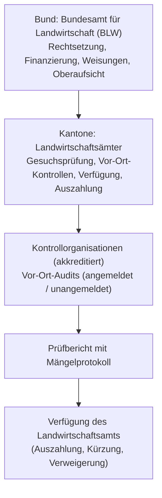

## Überblick {#ueberblick}

Die finanzielle Unterstützung der Schweizer Landwirtschaft durch das Gemeinwesen wird in der politischen Debatte und im Alltagssprachgebrauch regelmässig als *Bauernsubventionen*, *Agrarsubventionen* oder *Finanzzuschüsse* bezeichnet. Aus juristischer Sicht greifen diese Begriffe indessen zu kurz. Das schweizerische Agrarrecht hat das frühere System staatlicher Produkt- und Preisstützungen (*Milch- und Getreidegarantiepreise*) grundlegend überwunden und durch ein differenziertes, verfassungsrechtlich verankertes System zielgerichteter **Direktzahlungen** ersetzt.

Das heutige System basiert auf dem verfassungsrechtlichen Mandat der *multifunktionalen Landwirtschaft* gemäss Art. 104 BV: Der Staat garantiert den bäuerlichen Betrieben keine Absatz- oder Mengengarantien mehr, sondern vergütet klar definierte gemeinwirtschaftliche und ökologische Leistungen, die der freie Markt nicht eigenständig honoriert (namentlich die sichere Versorgung der Bevölkerung, die Erhaltung der natürlichen Lebensgrundlagen, die Pflege der Kulturlandschaft und die dezentrale Besiedlung des Landes).

Rechtstechnisch handelt es sich bei den Direktzahlungen um Kausalabgeltungen und verhaltenslenkende Subventionen des Bundes ([BGE 134 II 287](https://entscheidsuche.ch/docs/CH_BGE/CH_BGE_004_BGE-134-II-287_2008.html#consideration_3.4) E. 3.4). Wer die anspruchsbegründenden gesetzlichen Voraussetzungen erfüllt, besitzt einen klagbaren Rechtsanspruch auf Beitragsausrichtung ([BGer 2C_627/2021 vom 23.12.2021](https://entscheidsuche.ch/docs/CH_BGer/CH_BGer_002_2C-627-2021_2021-12-23.html) E. 1.1; [BGer 2C_560/2010 vom 18.6.2011](https://entscheidsuche.ch/docs/CH_BGer/CH_BGer_002_2C-560-2010_2011-06-18.html) E. 1.1). Dieser Anspruch ist jedoch an strenge persönliche Kriterien (landwirtschaftliche Ausbildung, Bewirtschafterstellung mit gültigem Rechtstitel), betriebliche Mindestgrössen (Standardarbeitskraft, SAK) und zwingend an den **ökologischen Leistungsnachweis (ÖLN)** als *Cross-Compliance*-Kriterium gekoppelt (Art. 70a LwG).

---

## Terminologie und Begriffsklärung: Direktzahlungen statt Bauernsubventionen {#terminologie-und-begriffsklaerung}

Im allgemeinen Sprachgebrauch werden die verschiedenen staatlichen Geldflüsse an Landwirte häufig undifferenziert vermengt. Das Landwirtschaftsgesetz (LwG, SR 910.1) und das Subventionsgesetz (SubvG, SR 616.1) unterscheiden präzise zwischen unterschiedlichen Rechtsinstrumenten:

| Begriff | Gesetzliche Grundlage | Rechtsnatur & Zweck | Empfängerkreis & Koppelung |
|---|---|---|---|
| **Direktzahlungen** | Art. 70–77 LwG; DZV (SR 910.13) | Kausalabgeltungen für gemeinwirtschaftliche und ökologische Leistungen sowie Einkommensergänzung; Rechtsanspruch bei Erfüllung der Kriterien | Bodenbewirtschaftende Landwirte; an Auflagen (ÖLN) gebunden, entkoppelt von der Produktionsmenge |
| **Einzelkulturbeiträge** | Art. 54 LwG; EKV (SR 910.12) | Produktionsbezogene Flächenbeiträge zur Sicherung bestimmter Kulturen (z. B. Ackerbohnen, Eiweisserbsen, Zuckerrüben, Raps) | Bewirtschafter bestimmter Ackerbauflächen; Förderung der Verarbeitungskapazität |
| **Zulagen** (Verkäsungszulage, Zulage für silofreie Milch) | Art. 38–43 LwG; VMilchZ (SR 916.350.2) | Marktbezogene Preiszulagen pro Kilogramm verwerteter Milch zur Verringerung des Preisabstands zum Ausland | Milchproduzenten bzw. Käsereibetriebe (über Milchgeldabrechnung) |
| **Strukturverbesserungen (Investitionskredite & Beiträge)** | Art. 87–107 LwG; SVV (SR 913.1) | Zinslose, rückzahlbare Darlehen (Investitionskredite) sowie A-fonds-perdu-Beiträge an bauliche und gemeinschaftliche Massnahmen | Eigentümer/Bewirtschafter für Bauten (Ställe, Remisen), Bodenverbesserungen, Alperschliessungen |
| **Betriebshilfe** | Art. 78–86 LwG; BHV (SR 914.11) | Zinslose, rückzahlbare Darlehen zur Behebung unverschuldeter finanzieller Notlagen (Krisenintervention) | Überschuldete, aber sanierungsfähige Landwirtschaftsbetriebe |
| **Subventionen i. e. S.** | SubvG (SR 616.1) i. V. m. Art. 177 LwG | Subsidiäres Dachrecht: Finanzhilfen (zur Förderung) und Abgeltungen (für Pflichten) | Sämtliche Bundessubventionen; LwG geht als *Lex specialis* vor |

Der Terminus *Subvention* im Sinne von Art. 2 und 3 SubvG ist der juristische Oberbegriff. Er umfasst sowohl *Abgeltungen* (zur Milderung oder zum Ausgleich finanzieller Lasten aus der Erfüllung von Bundesrecht) als auch *Finanzhilfen* (Geldleistungen an Empfänger ausserhalb der Bundesverwaltung zur Erhaltung oder Förderung einer vom Bund erwünschten Tätigkeit). Im Agrarbereich haben die **Direktzahlungen** überwiegend Abgeltungscharakter für verfassungsmässige Gemeinwohlleistungen, während Strukturverbesserungsbeiträge und Betriebshilfen typische Finanzhilfen darstellen.

---

## Verfassungsrechtlicher Auftrag und Systemwechsel {#verfassungsrechtlicher-auftrag}

### Der Verfassungsauftrag von Art. 104 BV {#verfassungsauftrag-art-104}

Die Verfassungsgrundlage bildet Art. 104 BV, der 1996 durch die Volksabstimmung zur Agrarinitiative und Gegenentwurf grundlegend neu gefasst und 1999 in die neue Bundesverfassung überführt wurde. Er verpflichtet den Bund, die Landwirtschaft auf eine nachhaltige, marktorientierte Produktion auszurichten:



Ergänzt wird diese Bestimmung durch Art. 104a BV (Ernährungssicherheit), welcher 2017 vom Souverän angenommen wurde und die Erhaltung der Kulturlandbasis, eine standortangepasste und ressourceneffiziente Lebensmittelproduktion sowie marktorientierte Handelsbeziehungen verfassungsrechtlich verankert:



### Der agrarpolitische Systemwechsel {#agrarpolitischer-systemwechsel}

Historisch stützte die Eidgenossenschaft die bäuerlichen Betriebe über Jahrzehnte hinweg über das System der **Garantiepreise und Marktstützungen** (Art. 31octies der Bundesverfassung von 1874). Der Staat legte Mindestpreise für Milch, Getreide oder Schlachtvieh fest und kaufte Überschüsse auf Staatskosten auf. Dieses System führte in den 1970er- und 1980er-Jahren zu massiver struktureller Überproduktion (*Milchseen*, *Butterberge*), enormen Kosten für die Einlagerung und den subventionierten Export sowie zu erheblichen ökologischen Fehlsteuerungen (Überdüngung durch Maximierung des Ertrags pro Hektare).

Mit den Reformetappen **Agrarpolitik 2002 (AP 2002)**, **AP 2007**, **AP 2011**, **AP 14–17** und der Weiterentwicklung **AP 22+** vollzog der Bund eine radikale Trennung zwischen Markt- und Einkommenspolitik:
1. **Entkoppelung**: Staatliche Zahlungen wurden von der produzierten Menge abgekoppelt. Wer mehr Milch produziert, erhält dafür keine höheren Staatsbeiträge mehr.
2. **Marktorientierung**: Preise für landwirtschaftliche Produkte bilden sich grundsätzlich am Markt (abgesichert durch einen zolltariflichen Aussenschutz an der Grenze).
3. **Leistungsabgeltung**: Staatliche Gelder fliessen ausschliesslich als Entgelt für gesellschaftlich erwünschte, aber nicht marktfähige Leistungen (Biodiversität, Tierwohl, Landschaftspflege) oder zur Absicherung der agronomischen Basiskapazität bei ungünstigen topografischen Lagen (Berg- und Hügelzonen).

---

## Das Fördersystem des Landwirtschaftsgesetzes {#foerdersystem-lwg}

Das Bundesgesetz über die Landwirtschaft (LwG) regelt die Direktzahlungen im 3. Titel (*Massnahmen zugunsten der Betriebe*), 1. Kapitel (Art. 70 ff. LwG). Die Generalklausel statuiert den Fördergrundsatz:



Das Bundesgericht hält zur Rechtsnatur dieser Förderinstrumente fest, dass Direktzahlungen eine zweifache Zweckrichtung verfolgen ([BGE 134 II 287](https://entscheidsuche.ch/docs/CH_BGE/CH_BGE_004_BGE-134-II-287_2008.html#consideration_3.4) E. 3.4):
> «In der Tat bezwecken landwirtschaftliche Direktzahlungen als Subventionen eine bestimmte Verhaltenslenkung»
> […] «Die landwirtschaftlichen Direktzahlungen dienen aber nicht nur der ökologischen Landwirtschaft, sondern entschädigen die Landwirte ganz allgemein für ihre gemeinwirtschaftlichen Leistungen […] womit sie auch der Einkommenssicherung der Landwirte dienen».

---

## Die sieben Beitragsarten der Direktzahlungen (Art. 70 ff. LwG, DZV) {#sieben-beitragsarten}

Mit der Agrarpolitik 2014–2017 (AP 14–17) wurde das frühere System der *allgemeinen* und *ökologischen* Direktzahlungen durch ein **zielorientiertes Sieben-Säulen-System** abgelöst. Jeder Beitragstyp knüpft an einen spezifischen Zweck an:

| Beitragsart | Gesetzliche Basis | Verordnung (DZV) | Zweck und Hauptmassnahmen |
|---|---|---|---|
| **1. Kulturlandschaftsbeiträge** | Art. 71 LwG | Art. 38–47 DZV | Erhaltung einer offenen Kulturlandschaft und Verhinderung von Verwaldung; gestaffelt nach Zonen: *Offenhaltungsbeitrag*, *Hangbeitrag*, *Steillagenbeitrag*, *Hanglagenbeitrag*, *Sömmerungsbeitrag* und *Alpungsbeitrag*. |
| **2. Versorgungssicherheitsbeiträge** | Art. 72 LwG | Art. 48–54 DZV | Erhaltung der Produktionskapazität zur Sicherstellung der Versorgung; unterteilt in *Basisbeitrag* (pro ha Nutzfläche), *Produktionserschwernisbeitrag* (in Hang- und Berggebieten) sowie *Zusatzbeitrag für die Sicherung der agronomischen Basiskapazität* (Ackerbau/Dauerkulturen). |
| **3. Biodiversitätsbeiträge** | Art. 73 LwG | Art. 55–63 DZV | Erhaltung und Förderung der Arten- und Lebensraumvielfalt auf Biodiversitätsförderflächen (BFF); gegliedert in *Qualitätsstufe I* (Grundanforderungen), *Qualitätsstufe II* (botanische/ökologische Zeigerarten) und *Vernetzungsbeiträge* (kantonale Vernetzungsprojekte). |
| **4. Landschaftsqualitätsbeiträge** | Art. 74 LwG | Art. 64–66 DZV | Erhaltung, Pflege und Aufwertung standorttypischer Landschaftsbilder (z. B. Hochstamm-Feldobstbäume, Trockenmauern, traditionelle Rebterrassen); Umsetzung über regionale, vom Kanton und Bund genehmigte Projekte mit kantonaler Kofinanzierung (mindestens 10 %). |
| **5. Produktionssystembeiträge** | Art. 75 LwG | Art. 67–77 DZV | Förderung besonders naturnaher und tierfreundlicher Produktionsformen; umfasst *Biologischen Landbau*, *Extenso-Anbau* (Getreide ohne Fungizide/Insektizide), *Graslandbasierte Milch- und Fleischproduktion (GMF)* sowie Tierwohlprogramme (*BTS* [Besonders tierfreundliche Stallhaltung], *RAUS* [Regelmässiger Auslauf im Freien]). |
| **6. Ressourceneffizienzbeiträge** | Art. 76 LwG | Art. 78–86 DZV | Zeitlich befristete Anschubbeiträge für Techniken zur Reduktion von Emissionen und Ressourcenschonung (z. B. emissionsmindernde Gülleausbringung mittels Schleppschlauch/Schleppschuh, präzise Pflanzenschutztechnik, bodenschonende Bearbeitung ohne Pflug). |
| **7. Übergangsbeitrag** | Art. 77 LwG | Art. 87 DZV | Sozialverträgliche Abfederung von Einkommenseinbussen infolge des Systemwechsels der AP 14–17; wird rechnerisch aus dem Bundesbudget ermittelt und als Restgrösse verteilt (kontinuierlich degressiv). |

### Ergänzende Finanzierungsinstrumente {#ergaenzende-finanzierungsinstrumente}

Neben den Direktzahlungen kennt das Landwirtschaftsgesetz weitere Finanzhilfen:
- **Einzelkulturbeiträge (Art. 54 LwG)**: Spezifische Flächenbeiträge für den Anbau von Ackerbohnen, Körnererbsen, Lupinen, Raps, Soja, Sonnenblumen und Zuckerrüben, um den inländischen Selbstversorgungsgrad bei Eiweiss- und Ölpflanzen sowie Zuckerfabriken zu sichern.
- **Milchzulagen (Art. 38 ff. LwG)**: Eine Zulage für Verkehrsmilch, die zu Käse verarbeitet wird (Verkäsungszulage), sowie eine Zulage für Fütterung ohne Silage (Siloverzichtszulage).
- **Strukturverbesserungen (Art. 87 ff., 105 LwG)**: Zinslose Bundesdarlehen (Investitionskredite) und A-fonds-perdu-Beiträge zur Modernisierung landwirtschaftlicher Gebäude, gemeinschaftlicher Verarbeitungsanlagen sowie zur Durchführung von Landumlegungen und Meliorationen.

---

## Voraussetzungen des Direktzahlungsanspruchs {#voraussetzungen-des-anspruchs}

Der Bezug von Direktzahlungen ist an kumulative persönliche, betriebliche und ökologische Voraussetzungen gebunden.

### Betriebliche und persönliche Anspruchskriterien {#betriebliche-und-persoenliche-kriterien}

1. **Bewirtschaftereigenschaft**: Anspruchsberechtigt sind natürliche Personen mit Wohnsitz in der Schweiz sowie juristische Personen oder Personengesellschaften mit Sitz in der Schweiz, die einen Betrieb auf eigene Rechnung und Gefahr führen (Art. 70 Abs. 1 LwG).
2. **Zivilrechtlicher Rechtstitel**: Das Bundesgericht verlangt in ständiger Judikatur, dass die Bewirtschaftung auf einem gültigen Rechtstitel beruht ([BGE 134 II 287](https://entscheidsuche.ch/docs/CH_BGE/CH_BGE_004_BGE-134-II-287_2008.html#consideration_3.1) E. 3.1). Der Bewirtschafter muss Eigentümer der Flächen sein oder über einen rechtsgültigen Pachtvertrag nach dem Bundesgesetz über die landwirtschaftliche Pacht (LPG, SR 221.213.2) verfügen. Eine rechtswidrige Weiterbewirtschaftung nach Beendigung der Pacht begründet keinen Beitragsanspruch ([BGE 134 II 287](https://entscheidsuche.ch/docs/CH_BGE/CH_BGE_004_BGE-134-II-287_2008.html#consideration_4.) E. 4):
   > «Sind die privatrechtlichen Verhältnisse rechtskräftig geklärt, kann nicht durch rechtswidriges Verhalten, hier Weiterbewirtschaftung trotz abgelaufenem Pachtverhältnis, erwirkt werden, dass weiterhin Direktzahlungen geleistet werden».
3. **Mindestarbeitsbedarf (Standardarbeitskraft, SAK)**: Ein Betrieb muss eine agronomische Mindestgrösse erreichen, um Direktzahlungen beziehen zu können. Massstab ist die Standardarbeitskraft (SAK), welche den standardisierten Arbeitsbedarf für Nutzpflanzen und Nutztiere beziffert (Art. 2a der landwirtschaftlichen Begriffsverordnung, LBV, SR 910.91). Die bundesrechtliche Mindestgrenze liegt bei mindestens **0,20 SAK** (bzw. in früheren Verfassungen 0,25 SAK). Liegt ein Betrieb unter dieser Schwelle, gilt er als nicht beitragswürdiges Klein- oder Freizeitunternehmen ([BGE 137 II 182](https://entscheidsuche.ch/docs/CH_BGE/CH_BGE_004_BGE-137-II-182_2011.html#consideration_3.2.3) E. 3.2.3).
4. **Berufliche Qualifikation**: Die Bewirtschafterin oder der Bewirtschafter muss über eine anerkannte landwirtschaftliche Ausbildung verfügen (eidgenössisches Fähigkeitszeugnis als Landwirt/in, Berufsattest oder ein gleichwertiger Abschluss; Art. 70 Abs. 2 LwG, Art. 4 DZV).
5. **Degression und Plafonierung**: Zur Vermeidung übermässiger Beitragsballungen auf Grossbetrieben werden Direktzahlungen ab bestimmten Grössenklassen degressiv abgestuft (pro SAK-Stufe sinkt der Ansatz je Hektare) oder bei juristischen Konstrukten auf Maximalbeträge plafoniert (Art. 88 DZV).

---

### Der ökologische Leistungsnachweis (ÖLN) als Grundvoraussetzung {#oekologischer-leistungsnachweis}

Der ökologische Leistungsnachweis nach Art. 104 Abs. 3 lit. b BV und Art. 70a LwG ist das Herzstück des schweizerischen Agrarunterstützungssystems (*Cross-Compliance*):



Wer den ÖLN nicht lückenlos auf dem gesamten Betrieb erbringt, verliert den Anspruch auf sämtliche Direktzahlungen (unter Vorbehalt der Verhältnismässigkeit bei Teilkürzungen). Der ÖLN umfasst sechs verbindliche Module (Art. 11–37 DZV):

```
┌─────────────────────────────────────────────────────────────────┐
│               DER ÖKOLOGISCHE LEISTUNGSNACHWEIS (ÖLN)           │
├────────────────────────────────┬────────────────────────────────┤
│ 1. Artgerechte Tierhaltung     │ Einhaltung der Tierschutz-     │
│    (Art. 12 DZV, TSchG)        │ vorschriften, Auslaufgarantien │
├────────────────────────────────┼────────────────────────────────┤
│ 2. Ausgeglichene Düngerbilanz  │ Maximale Nährstoffzufuhr gem.  │
│    (Art. 13 DZV, GSchG)        │ Suisse-Bilanz (N und P)        │
├────────────────────────────────┼────────────────────────────────┤
│ 3. Angemessener Anteil an BFF  │ Mindestens 7 % der LN als      │
│    (Art. 14–20 DZV)            │ Biodiversitätsförderflächen    │
├────────────────────────────────┼────────────────────────────────┤
│ 4. Geregelte Fruchtfolge       │ Verbot von Monokulturen,       │
│    (Art. 21 DZV)               │ Anbaupausen bei Ackerkulturen  │
├────────────────────────────────┼────────────────────────────────┤
│ 5. Gezielter Bodenschutz       │ Erosionsschutz, Bodenbedeckung │
│    (Art. 22–24 DZV)            │ im Winter, Bodenschonung       │
├────────────────────────────────┼────────────────────────────────┤
│ 6. Gezielter Pflanzenschutz    │ Schadschwellenprinzip, Schutz  │
│    (Art. 25–37 DZV)            │ von Gewässern und Biotopen     │
└────────────────────────────────┴────────────────────────────────┘
```

1. **Artgerechte Tierhaltung**: Zwingende Einhaltung der Vorschriften der Tierschutzgesetzgebung (TSchG, TSchV). Tiere dürfen nicht dauernd angebunden gehalten werden; Rinder in Anbindehaltung müssen an mindestens 60 Tagen während der Vegetationsperiode und 30 Tagen im Winter Auslauf erhalten ([BGer 2C_627/2021 vom 23.12.2021](https://entscheidsuche.ch/docs/CH_BGer/CH_BGer_002_2C-627-2021_2021-12-23.html) E. 2.1 f.). Liegebereiche müssen ausreichend mit trockener Einstreu versehen sein ([BGer 2C_765/2020 vom 14.1.2021](https://entscheidsuche.ch/docs/CH_BGer/CH_BGer_002_2C-765-2020_2021-01-14.html) E. 3).
2. **Ausgeglichene Düngerbilanz (Suisse-Bilanz)**: Der Phosphor- und Stickstoffausstoss des Viehbestands darf den Düngebedarf der bewirtschafteten Pflanzen nicht übersteigen. Ein Überhang von maximal 10 % Toleranzmarge war historisch zulässig; Überschüsse müssen über vertragliche Hofdüngerverträge an abnahmeberechtigte Betriebe abgegeben werden ([BGer 2A-227/2003 vom 22.10.2003](https://entscheidsuche.ch/docs/CH_BGer/CH_BGer_002_2A-227-2003_2003-10-22.html) E. 2.2).
3. **Biodiversitätsförderflächen (BFF)**: Mindestens 7 % der landwirtschaftlichen Nutzfläche (LN) – bei Betrieben mit Spezialkulturen wie Reben oder Obstbau mindestens 3,5 % – müssen als Biodiversitätsförderflächen (z. B. extensiv genutzte Wiesen, Hecken, Feldgehölze, Buntbrachen) bewirtschaftet werden.
4. **Geregelte Fruchtfolge**: Auf Betrieben mit mehr als 3 Hektaren Ackerland sind abwechslungsreiche Fruchtfolgen vorgeschrieben, um Bodenmüdigkeit und Schädlingsbefall ohne exzessiven Pestizideinsatz zu verhindern.
5. **Gezielter Bodenschutz**: Massnahmen gegen Bodenverdichtung und Erosion (z. B. Begrünung über den Winter, Verbot des Pflügens stark geneigter Hänge bei akuter Erosionsgefahr).
6. **Gezielte Auswahl und Anwendung von Pflanzenschutzmitteln**: Verpflichtende Anwendung des Schadschwellenprinzips; Applikation chemisch-synthetischer Pflanzenschutzmittel nur bei dokumentierter Notwendigkeit unter strikter Wahrung von Pufferstreifen zu Gewässern und Waldrändern.

---

## Vollzug, Kontrollwesen und Bundesaufsicht (Bund–Kantone) {#vollzug-und-bundesaufsicht}

Der Vollzug des Direktzahlungssystems ist föderalistisch organisiert (Art. 180 LwG, Art. 97 ff. DZV):



- **Bundesamt für Landwirtschaft (BLW)**: Erlässt technische Wegleitungen, stellt die Bundesmittel bereit, verwaltet die zentralen agrarpolitischen Informationssysteme (Agate) und übt die Oberaufsicht über die Kantone aus.
- **Kantonale Landwirtschaftsämter**: Nehmen die jährlichen Beitragsgesuche entgegen (über kantonale Erfassungsportale wie GELAN oder LAWIS), prüfen die Flächen- und Tierangaben, beauftragen die Kontrollstellen, erlassen die Kürzungs- oder Abrechnungsverfügungen und zahlen die Beiträge an die Bewirtschafter aus.
- **Kontrollmodalitäten**: Die Betriebe werden periodisch (mindestens alle 4 bis 8 Jahre bzw. risiko- und verdachtsbasiert) durch akkreditierte Kontrollorganisationen (z. B. *Quali-Cert*, *Agri-Check*) überprüft. Kontrollen können angekündigt oder – namentlich im Bereich Tierwohl und Pflanzenschutz – **vollkommen unangemeldet** erfolgen ([BGer 2C_765/2020 vom 14.1.2021](https://entscheidsuche.ch/docs/CH_BGer/CH_BGer_002_2C-765-2020_2021-01-14.html) E. 3).

---

## Verwaltungssanktionen: Kürzung, Verweigerung und Rückerstattung {#sanktionen-kuerzung-rueckerstattung}

Werden bei Betriebskontrollen Mängel festgestellt, greift das agrarrechtliche Sanktionsregime der Art. 170 und 171 LwG.

### Kürzung und Verweigerung von Beiträgen (Art. 170 LwG) {#kuerzung-und-verweigerung}



Zur Durchsetzung dieses Grundsatzes erliess der Bundesrat gestützt auf Art. 170 Abs. 3 LwG in **Anhang 8 der DZV** einen detaillierten Sanktionskatalog. Das Bundesgericht bestätigte die Gesetzmässigkeit dieser Verordnungsregelung ([BGer 2C_446/2022 vom 20.3.2024](https://entscheidsuche.ch/docs/CH_BGer/CH_BGer_002_2C-446-2022_2024-03-20.html) E. 7.1):
> «Der Gesetzgeber hat dem Bundesrat dabei einen weiten Spielraum eingeräumt, die inhaltliche Ausgestaltung der Kürzungshöhe und -modalitäten festzulegen. In Ausübung dieser Ermächtigung erliess der Bundesrat in Anhang 8 DZV detaillierte Kürzungsvorschriften. Sie ermöglichen ein einheitliches und verbindliches Kontrollsystem, das den allgemeinen Anforderungen des Rechtsgleichheitsgebots und der Verhältnismässigkeit entsprechen soll».

Das Bundesgericht statuierte im Leitentscheid [BGE 137 II 366](https://entscheidsuche.ch/docs/CH_BGE/CH_BGE_004_BGE-137-II-366_2011.html#consideration_3.2) E. 3.2 zudem zwei verfassungsrechtliche Kernprinzipien für Verwaltungssanktionen:
1. **Kein Strafcharakter**:
   > «Die Verweigerung der Beiträge hat keinen pönalen Charakter; sie hat ihren Grund vielmehr darin, dass die Leistungen, welche mit den Zahlungen abgegolten werden sollen, nicht erbracht werden. Es muss mit anderen Worten ein Zusammenhang zwischen der Sanktion (Beitragskürzung oder -verweigerung) und der verletzten Bestimmung bestehen».
2. **Gebot des sachlichen Zusammenhangs**: Eine Missachtung von Tierschutzvorschriften rechtfertigt die Streichung tierbezogener Beiträge (wie Raufutterbeiträge oder RAUS-Zulagen), verbietet jedoch die Verweigerung boden- und flächenbezogener Beiträge (wie Kulturlandschaftsbeiträge oder Flächenbeiträge für den ökologischen Ausgleich), wenn bezüglich dieser Flächen kein Mangel vorliegt ([BGE 137 II 366](https://entscheidsuche.ch/docs/CH_BGE/CH_BGE_004_BGE-137-II-366_2011.html#consideration_3.3.2) E. 3.3.2).

### Rückerstattung zu Unrecht bezogener Beiträge (Art. 171 LwG) {#rueckerstattung-von-beitraegen}

Wurden Beiträge aufgrund falscher Gesuchsangaben oder nachträglich weggefallener Anspruchskriterien ausbezahlt, sind sie zwingend zurückzuerstatten:



Nach der bundesgerichtlichen Praxis gilt ([BGer 2C_88/2012 vom 28.8.2012](https://entscheidsuche.ch/docs/CH_BGer/CH_BGer_002_2C-88-2012_2012-08-28.html) E. 2.2):
> «Nach Art. 171 LwG werden Beiträge ganz oder teilweise zurückgefordert, wenn die Voraussetzungen, unter denen ein Beitrag gewährt wurde, nicht mehr erfüllt sind».

Der Rückforderungsanspruch verjährt nach Art. 171 Abs. 3 LwG in sinngemässer Anwendung des Subventionsgesetzes mit Ablauf eines Jahres ab Kenntnis der Behörde, spätestens jedoch zehn Jahre nach der Entstehung des Anspruchs. Wer vorsätzlich falsche oder unvollständige Angaben einreicht, um Direktzahlungen zu erlangen, macht sich zudem des **Subventionsbetrugs** (Art. 110 SubvG) bzw. des **Betrugs** (Art. 146 StGB) strafbar.

---

## Rechtsschutz und gerichtliche Kognition {#rechtsschutz-und-kognition}

Entscheide über Direktzahlungen ergehen in Form von erstinstanzlichen Verfügungen der kantonalen Landwirtschaftsämter. Der Rechtsmittelweg gliedert sich wie folgt:

1. **Kantonales Vorverfahren**: Einsprache oder Beschwerde an die kantonale Rekursbehörde (je nach Kanton das zuständige Departement, die kantonale Rekurskommission oder direkt das kantonale Verwaltungsgericht).
2. **Kantonales Verwaltungsgericht**: Letztinstanzlicher kantonaler Gerichtsentscheid.
3. **Bundesgericht**: Gegen den kantonalen Gerichtsentscheid steht die **Beschwerde in öffentlich-rechtlichen Angelegenheiten** an das Bundesgericht offen (Art. 82 lit. a BGG).

Die bundesgerichtliche Eintretensvoraussetzung ist erfüllt, weil das Bundesgericht festhält ([BGer 2C_627/2021 vom 23.12.2021](https://entscheidsuche.ch/docs/CH_BGer/CH_BGer_002_2C-627-2021_2021-12-23.html) E. 1.1):
> «Es besteht grundsätzlich ein Anspruch auf diese bundesrechtlich geregelten Beiträge».

Damit greift der Ausschlussgrund für blosse Ermessenssubventionen gemäss Art. 83 lit. k BGG **nicht**. Das Bundesgericht prüft Bundesrechtsverletzungen mit freier Kognition (Art. 95 lit. a BGG), ist jedoch an die Sachverhaltsfeststellungen der kantonalen Vorinstanz gebunden (Art. 105 Abs. 1 BGG).

---

## Würdigung und agrarpolitische Spannungsfelder {#wuerdigung}

Das schweizerische Direktzahlungssystem gilt international als Pionierleistung bei der Entkoppelung agrarischer Transferleistungen von der Marktproduktion gemäss den *Green-Box*-Kriterien der Welthandelsorganisation (WTO). Es garantiert, dass staatliche Gelder nicht zu Handelsverzerrungen auf dem Weltmarkt führen, sondern gezielt als Gegenleistung für landschaftliche und ökologische Dienstleistungen fliessen.

Gleichzeitig steht das System in permanenten politischen und rechtlichen Zielkonflikten:
1. **Versorgungssicherheit vs. Biodiversität**: Die Verpflichtung zur Ausscheidung von 7 % Biodiversitätsförderflächen und die Diskussion um weitergehende Reduktionsziele bei Pflanzenschutzmitteln und Nährstoffverlusten (vgl. Art. 6a und 6b LwG, Parlamentsinitiative 19.475) führen zu agronomischen Kontroversen über den inländischen Selbstversorgungsgrad.
2. **Bürokratie und Administrationsaufwand**: Das minutiöse Nachweissystem (Suisse-Bilanz, Feldkalender, Spritzmitteltagebuch, Auslaufjournale) erfordert von Landwirtschaftsbetrieben einen erheblichen administrativen Aufwand. Mängel in der bürokratischen Dokumentation führen selbst bei materiell vorbildlicher Haltung zu gravierenden Beitragskürzungen.
3. **Einkommenswirksamkeit**: Durchschnittlich stammen rund 50 % des bäuerlichen Einkommens in der Schweiz aus Direktzahlungen (in Bergregionen bis zu 70 %). Damit fungiert das System de facto als unverzichtbares agrarsoziales Auffangnetz, was die politische Debatte über die zukünftige Ausgestaltung der Agrarpolitik ab 2030 (AP 30+) prägt.

---

## Praxishinweise {#praxishinweise}

### Für Betriebsleiterinnen und Betriebsleiter (Landwirte) {#praxishinweise-landwirte}
- **Fristen strikt wahren**: Die Beitragsgesuche sind jährlich über die kantonalen Informationssysteme (z. B. Agate/GELAN) bis zum Stichtag (meist Mitte Februar bis März) vollständig einzureichen. Verspätete Gesuche führen nach der DZV zu automatischen prozentualen Kürzungen pro Werktag Verspätung.
- **Dokumentationsdisziplin bei Tierwohlprogrammen (RAUS/BTS)**: Bei Teilnahme an Tierwohlprogrammen ist die lückenlose Führung des Auslaufjournals zwingend. Fehlen Einträge oder können Weidetage bei Anbindehaltung nicht nachgewiesen werden, werden Tierwohlbeiträge gestrichen und ÖLN-Kürzungen verfügt ([BGer 2C_627/2021 vom 23.12.2021](https://entscheidsuche.ch/docs/CH_BGer/CH_BGer_002_2C-627-2021_2021-12-23.html)).
- **Unangekündigte Kontrollen dulden**: Kontrollpersonen ist jederzeit Zutritt zu sämtlichen Betriebsräumen und Kulturflächen zu gewähren. Eine Verweigerung der Kontrolle führt nach Art. 105 DZV zur sofortigen Verweigerung sämtlicher Beiträge.
- **Pachtverhältnisse schriftlich fixieren**: Flächen dürfen nur deklariert werden, wenn ein zivilrechtlich gültiger Pachtvertrag oder schriftlicher Nutzungsüberlassungsvertrag vorliegt ([BGE 134 II 287](https://entscheidsuche.ch/docs/CH_BGE/CH_BGE_004_BGE-134-II-287_2008.html#consideration_4.)).

### Für Rechtsberatung, Treuhand und Behörden {#praxishinweise-beratung}
- **Sanktionsverhältnismässigkeit prüfen**: Bei Kürzungen wegen Mängeln (z. B. im Tierschutz oder Umweltschutz) ist stets zu kontrollieren, ob die Behörde den Grundsatz des sachlichen Zusammenhangs gewahrt hat ([BGE 137 II 366](https://entscheidsuche.ch/docs/CH_BGE/CH_BGE_004_BGE-137-II-366_2011.html#consideration_3.2)). Tierschutzmängel dürfen nicht zu einer Verweigerung reiner Flächen- oder Kulturlandschaftsbeiträge führen.
- **Rückforderungsverfügungen anfechten**: Bei Rückforderungsverfügungen nach Art. 171 LwG sind die relativen Verwirkungsfristen (ein Jahr ab behördlicher Kenntnis) sowie der Grundsatz des Vertrauensschutzes sorgfältig zu prüfen.

---

## Leitentscheide {#leitentscheide}

| Entscheid | Gegenstand | Kernaussage & agrarrechtliche Bedeutung |
|---|---|---|
| [BGE 134 II 287](https://entscheidsuche.ch/docs/CH_BGE/CH_BGE_004_BGE-134-II-287_2008.html#consideration_3.1) | Rechtstitel für Direktzahlungen; rechtliche Selbständigkeit | Direktzahlungen bezwecken eine Verhaltenslenkung und Einkommenssicherung. Voraussetzung ist ein gültiger zivilrechtlicher Rechtstitel (Eigentum oder Pacht) an den Flächen. Widerrechtliche Weiterbewirtschaftung nach Ablauf des Pachtvertrags begründet keinen Beitragsanspruch (E. 3.1, 3.4, 4). |
| [BGE 137 II 366](https://entscheidsuche.ch/docs/CH_BGE/CH_BGE_004_BGE-137-II-366_2011.html#consideration_3.2) | Kürzung und Verweigerung; Tierschutzverstösse | Die Verweigerung von Direktzahlungen hat keinen pönalen Charakter, sondern knüpft an die Nichterbringung der Leistung an. Es gilt ein striktes Gebot des sachlichen Zusammenhangs: Tierschutzmängel rechtfertigen die Streichung von Tierwohlbeiträgen, nicht aber von reinen Flächenbeiträgen (E. 3.2, 3.3). |
| [BGE 137 II 182](https://entscheidsuche.ch/docs/CH_BGE/CH_BGE_004_BGE-137-II-182_2011.html#consideration_3.2.3) | Standardarbeitskraft (SAK); Mindestarbeitsbedarf | Die Standardarbeitskraft dient als objektiver Massstab für den agronomischen Arbeitsbedarf. Bestimmend sind Nutzfläche, Tierbestand und die Einhaltung einer ausgeglichenen Düngerbilanz (E. 3.1.3, 3.2.3). |
| [BGer 2C_446/2022 vom 20.3.2024](https://entscheidsuche.ch/docs/CH_BGer/CH_BGer_002_2C-446-2022_2024-03-20.html) | Kürzungsregime gemäss Anhang 8 DZV; Vernetzungsprojekte | Bestätigung des weiten gesetzgeberischen Ermessensspielraums des Bundesrates bei der Festlegung von Sanktionspauschalen in Anhang 8 DZV (Art. 170 Abs. 3 LwG); Verhältnis von Kürzung und Rückforderung (Art. 171 LwG) bei Vernetzungsbeiträgen (E. 7.1 ff.). |
| [BGer 2C_627/2021 vom 23.12.2021](https://entscheidsuche.ch/docs/CH_BGer/CH_BGer_002_2C-627-2021_2021-12-23.html) | Rechtsanspruch auf Direktzahlungen; ÖLN und RAUS | Grundsätzlicher Rechtsanspruch auf bundesrechtliche Direktzahlungen (kein Ausschlussgrund nach Art. 83 lit. k BGG); Nichterfüllung der Mindestweidetage bei Anbindehaltung führt zur rechtmässigen Kürzung von Beiträgen (E. 1.1, 2.1). |
| [BGer 2C_765/2020 vom 14.1.2021](https://entscheidsuche.ch/docs/CH_BGer/CH_BGer_002_2C-765-2020_2021-01-14.html) | Unangemeldete Vor-Ort-Kontrolle; Einstreupflicht | Zulässigkeit unangekündigter behördlicher Kontrollen; Mängel bei der Einstreu von Pferden/Ponys verletzen den ÖLN und rechtfertigen Beitragskürzungen beim Tierwohl und Basisbeitrag (E. 3 ff.). |
| [BGer 2C_88/2012 vom 28.8.2012](https://entscheidsuche.ch/docs/CH_BGer/CH_BGer_002_2C-88-2012_2012-08-28.html) | Rückerstattung zu Unrecht bezogener Beiträge (Art. 171 LwG) | Beiträge für Flächen ohne gültigen Rechtstitel sind zurückzuerstatten; Prüfung der relativen und absoluten Verwirkungsfristen für Rückforderungsverfügungen (E. 2.2). |
| [BGer 2C_588/2010 vom 24.2.2011](https://entscheidsuche.ch/docs/CH_BGer/CH_BGer_002_2C-588-2010_2011-02-24.html) | Kontrollperiode für Ethobeiträge | Die Erfüllung von Tierhaltungsvorschriften muss über die gesamte massgebliche Bemessungsperiode hinweg nachgewiesen werden; Mängel in der Vorperiode strahlen auf das Beitragsjahr aus (E. 2.4). |
| [BGer 2C_560/2010 vom 18.6.2011](https://entscheidsuche.ch/docs/CH_BGer/CH_BGer_002_2C-560-2010_2011-06-18.html) | Klagbarkeit des Direktzahlungsanspruchs | Bestätigung, dass die Ausrichtung von Direktzahlungen keine blosse Ermessensleistung darstellt, sondern bei Vorliegen der gesetzlichen Voraussetzungen gerichtlich einklagbar ist (E. 1.1). |
| [BGer 2A-227/2003 vom 22.10.2003](https://entscheidsuche.ch/docs/CH_BGer/CH_BGer_002_2A-227-2003_2003-10-22.html) | Ausgeglichene Düngerbilanz (Suisse-Bilanz) | Die ausgeglichene Düngerbilanz ist zwingender Bestandteil des ÖLN. Fehlende Nachweise oder fehlerhafte Bilanzierungen berechtigen die Behörde zur Rückforderung ausgerichteter Beiträge (E. 2.2). |

---

## Literatur {#literatur}

- **Roland Norer**, Handbuch des Agrarrechts, 2. Aufl., Bern 2017.
- **Paul Richli**, Agrarrecht, in: Wirtschaftsstrukturrecht, Schweizerisches Bundesverwaltungsrecht (SBVR), Bd. XIII, Basel 2005.
- **Beat Stalder**, Das Bundesgesetz über die Landwirtschaft (LwG) – Grundzüge und Vollzug, in: Blätter für Agrarrecht, 2014, S. 45 ff.
- **Nicole Nussberger-Gossner**, Ökologische Ausgleichsflächen in der Landwirtschaftszone, Diss. Zürich, Basel/Genf 2005.
