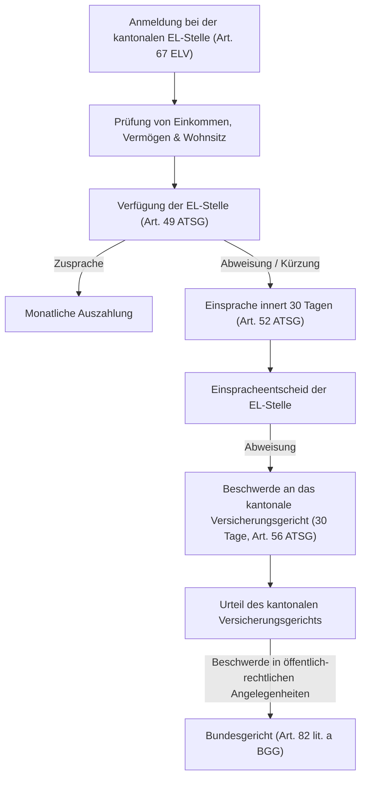

## Überblick {#ueberblick}

Die **Ergänzungsleistungen (EL)** bilden den unverzichtbaren existenzsichernden Pfeiler der schweizerischen 1. Säule. Während die Alters- und Hinterlassenenversicherung (AHV) und die Invalidenversicherung (IV) darauf angelegt sind, den grundlegenden Existenzbedarf durch beitragsfinanzierte Renten zu decken (Art. 112 Abs. 2 lit. b BV), erreichen die gesetzlichen Renten allein dieses Ziel in vielen Lebenssachverhalten nicht – namentlich bei tiefen Erwerbseinkommen während der Erwerbsbiografie, bei Beitragslücken oder bei hohen Lebenshaltungskosten infolge von Pflege- und Heimeintritten.

In diesen Konstellationen greift der Verfassungsauftrag von Art. 112a BV: Bund und Kantone richten Ergänzungsleistungen aus, um den tatsächlichen Existenzbedarf abzusichern. Ergänzungsleistungen sind keine blosse Ermessensleistung und keine fürsorgerische Sozialhilfe im herkömmlichen Sinne. Sie begründen einen einklagbaren bundesrechtlichen Rechtsanspruch. Wer die gesetzlichen Voraussetzungen erfüllt, hat Anspruch auf Auszahlung der berechneten Beträge, «ohne dass die Versicherten Sozialhilfe beziehen müssen» ([BGE 143 V 9](https://entscheidsuche.ch/docs/CH_BGE/CH_BGE_007_BGE-143-V-9_2017.html#consideration_6.2) E. 6.2). 

Trotz dieses Bedarfscharakters bleiben Ergänzungsleistungen rechtlich echte Sozialversicherungsleistungen:

> «Nach der Praxis des Bundesgerichts kann auch selbstverschuldete Bedürftigkeit einen Anspruch auf Ergänzungsleistungen begründen. Auch wenn diesen deswegen ein gewisser sozialhilferechtlicher Charakter beigemessen wird, werden sie dadurch weder rechtlich noch "faktisch" von Sozialversicherungs- zu Sozialhilfeleistungen. Die Beschwerdeführerin bringt zu Recht vor, dass Ergänzungsleistungen stets an den Bezug einer Alters-, Hinterlassenen- oder Invalidenrente und damit an den Eintritt eines versicherten Risikos anknüpfen.»
>
> — [BGE 146 V 306](https://entscheidsuche.ch/docs/CH_BGE/CH_BGE_007_BGE-146-V-306_2020.html#consideration_2.6.2) E. 2.6.2

Mit der per 1. Januar 2021 in Kraft getretenen EL-Reform (Bundesgesetz über die Ergänzungsleistungen zur Alters-, Hinterlassenen- und Invalidenversicherung, [BBl 2016 7465](https://www.fedlex.admin.ch/eli/fbl/2016/7465/de)) hat der Bundesgesetzgeber das System indessen tiefgreifend modifiziert: Um Fehlanreize zu korrigieren und das Kostenwachstum zu dämpfen, wurden eine strikte *Vermögensschwelle* (Art. 9a ELG) sowie eine gesetzliche *Rückerstattungspflicht aus dem Nachlass* (Art. 16a ELG) eingeführt.

## Rechtsgrundlagen und verfassungsrechtliche Stellung {#rechtsgrundlagen}

Die Ergänzungsleistungen ruhen auf Art. 112a BV:



Auf Gesetzesstufe wird die Verfassungsnorm durch das [Bundesgesetz über Ergänzungsleistungen zur Alters-, Hinterlassenen- und Invalidenversicherung (ELG, SR 831.30)](/kommentar/elg/) und die dazugehörige Verordnung ([ELV, SR 831.301](https://www.fedlex.admin.ch/eli/cc/1971/342_346_346/de)) konkretisiert. Das Bundesrecht unterscheidet zwei Leistungsarten:



Das EL-Recht verweist für das Verwaltungsverfahren und die materiellen Grundbegriffe ausdrücklich auf das Bundesgesetz über den Allgemeinen Teil des Sozialversicherungsrechts ([ATSG, SR 830.1](/kommentar/atsg/)), soweit das ELG nicht ausdrücklich Abweichungen vorsieht (Art. 1 Abs. 1 ELG, Art. 21 Abs. 2 ELG).

### Abgrenzung zur Sozialhilfe {#abgrenzung-sozialhilfe}

Die klare Scheidung zwischen Ergänzungsleistungen und kommunaler bzw. kantonaler Sozialhilfe ist von herausragender rechtlicher und praktischer Bedeutung:

| Kriterium | Ergänzungsleistungen (EL) | Sozialhilfe |
|---|---|---|
| **Rechtsnatur** | Bundesrechtlicher Rechtsanspruch (Art. 112a BV, Art. 2 ELG) | Kantonal geregelte Not- und Auffanghilfe (Art. 12 BV) |
| **Voraussetzung** | Anknüpfung an ein versichertes Risiko (Rente der AHV oder IV) | Blosse Bedürftigkeit, subsidiär zu allen anderen Hilfen |
| **Bemessung** | Bundesweit einheitliche mathematische Formel (Ausgaben ./. Einnahmen) | Individuelle Bedarfsprüfung nach kantonalen SKOS-Richtlinien |
| **Verwandtenunterstützung** | Keine Inanspruchnahme von Kindern oder Verwandten zu Lebzeiten | Geltendmachung der Verwandtenunterstützungspflicht (Art. 328 ZGB) |
| **Freizügigkeit / Ausländerrecht** | Bezug gefährdet die Niederlassungsbewilligung grundsätzlich nicht | Sozialhilfebezug kann Widerruf von Aufenthalts- oder Niederlassungsbewilligungen auslösen |
| **Rückerstattung zu Lebzeiten** | Nur bei unrechtmässigem Bezug (Art. 25 ATSG) | Regelmässig bei gebesserten wirtschaftlichen Verhältnissen vorgesehen |

## Aufbau, Zuständigkeiten und das Zusammenspiel von Bund und Kantonen {#zustaendigkeiten}

Der Vollzug der Ergänzungsleistungen ist im schweizerischen Föderalismus verankert. Gemäss Art. 21 Abs. 1 ELG bezeichnen die Kantone die Organe, welche die Ergänzungsleistungen durchführen:

1. **Durchführungsorgane**: In den meisten Kantonen sind die kantonalen Ausgleichskassen (bzw. die Sozialversicherungsanstalten, SVA) für die Entgegennahme der Gesuche, die Festsetzung und die Auszahlung zuständig. Einige Kantone (etwa Zürich oder Basel-Stadt) haben Durchführungsstellen bei den Gemeinden oder Bezirken eingerichtet.
2. **Kantonale Beihilfen und Zuschüsse**: Art. 2 Abs. 2 ELG ermächtigt die Kantone, über die bundesrechtlichen Minimalansprüche hinaus eigene Beihilfen auszurichten oder weitergehende Krankheitskosten anzuerkennen. Solche Leistungen unterstehen kantonalem Recht, werden jedoch in der Regel gemeinsam mit den bundesrechtlichen EL festgesetzt.
3. **Finanzierung**: Die jährlichen Ergänzungsleistungen werden gemeinsam von Bund und Kantonen aus allgemeinen Steuermitteln finanziert (Art. 13 ELG); Krankheits- und Behinderungskosten sowie kantonale Beihilfen tragen die Kantone allein.

## Anspruchsvoraussetzungen {#anspruchsvoraussetzungen}

Der Anspruch auf Ergänzungsleistungen setzt das kumulative Vorliegen persönlicher und wirtschaftlicher Kriterien voraus.

### Persönliche Anspruchsvoraussetzungen (Art. 4 ELG) {#persoenliche-voraussetzungen}

Gemäss Art. 4 Abs. 1 ELG haben Personen Anspruch auf Ergänzungsleistungen, wenn sie ihren Wohnsitz und gewöhnlichen Aufenthalt in der Schweiz haben und eine der folgenden rentenbezogenen Grundvoraussetzungen erfüllen:

- **Altersrente der AHV**: Bezug einer ordentlichen oder ausserordentlichen Altersrente (auch bei Rentenvorbezug ab Vorbezugsmonat);
- **Hinterlassenenrente der AHV**: Anspruch auf eine Witwen-, Witwer- oder Waisenrente;
- **Invalidenrente der IV**: Anspruch auf eine ganze Rente, eine Dreiviertelrente, eine halbe Rente oder eine Viertelrente der IV;
- **Hilflosenentschädigung der IV**: Bezug einer Hilflosenentschädigung der IV nach Vollendung des 18. Altersjahres;
- **Taggeld der IV**: Bezug eines Taggeldes der IV während mindestens sechs Monaten ununterbrochen.

Personen, die zwar keine Rente erhalten, weil sie die erforderliche Mindestbeitragsdauer nicht erfüllen, aber die persönlichen Voraussetzungen für eine Rente erfüllen würden, sind den Rentenberechtigten gleichgestellt (Art. 4 Abs. 2 ELG).

### Wohnsitz und gewöhnlicher Aufenthalt (Art. 13 ATSG) {#wohnsitz}

Ergänzungsleistungen sind nicht exportierbar. Anspruchsberechtigt ist nur, wer Wohnsitz (Art. 13 Abs. 1 ATSG i.V.m. Art. 23 ZGB) und tatsächlichen, gewöhnlichen Aufenthalt (Art. 13 Abs. 2 ATSG) in der Schweiz hat. Verlegt eine rentenbeziehende Person ihren Wohnsitz ins Ausland, erlischt der EL-Anspruch per Ende des Wegzugsmonats vollständig. Vorübergehende Auslandsaufenthalte (etwa Ferien oder Besuche) unterbrechen den gewöhnlichen Aufenthalt nicht, solange der Mittelpunkt der Lebensverhältnisse in der Schweiz verbleibt.

### Karenzfristen für ausländische Staatsangehörige (Art. 5 ELG) {#karenzfristen}

Ausländische Staatsangehörige haben nach [Art. 5 ELG](/kommentar/elg/art-005/) erst nach einer bestimmten Aufenthaltsdauer Anspruch auf Ergänzungsleistungen:

- **Zehnjährige Karenzfrist**: Ausländerinnen und Ausländer müssen sich während mindestens zehn Jahren ununterbrochen in der Schweiz aufgehalten haben (Art. 5 Abs. 1 ELG);
- **Fünfjährige Karenzfrist**: Für anerkannte Flüchtlinge und Staatenlose beträgt die Karenzfrist fünf Jahre (Art. 5 Abs. 3 ELG).

**Ausnahme für EU/EFTA-Staatsangehörige**: Unter dem Freizügigkeitsabkommen (FZA) und den Verordnungen (EG) Nr. 883/2004 und Nr. 987/2009 sind Staatsangehörige der EU- und EFTA-Mitgliedstaaten Schweizern gleichgestellt, sofern sie als Arbeitnehmer oder Selbstständige vom Freizügigkeitsrecht Gebrauch gemacht haben oder als deren Familienangehörige qualifizieren; die zehnjährige Karenzfrist entfällt für diesen Personenkreis ([BGE 145 V 231](https://entscheidsuche.ch/docs/CH_BGE/CH_BGE_007_BGE-145-V-231_2019.html#consideration_8.3.7) E. 8.3.7).

## Die Vermögensschwelle nach Art. 9a ELG {#vermoegensschwelle}

Mit der EL-Reform per 1. Januar 2021 wurde als zentrale materielle Neuerung eine strikte Eintrittsschwelle beim Reinvermögen geschaffen:



Die Vermögensschwelle wirkt als absolute Anspruchsvoraussetzung: Übersteigt das anrechenbare Reinvermögen am Stichtag (in der Regel der 1. Januar des Bezugsjahres) die massgebende Schwelle auch nur um einen Franken, besteht **überhaupt kein Anspruch** auf Ergänzungsleistungen – weder auf die jährliche Ergänzungsleistung noch auf die Vergütung von Krankheits- und Behinderungskosten.

Die gesetzliche Ordnung sieht dabei zwei wesentliche Mechanismen vor:
- **Schutz der selbstbewohnten Liegenschaft (Art. 9a Abs. 2 ELG)**: Der Wert einer Liegenschaft, die von der ansprechenden Person oder einem in die Berechnung einbezogenen Familienmitglied selbst bewohnt wird, zählt nicht zum Reinvermögen für die Vermögensschwelle. Wohneigentümer werden dadurch nicht gezwungen, ihr Eigenheim vor dem Bezug von Ergänzungsleistungen zu veräussern.
- **Einbezug von Verzichtsvermögen (Art. 9a Abs. 3 ELG)**: Vermögenswerte, auf welche freiwillig verzichtet wurde (Schenkungen, Erbvorbezüge, ungerechtfertigter Mehrverbrauch nach Art. 11a ELG), werden dem vorhandenen Vermögen hinzugerechnet. Wer Vermögen verschenkt, um unter die Vermögensschwelle zu gelangen, scheitert an dieser Zurechnung.

## Berechnung der jährlichen Ergänzungsleistung {#berechnung}

Liegen die persönlichen Voraussetzungen vor und wird die Vermögensschwelle nicht überschritten, berechnet sich die jährliche Ergänzungsleistung nach der gesetzlichen Grundformel von Art. 9 Abs. 1 ELG:

$$\text{Jährliche EL} = \text{Anerkannte Ausgaben} - \text{Anrechenbare Einnahmen}$$

Übersteigen die anerkannten Ausgaben die anrechenbaren Einnahmen, entspricht die jährliche Ergänzungsleistung genau diesem Fehlbetrag. Sind die Einnahmen höher als die Ausgaben, besteht kein Anspruch auf eine laufende monatliche Auszahlung.

### Die Familieneinheit (Art. 9 Abs. 2 ELG) {#familieneinheit}

Ergänzungsleistungen werden nicht rein individuell bemessen, sondern nach Familieneinheiten. Nach Art. 9 Abs. 2 ELG werden die anerkannten Ausgaben sowie die anrechenbaren Einnahmen von Ehegatten und Personen mit rentenberechtigten Waisen oder mit Kindern, die einen Anspruch auf eine Kinderrente der AHV oder IV begründen, zusammengerechnet. Dies gilt auch für rentenberechtigte Waisen, die im selben Haushalt leben ([BGE 147 V 441](https://entscheidsuche.ch/docs/CH_BGE/CH_BGE_007_BGE-147-V-441_2021.html#consideration_3.2) E. 3.2). Kinder, welche diese Rentenvoraussetzung nicht erfüllen, fallen bei der gemeinsamen Anspruchsberechnung hingegen ausser Betracht (Art. 8 Abs. 1 ELV).

Lebt ein Ehepaar zusammen, wird eine gemeinsame Berechnung durchgeführt. Bei getrennt lebenden Ehegatten oder bei Scheidung erfolgt eine separate Berechnung; ein nicht getrennter Ehegatte ohne eigenen Rentenanspruch wird jedoch in die Berechnung einbezogen.

## Anerkannte Ausgaben {#ausgaben}

Was das Gesetz als Ausgaben anerkennt, ist in [Art. 10 ELG](/kommentar/elg/art-010/) abschliessend umschrieben:

### 1. Allgemeiner Lebensbedarf (Art. 10 Abs. 1 lit. a ELG) {#lebensbedarf}

Für die allgemeinen Lebenshaltungskosten (Nahrung, Kleidung, Strom, Telefon, Mobilität) gilt eine bundesweit verbindliche Pauschale (Stand 2026):
- Alleinstehende Personen: **CHF 20'670** pro Jahr;
- Ehepaare: **CHF 31'005** pro Jahr;
- Kinder mit Anspruch auf eine Kinderrente: gestaffelte Beträge je nach Alter und Kinderzahl (CHF 10'815 für Kinder ab 11 Jahren, CHF 7'590 für jüngere Kinder).

### 2. Mietzins und Nebenkosten (Art. 10 Abs. 1 lit. b ELG) {#mietzins}

Seit der EL-Reform gilt ein dreistufiges regionales System von Mietzinsmaxima, welches den unterschiedlichen Mietpreisniveaus zwischen Ballungszentren und ländlichen Regionen Rechnung trägt:

| Haushaltsgrösse | Region 1 (Grosszentren) | Region 2 (Stadt / Agglomeration) | Region 3 (Land) |
|---|---|---|---|
| **1 Person (allein lebend)** | CHF 18'900 / Jahr (CHF 1'575 / Mt.) | CHF 18'300 / Jahr (CHF 1'525 / Mt.) | CHF 16'680 / Jahr (CHF 1'390 / Mt.) |
| **Zuschlag 2. Person** | + CHF 3'420 / Jahr (+ CHF 285 / Mt.) | + CHF 3'420 / Jahr (+ CHF 285 / Mt.) | + CHF 3'480 / Jahr (+ CHF 290 / Mt.) |
| **Zuschlag 3. Person** | + CHF 2'460 / Jahr (+ CHF 205 / Mt.) | + CHF 2'040 / Jahr (+ CHF 170 / Mt.) | + CHF 2'040 / Jahr (+ CHF 170 / Mt.) |
| **Zuschlag 4. Person** | + CHF 2'280 / Jahr (+ CHF 190 / Mt.) | + CHF 2'160 / Jahr (+ CHF 180 / Mt.) | + CHF 1'800 / Jahr (+ CHF 150 / Mt.) |
| **Rollstuhlzuschlag** | + CHF 6'900 / Jahr (+ CHF 575 / Mt.) | + CHF 6'900 / Jahr (+ CHF 575 / Mt.) | + CHF 6'900 / Jahr (+ CHF 575 / Mt.) |

Wohnen mehrere Personen in einer Wohnung, wird das Mietzinsmaximum anteilsmässig aufgeteilt (Art. 10 Abs. 1ter ELG). Bei selbstbewohnten Liegenschaften tritt der Mietwert an die Stelle des Mietzinses.

### 3. Pauschalbetrag für die Krankenversicherung (Art. 10 Abs. 3 lit. d ELG) {#krankenversicherung}

Die Prämie der obligatorischen Krankenpflegeversicherung (Grundversicherung nach KVG) wird nicht als Einzelfallbeleg vergütet, sondern als regionaler Pauschalbetrag anerkannt. Der Betrag entspricht der tatsächlichen Prämie, höchstens aber der kantonalen bzw. regionalen Durchschnittsprämie. Zur administrativen Vereinfachung und zur Vermeidung von Prämienrückständen überweisen die EL-Stellen diese Pauschale in der Praxis direkt an den jeweiligen Krankenversicherer (Art. 21a ELG; [BGE 147 V 369](https://entscheidsuche.ch/docs/CH_BGE/CH_BGE_007_BGE-147-V-369_2021.html#consideration_4.3.3) E. 4.3.3).

### 4. Heimaufenthalt (Art. 10 Abs. 2 ELG) {#heimaufenthalt}

Lebt eine anspruchsberechtigte Person dauernd in einem Pflege- oder Altersheim, treten an die Stelle von Lebensbedarf und Wohnungsmiete:
- Die vom Kanton anerkannte Tagestaxe für Aufenthalt, Betreuung und Verpflegung;
- Ein kantonal festgesetzter Betrag für persönliche Auslagen (Taschengeld für Kleidung, Toilettenartikel, persönliche Bedürfnisse).

Das Bundesgericht hat klargestellt, dass Art. 10 Abs. 2 lit. a ELG die Kantone nicht verpflichtet, die Tagestaxen für alle Einrichtungen so anzusetzen, dass jeder Heimbewohner ausnahmslos vor dem Gang zur Sozialhilfe bewahrt wird ([BGE 143 V 9](https://entscheidsuche.ch/docs/CH_BGE/CH_BGE_007_BGE-143-V-9_2017.html#consideration_6.2) E. 6.2).

## Anrechenbare Einnahmen und Vermögensverzehr {#einnahmen}

Die Einnahmenseite ist in [Art. 11 ELG](/kommentar/elg/art-011/) geregelt. Es gilt das Realitätsprinzip: Grundsätzlich sind alle tatsächlich zufliessenden Einkünfte und verfügbaren Vermögenswerte anzurechnen.

### 1. Renten und Ersatzeinkünfte (Art. 11 Abs. 1 lit. d ELG) {#renteneinkommen}

Sämtliche Renten der 1. und 2. Säule (AHV, IV, BVG/Pensionskasse, Unfallversicherung UVG, Militärversicherung MV) sowie Ersatzeinkünfte (Taggelder der ALV, Krankentaggelder) und ausländische Renten werden vollumfänglich als Einnahmen angerechnet.

### 2. Erwerbseinkommen und Erwerbsprivilegierung (Art. 11 Abs. 1 lit. a ELG) {#erwerbseinkommen}

Um Erwerbsanreize nicht vollständig zu ersticken, wird ein erzieltes Erwerbseinkommen privilegiert:
- Bei Alleinstehenden wird ein Freibetrag von **CHF 1'300** pro Jahr abgezogen;
- Bei Ehepaaren und Personen mit Kindern beträgt der Freibetrag **CHF 1'950** pro Jahr;
- Vom darüber hinausgehenden Netto-Erwerbseinkommen werden nur **zwei Drittel (66,6 %)** als Einnahme angerechnet.
- Das Erwerbseinkommen des Ehegatten einer anspruchsberechtigten Person wird zu **80 Prozent** angerechnet.

### 3. Vermögensverzehr (Art. 11 Abs. 1 lit. c ELG) {#vermoegensverzehr}

Das vorhandene Reinvermögen muss bis zu gesetzlichen Freibeträgen für den Lebensunterhalt verzehrt werden. Als Einnahme wird angerechnet:
- Ein Zehntel (**1/10**) des Reinvermögens bei Altersrentnerinnen und Altersrentnern;
- Ein Fünfzehntel (**1/15**) des Reinvermögens bei IV-Rentnerinnen und IV-Rentnern (bei Heimbewohnern können Kantone den Satz auf bis zu 1/5 erhöhen).

**Freibeträge beim Vermögensverzehr**:
- CHF 30'000 für Alleinstehende;
- CHF 50'000 für Ehepaare;
- CHF 15'000 für Kinder.

**Sonderfall selbstbewohnte Liegenschaft**: Dient eine Liegenschaft dem Bezüger als eigene Wohnung, gilt ein privilegierter Liegenschaftsfreibetrag von **CHF 112'500** (erhöht sich auf **CHF 300'000**, wenn ein Ehegatte im Heim lebt oder eine Person eine Hilflosenentschädigung bezieht). Nur der diesen Freibetrag übersteigende Liegenschaftswert unterliegt dem Vermögensverzehr. Auf der Einnahmenseite ist zugleich der Mietwert nach den allgemeinen Grundsätzen ohne kantonale steuerrechtliche Vorzugsrabatte anzurechnen ([BGE 138 V 9](https://entscheidsuche.ch/docs/CH_BGE/CH_BGE_007_BGE-138-V-9_2012.html#consideration_4.3) E. 4.3).

**Freizügigkeitsguthaben**: Guthaben der beruflichen Vorsorge auf Freizügigkeitskonten oder Freizügigkeitspolicen gelten ab dem Moment als anrechenbares Vermögen, in dem die versicherte Person den Bezug rechtlich verlangen kann – bei einer IV-Rente mithin ab Rechtskraft der Rentenverfügung ([BGE 146 V 331](https://entscheidsuche.ch/docs/CH_BGE/CH_BGE_007_BGE-146-V-331_2020.html#consideration_3.3.1) E. 3.3.1, E. 5.6).

## Verzicht auf Einkünfte und Vermögenswerte {#verzicht}

Werden Vermögenswerte oder Einkünfte ohne Not weggegeben, soll dies nicht zu Lasten der Allgemeinheit gehen. Die Zurechnung fiktiver Einnahmen und Verzichtsvermögen ist in Art. 11a ELG geregelt.

### Die bundesgerichtliche Verzichtsdoktrin {#verzichtsdoktrin}

Nach gefestigter Rechtsprechung liegt ein Verzicht vor, wenn eine anspruchsberechtigte Person:
1. Ohne rechtliche Verpflichtung und ohne adäquate Gegenleistung auf Vermögen oder Einkünfte verzichtet hat;
2. Einen bestehenden Rechtsanspruch nicht geltend macht oder nicht durchsetzt; oder
3. Aus von ihr zu verantwortenden Gründen auf die Ausübung einer möglichen und zumutbaren Erwerbstätigkeit verzichtet ([BGE 140 V 267](https://entscheidsuche.ch/docs/CH_BGE/CH_BGE_007_BGE-140-V-267_2014.html#consideration_2.2) E. 2.2).

Wurde Vermögen verschenkt oder ein Erbvorbezug ausgerichtet, wird der verschenkte Betrag bei der EL-Berechnung so hinzugerechnet, als wäre er noch voll vorhanden. Das Verzichtsvermögen vermindert sich ab dem zweiten Jahr nach der Verzichtshandlung jährlich um eine Pauschale von **CHF 10'000** (Art. 17b ELV, Amortisation).

### Gesetzliche Vermögensverzehrgrenze seit der EL-Reform (Art. 11a Abs. 3 und 4 ELG) {#mehrverbrauch}

Bis 2020 galt verschwenderischer Vermögensverzehr vor der Anmeldung nicht als Verzicht ([BGE 146 V 306](https://entscheidsuche.ch/docs/CH_BGE/CH_BGE_007_BGE-146-V-306_2020.html#consideration_2.6.2) E. 2.6.2). Diesen Zustand hat der Gesetzgeber mit Art. 11a Abs. 3 und 4 ELG ausdrücklich beendet:

- **10-Prozent-Regel**: Verbraucht eine Person pro Jahr mehr als **10 Prozent** ihres Vermögens (bei Vermögen unter CHF 100'000: mehr als **CHF 10'000** pro Jahr), gilt der überschiessende Betrag als Vermögensverzicht, sofern kein *wichtiger Grund* nachgewiesen wird (Art. 11a Abs. 3 ELG).
- **Zehnjährige Rückschau bei Altersrenten**: Bei Bezügern einer Altersrente der AHV wird der Vermögensverbrauch der letzten **zehn Jahre vor Beginn des Rentenanspruchs** überprüft (Art. 11a Abs. 4 ELG). Wer sein Pensionskassenguthaben bei der Pensionierung als Kapital bezieht und in wenigen Jahren ohne wichtigen Grund aufbraucht, wird mit einem fiktiven Verzichtsvermögen belegt.
- **Wichtige Gründe**: Als wichtige Gründe für einen höheren Verbrauch anerkennt das Verordnungsrecht (Art. 17a ELV) namentlich den Erwerb oder Werterhalt einer selbstbewohnten Liegenschaft, notwendige Krankheits- und Zahnbehandlungskosten, unfallbedingte Auslagen oder berufsbedingte Aus- und Weiterbildungen. Reine Luxusausgaben, riskante Spekulationen oder ausserordentliche Reisen gelten nicht als wichtiger Grund.

### Hypothetisches Erwerbseinkommen {#hypothetisches-einkommen}

Verzichtet die versicherte Person oder ihr nicht invalider Ehegatte freiwillig auf eine zumutbare Erwerbstätigkeit, wird ein hypothetisches Erwerbseinkommen als Einnahme angerechnet (Art. 11a Abs. 1 ELG; [BGE 140 V 267](https://entscheidsuche.ch/docs/CH_BGE/CH_BGE_007_BGE-140-V-267_2014.html#consideration_2.2) E. 2.2). Die Zumutbarkeit bemisst sich nach Alter, Gesundheit, Ausbildung, bisheriger Tätigkeit und familiären Betreuungspflichten.

## Krankheits- und Behinderungskosten {#krankheitskosten}

Zusätzlich zur monatlichen jährlichen Ergänzungsleistung vergüten die Kantone nach Art. 14 ELG ausgewiesene Krankheits- und Behinderungskosten, soweit sie die Kostenbeteiligung der Krankenversicherung übersteigen:

1. **Vergütungsfähige Kostenarten (Art. 14 Abs. 1 ELG)**:
   - Zahnärztliche Behandlungen (einfache, wirtschaftliche und zweckmässige Ausführung);
   - Hilfe, Pflege und Betreuung zu Hause (Spitex, anerkannte Entlastungsdienste);
   - Kostenbeteiligung bei ärztlich verordneten Erholungs- und Badekuren;
   - Mehrkosten für eine lebensnotwendige Diät;
   - Anschaffung oder Miete von Hilfsmitteln;
   - Transportkosten zur nächstgelegenen Behandlungsstelle.
2. **Pflege durch Familienangehörige**: Werden Pflege- und Betreuungsaufgaben durch nahe Angehörige wahrgenommen, vergüten die EL-Stellen diese Kosten nur, soweit beim Angehörigen ein tatsächlicher Erwerbsausfall entstanden ist ([BGE 150 V 340](https://entscheidsuche.ch/docs/CH_BGE/CH_BGE_007_BGE-150-V-340_2024.html#consideration_6.1) E. 6.1).
3. **Verwirkungsfrist (Art. 14 Abs. 6 ELG)**: Rechnungen für Krankheits- und Behinderungskosten müssen der Durchführungsstelle **innert 15 Monaten nach Rechnungsstellung** eingereicht werden. Nach Ablauf dieser Frist erlischt der Anspruch unwiederbringlich.
4. **Sistierung im Strafvollzug**: Befindet sich ein EL-Bezüger im Straf- oder Massnahmenvollzug und wird die Rente nach Art. 21 Abs. 5 ATSG sistiert, ruht auch der Anspruch auf Vergütung von Krankheitskosten ([BGE 152 V 70](https://entscheidsuche.ch/docs/CH_BGE/CH_BGE_007_BGE-152-V-70_2026.html#consideration_5.1) E. 5.1).

## Die EL-Reform und die Nachlassrückerstattung {#el-reform}

Die per 1. Januar 2021 in Kraft getretene Nachlassrückerstattung markiert einen grundlegenden Systemwechsel im schweizerischen Sozialversicherungsrecht: Im Gegensatz zum herkömmlichen Prinzip, wonach Sozialversicherungsleistungen nur zurückzuerstatten sind, wenn sie zu Unrecht bezogen wurden, begründen Art. 16a und 16b ELG eine Rückerstattungspflicht für *rechtmässig* bezogene Leistungen aus dem Nachlass ([BGE 151 V 270](https://entscheidsuche.ch/docs/CH_BGE/CH_BGE_007_BGE-151-V-270_2025.html#consideration_4.1) E. 4.1).

### Voraussetzungen der Nachlassrückerstattung (Art. 16a ELG) {#nachlassrueckerstattung}

Die Rückerstattung rechtmässig bezogener Ergänzungsleistungen trifft nicht den Bezüger selbst, sondern ausschliesslich dessen Erben:

- **10-Jahres-Frist**: Zurückzuerstatten sind die in den letzten **zehn Jahren** vor dem Tod bezogenen jährlichen Ergänzungsleistungen (Art. 16a Abs. 1 ELG).
- **Erbschaftsfreibetrag**: Die Rückerstattung darf nur von demjenigen Teil des Nachlasses verlangt werden, der den Betrag von **CHF 40'000** übersteigt. Den Erben verbleibt in jedem Fall dieser Schonbetrag.
- **Schutz des überlebenden Ehegatten (Art. 16a Abs. 2 ELG)**: Stirbt einer von zwei Ehegatten, entsteht die Rückerstattungspflicht noch nicht. Sie wird aufgeschoben und entsteht erst nach dem Tod des zweitverstorbenen Ehegatten aus dessen Nachlass.
- **Verwirkungsfrist (Art. 16b ELG)**: Der Rückforderungsanspruch der Behörde erlischt nach Ablauf eines Jahres, nachdem die EL-Stelle vom Tod des Bezügers und den wesentlichen Sachverhaltselementen des Nachlasses Kenntnis erhalten hat, spätestens aber nach zehn Jahren ([BGE 151 V 270](https://entscheidsuche.ch/docs/CH_BGE/CH_BGE_007_BGE-151-V-270_2025.html#consideration_4.1) E. 4.1).

## Das Verwaltungsverfahren und der Rechtsschutz {#verfahren}

Das Verfahren zur Geltendmachung und Durchsetzung von Ergänzungsleistungen folgt den Regeln des ATSG und des kantonalen Verwaltungsprozessrechts.

### 1. Anmeldung und Auszahlungsbeginn (Art. 21 ELG, Art. 67 ELV) {#anmeldung}

Ergänzungsleistungen werden nicht von Amtes wegen ausgerichtet; es bedarf einer schriftlichen Anmeldung mit offiziellem Formular bei der zuständigen kantonalen Durchführungsstelle am Wohnsitz.

- **Beginn des Anspruchs**: Der Anspruch entsteht mit dem ersten Tag des Monats, in dem die Anmeldung eingereicht wurde, sofern sämtliche Voraussetzungen in diesem Monat erfüllt sind (Art. 22 ELG, Art. 29 ATSG). 
- **Keine Rückwirkung**: Eine rückwirkende Auszahlung für Monate vor der Anmeldung ist ausgeschlossen (ausser die versicherte Person war durch schwere Krankheit oder Urteilsunfähigkeit an der rechtzeitigen Einreichung gehindert).
- **Auskunfts- und Mitwirkungspflicht**: Die gesuchstellende Person muss sämtliche Einkommens-, Vermögens- und Wohnverhältnisse lückenlos offenlegen (Steuerausweise, Bankkontoauszüge, Mietverträge, Scheidungsurteile).

### 2. Laufende Meldepflicht (Art. 31 ATSG, Art. 24 ELV) {#meldepflicht}

Jede wesentliche Änderung der persönlichen oder wirtschaftlichen Verhältnisse ist der EL-Stelle unverzüglich zu melden:
- Heirat, Trennung, Scheidung oder Tod eines Haushaltsmitglieds;
- Wohnungswechsel oder Mietzinsänderungen;
- Heimeintritt oder Spitalaufenthalt von mehr als drei Monaten;
- Vermögensanfall (Erbschaften, Schenkungen, Lotteriegewinne);
- Änderungen des Renteneinkommens oder Wiederaufnahme einer Erwerbstätigkeit.

### 3. Verfügung und Einspracheverfahren (Art. 49 und 52 ATSG) {#einsprache}

Über den Anspruch erlässt die EL-Stelle eine schriftliche [Verfügung](/kommentar/atsg/art-049/) mit Begründung und Rechtsmittelbelehrung (Art. 49 ATSG), der eine detaillierte Berechnungsübersicht beiliegt.

- **Frist**: Gegen die Verfügung kann innert **30 Tagen** seit Zustellung schriftlich [Einsprache](/kommentar/atsg/art-052/) bei der verfügenden EL-Stelle erhoben werden (Art. 52 Abs. 1 ATSG).
- **Form und Kosten**: Die Einsprache muss ein Rechtsbegehren und eine kurze Begründung enthalten. Das Einspracheverfahren ist kostenlos.
- **Entscheid**: Die EL-Stelle prüft die Sach- und Rechtslage frei und erlässt einen begründeten Einspracheentscheid (Art. 52 Abs. 2 ATSG).

### 4. Gerichtlicher Rechtsschutz {#gerichtlicher-rechtsschutz}

Gegen den Einspracheentscheid steht der Rechtsmittelweg an die Gerichte offen:

1. **Kantonales Versicherungsgericht**: Innert **30 Tagen** kann [Beschwerde](/kommentar/atsg/art-056/) beim kantonalen Versicherungsgericht (bzw. Verwaltungsgericht) am Wohnsitz erhoben werden (Art. 56–61 ATSG). Das kantonale Verfahren ist in der Regel für die Parteien kostenlos (Art. 61 lit. a ATSG), und das Gericht prüft Sachverhalt und Rechtsanwendung von Amtes wegen (Untersuchungsmaxime).
2. **Bundesgericht**: Gegen das Urteil des kantonalen Versicherungsgerichts kann innert **30 Tagen** Beschwerde in öffentlich-rechtlichen Angelegenheiten an das Bundesgericht (I. bzw. IV. öffentlich-rechtliche Abteilung) erhoben werden (Art. 82 lit. a, Art. 86 Abs. 1 lit. d, Art. 90 ff., Art. 100 Abs. 1 BGG). Vor Bundesgericht kann nur noch die Verletzung von Bundesrecht und eine offensichtlich unrichtige (willkürliche) Sachverhaltsfeststellung gerügt werden (Art. 95, 97 BGG).

### 5. Rückforderung unrechtmässig bezogener Leistungen (Art. 25 ATSG) {#rueckforderung}

Wurden Ergänzungsleistungen zu Unrecht bezogen – etwa infolge unterlassener Meldung einer Erbschaft oder wegen eines Berechnungsfehlers der Verwaltung –, müssen sie [zurückerstattet](/kommentar/atsg/art-025/) werden:

- **Fristen (Art. 25 Abs. 2 ATSG)**: Der Rückforderungsanspruch erlischt **drei Jahre**, nachdem die Versicherungseinrichtung davon Kenntnis erhalten hat, spätestens aber **fünf Jahre** seit der Auszahlung der einzelnen Leistung. Bei strafbaren Handlungen gilt die längere strafrechtliche Verjährungsfrist.
- **Wiedererwägung ex tunc**: Eine rechtskräftige formelle Leistungszusprache kann bei zweifelloser Unrichtigkeit rückwirkend korrigiert werden, da eine gesetzliche Ordnung, «wie sie in Art. 25 ATSG angelegt ist und letztlich der Durchsetzung des Legalitätsprinzips dient» ([BGE 142 V 259](https://entscheidsuche.ch/docs/CH_BGE/CH_BGE_007_BGE-142-V-259_2016.html#consideration_3.2.2) E. 3.2.2), Vertrauensschutzargumente im Regelfall überwiegt.
- **Erlass (Art. 25 Abs. 1 Satz 2 ATSG)**: Wer die Leistungen in *gutem Glauben* bezogen hat und durch die Rückerstattung in eine *grosse Härte* (Fehlen von Mitteln über dem betreibungsrechtlichen Notbedarf) gestürzt würde, kann innert 30 Tagen ein Erlassgesuch stellen.

## Praxishinweise {#praxishinweise}

Für Rentenbeziehende, betreuende Angehörige und Rechtsberatende ergeben sich aus dem System der Ergänzungsleistungen zentrale taktische Grundsätze:

1. **Rechtzeitige Gesuchseinreichung**: Da Ergänzungsleistungen ausnahmslos erst ab dem Monat der Anmeldung ausgerichtet werden und keine Rückwirkung kennen, sollte das Anmeldeformular unverzüglich nach Erhalt der Rentenverfügung eingereicht werden – selbst wenn noch nicht alle Belege (z. B. definitive Steuerveranlagung) vorliegen. Die Unterlagen können nachgereicht werden.
2. **Warnung vor vorzeitigen Vermögensübertragungen**: Liegenschaftsabtretungen an Kinder, Erbvorbezüge oder Schenkungen zur angeblichen Rettung des Vermögens vor dem Pflegeheim erweisen sich im EL-Recht regelmässig als gravierende Fehlentscheidung. Das verschenkte Vermögen wird lebenslang als fiktives Verzichtsvermögen (Art. 11a Abs. 2 ELG) angerechnet, führt zu einer Verweigerung der Ergänzungsleistung und stürzt Betroffene in die Sozialhilfeabhängigkeit.
3. **Dokumentation des Vermögensabbaus im Alter**: Wegen der zehnjährigen Rückschau nach Art. 11a Abs. 4 ELG sollten Personen ab dem 55. Altersjahr sämtliche ausserordentlichen Ausgaben (Liegenschaftsrenovationen, Zahnbehandlungen, Ausbildungen von Kindern) sorgfältig mit Belegen archivieren, um den Vorwurf des rechtsmissbräuchlichen Verzehrs widerlegen zu können.
4. **Belegfristen bei Krankheitskosten strikt beachten**: Die Frist von 15 Monaten nach Rechnungsstellung für Krankheits- und Behinderungskosten nach Art. 14 Abs. 6 ELG ist eine Verwirkungsfrist und kann nicht erstreckt werden. Rechnungen von Zahnärzten, Spitex oder Transporteuren sollten laufend gesammelt und quartalsweise eingereicht werden.
5. **Erbrechtliche Vorkehren bezüglich Art. 16a ELG**: Bezügerinnen und Bezüger von Ergänzungsleistungen sollten beachten, dass ein verbleibender Nachlass über CHF 40'000 nach ihrem Ableben (bzw. dem Ableben beider Ehegatten) für die bezogenen Leistungen der letzten zehn Jahre haftet. Dies sollte in der erbrechtlichen Beratung und bei der Ausgestaltung letztwilliger Verfügungen realistisch einkalkuliert werden.

## Leitentscheide {#leitentscheide}

| Entscheid | Gegenstand | Bedeutung |
|---|---|---|
| [BGE 146 V 306](https://entscheidsuche.ch/docs/CH_BGE/CH_BGE_007_BGE-146-V-306_2020.html#consideration_2.6.2) | Rechtsnatur der EL und Vermögensverschwendung | Bestätigt, dass EL trotz Bedarfscharakter Sozialversicherungsleistungen mit Rechtsanspruch bleiben und auch selbstverschuldete Bedürftigkeit einen Anspruch begründen kann; Einordnung der EL-Reform 2021. |
| [BGE 140 V 267](https://entscheidsuche.ch/docs/CH_BGE/CH_BGE_007_BGE-140-V-267_2014.html#consideration_2.2) | Einkommens- und Vermögensverzicht (Art. 11a ELG) | Definiert die Verzichtshandlung: Leistungsverzicht ohne Rechtspflicht oder adäquate Gegenleistung sowie Unterlassung zumutbarer Erwerbstätigkeit führen zur Anrechnung hypothetischer Einnahmen. |
| [BGE 151 V 270](https://entscheidsuche.ch/docs/CH_BGE/CH_BGE_007_BGE-151-V-270_2025.html#consideration_4.1) | Rückerstattung aus dem Nachlass (Art. 16a/16b ELG) | Grundsatzurteil zur EL-Reform 2021: Die Nachlassrückerstattung rechtmässig bezogener EL bricht mit traditionellen Sozialversicherungsprinzipien; Fristenlauf der Verwirkung beginnt erst bei vollständiger Kenntnis aller Nachlasselemente. |
| [BGE 146 V 331](https://entscheidsuche.ch/docs/CH_BGE/CH_BGE_007_BGE-146-V-331_2020.html#consideration_3.3.1) | Freizügigkeitsguthaben als anrechenbares Vermögen | Guthaben der beruflichen 2. Säule gelten ab dem Moment als verzehrbares Vermögen im Sinne von Art. 11 Abs. 1 lit. c ELG, in dem die versicherte Person den Bezug rechtlich verlangen kann. |
| [BGE 147 V 441](https://entscheidsuche.ch/docs/CH_BGE/CH_BGE_007_BGE-147-V-441_2021.html#consideration_3.2) | Familieneinheit bei Hilflosenentschädigung / Taggeld | Umschreibt die Zusammensetzung der Familieneinheit nach Art. 9 Abs. 2 ELG und regelt den familienrechtlichen Unterhaltsbeitrag als Ausgabe bei Kindern ohne Rentenberechtigung. |
| [BGE 150 V 340](https://entscheidsuche.ch/docs/CH_BGE/CH_BGE_007_BGE-150-V-340_2024.html#consideration_6.1) | Krankheits- und Behinderungskosten (Art. 14 ELG) | Kosten für Pflege und Betreuung durch Angehörige sind nach Art. 14 Abs. 1 lit. b ELG nur im Umfang des tatsächlichen Erwerbsausfalls und unter dem Gebot der Wirtschaftlichkeit zu vergüten. |
| [BGE 143 V 9](https://entscheidsuche.ch/docs/CH_BGE/CH_BGE_007_BGE-143-V-9_2017.html#consideration_6.2) | Heimtaxen und Schutz vor Sozialhilfeabhängigkeit | Art. 10 Abs. 2 lit. a ELG verpflichtet die Kantone nicht, Tagestaxen für Heime so anzusetzen, dass jeder Heimbewohner zwingend vor Sozialhilfe geschützt wird; Verfassungsbindung nach Art. 190 BV. |
| [BGE 138 V 9](https://entscheidsuche.ch/docs/CH_BGE/CH_BGE_007_BGE-138-V-9_2012.html#consideration_4.3) | Mietwert selbstbewohnter Liegenschaften | Steuerrechtliche Vorzugsrabatte beim Eigenmietwert sind bei der EL-Berechnung nicht anwendbar; Verwirklichung des Prinzips der Gleichbehandlung von Mietern und Eigentümern. |
| [BGE 142 V 259](https://entscheidsuche.ch/docs/CH_BGE/CH_BGE_007_BGE-142-V-259_2016.html#consideration_3.2.2) | Rückforderung unrechtmässiger Leistungen (Art. 25 ATSG) | Wiedererwägung und Rückforderung ex tunc dienen der Durchsetzung des Legalitätsprinzips und verdrängen den allgemeinen Vertrauensschutz bei unrechtmässigem Leistungsbezug. |
| [BGE 145 V 231](https://entscheidsuche.ch/docs/CH_BGE/CH_BGE_007_BGE-145-V-231_2019.html#consideration_8.3.7) | Karenzfristen und Freizügigkeitsabkommen (FZA) | Zusammenfassung der Rechtsprechung zu Art. 5 ELG im Verhältnis zu den europäischen Koordinationsverordnungen: Entfall der Karenzfrist für anspruchsberechtigte EU/EFTA-Bürger und Angehörige. |
| [BGE 152 V 70](https://entscheidsuche.ch/docs/CH_BGE/CH_BGE_007_BGE-152-V-70_2026.html#consideration_5.1) | Leistungsruhen bei Freiheitsentzug | Die Sistierung von Geldleistungen bei Straf- oder Massnahmenvollzug (Art. 21 Abs. 5 ATSG) erfasst neben der monatlichen EL auch die Vergütung von Krankheitskosten nach Art. 14 ELG. |

## Literatur {#literatur}

- **Carigiet Erwin / Koch Ueli**, Ergänzungsleistungen zur AHV/IV, 3. Aufl., Zürich/Basel/Genf 2021.
- **Kieser Ueli**, ATSG-Kommentar, Kommentar zum Bundesgesetz über den Allgemeinen Teil des Sozialversicherungsrechts, 4. Aufl., Zürich/Basel/Genf 2020.
- **Locher Thomas / Gächter Thomas**, Grundriss des Sozialversicherungsrechts, 4. Aufl., Bern 2014.
- **Jöhl Ralph / Usinger-Egger Patricia**, Ergänzungsleistungen zur AHV/IV, in: Ulrich Meyer (Hrsg.), Schweizerisches Bundesverwaltungsrecht (SBVR), Bd. XIV: Soziale Sicherheit, 3. Aufl., Basel 2016, S. 1777–1934.
