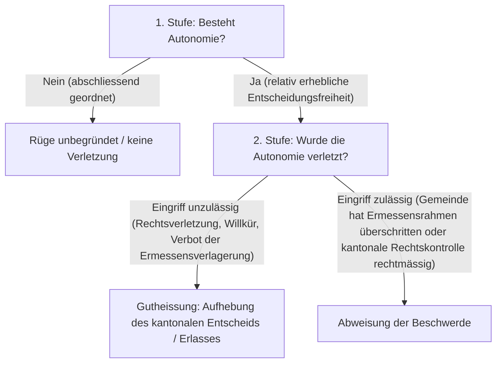

## Überblick {#ueberblick}

Die Schweiz ist ein dreistufiges föderatives Gemeinwesen: Neben dem Bund und den 26 Kantonen bilden über 2'100 Einwohnergemeinden das staatsorganisatorische Fundament der Eidgenossenschaft. Die **Gemeindeautonomie** garantiert den Gemeinden das Recht auf Selbstverwaltung und eigenständige Rechtsgestaltung in Angelegenheiten von lokaler Bedeutung.

Historisch basierte die Autonomie auf der von Zaccaria Giacometti geprägten Lehre der strikten Trennung zwischen *eigenem* und *übertragenem Wirkungskreis*. Nach dieser überholten Auffassung galt eine Gemeinde nur dort als autonom, wo sie originäre eigene Aufgaben völlig frei von staatlicher Kontrolle wahrnahm. Den entscheidenden Paradigmenwechsel vollzog das Bundesgericht in [BGE 93 I 154](https://entscheidsuche.ch/docs/CH_BGE/CH_BGE_001_BGE-93-I-154_1967-03-08.html#consideration_5.) E. 5 (1967): Es verwarf die starre Zweiteilung und begründete das moderne, relative Autonomiekonzept. Danach geniesst die Gemeinde Schutz, sobald und soweit ihr das kantonale Recht eine *relativ erhebliche Entscheidungsfreiheit* belässt – unabhängig davon, ob es sich um traditionelle Gemeindeaufgaben oder um delegierte staatliche Materien handelt.

In der Rechtspraxis gehört die Gemeindeautonomie zu den wirksamsten verfassungsrechtlichen Rügen im öffentlichen Recht: Sie bildet die Schranke gegen übermässige kantonale Zentralisierung und bevormundende Rechtskontrollen. Ob bei der kommunalen Nutzungsplanung, der Festsetzung des Gemeindesteuerfusses, der Erteilung von Baubewilligungen oder der Festlegung der Schulsprache: Wo das Gesetz der Gemeinde ein Ermessen oder Beurteilungsspielraum einräumt, verbietet die Gemeindeautonomie den kantonalen Gerichten und Aufsichtsbehörden, ihr eigenes Ermessen an die Stelle jenes der Gemeinde zu setzen.

## Rechtsgrundlagen: Bund und Kantone {#rechtsgrundlagen}

Die bundesverfassungsrechtliche Garantie ist in [Art. 50 BV](/kommentar/bv/art-050/) verankert:



### Das Zusammenspiel von Bundes- und Kantonsverfassung {#bund-kantone}

Art. 50 Abs. 1 BV fungiert als sogenannte *Rechtsinstitutionsgarantie mit bundesrechtlichem Schutz*: Die Bundesverfassung gewährleistet die Gemeindeautonomie zwar unmittelbar, überlässt ihren konkreten Bestand und Umfang jedoch der kantonalen Rechtsordnung (*«nach Massgabe des kantonalen Rechts»*). Die Kantone bestimmen autonom, ob, in welchen Aufgabenbereichen und in welchem Ausmass sie ihren Gemeinden Entscheidungsbefugnisse belassen.

Ergänzt wird dieser Grundsatz durch das Subsidiaritätsprinzip in Art. 43a Abs. 1 BV:



Der Bund verpflichtet sich in Art. 50 Abs. 2 und 3 BV, bei seinem Handeln auf die Gemeinden Rücksicht zu nehmen und den besonderen Verhältnissen von Städten, Agglomerationen und Berggebieten Rechnung zu tragen.

Die eigentliche materielle Rechtsquelle der Gemeindeautonomie liegt indessen in den Kantonsverfassungen (z. B. Art. 83 f. KV/ZH, Art. 109 KV/BE, § 68 KV/LU, § 44 KV/BL, Art. 89 KV/GR) und kantonalen Gemeindegesetzen. Sie umschreiben die kommunalen Aufgabenbereiche, statuieren den Grundsatz der Gemeindeautonomie und errichten verfassungsrechtliche Schranken gegen kantonale Eingriffe.

## Begriff und Schutzbereich {#begriff-und-schutzbereich}

### Die bundesgerichtliche Leitformel {#leitformel}

In gefestigter Praxis umschreibt das Bundesgericht die Gemeindeautonomie mit einer zweigliedrigen Formel:

> «Die Bundesverfassung gewährleistet die Gemeindeautonomie nach Massgabe des kantonalen Rechts […] Gemeinden sind in einem Sachbereich autonom, wenn das kantonale Recht diesen nicht abschliessend ordnet, sondern ihn ganz oder teilweise der Gemeinde zur Regelung überlässt und ihr dabei eine relativ erhebliche Entscheidungsfreiheit einräumt».
>
> — [BGE 147 I 136](https://entscheidsuche.ch/docs/CH_BGE/CH_BGE_001_BGE-147-I-136_2021.html#consideration_2.1) E. 2.1; ebenso [BGE 146 I 36](https://entscheidsuche.ch/docs/CH_BGE/CH_BGE_001_BGE-146-I-36_2020.html#consideration_3.1) E. 3.1; [BGE 145 I 52](https://entscheidsuche.ch/docs/CH_BGE/CH_BGE_001_BGE-145-I-52_2019.html#consideration_3.1) E. 3.1

Zwei Kriterien müssen kumulativ erfüllt sein:
1. **Keine abschliessende übergeordnete Regelung**: Das kantonale oder eidgenössische Recht darf den betreffenden Sachbereich nicht lückenlos und abschliessend geregelt haben.
2. **Relativ erhebliche Entscheidungsfreiheit**: Der Gemeinde muss durch offene Normen, Ermessenseinräumung oder unbestimmte Rechtsbegriffe ein echter Gestaltungs- oder Handlungsspielraum verbleiben.

Die Autonomie besteht dabei nicht zwingend für ein gesamtes Aufgabengebiet abstrakt, sondern «lediglich im streitigen Bereich» ([BGE 142 I 177](https://entscheidsuche.ch/docs/CH_BGE/CH_BGE_001_BGE-142-I-177_2016.html#consideration_2.) E. 2.; [BGE 145 I 52](https://entscheidsuche.ch/docs/CH_BGE/CH_BGE_001_BGE-145-I-52_2019.html#consideration_3.1) E. 3.1).

### Rechtsetzungs- und Anwendungsautonomie {#rechtsetzung-anwendung}

Der geschützte Autonomiebereich entfaltet sich auf zwei Stufen:

- **Rechtsetzungsautonomie**: Die Befugnis der Gemeinde, eigene kommunale Erlasse (Gemeindeordnungen, Bau- und Zonenreglemente, Abfall- und Gebührenreglemente) zu verabschieden.
- **Rechtsanwendungsautonomie**: Die Befugnis, beim Vollzug von kommunalem, kantonalem oder eidgenössischem Recht einen eingeräumten Beurteilungs- und Ermessensspielraum nach pflichtgemässem Ermessen auszufüllen ([BGE 145 I 52](https://entscheidsuche.ch/docs/CH_BGE/CH_BGE_001_BGE-145-I-52_2019.html#consideration_3.1) E. 3.1; [BGE 143 II 553](https://entscheidsuche.ch/docs/CH_BGE/CH_BGE_004_BGE-143-II-553_2017.html#consideration_6.3) E. 6.3).

### Die zentralen Schutzbereiche {#schutzbereiche}

Die Rechtsprechung hat die Gemeindeautonomie namentlich in folgenden klassischen Sachbereichen konkretisiert:

| Sachbereich | Typischer Gegenstand | Leitentscheide |
|---|---|---|
| **Planungs- und Bauautonomie** | Erlass von Zonenplänen, Bauordnungen, Erschliessungsfragen, Auslegung lokaler Gestaltungs- und Ästhetikklauseln | [BGE 145 I 52](https://entscheidsuche.ch/docs/CH_BGE/CH_BGE_001_BGE-145-I-52_2019.html#consideration_3.1) E. 3.1; [BGE 93 I 154](https://entscheidsuche.ch/docs/CH_BGE/CH_BGE_001_BGE-93-I-154_1967-03-08.html#consideration_6.) E. 6. |
| **Finanz- und Steuerautonomie** | Festsetzung des Gemeindesteuerfusses, Erhebung von Kausalabgaben und Gebühren, Vermögensverwaltung | [BGE 147 I 136](https://entscheidsuche.ch/docs/CH_BGE/CH_BGE_001_BGE-147-I-136_2021.html#consideration_2.1) E. 2.1; [BGE 142 I 177](https://entscheidsuche.ch/docs/CH_BGE/CH_BGE_001_BGE-142-I-177_2016.html#consideration_4.3) E. 4.3 |
| **Organisationsautonomie** | Aufbau und Gliederung der Gemeindebehörden (Gemeinderat, Gemeindeparlament, Kommissionen), Wahlverfahren | [BGE 143 I 272](https://entscheidsuche.ch/docs/CH_BGE/CH_BGE_001_BGE-143-I-272_2017.html#consideration_2.4) E. 2.4 |
| **Personalautonomie** | Anstellung, Einstufung und Besoldung des kommunalen Personals und der Lehrpersonen | BGE 134 I 204 E. 2 |
| **Polizei- und Sachaufgaben** | Ortspolizeiliche Ruhe- und Ordnungsreglemente, Festlegung der Schulsprache, kommunale Kulturförderung, ordentliche Einbürgerungen | [BGE 141 I 36](https://entscheidsuche.ch/docs/CH_BGE/CH_BGE_001_BGE-141-I-36_2015.html#consideration_5.5) E. 5.5; [BGE 144 I 193](https://entscheidsuche.ch/docs/CH_BGE/CH_BGE_001_BGE-144-I-193_2018.html#consideration_7.4.1) E. 7.4.1; [BGE 146 I 83](https://entscheidsuche.ch/docs/CH_BGE/CH_BGE_001_BGE-146-I-83_2020.html#consideration_2.1) E. 2.1 |

## Zweistufige Prüfmethodik des Bundesgerichts {#pruefmethodik}

Das Bundesgericht prüft Rügen einer Verletzung der Gemeindeautonomie in einem strikt zweistufigen Verfahren:

### 1. Stufe: Bestand der Autonomie im streitigen Bereich {#stufe-1}

Zunächst wird untersucht, ob der Gemeinde nach Massgabe des anwendbaren kantonalen Verfassungs- und Gesetzesrechts im konkreten Streitpunkt eine relativ erhebliche Entscheidungsfreiheit zusteht ([BGE 147 I 136](https://entscheidsuche.ch/docs/CH_BGE/CH_BGE_001_BGE-147-I-136_2021.html#consideration_2.1) E. 2.1).
- Hat der kantonale oder eidgenössische Gesetzgeber den Bereich abschliessend geregelt, fehlt es an der Autonomie, und die Rüge erweist sich von vornherein als unbegründet.
- Die Frage, ob Autonomie besteht, prüft das Bundesgericht frei, soweit es sich um die Auslegung von kantonalem Verfassungsrecht handelt (Art. 95 lit. c BGG); bei einfachem kantonalem Gesetzesrecht beschränkt sich die Kognition auf Willkür ([BGE 141 I 36](https://entscheidsuche.ch/docs/CH_BGE/CH_BGE_001_BGE-141-I-36_2015.html#consideration_5.4) E. 5.4).

### 2. Stufe: Verletzung der Autonomie {#stufe-2}

Wird das Bestehen von Autonomie bejaht, wird auf der zweiten Stufe geprüft, ob die kantonale Behörde oder das kantonale Gericht unzulässig in diese Entscheidungsfreiheit eingegriffen hat. Eine Verletzung liegt vor, wenn die kantonale Instanz:
1. **Ihre Prüfungsbefugnis überschritten hat**: Sie greift in das gemeindliche Ermessen ein, obwohl ihr nach kantonalem Recht nur eine Rechtskontrolle zusteht ([BGE 93 I 154](https://entscheidsuche.ch/docs/CH_BGE/CH_BGE_001_BGE-93-I-154_1967-03-08.html#consideration_5.) E. 5).
2. **Die Rechtskontrolle fehlerhaft ausgeübt hat**: Sie nimmt eine Rechtsverletzung durch die Gemeinde an, die in Wirklichkeit gar nicht vorliegt, oder wendet das massgebliche kantonale Recht willkürlich an ([BGE 93 I 427](https://entscheidsuche.ch/docs/CH_BGE/CH_BGE_001_BGE-93-I-427_1967-10-04.html#consideration_3.) E. 3c).
3. **Verfassungsmässige Rechte missachtet hat**: Im Rahmen der Autonomierüge «kann sich eine Gemeinde in Verbindung mit der Rüge der Verletzung ihrer Autonomie auf weitere Verfassungsrechte und -grundsätze berufen, namentlich auf die Rechtsgleichheit […] den Schutz vor Willkür bzw. die Wahrung von Treu und Glauben […] sowie die Grundsätze staatlichen Handelns» ([BGE 144 I 193](https://entscheidsuche.ch/docs/CH_BGE/CH_BGE_001_BGE-144-I-193_2018.html#consideration_7.4.1) E. 7.4.1; [BGE 146 I 36](https://entscheidsuche.ch/docs/CH_BGE/CH_BGE_001_BGE-146-I-36_2020.html#consideration_3.2) E. 3.2).

## Gerichtliche Kontrolle und Kognition {#kognition}

### Das Verbot der Ermessensverlagerung bei kantonalen Gerichten {#ermessensverlagerung}

In der Praxis entsteht der schärfste Konflikt zwischen der Gemeindeautonomie und der Kognition kantonaler Verwaltungsgerichte und Baurekursgerichte:

Viele kantonale Verfahrensgesetze räumen der ersten gerichtlichen Rechtsmittelinstanz formell eine Überprüfung der Angemessenheit ein (vgl. § 20 Abs. 1 VRG/ZH oder Art. 33 Abs. 3 lit. b RPG). Würde das kantonale Gericht diese Befugnis jedoch uneingeschränkt ausüben und seine eigene Wertung an die Stelle der kommunalen Baubehörde setzen, würde die lokale Selbstverwaltung ausgehöhlt.

In [BGE 145 I 52](https://entscheidsuche.ch/docs/CH_BGE/CH_BGE_001_BGE-145-I-52_2019.html#consideration_3.6) E. 3.6 hat das Bundesgericht dieses Spannungsverhältnis grundlegend geklärt:
- **Respektierung lokaler Vertrautheit**: Bei unbestimmten Rechtsbegriffen und Gestaltungsfragen (wie der *befriedigenden Gesamtwirkung* oder Ästhetik nach § 238 PBG/ZH) besitzen kommunale Behörden eine besondere Vertrautheit mit den örtlichen Verhältnissen.
- **Richterliche Zurückhaltung**: «Dagegen lässt die Rechtsweggarantie eine richterliche Zurückhaltung bei der Überprüfung unbestimmter Rechtsbegriffe zu, was den Gerichten erlaubt, den entsprechenden Handlungsspielraum der unteren Instanzen und insbesondere der Gemeinden zu wahren» (BGE 145 I 52 E. 3.6).
- **Keine freie Ermessenssubstitution**: «Vielmehr darf es den Einordnungsentscheid der kommunalen Baubehörde nur aufheben, wenn diese bei der Anwendung von § 238 PBG /ZH ihren durch die Gemeindeautonomie gewährleisteten Beurteilungs- und Ermessensspielraum überschritten hat» (BGE 145 I 52 E. 3.6).
- **Grenzen der Zurückhaltung**: Die Zurückhaltung darf aber nicht zu einer blossen Willkürkognition herabsinken, da sonst Art. 29a BV (Rechtsweggarantie) und Art. 33 Abs. 3 lit. b RPG verletzt würden. Das kantonale Gericht muss einschreiten, wenn die Gemeinde sachfremde Kriterien anwendet, das Verhältnismässigkeitsprinzip verletzt oder übergeordnete Ziele des Raumplanungsrechts (z. B. innere Verdichtung) missachtet (BGE 145 I 52 E. 3.6).

### Kognition des Bundesgerichts {#bger-kognition}

Gelangt ein Streitfall vor das Bundesgericht, richtet sich dessen Überprüfungsbefugnis nach Art. 95 BGG ([BGE 141 I 36](https://entscheidsuche.ch/docs/CH_BGE/CH_BGE_001_BGE-141-I-36_2015.html#consideration_5.4) E. 5.4; [BGE 147 I 136](https://entscheidsuche.ch/docs/CH_BGE/CH_BGE_001_BGE-147-I-136_2021.html#consideration_1.4) E. 1.4):

1. **Freie Prüfung (Rechtskontrolle)**:
   - Die Anwendung von Bundesrecht (Art. 95 lit. a BGG).
   - Die Auslegung von kantonalem Verfassungsrecht (Art. 95 lit. c BGG), insbesondere jenen Normen, welche die Garantie der Gemeindeautonomie und die Kompetenzverteilung zwischen Kanton und Gemeinden verankern.
   - Die Frage, ob die kantonale Vorinstanz den gemeindlichen Ermessens- und Beurteilungsspielraum respektiert hat: «Frei prüft das Bundesgericht sodann, ob die kantonale Rechtsmittelinstanz einen in den Anwendungsbereich der Gemeindeautonomie fallenden Beurteilungsspielraum respektiert hat» (BGE 141 I 36 E. 5.4).
2. **Willkürprüfung (Art. 9 BV)**:
   - Die Auslegung und Anwendung des einfachen kantonalen Gesetzes- und Verordnungsrechts prüft das Bundesgericht ausschliesslich unter dem Blickwinkel des Willkürverbots ([BGE 142 I 177](https://entscheidsuche.ch/docs/CH_BGE/CH_BGE_001_BGE-142-I-177_2016.html#consideration_2.) E. 2.; [BGE 147 I 136](https://entscheidsuche.ch/docs/CH_BGE/CH_BGE_001_BGE-147-I-136_2021.html#consideration_1.4) E. 1.4).

## Verfahren und Beschwerdelegitimation {#verfahren-und-legitimation}



### Beschwerdebefugnis der Gemeinden (Art. 89 Abs. 2 lit. c BGG) {#legitimation-gemeinde}

Gemeinden sind als staatliche Gebietskörperschaften grundsätzlich Träger staatlicher Gewalt und nicht Grundrechtsträger. Sie können daher nicht wie Private jedwede Grundrechtsverletzung rügen. Art. 89 Abs. 2 lit. c BGG eröffnet ihnen jedoch eine Sonderlegitimation zur Beschwerde in öffentlich-rechtlichen Angelegenheiten:

- **Voraussetzung**: Die Gemeinde rügt die Verletzung von Garantien, die ihr die Kantons- oder Bundesverfassung gewährt ([Art. 89 Abs. 2 lit. c BGG](/kommentar/bgg/art-089/); [BGE 136 I 404](https://entscheidsuche.ch/docs/CH_BGE/CH_BGE_001_BGE-136-I-404_2010.html#consideration_1.1.2) E. 1.1.2). Dazu zählt an vorderster Stelle Art. 50 Abs. 1 BV.
- **Eintreten vs. materielle Begründetheit**: Für das Eintreten auf die Beschwerde genügt es, dass die Gemeinde substantiiert behauptet, in ihrer Autonomie verletzt zu sein. «Ob die beanspruchte Autonomie tatsächlich besteht, ist hingegen keine Frage des Eintretens, sondern der materiellen Beurteilung» ([BGE 146 I 36](https://entscheidsuche.ch/docs/CH_BGE/CH_BGE_001_BGE-146-I-36_2020.html#consideration_1.4) E. 1.4; ebenso BGE 135 I 43 E. 1.2).
- **Andere öffentlich-rechtliche Körperschaften**: Neben den Einwohnergemeinden sind auch Schulgemeinden ([BGE 143 I 272](https://entscheidsuche.ch/docs/CH_BGE/CH_BGE_001_BGE-143-I-272_2017.html#consideration_2.4) E. 2.4), Bürgergemeinden ([BGE 146 I 83](https://entscheidsuche.ch/docs/CH_BGE/CH_BGE_001_BGE-146-I-83_2020.html#consideration_2.1) E. 2.1) und Zweckverbände gestützt auf Art. 89 Abs. 2 lit. c BGG legitimiert, sofern ihnen nach kantonalem Recht ein autonomer Aufgabenbereich zusteht.
- **Anfechtungsobjekte**: Anfechtbar sind Einzelakte kantonaler Instanzen (Verfügungen, Rekursentscheide), kantonale richtplanerische Massnahmen ([BGE 146 I 36](https://entscheidsuche.ch/docs/CH_BGE/CH_BGE_001_BGE-146-I-36_2020.html#consideration_1.4) E. 1.4) sowie kantonale Gesetze und Verordnungen im Rahmen der abstrakten Normenkontrolle ([BGE 147 I 136](https://entscheidsuche.ch/docs/CH_BGE/CH_BGE_001_BGE-147-I-136_2021.html#consideration_1.2) E. 1.2).

### Beschwerdebefugnis Privater (Art. 89 Abs. 1 BGG) {#legitimation-private}

Unter der Herrschaft des früheren Organisationsreglements (Art. 88 OG) konnten Privatpersonen die Autonomierüge nur hilfsweise erheben. Mit der Einführung des BGG hat sich die Rechtslage grundlegend geändert:

> «Private können sich daher auf die Gemeindeautonomie berufen, soweit diese Garantie eine Auswirkung auf ihre rechtliche oder tatsächliche Stellung haben kann».
>
> — [BGE 141 I 36](https://entscheidsuche.ch/docs/CH_BGE/CH_BGE_001_BGE-141-I-36_2015.html#consideration_1.2.4) E. 1.2.4

Voraussetzung ist lediglich, dass der Beschwerdeführer ein schutzwürdiges Interesse an der Aufhebung des Akts hat (Art. 89 Abs. 1 lit. c BGG) und die Gemeinde hoheitlich gehandelt hat. So können Bauherren oder Einsprecher die Verletzung der Gemeindeautonomie rügen, wenn eine kantonale Rechtsmittelinstanz einen zu ihren Gunsten lautenden kommunalen Bau- oder Zonenentscheid aufgehoben hat.

Eine kantonale Regelung, welche die Autonomierüge im kantonalen Verfahren ausschliesslich den Gemeinden vorbehalten und Privatpersonen verwehren will, ist nach Art. 111 Abs. 1 BGG bundesrechtswidrig ([BGE 141 I 36](https://entscheidsuche.ch/docs/CH_BGE/CH_BGE_001_BGE-141-I-36_2015.html#consideration_5.1) E. 5.1).

## Grenzen und kantonale Eingriffsmöglichkeiten {#grenzen-und-eingriffe}

### Gesetzgebungsfreiheit des Kantons und verfassungsrechtliche Grenzen {#gesetzgebungsfreiheit}

Weil die Autonomie nach Art. 50 Abs. 1 BV unter dem Vorbehalt des kantonalen Rechts steht, ist der kantonale Gesetzgeber grundsätzlich frei, das kantonale Recht anzupassen:

«Die Kantone dürfen ihre Gesetze grundsätzlich ändern und dadurch die bisherige relativ erhebliche Entscheidungsfreiheit der Gemeinden in einem Sachbereich einschränken oder gar ganz abschaffen. Kantonale Gesetzesänderungen können die Gemeindeautonomie nur verletzen, wenn der betroffene Autonomiebereich durch die kantonale Verfassung geschützt wird» ([BGE 147 I 136](https://entscheidsuche.ch/docs/CH_BGE/CH_BGE_001_BGE-147-I-136_2021.html#consideration_2.3.1) E. 2.3.1).

Die kantonale Verfassung zieht der kantonalen Gesetzgebung mithin bindende Schranken:
- **Der Fall des Luzerner Steuerfussabtauschs**: Im Kanton Luzern garantierte die Kantonsverfassung (§ 68 Abs. 2, § 77 lit. a KV/LU) den Gemeinden das Recht auf eigene Steuerhoheit und Steuerfussfestsetzung. Als der Grosse Rat mit dem Steuerfussabtauschgesetz den Gemeinden die Festsetzung des Steuerfusses für das Jahr 2020 entziehen wollte, hob das Bundesgericht die Bestimmung wegen Verletzung der Gemeindeautonomie auf ([BGE 147 I 136](https://entscheidsuche.ch/docs/CH_BGE/CH_BGE_001_BGE-147-I-136_2021.html#consideration_2.4) E. 2.4).
- **Zwangsfusionen von Schulgemeinden in Zürich**: Weil Art. 84 Abs. 2 KV/ZH für den Zusammenschluss einer Schulgemeinde mit einer Einwohnergemeinde die Zustimmung der Mehrheit der Schulgemeinde verlangt, hob das Bundesgericht eine kantonale Gesetzesbestimmung auf, die diese Abstimmung ausschalten wollte ([BGE 143 I 272](https://entscheidsuche.ch/docs/CH_BGE/CH_BGE_001_BGE-143-I-272_2017.html#consideration_2.4) E. 2.4).

### Schranken kantonaler Volksinitiativen {#schranken-initiativen}

Die Gemeindeautonomie setzt auch kantonalen Volksinitiativen materielle Schranken: Eine kantonale Initiative darf nicht zu einer faktisch erdrosselnden oder unverhältnismässigen Aushöhlung der kommunalen Kernkompetenzen führen.

In [BGE 144 I 193](https://entscheidsuche.ch/docs/CH_BGE/CH_BGE_001_BGE-144-I-193_2018.html#consideration_7.4.2) (betreffend die bernische Volksinitiative *Keine Steuergelder für die Berner Reitschule!*) bestätigte das Bundesgericht die Ungültigerklärung der Initiative: Die Vorlage wollte der Stadt Bern die Gelder aus dem kantonalen Finanzausgleich kürzen, falls sie das Kulturzentrum Reitschule weiter subventioniere. Das Bundesgericht erachtete diese finanzielle Sanktion als übermässigen, verfassungswidrigen Eingriff in die kommunale Kulturförderungsautonomie und als Verstoss gegen das Verhältnismässigkeitsprinzip (E. 7.4.5).

### Kantonale Aufsicht: Rechtsaufsicht statt Zweckmässigkeitskontrolle {#aufsicht}

Erlasse und Beschlüsse von Gemeinden unterliegen häufig Genehmigungsvorbehalten oder der Aufsicht durch kantonale Departemente oder den Regierungsrat. Hier gilt der von der Rechtsprechung seit [BGE 93 I 154](https://entscheidsuche.ch/docs/CH_BGE/CH_BGE_001_BGE-93-I-154_1967-03-08.html#consideration_5.) E. 5 gezogene Grundsatz:
- Dürfen die Aufsichtsbehörden Erlasse der Gemeinde nur auf ihre **Rechtmässigkeit** hin überprüfen, verletzt jede Beanstandung aus Zweckmässigkeitsgründen die Gemeindeautonomie.
- Sieht das kantonale Recht ausnahmsweise auch eine **Zweckmässigkeitsprüfung** vor, ist die Autonomie nur verletzt, wenn die kantonale Behörde das ihr zustehende Aufsichtsermessen missbraucht oder überschreitet ([BGE 93 I 154](https://entscheidsuche.ch/docs/CH_BGE/CH_BGE_001_BGE-93-I-154_1967-03-08.html#consideration_5.) E. 5).

## Würdigung {#wuerdigung}

Die Gemeindeautonomie bildet das tragende Gegengewicht im schweizerischen Bundesstaat: Sie verhindert die Erstarrung der Rechtsanwendung in zentralistischer Gleichmacherei und sichert sach- und bürgernahe Lösungen. Gerade in der Raumplanung, im Baupolizeirecht und im Steuerwesen ermöglicht sie es den Gemeinden, den spezifischen topografischen, wirtschaftlichen und gesellschaftlichen Eigenheiten vor Ort massgeschneidert Rechnung zu tragen.

Gleichzeitig steht die Gemeindeautonomie unter permanentem Reform- und Harmonisierungsdruck: Zunehmend verlangen übergeordnete Herausforderungen – von der haushälterischen Bodennutzung über interkommunale Verkehrskonzepte bis hin zu kantonsweiten Bildungs- und Spitalplanungen – nach koordinierter Führung auf kantonaler und eidgenössischer Ebene.

Die Rechtsprechung des Bundesgerichts meistert diesen Spagat, indem sie die Autonomie nicht als statisches Vorrecht begreift, sondern als funktionale Kompetenzverteilung:
1. Den Kantonen verbleibt die Befugnis, die Aufgabenverteilung legistisch weiterzuentwickeln, solange sie die Schranken ihrer eigenen Verfassung beachten ([BGE 147 I 136](https://entscheidsuche.ch/docs/CH_BGE/CH_BGE_001_BGE-147-I-136_2021.html#consideration_2.3.1) E. 2.3.1).
2. Wo das übergeordnete Recht der Gemeinde jedoch Entscheidungsspielräume einräumt, bindet die Autonomiegarantie die Rechtsmittelinstanzen strikt an das Verbot der Ermessensverlagerung ([BGE 145 I 52](https://entscheidsuche.ch/docs/CH_BGE/CH_BGE_001_BGE-145-I-52_2019.html#consideration_3.6) E. 3.6). Damit bleibt gewährleistet, dass örtliche Ermessensentscheide von den demokratisch legitimierten Gemeindeorganen getroffen werden und nicht von kantonalen Gerichten.

## Praxishinweise {#praxishinweise}

- **Genaue Analyse der Rechtsgrundlagen im kantonalen Recht**: Vor jeder Rüge ist nachzuweisen, dass das kantonale Recht den Bereich nicht abschliessend regelt und der Gemeinde eine relativ erhebliche Entscheidungsfreiheit belässt. Fehlt dieser Nachweis in der Beschwerdeschrift, scheitert die Rüge bereits auf der 1. Stufe ([BGE 147 I 136](https://entscheidsuche.ch/docs/CH_BGE/CH_BGE_001_BGE-147-I-136_2021.html#consideration_2.1) E. 2.1).
- **Verbot der Ermessensverlagerung aktiv einfordern**: Hat eine kantonale Rechtsmittelinstanz (z. B. ein Baurekursgericht) ein kommunales Baugesuch anders beurteilt als die Gemeindebehörde, ist sorgfältig zu prüfen, ob die Vorinstanz ihr eigenes Ermessen an die Stelle jenes der Gemeinde gesetzt hat. Bei Beurteilungsspielräumen im Bau- und Ästhetikrecht darf das Gericht den kommunalen Entscheid nur bei Rechtsverletzungen oder Ermessensüberschreitung aufheben ([BGE 145 I 52](https://entscheidsuche.ch/docs/CH_BGE/CH_BGE_001_BGE-145-I-52_2019.html#consideration_3.6) E. 3.6).
- **Akzessorische Verfassungsrügen verbinden**: Eine Gemeinde kann Grundrechte (wie Art. 8 oder 9 BV) nicht selbständig anrufen. Rügt sie jedoch eine Autonomieverletzung, kann sie mit Erfolg Willkür (Art. 9 BV), Rechtsungleichheit (Art. 8 BV) und Unverhältnismässigkeit (Art. 5 Abs. 2 BV) rügen ([BGE 144 I 193](https://entscheidsuche.ch/docs/CH_BGE/CH_BGE_001_BGE-144-I-193_2018.html#consideration_7.4.1) E. 7.4.1).
- **Legitimation Privater gezielt nutzen**: Private Beschwerdeführer (Bauherren, Gesuchsteller) können sich nach Art. 89 Abs. 1 BGG selbständig auf die Gemeindeautonomie berufen, wenn die kantonale Vorinstanz einen zu ihren Gunsten ergangenen Gemeindeentscheid aufgehoben hat ([BGE 141 I 36](https://entscheidsuche.ch/docs/CH_BGE/CH_BGE_001_BGE-141-I-36_2015.html#consideration_1.2.4) E. 1.2.4).
- **Kantonale Verfassungsgarantien gegen Erlasse mobilisieren**: Soll eine kommunale Kernkompetenz (z. B. die Steuerhoheit oder Schulorganisation) durch ein kantonales Gesetz entzogen werden, ist unverzüglich die Kantonsverfassung auf entgegenstehende Garantien hin zu prüfen und gegebenenfalls ein Normenkontrollverfahren einzuleiten ([BGE 147 I 136](https://entscheidsuche.ch/docs/CH_BGE/CH_BGE_001_BGE-147-I-136_2021.html#consideration_2.3.1) E. 2.3.1; [BGE 143 I 272](https://entscheidsuche.ch/docs/CH_BGE/CH_BGE_001_BGE-143-I-272_2017.html#consideration_2.4) E. 2.4).

## Leitentscheide {#leitentscheide}

| Entscheid | Gegenstand | Bedeutung für die Gemeindeautonomie |
|---|---|---|
| [BGE 93 I 154](https://entscheidsuche.ch/docs/CH_BGE/CH_BGE_001_BGE-93-I-154_1967-03-08.html#consideration_5.) E. 5, 6 | Bauvorschriften und Zonenpläne Zürich | Grundsatzentscheid: Abkehr von der Lehre Giacomettis; Begründung der Formel der *relativ erheblichen Entscheidungsfreiheit* |
| [BGE 93 I 427](https://entscheidsuche.ch/docs/CH_BGE/CH_BGE_001_BGE-93-I-427_1967-10-04.html#consideration_3.) E. 3c | Bebauungspläne Solothurn | Autonomieverletzung bei willkürlicher Handhabung der kantonalen Rechtskontrolle |
| [BGE 135 I 43](https://entscheidsuche.ch/docs/CH_BGE/CH_BGE_001_BGE-135-I-43_2009.html#consideration_1.2) E. 1.2, 1.3 | Finanzausgleich St. Gallen | Beschwerdelegitimation der Gemeinden; Fehlen eines geschützten Autonomiebereichs beim interkommunalen Finanzausgleich |
| [BGE 136 I 404](https://entscheidsuche.ch/docs/CH_BGE/CH_BGE_001_BGE-136-I-404_2010.html#consideration_1.1.2) E. 1.1.2, 1.1.3 | Gemeindebeschwerderecht Genf | Beschwerderecht der Gemeinden stützt sich auf Art. 89 Abs. 2 lit. c BGG, nicht auf politische Rechte |
| [BGE 141 I 36](https://entscheidsuche.ch/docs/CH_BGE/CH_BGE_001_BGE-141-I-36_2015.html#consideration_1.2.4) E. 1.2.4, 5.1, 5.4, 5.5 | Schulsprache Graubünden (Rumantsch Grischun) | Private können die Verletzung der Gemeindeautonomie rügen; Kognition des Bundesgerichts bei Art. 95 BGG |
| [BGE 142 I 177](https://entscheidsuche.ch/docs/CH_BGE/CH_BGE_001_BGE-142-I-177_2016.html#consideration_2.) E. 2, 4.3 | Mehrwertabgabe Münchenstein BL | Schutz im streitigen Bereich; kommunale Kompetenz zur Erhebung einer Mehrwertabgabe bei kantonaler Untätigkeit |
| [BGE 143 I 272](https://entscheidsuche.ch/docs/CH_BGE/CH_BGE_001_BGE-143-I-272_2017.html#consideration_2.4) E. 2.4 | Schulgemeinden Zürich | Schutz anderer öffentlich-rechtlicher Körperschaften (Schulgemeinden) vor gesetzlichen Zwangsfusionen durch Kantonsverfassung |
| [BGE 143 II 553](https://entscheidsuche.ch/docs/CH_BGE/CH_BGE_004_BGE-143-II-553_2017.html#consideration_6.3) E. 6.3 | Öffentliches Beschaffungswesen Zürich | Entscheidungsfreiheit der Gemeinden bei der Ausgestaltung von Zuschlagskriterien |
| [BGE 144 I 193](https://entscheidsuche.ch/docs/CH_BGE/CH_BGE_001_BGE-144-I-193_2018.html#consideration_7.4.1) E. 7.4.1, 7.4.5 | Kulturförderung Bern (Reitschule-Initiative) | Schranke kantonaler Volksinitiativen gegenüber der Gemeindeautonomie; Verbindung mit Art. 5, 8 und 9 BV |
| [BGE 145 I 52](https://entscheidsuche.ch/docs/CH_BGE/CH_BGE_001_BGE-145-I-52_2019.html#consideration_3.6) E. 3.1, 3.6 | Baurekursgericht Zürich (§ 238 PBG/ZH) | Leitentscheid zur Kognition: Verbot der freien Ermessenssubstitution durch kantonale Rechtsmittelgerichte bei Ästhetik- und Gestaltungsfragen |
| [BGE 146 I 36](https://entscheidsuche.ch/docs/CH_BGE/CH_BGE_001_BGE-146-I-36_2020.html#consideration_1.4) E. 1.4, 3.1 | Richtplanung und RPG | Legitimation nach Art. 89 Abs. 2 lit. c BGG als materielle Frage; Anfechtbarkeit kantonaler Richtpläne |
| [BGE 147 I 136](https://entscheidsuche.ch/docs/CH_BGE/CH_BGE_001_BGE-147-I-136_2021.html#consideration_2.1) E. 1.4, 2.1, 2.3.1, 2.4 | Steuerfussabtausch Luzern (AFR18) | Leitentscheid: Finanz- und Steuerautonomie; Grenzen kantonaler Gesetzgebung durch kantonales Verfassungsrecht |

## Literatur {#literatur}

In den zitierten Leitentscheiden ausdrücklich herangezogen:

- Giacometti, Staatsrecht der schweizerischen Kantone, S. 75 (in BGE 93 I 154 E. 5).
- Häfelin/Müller/Uhlmann, Allgemeines Verwaltungsrecht, 7. Aufl. 2016, S. 98 Rz. 419 f. (in BGE 145 I 52 E. 3.6).
- Liver, Die Gemeindeautonomie in der neueren Rechtsprechung des Bundesgerichts, ZBl 50/1949 S. 40 ff., S. 45 (in BGE 93 I 154 E. 5).
- Schindler, Die Gemeindeautonomie als Hindernis für einen wirksamen Rechtsschutz, in: Staats- und Verwaltungsrecht auf vier Ebenen, Festschrift für Tobias Jaag, 2012, S. 149 ff. (in BGE 145 I 52 E. 3.6).
- Tschannen, Die Gemeindeautonomie in der neueren bundesgerichtlichen Rechtsprechung, ZBJV 146/2010 S. 1004; 147/2011 S. 810 f.; 150/2014 S. 834 (in BGE 141 I 36 E. 5.4).
- Tschannen/Zimmerli/Müller, Allgemeines Verwaltungsrecht, 4. Aufl. 2014, S. 222 f. Rz. 29 (in BGE 145 I 52 E. 3.6).
- Waldmann, in: Basler Kommentar, Bundesgerichtsgesetz, 2008, N. 62 zu Art. 89 BGG (in BGE 136 I 404 E. 1.1.3).

Die Angaben folgen den Zitierungen in den jeweiligen Entscheiden; die Werke selbst wurden nicht eingesehen.
