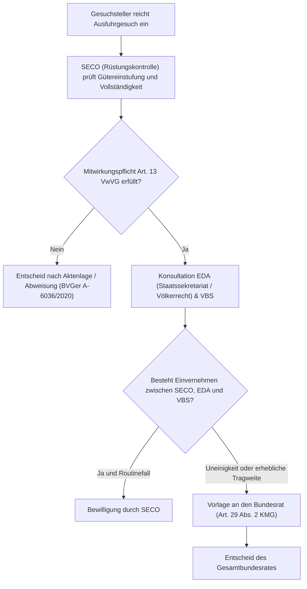

## Überblick {#ueberblick}

Das schweizerische Rüstungskontrollrecht bewegt sich in einem dauerhaften verfassungs- und aussenpolitischen Spannungsfeld: Einerseits gebieten die dauernde bewaffnete Neutralität, das humanitäre Völkerrecht und die aussenpolitischen Grundsätze der Schweizerischen Eidgenossenschaft eine strikte Kontrolle und Zurückhaltung bei der Ausfuhr von Kriegsmaterial. Andererseits verlangt die Glaubwürdigkeit und Durchhaltefähigkeit der Landesverteidigung eine funktionsfähige inländische Sicherheits- und Rüstungsindustrie, die auf den Export angewiesen ist, um im internationalen Verbund wirtschaftlich und technologisch überleben zu können.

Diesen Dualismus bringt die Zweckbestimmung des Kriegsmaterialgesetzes (Art. 1 KMG) unmittelbar zum Ausdruck:



Nach den politischen Kontroversen um Rüstungsexporte in Bürgerkriegsregionen des Nahen Ostens verankerte das Parlament mit dem indirekten Gegenvorschlag zur sogenannten *Korrektur-Initiative* die massgeblichen Bewilligungskriterien und zwingenden Versagungsgründe per 1. Mai 2022 direkt im formellen Gesetz (Art. 22a KMG). Der Ausbruch des Ukraine-Kriegs im Februar 2022 und die Weigerung des Bundesrates, europäischen Partnerstaaten wie Deutschland, Dänemark oder Spanien die Weitergabe (den *Reexport*) von in der Schweiz beschaffter Munition und Panzern an die von Russland angegriffene Ukraine zu gestatten, führten jedoch zu einer tiefgreifenden Vertrauenskrise in den sicherheitspolitischen Beziehungen zu westlichen Demokratien.

Mit der Gesetzesrevision vom 19. Dezember 2025 (Geschäft 25.024) beschloss die Bundesversammlung, dem Bundesrat eine Abweichungskompetenz von den gesetzlichen Exportkriterien einzuräumen und die Weitergabe von Kriegsmaterial an demokratische Partnerstaaten unter bestimmten Voraussetzungen zu erleichtern. Weil gegen diese Vorlage das fakultative Referendum ergriffen wurde, entscheidet das Schweizer Stimmvolk am **29. November 2026** über die Zukunft der Rüstungsexportkontrolle.

---

## Verfassungsrechtlicher Rahmen und Zweck {#verfassungsrechtlicher-rahmen-und-zweck}

Die verfassungsrechtliche Gesetzgebungskompetenz für das Rüstungswesen liegt gemäss Art. 107 BV beim Bund:



Die Bestimmung erteilt dem Bund eine umfassende, ausschliessliche Sachkompetenz zur Regulierung sämtlicher Phasen des Lebenszyklus von Rüstungsgütern: von der Entwicklung und Herstellung über den innerstaatlichen Vertrieb bis hin zur Ein-, Aus- und Durchfuhr. 

In materieller Hinsicht wird das Kriegsmaterialrecht von zwei gegenläufigen Staatsaufgaben flankiert:
1. **Aussenpolitische Verpflichtungen und Neutralität (Art. 54 BV, [Art. 184 BV](/kommentar/bv/art-185/)):** Die Schweiz ist völkerrechtlich an das Fünfte Haager Abkommen von 1907 betreffend die Rechte und Pflichten der neutralen Mächte und Personen im Falle eines Landkriegs gebunden. Neutralitätsrechtlich ist es dem neutralen Staat untersagt, kriegführenden Staaten staatliche Rüstungsgüter zu liefern (Art. 6 HKÜ V). Gestattet ein neutraler Staat privaten Rüstungsunternehmen den Export, muss er dies gegenüber allen Kriegsparteien gleich behandeln (Art. 9 HKÜ V). Ergänzt wird dies durch den internationalen Waffenhandelsvertrag (Arms Trade Treaty, ATT, SR 0.518.61), der Rüstungstransfers untersagt, wenn die Gefahr von Völkermord, Verbrechen gegen die Menschlichkeit oder Kriegsverbrechen droht.
2. **Sicherheits- und Landesverteidigungskompetenz (Art. 58 BV, [Art. 185 BV](/kommentar/bv/art-185/)):** Eine autonome militärische Verteidigungsfähigkeit setzt industrielle Kapazitäten im Inland voraus, die Waffen und Munition warten, anpassen und im Krisenfall bereitstellen können. Da der Bedarf der Schweizer Armee allein für eine wirtschaftliche Rüstungsproduktion zu gering ist, erkennt Art. 1 KMG die Aufrechterhaltung einer solchen industriellen Kapazität ausdrücklich als Gesetzeszweck an.

Das Bundesgericht betonte im Urteil [1C_592/2019 vom 16. Dezember 2019](https://entscheidsuche.ch/docs/CH_BGer/CH_BGer_001_1C-592-2019_2019-12-16.html) (E. 4.3):
> «Der Zweck des Güterkontrollgesetzes liegt gemäss dessen Art. 1 darin, die in den Anwendungsbereich dieses Gesetzes fallenden Güter zu kontrollieren. Ähnlich sieht Art. 1 KMG insbesondere vor, das Gesetz bezwecke, durch die Kontrolle der Herstellung und des Transfers von Kriegsmaterial und der entsprechenden Technologie die internationalen Verpflichtungen der Schweiz zu erfüllen sowie ihre aussenpolitischen Grundsätze zu wahren.»

---

## Begriff des Kriegsmaterials und Abgrenzungen {#begriff-des-kriegsmaterials-und-abgrenzungen}

Das Bundesgesetz über das Kriegsmaterial erfasst nicht jede Form von Ausrüstung, die vom Militär genutzt wird, sondern statuiert eine präzise Abgrenzung:

### Definition nach Art. 5 KMG und Anhang 1 KMV {#definition-nach-art-5-kmg-und-anhang-1-kmv}

Als *Kriegsmaterial* gelten gemäss Art. 5 Abs. 1 KMG Waffen, Waffensysteme, Munition und militärische Sprengmittel sowie Ausrüstungsgegenstände und Bestandteile, die spezifisch für den militärischen Einsatz konzipiert oder abgeändert worden sind. Die konkrete Güterliste wird vom Bundesrat in Anhang 1 der Kriegsmaterialverordnung (KMV, SR 514.511) festgelegt und umfasst 22 Kategorien (KM 1 bis KM 22, orientiert an der Munitionsliste des Wassenaar-Arrangements).

Für Bauteile und Baugruppen gilt ein funktioneller Massstab: Werden Gegenstände nach Mass für militärische Vorhaben gefertigt und fehlt ihnen eine zivile Einsatzmöglichkeit, fallen sie unter das KMG. Im Leitentscheid zur irakischen *Supergun* ([BGE 122 IV 103 E. III.3.](https://entscheidsuche.ch/docs/CH_BGE/CH_BGE_006_BGE-122-IV-103_1996-02-01.html#consideration_III.3.)) hielt das Bundesgericht fest:
> «Ob Dämpfzylinder ganz allgemein auch zivile Verwendung finden können, ist jedoch nicht entscheidend, denn es kommt nach dem klaren Wortlaut der VKM darauf an, ob die konkret in Frage stehenden Gegenstände "in der gleichen Ausführung" eine zivile Verwendung finden können oder nicht.»
> «Die von Von Roll hergestellten Gegenstände waren genau auf die irakischen Projekte zugeschnitten und konnten "in der gleichen Ausführung" ausschliesslich dort eingebaut werden.»

### Abgrenzung zu Gütern nach Güterkontrollgesetz (GKG) und Waffengesetz (WG) {#abgrenzung-zu-guetern-nach-gueterkontrollgesetz-und-waffengesetz}

Im schweizerischen Recht ist zwischen drei Kategorien zu unterscheiden:

| Erlass | Anwendungsbereich | Typische Güter | Bewilligungsregime |
|---|---|---|---|
| **Kriegsmaterialgesetz (KMG)** | Waffen, Munition und Güter, die spezifisch für das Gefecht bestimmt sind | Kampfpanzer, Artilleriegeschütze, Kriegsmunition, Lenkwaffen, militärische Zielerfassung | Strenge Bewilligungspflicht nach Art. 17/22/22a KMG; Grundbewilligung und Ausfuhrbewilligung |
| **Güterkontrollgesetz (GKG, SR 946.202)** | Zivil und militärisch verwendbare Güter (*Dual-Use*) sowie besondere militärische Güter | Werkzeugmaschinen, Hochleistungspumpen, unbewaffnete Trainingsflugzeuge (z. B. Pilatus PC-21), Schutzausrüstung | Bewilligungspflicht nach GKG; Versagungsgründe primär Non-Proliferation und Sanktionen |
| **Waffengesetz (WG, SR 514.54)** | Zivile Hand- und Faustfeuerwaffen, Sport- und Jagdwaffen, Sammlerwaffen | Jagdgewehre, Sportpistolen, Ordonnanzwaffen im Privatbesitz | Erwerbsschein- und Meldewesen; kantonale Vollzugskompetenz; Schnittstellen zum KMG bei Einziehung ([BGE 150 II 519 E. 4.4](https://entscheidsuche.ch/docs/CH_BGE/CH_BGE_004_BGE-150-II-519_2024.html#consideration_4.4)) |

---

## Voraussetzungen der Exportbewilligung {#voraussetzungen-der-exportbewilligung}

Wer Kriegsmaterial ins Ausland liefern will, bedarf einer zweistufigen Bewilligung:
1. **Grundbewilligung (Art. 9 KMG):** Berechtigt zur gewerbsmässigen Herstellung, Beschaffung oder Vermittlung von Kriegsmaterial im Inland ([BGE 121 IV 358 E. 1.](https://entscheidsuche.ch/docs/CH_BGE/CH_BGE_006_BGE-121-IV-358_1995-11-24.html#consideration_1.)).
2. **Spezifische Ausfuhrbewilligung (Art. 17 und 22 KMG):** Jede einzelne Ausfuhr oder Durchfuhr über die Schweizer Grenze erfordert eine gesonderte Einzelbewilligung.

### Kriterienkatalog und zwingende Ausschlussgründe (Art. 22a KMG) {#kriterienkatalog-und-zwingende-ausschlussgruende}

Die materielle Prüfung eines Exportgesuchs richtet sich nach Art. 22a KMG:



Die Norm unterscheidet zwischen zwei Prüfelementen:

#### 1. Abwägungskriterien (Art. 22a Abs. 1 KMG)
Die Behörden müssen eine umfassende Gesamtwürdigung vornehmen unter Berücksichtigung von:
- Aufrechterhaltung des Friedens, der internationalen Sicherheit und der regionalen Stabilität (Bst. a);
- Respektierung der Menschenrechte und Verzicht auf Kindersoldaten im Bestimmungsland (Bst. b);
- Bestrebungen der Entwicklungszusammenarbeit (namentlich Platzierung auf der OECD-DAC-Liste der am wenigsten entwickelten Länder, Bst. c);
- Verhalten des Bestimmungslandes gegenüber der Staatengemeinschaft und Einhaltung des Völkerrechts (Bst. d);
- Haltung der internationalen Partnerstaaten in den Exportkontrollregimes (Bst. e).

#### 2. Zwingende Ausschlussgründe (Art. 22a Abs. 2 KMG)
Liegt einer der folgenden vier Tatbestände vor, **muss** die Bewilligung zwingend verweigert werden; den Behörden steht diesbezüglich kein Ermessen zu:
- **Bewaffneter Konflikt (Bst. a):** Das Bestimmungsland ist in einen internen oder internationalen bewaffneten Konflikt verwickelt. Das Bundesverwaltungsgericht bestätigte im Urteil [A-6036/2020 vom 31. Januar 2022](https://entscheidsuche.ch/docs/CH_BVGer/CH_BVGE_001_A-6036-2020_2022-01-31.pdf) (E. 6.1 ff.), dass sich das Vorliegen eines internen bewaffneten Konflikts nach objektiven Kriterien des humanitären Völkerrechts richtet (Intensität der Kampfhandlungen und Organisationsgrad der bewaffneten Gruppen); ein lokaler Aufstand im Süden Thailands genügte, um die Ausfuhr von Haubitzenteilen an die thailändische Marine zwingend auszuschliessen.
- **Schwere Menschenrechtsverletzungen (Bst. b):** Das Bestimmungsland verletzt Menschenrechte schwerwiegend und systematisch.
- **Einsatzrisiko gegen Zivilbevölkerung (Bst. c):** Im Bestimmungsland besteht ein hohes Risiko, dass das Kriegsmaterial gegen Zivilpersonen eingesetzt wird.
- **Unerwünschte Weitergabe (Bst. d):** Es besteht ein hohes Risiko, dass das Material an einen unbefugten oder unerwünschten Endempfänger weitergeleitet wird.

### Nichtwiederausfuhr-Erklärungen und Reexport-Problematik (Art. 18 KMG) {#nichtwiederausfuhr-erklaerungen-und-reexport-problematik}

Zur Verhinderung von Umgehungsgeschäften verlangt Art. 18 Abs. 1 KMG beim Export an ausländische Regierungen zwingend eine völkerrechtliche **Nichtwiederausfuhr-Erklärung** (*Endverbleibserklärung* bzw. *End-User Certificate*):

> Der Empfängerstaat muss sich gegenüber der Schweiz vertraglich verpflichten, das gelieferte Kriegsmaterial weder ganz noch in Teilen ohne vorgängige schriftliche Zustimmung der Schweizer Behörden an einen Drittstaat weiterzugeben oder weiterzuverkaufen.

Auf eine solche Erklärung kann gemäss Art. 18 Abs. 2 KMG nur bei Einzelteilen oder Baugruppen verzichtet werden, wenn feststeht, dass diese im Ausland in ein Endprodukt eingebaut werden, oder bei anonymen Teilen von untergeordnetem Wert.

Im Kontext des Ukraine-Kriegs führte dieses Regime zu einer Blockade: Weil die Ukraine in einen internationalen bewaffneten Konflikt verwickelt ist, schloss Art. 22a Abs. 2 lit. a KMG in Verbindung mit dem Neutralitätsrecht jegliche Genehmigung einer Weitergabe von in der Schweiz hergestelltem Kriegsmaterial (z. B. 35mm-Gepard-Munition aus Deutschland oder Piranha-III-Radschützenpanzer aus Dänemark) an die Ukraine rechtlich zwingend aus.

### Ersatzteillieferungen (Art. 23 KMG) {#ersatzteillieferungen}

Art. 23 KMG regelt ein erleichtertes Regime für Ersatzteile zu früher bewilligtem Kriegsmaterial: Diese werden grundsätzlich bewilligt, sofern keine ausserordentlichen Umstände eingetreten sind, die einen Widerruf der ursprünglichen Bewilligung rechtfertigen würden. 

Das Bundesverwaltungsgericht stellte im Entscheid [A-6036/2020](https://entscheidsuche.ch/docs/CH_BVGer/CH_BVGE_001_A-6036-2020_2022-01-31.pdf) (E. 5.1 f.) klar, dass Art. 23 KMG strikt auszulegen ist: Das Privileg greift ausschliesslich dann, wenn das Hauptwaffensystem seinerzeit selbst legal aus der Schweiz exportiert worden ist. Dient das Ersatzteil einem im Ausland von Dritten produzierten Waffensystem, findet Art. 23 KMG keine Anwendung.

---

## Behördliche Zuständigkeiten und Bewilligungsverfahren {#behoerdliche-zustaendigkeiten-und-bewilligungsverfahren}

Das administrative Bewilligungsverfahren ist im Gesetz nur in Grundzügen umrissen (Art. 29 KMG) und wird in Art. 14 KMV detailliert operationalisiert.

### Das gestufte Verfahren: SECO, EDA und Fachbehörden {#das-gestufte-verfahren}

Zuständige Leitbehörde für die Einreichung, Instruktion und Bewilligungserteilung ist das **Staatssekretariat für Wirtschaft (SECO)** im Eidgenössischen Departement für Wirtschaft, Bildung und Forschung (WBF):

1. **SECO-Instruktion:** Das SECO prüft die technischen Gütereigenschaften (Anhang 1 KMV). Den Gesuchsteller trifft nach Art. 13 Abs. 1 lit. a VwVG eine qualifizierte Mitwirkungspflicht zur Vorlage detaillierter Pläne, Datenblätter und Endverbleibsnachweise ([BVGer A-6036/2020 E. 4.4](https://entscheidsuche.ch/docs/CH_BVGer/CH_BVGE_001_A-6036-2020_2022-01-31.pdf)).
2. **Einvernehmensverfahren (Art. 14 Abs. 2 KMV):** Das SECO fällt Auslandsentscheide zwingend *im Einvernehmen* mit den zuständigen Stellen des Eidgenössischen Departements für auswärtige Angelegenheiten (EDA; Abteilung Frieden und Menschenrechte sowie Direktion für Völkerrecht) sowie dem Eidgenössischen Departement für Verteidigung, Bevölkerungsschutz und Sport (VBS).
3. **Nachrichtendienstliche Konsultation (Art. 14 Abs. 2bis KMV):** Bei sicherheitspolitisch bedeutsamen Gesuchen oder Proliferationsrisiken konsultiert das SECO den Nachrichtendienst des Bundes (NDB).

### Die Leitungsfunktion des Bundesrates bei politischer Tragweite {#die-leitungsfunktion-des-bundesrates}

Können sich SECO, EDA und VBS über die Genehmigung eines Gesuchs nicht einigen (Art. 14 Abs. 4 KMV) oder handelt es sich um ein Geschäft von *erheblicher aussen- oder sicherheitspolitischer Tragweite* (Art. 29 Abs. 2 KMG, Art. 14 Abs. 3 KMV), wird das Gesuch dem **Bundesrat als Gesamtgremium** zum Entscheid unterbreitet. 

Dies betrifft namentlich Exporte in geopolitische Spannungsgebiete, Geschäfte mit neuen Waffensystemen oder Lieferungen in Staaten mit prekärer innerer Sicherheitslage.

---

## Rechtsschutz und Justiziabilität {#rechtsschutz-und-justiziabilitaet}

### Kognition und Beschwerdeweg an das Bundesverwaltungsgericht {#kognition-und-beschwerdeweg}

Wird ein Gesuch vom SECO abgewiesen oder mit Auflagen versehen, stellt dieser Entscheid eine formelle Verfügung im Sinne von Art. 5 VwVG dar. Gegen Verfügungen des SECO steht der Rechtsmittelweg an das **Bundesverwaltungsgericht (BVGer)** offen (Art. 31, 33 lit. d VGG).

Das Bundesverwaltungsgericht prüft gemäss Art. 49 VwVG:
- die Verletzung von Bundesrecht einschliesslich Überschreitung oder Missbrauch des Ermessens;
- die unrichtige oder unvollständige Feststellung des rechtserheblichen Sachverhalts;
- die Angemessenheit.

Allerdings auferlegt sich das Gericht bei der Überprüfung technischer Rüstungsfragen und aussenpolitischer Einschätzungen traditionell eine spürbare Zurückhaltung und weicht nicht ohne sachliche Notwendigkeit von den Fachberichten des EDA und SECO ab ([BVGer A-6036/2020 E. 2 und 6.3](https://entscheidsuche.ch/docs/CH_BVGer/CH_BVGE_001_A-6036-2020_2022-01-31.pdf)).

Zudem besteht kein Anspruch auf «Gleichbehandlung im Unrecht»: Hat das SECO in der Vergangenheit rechtswidrig oder irrtümlich Bewilligungen für eine Region erteilt, kann ein Gesuchsteller daraus keinen Anspruch ableiten, ebenfalls abweichend vom Gesetz behandelt zu werden ([BVGer A-6036/2020 E. 5.4](https://entscheidsuche.ch/docs/CH_BVGer/CH_BVGE_001_A-6036-2020_2022-01-31.pdf)).

### Ausschluss nach Art. 32 VGG bei Regierungsakten {#ausschluss-nach-art-32-vgg}

Entscheidet der Gesamtbundesrat direkt gestützt auf Art. 29 Abs. 2 KMG oder seine verfassungsmässige Leitungsfunktion im Aussen- und Sicherheitsbereich ([Art. 184 BV](/kommentar/bv/art-185/), [Art. 185 BV](/kommentar/bv/art-185/)), greift die Frage der Justiziabilität:

Gemäss Art. 32 Abs. 1 lit. a VGG ist die Beschwerde an das Bundesverwaltungsgericht unzulässig gegen Verfügungen auf dem Gebiet der inneren und äusseren Sicherheit des Landes, der Neutralität und der auswärtigen Angelegenheiten. Das Bundesverwaltungsgericht hält in ständiger Rechtsprechung fest ([BVGer B-3427/2019 vom 7. Januar 2021](https://entscheidsuche.ch/docs/CH_BVGer/CH_BVGE_001_B-3427-2019_2021-01-07.pdf) E. 1.3), dass diese Ausnahmen restriktiv auszulegen sind: Sie erfassen ausschliesslich klassische *actes de gouvernement* (Regierungsakte mit eminent politischem Charakter), während rechtsanwendende Exportkontrollentscheide der Fachdepartemente regulär justiziabel bleiben. Entscheidet hingegen der Bundesrat als oberste Exekutive über strategische Rüstungsfragen des Landes, ist dieser Entscheid letztinstanzlich und schliesst den Rechtsweg an die Bundesgerichte aus (Art. 189 Abs. 4 BV, Art. 83 lit. a BGG).

---

## Stand der Gesetzgebung: Die Volksabstimmung vom 29. November 2026 {#stand-der-gesetzgebung}

Am **29. November 2026** gelangt die Revision des Kriegsmaterialgesetzes zur eidgenössischen Volksabstimmung.

### Ausgangslage und Revisionsmotive (Geschäft 25.024) {#ausgangslage-und-revisionsmotive}

Nach dem russischen Überfall auf die Ukraine im Februar 2022 geriet die Schweiz in eine rüstungspolitische Sackgasse:
- Staaten wie Deutschland, die Niederlande, Spanien und Dänemark hatten Schweizer Rüstungsgüter (insbesondere Fliegerabwehrmunition für den Flugabwehrpanzer Gepard sowie Piranha-Schützenpanzer) gekauft.
- Als diese Staaten die Rüstungsgüter zur Verteidigung an die Ukraine weiterleiten wollten, untersagte der Bundesrat dies unter Berufung auf Art. 18 Abs. 1 und Art. 22a Abs. 2 lit. a KMG sowie das Haager Neutralitätsabkommen.
- In der Folge erklärten mehrere europäische Staaten (darunter Deutschland und die Niederlande), bei Neubeschaffungen keine Rüstungsgüter mehr aus der Schweiz zu beziehen, da Endverbleibsklauseln, die eine Weitergabe an verteidigende Staaten verbieten, die europäische Sicherheitsarchitektur schwächten.
- Die Schweizer Sicherheits- und Rüstungsindustrie (vertreten durch Swissmem) warnte vor massiven Auftragsverlusten, dem Abbau von Hochtechnologie-Arbeitsplätzen und der Gefährdung der inländischen industriellen Basis zur Landesverteidigung (Art. 1 KMG).

Als Reaktion darauf überwies das Parlament die Motion 23.3585 der Sicherheitspolitischen Kommission des Ständerates (SiK-S), worauf der Bundesrat am 12. Februar 2025 die Botschaft zur **Änderung des Kriegsmaterialgesetzes (Aufnahme einer Abweichungskompetenz für den Bundesrat)** vorlegte ([BBl 2025 650](https://www.fedlex.admin.ch/eli/fga/2025/650/de); Entwurf [BBl 2025 651](https://www.fedlex.admin.ch/eli/fga/2025/651/de)).

In der Wintersession verabschiedete die Bundesversammlung am 19. Dezember 2025 den Schlussabstimmungstext ([BBl 2026 22](https://www.fedlex.admin.ch/eli/fga/2026/22/de)).

### Die Kernpunkte der Revisionsvorlage {#die-kernpunkte-der-revisionsvorlage}

Die vom Parlament beschlossene Gesetzesänderung bringt drei zentrale Neuerungen:

1. **Abweichungskompetenz des Bundesrates bei ausserordentlichen Lagen:** Dem Bundesrat wird in Art. 22a KMG die Kompetenz erteilt, bei Vorliegen ausserordentlicher Umstände und zur Wahrung wesentlicher aussen- oder sicherheitspolitischer Interessen der Schweiz von den zwingenden Ausschlusskriterien des Abs. 2 abzuweichen. Voraussetzung bleibt die Wahrung des Völkerrechts und der Neutralität.
2. **Lockerung für demokratische Partnerstaaten (Anhang 2 KMV):** Für 36 definierte Partnerstaaten (namentlich NATO- und EU-Mitglieder, die gleichwertige Exportkontrollregimes anwenden) soll der Export auch dann nicht von vornherein ausgeschlossen sein, wenn diese in völkerrechtskonforme Verteidigungshandlungen involviert sind.
3. **Lockerung der Nichtwiederausfuhr-Erklärungen (Art. 18 KMG):** Bei Lieferungen an Partnerstaaten kann die Geltungsdauer der Nichtwiederausfuhr-Erklärung auf fünf Jahre befristet werden. Nach Ablauf dieser Frist darf der Partnerstaat das Kriegsmaterial unter bestimmten Bedingungen an Drittstaaten weitergeben, sofern dieser Drittstaat von seinem völkerrechtlichen Selbstverteidigungsrecht gemäss Art. 51 der UNO-Charta Gebrauch macht und keine schwerwiegenden Menschenrechtsverletzungen begeht.

### Gegenstand des Referendums und politische Kontroverse {#gegenstand-des-referendums-und-politische-kontroverse}

Gegen die Gesetzesänderung ergriff eine Allianz aus der Gruppe für eine Schweiz ohne Armee (GSoA), der SP, den Grünen sowie verschiedenen Hilfswerken und Menschenrechtsorganisationen (u. a. Amnesty International) das **fakultative Referendum** (Zustandekommen publiziert in [BBl 2026 1114](https://www.fedlex.admin.ch/eli/fga/2026/1114/de)).

#### Argumente des Referendumskomitees (Nein-Lager):
- **Aushöhlung des Volksentscheids:** Erst 2021/2022 sei mit dem Gegenvorschlag zur Korrektur-Initiative ein verbindlicher Kompromiss geschaffen worden, der Waffenlieferungen in Konfliktländer strikt untersagte. Die Revisionsvorlage mache diese Errungenschaft zunichte und öffne der Rüstungslobby Tür und Tor.
- **Beschädigung der Neutralität:** Eine Lockerung zugunsten westlicher Partnerstaaten und die Erleichterung von Weitergaben an Kriegsparteien verletze das neutralitätsrechtliche Gleichbehandlungsgebot und gefährde die Glaubwürdigkeit der Schweiz als neutrale Vermittlerin.
- **Menschenrechtsrisiken:** Der Bundesrat erhalte eine zu weite *Blankovollmacht*, wodurch Schweizer Rüstungsgüter unkontrolliert in Krisengebieten landen könnten.

#### Argumente von Bundesrat und Parlamentsmehrheit (Ja-Lager):
- **Erhalt der Sicherheitsindustrie und Wehrfähigkeit:** Ohne Exportmöglichkeiten und Verlässlichkeit gegenüber Partnern verliert die Schweizer Industrie den Anschluss an europäische Rüstungsprojekte. Dies führt zum Verlust sicherheitsrelevanter Kapazitäten und schwächt die Ausrüstung der Schweizer Armee (Art. 1 KMG).
- **Verlässlichkeit gegenüber Verbündeten:** Europäische Demokratien fordern zu Recht, dass Rüstungsgüter, die sie zur eigenen Verteidigung beschaffen, in existenzbedrohenden Lagen auch an angegriffene Partner weitergegeben werden dürfen.
- **Gezielte, kontrollierte Flexibilität:** Das Gesetz behalte alle menschenrechtlichen Schranken bei; die Abweichungskompetenz sei an enge verfassungs- und völkerrechtliche Schranken gebunden.

---

## Praxishinweise {#praxishinweise}

Für Rüstungsunternehmen, Zulieferbetriebe, Spediteure und Rechtsberater ergeben sich aus Gesetz und Judikatur folgende zentrale Handlungsgrundsätze:

1. **Genaue technische Klassifizierung und Vermeidung der Lohnfertigungsfalle:**
   Industriebetriebe dürfen sich bei der Fertigung von massgeschneiderten Einzelteilen nicht darauf verlassen, dass einzelne Bauteile (wie Zylinder, Ventile oder Gehäuse) für sich genommen mechanisch zivil einsetzbar wären. Werden Komponenten nach Plänen für ein Rüstungsprojekt gefertigt (*Lohnfertigung*), gelten sie nach der Rechtsprechung ([BGE 122 IV 103 E. III.3.](https://entscheidsuche.ch/docs/CH_BGE/CH_BGE_006_BGE-122-IV-103_1996-02-01.html#consideration_III.3.)) als Kriegsmaterial, wenn sie «in der gleichen Ausführung» keine reale zivile Verwendung finden.
2. **Aktive Mitwirkung im Bewilligungsverfahren:**
   Wird die Kriegsmaterialeigenschaft oder die zivile Verwendungsmöglichkeit eines Gutes vom SECO infrage gestellt, muss das Unternehmen im Rahmen seiner Mitwirkungspflicht (Art. 13 Abs. 1 lit. a VwVG) unaufgefordert detaillierte technische Zeichnungen, Werkstoffprüfungen und Funktionsnachweise vorlegen. Das Unterlassen führt zum Beweisnotstand und zur materiellen Abweisung des Gesuchs nach Aktenlage ([BVGer A-6036/2020 E. 4.4](https://entscheidsuche.ch/docs/CH_BVGer/CH_BVGE_001_A-6036-2020_2022-01-31.pdf)).
3. **Vorabanfragen beim SECO nutzen:**
   Vor dem Abschluss kostenintensiver Auslandsverträge sollte beim SECO frühzeitig eine unverbindliche Voranfrage (*Vorprüfung*) eingereicht werden. Dies gilt insbesondere für Geschäfte in Staaten der Peripherie oder Staaten auf der OECD-DAC-Liste.
4. **Vertragliche Absicherung von Endverbleibserklärungen:**
   Ausfuhrverträge müssen strikt an die Beibringung einer rechtsgültigen Nichtwiederausfuhr-Erklärung (Art. 18 KMG) gekoppelt werden. Fehlt diese oder weist sie Vorbehalte auf, darf die Ausfuhr keinesfalls vollzogen werden; eine Zuwiderhandlung zieht drastische strafrechtliche Sanktionen nach sich (Art. 33 KMG, bis zu zehn Jahre Freiheitsstrafe bei gewerbsmässiger Tat) und führt zur zwingenden Einziehung des Materials ([BGE 117 IV 336 E. 3.](https://entscheidsuche.ch/docs/CH_BGE/CH_BGE_006_BGE-117-IV-336_1991-11-05.html#consideration_3.)).
5. **Kein Vertrauensschutz bei Praxisänderungen:**
   Die Erteilung früherer Bewilligungen für denselben Empfängerstaat begründet keinen Rechtsanspruch auf Weiterführung dieser Praxis. Ändert sich die Sicherheitslage im Empfängerstaat (z. B. durch Ausbruch interner Unruhen), greift das zwingende Exportverbot nach Art. 22a Abs. 2 KMG uneingeschränkt ([BVGer A-6036/2020 E. 5.4](https://entscheidsuche.ch/docs/CH_BVGer/CH_BVGE_001_A-6036-2020_2022-01-31.pdf)).

---

## Leitentscheide {#leitentscheide}

| Entscheid | Gegenstand | Kernaussage |
|---|---|---|
| [BGE 122 IV 103](https://entscheidsuche.ch/docs/CH_BGE/CH_BGE_006_BGE-122-IV-103_1996-02-01.html#consideration_III.3.) | Kriegsmaterialbegriff; Supergun-Projekt; Sorgfaltspflichten der Industrie | Massgefertigte Teile für Rüstungsprojekte gelten als Kriegsmaterial, wenn sie «in der gleichen Ausführung» keine zivile Verwendung finden. Unternehmen treffen gesteigerte Sorgfalts- und Abklärungspflichten bei Lieferungen an ausländische Rüstungsbeschaffer. |
| [BGE 121 IV 358](https://entscheidsuche.ch/docs/CH_BGE/CH_BGE_006_BGE-121-IV-358_1995-11-24.html#consideration_1.) | Grundbewilligung und Ausfuhrbewilligung; Abgrenzung zum Inlandshandel | Während der gelegentliche private Kauf und Verkauf von Einzelwaffen im Inland keiner Grundbewilligung bedarf, unterliegt jede Ein-, Aus- und Durchfuhr von Kriegsmaterial ungeachtet des Umfangs einer Bewilligung des Bundes. |
| [BVGer A-6036/2020](https://entscheidsuche.ch/docs/CH_BVGer/CH_BVGE_001_A-6036-2020_2022-01-31.pdf) | Abweisung eines Rüstungsgesuchs; interner bewaffneter Konflikt; Mitwirkungspflicht | Das Vorliegen eines internen bewaffneten Konflikts richtet sich nach objektiven völkerrechtlichen Kriterien (Intensität und Organisationsgrad). Kommt der Gesuchsteller seiner Mitwirkungspflicht zur Güterabgrenzung nicht nach, entscheidet die Behörde nach Aktenlage zu seinen Lasten. |
| [BGer 1C_592/2019](https://entscheidsuche.ch/docs/CH_BGer/CH_BGer_001_1C-592-2019_2019-12-16.html) | Ausfuhrkontrolle nach KMG und GKG; mittelbare Täterschaft; Schutzzweck | Art. 1 KMG bezweckt die umfassende staatliche Kontrolle des Kriegsmaterialtransfers. Die Strafbarkeit nach Art. 33 KMG ist kein eigenhändiges Delikt; auch ausländische Besteller können sich als mittelbare Täter strafbar machen. |
| [BGE 117 IV 336](https://entscheidsuche.ch/docs/CH_BGE/CH_BGE_006_BGE-117-IV-336_1991-11-05.html#consideration_3.) | Einziehung von Kriegsmaterial bei Widerhandlung; Art. 20 aKMG / Art. 33 KMG | Bei vorsätzlichem illegalem Handel mit Kriegsmaterial wird das Material zuhanden des Bundes eingezogen; eine konkrete Wiederholungsgefahr ist nicht erforderlich, da der Gesetzgeber erneute Delikte von vornherein unterbinden will. |
| [BGE 150 II 519](https://entscheidsuche.ch/docs/CH_BGE/CH_BGE_004_BGE-150-II-519_2024.html#consideration_4.4) | Schnittstelle zwischen strafrechtlicher Sicherungseinziehung und Waffen-/Kriegsmaterialrecht | Nach dem Grundsatz der Einheit der Rechtsordnung sind Verwaltungsbehörden an rechtskräftige strafrechtliche Einziehungsentscheide gebunden; die Verhältnismässigkeit der Einziehung ist primär im Strafverfahren geltend zu machen. |
| [BVGer B-3427/2019](https://entscheidsuche.ch/docs/CH_BVGer/CH_BVGE_001_B-3427-2019_2021-01-07.pdf) | Justiziabilität von Rüstungs- und Sicherheitsverfügungen; Ausschluss nach Art. 32 VGG | Die Ausnahme von Art. 32 Abs. 1 lit. a VGG für die innere/äussere Sicherheit ist restriktiv auszulegen und greift nur bei klassischen Regierungsakten (*actes de gouvernement*), nicht bei rechtsanwendenden behördlichen Verfügungen. |
