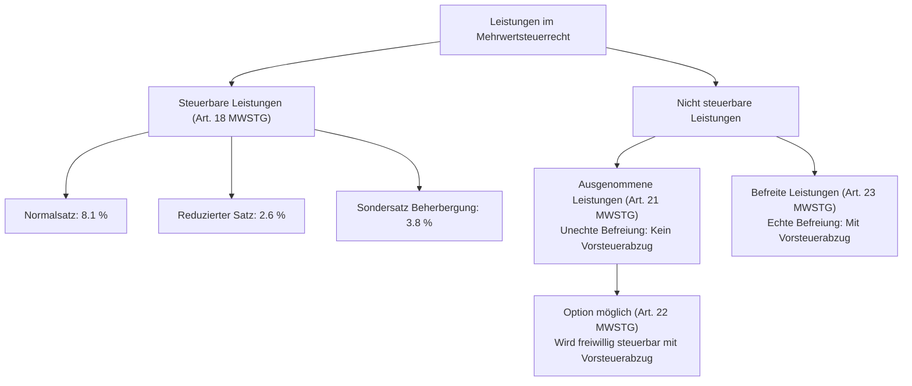
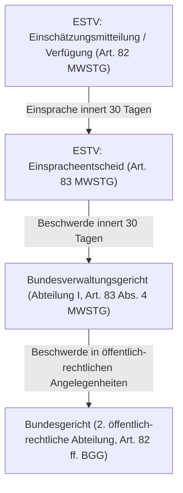

## Überblick {#ueberblick}

Die **Mehrwertsteuer** (MWST) ist die ertragsreichste Einnahmequelle der Eidgenossenschaft. Als Konsumsteuer steuert sie jährlich über 24 Milliarden Franken zum Bundeshaushalt bei. Sie ist als **indirekte Steuer** konzipiert: Steuerschuldner sind nicht die Konsumentinnen und Konsumenten, sondern die Unternehmen, welche die Steuer auf ihren Verkäufen erheben und an die Eidgenössische Steuerverwaltung (ESTV) abliefern.

Ökonomisch und dogmatisch beruht das schweizerische Mehrwertsteuersystem auf dem Zusammenspiel zweier Konzeptionen:

1. **Erhebungskonzeption**: Die Steuer wird als *Netto-Allphasensteuer mit Vorsteuerabzug* erhoben ([Art. 1 Abs. 1 Satz 1 MWSTG](https://www.fedlex.admin.ch/eli/cc/2009/615/de#art_1)). Auf jeder Stufe des Produktions- und Distributionsprozesses (Allphasenprinzip) unterliegt das Entgelt für Leistungen der Mehrwertsteuer. Zugleich dürfen steuerpflichtige Unternehmen die ihnen von Vorlieferanten in Rechnung gestellte Mehrwertsteuer laufend als Vorsteuer in Abzug bringen ([Art. 28 Abs. 1 MWSTG](https://www.fedlex.admin.ch/eli/cc/2009/615/de#art_28)). Im Ergebnis wird bei jedem Unternehmen ausschliesslich die auf der jeweiligen Stufe geschaffene Wertschöpfung (der *Mehrwert*) besteuert.
2. **Belastungskonzeption**: Die Mehrwertsteuer zielt auf den *nicht unternehmerischen Endverbrauch im Inland* ab ([Art. 1 Abs. 1 Satz 2 MWSTG](https://www.fedlex.admin.ch/eli/cc/2009/615/de#art_1)). Für die Unternehmen soll die Steuer ein durchlaufender Posten sein, der Investitionen und Vorleistungen nicht verteuert. Kumulative Belastungswirkungen (*taxe occulte*) und Verzerrungen im Wirtschaftsverkehr werden durch das Vorsteuerabzugsrecht neutralisiert ([BGE 140 II 80 E. 2.1](https://entscheidsuche.ch/docs/CH_BGE/CH_BGE_004_BGE-140-II-80_2014.html#consideration_2.1); [BGE 142 II 488 E. 2.2.1](https://entscheidsuche.ch/docs/CH_BGE/CH_BGE_004_BGE-142-II-488_2016.html#consideration_2.2.1)).

Verfahrensrechtlich folgt die Mehrwertsteuer dem Prinzip der **modifizierten Selbstveranlagung** ([Art. 1 Abs. 4 MWSTG](https://www.fedlex.admin.ch/eli/cc/2009/615/de#art_1)): Das steuerpflichtige Unternehmen muss sich unaufgefordert bei der ESTV registrieren, die geschuldete Steuer und das Vorsteuerguthaben eigenverantwortlich ermitteln, fristgerecht deklarieren und die Steuerzahllast abliefern ([BGE 144 I 340 E. 2.2.1](https://entscheidsuche.ch/docs/CH_BGE/CH_BGE_001_BGE-144-I-340_2018.html#consideration_2.2.1)).

## Verfassungsrechtliche und gesetzliche Grundlagen {#rechtsgrundlagen}

### Verfassungskompetenz des Bundes (Art. 130 BV) {#bundeskompetenz}

Die Steuerhoheit für die Mehrwertsteuer liegt ausschliesslich beim Bund; den Kantonen ist die Erhebung gleichartiger Steuern auf dem Konsum verfassungsrechtlich verwehrt ([Art. 134 BV](https://www.fedlex.admin.ch/eli/cc/1999/404/de#art_134)). 



Die Verfassungskompetenz ermächtigt den Bund zur Erhebung einer Mehrwertsteuer mit einem Höchstsatz von 6.5 % (Art. 130 Abs. 1 BV). Gestützt auf die Übergangsbestimmungen der Bundesverfassung ([Art. 196 Ziff. 14 BV](https://www.fedlex.admin.ch/eli/cc/1999/404/de#art_196)) darf der Bund zur Finanzierung der Eisenbahninfrastruktur sowie zur Sicherung der AHV und IV Zusatzprozente erheben. Die verfassungsmässige Befristung der Erhebungskompetenz wurde vom Souverän wiederholt verlängert, zuletzt im Rahmen der Stabilisierung der AHV (AHV 21) bis zum 31. Dezember 2035.

### Gesetzliche Leitprinzipien im MWSTG {#gesetzliche-leitprinzipien}

Auf gesetzlicher Ebene regelt das Bundesgesetz vom 12. Juni 2009 über die Mehrwertsteuer (MWSTG, SR 641.20) die Erhebung der Steuer.



Das Gesetz formuliert in Art. 1 Abs. 3 MWSTG drei fundamentale Erhebungsgrundsätze:
* **Wettbewerbsneutralität** (lit. a): Gleichartige Leistungen müssen unabhängig von der Rechtsform des Anbieters, der Vertriebsform oder dem Leistungsweg gleich besteuert werden.
* **Wirtschaftlichkeit der Entrichtung und Erhebung** (lit. b): Die administrativen Kosten bei den Steuerpflichtigen und bei der Steuerverwaltung sind so gering wie möglich zu halten.
* **Verhältnismässigkeit** (lit. c): Die Pflichten der Steuerpflichtigen dürfen nicht über das zur Sicherung des Steuerertrags Erforderliche hinausgehen.

Das Bundesgericht leitet aus dem Gebot der Allgemeinheit und der Wettbewerbsneutralität eine grundlegende Auslegungsregel ab: «Vor dem Hintergrund der Allgemeinheit der Mehrwertbesteuerung und dem Postulat der Wettbewerbsneutralität ist eine weite Auslegung des Tatbestandes der subjektiven Mehrwertsteuerpflicht am Platz» ([BGE 138 II 251](https://entscheidsuche.ch/docs/CH_BGE/CH_BGE_004_BGE-138-II-251_2012.html#consideration_2.3.4) E. 2.3.4; [BGE 142 II 488](https://entscheidsuche.ch/docs/CH_BGE/CH_BGE_004_BGE-142-II-488_2016.html#consideration_2.3.1) E. 2.3.1). Im Gegenzug gilt: «Spiegelbildlich sind Ausnahmen von der subjektiven Mehrwertsteuerpflicht einschränkend auszulegen» ([BGE 138 II 251](https://entscheidsuche.ch/docs/CH_BGE/CH_BGE_004_BGE-138-II-251_2012.html#consideration_2.3.4) E. 2.3.4; [BGE 149 II 255](https://entscheidsuche.ch/docs/CH_BGE/CH_BGE_004_BGE-149-II-255_2023.html#consideration_2.2.7) E. 2.2.7).

## Die drei Steuerarten (Steuerobjekte) {#steuerobjekte}

Das Mehrwertsteuergesetz unterscheidet drei eigenständige Steuerobjekte ([Art. 1 Abs. 2 MWSTG](https://www.fedlex.admin.ch/eli/cc/2009/615/de#art_1)):

| Steuerart | Norm | Gegenstand | Erhebungsbehörde |
|---|---|---|---|
| **Inlandsteuer** | Art. 18 ff. MWSTG | Lieferungen und Dienstleistungen im Inland gegen Entgelt | Eidgenössische Steuerverwaltung (ESTV) |
| **Bezugsteuer** | Art. 45 ff. MWSTG | Bezug von Dienstleistungen und Lieferungen aus dem Ausland durch Inländer | Eidgenössische Steuerverwaltung (ESTV) |
| **Einfuhrsteuer** | Art. 50 ff. MWSTG | Einfuhr von Gegenständen ins Inland | Bundesamt für Zoll und Grenzsicherheit (BAZG) |

### 1. Inlandsteuer (Art. 18 ff. MWSTG) {#inlandsteuer}

Die Inlandsteuer erfasst den überwiegenden Teil der wirtschaftlichen Transaktionen im Inland.



#### Leistungsaustauschverhältnis
Grundvoraussetzung der Inlandsteuer ist das Vorliegen eines mehrwertsteuerlichen **Leistungsverhältnisses**: «Charakteristisch für die Mehrwertsteuer ist der Austausch von Leistungen (das "Leistungsverhältnis")» ([BGE 140 II 80](https://entscheidsuche.ch/docs/CH_BGE/CH_BGE_004_BGE-140-II-80_2014.html#consideration_2.1) E. 2.1). «Ein mehrwertsteuerlich relevantes Leistungsverhältnis ist anzunehmen, soweit zwischen der (Haupt-)Leistung […] und der Gegenleistung […] ein hinreichender Konnex besteht» ([BGE 140 II 80](https://entscheidsuche.ch/docs/CH_BGE/CH_BGE_004_BGE-140-II-80_2014.html#consideration_2.1) E. 2.1). Das Gericht präzisiert: «Von einer (Haupt-)Leistung im mehrwertsteuerrechtlichen Sinn ist zu sprechen, falls die leistungserbringende Person einer leistungsempfangenden Drittperson einen verbrauchsfähigen wirtschaftlichen Wert einräumt» ([BGE 149 II 255](https://entscheidsuche.ch/docs/CH_BGE/CH_BGE_004_BGE-149-II-255_2023.html#consideration_2.2.1) E. 2.2.1; [BGE 149 II 290](https://entscheidsuche.ch/docs/CH_BGE/CH_BGE_004_BGE-149-II-290_2023.html#consideration_2.2.1) E. 2.2.1).

Die Steuerpflicht differenziert zwischen zwei Leistungstypen ([Art. 3 MWSTG](https://www.fedlex.admin.ch/eli/cc/2009/615/de#art_3)):
* **Lieferung von Gegenständen** (lit. d): Verschaffung der Befähigung, im eigenen Namen über einen Gegenstand wirtschaftlich zu verfügen, Überlassung zum Gebrauch oder zur Nutzung (Miete, Leasing) sowie das Abliefern von Gegenständen, an denen Arbeiten besorgt wurden.
* **Dienstleistung** (lit. e): Jede Leistung, die keine Lieferung eines Gegenstandes ist (Auffangtatbestand, namentlich immaterielle Werte, Arbeitsleistungen, Beratung, Duldung oder Unterlassung).

#### Ort der Leistung (Art. 7 und 8 MWSTG)
Die Steuerbarkeit greift nur, wenn die Leistung als im Inland erbracht gilt:
* Bei **Lieferungen** gilt als Ort der Leistung grundsätzlich der Ort, an dem sich der Gegenstand im Zeitpunkt der Verschaffung der wirtschaftlichen Verfügungsmacht, bei Beginn der Beförderung oder bei der Übergabe befindet ([Art. 7 Abs. 1 MWSTG](https://www.fedlex.admin.ch/eli/cc/2009/615/de#art_7)).
* Bei **Dienstleistungen** gilt als Grundsatz das **Empfängerortprinzip**: Die Dienstleistung gilt an dem Ort erbracht, an dem die empfangende Person den Sitz der wirtschaftlichen Tätigkeit oder eine Betriebsstätte hat ([Art. 8 Abs. 1 MWSTG](https://www.fedlex.admin.ch/eli/cc/2009/615/de#art_8)). Von diesem Grundsatz bestehen Ausnahmen ([Art. 8 Abs. 2 MWSTG](https://www.fedlex.admin.ch/eli/cc/2009/615/de#art_8)), etwa das Tätigkeitsortprinzip (physisch vor Ort erbrachte Dienstleistungen wie Heilbehandlungen, Gastgewerbe) oder das Belegenheitsortprinzip bei Grundstücken.

Zur Zurechnung von Leistungen bei Beteiligung mehrerer Personen siehe den Kommentar zu [Art. 20 MWSTG](/kommentar/mwstg/art-020/).

#### Nichtentgelte (Art. 18 Abs. 2 MWSTG)
Keine Leistungen und damit keine Entgelte sind Mittelflüsse, bei denen es an einem Leistungsaustausch fehlt. Der Gesetzgeber zählt diese Tatbestände in Art. 18 Abs. 2 MWSTG auf (u.a. Subventionen, Spenden, Schadenersatz, Dividenden, Einlagen in Gesellschaften). 

Hoheitliche Kausalabgaben stellen mangels marktfähiger Leistung kein steuerbares Entgelt dar: Die rundfunkrechtliche Empfangsgebühr unterliegt nicht der Mehrwertsteuerpflicht, weil der Bund bei der Erhebung keine marktfähige Leistung erbringt, sondern eine hoheitliche Regulierung wahrnimmt ([BGE 141 II 182 E. 3.1](https://entscheidsuche.ch/docs/CH_BGE/CH_BGE_004_BGE-141-II-182_2015.html#consideration_3.1) und [E. 6.5](https://entscheidsuche.ch/docs/CH_BGE/CH_BGE_004_BGE-141-II-182_2015.html#consideration_6.5)).

### 2. Bezugsteuer (Art. 45 ff. MWSTG) {#bezugsteuer}

Die **Bezugsteuer** bildet das spiegelbildliche Gegenstück zum Empfängerortprinzip: Bezieht ein inländisches Unternehmen oder eine nicht steuerpflichtige Person Dienstleistungen von einem Unternehmen mit Sitz im Ausland (wo die Leistung mangels Inlandbezugs nicht der schweizerischen Inlandsteuer unterliegt), verlagert das Gesetz die Steuerpflicht auf den inländischen Leistungsempfänger (*Reverse-Charge-Verfahren*).

Der Bezugsteuer unterliegen ([Art. 45 Abs. 1 MWSTG](https://www.fedlex.admin.ch/eli/cc/2009/615/de#art_45)):
1. Von Unternehmen mit Sitz im Ausland erbrachte Dienstleistungen, deren Leistungsort sich nach dem Empfängerortprinzip im Inland befindet (z. B. ausländische IT-Dienstleistungen, Software-Lizenzen, Marketing- oder Rechtsberatung);
2. Die Einfuhr von Datenträgern ohne Marktwert mit den darin enthaltenen Dienstleistungen;
3. Bestimmte Lieferungen von Gegenständen im Inland durch Unternehmen mit Sitz im Ausland.

Die Bezugsteuer verhindert, dass inländische Abnehmer ausländische Dienstleister bevorzugen, nur weil diese keine schweizerische Mehrwertsteuer in Rechnung stellen müssen ([BGE 152 II 250 E. 5.1](https://entscheidsuche.ch/docs/CH_BGE/CH_BGE_004_BGE-152-II-250_2026.html#consideration_5.1)). Ist der inländische Bezüger mehrwertsteuerpflichtig und vorsteuerabzugsberechtigt, deklariert er die Bezugsteuer als geschuldete Steuer und zieht denselben Betrag gleichzeitig als Vorsteuer ab (Nullsummenspiel).

### 3. Einfuhrsteuer (Art. 50 ff. MWSTG) {#einfuhrsteuer}

Die **Einfuhrsteuer** erfasst das Verbringen von körperlichen Gegenständen über die schweizerische Zollgrenze ins Inland. Sie wird nicht von der ESTV, sondern vom **Bundesamt für Zoll und Grenzsicherheit** (BAZG) nach den Vorschriften der Zollgesetzgebung erhoben ([Art. 50 MWSTG](https://www.fedlex.admin.ch/eli/cc/2009/615/de#art_50)). 

Steuerpflichtig ist die zollzahlungspflichtige Person (in der Regel der Importeur oder Spediteur). Bemessungsgrundlage ist das Entgelt oder der Marktwert des Gegenstands frei Bestimmungsort im Inland einschliesslich sämtlicher Transport- und Zollkosten ([Art. 54 MWSTG](https://www.fedlex.admin.ch/eli/cc/2009/615/de#art_54)). Registrierte Unternehmen können die vom BAZG veranlagte Einfuhrsteuer im Rahmen ihrer unternehmerischen Tätigkeit als Vorsteuer abziehen ([Art. 28 Abs. 1 lit. b MWSTG](https://www.fedlex.admin.ch/eli/cc/2009/615/de#art_28)).

## Subjektive Steuerpflicht {#steuerpflicht}

### Begriff des Unternehmensträgers (Art. 10 MWSTG) {#unternehmenstraeger}

Die subjektive Steuerpflicht knüpft an das Betreiben eines Unternehmens an.



Mehrwertsteuerpflichtig wird, wer eine mit der Erzielung von Einnahmen verbundene gewerbliche oder berufliche Tätigkeit selbständig ausübt und unter eigenem Namen nach aussen auftritt. Auf die Rechtsform, die Gewinnabsicht oder den zivilrechtlichen Status kommt es nicht an: Sowohl natürliche Personen als auch Einzelfirmen, Personengesellschaften, juristische Personen (AG, GmbH, Genossenschaft, Verein, Stiftung) und öffentlich-rechtliche Anstalten können Unternehmensträger sein ([BGE 140 II 80](https://entscheidsuche.ch/docs/CH_BGE/CH_BGE_004_BGE-140-II-80_2014.html#consideration_2.2) E. 2.2; [BGE 142 II 488](https://entscheidsuche.ch/docs/CH_BGE/CH_BGE_004_BGE-142-II-488_2016.html#consideration_2.3.2) E. 2.3.2).

### Befreiung von der Steuerpflicht und Kleinunternehmergrenze {#befreiung-kleinunternehmer}

Nicht jedes Unternehmen ist zur Abrechnung der Steuer verpflichtet. Von der Steuerpflicht befreit ist ([Art. 10 Abs. 2 MWSTG](https://www.fedlex.admin.ch/eli/cc/2009/615/de#art_10)):
* Wer im In- und Ausland innerhalb eines Jahres **weniger als 100'000 Franken** Umsatz aus Leistungen erzielt, die nicht nach Art. 21 Abs. 2 MWSTG von der Steuer ausgenommen sind;
* Nicht gewinnstrebige, ehrenamtlich geführte Sport- oder Kulturvereine sowie gemeinnützige Institutionen, wenn sie weniger als **250'000 Franken** Umsatz erzielen;
* Unternehmen mit Sitz im Ausland, die im Inland ausschliesslich Dienstleistungen erbringen, die der Bezugsteuer unterliegen.

> [!NOTE] Weltweiter Umsatz als Massstab seit 2018
> Seit dem 1. Januar 2018 ist für die Beurteilung der 100'000-Franken-Schwelle der **weltweite Umsatz** des Unternehmens massgebend. Erzielt ein multinationales Unternehmen weltweit Millionenumsätze, wird es in der Schweiz bereits ab dem ersten Franken steuerbarem Inlandumsatz mehrwertsteuerpflichtig.

Unternehmen, die unter die Befreiungsgrenze fallen, haben das Recht, auf die Befreiung von der Steuerpflicht zu verzichten (**Freiwillige Steuerpflicht**, Art. 10 Abs. 3 lit. a MWSTG). Dies ist wirtschaftlich dann sinnvoll, wenn das Unternehmen erhebliche Vorleistungen bezieht und diese als Vorsteuer zurückfordern will (Vermeidung der *taxe occulte* im B2B-Verkehr).

### Gemeinwesen und Teilautonome Einheiten (Art. 12 MWSTG) {#gemeinwesen}

Öffentlich-rechtliche Körperschaften (Bund, Kantone, Gemeinden) und deren autonome Dienststellen unterliegen der Steuerpflicht, soweit sie unternehmerische Tätigkeiten ausüben und damit im Wettbewerb zu privaten Anbietern stehen ([Art. 12 Abs. 1 MWSTG](https://www.fedlex.admin.ch/eli/cc/2009/615/de#art_12)). Leistungen, die im Rahmen hoheitlicher Befugnisse erbracht werden (z. B. Passausstellung, Baubewilligungen, Gerichtsentscheide), fallen nicht unter die Inlandsteuer ([Art. 18 Abs. 2 lit. l MWSTG](https://www.fedlex.admin.ch/eli/cc/2009/615/de#art_18)).

## Steuerausnahmen: Ausgenommene versus befreite Leistungen {#ausnahmen-und-befreiungen}

Das Gesetz unterscheidet terminologisch streng zwischen zwei Kategorien von Ausnahmen:

### 1. Von der Steuer ausgenommene Leistungen (Art. 21 MWSTG) {#ausgenommene-leistungen}

Ausgenommene Leistungen werden als **unechte Steuerbefreiung** bezeichnet: Auf dem Entgelt wird keine Mehrwertsteuer geschuldet, der Leistungserbringer ist dafür jedoch **nicht zum Vorsteuerabzug berechtigt** ([Art. 29 Abs. 1 MWSTG](https://www.fedlex.admin.ch/eli/cc/2009/615/de#art_29)). Die Vorsteuer auf den Eingangsleistungen bleibt als Kostenfaktor beim Unternehmen hängen und wird verdeckt an den Kunden weitergewälzt (*taxe occulte*).

Der Katalog von Art. 21 Abs. 2 MWSTG umfasst sozial-, gesundheits- oder kulturpolitisch motivierte Bereiche:
* Heilbehandlungen im Bereich der Humanmedizin (Ziff. 2 und 3);
* Sozialfürsorgliche und sozialpflegerische Leistungen (Ziff. 7);
* Erziehung von Kindern und Jugendlichen, Unterricht, Aus- und Weiterbildung (Ziff. 11);
* Kulturelle Dienstleistungen (Theater, Konzerte, Museen, Ziff. 14–16);
* Versicherungsleistungen (Ziff. 18);
* Umsätze im Geld- und Kapitalverkehr, Kreditgewährung, Beteiligungsgeschäft (Ziff. 19);
* Überlassung und Veräusserung von Grundstücken (Vermietung und Verkauf von Wohnungen und Geschäftshäusern, Ziff. 20 und 21).

### 2. Option für die Versteuerung ausgenommener Leistungen (Art. 22 MWSTG) {#option}

Um die *taxe occulte* im Geschäftsverkehr zu eliminieren, erlaubt Art. 22 MWSTG den Steuerpflichtigen, für die Versteuerung ausgenommener Leistungen zu optieren. Die Leistung wird dadurch freiwillig steuerbar, und der Leistungserbringer erlangt das volle Vorsteuerabzugsrecht auf den dazugehörigen Investitionen (z. B. Bau- und Renovationskosten einer Gewerbeimmobilie).

Für die Ausübung der Option gelten strenge Formvorschriften: «Das Erfordernis, im Fall der Option im objektiven Sinn die Steuer "offen auszuweisen", ist nicht bloss eine Ordnungs-, sondern eine Gültigkeitsvorschrift» ([BGE 140 II 495](https://entscheidsuche.ch/docs/CH_BGE/CH_BGE_004_BGE-140-II-495_2014.html#consideration_3.2) E. 3.2.1). Die Option setzt voraus, dass die Steuer auf der Rechnung offen deklariert wird. Für Wohnzwecke genutzte Immobilien ist die Option gesetzlich ausgeschlossen ([Art. 22 Abs. 2 MWSTG](https://www.fedlex.admin.ch/eli/cc/2009/615/de#art_22)).

### 3. Von der Steuer befreite Leistungen (Art. 23 MWSTG) {#befreite-leistungen}

Von der Steuer befreite Leistungen stellen eine **echte Steuerbefreiung** dar: Auf der Ausgangsleistung fällt keine Steuer an, das **Recht zum Vorsteuerabzug bleibt jedoch vollständig erhalten** ([Art. 28 Abs. 1 lit. a MWSTG](https://www.fedlex.admin.ch/eli/cc/2009/615/de#art_28)).

Zweck dieser Regelung ist die Entlastung von Exporten nach dem **Bestimmungslandprinzip**: Schweizer Güter und Dienstleistungen sollen unversteuert ins Ausland gelangen, wo sie der dortigen Verbrauchssteuer unterworfen werden. Typische befreite Leistungen sind:
* Die Ausfuhr von Gegenständen ins Ausland ([Art. 23 Abs. 2 Ziff. 1 MWSTG](https://www.fedlex.admin.ch/eli/cc/2009/615/de#art_23));
* Grenzüberschreitende Beförderungen und damit zusammenhängende logistische Leistungen (Ziff. 5–7).

## Steuersätze und Bemessung {#steuersaetze}

### Die Steuersätze im Überblick {#steuersaetze-tabelle}

Die Steuersätze sind in Art. 25 MWSTG geregelt. Infolge der Volksabstimmung zur Reform der AHV (AHV 21) gelten seit dem **1. Januar 2024** folgende Ansätze:



| Steuersatz | Satz | Geltungsbereich | Typische Beispiele |
|---|---|---|---|
| **Normalsatz** | **8.1 %** | Alle steuerbaren Leistungen, für die kein Sondersatz gilt (Regelfall) | Elektronik, Fahrzeuge, Kleidung, Maschinen, Treibstoffe, Beratungsdienstleistungen, Telekommunikation, Gastronomie |
| **Reduzierter Satz** | **2.6 %** | Güter des täglichen Bedarfs gemäss Art. 25 Abs. 2 MWSTG | Nahrungsmittel und alkoholfreie Getränke, Leitungswasser, Medikamente, Zeitungen, Zeitschriften, Bücher (auch digital), Futtermittel, Dünger |
| **Sondersatz Beherbergung** | **3.8 %** | Beherbergungsleistungen einschliesslich Frühstück (Art. 25 Abs. 4 MWSTG) | Übernachtung in Hotels, Ferienwohnungen, Pensionen, Campingplätzen (sofern Beherbergung Hauptleistung ist) |

> [!IMPORTANT] Strikte Abgrenzung zwischen Speisen und Gastgewerbe
> Die Lieferung von Nahrungsmitteln unterliegt dem reduzierten Satz von 2.6 % (z. B. Einkauf im Supermarkt oder Take-away). Sobald die Speisen jedoch an Ort und Stelle konsumiert werden oder zusätzliche Dienstleistungen (Tischbedienung, Geschirr, Sitzgelegenheiten) hinzutreten, liegt eine gastgewerbliche Dienstleistung vor, die zwingend zum Normalsatz von 8.1 % abzurechnen ist ([BGer 2C_662/2007 vom 23.07.2008 E. 2.2](https://entscheidsuche.ch/docs/CH_BGer/CH_BGer_002_2C-662-2007_2008-07-23.html)).

### Bemessungsgrundlage (Art. 24 MWSTG) {#bemessungsgrundlage}

Die Steuer wird auf dem **tatsächlich empfangenen Entgelt** berechnet ([Art. 24 Abs. 1 MWSTG](https://www.fedlex.admin.ch/eli/cc/2009/615/de#art_24)). Zum Entgelt gehört alles, was der Empfänger oder eine Drittperson als Gegenleistung für die Leistung aufwendet (einschliesslich Nebenkosten wie Porto, Verpackung, Zölle, Trinkgelder).

Minderungen des Entgelts (z. B. Skonti, Rabatte, Umsatzrückvergütungen, Uneinbringlichkeit von Forderungen) berechtigen zu einer Herabsetzung der Steuerschuld. Davon zu unterscheiden sind eigenständige Leistungen im Austauschverhältnis, die nicht als Entgeltsminderung verrechnet werden dürfen ([BGE 149 II 290 E. 2.2.1](https://entscheidsuche.ch/docs/CH_BGE/CH_BGE_004_BGE-149-II-290_2023.html#consideration_2.2.1)).

## Vorsteuerabzug und Vorsteuerkorrekturen {#vorsteuerabzug}

### Das Recht auf Vorsteuerabzug (Art. 28 MWSTG) {#vorsteuer-grundsatz}

Der Vorsteuerabzug ist das Instrument zur Verwirklichung der Wettbewerbsneutralität.



Abzugsfähig sind:
1. Die in Rechnung gestellte Inlandsteuer für bezogene Lieferungen und Dienstleistungen;
2. Die deklarierte Bezugsteuer;
3. Die entrichtete oder gestundete Einfuhrsteuer.

Das Bundesgericht stellt klar, dass der Vorsteuerabzug keinen engen Verwendungskonnex zu einzelnen Umsätzen voraussetzt: «Hauptvoraussetzung für den Vorsteuerabzug ist damit die Zuordnung zur unternehmerischen Tätigkeit» ([BGE 142 II 488](https://entscheidsuche.ch/docs/CH_BGE/CH_BGE_004_BGE-142-II-488_2016.html#consideration_2.3.5) E. 2.3.5). Werden Vorleistungen für das Unternehmen bezogen, kann die Vorsteuer voll abgezogen werden, selbst wenn sie die Gemeinkosten des Betriebs betrifft.

### Einschränkungen und Vorsteuerkürzungen (Art. 29–33 MWSTG) {#vorsteuerkuerzung}

Das Vorsteuerabzugsrecht wird in folgenden Konstellationen eingeschränkt:

* **Ausgenommene Leistungen (Art. 29 MWSTG)**: Verwendet das Unternehmen Gegenstände oder Dienstleistungen für Leistungen, die von der Steuer ausgenommen sind (und für die nicht optiert wurde), besteht kein Vorsteuerabzugsrecht.
* **Gemischte Verwendung (Art. 30 MWSTG)**: Werden Vorleistungen sowohl für steuerbare als auch für ausgenommene Tätigkeiten verwendet (z. B. Banken, Versicherungen, Immobilienverwaltungen), muss der Vorsteuerabzug nach dem Verhältnis der Verwendung gekürzt werden (pro-rata-Kürzung).
* **Eigenverbrauch und Einlageentsteuerung (Art. 31 und 32 MWSTG)**: Entnimmt ein Steuerpflichtiger Gegenstände oder Dienstleistungen aus dem Unternehmen für private Zwecke (Eigenverbrauch), ist die zuvor abgezogene Vorsteuer zu korrigieren. Umgekehrt kann bei Einlage von Vermögenswerten in das Unternehmen nachträglich ein Vorsteuerabzug vorgenommen werden (Einlageentsteuerung).
* **Vorsteuerkürzung bei Subventionen (Art. 33 MWSTG)**: Empfängt das Unternehmen Subventionen oder andere öffentlich-rechtliche Beiträge ([Art. 18 Abs. 2 lit. a–c MWSTG](https://www.fedlex.admin.ch/eli/cc/2009/615/de#art_18)), ist der Vorsteuerabzug verhältnismässig zu kürzen. Spenden ([Art. 18 Abs. 2 lit. d MWSTG](https://www.fedlex.admin.ch/eli/cc/2009/615/de#art_18)) führen hingegen zu keiner Vorsteuerkürzung ([BGE 149 II 255 E. 2.2.2](https://entscheidsuche.ch/docs/CH_BGE/CH_BGE_004_BGE-149-II-255_2023.html#consideration_2.2.2)).
* **Kürzung bei Insolvenz (Art. 41 MWSTG)**: Bleiben Eingangsrechnungen infolge Nachlassstundung oder Konkurs unbezahlt, ist der Vorsteuerabzug zu kürzen, da die steuerpflichtige Person die Vorsteuer wirtschaftlich nicht getragen hat ([BGE 137 II 136 E. 4.1](https://entscheidsuche.ch/docs/CH_BGE/CH_BGE_004_BGE-137-II-136_2011.html#consideration_4.1)).

## Abrechnungsmethoden und Verfahren {#abrechnung-verfahren}

### Effektive Methode versus Saldosteuersatzmethode {#abrechnungsmethoden}

Steuerpflichtige können zwischen zwei Abrechnungsarten wählen:

#### 1. Effektive Abrechnungsmethode (Art. 36 und 39 MWSTG)
Das Unternehmen deklariert den tatsächlich erzielten Umsatz, berechnet darauf die geschuldete Mehrwertsteuer und zieht die effektiv angefallenen Vorsteuern ab. Die Abrechnung erfolgt vierteljährlich ([Art. 35 Abs. 1 lit. a MWSTG](https://www.fedlex.admin.ch/eli/cc/2009/615/de#art_35)). Die Abrechnung kann erfolgen:
* **Nach vereinbarten Entgelten** (Regelfall, Art. 39 Abs. 1 MWSTG): Massgebend ist der Zeitpunkt der Rechnungsstellung bzw. des Eingangs der Debitorenrechnung;
* **Nach vereinnahmten Entgelten** (Art. 39 Abs. 2 MWSTG): Auf Antrag kann die Steuer erst bei Zahlungseingang abgerechnet werden (Cash-Accounting).

#### 2. Saldosteuersatzmethode (Art. 37 MWSTG)
Zur Entlastung von kleinen und mittleren Unternehmen (KMU) sieht das Gesetz eine pauschalierte Abrechnungsmethode vor. Unternehmen müssen ihren Vorsteuerabzug nicht belegen, sondern multiplizieren ihren steuerbaren Bruttoumsatz (inkl. Steuer) mit einem von der ESTV festgelegten **Saldosteuersatz**.

Voraussetzungen für die Saldosteuersatzmethode:
* Jahresumsatz aus steuerbaren Leistungen höchstens **5'024'000 Franken** (inkl. Steuer);
* Geschuldete Steuer (Steuerzahllast) höchstens **108'000 Franken** pro Jahr;
* Die Abrechnung erfolgt halbjährlich statt vierteljährlich.

Die Saldosteuersätze sind branchenspezifisch abgestuft und tragen der durchschnittlichen Vorsteuerbelastung der jeweiligen Branche Rechnung ([BGer 2C_29/2020 vom 03.04.2020 E. 3.2](https://entscheidsuche.ch/docs/CH_BGer/CH_BGer_002_2C-29-2020_2020-04-03.html)).

### Das Prinzip der modifizierten Selbstveranlagung {#selbstveranlagung}

Das Mehrwertsteuerverfahren unterscheidet sich grundlegend vom Veranlagungsverfahren der direkten Steuern:

«Bei der Mehrwertsteuer als Selbstveranlagungssteuer entsteht die Steuerforderung bei Lieferungen und Dienstleistungen von Gesetzes wegen» ([BGE 137 II 17](https://entscheidsuche.ch/docs/CH_BGE/CH_BGE_004_BGE-137-II-17_2011.html#consideration_2.4) E. 2.4). «Eine eigentliche Veranlagung, wie sie bei den direkten Steuern zwingend erforderlich ist, findet nicht statt» ([BGE 137 II 17](https://entscheidsuche.ch/docs/CH_BGE/CH_BGE_004_BGE-137-II-17_2011.html#consideration_2.4) E. 2.4).

Daraus ergeben sich weitreichende Pflichten für die Steuerpflichtigen ([Art. 65 ff. MWSTG](https://www.fedlex.admin.ch/eli/cc/2009/615/de#art_65)):
1. **Selbständige Anmeldung**: Entstehen die Voraussetzungen der Steuerpflicht, muss sich das Unternehmen innert 30 Tagen unaufgefordert bei der ESTV anmelden ([Art. 66 MWSTG](https://www.fedlex.admin.ch/eli/cc/2009/615/de#art_66)).
2. **Deklarations- und Ablieferungspflicht**: Die Steuerabrechnung ist unaufgefordert innert **60 Tagen nach Ablauf der Abrechnungsperiode** elektronisch einzureichen und die Steuer zu bezahlen ([Art. 71](https://www.fedlex.admin.ch/eli/cc/2009/615/de#art_71) und [Art. 86 MWSTG](https://www.fedlex.admin.ch/eli/cc/2009/615/de#art_86); [BGE 144 I 340 E. 2.2.1](https://entscheidsuche.ch/docs/CH_BGE/CH_BGE_001_BGE-144-I-340_2018.html#consideration_2.2.1)).
3. **Mehrwertsteuerkontrolle**: Die ESTV prüft die Abrechnungen stichprobenweise durch Kontrolle an Ort und Stelle vor Ort ([Art. 78 MWSTG](https://www.fedlex.admin.ch/eli/cc/2009/615/de#art_78)). Bestreitet die steuerpflichtige Person das Kontrollergebnis, erlässt die ESTV eine förmliche Verfügung ([Art. 82 MWSTG](https://www.fedlex.admin.ch/eli/cc/2009/615/de#art_82)).

### Abrechnungs- versus Überwälzungsverhältnis {#abrechnung-ueberwaelzung}

Im Mehrwertsteuerrecht sind zwei getrennte Rechtsverhältnisse strikt auseinanderzuhalten: «In der vorliegenden Konstellation sind zwei unterschiedliche abgaberechtliche Verhältnisse auseinanderzuhalten» ([BGE 144 II 412](https://entscheidsuche.ch/docs/CH_BGE/CH_BGE_004_BGE-144-II-412_2018.html#consideration_2.2.1) E. 2.2.1).

1. **Abrechnungsverhältnis** (ESTV – Steuerpflichtiger): Öffentlich-rechtliches Verhältnis über die Entstehung, Festsetzung und Bezahlung der Steuerforderung sowie den Vorsteuerabzug. Zuständig sind die Steuerjustizbehörden (ESTV, Bundesverwaltungsgericht, Bundesgericht; [BGE 144 II 412 E. 2.2.1](https://entscheidsuche.ch/docs/CH_BGE/CH_BGE_004_BGE-144-II-412_2018.html#consideration_2.2.1)).
2. **Überwälzungsverhältnis** (Steuerpflichtiger – Leistungsempfänger): Zivilrechtliches Verhältnis über die Überwälzung der Steuer auf den Kunden. Die Überwälzung richtet sich nach den vertraglichen Abreden der Parteien ([Art. 6 Abs. 1 MWSTG](https://www.fedlex.admin.ch/eli/cc/2009/615/de#art_6)); für Streitigkeiten sind ausschliesslich die Zivilgerichte zuständig ([Art. 6 Abs. 2 MWSTG](https://www.fedlex.admin.ch/eli/cc/2009/615/de#art_6); [BGE 140 II 80 E. 2.4](https://entscheidsuche.ch/docs/CH_BGE/CH_BGE_004_BGE-140-II-80_2014.html#consideration_2.4); [BGE 144 II 412 E. 2.2.2](https://entscheidsuche.ch/docs/CH_BGE/CH_BGE_004_BGE-144-II-412_2018.html#consideration_2.2.2)).

Weist ein Unternehmen in einer Rechnung Mehrwertsteuer aus, die gesetzlich gar nicht geschuldet ist, schuldet es diese Steuer der ESTV dennoch, solange die Rechnung nicht korrigiert wird (*impôt facturé = impôt dû*, [Art. 27 Abs. 2 MWSTG](https://www.fedlex.admin.ch/eli/cc/2009/615/de#art_27); [BGE 144 II 412 E. 3.2.1](https://entscheidsuche.ch/docs/CH_BGE/CH_BGE_004_BGE-144-II-412_2018.html#consideration_3.2)).

### Auskunftsrecht und Vertrauensschutz (Art. 69 MWSTG) {#auskunftsrecht}

Wegen der Komplexität des Mehrwertsteuerrechts und des Risikos von Steuernachforderungen verleiht das Gesetz den Steuerpflichtigen ein verbindliches Auskunftsrecht:

«Im Mehrwertsteuerrecht besteht aufgrund von Art. 69 MWSTG ein Anspruch auf behördliche Auskunft» ([BGE 151 II 364](https://entscheidsuche.ch/docs/CH_BGE/CH_BGE_004_BGE-151-II-364_2025.html#consideration_5.1.2) E. 5.1.2). Auf schriftliche Anfrage hin erteilt die ESTV eine für beide Seiten rechtsverbindliche Auskunft zu den steuerlichen Konsequenzen eines konkret umschriebenen Sachverhalts ([Art. 69 MWSTG](https://www.fedlex.admin.ch/eli/cc/2009/615/de#art_69)). Ändert die ESTV später ihre publizierte Praxis, entfällt der Vertrauensschutz für eine zuvor individuell erteilte Auskunft erst dann, wenn die ESTV die Auskunft gegenüber der steuerpflichtigen Person förmlich widerruft ([BGE 151 II 364 E. 5.3.4.2](https://entscheidsuche.ch/docs/CH_BGE/CH_BGE_004_BGE-151-II-364_2025.html#consideration_5.3.4.2)).

### Verjährung und Rechtsmittelweg {#verjaehrung-rechtsmittel}

Das Mehrwertsteuerrecht unterscheidet zwei Verjährungsarten ([Art. 42 MWSTG](https://www.fedlex.admin.ch/eli/cc/2009/615/de#art_42)):
* **Relative Festsetzungsverjährung**: Das Recht, eine Steuerforderung festzusetzen, verjährt 5 Jahre nach Ablauf der Steuerperiode, in der die Forderung entstanden ist.
* **Absolute Festsetzungsverjährung**: Das Recht zur Steuerfestsetzung verjährt in jedem Fall 10 Jahre nach Ablauf der massgebenden Steuerperiode ([Art. 42 Abs. 6 MWSTG](https://www.fedlex.admin.ch/eli/cc/2009/615/de#art_42); [BGE 144 II 273 E. 2.2.1](https://entscheidsuche.ch/docs/CH_BGE/CH_BGE_004_BGE-144-II-273_2018.html#consideration_2.2.1)).

Der Rechtsmittelweg folgt dem Verwaltungsverfahren des Bundes:

## Praxishinweise {#praxishinweise}

Die folgenden Grundsätze schützen Unternehmen und Beratende vor Nachbelastungen und Haftungsrisiken:

1. **Umsatzschwelle laufend überwachen**: Auch kleine Unternehmen müssen ihre Umsätze überwachen. Da seit 2018 der *weltweite* Umsatz massgebend ist, führt bereits ein geringfügiger Inlandsumsatz zur Steuerpflicht, wenn das Unternehmen international tätig ist. Bei Überschreiten der Schwelle von 100'000 Franken muss die Anmeldung bei der ESTV unaufgefordert innert 30 Tagen erfolgen.
2. **Bezugsteuer auf Auslandsausgaben deklarieren**: Der Bezug von Dienstleistungen aus dem Ausland (z. B. Software-Abos, Cloud-Hosting, Beratungen, Online-Werbung bei Google oder Meta) unterliegt der Bezugsteuer nach Art. 45 MWSTG. Wird die Bezugsteuer in der Abrechnung vergessen, drohen bei einer MWST-Revision Verzugszinsen und Nachforderungen – selbst dann, wenn das Unternehmen voll vorsteuerabzugsberechtigt gewesen wäre.
3. **Formvorschrift der Option strikt einhalten**: Soll ein nach Art. 21 MWSTG ausgenommener Umsatz (z. B. Vermietung von Gewerberäumen an Geschäftskunden) optiert werden, muss die Mehrwertsteuer auf dem Mietvertrag und den Rechnungen zwingend offen ausgewiesen werden. Ein stillschweigendes Optieren oder blosses Deklarieren in der MWST-Abrechnung ohne Steuerausweis auf der Rechnung ist nach [BGE 140 II 495](https://entscheidsuche.ch/docs/CH_BGE/CH_BGE_004_BGE-140-II-495_2014.html#consideration_3.2) ungültig und vernichtet das Vorsteuerabzugsrecht rückwirkend.
4. **Vorteile der Saldosteuersatzmethode kalkulieren**: Für KMU mit tiefer Vorsteuerquote (z. B. Dienstleister, Treuhänder, Programmierer) kann die Saldosteuersatzmethode nicht nur administrativen Aufwand sparen, sondern auch finanzielle Vorteile bieten. Vor einem Wechsel ist die effektive Vorsteuerquote über mehrere Quartale mit dem Branchentarif abzugleichen.
5. **Verbindliche Vorabklärung bei komplexen Projekten nutzen**: Bei Umstrukturierungen, Immobilienübertragungen oder neuartigen Leistungsmodellen sollte vor Umsetzung der Transaktion ein schriftlicher Vorbescheid (Ruling) nach Art. 69 MWSTG bei der ESTV eingeholt werden. Die Auskunft bindet die Steuerverwaltung und schützt vor nachträglichen Praxisverschärfungen ([BGE 151 II 364](https://entscheidsuche.ch/docs/CH_BGE/CH_BGE_004_BGE-151-II-364_2025.html#consideration_5.1.2)).
6. **Vorsteuerkürzungen bei Subventionen und Spenden trennen**: Erhält ein Betrieb öffentliche Gelder oder Drittmittel, ist die Rechtsnatur der Zuwendung präzise abzuklären. Während Subventionen nach Art. 33 MWSTG zu einer schmerzhaften Vorsteuerkürzung zwingen, sind echte Spenden vorsteuerneutral ([BGE 149 II 255](https://entscheidsuche.ch/docs/CH_BGE/CH_BGE_004_BGE-149-II-255_2023.html#consideration_2.2.2)).

## Leitentscheide {#leitentscheide}

| Entscheid | Gegenstand | Bedeutung |
|---|---|---|
| [BGE 140 II 80](https://entscheidsuche.ch/docs/CH_BGE/CH_BGE_004_BGE-140-II-80_2014.html#consideration_2.1) | Wesen der MWST und Rechtsweg bei Überwälzung | Grundlegendes Urteil zur Natur als Netto-Allphasensteuer mit Vorsteuerabzug, zum Leistungsverhältnis (Konnex Leistung–Gegenleistung) und zur Trennung von abgaberechtlichem Abrechnungsverhältnis und zivilrechtlichem Überwälzungsverhältnis. |
| [BGE 138 II 251](https://entscheidsuche.ch/docs/CH_BGE/CH_BGE_004_BGE-138-II-251_2012.html#consideration_2.3.4) | Begriff der Selbständigkeit und Auslegung von Steuerausnahmen | Leitformel: Weite Auslegung der subjektiven Steuerpflicht zur Wahrung von Allgemeinheit und Wettbewerbsneutralität; spiegelbildlich sind Ausnahmen von der Steuerpflicht strikt einschränkend auszulegen. |
| [BGE 142 II 488](https://entscheidsuche.ch/docs/CH_BGE/CH_BGE_004_BGE-142-II-488_2016.html#consideration_2.3.5) | Voraussetzungen des Vorsteuerabzugs | Zur Zuordnung von Vorsteuern zur unternehmerischen Tätigkeit: Unter dem revidierten MWSTG 2009 genügt der Bezug im Rahmen des Gesamtunternehmens; ein enger Verwendungskonnex zu einzelnen Umsätzen ist nicht mehr erforderlich. |
| [BGE 144 II 412](https://entscheidsuche.ch/docs/CH_BGE/CH_BGE_004_BGE-144-II-412_2018.html#consideration_2.2.1) | Rückforderung rechtswidrig überwälzter Mehrwertsteuer | Systematische Differenzierung zwischen öffentlich-rechtlicher Abrechnungsbeziehung (ESTV) und zivilrechtlicher Überwälzungsbeziehung. Hilfssteuerobjekt des offenen Steuerausweises (*impôt facturé = impôt dû*, Art. 27 Abs. 2 MWSTG). |
| [BGE 140 II 495](https://entscheidsuche.ch/docs/CH_BGE/CH_BGE_004_BGE-140-II-495_2014.html#consideration_3.2) | Formvorschriften bei der Option (Art. 22 MWSTG) | Der offene Ausweis der Mehrwertsteuer auf der Rechnung bei der Option zur Versteuerung ausgenommener Leistungen ist eine materiell-rechtliche Gültigkeitsvorschrift und keine blosse Ordnungsvorschrift. |
| [BGE 149 II 255](https://entscheidsuche.ch/docs/CH_BGE/CH_BGE_004_BGE-149-II-255_2023.html#consideration_2.2.1) | Nichtentgelte und Vorsteuerkürzung (Art. 18 und 33 MWSTG) | Begriff der Leistung im Mehrwertsteuerrecht (Einräumung eines verbrauchsfähigen Wertes). Abgrenzung vorsteuerkürzender Subventionen von vorsteuerneutralen Spenden bei öffentlichen Forschungsbeiträgen. |
| [BGE 149 II 290](https://entscheidsuche.ch/docs/CH_BGE/CH_BGE_004_BGE-149-II-290_2023.html#consideration_2.2.1) | Bemessungsgrundlage und Entgeltsminderung | Kriterien zur Abgrenzung zwischen einer Entgeltsminderung (Skonto, Rabatt) und eigenständigen, wechselseitig erbrachten Gegenleistungen im Rahmen des Leistungsaustauschs. |
| [BGE 141 II 182](https://entscheidsuche.ch/docs/CH_BGE/CH_BGE_004_BGE-141-II-182_2015.html#consideration_3.1) | MWST auf hoheitlichen Kausalabgaben (Billag-Urteil) | Radio- und Fernsehempfangsgebühren unterliegen nicht der Mehrwertsteuer, da der Bund dabei keine marktfähige Leistung im wirtschaftlichen Sinne erbringt, sondern eine hoheitliche Regulierung ausübt. |
| [BGE 151 II 364](https://entscheidsuche.ch/docs/CH_BGE/CH_BGE_004_BGE-151-II-364_2025.html#consideration_5.1.2) | Auskunftsrecht und Vertrauensschutz (Art. 69 MWSTG) | Ausgestaltung des behördlichen Auskunftsanspruchs als verfassungsrechtliche Vertrauensgrundlage. Eine publizierte Praxisänderung der ESTV bedingt zur Beseitigung der Bindungswirkung den förmlichen Widerruf der individuellen Auskunft. |
| [BGE 152 II 250](https://entscheidsuche.ch/docs/CH_BGE/CH_BGE_004_BGE-152-II-250_2026.html#consideration_5.1) | Bezugsteuer und elektronische Dienstleistungen ausländischer Plattformen | Begriff der elektronischen Dienstleistung bei Online-Reservierungsplattformen. Steuerpflicht ausländischer Plattformen bei Erbringung von Leistungen an nicht steuerpflichtige Inländer (Gegenausnahme zur Steuerbefreiung). |
| [BGE 144 I 340](https://entscheidsuche.ch/docs/CH_BGE/CH_BGE_001_BGE-144-I-340_2018.html#consideration_2.2.1) | Modifizierte Selbstveranlagung und provisorische Steuerforderung | Bestätigung des Selbstveranlagungsprinzips. Das vorsorgliche Festsetzungsverfahren nach Art. 86 Abs. 2 MWSTG ist ein präliminares Verfahren *sui generis* zur Sicherung des Steueranspruchs und vereinbar mit Art. 6 EMRK. |
| [BGE 137 II 17](https://entscheidsuche.ch/docs/CH_BGE/CH_BGE_004_BGE-137-II-17_2011.html#consideration_2.4) | Entstehung der Steuerforderung und Verjährung | Die Mehrwertsteuerforderung entsteht als Selbstveranlagungssteuer von Gesetzes wegen mit Ablauf der Abrechnungsperiode, ohne dass es eines behördlichen Veranlagungsakts bedarf. |
| [BGE 137 II 136](https://entscheidsuche.ch/docs/CH_BGE/CH_BGE_004_BGE-137-II-136_2011.html#consideration_4.1) | Vorsteuerkorrektur im Nachlass- und Insolvenzverfahren | Bei Bewilligung einer Nachlassstundung ist der Vorsteuerabzug zu kürzen, soweit mehrwertsteuerbelastete Verbindlichkeiten unbezahlt bleiben; Verrechnung mit Vorsteuerguthaben zulässig. |

## Literatur {#literatur}

* Martin Zweifel / Michael Beusch / Pierre-Marie Glauser / Philip Robinson (Hrsg.), *Kommentar zum Bundesgesetz über die Mehrwertsteuer (MWSTG)*, Helbing Lichtenhahn Verlag, Basel 2015.
* Klaus A. Vallender / Heinz Keller / Claudio Fischer / Michael Beusch (Hrsg.), *Handbuch zum Mehrwertsteuergesetz (MWSTG)*, 4. Aufl., Stämpfli Verlag, Bern 2019.
* Alois Camenzind / Niklaus Honauer / Klaus A. Vallender / Marcel R. Jung / Ivo P. Baumgartner, *Handbuch zum Mehrwertsteuergesetz (MWSTG)*, 3. Aufl., Bern 2012.
* Ivo P. Baumgartner / Diego Clavadetscher / Martin Kocher, *Vom alten zum neuen Mehrwertsteuergesetz*, Stämpfli Verlag, Bern 2010.
* Xavier Oberson, *Droit fiscal suisse*, 5. Aufl., Éditions Romandes, Basel 2021.
* Daniel Riedo, *Vom Wesen der Mehrwertsteuer als allgemeine Verbrauchsteuer*, Diss. Fribourg, Bern 1999.
