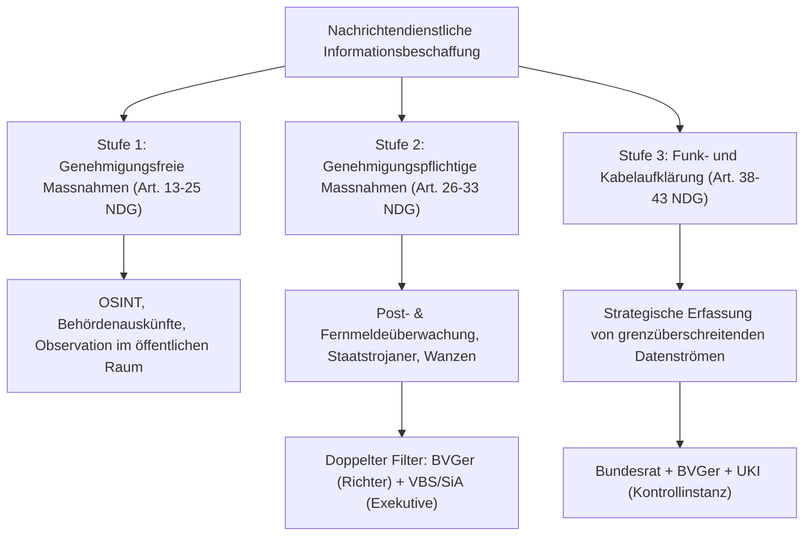

## Überblick {#ueberblick}

Der **Nachrichtendienst des Bundes (NDB)** ist die zivile Sicherheitsbehörde der Eidgenossenschaft zur Früherkennung und Verhinderung von Bedrohungen der inneren und äusseren Sicherheit. Seine Existenz und Befugnisse berühren das sensible Spannungsverhältnis eines modernen Rechtsstaates: Einerseits verlangt der Schutz der demokratischen Institutionen, der Bevölkerung und der kritischen Infrastrukturen vor Terrorismus, verbotener Spionage, Proliferation und Cyberangriffen schlagkräftige nachrichtendienstliche Mittel; andererseits greifen verdeckte Überwachungsmassnahmen tief in die Privatsphäre ([Art. 13 BV](/kommentar/bv/art-013/), [Art. 8 EMRK](/kommentar/emrk/art-008/)) und die demokratischen Grundrechte ein.

Die Architektur des schweizerischen Nachrichtendienstes ist stark durch historische Traumata geprägt – allen voran durch den **Fichen-Skandal von 1989**, der das Vertrauen der Schweizer Bevölkerung in staatliche Sicherheitsorgane nachhaltig erschütterte. Als das Parlament am 25. September 2015 das **Nachrichtendienstgesetz (NDG, SR 121)** verabschiedete und das Volk diesem am 25. September 2016 mit 65.5 % der Stimmen zustimmte, wurde ein fein austarierter Kompromiss geschaffen: Der NDB erhielt erstmals Befugnisse zu invasiven Überwachungsmassnahmen im Inland (etwa Wanzen, Trojaner und Kabelaufklärung), die jedoch einer strengen, mehrstufigen gerichtlichen und exekutiven Genehmigungskaskade sowie einer unabhängigen Aufsicht unterworfen wurden ([BGE 143 I 78](https://entscheidsuche.ch/docs/CH_BGE/CH_BGE_001_BGE-143-I-78_2017.html#consideration_4.) E. 4).

In den letzten zehn Jahren geriet der NDB gleichwohl mehrfach in das Zentrum öffentlicher und parlamentarischer Empörung: Die Enthüllungen um die Affäre der Zuger **Crypto AG (*Operation Rubikon*)**, wiederholte Beanstandungen unrechtmässiger Datensammlungen über politische Aktivistinnen und Aktivisten entgegen [Art. 5 NDG](/kommentar/ndg/) sowie gravierende Rechtswidrigkeiten bei der Durchführung der **Kabelaufklärung**, die von der parlamentarischen Aufsicht gerügt und vom Bundesverwaltungsgericht ([BVGer A-6444/2020](https://entscheidsuche.ch/docs/CH_BVGer/CH_BVGE_001_A-6444-2020_2025-11-19.pdf)) als grundrechtswidrig beurteilt wurden. Mit der parlamentarischen Beratung der **Teilrevision des NDG (Geschäft 26.021)** steht das Regime vor einer grundlegenden Neuausrichtung.

---

## Politische Gestaltung und historisches Erbe {#politische-gestaltung}

### Das Trauma der Fichen-Affäre 1989 {#fichen-affaere}

Das heutige Sicherheitsrecht der Schweiz lässt sich ohne den Fichen-Skandal von November 1989 nicht verstehen. Im Rahmen der Parlamentarischen Untersuchungskommission zum Eidgenössischen Militärdepartement (PUK EMD) und der PUK EJPD unter Nationalrat Moritz Leuenberger wurde aufgedeckt, dass die Bundesanwaltschaft und kantonale Polizeiorgane über 900'000 Karteikarten (*Fichen*) über Bürgerinnen und Bürger, Organisationen, Politiker, Gewerkschafter und Kulturschaffende angelegt hatten. Ohne jede richterliche Kontrolle und ohne tatsächlichen Bezug zu Gewalttaten wurden Bürger überwacht, weil sie sich politisch links engagierten, gegen Kernkraftwerke demonstrierten oder Friedensinitiativen unterstützten.

Die Konsequenzen prägten die Schweizer Innenpolitik über Jahrzehnte:
1. **Institutionelle Trennung**: Der Inlandnachrichtendienst (*Dienst für Analyse und Prävention, DAP*) verblieb im Eidgenössischen Justiz- und Polizeidepartement (EJPD), während der Auslandnachrichtendienst (*Strategischer Nachrichtendienst, SND*) dem Eidgenössischen Departement für Verteidigung, Bevölkerungsschutz und Sport (VBS) unterstellt war.
2. **Rechtliche Schranken**: Das 1997 geschaffene Bundesgesetz über Massnahmen zur Wahrung der inneren Sicherheit (BWIS) schränkte die Mittel stark ein. Geheimdienstliche Zwangsmassnahmen (Abhören privater Räume, Eindringen in Computersysteme) waren dem Dienst im Inland verwehrt.
3. **Strikte Trennung von Nachrichtendienst und Polizei**: Der Nachrichtendienst besitzt keine originären polizeilichen Zwangsbefugnisse (keine Festnahme, keine strafprozessuale Beschlagnahme).

### Die Zusammenlegung 2010 und das NDG von 2015 {#zusammenlegung-und-ndg}

Per 1. Januar 2010 wurden DAP und SND unter Bundesrat Ueli Maurer im VBS zum heutigen **Nachrichtendienst des Bundes (NDB)** fusioniert, um Doppelspurigkeiten und Reibungsverluste an der Schnittstelle von In- und Auslandslage zu beenden.

Weil das alte Instrumentarium des BWIS den Bedrohungen des internationalen Dschihadismus, hochentwickelter Cyberangriffe und staatlicher Spionage nicht mehr gewachsen schien, legte der Bundesrat 2014 den Entwurf für das Nachrichtendienstgesetz (NDG) vor. Im Abstimmungskampf zur Referendumsabstimmung vom 25. September 2016 warb Bundesrat Guy Parmelin mit dem Versprechen höchster Zurückhaltung: Das Gesetz führe zu *keiner Massenüberwachung*, und die neuen invasiven Massnahmen würden schätzungsweise in lediglich 10 bis 15 Einzelfällen pro Jahr zur Anwendung gelangen. Das Volk hiess das NDG mit 65.5 % Ja-Stimmen gut, worauf es per 1. September 2017 in Kraft trat.

### Verfassungsrechtlicher Rahmen: Art. 185 BV versus Grundrechte {#verfassungsrahmen}

Verfassungsrechtlich stützt sich die Tätigkeit des NDB auf die Kompetenz des Bundes zur Wahrung der inneren und äusseren Sicherheit:



Dem staatlichen Sicherheitsauftrag stehen elementare Grundrechte gegenüber:
- Das Recht auf persönliche Freiheit und der Schutz der Privatsphäre ([Art. 13 BV](/kommentar/bv/art-013/), [Art. 8 EMRK](/kommentar/emrk/art-008/)), das sowohl die Privat- und Geheimsphäre, das Brief-, Post- und Fernmeldegeheimnis als auch das Recht auf informationelle Selbstbestimmung umfasst ([BGE 138 I 6](https://entscheidsuche.ch/docs/CH_BGE/CH_BGE_001_BGE-138-I-6_2012.html#consideration_4.1) E. 4.1).
- Die Meinungs-, Informations- und Medienfreiheit ([Art. 16 BV](/kommentar/bv/art-016/), Art. 17 BV).
- Die Versammlungs- und Vereinigungsfreiheit (Art. 22 BV, Art. 23 BV).

Jede nachrichtendienstliche Informationsbeschaffung, die in diese Rechte eingreift, muss die Voraussetzungen von [Art. 36 BV](/kommentar/bv/art-036/) kumulativ erfüllen: eine klare gesetzliche Grundlage in einem formellen Gesetz, ein überwiegendes öffentliches Interesse sowie strikte Verhältnismässigkeit ([BGE 147 I 103](https://entscheidsuche.ch/docs/CH_BGE/CH_BGE_001_BGE-147-I-103_2021.html#consideration_17.5) E. 17.5; [BGE 147 I 280](https://entscheidsuche.ch/docs/CH_BGE/CH_BGE_001_BGE-147-I-280_2021.html#consideration_7.1) E. 7.1).

---

## Rechtsgrundlagen und Aufbau {#rechtsgrundlagen}

Die Aufgaben und der Gegenstand des NDB sind in [Art. 1 NDG](/kommentar/ndg/) umschrieben:



Der NDB untersteht als Bundesamt dem Eidgenössischen Departement für Verteidigung, Bevölkerungsschutz und Sport (VBS). Er gliedert sich in verschiedene Fachbereiche (Informationsbeschaffung, Auswertung, Cyber, Lagezentrum) und arbeitet mit den kantonalen Nachrichtendiensten zusammen, die als Vollzugsorgane im föderalen Gefüge agieren (kantonale Polizeikorps bzw. Staatsschutzstellen).

### Die gesetzliche Schranke: Das Verbot politischer Informationsbeschaffung {#verbot-politischer-beschaffung}

Als direkte Lehre aus dem Fichen-Skandal normiert [Art. 5 NDG](/kommentar/ndg/) eine zentrale rechtsstaatliche Sperrklausel:



Art. 5 Abs. 5 NDG statuiert ein kategorisches Verbot: Der NDB darf keine Informationen über die blosse politische Betätigung und die Ausübung von Grundrechten in der Schweiz beschaffen. Eine Durchbrechung ist gemäss Art. 5 Abs. 6 NDG nur ausnahmsweise und unter restriktiven Bedingungen zulässig: Es müssen *konkrete Anhaltspunkte* vorliegen, dass die Ausübung dieser Freiheiten dazu dient, terroristische, verbotene nachrichtendienstliche oder gewalttätig-extremistische Handlungen vorzubereiten oder durchzuführen.

---

## Gesetzliche Befugnisse und Instrumente {#befugnisse}

Das NDG gliedert die Befugnisse des Nachrichtendienstes in eine dreistufige Systematik abgestufter Eingriffsintensität:

### Stufe 1: Genehmigungsfreie Beschaffungsmassnahmen (Art. 13–25 NDG) {#genehmigungsfreie-massnahmen}

Genehmigungsfreie Massnahmen sind solche, die nicht gezielt in durch Grundrechte besonders geschützte Geheim- oder Privatsphären eingreifen:
- **Offene Informationsquellen (OSINT)**: Auswertung von Medien, sozialen Netzwerken, öffentlichen Datenbanken und Internetforen (Art. 13 NDG).
- **Auskünfte und Kooperation**: Einholen von Auskünften bei Bund, Kantonen, Gemeinden und ausländischen Partnerdiensten (Art. 14–15 NDG).
- **Verdeckte Registrierungen und Fahndungsausschreibungen**: Ausschreibung von Zielpersonen im Schengener Informationssystem (SIS) oder im nationalen Fahndungssystem RIPOL zur verdeckten Kontrolle (Art. 16 NDG).
- **Observation im öffentlichen Raum**: Verdeckte Beobachtung von Personen an allgemein zugänglichen Orten (Art. 18 NDG).
- **Einsatz menschlicher Quellen**: Führung von Vertrauenspersonen und Informanten (HUMINT).

### Stufe 2: Genehmigungspflichtige Beschaffungsmassnahmen (Art. 26–33 NDG) {#genehmigungspflichtige-massnahmen}

Greift eine Massnahme gezielt in die Privatsphäre ein, handelt es sich um eine genehmigungspflichtige Beschaffungsmassnahme:



Zu diesen Instrumenten gehören:
1. **Fernmeldeüberwachung**: Abhören von Telefongesprächen, Auslesen von E-Mails, SMS und Messengerdiensten sowie Echtzeit- und rückwirkende Erfassung von Randdaten (Art. 26 Abs. 1 lit. a NDG).
2. **Eindringen in Computersysteme und Netzwerke (GovWare / Staatstrojaner)**: Verdeckte Installation von Spionagesoftware auf Computern oder Smartphones, um Daten vor deren Verschlüsselung abzugreifen (Art. 26 Abs. 1 lit. b NDG).
3. **Durchsuchung von Räumen und Fahrzeugen**: Heimliches Betreten und Durchsuchen von Privatwohnungen, Büros oder Fahrzeugen zur Anbringung von Ortungsgeräten oder Sicherstellung von Datenträgern (Art. 26 Abs. 1 lit. c NDG).
4. **Abhören mit technischen Spezialgeräten (Wanzen)**: Aufzeichnung von nichtöffentlichen Gesprächen in Privaträumen mittels Mikrofonen (Art. 26 Abs. 1 lit. d NDG).

#### Materielle Voraussetzungen und Bewilligungskaskade {#bewilligungskaskade}

Diese Massnahmen dürfen ausschliesslich zur Abwehr gravierender Bedrohungen angeordnet werden: Terrorismus, verbotener Nachrichtendienst (Spionage), Proliferation von Massenvernichtungswaffen sowie Angriffe auf kritische Infrastrukturen (Art. 27 NDG). Das Gesetz sieht eine strenge zweistufige Bewilligungskaskade vor (Art. 29–31 NDG):
1. **Richterliche Vorabprüfung**: Der NDB muss beim **Bundesverwaltungsgericht** (beim dafür bestimmten Genehmigungsrichter) ein detailliert begründetes Gesuch einreichen. Das Gericht prüft die Gesetzmässigkeit, Verhältnismässigkeit und Dringlichkeit.
2. **Politische Freigabe**: Nach richterlicher Genehmigung muss der Vorsteher oder die Vorsteherin des VBS die Massnahme freigeben. Zuvor muss die Chefin oder der Chef VBS den **Sicherheitsausschuss des Bundesrates (SiA)** konsultieren (Bundespräsident/in, Justizminister/in, Aussenminister/in).

### Stufe 3: Funk- und Kabelaufklärung (Art. 38–43 NDG) {#kabelaufklaerung}

Die Funk- und Kabelaufklärung stellt die technisch weitreichendste Form nachrichtendienstlicher Informationsgewinnung dar:



Während die Funkaufklärung elektromagnetische Wellen aus dem Äther abfängt, erfasst die **Kabelaufklärung (Art. 39–43 NDG)** grenzüberschreitende Datenströme direkt aus den Glasfasernetzen der Schweizer Telekommunikationsanbieter. Telekom-Provider sind gesetzlich verpflichtet, dem Zentrum für elektronische Operationen (ZEO) der Armee Kopien der internationalen Datenströme zuzuleiten. Mittels vordefinierter Suchbegriffe (*Selektoren*) filtert das System diese gewaltigen Datenmengen nach sicherheitsrelevanten Vorgängen im Ausland.

---

## Das System der Kontrolle und Aufsicht {#aufsichtsarchitektur}

Um Missbräuchen im geheimen Tätigkeitsbereich vorzubeugen, etablierte das NDG eine mehrdimensionale Aufsichtsstruktur:

| Instanz | Rechtsgrundlage | Aufsichtstyp | Kernzuständigkeit |
|---|---|---|---|
| **Bundesverwaltungsgericht** | Art. 29 ff. NDG | Ex-ante (präventiv) | Richterliche Bewilligung genehmigungspflichtiger Beschaffungsmassnahmen |
| **Sicherheitsausschuss (SiA) / Bundesrat** | Art. 30 NDG | Ex-ante (politisch) | Politische Freigabe genehmigungspflichtiger Massnahmen und Kabelaufklärung |
| **Unabhängige Aufsichtsbehörde (AB-ND)** | [Art. 76 NDG](/kommentar/ndg/) | Ex-post (administrativ) | Laufende Rechtmässigkeits- und Zweckmässigkeitsprüfung aller NDB-Aktivitäten |
| **Unabhängige Kontrollinstanz (UKI)** | Art. 42 NDG | Laufend (technisch) | Vorabprüfung und Überwachung der Suchbegriffe (Selektoren) der Kabelaufklärung |
| **Geschäftsprüfungsdelegation (GPDel)** | Art. 53 ParlG | Ex-post (parlamentarisch) | Oberaufsicht über Geschäftsführung, Rechtmässigkeit und politische Führung |
| **EDÖB** | Art. 64 NDG | Ex-post (Datenschutz) | Überprüfung der Datenbearbeitung beim indirekten Auskunftsrecht |



Die Unabhängige Aufsichtsbehörde über die nachrichtendienstlichen Tätigkeiten (AB-ND) verfügt über uneingeschränkten Zugang zu sämtlichen Akten, Systemen und Räumlichkeiten des NDB. Sie erstattet dem Bundesrat und der GPDel jährlich Bericht. Die parlamentarische Oberaufsicht obliegt der sechsköpfigen **Geschäftsprüfungsdelegation (GPDel)** der Eidgenössischen Räte, die auch geheime Akten einsehen und Zeugen unter Wahrheitspflicht befragen darf.

---

## Empörung und Skandale der letzten zehn Jahre {#skandale-und-kontroversen}

Trotz der im NDG verankerten Kontrollmechanismen sorgten wiederholt gravierende Vorfälle für Erschütterungen im politischen System der Schweiz.

### 1. Die Crypto AG und die Operation Rubikon (2020) {#crypto-ag}

Im Februar 2020 deckten Recherchen von SRF (*Rundschau*), dem ZDF und der *Washington Post* die weltweite Spionageoperation *Rubikon* (auch *Thesaurus*) auf: Die in Steinhausen (Kanton Zug) ansässige **Crypto AG**, einst weltweite Marktführerin für Verschlüsselungstechnik, befand sich ab 1970 im verdeckten Besitz des deutschen Bundesnachrichtendienstes (BND) und des US-Geheimdienstes CIA. Über Jahrzehnte verkaufte das Unternehmen manipulierte Chiffriergeräte an über 100 Staaten (darunter Staaten in Lateinamerika, im Nahen Osten und im Vatikan), deren vertrauliche Regierungskommunikation von BND und CIA mühelos entschlüsselt werden konnte.

Der Skandal traf die Schweiz an ihrer empfindlichsten völkerrechtlichen Schnittstelle: ihrer **dauernden Neutralität**. Die Schweiz bot jahrzehntelang den Schirm für eine gigantische Spionageoperation ausländischer Mächte. Im November 2020 veröffentlichte die GPDel ihren Untersuchungsbericht. Sie kam zum Schluss, dass der Schweizer Nachrichtendienst (der damalige SND) spätestens seit 1993 davon wusste, dass BND und CIA hinter der Crypto AG standen, und von den abgefangenen Berichten profitierte. Der Gesamtbundesrat war jedoch über Jahrzehnte hinweg nicht oder nur bruchstückhaft informiert worden; zuständige Departementsvorsteher schauten weg oder dokumentierten ihr Wissen bewusst nicht.

Die juristische Aufarbeitung vor dem Bundesgericht illustrierte die anhaltende staatliche Geheimhaltung: In [BGer 1C_257/2022](https://entscheidsuche.ch/docs/CH_BGer/CH_BGer_001_1C-257-2022_2023-06-07.html) vom 7. Juni 2023 wies das Bundesgericht die Beschwerde einer Journalistin ab, welche vollständige Einsicht in archivierte Akten der Bundesanwaltschaft zur Crypto AG verlangt hatte. Das Gericht stützte die Haltung des NDB und des Bundesverwaltungsgerichts, wonach der Schutz nachrichtendienstlicher Quellen und die Zusammenarbeit mit ausländischen Partnerdiensten das öffentliche Interesse an historischer Aufarbeitung überwiegen können.

### 2. Gesetzwidrige Kabelaufklärung und Sistierung im Cyberbereich (2022–2025) {#kabelaufklaerung-skandal}

Im Jahr 2022 deckte die AB-ND in einer vertraulichen Inspektion auf, dass der NDB die **Kabelaufklärung über Jahre hinweg gesetzwidrig betrieben** hatte:
- Es wurden Datenströme abgefangen und verarbeitet, ohne dass die erforderlichen Einzelgenehmigungen des Bundesverwaltungsgerichts oder Freigaben der Chefin VBS für bestimmte Netzknoten vorlagen.
- Die eingesetzten Suchbegriffe (Selektoren) waren teilweise mangelhaft definiert oder erfassten unzulässigerweise Kommunikationsdaten im Inland.
- Bei der Auswertung von Daten im Cyberbereich wurden Informationen gespeichert, für die keine rechtliche Grundlage im NDG bestand.

Nachdem Verteidigungsministerin Viola Amherd im Frühjahr 2022 interveniert hatte, trat der damalige NDB-Direktor Jean-Philippe Gaudin zurück; unter seinem Nachfolger Christian Dussey wurden Teile der Datenverarbeitung im Cyberbereich interimistisch sistiert.

Parallel dazu focht der Verein *Digitale Gesellschaft* das gesamte Regime der Funk- und Kabelaufklärung gerichtlich an. Nachdem das Bundesgericht in [BGE 147 I 280](https://entscheidsuche.ch/docs/CH_BGE/CH_BGE_001_BGE-147-I-280_2021.html#consideration_9.4) E. 9.4 klargestellt hatte, dass die Betroffenen einen Anspruch auf wirksame gerichtliche Überprüfung geheimer Überwachungssysteme nach [Art. 13 EMRK](/kommentar/emrk/art-008/) haben:

> «Zwar sind gewisse Einschränkungen des Rechtsschutzes bei geheimen Überwachungsmassnahmen zulässig; dies setzt jedoch voraus, dass das Gesamtsystem den Anforderungen von Art. 8 EMRK und Art. 13 BV genügt»

fällte das Bundesverwaltungsgericht im Rückweisungsverfahren ein historisches Urteil: Im Entscheid [BVGer A-6444/2020](https://entscheidsuche.ch/docs/CH_BVGer/CH_BVGE_001_A-6444-2020_2025-11-19.pdf) vom 19. November 2025 stellte das Bundesverwaltungsgericht fest, dass die gesetzliche Ausgestaltung der Kabelaufklärung im NDG **verfassungswidrig und EMRK-widrig** ist. Gerügt wurden namentlich unzureichende Garantien zum Schutz des Anwalts- und Quellengeheimnisses sowie Lücken bei der Unabhängigkeit der Kontrolle. Das Gericht räumte dem Bundesrat eine fünfjährige Übergangsfrist zur parlamentarischen Bereinigung ein. Der Bundesrat verzichtete im Januar 2026 auf einen Weiterzug an das Bundesgericht. Der Zugang zu Dokumenten über die Kabelaufklärung bleibt Gegenstand ständiger Verfahren ([BVGer A-4286/2022](https://entscheidsuche.ch/docs/CH_BVGer/CH_BVGE_001_A-4286-2022_2026-04-20.pdf) vom 20. April 2026).

### 3. Fichen-Affäre 2.0: Überwachung von Klimastreik und Politikern {#fichen-affaere-2}

Wiederholt führten Berichte der GPDel und der AB-ND zu scharfer öffentlicher Kritik, weil der NDB das fundamentale Verbot von [Art. 5 NDG](/kommentar/ndg/) (keine Informationsbeschaffung über politische Betätigung) missachtete:
- In internen Datensystemen – wie dem *Integralen Analysesystem Gewaltextremismus (IASA-GEX)* oder dem *OSINT-Portal* – wurden systematisch Berichte, Zeitungsartikel und Einträge über friedliche Kundgebungen, Klimaschutzgruppen (*Klimastreik*), linke Parteiexponenten, Gewerkschaften und kurdische Kulturvereine erfasst, ohne dass Anhaltspunkte für Gewalttaten oder Terrorismus vorlagen.
- Vor dem Bundesgericht führte diese Praxis zu mehreren Pilotprozessen: In [BGer 1C_493/2023](https://entscheidsuche.ch/docs/CH_BGer/CH_BGer_001_1C-493-2023_2024-11-26.html) vom 26. November 2024 stritt ein Bürger über die Schwärzung und Verweigerung von Auskünften im System IASA-GEX NDB; in [BGer 1C_114/2025](https://entscheidsuche.ch/docs/CH_BGer/CH_BGer_001_1C-114-2025_2026-07-24.html) vom 24. Juli 2026 rügte ein politischer Verein die Erfassung seiner Teilnehmenden an öffentlichen Veranstaltungen im OSINT-Portal und in den elektronischen Lagedokumentationen (ELD).

### 4. Spionagefälle, Datendiebstahl und der Spionage-Hotspot Genf {#spionagefaelle}

Auch operative Pannen und Spionageabwehr-Vorfälle sorgten für Schlagzeilen:
- **Affäre Daniel M. (2017)**: Ein ehemaliger Schweizer Polizist spionierte im Auftrag des NDB die deutsche Finanzverwaltung in Nordrhein-Westfalen aus, um herauszufinden, wie deutsche Steuerfahnder an CDs mit Schweizer Bankdaten gelangten. Die Festnahme und Verurteilung von Daniel M. durch das Oberlandesgericht Frankfurt am Main löste erhebliche diplomatische Spannungen zwischen Bern und Berlin aus.
- **RUAG-Cyberangriff (2016)**: Mutmasslich staatliche russische Hacker (*Turla/APT28*) infiltrierten über Jahre unbemerkt das Firmennetzwerk des bundeseigenen Rüstungskonzerns RUAG und erbeuteten Terabytes an sensiblen Daten, bevor der NDB den Angriff nach Hinweisen ausländischer Partner bemerkte.
- **Russische Agenten in Genf und Spiez (2018)**: Die Bundesanwaltschaft und der NDB enttarnten russische Spione des Militärgeheimdienstes GRU, die versucht hatten, das Labor Spiez (welches das Nervengift Nowitschok im Fall Skripal und Chemiewaffen in Syrien untersuchte) sowie die Welt-Anti-Doping-Agentur (WADA) in Lausanne zu hacken.

---

## Stand der Gesetzgebung {#stand-der-gesetzgebung}

Die Mängel des geltenden Rechts, der wachsende Druck durch Urteile des Bundesverwaltungsgerichts sowie die veränderte geopolitische Bedrohungslage (insbesondere Spionage und Cyberbedrohungen im Kontext des Ukraine-Kriegs) führten zur Ausarbeitung einer umfassenden Gesetzesrevision:

Die Vorlage wird im Parlament als **Geschäft 26.021** ([Curia Vista 26.021](https://www.parlament.ch/de/ratsbetrieb/suche-curia-vista/geschaeft?AffairId=20260021)) unter dem Titel *Bundesgesetz über den Nachrichtendienst (Nachrichtendienstgesetz, NDG). Änderung* geführt. Der Bundesrat hat die [Botschaft vom 28. Januar 2026 (BBl 2026 394)](https://www.parlament.ch/de/ratsbetrieb/suche-curia-vista/geschaeft?AffairId=20260021) verabschiedet.

### Kernpunkte der Revision {#revisionsinhalte}

1. **Ausweitung genehmigungspflichtiger Massnahmen auf gewalttätigen Extremismus**: Bislang dürfen invasive Zwangsmassnahmen (Abhören, Trojaner, Wanzen) nur bei Terrorismus, Spionage, Proliferation und Angriffen auf kritische Infrastrukturen angeordnet werden. Neu soll der NDB diese Instrumente auch zur Bekämpfung von *gewalttätigem Extremismus* einsetzen können, wenn eine schwere Gefährdung vorliegt.
2. **Auskunftspflicht von Finanzintermediären**: Der NDB soll neu die Befugnis erhalten, bei Banken und Zahlungsdienstleistern Finanztransaktionen von Zielpersonen abzufragen, wenn konkrete Verdachtsmomente auf Terrorismusfinanzierung oder nachrichtendienstliche Finanzierung vorliegen.
3. **Reform der Kabelaufklärung**: Reaktion auf das Urteil [BVGer A-6444/2020](https://entscheidsuche.ch/docs/CH_BVGer/CH_BVGE_001_A-6444-2020_2025-11-19.pdf): Präzisere gesetzliche Definition der Selektoren, ausdrückliche Schutzklauseln für Berufsgeheimnisträger (Journalisten, Anwälte, Ärzte) und Ausbau der Kontrollbefugnisse der Unabhängigen Kontrollinstanz (UKI).
4. **Stärkung der Aufsichtsbehörde (AB-ND)**: Rechtliche Klärung der uneingeschränkten Zugriffsrechte der AB-ND auf sämtliche Informatiksysteme des NDB und verbindlichere Folgepflichten bei Beanstandungen.

### Parlamentarischer Stand (Herbst 2026) {#parlamentsberatung}

- **Nationalrat**: Behandelte das Geschäft als Erstrat in der Sommersession am 3. Juni 2026 und nahm den Entwurf mit 111 zu 40 Stimmen bei 35 Enthaltungen an.
- **Ständerat**: Trat in der Herbstsession am 16. September 2026 auf die Vorlage ein und hiess sie mit 41 zu 1 Stimme gut. Der Ständerat strich jedoch die hochumstrittene Bestimmung von Art. 5 Abs. 6 lit. c des Entwurfs, die eine Ausweitung der Informationsbeschaffung über politische Aktivitäten ermöglicht hätte.
- **Differenzbereinigung**: Das Geschäft befindet sich derzeit in der Differenzbereinigung zwischen den beiden Räten. Mehrere Bürgerrechtsorganisationen und Parteien haben für den Fall der Verabschiedung das Referendum angekündigt.

---

## Praxishinweise {#praxishinweise}

Für Personen, Organisationen und Medienschaffende, die mit Massnahmen des NDB konfrontiert sind oder solche vermuten, gelten folgende verfahrensrechtliche Grundsätze:

### 1. Auskunftsbegehren nach Art. 63 NDG: Direkt vs. Indirekt {#auskunftsbegehren}

Wer in Erfahrung bringen möchte, ob der NDB Personendaten über ihn bearbeitet, kann sich auf [Art. 63 NDG](/kommentar/ndg/) stützen:
- **Direktes Auskunftsrecht (Art. 63 Abs. 1 NDG)**: Für offene Systeme (wie das OSINT-Portal oder elektronische Lagedokumentationen) gilt das gewöhnliche Datenschutzgesetz (DSG). Der NDB muss Auskunft über die vorhandenen Daten erteilen, es sei denn, überwiegende Geheimhaltungsinteressen stehen entgegen.
- **Indirektes Auskunftsrecht und Aufschub (Art. 63 Abs. 2 NDG i.V.m. Art. 64 NDG)**: Bei Staatsschutzdatenbanken und operativen Dossiers verweigert der NDB in der Regel die direkte Auskunft oder schiebt diese auf, um laufende Operationen oder Quellen nicht zu gefährden ([BGE 138 I 6](https://entscheidsuche.ch/docs/CH_BGE/CH_BGE_001_BGE-138-I-6_2012.html#consideration_5.2) E. 5.2). In diesem Fall prüft der Eidgenössische Datenschutz- und Öffentlichkeitsbeauftragte (EDÖB) auf Gesuch hin vertraulich, ob Daten rechtmässig bearbeitet werden, und teilt der antragstellenden Person mit, dass entweder keine Daten unrechtmässig bearbeitet werden oder dass bei festgestellten Mängeln eine Empfehlung an den NDB ergangen ist.

### 2. Rechtsschutz bei geheimen Überwachungsmassnahmen {#rechtsschutz-ueberwachung}

Wurden genehmigungspflichtige Beschaffungsmassnahmen (Art. 26 NDG) durchgeführt, muss der NDB die betroffene Person spätestens einen Monat nach Abschluss der Massnahme darüber benachrichtigen (Art. 33 NDG). Die Benachrichtigung kann mit Genehmigung des Bundesverwaltungsgerichts aufgeschoben werden, solange überwiegende Sicherheitsinteressen dies erfordern. Nach erfolgter Mitteilung steht der Rechtsweg an das Bundesverwaltungsgericht offen, um die Widerrechtlichkeit der Massnahme feststellen zu lassen.

### 3. Schutz journalistischer Quellen und Anwaltsdaten {#quellenschutz}

Medienschaffende und Anwältinnen geniessen erhöhten Schutz:
- Erkennt der NDB bei einer genehmigungspflichtigen Massnahme oder bei der Kabelaufklärung, dass Daten dem Quellenschutz (Art. 28a StGB) oder dem Berufsgeheimnis ([Art. 321 StGB](/kommentar/stgb/art-321/)) unterliegen, dürfen diese nicht verwertet werden und sind unverzüglich zu vernichten.
- Das Bundesverwaltungsgericht betonte in [BVGer A-6444/2020](https://entscheidsuche.ch/docs/CH_BVGer/CH_BVGE_001_A-6444-2020_2025-11-19.pdf), dass diese Filtermechanismen technisch und organisatorisch strikt nachweisbar sein müssen.

### 4. Informationszugang für Journalistinnen und Forscher {#zugang-forschende}

Der Zugang zu historischen Dokumenten des NDB richtet sich nach dem Öffentlichkeitsgesetz (BGÖ) und dem Archivierungsgesetz (BGA). Das Bundesgericht hat klargestellt, dass der NDB dem Öffentlichkeitsprinzip untersteht, Zugangsgesuche aber an den Ausnahmebestimmungen zum Schutz der inneren und äusseren Sicherheit (Art. 7 Abs. 1 lit. c BGÖ) scheitern können ([BGer 1C_122/2015](https://entscheidsuche.ch/docs/CH_BGer/CH_BGer_001_1C-122-2015_2016-05-18.html)).

---

## Leitentscheide {#leitentscheide}

| Entscheid | Datum | Gegenstand | Bedeutung |
|---|---|---|---|
| [BGE 147 I 280](https://entscheidsuche.ch/docs/CH_BGE/CH_BGE_001_BGE-147-I-280_2021.html#consideration_9.4) | 02.12.2020 | Funk- und Kabelaufklärung (Art. 38 ff. NDG), Rechtsschutz gegen Massenüberwachung | **Leitentscheid**: Betroffene Personen haben gestützt auf Art. 13 EMRK Anspruch auf materielle Überprüfung des Systems der Funk- und Kabelaufklärung durch unabhängige Gerichte; Überwindung prozessualer Nichteintretenshürden. |
| [BVGer A-6444/2020](https://entscheidsuche.ch/docs/CH_BVGer/CH_BVGE_001_A-6444-2020_2025-11-19.pdf) | 19.11.2025 | Verfassungs- und EMRK-Widrigkeit der Kabelaufklärung nach NDG | **Grundsatzurteil**: Die Ausgestaltung der Kabelaufklärung im NDG verletzt Art. 13 BV und Art. 8 EMRK (mangelhafter Berufsgeheimnisschutz, lückenhafte Aufsicht); Fünfjahresfrist zur Behebung der Mängel. |
| [BGE 138 I 6](https://entscheidsuche.ch/docs/CH_BGE/CH_BGE_001_BGE-138-I-6_2012.html#consideration_4.1) | 14.11.2011 | Staatsschutzakten, indirektes Auskunftsrecht und Aufschub | Vereinbarkeit des indirekten Auskunftsrechts mit Art. 8 und 13 EMRK bejaht; Kontrollbefugnisse des EDÖB und verbindliche Befolgungspflichten von Empfehlungen. |
| [BGE 143 I 78](https://entscheidsuche.ch/docs/CH_BGE/CH_BGE_001_BGE-143-I-78_2017.html#consideration_4.) | 01.01.2017 | Volksabstimmung zum NDG 2016, Intervention von Kantonsregierungen | Massstäbe für behördliche Informationen vor Volksabstimmungen zu nachrichtendienstlichen Gesetzesvorlagen (Art. 34 BV). |
| [BGE 147 I 103](https://entscheidsuche.ch/docs/CH_BGE/CH_BGE_001_BGE-147-I-103_2021.html#consideration_17.5) | 01.01.2021 | Verfassungsrechtliche Schranken präventiver Ortungsüberwachung | Anforderungen an GPS- und Ortungsüberwachung (Art. 13 BV, Art. 8 EMRK); Vergleich zwischen polizeilichen, nachrichtendienstlichen und strafprozessualen Befugnissen. |
| [BGer 1C_257/2022](https://entscheidsuche.ch/docs/CH_BGer/CH_BGer_001_1C-257-2022_2023-06-07.html) | 07.06.2023 | Archivakten zur Crypto AG / Operation Rubikon | Abweisung von Medieneinsichtsgesuchen in historische Staatsschutzakten zur Operation Rubikon; Schutz von Partnerdiensten und nachrichtendienstlichen Quellen. |
| [BGer 1C_114/2025](https://entscheidsuche.ch/docs/CH_BGer/CH_BGer_001_1C-114-2025_2026-07-24.html) | 24.07.2026 | Auskunftsbegehren eines Vereins gegen den NDB (OSINT / ELD) | Anfechtung von Datenbearbeitungen in offenen Informationssystemen und Lagedokumentationen des NDB; Prüfmassstab für Art. 63 NDG. |
| [BGer 1C_493/2023](https://entscheidsuche.ch/docs/CH_BGer/CH_BGer_001_1C-493-2023_2024-11-26.html) | 26.11.2024 | Datensystem IASA-GEX NDB, Schwärzung und Auskunftsaufschub | Streit über die Auskunftserteilung im integralen Analysesystem Gewaltextremismus; automatisierte Löschungen und Begründungsanforderungen. |
| [BGer 1C_122/2015](https://entscheidsuche.ch/docs/CH_BGer/CH_BGer_001_1C-122-2015_2016-05-18.html) | 18.05.2016 | Öffentlichkeitsgesetz (BGÖ) und NDB | Grundsätzliche Unterstellung des NDB unter das BGÖ bei gleichzeitiger Wahrung von Sicherheitsausnahmen (Art. 7 Abs. 1 lit. c BGÖ). |
| [BVGer A-4286/2022](https://entscheidsuche.ch/docs/CH_BVGer/CH_BVGE_001_A-4286-2022_2026-04-20.pdf) | 20.04.2026 | BGÖ-Zugang zu Dokumenten der Kabelaufklärung | Beurteilung von Informationszugangsgesuchen bezüglich der Vollzugspraxis der Funk- und Kabelaufklärung. |

---

## Literatur {#literatur}

- **Rainer J. Schweizer**, Das neue Nachrichtendienstgesetz (NDG) – Grundrechtliche und rechtsstaatliche Würdigung, in: Sicherheit & Recht (S&R) 2016, S. 138 ff.
- **Markus Mohler**, Die Sicherheitsarchitektur der Schweiz: Polizei, Nachrichtendienst und Armee im Verfassungsgefüge, Basel 2019.
- **Astrid Epiney / Nina Gammenthaler**, Datenschutzrechtliche Anforderungen an geheime Überwachungsmassnahmen nach EMRK und Bundesverfassung, ZSR 2021 I, S. 245 ff.
- **Geschäftsprüfungsdelegation der Eidgenössischen Räte (GPDel)**, Die Aktivitäten der Schweizer Nachrichtendienste im Zusammenhang mit der «Crypto AG» (Bericht vom 10. November 2020), BBl 2020 9187 ff.
- **Unabhängige Aufsichtsbehörde über die nachrichtendienstlichen Tätigkeiten (AB-ND)**, Tätigkeitsberichte 2019–2025, Bern.
