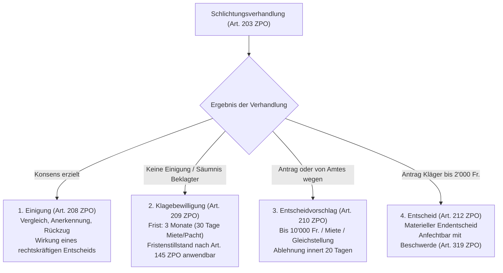

## Überblick {#ueberblick}

Das schweizerische Zivilprozessrecht folgt dem traditionellen Leitgedanken *Schlichten vor Richten*. Bevor die staatlichen Zivilgerichte in einer Streitigkeit ein förmliches, kontradiktorisches Entscheidverfahren durchführen, soll den Parteien Gelegenheit gegeben werden, ihren Konflikt im Rahmen einer formlosen, vertraulichen und kostengünstigen Aussprache einvernehmlich beizulegen (Botschaft ZPO, BBl 2006 7221, S. 7329).

Dieser Schlichtungsversuch bildet keine blosse Formalität, sondern ein zentrales Steuerungsinstrument der Zivilrechtspflege: Schweizweit werden je nach Sachgebiet und Kanton zwischen 50 und über 70 Prozent aller anhängig gemachten Streitigkeiten bereits vor der Schlichtungsbehörde durch Vergleich, Klageanerkennung oder Klagerückzug definitiv erledigt. Damit entlastet das Schlichtungsverfahren die Zivilgerichte substanziell und fördert den dauerhaften Rechtsfrieden, da konsensuale Lösungen im Vergleich zu streitigen Urteilen eine signifikant höhere Akzeptanz aufweisen.

Verfahrensrechtlich ist die Durchführung des gesetzlich vorgeschriebenen Schlichtungsverfahrens ein konstitutives Gültigkeitserfordernis für das nachfolgende gerichtliche Entscheidverfahren. Das Vorliegen einer gültigen Klagebewilligung der zuständigen Schlichtungsbehörde stellt eine von Amtes wegen zu prüfende Sachurteilsvoraussetzung im Sinne von [Art. 59 Abs. 2 ZPO](/kommentar/zpo/art-059/) dar ([BGE 139 III 273](https://entscheidsuche.ch/docs/CH_BGE/CH_BGE_005_BGE-139-III-273_2013.html#consideration_2.1) E. 2.1). Fehlt es an einem gesetzmässigen Schlichtungsversuch oder erweist sich die Klagebewilligung als ungültig, tritt das Sachgericht auf die Klage nicht ein ([BGE 140 III 70](https://entscheidsuche.ch/docs/CH_BGE/CH_BGE_005_BGE-140-III-70_2014.html#consideration_5.) E. 5).

Die Organisation der Schlichtungsbehörden ist Sache der Kantone (Art. 3 ZPO; [BGE 139 III 273](https://entscheidsuche.ch/docs/CH_BGE/CH_BGE_005_BGE-139-III-273_2013.html#consideration_2.2) E. 2.2). Das Bundesrecht unterscheidet im Wesentlichen zwei Typen:
* **Allgemeine Schlichtungsbehörden**: In den meisten Kantonen amtieren hierfür Laienrichterinnen und Laienrichter als Friedensrichter, Vermittler oder Schlichtungsrichter (z. B. Friedensrichterämter im Kanton Zürich; Vermittlerämter im Kanton St. Gallen).
* **Paritätische Schlichtungsbehörden**: Für Streitigkeiten aus Miete und Pacht von Wohn- und Geschäftsräumen (Art. 200 Abs. 1 ZPO) sowie Streitigkeiten nach dem Gleichstellungsgesetz (Art. 200 Abs. 2 ZPO) schreibt das Bundesrecht zwingend Behörden vor, die sich aus einer unabhängigen vorsitzenden Person und einer paritätischen Vertretung der jeweiligen Interessengruppen (Vermieter- und Mietervertreter bzw. Arbeitgeber- und Arbeitnehmervertreter) zusammensetzen.

Mit der per 1. Januar 2025 in Kraft getretenen Teilrevision der ZPO (BBl 2020 2697; AS 2023 491) hat der Bundesgesetzgeber das Schlichtungsverfahren weiter gestärkt und praxisbezogene Hürden abgebaut: Namentlich wurden die Streitwertgrenze für den Entscheidvorschlag von 5'000 auf 10'000 Franken verdoppelt (Art. 210 Abs. 1 lit. c ZPO), die Vertretungsregeln für juristische Personen und Streitgenossen präzisiert (Art. 204 ZPO), eine ausdrückliche Busse bei pflichtwidriger Säumnis eingeführt (Art. 206 Abs. 4 ZPO) und die einseitigen Verzichtsmöglichkeiten ausgedehnt (Art. 199 Abs. 2 und 3 ZPO).

## Phasen des Schlichtungsverfahrens {#phasen}

Das Schlichtungsverfahren gliedert sich in fünf aufeinanderfolgende Phasen von der Gesuchseinreichung bis zur Weiterleitung an das Sachgericht:

| Phase | Zuständige Stelle & Akteure | Frist & Verfahrensakt | Typische Rechtsfolge / Kernproblem |
|---|---|---|---|
| **1. Einleitung** | Gesuchsteller (klagende Partei) bei Schlichtungsbehörde | Kein Fristenzwang (ausser bei gesetzlichen Verwirkungsfristen) | Einreichung des Schlichtungsgesuchs (Art. 202 ZPO); begründet Rechtshängigkeit (Art. 62 Abs. 1 ZPO) und unterbricht Verjährung (Art. 135 Ziff. 2 OR). |
| **2. Vorbereitung** | Schlichtungsbehörde | Unverzügliche Zustellung; Vorladung zur Verhandlung innert 2 Monaten (Art. 203 Abs. 1 ZPO) | Schriftenwechsel findet nur ausnahmsweise statt (Art. 202 Abs. 4 ZPO); Prüfung der Dispensationsgründe (Art. 204 Abs. 3 ZPO). |
| **3. Schlichtungsverhandlung** | Schlichtungsbehörde und beide Parteien (mit Begleitung/Vertretung) | Mündliche Verhandlung; max. 12 Monate Verfahrensdauer (Art. 203 Abs. 4 ZPO) | Pflicht zum persönlichen Erscheinen (Art. 204 ZPO); striktes Protokollierungs- und Verwertungsverbot (Art. 205 ZPO). |
| **4. Verfahrensabschluss** | Schlichtungsbehörde | Unmittelbar an oder nach der Verhandlung | Vier Erledigungsarten: Einigung (Art. 208 ZPO), Klagebewilligung (Art. 209 ZPO), Entscheidvorschlag (Art. 210 ZPO) oder Entscheid bis 2'000 Fr. (Art. 212 ZPO). |
| **5. Prosequierung** | Klagende Partei (bzw. ablehnende Partei bei Miete/Pacht) beim Sachgericht | **3 Monate** (Art. 209 Abs. 3 ZPO) bzw. **30 Tage** bei Miete/Pacht (Art. 209 Abs. 4 ZPO) | Einreichung der Klageschrift beim erstinstanzlichen Gericht; Fristenstillstand gemäss Art. 145 ZPO anwendbar ([BGE 138 III 615](https://entscheidsuche.ch/docs/CH_BGE/CH_BGE_005_BGE-138-III-615_2012.html#consideration_2.4) E. 2.4). |

## Voraussetzungen und Ausnahmen vom Schlichtungsversuch {#voraussetzungen-ausnahmen}

### Der Grundsatz des Schlichtungsobligatoriums {#grundsatz}



Art. 197 ZPO formuliert eine strikte Regel-Ausnahme-Ordnung: In sämtlichen Zivilstreitigkeiten muss zwingend ein Schlichtungsversuch vorangegangen sein, es sei denn, das Gesetz sieht ausdrücklich eine Ausnahme vor oder die Parteien haben darauf rechtsgültig verzichtet.

### Gesetzliche Ausnahmen nach Art. 198 ZPO {#ausnahmen}

In bestimmten Verfahrenskonstellationen entfällt das Schlichtungsverfahren von Gesetzes wegen. [Art. 198 ZPO](/kommentar/zpo/art-198/) zählt diese Fälle abschliessend auf:

1. **Summarisches Verfahren (lit. a)**: Sämtliche Angelegenheiten des summarischen Verfahrens (Art. 248 ff. ZPO), namentlich der vorsorgliche Rechtsschutz (Art. 261 ff. ZPO), der Rechtsöffnungsprozess (Art. 80 ff. SchKG) und der Rechtsschutz in klaren Fällen (Art. 257 ZPO). Die Dringlichkeit und Raschheit des Summarverfahrens schliessen eine Schlichtungsverhandlung aus.
2. **Gewaltschutz (lit. a^bis)**: Klagen wegen Gewalt, Drohungen oder Nachstellungen nach Art. 28b ZGB sowie elektronische Überwachung (Art. 28c ZGB). Den Opfern ist ein Schlichtungsgespräch mit der gewaltausübenden Person unzumutbar.
3. **Status- und Kinderbelange (lit. b und b^bis)**: Klagen über den Personenstand (Vaterschafts-, Anfechtungs- und Feststellungsklagen) sowie Klagen über den Unterhalt minder- und volljähriger Kinder und weitere Kinderbelange. Wegen der Geltung der Offizial- und Untersuchungsmaxime sind diese Rechte der freien Parteiendisposition entzogen.
4. **Scheidungs- und Auflösungsverfahren (lit. c und d)**: Im Scheidungsprozess führt das Gericht selbst eine gesetzliche Einigungsverhandlung durch (Art. 291 ZPO), weshalb eine vorgeschaltete Schlichtung einen unnötigen Leerlauf darstellen würde.
5. **Enumerierte SchKG-Klagen (lit. e Ziff. 1–8)**: Typische betreibungsrechtliche Klagen mit kurzen gesetzlichen Klagefristen (namentlich Aberkennungsklage nach Art. 83 Abs. 2 SchKG, Feststellungsklage nach Art. 85a SchKG, Widerspruchs- und Kollokationsklagen).
6. **Einzige kantonale Instanz (lit. f und Art. 199 Abs. 3 ZPO)**: Streitigkeiten, für die nach Art. 7 ZPO das kantonale Versicherungsgericht als einzige kantonale Instanz zuständig ist (Zusatzversicherungen zur sozialen Krankenversicherung nach VVG).
7. **Prozessuale Konnexität (lit. g und h)**: Hauptintervention, Widerklage und Streitverkündungsklage, da das Sachgericht bereits mit der Hauptsache befasst ist. Ebenso Klagen, für die das Gericht eine Klagefrist gesetzt hat (z. B. nach vorsorglicher Beweisabnahme oder vorsorglicher Massnahme nach Art. 263 ZPO), sowie sachlich damit konnexe Klagen.
8. **Bundespatentgericht (lit. i)**: Klagen, für die das Bundespatentgericht zuständig ist.

### Parteiverzicht nach Art. 199 ZPO {#verzicht}



Neben den gesetzlichen Ausnahmen sieht Art. 199 ZPO vor, unter welchen Voraussetzungen die Parteien auf den Schlichtungsversuch verzichten können:

* **Gemeinsamer Verzicht ab 100'000 Franken Streitwert (Abs. 1)**: Bei vermögensrechtlichen Streitigkeiten mit einem Streitwert von mindestens 100'000 Franken können Kläger und Beklagter übereinstimmend direkt das Gericht anrufen. Liegt der Streitwert hingegen unter 100'000 Franken, ist ein Verzicht selbst bei vollkommenem Konsens beider Parteien gesetzlich ausgeschlossen ([BGE 146 III 185](https://entscheidsuche.ch/docs/CH_BGE/CH_BGE_005_BGE-146-III-185_2020.html#consideration_4.1) E. 4.1).
* **Einseitiger Verzicht der klagenden Partei (Abs. 2)**: Die Klägerschaft darf die Schlichtungsbehörde ohne Zustimmung der Gegenpartei überspringen, wenn:
  * die beklagte Partei Sitz oder Wohnsitz im Ausland hat (lit. a);
  * der Aufenthaltsort der beklagten Partei unbekannt ist (lit. b);
  * eine Streitigkeit nach dem Gleichstellungsgesetz (GlG) vorliegt (lit. c).
* **Einzige kantonale Instanz (Abs. 3, neu seit 2025)**: Bei Streitigkeiten vor dem Handelsgericht (Art. 6 ZPO), dem kantonalen Spezialgericht für Immaterialgüterrecht und Kartellrecht (Art. 5 ZPO) oder bei direkter Klage an das obere kantonale Gericht bei Streitwerten ab 100'000 Franken (Art. 8 ZPO) kann die klagende Partei die Klage direkt beim Gericht einreichen.

## Einleitung und Vorbereitung {#einleitung-vorbereitung}

### Das Schlichtungsgesuch und seine Wirkungen {#schlichtungsgesuch}

Das Schlichtungsverfahren wird durch Einreichung des Schlichtungsgesuchs eingeleitet (Art. 202 Abs. 1 ZPO). Die Eingabe kann schriftlich in Papierform, elektronisch gemäss Art. 130 ZPO oder mündlich zur Protokollierung vor der Schlichtungsbehörde erfolgen.

An das Schlichtungsgesuch stellt das Gesetz bewusst geringe formelle Anforderungen: Es genügen die Bezeichnung der Parteien, ein bestimmtes oder bestimmbares Rechtsbegehren sowie eine kurze Umschreibung des Streitgegenstands (Art. 202 Abs. 2 ZPO). Eine ausführliche Tatsachenbegründung oder die Nennung von Gesetzesartikeln ist nicht erforderlich.

Mit der Einreichung des Schlichtungsgesuchs treten zwei fundamentale Rechtswirkungen ein:
1. **Rechtshängigkeit (Litispendenz)**: Das Verfahren wird rechtshängig (Art. 62 Abs. 1 ZPO). Damit greift die Sperrwirkung nach Art. 64 Abs. 1 lit. a ZPO (keine zweite Klage über denselben Streitgegenstand zwischen denselben Parteien), und gesetzliche Klage- oder Verwirkungsfristen sind gewahrt.
2. **Unterbrechung der Verjährung**: Nach Art. 135 Ziff. 2 OR wird die Verjährung der eingeklagten Forderung unterbrochen ([BGE 147 III 419](https://entscheidsuche.ch/docs/CH_BGE/CH_BGE_005_BGE-147-III-419_2021.html) E. 5.3.2).

### Bindung an den Streitgegenstand {#streitgegenstand}

Der im Schlichtungsgesuch definierte Streitgegenstand steckt den Rahmen für das spätere Gerichtsverfahren ab: Die Klagebewilligung ermächtigt nur zur Geltendmachung jener Ansprüche, die Gegenstand des Schlichtungsverfahrens waren.

Wird im nachfolgenden Entscheidverfahren vor dem Sachgericht ein Anspruch eingeklagt, der im Schlichtungsverfahren nicht Gegenstand der Vermittlung war, fehlt es an der Prozessvoraussetzung des durchgeführten Schlichtungsversuchs. Eine Erweiterung oder quantitative Erhöhung des Rechtsbegehrens ist vor Gericht nur im engen Rahmen der Voraussetzungen für eine Klageänderung nach Art. 227 ZPO zulässig ([BGE 146 III 290](https://entscheidsuche.ch/docs/CH_BGE/CH_BGE_005_BGE-146-III-290_2020.html#consideration_4.3.1) E. 4.3.1).

### Vorladung und Mündlichkeitsgrundsatz {#vorladung}

Nach Eingang des Gesuchs stellt die Schlichtungsbehörde der Gegenpartei das Gesuch unverzüglich zu und lädt die Parteien zur Verhandlung vor (Art. 202 Abs. 3 ZPO). Die Verhandlung soll innert zwei Monaten stattfinden (Art. 203 Abs. 1 ZPO). Diese Frist ist eine Ordnungsfrist für die Behörde; ihre Nichteinhaltung berührt die Gültigkeit des Verfahrens nicht.

Ein vorbereitender Schriftenwechsel ist im Schlichtungsverfahren verpönt: Er ist nur ausnahmsweise zulässig, wenn ein Entscheidvorschlag (Art. 210 ZPO) oder ein Entscheid (Art. 212 ZPO) in Frage kommt (Art. 202 Abs. 4 ZPO).

## Verhandlung und Verfahrensregeln {#verhandlung-verfahrensregeln}

### Pflicht zum persönlichen Erscheinen (Art. 204 ZPO) {#erscheinen}



Das persönliche Erscheinen der Parteien an der Schlichtungsverhandlung ist das Kardinalprinzip des Schlichtungsverfahrens (Art. 204 Abs. 1 ZPO). Vergleichsgespräche können ihren Zweck nur erfüllen, wenn die tatsächlich entscheidungsbefugten und wirtschaftlich betroffenen Personen am Verhandlungstisch sitzen und sich direkt austauschen ([BGE 140 III 70](https://entscheidsuche.ch/docs/CH_BGE/CH_BGE_005_BGE-140-III-70_2014.html#consideration_4.3) E. 4.3).

#### Juristische Personen und Organe
Handelt es sich bei einer Partei um eine juristische Person (z. B. eine AG oder GmbH), so muss gemäss Art. 204 Abs. 1 Satz 2 ZPO entweder ein formelles Organ (Verwaltungsrat, Geschäftsführer) oder eine Person erscheinen, die:
* mit einer kaufmännischen Handlungsvollmacht (Art. 462 OR) oder Prokura (Art. 458 OR) ausgestattet ist,
* zur Prozessführung sowie zum Abschluss eines Vergleichs bevollmächtigt ist, und
* mit dem Streitgegenstand tatsächlich vertraut ist.

Das Bundesgericht hat klargestellt, dass das Erscheinen eines bloss faktischen Organs oder einer Person mit gewöhnlicher bürgerlicher Vollmacht (Art. 32 OR) den Anforderungen von Art. 204 Abs. 1 ZPO nicht genügt ([BGE 141 III 159](https://entscheidsuche.ch/docs/CH_BGE/CH_BGE_005_BGE-141-III-159_2015.html#consideration_2.3) E. 2.3, E. 3.2).

#### Begleitung und Vertretung
Die Parteien dürfen sich an der Schlichtungsverhandlung von einer Anwältin, einem Anwalt oder einer Vertrauensperson begleiten lassen (Art. 204 Abs. 2 ZPO). Die Begleitperson darf die Partei beraten und plädieren, ersetzt aber deren persönliche Anwesenheit nicht.

Eine Vertretung ohne persönliches Erscheinen ist nach Art. 204 Abs. 3 ZPO nur in eng begrenzten Ausnahmefällen zulässig:
1. **Ausserkantonaler oder ausländischer Wohnsitz bzw. Sitz (lit. a)**: Hat eine Partei ihren zivilrechtlichen Wohnsitz oder Sitz ausserhalb des Kantons der Schlichtungsbehörde oder im Ausland, darf sie sich vollständig durch einen bevollmächtigten Anwalt oder Dritten vertreten lassen.
2. **Krankheit, Alter oder andere wichtige Verhinderungsgründe (lit. b)**: Erfordert ein ärztliches Zeugnis oder den Nachweis einer unüberwindbaren Hürde.
3. **Delegation in vereinfachten Verfahren nach Art. 243 ZPO (lit. c)**: Ein Arbeitgeber oder Versicherer darf eine angestellte Person, ein Vermieter seine Liegenschaftsverwaltung delegieren, sofern diese schriftlich zum Vergleichsabschluss ermächtigt sind.
4. **Streitgenossenschaft (lit. d, neu seit 2025)**: Bei mehreren Klägern oder Beklagten genügt die Anwesenheit einer Partei, wenn diese bevollmächtigt ist, die anderen zu vertreten und einen Vergleich abzuschliessen.

### Vertraulichkeit des Verfahrens (Art. 205 ZPO) {#vertraulichkeit}

Das Schlichtungsverfahren untersteht einer absoluten Vertraulichkeit ([Art. 205 ZPO](/kommentar/zpo/art-205/)). Um den Parteien eine offene Suche nach Kompromissen zu ermöglichen, normiert Art. 205 Abs. 1 ZPO ein zweifaches Verbot:
1. **Protokollierungsverbot**: Aussagen der Parteien zur Sache, Sachverhaltseingeständnisse und Vergleichsofferten dürfen von der Schlichtungsbehörde nicht protokolliert werden.
2. **Gerichtliches Verwertungsverbot**: Im nachfolgenden Entscheidverfahren vor dem Sachgericht dürfen Äusserungen aus der Schlichtungsverhandlung weder von den Parteien vorgebracht noch vom Richter verwertet werden. Sie gelten als absolut unverwertbar ([BGE 152 III 61](https://entscheidsuche.ch/docs/CH_BGE/CH_BGE_005_BGE-152-III-61_2026.html#consideration_6.2.4) E. 6.2.4).

### Säumnis und ihre Folgen (Art. 206 ZPO) {#saeumnis}



Bleibt eine Partei der Schlichtungsverhandlung unentschuldigt fern, knüpft Art. 206 ZPO daran asymmetrische und für die klagende Partei existenzbedrohende Konsequenzen:

#### Säumnis der klagenden Partei (Abs. 1)
Erscheint die klagende Partei nicht persönlich (und liegt kein Dispensationsgrund nach Art. 204 Abs. 3 ZPO vor), gilt das Schlichtungsgesuch von Gesetzes wegen als zurückgezogen; das Verfahren wird als gegenstandslos abgeschrieben (Art. 206 Abs. 1 ZPO).

Diese strikte Fiktion greift selbst dann, wenn die beklagte Partei der Behörde zuvor schriftlich mitgeteilt hatte, sie werde keinesfalls zur Verhandlung erscheinen: Die Schlichtungsbehörde darf den Kläger in diesem Fall nicht dispensieren; der Kläger muss zwingend zur Verhandlung antreten, und sei es nur, um die Klagebewilligung abzuholen ([BGE 146 III 185](https://entscheidsuche.ch/docs/CH_BGE/CH_BGE_005_BGE-146-III-185_2020.html#consideration_4.3.2) E. 4.3.2).

Stellt die Schlichtungsbehörde dem Kläger trotz dessen unentschuldigtem Fernbleiben eine Klagebewilligung aus, ist diese **nichtig bzw. ungültig**. Das Sachgericht muss auf die spätere Klage mangels gültiger Klagebewilligung durch Nichteintretensentscheid abschreiben ([BGE 140 III 70](https://entscheidsuche.ch/docs/CH_BGE/CH_BGE_005_BGE-140-III-70_2014.html#consideration_5.) E. 5).

#### Säumnis der beklagten Partei (Abs. 2)
Erscheint die beklagte Partei nicht, wird sie durch ihr Ausbleiben nicht belohnt: Das Verfahren wird fortgeführt, wie wenn keine Einigung zustande gekommen wäre (Art. 206 Abs. 2 ZPO). Die Schlichtungsbehörde stellt der klagenden Partei ohne Weiteres die Klagebewilligung aus oder unterbreitet einen Entscheidvorschlag bzw. fällt einen Entscheid bis 2'000 Franken.

#### Ordnungsbusse (Abs. 4)
Seit der ZPO-Revision 2025 kann die Schlichtungsbehörde eine Partei, die der Verhandlung unentschuldigt fernbleibt, mit einer Ordnungsbusse bis zu 1'000 Franken bestrafen (Art. 206 Abs. 4 ZPO). Damit schloss der Gesetzgeber die Lücke, die das Bundesgericht in [BGE 141 III 265](https://entscheidsuche.ch/docs/CH_BGE/CH_BGE_005_BGE-141-III-265_2015.html#consideration_3.2) (E. 3.2) offengelegt hatte.

## Die vier Erledigungsarten {#erledigungsarten}

Das Schlichtungsverfahren kennt vier gesetzliche Abschlussformen:

### 1. Einigung der Parteien (Art. 208 ZPO) {#einigung}



Kommt es an der Verhandlung zu einer Einigung, nimmt die Behörde einen gerichtlichen Vergleich, eine Klageanerkennung oder einen vorbehaltlosen Klagerückzug zu Protokoll. Das Protokoll wird den Parteien vorgelesen und von ihnen unterzeichnet.

Nach Art. 208 Abs. 2 ZPO hat das Protokoll die definitive Wirkung eines rechtskräftigen gerichtlichen Entscheids:
* **Res iudicata**: Über denselben Anspruch kann zwischen den Parteien kein neuer Prozess mehr geführt werden.
* **Vollstreckbarkeit**: Der Vergleich ist ein definitiver Rechtsöffnungstitel im Sinne von Art. 80 SchKG und kann direkt vollstreckt werden (Art. 387 ZPO).

### 2. Klagebewilligung (Art. 209 ZPO) {#klagebewilligung}

Kommt keine Einigung zustande und fällt weder ein Entscheidvorschlag noch ein Entscheid, hält die Schlichtungsbehörde das Scheitern fest und erteilt die Klagebewilligung (Art. 209 Abs. 1 ZPO).

#### Adressat der Klagebewilligung
In der Regel erhält die klagende Partei die Klagebewilligung (lit. b). Eine gesetzliche Ausnahme gilt bei der Anfechtung von Miet- und Pachtzinserhöhungen: Hier wird die Klagebewilligung dem Vermieter bzw. Verpächter erteilt (lit. a), weil dieser die Berechtigung der Erhöhung vor Gericht prosequieren muss.

Wurde im Schlichtungsverfahren eine Widerklage erhoben, erhält die widerklagende Partei keine separate Klagebewilligung: Lässt die Hauptklägerin die Klagefrist ungenutzt verstreichen, kann der Widerkläger seine Widerklage nicht selbständig prosequieren ([BGE 148 III 314](https://entscheidsuche.ch/docs/CH_BGE/CH_BGE_005_BGE-148-III-314_2022.html#consideration_2.1.2) E. 2.1.2).

#### Fristen zur Klageerhebung
Die Klagebewilligung berechtigt zur Einreichung der Klage beim zuständigen Zivilgericht (Art. 209 Abs. 3 ZPO):
* **Allgemeine Frist**: **Drei Monate** seit der Eröffnung der Klagebewilligung.
* **Sonderfrist bei Miete und Pacht**: **30 Tage** in Streitigkeiten aus Miete und Pacht von Wohn- und Geschäftsräumen sowie landwirtschaftlicher Pacht (Art. 209 Abs. 4 ZPO).

Wird die Klage nicht innert der Frist beim Gericht eingereicht, verwirkt die Klagebewilligung. Ein Gerichtsverfahren kann anschliessend nur nach Durchführung eines erneuten Schlichtungsverfahrens eingeleitet werden.

#### Stillstand und Berechnung der Klagefrist
Das Bundesgericht hat grundlegende Leitentscheide zu den Fristen nach Art. 209 ZPO gefällt:
1. **Fristenstillstand (Gerichtsferien)**: Entgegen dem Wortlaut von Art. 145 Abs. 2 lit. a ZPO (Ausschluss der Gerichtsferien für das Schlichtungsverfahren) gilt der Fristenstillstand nach Art. 145 Abs. 1 ZPO für die Frist zur Klageeinreichung beim Gericht gemäss Art. 209 Abs. 3 und 4 ZPO ([BGE 138 III 615](https://entscheidsuche.ch/docs/CH_BGE/CH_BGE_005_BGE-138-III-615_2012.html#consideration_2.4) E. 2.4). Fällt die dreimonatige Frist in die Sommer-, Oster- oder Weihnachtsgerichtsferien, verlängert sie sich entsprechend.
2. **Fristberechnung**: Die Dreimonatsfrist beginnt mit der tatsächlichen Zustellung der Klagebewilligung zu laufen. Für das Fristende ist nach Art. 142 Abs. 2 ZPO auf den Tag des fristauslösenden Ereignisses (Zustellungsdatum) abzustellen ([BGE 150 III 367](https://entscheidsuche.ch/docs/CH_BGE/CH_BGE_005_BGE-150-III-367_2024.html#consideration_5.6) E. 5.6): Wird die Klagebewilligung am 15. März zugestellt, endet die Dreimonatsfrist am 15. Juni (und nicht am 16. Juni).

#### Keine selbständige Anfechtbarkeit
Die Klagebewilligung ist kein förmlicher Hoheitsentscheid, sondern eine Prozessüberweisung. Sie kann weder mit Berufung noch mit Beschwerde angefochten werden ([BGE 139 III 273](https://entscheidsuche.ch/docs/CH_BGE/CH_BGE_005_BGE-139-III-273_2013.html#consideration_2.3) E. 2.3; [BGE 140 III 227](https://entscheidsuche.ch/docs/CH_BGE/CH_BGE_005_BGE-140-III-227_2014.html#consideration_3.1) E. 3.1). Allfällige Mängel der Schlichtung (z. B. unentschuldigtes Fehlen oder örtliche Unzuständigkeit der Schlichtungsbehörde nach [BGE 146 III 265](https://entscheidsuche.ch/docs/CH_BGE/CH_BGE_005_BGE-146-III-265_2020.html#consideration_5.5.1) E. 5.5.1) müssen als Einrede im Rahmen der Prozessvoraussetzungen vor dem Sachgericht gerügt werden.

### 3. Entscheidvorschlag (Art. 210 und 211 ZPO) {#entscheidvorschlag}





Der Entscheidvorschlag (bis Ende 2024 als *Urteilsvorschlag* bezeichnet) ist ein vermittelnder Lösungsvorschlag der Behörde mit Urteilscharakter. Er kann unterbreitet werden in:
* Streitigkeiten nach dem Gleichstellungsgesetz (GlG);
* miet- und pachtrechtlichen Streitigkeiten betreffend Hinterlegung, Missbrauch von Mietzinsen, Kündigungsschutz oder Erstreckung (Art. 210 Abs. 1 lit. b ZPO);
* allen übrigen vermögensrechtlichen Streitigkeiten bis zu einem Streitwert von **10'000 Franken** (Art. 210 Abs. 1 lit. c ZPO; vor 2025: 5'000 Franken).

#### Wirkung und Ablehnungsfrist
Jede Partei kann den Entscheidvorschlag innert **20 Tagen** seit der schriftlichen Eröffnung ohne jede Begründung ablehnen (Art. 211 Abs. 1 ZPO).
* **Fristenstillstand**: Die 20-tägige Ablehnungsfrist steht während der Gerichtsferien nach Art. 145 Abs. 1 ZPO still ([BGE 144 III 404](https://entscheidsuche.ch/docs/CH_BGE/CH_BGE_005_BGE-144-III-404_2018.html#consideration_4.2) E. 4.2).
* **Annahme bei Stillschweigen**: Lehnt keine Partei fristgerecht ab, gilt der Entscheidvorschlag als angenommen und erwächst in materielle Rechtskraft mit der Wirkung eines vollstreckbaren Urteils. Gegen den Urteilsvorschlag ist eine Beschwerde unzulässig; wer ihn nicht akzeptieren will, muss ihn ablehnen ([BGE 140 III 310](https://entscheidsuche.ch/docs/CH_BGE/CH_BGE_005_BGE-140-III-310_2014.html#consideration_1.2) E. 1.2).

#### Die Prozessfalle im Mietrecht (Art. 211 Abs. 2 lit. a und Abs. 3 ZPO)
Im Mietrecht kehrt Art. 211 ZPO die Parteirollen um: Lehnt in den Angelegenheiten von Art. 210 Abs. 1 lit. b ZPO eine Partei den Entscheidvorschlag ab, stellt die Schlichtungsbehörde die Klagebewilligung der **ablehnenden Partei** zu. Reicht die ablehnende Partei innert 30 Tagen keine Klage beim Mietgericht ein, gilt der Entscheidvorschlag kraft gesetzlicher Fiktion als anerkannt und wird rechtskräftig (Art. 211 Abs. 3 ZPO).

### 4. Entscheid der Schlichtungsbehörde (Art. 212 ZPO) {#entscheid}



In vermögensrechtlichen Streitigkeiten bis zu einem Streitwert von **2'000 Franken** kann die Schlichtungsbehörde auf Antrag der klagenden Partei als vollwertige richterliche Instanz einen materiellen Endentscheid fällen.

* **Keine Zwangskompetenz**: Die Behörde ist nicht verpflichtet, dem Antrag auf Entscheid zu entsprechen; sie kann nach pflichtgemässem Ermessen stattdessen einen Entscheidvorschlag unterbreiten oder die Klagebewilligung ausstellen ([BGE 142 III 638](https://entscheidsuche.ch/docs/CH_BGE/CH_BGE_005_BGE-142-III-638_2016.html#consideration_3.4.1) E. 3.4.1).
* **Rechtsmittel**: Ein Entscheid nach Art. 212 ZPO ist ein Urteil im Sinne von Art. 236 ZPO. Wegen des Streitwerts unter 10'000 Franken ist er nicht mit Berufung, sondern ausschliesslich mit Beschwerde nach Art. 319 lit. a ZPO an das obere kantonale Gericht anfechtbar (Kognition beschränkt auf Rechtsverletzung und offensichtlich unrichtige Sachverhaltsfeststellung, Art. 320 ZPO).

## Kosten und Parteientschädigung {#kosten}

### Gerichtskosten des Schlichtungsverfahrens (Art. 207 ZPO) {#gerichtskosten}

Die Spruchgebühren im Schlichtungsverfahren richten sich nach kantonalem Gebührentarif (Art. 96 ZPO) und betragen in einfachen Streitigkeiten meist zwischen 100 und 500 Franken.

Nach Art. 207 Abs. 1 ZPO werden die Kosten der klagenden Partei auferlegt, wenn sie das Gesuch zurückzieht, wenn sie säumig ist oder wenn ihr die Klagebewilligung erteilt wird. Reicht die Klägerin anschliessend fristgerecht Klage beim Zivilgericht ein, werden die Kosten des Schlichtungsverfahrens als Teil der Prozesskosten zur Hauptsache geschlagen (Art. 207 Abs. 2 ZPO): Die obsiegende Partei erhält sie am Ende des Gerichtsprozesses von der unterliegenden Gegenpartei ersetzt.

### Kostenlose Schlichtungsverfahren (Art. 114 ZPO) {#kostenlosigkeit}

Aus sozialpolitischen Gründen ist das Schlichtungsverfahren in zahlreichen Angelegenheiten vollkommen gerichtsgebührenfrei (Art. 114 ZPO):
* Streitigkeiten nach dem Gleichstellungsgesetz (lit. a);
* miet- und pachtrechtliche Streitigkeiten betreffend Hinterlegung, Kündigungsschutz, Erstreckung sowie Mietzinsanfechtung (lit. c);
* arbeitsrechtliche Streitigkeiten bis zu einem Streitwert von 30'000 Franken (lit. d);
* Streitigkeiten nach dem Behindertengleichstellungsgesetz (lit. f).

### Keine Parteientschädigung vor Schlichtungsbehörde (Art. 113 ZPO) {#parteientschaedigung}

Gemäss Art. 113 Abs. 1 Satz 1 ZPO werden im Schlichtungsverfahren keine Parteientschädigungen zugesprochen. Jede Partei trägt ihre vorgerichtlichen Anwalts- und Vertretungskosten selbst, unabhängig vom Ausgang der Schlichtung.

Das Bundesgericht hat jedoch entschieden, dass diese Bestimmung nur die Schlichtungsbehörde selbst bindet: Führt die Klägerin gestützt auf die Klagebewilligung den Prozess vor Gericht weiter und obsiegt sie, darf der Sachrichter im Rahmen des Endentscheids eine Parteientschädigung auch für den notwendigen anwaltlichen Vertretungsaufwand des vorgeschalteten Schlichtungsverfahrens zusprechen ([BGE 141 III 20](https://entscheidsuche.ch/docs/CH_BGE/CH_BGE_005_BGE-141-III-20_2015.html#consideration_5.1) E. 5.1).

## Praxishinweise {#praxishinweise}

### Für klagende Parteien und Gesuchsteller {#fuer-klagende-parteien}
* **Persönliches Erscheinen ist zwingend**: Verlassen Sie sich keinesfalls darauf, dass Ihr Anwalt oder Ihre Anwältin allein zur Verhandlung geht. Fehlt die klagende Partei unentschuldigt, gilt das Gesuch als zurückgezogen (Art. 206 Abs. 1 ZPO). Selbst wenn die Gegenpartei schriftlich angekündigt hat, nicht zu kommen, müssen Sie persönlich erscheinen ([BGE 146 III 185](https://entscheidsuche.ch/docs/CH_BGE/CH_BGE_005_BGE-146-III-185_2020.html#consideration_4.3.2)).
* **Organe und Vollmachten bei juristischen Personen prüfen**: Nimmt für ein Unternehmen kein im Handelsregister eingetragenes Organ teil, muss die entsandte Person eine schriftliche kaufmännische Handlungsvollmacht (Art. 462 OR) vorweisen, zum Vergleichsabschluss bevollmächtigt und nachweisbar mit dem Sachverhalt vertraut sein (Art. 204 Abs. 1 Satz 2 ZPO). Eine einfache Vollmacht nach Art. 32 OR reicht nicht aus ([BGE 141 III 159](https://entscheidsuche.ch/docs/CH_BGE/CH_BGE_005_BGE-141-III-159_2015.html#consideration_2.3)).
* **Klagefrist taggenau berechnen**: Nach Erhalt der Klagebewilligung läuft die dreimonatige Frist (30 Tage bei Miete/Pacht) ab dem Tag der Zustellung. Berechnen Sie das Fristende nach Art. 142 Abs. 2 ZPO taggenau ([BGE 150 III 367](https://entscheidsuche.ch/docs/CH_BGE/CH_BGE_005_BGE-150-III-367_2024.html#consideration_5.6)) und berücksichtigen Sie allfällige Gerichtsferien nach Art. 145 ZPO ([BGE 138 III 615](https://entscheidsuche.ch/docs/CH_BGE/CH_BGE_005_BGE-138-III-615_2012.html#consideration_2.4)).

### Für beklagte Parteien {#fuer-beklagte-parteien}
* **Nichterscheinen verhindert das Verfahren nicht**: Ein unentschuldigtes Fernbleiben blockiert den Kläger nicht, sondern führt direkt zur Erteilung der Klagebewilligung (Art. 206 Abs. 2 ZPO) und kann neu mit einer Ordnungsbusse bis zu 1'000 Franken bestraft werden (Art. 206 Abs. 4 ZPO).
* **Falle bei mietrechtlichen Entscheidvorschlägen**: Wenn Sie als Mieter oder Vermieter einen Entscheidvorschlag der Schlichtungsbehörde nach Art. 210 Abs. 1 lit. b ZPO ablehnen, erhalten Sie die Klagebewilligung. Sie müssen innert 30 Tagen Klage beim Gericht einreichen — tun Sie dies nicht, wird der abgelehnte Vorschlag dennoch rechtskräftig (Art. 211 Abs. 3 ZPO).
* **Vertraulichkeit als Verhandlungschance nutzen**: Weil an der Schlichtungsverhandlung getätigte Zugeständnisse im späteren Prozess absolut unverwertbar sind ([Art. 205 ZPO](/kommentar/zpo/art-205/)), können risikolos Vergleiche ausgelotet und wirtschaftliche Angebote unterbreitet werden.

## Leitentscheide {#leitentscheide}

| Entscheid | Fundstelle & Erwägung | Gegenstand | Kernaussage & Bedeutung |
|---|---|---|---|
| **Klagebewilligung als Prozessvoraussetzung** | [BGE 139 III 273](https://entscheidsuche.ch/docs/CH_BGE/CH_BGE_005_BGE-139-III-273_2013.html#consideration_2.1) E. 2.1, E. 2.3 | Gültigkeit der Klagebewilligung; keine Beschwerdemöglichkeit | Die Klagebewilligung ist eine Prozessvoraussetzung, die das Gericht von Amtes wegen prüft. Die Klagebewilligung selbst ist kein anfechtbarer Entscheid. |
| **Prüfung der Gültigkeit durch Sachrichter** | [BGE 140 III 227](https://entscheidsuche.ch/docs/CH_BGE/CH_BGE_005_BGE-140-III-227_2014.html#consideration_3.1) E. 3.1 | Ausschluss der kantonalen Beschwerde gegen Klagebewilligung | Bestätigung, dass die Gültigkeit der Klagebewilligung ausschliesslich durch das angerufene Sachgericht im Entscheidverfahren geprüft wird. |
| **Persönliches Erscheinen juristischer Personen** | [BGE 140 III 70](https://entscheidsuche.ch/docs/CH_BGE/CH_BGE_005_BGE-140-III-70_2014.html#consideration_4.3) E. 4.3, E. 5. | Pflicht zum persönlichen Erscheinen; ungültige Klagebewilligung | Juristische Personen müssen durch Organe oder handlungsbevollmächtigte Personen vertreten sein. Missachtung führt zur Säumnis und Nichtigkeit der Klagebewilligung. |
| **Keine Vertretung durch bürgerliche Vollmacht** | [BGE 141 III 159](https://entscheidsuche.ch/docs/CH_BGE/CH_BGE_005_BGE-141-III-159_2015.html#consideration_2.3) E. 2.3, E. 3.2 | Faktische Organe und Vollmachtsformen im Schlichtungsverfahren | Eine Vertretung juristischer Personen verlangt formelle Organstellung oder kaufmännische Handlungsvollmacht (Art. 462 OR). Bürgerliche Vollmacht (Art. 32 OR) reicht nicht. |
| **Teilnahmepflicht trotz angekündigter Säumnis** | [BGE 146 III 185](https://entscheidsuche.ch/docs/CH_BGE/CH_BGE_005_BGE-146-III-185_2020.html#consideration_4.1) E. 4.1, E. 4.3.2 | Gemeinsamer Verzicht (Art. 199 ZPO); Säumnis des Klägers | Unter 100'000 Fr. Streitwert ist ein Verzicht ausgeschlossen. Der Kläger muss auch dann persönlich erscheinen, wenn der Beklagte vorab erklärt hat, er werde fernbleiben. |
| **Fristenstillstand bei Klagebewilligung** | [BGE 138 III 615](https://entscheidsuche.ch/docs/CH_BGE/CH_BGE_005_BGE-138-III-615_2012.html#consideration_2.4) E. 2.4 | Gerichtsferien (Art. 145 ZPO) und Klagefrist (Art. 209 ZPO) | Die dreimonatige Frist zur Klageeinreichung beim Gericht nach Erteilung der Klagebewilligung steht während der Gerichtsferien still. |
| **Taggenaue Fristberechnung nach Monaten** | [BGE 150 III 367](https://entscheidsuche.ch/docs/CH_BGE/CH_BGE_005_BGE-150-III-367_2024.html#consideration_5.6) E. 5.6 | Monatsfristberechnung (Art. 142 Abs. 2 und Art. 209 Abs. 3 ZPO) | Für das Ende der dreimonatigen Klagefrist ist auf denselben Tag des Monats wie der Tag der Zustellung abzustellen (Zustellung am 15. März → Fristende 15. Juni). |
| **Fristenstillstand bei Entscheidvorschlag** | [BGE 144 III 404](https://entscheidsuche.ch/docs/CH_BGE/CH_BGE_005_BGE-144-III-404_2018.html#consideration_4.2) E. 4.2 | 20-tägige Ablehnungsfrist des Urteilsvorschlags (Art. 211 ZPO) | Die Frist zur Ablehnung eines Urteilsvorschlags steht während der Gerichtsferien nach Art. 145 Abs. 1 ZPO still. |
| **Rechtsmittel gegen Entscheidvorschlag** | [BGE 140 III 310](https://entscheidsuche.ch/docs/CH_BGE/CH_BGE_005_BGE-140-III-310_2014.html#consideration_1.2) E. 1.2 | Ausschluss der Beschwerde gegen den Urteilsvorschlag | Einziges Rechtsmittel gegen einen Entscheidvorschlag ist die fristgerechte Ablehnung; eine Beschwerde an das Obergericht ist unzulässig. |
| **Keine Pflicht zum Entscheid nach Art. 212 ZPO** | [BGE 142 III 638](https://entscheidsuche.ch/docs/CH_BGE/CH_BGE_005_BGE-142-III-638_2016.html#consideration_3.4.1) E. 3.4.1 | Entscheidkompetenz der Schlichtungsbehörde bis 2'000 Franken | Die Schlichtungsbehörde ist nicht verpflichtet, nach Art. 212 ZPO zu entscheiden; sie kann stattdessen die Klagebewilligung erteilen. |
| **Parteientschädigung für Schlichtungsverfahren** | [BGE 141 III 20](https://entscheidsuche.ch/docs/CH_BGE/CH_BGE_005_BGE-141-III-20_2015.html#consideration_5.1) E. 5.1 | Keine Parteientschädigung vor Schlichtungsbehörde (Art. 113 ZPO) | Art. 113 ZPO hindert den Zivilrichter im nachfolgenden Entscheidverfahren nicht, eine Entschädigung auch für den Aufwand der Schlichtung zuzusprechen. |
| **Widerklage im Schlichtungsverfahren** | [BGE 148 III 314](https://entscheidsuche.ch/docs/CH_BGE/CH_BGE_005_BGE-148-III-314_2022.html#consideration_2.1.2) E. 2.1.2 | Keine selbständige Prosequierung durch Widerkläger | Lässt der Hauptkläger die Frist der Klagebewilligung ungenutzt verstreichen, kann der Widerkläger seine Widerklage nicht selbständig beim Gericht prosequieren. |
| **Absolute Vertraulichkeit von Vergleichsgesprächen** | [BGE 152 III 61](https://entscheidsuche.ch/docs/CH_BGE/CH_BGE_005_BGE-152-III-61_2026.html#consideration_6.2.4) E. 6.2.4 | Verwertungsverbot von Vergleichsaussagen (Art. 205 ZPO) | Aussagen aus Schlichtungs- und Vergleichsverhandlungen dürfen im Prozess weder protokolliert noch verwertet werden (analoge Geltung für Gerichte). |
| **Örtliche Unzuständigkeit der Schlichtungsbehörde** | [BGE 146 III 265](https://entscheidsuche.ch/docs/CH_BGE/CH_BGE_005_BGE-146-III-265_2020.html#consideration_5.5.1) E. 5.5.1 | Gültigkeit der Klagebewilligung bei unzuständiger Behörde | Die von einer örtlich unzuständigen Schlichtungsbehörde erteilte Klagebewilligung ist grundsätzlich ungültig, es sei denn, der Beklagte hat sich vorbehaltlos eingelassen. |
