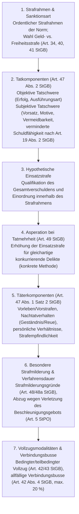

## Überblick {#ueberblick}

Die Strafzumessung bildet das Scharnier zwischen der strafrechtlichen Schuldfrage und der konkreten Rechtsfolge: Hat das Gericht festgestellt, dass eine beschuldigte Person sämtliche objektiven und subjektiven Tatbestandsmerkmale einer Strafnorm rechtswidrig und schuldhaft verwirklicht hat, muss es die gesetzlich meist weit gefasste Strafdrohung — etwa Freiheitsstrafe bis zu fünf Jahren oder Geldstrafe beim Diebstahl ([Art. 139 Ziff. 1 StGB](/kommentar/stgb/art-139/)) oder Freiheitsstrafe von einem bis zu zwanzig Jahren bei der vorsätzlichen Tötung ([Art. 111 StGB](/kommentar/stgb/art-111/)) — in eine exakt bezifferte Sanktion überführen. Für die verurteilte Person ist dieser Vorgang in der Praxis oft weitaus folgenreicher als subtile dogmatische Abgrenzungen im Bereich des Allgemeinen oder Besonderen Teils, entscheidet doch erst die Strafzumessung darüber, wie viele Tagessätze Geldstrafe zu bezahlen sind, ob eine Freiheitsstrafe ausgesprochen wird und ob diese bedingt aufgeschoben oder im Gefängnis vollzogen werden muss (vgl. zum System der Sanktionsarten und Vollzugsmodalitäten das Thema [Strafrechtliche Sanktionen](/themen/strafrechtliche-sanktionen/)).

In der strafrechtlichen Dogmatik hat sich die Unterscheidung zwischen **Strafzumessung im engeren Sinn (i.e.S.)** und **Strafzumessung im weiteren Sinn (i.w.S.)** etabliert (Seelmann, *Strafzumessung und Doppelverwertung*, Zürich 2023, S. 11 f.):

- **Strafzumessung i.e.S.** bezeichnet die Festsetzung der konkreten Strafhöhe (Anzahl der Tagessätze einer Geldstrafe oder Dauer einer Freiheitsstrafe in Monaten und Jahren) innerhalb des anwendbaren gesetzlichen Strafrahmens nach Massgabe des Verschuldens sowie des Vorlebens, der persönlichen Verhältnisse und der Strafwirkung ([Art. 47 StGB](/kommentar/stgb/art-047/)). Dazu zählen auch die Strafmilderung ([Art. 48](/kommentar/stgb/art-048/) und Art. 48a StGB) sowie die Gesamt- und Zusatzstrafenbildung bei Tatmehrheit ([Art. 49 StGB](/kommentar/stgb/art-049/)).
- **Strafzumessung i.w.S.** umfasst sämtliche weiteren Rechtsfolgeentscheidungen, die mit der Bemessung der Strafhöhe verknüpft sind, namentlich die Wahl zwischen mehreren zur Verfügung stehenden Sanktionsarten (Geldstrafe oder Freiheitsstrafe im Überschneidungsbereich bis zu 180 Strafeinheiten nach [Art. 34](/kommentar/stgb/art-034/) und [Art. 41 StGB](/kommentar/stgb/art-041/)), die Bemessung der Tagessatzhöhe nach den wirtschaftlichen Verhältnissen (Art. 34 Abs. 2 StGB) sowie den Entscheid über den bedingten oder teilbedingten Strafvollzug ([Art. 42](/kommentar/stgb/art-042/) und [Art. 43 StGB](/kommentar/stgb/art-043/)).

Die Strafzumessung steht seit jeher in einem grundlegenden verfassungs- und strafrechtlichen Spannungsverhältnis zwischen **Individualisierung** und **Rechtsgleichheit** (eingehend Ranzoni, *Gerechte Strafen ohne Gleichheit?*, Zürich 2025, Rz. 4 ff., 200 ff.; Seelmann 2023, S. 27 ff., 425 f.): Einerseits verlangt das Schuldprinzip ([Art. 47 Abs. 1 StGB](/kommentar/stgb/art-047/)), dass jede Strafe den Besonderheiten der konkreten Tat und der individuellen Täterpersönlichkeit gerecht wird, wofür dem Sachgericht zwangsläufig ein erheblicher Ermessensspielraum zukommt. Andererseits gebietet das verfassungsrechtliche Rechtsgleichheitsgebot ([Art. 8 Abs. 1 BV](/kommentar/bv/art-008/)), dass vergleichbare Taten ähnlich schwer (ordinale Proportionalität) und unterschiedlich schwere Taten im Verhältnis ihrer Schwere abgestuft bestraft werden, ohne dass der Strafort, der urteilende Spruchkörper oder die Person der Richterin bzw. des Richters zu sachlich nicht begründbaren Strafmassdifferenzen führt (Ranzoni 2025, Rz. 203 ff.). Hinzu kommt eine rechtstatsächliche Besonderheit der schweizerischen Strafrechtspflege: Über 90 Prozent aller Verurteilungen ergehen im summarischen Strafbefehlsverfahren (Art. 352 ff. StPO) durch die Staatsanwaltschaften ohne gerichtliche Hauptverhandlung und ohne schriftliche Strafzumessungsbegründung (Ranzoni 2025, Rz. 291 ff.).

---

## Rechtsgrundlagen und Strafzwecke {#rechtsgrundlagen}

### Gesetzliche Ausgangslage (Art. 47 StGB) {#art-47-stgb}

Die zentrale Grundsatznorm der schweizerischen Strafzumessung findet sich in [Art. 47 StGB](/kommentar/stgb/art-047/), der mit der am 1. Januar 2007 in Kraft getretenen Revision des Allgemeinen Teils den altrechtlichen aArt. 63 StGB ablöste (Botschaft zur Änderung des Schweizerischen Strafgesetzbuches vom 21. September 1998, BBl 1999 1979, S. 2059 ff.):



Während Abs. 1 Satz 1 das **Verschuldensprinzip** als primären Massstab statuiert und Satz 2 die täterbezogenen Faktoren (*Vorleben*, *persönliche Verhältnisse* und *Wirkung der Strafe auf das Leben des Täters*) ergänzt, kodifiziert Abs. 2 die wesentlichen Kriterien des **Tatverschuldens**. Mit der Revision von 2007 wollte der Gesetzgeber die bisherigen, von Lehre und Rechtsprechung zu aArt. 63 StGB entwickelten Zumessungsgrundsätze im Wesentlichen beibehalten, durch die explizite Aufzählung der tatbezogenen Verschuldenskriterien in Abs. 2 und die flankierende Begründungspflicht in [Art. 50 StGB](/kommentar/stgb/art-050/) jedoch die Transparenz und Überprüfbarkeit der gerichtlichen Strafzumessung stärken (BBl 1999 1979, S. 2060 f.; [BGE 136 IV 55 E. 5.4](https://entscheidsuche.ch/docs/CH_BGE/CH_BGE_006_BGE-136-IV-55_2010.html#consideration_5.4); [BGE 134 IV 17 E. 2.1](https://entscheidsuche.ch/docs/CH_BGE/CH_BGE_006_BGE-134-IV-17_2008.html#consideration_2.1)).

### Verschuldensprinzip und Strafzwecktheorien {#strafzwecktheorien}

Jede rationale Strafzumessung setzt Klarheit darüber voraus, welchen Zweck die Strafe verfolgt (*finale Strafzumessungsgründe*; Seelmann 2023, S. 12 ff., 168 ff.). Das schweizerische Strafzumessungsrecht baut auf dem **Schuldprinzip** auf, dem in der Strafzumessung eine dreifache Funktion zukommt: Die Schuld wirkt *strafbegründend* (keine Strafe ohne Schuld), *strafbegrenzend* (das Mass der Strafe darf das Mass der Schuld nicht überschreiten) und *strafbestimmend* (die Strafhöhe orientiert sich am Grad des Verschuldens; Seelmann 2023, S. 176 ff., 420). Gemeint ist nicht eine moralische Lebensführungsschuld, sondern die **Einzeltatschuld** (*Strafzumessungsschuld*), also das Mass der Vorwerfbarkeit des konkreten Delikts (Seelmann 2023, S. 171 ff.; Ranzoni 2025, Rz. 30 ff.).

Wie sich der Verschuldensausgleich zu präventiven Strafzwecken (Spezial- und Generalprävention) verhält, wird in Lehre und Rechtsprechung anhand verschiedener theoretischer Modelle diskutiert (Überblick bei Seelmann 2023, S. 222 ff.; Ranzoni 2025, Rz. 34 ff.):

| Strafzumessungstheorie | Kernaussage zum Verhältnis von Schuld und Prävention | Rezeption in Schweiz (Praxis und Lehre) |
|---|---|---|
| **Punktstrafetheorie** | Es existiert für jede Tat genau *eine* dem Verschulden entsprechende Strafe; präventive Gesichtspunkte haben keinen Raum (oder sind bereits im Schuldurteil enthalten). | In der Praxis als Fiktion abgelehnt, da sich Schuld nicht auf den Tag genau beziffern lässt (Seelmann 2023, S. 223 ff.). |
| **Spielraumtheorie (Schuldrahmentheorie)** | Das Verschulden legt keinen exakten Punkt, sondern einen *Schuldrahmen* zwischen einer schuldangemessenen Mindest- und Höchststrafe fest; innerhalb dieses Rahmens wird die Strafe nach präventiven Gesichtspunkten bestimmt. | Vom Bundesgericht im Grundsatz adaptiert ([BGE 136 IV 55 E. 5.4](https://entscheidsuche.ch/docs/CH_BGE/CH_BGE_006_BGE-136-IV-55_2010.html#consideration_5.4)); in der Lehre als *asymmetrische Spielraumtheorie* befürwortet (Seelmann 2023, S. 226 ff., 420). |
| **Stellenwerttheorie (Stufentheorie)** | Strikte Trennung der Strafzwecke nach Zumessungsstufen: Die Strafhöhe (Strafzumessung i.e.S.) bestimmt sich *allein* nach dem Tatverschulden; Präventionsgesichtspunkte fliessen erst auf der zweiten Stufe (Wahl der Strafart und Vollzugsmodus) ein. | In Teilen der schweizerischen Lehre vertreten, mit dem Wortlaut von [Art. 47 Abs. 1 Satz 2 StGB](/kommentar/stgb/art-047/) jedoch nur eingeschränkt vereinbar (Seelmann 2023, S. 235 ff.). |
| **Tatproportionale Strafzumessung** | Ausschliessliche Ausrichtung der Sanktionshöhe an der objektiven und subjektiven Tatschwere im Quervergleich zu anderen Taten (*just deserts*); Rückfall und Vorstrafen werden ausgeblendet oder stark relativiert. | Prägend für die verfassungsrechtliche Gleichheitsanalyse (kardinale und ordinale Proportionalität; Ranzoni 2025, Rz. 201 ff.; Seelmann 2023, S. 239 ff.). |

Das Bundesgericht folgt einer am Verschuldensausgleich orientierten Spielraumlösung: Die Strafe ist primär nach dem Verschulden festzusetzen; spezial- und generalpräventive Überlegungen dürfen ergänzend berücksichtigt werden, soweit sie den durch das persönliche Tatverschulden gezogenen Rahmen nicht sprengen ([BGE 136 IV 55 E. 5.4](https://entscheidsuche.ch/docs/CH_BGE/CH_BGE_006_BGE-136-IV-55_2010.html#consideration_5.4)). Eine über das Mass des Verschuldens hinausgehende Strafe zur allgemeinen Abschreckung (negative Generalprävention) ist bundesrechtswidrig. In der jüngeren Dogmatik zeigt Seelmann auf, dass negativ-spezialpräventive und negativ-generalpräventive Strafschärfungen weder rechtsdogmatisch noch empirisch-kriminologisch tragfähig sind; innerhalb des Schuldrahmens sollten daher nur positiv-spezialpräventive (Resozialisierung, Vermeidung von Desozialisierung; [Art. 47 Abs. 1 Satz 2 StGB](/kommentar/stgb/art-047/)) und positiv-generalpräventive Gesichtspunkte (Normbestätigung) herangezogen werden, wobei aus Gründen der Resozialisierung ausnahmsweise auch ein Unterschreiten des Schuldrahmens (*Unterschuldstrafe*) in Betracht fällt, sofern das Mindestbedürfnis der Normbestätigung gewahrt bleibt (Seelmann 2023, S. 188 ff., 231 ff., 420).

---

## Das Prüfprogramm der Rechtsprechung {#pruefprogramm}

Um den Vorgang der Strafzumessung zu strukturieren und nachvollziehbar zu machen, hat das Bundesgericht — massgeblich geprägt durch den Leitentscheid [BGE 136 IV 55](https://entscheidsuche.ch/docs/CH_BGE/CH_BGE_006_BGE-136-IV-55_2010.html) — ein mehrstufiges Prüfprogramm entwickelt. In der Lehre wird dieses Vorgehen nach den zugrunde liegenden Faktoren in *finale* (Strafzwecke), *reale* (konkrete Tat- und Täterkomponenten) und *logische Strafzumessungsgründe* (Umwertung in Zahlen) unterteilt, wofür Seelmann zur Abbildung sämtlicher Wechselwirkungen ein permeables *Fünf-Phasen-plus-eins-Modell* vorschlägt (Seelmann 2023, S. 162 ff., 293 ff., 419 f.).

### 1. Strafrahmen und Wahl der Sanktionsart {#strafrahmen-und-sanktionsart}

Ausgangspunkt ist stets der **ordentliche gesetzliche Strafrahmen** des verwirklichten Tatbestands. Nach ständiger Rechtsprechung ist die tat- und täterangemessene Strafe für eine einzelne Tat grundsätzlich innerhalb des ordentlichen Strafrahmens festzusetzen; dieser wird selbst beim Vorliegen von Strafmilderungs- oder Strafschärfungsgründen nur verlassen, wenn aussergewöhnliche Umstände vorliegen und die für die betreffende Tat angedrohte Strafe im konkreten Fall zu hart bzw. zu milde erscheint ([BGE 136 IV 55 E. 5.8](https://entscheidsuche.ch/docs/CH_BGE/CH_BGE_006_BGE-136-IV-55_2010.html#consideration_5.8)).

Im Bereich bis zu 180 Strafeinheiten (Tagessätze Geldstrafe gemäss [Art. 34 Abs. 1 StGB](/kommentar/stgb/art-034/) bzw. sechs Monate Freiheitsstrafe gemäss Art. 40 und [Art. 41 StGB](/kommentar/stgb/art-041/)) geniesst die Geldstrafe gesetzlichen Vorrang (Verhältnismässigkeitsprinzip): Auf eine kurze Freiheitsstrafe darf das Gericht nach [Art. 41 Abs. 1 StGB](/kommentar/stgb/art-041/) nur erkennen, wenn eine solche geboten erscheint, um den Täter von der Begehung weiterer Verbrechen oder Vergehen abzuhalten (lit. a), oder wenn eine Geldstrafe voraussichtlich nicht vollzogen werden kann (lit. b). Entscheidet sich das Gericht für die Freiheitsstrafe, hat es diese Wahl nach Art. 41 Abs. 2 StGB näher zu begründen ([BGE 144 IV 313 E. 1.1](https://entscheidsuche.ch/docs/CH_BGE/CH_BGE_006_BGE-144-IV-313_2018.html#consideration_1.1)).

### 2. Tatkomponenten und Einsatzstrafe (Art. 47 Abs. 2 StGB) {#tatkomponenten}

Auf der ersten Stufe der Strafhöhenbemessung bewertet das Gericht das **Tatverschulden** anhand der *Tatkomponenten* ([Art. 47 Abs. 2 StGB](/kommentar/stgb/art-047/); [BGE 136 IV 55 E. 5.5](https://entscheidsuche.ch/docs/CH_BGE/CH_BGE_006_BGE-136-IV-55_2010.html#consideration_5.5)):

1. **Objektive Tatschwere**: Sie bestimmt sich nach dem Ausmass der Verletzung oder Gefährdung des geschützten Rechtsguts (Erfolgsunrecht, z.B. Schwere der Körperverletzung, Deliktssumme, Drogenmenge) sowie nach der Art und Weise der Herbeiführung dieses Erfolgs (*Verwerflichkeit des Handelns*, Handlungsunrecht, z.B. Heimtücke, Brutalität, lange Tatdauer, ausgeklügelte Planung oder untergeordneter Tatbeitrag).
2. **Subjektive Tatschwere**: «Ausgehend von der objektiven Tatschwere hat der Richter das (subjektive) Tatverschulden zu bewerten.» ([BGE 136 IV 55 E. 5.5](https://entscheidsuche.ch/docs/CH_BGE/CH_BGE_006_BGE-136-IV-55_2010.html#consideration_5.5)). Hierher gehören die Willensrichtung und Intensität des deliktischen Willens (direkter Vorsatz ersten oder zweiten Grades gegenüber blossem Eventualvorsatz; bewusste gegenüber unbewusster Fahrlässigkeit), die **Beweggründe und Ziele** (egoistische, habgierige oder rassistische Motive gegenüber nachvollziehbaren Konfliktlagen; vgl. [BGer 7B_770/2023 vom 6. September 2024 E. 4.5.4](https://entscheidsuche.ch/docs/CH_BGer/CH_BGer_007_7B-770-2023_2024-09-06.html)) sowie das Mass an Entscheidungsfreiheit (**Vermeidbarkeit** unter Berücksichtigung der persönlichen Verhältnisse und äusseren Umstände).
3. **Verminderte Schuldfähigkeit ([Art. 19 Abs. 2 StGB](/kommentar/stgb/art-019/))**: War der Täter zur Zeit der Tat nur teilweise fähig, das Unrecht seiner Tat einzusehen oder gemäss dieser Einsicht zu handeln, mindert dies nicht direkt die Strafe nach einem linearen Tarif, sondern reduziert zunächst das *subjektive Tatverschulden* ([BGE 136 IV 55 E. 5.5–5.7](https://entscheidsuche.ch/docs/CH_BGE/CH_BGE_006_BGE-136-IV-55_2010.html#consideration_5.5)). Das Gericht muss in einem ersten Schritt das Gesamtverschulden unter Einbezug der verminderten Schuldfähigkeit qualifizieren (z.B. von mittelschwer auf leicht bis mittelschwer reduzieren) und daraus die hypothetische **Einsatzstrafe** ableiten.

### 3. Täterkomponenten (Art. 47 Abs. 1 Satz 2 StGB) {#taeterkomponenten}

Nach Festlegung der verschuldensangemessenen Einsatzstrafe (bzw. nach Bildung der hypothetischen Gesamtstrafe bei Tatmehrheit; [BGer 6B_287/2026 vom 10. September 2026 E. 2.1.2](https://entscheidsuche.ch/docs/CH_BGer/CH_BGer_006_6B-287-2026_2026-09-10.html)) modifiziert das Gericht diese anhand der täterbezogenen Umstände, die keinen unmittelbaren Bezug zur konkreten Tathandlung aufweisen ([Art. 47 Abs. 1 Satz 2 StGB](/kommentar/stgb/art-047/); [BGE 136 IV 55 E. 5.7](https://entscheidsuche.ch/docs/CH_BGE/CH_BGE_006_BGE-136-IV-55_2010.html#consideration_5.7)):

- **Vorleben und Vorstrafen**: Einschlägige Vorstrafen und eine Delinquenz während laufender Probezeit oder laufender Strafuntersuchung wirken sich straferhöhend aus. Umgekehrt hat das Bundesgericht mit [BGE 136 IV 1 E. 2.6](https://entscheidsuche.ch/docs/CH_BGE/CH_BGE_006_BGE-136-IV-1_2010.html#consideration_2.6) eine einschneidende Praxisänderung vollzogen: «Die Vorstrafenlosigkeit wirkt sich bei der Strafzumessung grundsätzlich neutral aus und ist deshalb nicht strafmindernd zu berücksichtigen.» ([BGE 136 IV 1 E. 2.6](https://entscheidsuche.ch/docs/CH_BGE/CH_BGE_006_BGE-136-IV-1_2010.html#consideration_2.6)). Nur bei einer *aussergewöhnlichen Gesetzestreue* darf die Straffreiheit ausnahmsweise strafmindernd gewichtet werden ([BGE 136 IV 1 E. 2.6.4](https://entscheidsuche.ch/docs/CH_BGE/CH_BGE_006_BGE-136-IV-1_2010.html#consideration_2.6.4)). Seit dem Inkrafttreten des Strafregistergesetzes (StReG, SR 331) am 23. Januar 2023 und der ersatzlosen Aufhebung von aArt. 369 Abs. 7 StGB besteht zudem kein gesetzliches Verwertungsverbot für aus dem Strafregister entfernte Urteile mehr; diese dürfen bei der Beurteilung des Vorlebens und der Legalprognose herangezogen werden ([BGE 150 IV 103 E. 2.2](https://entscheidsuche.ch/docs/CH_BGE/CH_BGE_006_BGE-150-IV-103_2024.html#consideration_2.2)).
- **Nachtatverhalten (Geständnis, Kooperation, Einsicht und Reue)**: Ein von Beginn weg abgelegtes, auf Einsicht und Reue beruhendes Geständnis, das die Strafverfolgung wesentlich erleichtert, kann zu einer Strafreduktion von bis zu einem Fünftel oder einem Drittel führen ([BGE 121 IV 202 E. 2d](https://entscheidsuche.ch/docs/CH_BGE/CH_BGE_006_BGE-121-IV-202_1995-09-25.html); [BGer 6B_689/2025 vom 30. April 2026 E. 5.2](https://entscheidsuche.ch/docs/CH_BGer/CH_BGer_006_6B-689-2025_2026-04-30.html)). Ein blosses *Taktikgeständnis* angesichts erdrückender Beweislage rechtfertigt dagegen keinen namhaften Rabatt. Das Bestreiten der Tat oder das Schweigen darf dem Beschuldigten wegen des Selbstbelastungsverbots (*nemo tenetur se ipsum accusare*, Art. 113 Abs. 1 StPO) bei der Strafhöhe niemals straferhöhend angelastet werden; eine hartnäckige Bagatellisierung oder Täter-Opfer-Umkehr kann jedoch das Fehlen von Einsicht und Reue belegen und bei der spezialpräventiven Wahl der Sanktionsart ([Art. 41 StGB](/kommentar/stgb/art-041/)) oder der Vollzugsprognose ([Art. 42 StGB](/kommentar/stgb/art-042/)) berücksichtigt werden.
- **Persönliche Verhältnisse und Strafempfindlichkeit**: Unter dem Titel der *Wirkung der Strafe auf das Leben des Täters* ([Art. 47 Abs. 1 Satz 2 StGB](/kommentar/stgb/art-047/)) ist eine erhöhte Strafempfindlichkeit nur bei aussergewöhnlichen Umständen (z.B. schwerste gesundheitliche Beeinträchtigungen) strafmindernd zu gewichten, da der Vollzug einer Freiheitsstrafe für jede beruflich und familiär integrierte Person mit erheblichen Nachteilen verbunden ist ([BGer 6B_689/2025 vom 30. April 2026 E. 5.3](https://entscheidsuche.ch/docs/CH_BGer/CH_BGer_006_6B-689-2025_2026-04-30.html); [BGer 6B_636/2025 vom 6. Juli 2026](https://entscheidsuche.ch/docs/CH_BGer/CH_BGer_006_6B-636-2025_2026-07-06.html)). Gesetzliche Nebenfolgen wie ein administrativer Führerausweisentzug bei Verkehrsdelikten ([BGer 7B_497/2025 vom 9. September 2026 E. 3.5.2](https://entscheidsuche.ch/docs/CH_BGer/CH_BGer_007_7B-497-2025_2026-09-09.html)) oder eine strafrechtliche Landesverweisung nach [Art. 66a StGB](/kommentar/stgb/art-066a/) wirken sich nach der neuesten Leitrechtsprechung des Bundesgerichts nicht strafmindernd aus: «Bei der Landesverweisung im Sinne von Art. 66a StGB handelt es sich daher nicht um eine (Neben-)Strafe, sondern um eine Massnahme.» ([BGE 151 IV 249 E. 5.3.4](https://entscheidsuche.ch/docs/CH_BGE/CH_BGE_006_BGE-151-IV-249_2025.html#consideration_5.3.4)).

### 4. Strafmilderung (Art. 48/48a StGB), Beschleunigungsgebot und Verbindungsbusse {#strafmilderung-und-beschleunigungsgebot}

Ergänzt wird die ordentliche Strafzumessung durch die gesetzlichen Strafmilderungsgründe von [Art. 48 StGB](/kommentar/stgb/art-048/) (achtenswerte Beweggründe, schwere Bedrängnis, achtungswürdige, tiefe Verzweiflung, Handeln auf Veranlassung einer Person, der der Täter Gehorsam schuldet, ernsthafte Reue und Wiedergutmachung sowie Zeitablauf bei Wohlverhalten):



Ein Handeln aus achtenswerten Beweggründen (Art. 48 lit. a Ziff. 1 StGB) beurteilt sich nach einer ethischen Wertung; bei politisch oder klimaaktivistisch motivierten Straftaten kann es nur bei gewaltfreien Protesten in Betracht gezogen werden, ist jedoch stets ausgeschlossen, wenn die Aktion mit Gewalt, Sachbeschädigungen oder einer Gefährdung der körperlichen Integrität einhergeht ([BGE 149 IV 217 E. 1.3](https://entscheidsuche.ch/docs/CH_BGE/CH_BGE_006_BGE-149-IV-217_2023.html#consideration_1.3)).

Unabhängig von Art. 48 lit. e StGB zwingt eine Verletzung des verfassungs- und konventionsrechtlichen **Beschleunigungsgebots** ([Art. 5 Abs. 1 StPO](/kommentar/stpo/art-005/), [Art. 29 Abs. 1 BV](/kommentar/bv/art-029/), Art. 6 Ziff. 1 EMRK) nach einer dreistufigen Rechtsfolgenkaskade im Regelfall zu einer explizit ausgewiesenen Strafreduktion, bei schwerwiegenden Fällen zur Strafbefreiung ([Art. 54 StGB](/kommentar/stgb/art-054/)) und als *ultima ratio* zur Verfahrenseinstellung ([BGE 143 IV 373 E. 1.4.1](https://entscheidsuche.ch/docs/CH_BGE/CH_BGE_006_BGE-143-IV-373_2017.html#consideration_1.4.1)).

Wird schliesslich eine bedingte Strafe mit einer unbedingten **Verbindungsbusse** nach [Art. 42 Abs. 4 StGB](/kommentar/stgb/art-042/) kombiniert (Schnittstellenproblem), muss die Summe beider Sanktionen schuldangemessen sein: Die Verbindungsbusse darf höchstens 20 Prozent der schuldangemessenen Gesamtsanktion ausmachen und ist von der bedingten Hauptstrafe *abzuziehen*, nicht etwa obendrauf zu addieren ([BGE 149 IV 321 E. 1.3.2](https://entscheidsuche.ch/docs/CH_BGE/CH_BGE_006_BGE-149-IV-321_2023.html#consideration_1.3.2); [BGer 7B_497/2025 vom 9. September 2026 E. 3.3.2](https://entscheidsuche.ch/docs/CH_BGer/CH_BGer_007_7B-497-2025_2026-09-09.html)).

---

## Doppelverwertungsverbot {#doppelverwertungsverbot}

### Grundsatz und bundesgerichtliche Praxis {#doppelverwertungsverbot-praxis}

Obwohl das Schweizerische Strafgesetzbuch — anders als § 46 Abs. 3 des deutschen StGB und § 32 Abs. 2 des österreichischen StGB — das **Doppelverwertungsverbot** nicht ausdrücklich im Gesetzestext verankert (dazu historisch und rechtsvergleichend Seelmann 2023, S. 314 ff., 325 ff.), ist es in der bundesgerichtlichen Rechtsprechung als ungeschriebener, zwingender Bundesrechtsgrundsatz anerkannt ([BGE 141 IV 61 E. 6.1.3](https://entscheidsuche.ch/docs/CH_BGE/CH_BGE_006_BGE-141-IV-61_2015.html#consideration_6.1.3); [BGer 6B_57/2024 vom 24. Januar 2025 E. 3.4](https://entscheidsuche.ch/docs/CH_BGer/CH_BGer_006_6B-57-2024_2025-01-24.html)).

Das Verbot besagt, dass Umstände, die bereits ein Merkmal des gesetzlichen Grundtatbestands bilden oder zur Anwendung eines höheren bzw. tieferen Strafrahmens (Qualifikation oder Privilegierung) geführt haben, innerhalb dieses Strafrahmens nicht noch einmal als Straferhöhungs- oder Strafminderungsgrund herangezogen werden dürfen, weil dem Täter sonst derselbe Umstand zweimal angelastet oder zugutegehalten würde ([BGE 141 IV 61 E. 6.1.3](https://entscheidsuche.ch/docs/CH_BGE/CH_BGE_006_BGE-141-IV-61_2015.html#consideration_6.1.3)). Wird ein Täter beispielsweise wegen eines durch Unterlassen begangenen Tötungsdelikts verurteilt, ist die blosse Untätigkeit bereits tatbestandsbegründend: «Innerhalb dieses Strafrahmens darf sich die unterbliebene Verhinderung des Erfolges, d.h. die Tatsache, dass der Täter dem Opfer keine Hilfe leistete, sondern es im Stich liess, nicht zusätzlich straferhöhend auswirken» ([BGer 6B_57/2024 vom 24. Januar 2025 E. 3.4](https://entscheidsuche.ch/docs/CH_BGer/CH_BGer_006_6B-57-2024_2025-01-24.html) unter Verweis auf Seelmann 2023, S. 390).

### Dogmatische Herleitung und Geltungsbereich (Seelmann 2023) {#doppelverwertungsverbot-dogmatik}

In seiner Zürcher Dissertation hat Martin Seelmann das Doppelverwertungsverbot erstmals monographisch für das schweizerische Recht aufgearbeitet (Seelmann 2023, S. 311 ff.). Nachdem er alternative Begründungsansätze — wie das prozessuale Verbot doppelter Strafverfolgung (*ne bis in idem*), die blosse Denklogik, die Begründungspflicht oder das Gewaltenteilungsprinzip als alleinigen Geltungsgrund — kritisch gewürdigt hat (Seelmann 2023, S. 341 ff.), verankert er das Doppelverwertungsverbot direkt im **Schuldprinzip ([Art. 47 Abs. 1 StGB](/kommentar/stgb/art-047/))** in Verbindung mit der gesetzgeberischen Wertentscheidung (Seelmann 2023, S. 358 ff., 422): Aufgrund der strafbegrenzenden und strafbestimmenden Funktion der Schuld führt bereits die einmalige Verwendung einer verschuldensrelevanten Tatsache — sei es durch den Gesetzgeber bei der Umschreibung des Tatbestands bzw. Strafrahmens, sei es durch das Gericht innerhalb der Zumessung — zu deren **Verbrauch** unter Schuldgesichtspunkten; eine nochmalige Heranziehung würde zwangsläufig in eine schuldunangemessene Strafe münden (Seelmann 2023, S. 363 ff., 416 f., 422).

Aus dieser Verankerung im Schuldprinzip leitet Seelmann drei praxisrelevante Abgrenzungsregeln ab, die in der jüngsten Rechtsprechung des Bundesgerichts bereits rezipiert worden sind:

1. **Steigerungsfähige Merkmale und konkretes Ausmass**: Vom Doppelverwertungsverbot erfasst ist nur das *Dass* des Tatbestands- oder Qualifikationsmerkmals, nicht aber das *Wie* bzw. die quantitative oder qualitative **Intensität seiner Verwirklichung** ([BGE 141 IV 61 E. 6.1.3](https://entscheidsuche.ch/docs/CH_BGE/CH_BGE_006_BGE-141-IV-61_2015.html#consideration_6.1.3); Seelmann 2023, S. 395 ff., 404). Während der Eintritt des Todes bei [Art. 111 StGB](/kommentar/stgb/art-111/) ein nicht abstufbares binäres Merkmal bildet, sind fast alle anderen Merkmale steigerungsfähig: So darf und muss das Gericht bei der Mordqualifikation ([Art. 112 StGB](/kommentar/stgb/art-112/)) das konkrete Ausmass der besonderen Skrupellosigkeit ([BGer 6B_988/2025 vom 26. Mai 2026 E. 3.4](https://entscheidsuche.ch/docs/CH_BGer/CH_BGer_006_6B-988-2025_2026-05-26.html)), beim qualifizierten Betäubungsmittelhandel (Art. 19 Abs. 2 BetmG) das Vielfache des Grenzwerts oder bei Vermögensdelikten die konkrete Schadenshöhe innerhalb des eröffneten Strafrahmens gewichten (Seelmann 2023, S. 397 ff.).
2. **Kein Doppelverwertungsverbot für das blosse *Regeltatbild***: Begleitumstände oder Motive, die bei einer bestimmten Deliktsart zwar *statistisch häufig* oder kriminalphänomenologisch typisch sind (z.B. finanzielle Engpässe beim unrechtmässigen Bezug von Sozialhilfeleistungen nach Art. 148a StGB), ohne jedoch Voraussetzung des gesetzlichen Tatbestands zu sein, unterfallen nicht dem Doppelverwertungsverbot (Seelmann 2023, S. 384 ff., 388). Das Bundesgericht hat sich dieser Lehrmeinung ausdrücklich angeschlossen: «Selbst wenn die beim Beschwerdeführer vorliegenden Motive und Umstände typisch sein mögen, sind sie nicht tatbestandsbegründend, weshalb ihnen bei der Bemessung des Verschuldens Rechnung getragen werden darf bzw. muss» ([BGer 7B_770/2023 vom 6. September 2024 E. 4.5.4](https://entscheidsuche.ch/docs/CH_BGer/CH_BGer_007_7B-770-2023_2024-09-06.html) mit Verweis auf Seelmann 2023, S. 388).
3. **Keine Geltung für präventive Kriterien bei der Strafzumessung i.w.S.**: Weil das Doppelverwertungsverbot auf dem Schuldprinzip fusst, sperrt es ausschliesslich die mehrfache Verwertung *verschuldensrelevanter* Faktoren. Rein präventive Gesichtspunkte — wie einschlägige Vorstrafen oder fehlende Einsicht — dürfen hingegen ohne Verstoss gegen das Doppelverwertungsverbot sowohl bei der Bemessung der Strafhöhe innerhalb des Schuldrahmens ([Art. 47 Abs. 1 Satz 2 StGB](/kommentar/stgb/art-047/)) als auch anschliessend bei der Prognoseentscheidung über die Sanktionsart ([Art. 41 StGB](/kommentar/stgb/art-041/)) oder den bedingten Strafvollzug ([Art. 42 StGB](/kommentar/stgb/art-042/)) berücksichtigt werden (Seelmann 2023, S. 400 ff., 423). Um die Rechtssicherheit zu erhöhen, schlägt Seelmann de lege ferenda vor, das Verbot in einem neuen Art. 47 Abs. 3 StGB explizit zu kodifizieren, wonach verschuldensrelevante Umstände bei der Strafzumessung weder zulasten noch zugunsten des Täters doppelt berücksichtigt werden dürfen (Seelmann 2023, S. 411 f., 423).

---

## Gesamtstrafenbildung und Konkurrenzen (Art. 49 StGB) {#konkurrenzen}

Hat die beschuldigte Person durch eine oder mehrere Handlungen mehrere Straftatbestände erfüllt (Idealkonkurrenz oder Realkonkurrenz), richtet sich die Zumessung nach [Art. 49 StGB](/kommentar/stgb/art-049/):



### Konkrete Methode, Gleichartigkeit und Verbot der Einheitsstrafe {#konkrete-methode}

Für die Anwendung des **Asperationsprinzips** nach [Art. 49 Abs. 1 StGB](/kommentar/stgb/art-049/) verlangt das Bundesgericht in gefestigter Rechtsprechung die **konkrete Methode** ([BGE 144 IV 217 E. 2.2 und 3.3](https://entscheidsuche.ch/docs/CH_BGE/CH_BGE_006_BGE-144-IV-217_2018.html#consideration_2.2); [BGE 144 IV 313 E. 1.1](https://entscheidsuche.ch/docs/CH_BGE/CH_BGE_006_BGE-144-IV-313_2018.html#consideration_1.1)): Eine Gesamtstrafe darf nur aus denjenigen Einzeltaten gebildet werden, für die das Gericht im konkreten Einzelfall — bei isolierter Betrachtung jeder einzelnen Tat nach [Art. 47](/kommentar/stgb/art-047/) und [Art. 41 StGB](/kommentar/stgb/art-041/) — **gleichartige Strafen** ausfällen würde. «Geldstrafe und Freiheitsstrafe sind keine gleichartigen Strafen im Sinne von Art. 49 Abs. 1 StGB» ([BGE 144 IV 217 E. 2.2](https://entscheidsuche.ch/docs/CH_BGE/CH_BGE_006_BGE-144-IV-217_2018.html#consideration_2.2)). Ist für ein Delikt eine Freiheitsstrafe und für ein weiteres Delikt lediglich eine Geldstrafe schuld- und zweckangemessen, scheidet eine Einheitsstrafe aus; die beiden Sanktionen sind zwingend **kumulativ** nebeneinander zu verhängen ([BGE 144 IV 217 E. 3.6](https://entscheidsuche.ch/docs/CH_BGE/CH_BGE_006_BGE-144-IV-217_2018.html#consideration_3.6)). Ebenso wenig darf das Gericht Geldstrafendelikte bloss deshalb in eine Freiheitsstrafe umwandeln, weil die Summe mehrerer Geldstrafen das gesetzliche Höchstmass von 180 Tagessätzen ([Art. 34 Abs. 1 StGB](/kommentar/stgb/art-034/)) übersteigen würde ([BGE 144 IV 313 E. 1.1.2](https://entscheidsuche.ch/docs/CH_BGE/CH_BGE_006_BGE-144-IV-313_2018.html#consideration_1.1.2)).

### Dreistufige Gesamtstrafenbildung und Obergrenzen {#dreistufige-gesamtstrafenbildung}

Sind mehrere gleichartige Strafen zu asperieren, schreibt die Rechtsprechung eine strikte **dreistufige Abfolge** vor ([BGE 144 IV 313 E. 1.1](https://entscheidsuche.ch/docs/CH_BGE/CH_BGE_006_BGE-144-IV-313_2018.html#consideration_1.1); [BGer 6B_287/2026 vom 10. September 2026 E. 2.1.2](https://entscheidsuche.ch/docs/CH_BGer/CH_BGer_006_6B-287-2026_2026-09-10.html)):

1. **Einsatzstrafe für die schwerste Tat**: Das Gericht bestimmt anhand der *abstrakten* gesetzlichen Strafdrohung (nicht nach dem konkreten Verschulden) die schwerste Straftat und setzt für diese ausschliesslich gestützt auf deren Tatkomponenten ([Art. 47 Abs. 2 StGB](/kommentar/stgb/art-047/)) die hypothetische Einsatzstrafe fest.
2. **Asperation für die weiteren Delikte**: Anschliessend bildet das Gericht gedanklich für jedes weitere gleichartige Delikt eine hypothetische Einzelstrafe (ebenfalls auf Basis der jeweiligen Tatkomponenten) und erhöht die Einsatzstrafe *angemessen*. Dabei ist der sachliche, zeitliche und situative Gesamtzusammenhang zwischen den Taten zu würdigen: Je enger die Delikte miteinander verknüpft sind, desto stärker fällt die Reduktion der hypothetischen Einzelstrafen im Rahmen der Asperation aus. Das Asperationsprinzip unterliegt dabei drei absoluten **Obergrenzen**: (a) Das Höchstmass der schwersten Straftat darf höchstens um die Hälfte überschritten werden (Art. 49 Abs. 1 Satz 2 StGB); (b) das gesetzliche Höchstmass der jeweiligen Strafart (180 Tagessätze Geldstrafe nach [Art. 34 Abs. 1 StGB](/kommentar/stgb/art-034/), 20 Jahre zeitige Freiheitsstrafe nach Art. 40 StGB) bleibt verbindlich (Art. 49 Abs. 1 Satz 3 StGB); und (c) die Gesamtstrafe darf niemals höher ausfallen als die rechnerische Summe aller hypothetischen Einzelstrafen, da die Asperation das Kumulationsprinzip mildern, nicht verschärfen soll ([BGE 143 IV 145 E. 8.2.3](https://entscheidsuche.ch/docs/CH_BGE/CH_BGE_006_BGE-143-IV-145_2017.html#consideration_8.2.3)).
3. **Berücksichtigung der Täterkomponenten**: Erst *nach* der Bildung der tatbezogenen Gesamtstrafe werden die allgemeinen täterbezogenen Faktoren ([Art. 47 Abs. 1 Satz 2 StGB](/kommentar/stgb/art-047/): Vorstrafen, Geständnis, Strafempfindlichkeit) gesamthaft einbezogen ([BGer 6B_287/2026 vom 10. September 2026 E. 2.1.2 und 2.3.2](https://entscheidsuche.ch/docs/CH_BGer/CH_BGer_006_6B-287-2026_2026-09-10.html); Seelmann 2023, S. 166). Werden Täterkomponenten bereits bei der Einsatzstrafe und danach nochmals bei den Nebendelikten eingerechnet, liegt ein unzulässiger Methodenfehler und eine Verletzung des Doppelverwertungsverbots vor.

### Retrospektive Konkurrenz und Differenzmethode (Art. 49 Abs. 2 StGB) {#retrospektive-konkurrenz}

Hat das Gericht Taten zu beurteilen, die der Täter begangen hat, *bevor* er wegen einer anderen Tat verurteilt worden ist (sog. retrospektive Konkurrenz), darf er durch die getrennte Verfahrensführung nicht schlechter gestellt werden als bei gleichzeitiger Beurteilung aller Delikte ([Art. 49 Abs. 2 StGB](/kommentar/stgb/art-049/)). Massgebender Stichtag für die **Zäsurwirkung** ist das Datum des erstinstanzlichen Sachurteils im ersten Verfahren ([BGE 138 IV 113 E. 3.4.2](https://entscheidsuche.ch/docs/CH_BGE/CH_BGE_006_BGE-138-IV-113_2012.html#consideration_3.4.2)).

Bei Gleichartigkeit der Sanktionen ([BGE 137 IV 57 E. 4.3](https://entscheidsuche.ch/docs/CH_BGE/CH_BGE_006_BGE-137-IV-57_2011.html#consideration_4.3)) ermittelt das Zweitgericht die **Zusatzstrafe** nach der **Differenzmethode** ([BGE 142 IV 265 E. 2.4.3–2.4.4](https://entscheidsuche.ch/docs/CH_BGE/CH_BGE_006_BGE-142-IV-265_2016.html#consideration_2.4.3)): «Die Zusatzstrafe ist die infolge Asperation mit der Grundstrafe reduzierte Strafe für die neu zu beurteilenden Taten» ([BGE 142 IV 265 E. 2.4.4](https://entscheidsuche.ch/docs/CH_BGE/CH_BGE_006_BGE-142-IV-265_2016.html#consideration_2.4.4)). Die Rechtskraft der Grundstrafe des Ersturteils ist unantastbar; das Zweitgericht bildet eine hypothetische Gesamtstrafe aus der rechtskräftigen Grundstrafe und den neu zu beurteilenden Vortaten und zieht davon die Grundstrafe rechnerisch ab ([BGE 142 IV 265 E. 2.4.3](https://entscheidsuche.ch/docs/CH_BGE/CH_BGE_006_BGE-142-IV-265_2016.html#consideration_2.4.3)). Liegt eine **teilweise retrospektive Konkurrenz** vor (sowohl Vortaten vor dem Ersturteil als auch Nachtaten nach dem Ersturteil), ist zunächst für die Vortaten eine Zusatzstrafe nach Art. 49 Abs. 2 StGB zu bilden, sodann für die Nachtaten eine unabhängige (Gesamt-)Strafe nach Art. 49 Abs. 1 StGB festzusetzen und schliesslich beides rechnerisch zu addieren ([BGE 145 IV 1 E. 1.3](https://entscheidsuche.ch/docs/CH_BGE/CH_BGE_006_BGE-145-IV-1_2019.html#consideration_1.3)).

---

## Begründungspflicht und bundesgerichtliche Kontrolle (Art. 50 StGB) {#begruendung-und-kognition}

Als prozessuales Korrelat zum weiten tatrichterlichen Ermessen verpflichtet [Art. 50 StGB](/kommentar/stgb/art-050/) das Sachgericht zur Offenlegung seiner Strafzumessungserwägungen:



### Anforderungen an die Begründungsdichte und Zurückhaltung bei Zahlenangaben {#begruendungsdichte}

Nach der Rechtsprechung muss das Gericht in seinem Urteil die für die Strafzumessung erheblichen Umstände und deren Gewichtung in den Grundzügen so wiedergeben, dass die gedankliche Ableitung des Strafmasses für die Parteien und die Rechtsmittelinstanzen nachvollziehbar ist ([BGE 134 IV 17 E. 2.1](https://entscheidsuche.ch/docs/CH_BGE/CH_BGE_006_BGE-134-IV-17_2008.html#consideration_2.1); [BGE 144 IV 313 E. 1.2](https://entscheidsuche.ch/docs/CH_BGE/CH_BGE_006_BGE-144-IV-313_2018.html#consideration_1.2)). Zwingend erforderlich ist namentlich eine ausdrückliche verbale **Qualifizierung des Gesamtverschuldens** (z.B. als leicht, nicht mehr leicht, mittelschwer oder sehr schwer): «Die Gesamteinschätzung des Tatverschuldens ist im Urteil zu benennen, damit überprüft werden kann, ob die daraus resultierende (hypothetische) Strafe angemessen ist und mit der durch den gesetzlichen Strafrahmen zum Ausdruck gebrachten Abstufung des Unrechtsgehaltes übereinstimmt» ([BGE 136 IV 55 E. 5.7](https://entscheidsuche.ch/docs/CH_BGE/CH_BGE_006_BGE-136-IV-55_2010.html#consideration_5.7)). Widersprechen sich die verbale Verschuldensqualifikation und die tatsächlich ausgefällte Strafe — etwa wenn das Gericht ein *gerade noch leichtes Verschulden* annimmt, aber eine Strafe im oberen Bereich verhängt, oder gleichzeitig von einem *noch leichten*, *mittelschweren* und *nicht mehr leichten* Verschulden spricht —, verletzt dies Bundesrecht ([BGer 6B_905/2024 vom 8. September 2025 E. 1.5.4](https://entscheidsuche.ch/docs/CH_BGer/CH_BGer_006_6B-905-2024_2025-09-08.html); [BGer 7B_497/2025 vom 9. September 2026 E. 3.3.3](https://entscheidsuche.ch/docs/CH_BGer/CH_BGer_007_7B-497-2025_2026-09-09.html)).

Gleichwohl hält das Bundesgericht bei Einzeldelikten daran fest, dass das Sachgericht nicht verpflichtet ist, in Zahlen oder Prozenten anzugeben, wie stark es die einzelnen straferhöhenden oder strafmindernden Faktoren gewichtet hat ([BGE 136 IV 55 E. 5.6](https://entscheidsuche.ch/docs/CH_BGE/CH_BGE_006_BGE-136-IV-55_2010.html#consideration_5.6); [BGE 144 IV 313 E. 1.2](https://entscheidsuche.ch/docs/CH_BGE/CH_BGE_006_BGE-144-IV-313_2018.html#consideration_1.2)). Deutlich strenger ist die neuere Rechtsprechung hingegen bei der **Gesamtstrafenbildung nach [Art. 49 Abs. 1 StGB](/kommentar/stgb/art-049/)**: Hier verlangt das Bundesgericht unter ausdrücklicher Bezugnahme auf die jüngere Lehre (u.a. Ranzoni 2025, Rz. 137 ff. und Seelmann 2023, S. 166) die Bezifferung der Einsatzstrafe sowie der hypothetischen Einzelstrafen: «Um die für die Zumessung der Strafe massgebenden Umstände und deren Gewichtung überprüfen zu können, insbesondere die Gründe für die Wahl der Strafart und das Mass der Erhöhung der Einsatzstrafe, kann es deshalb erforderlich sein, die Höhe der (hypothetischen) Einzelstrafen auch bei der Gesamtstrafenbildung nach Art. 49 Abs. 1 StGB auszuweisen» ([BGer 7B_769/2023 vom 13. Mai 2025 E. 3.5.2](https://entscheidsuche.ch/docs/CH_BGer/CH_BGer_007_7B-769-2023_2025-05-13.html); ebenso [BGer 6B_499/2025 vom 5. März 2026 E. 1.5](https://entscheidsuche.ch/docs/CH_BGer/CH_BGer_006_6B-499-2025_2026-03-05.html)).

### Kognition der Rechtsmittelinstanzen und Reparatur-Regel {#kognition}

Im Rechtsmittelverfahren unterscheidet sich die Prüfungsdichte fundamental nach der angerufenen Instanz (dazu eingehend Seelmann 2023, S. 412 ff.; Ranzoni 2025, Rz. 162 ff.):

- **Kantonales Berufungsgericht (Art. 398 Abs. 2 und 3, Art. 408 StPO)**: Die Berufungsinstanz verfügt über **volle Kognition** in Tat-, Rechts- und Ermessensfragen. Wird die Strafzumessung angefochten, darf sich das Ober- oder Kantonsgericht nicht auf eine blosse Willkür- oder Ermessensmissbrauchskontrolle der erstinstanzlichen Strafe beschränken, sondern muss eine **eigenständige Strafzumessung** vornehmen (Seelmann 2023, S. 413 f.).
- **Bundesgericht (Art. 95 BGG)**: Im Verfahren der Beschwerde in Strafsachen prüft das Bundesgericht nur Rechtsverletzungen, einschliesslich der Überschreitung und des Missbrauchs des Ermessens. Es greift in die Strafzumessung nur ein, wenn die Vorinstanz den gesetzlichen Strafrahmen über- oder unterschritten hat, wenn sie von rechtlich nicht massgebenden Kriterien ausgegangen ist (z.B. Verstoss gegen das Doppelverwertungsverbot) oder wenn sie wesentliche Gesichtspunkte ausser Acht gelassen bzw. in Überschreitung oder Missbrauch ihres Ermessens falsch gewichtet hat ([BGE 136 IV 55 E. 5.6](https://entscheidsuche.ch/docs/CH_BGE/CH_BGE_006_BGE-136-IV-55_2010.html#consideration_5.6); [BGE 134 IV 17 E. 2.1](https://entscheidsuche.ch/docs/CH_BGE/CH_BGE_006_BGE-134-IV-17_2008.html#consideration_2.1)). Zudem relativiert das Bundesgericht die Begründungspflicht von [Art. 50 StGB](/kommentar/stgb/art-050/) durch die sogenannte **Reparatur-Regel** ([BGE 127 IV 101 E. 2c](https://entscheidsuche.ch/docs/CH_BGE/CH_BGE_006_BGE-127-IV-101_2001-04-03.html#consideration_2.); [BGE 149 IV 217 E. 1.1](https://entscheidsuche.ch/docs/CH_BGE/CH_BGE_006_BGE-149-IV-217_2023.html#consideration_1.1)): «Allein einer besseren Begründung wegen hebt das Bundesgericht das angefochtene Urteil nicht auf, solange die Strafzumessung im Ergebnis bundesrechtskonform ist» ([BGer 6B_905/2024 vom 8. September 2025 E. 1.2.2](https://entscheidsuche.ch/docs/CH_BGer/CH_BGer_006_6B-905-2024_2025-09-08.html)).

---

## Kritik der Lehre und empirische Befunde {#kritik-und-empirie}

Während die bundesgerichtliche Rechtsprechung das formale Prüfprogramm zu [Art. 47–50 StGB](/kommentar/stgb/art-047/) über Jahrzehnte ausdifferenziert hat, übt die neuere schweizerische Strafrechtswissenschaft — namentlich in den Zürcher Dissertationen von **Martin Seelmann** (2023) und **Luca Ranzoni** (2025; vgl. bereits Urwyler/Ranzoni, ZStrR 2021, S. 72 ff.) — grundlegende dogmatische, verfassungsrechtliche und empirische Kritik an der realen Strafzumessungspraxis.

### 1. Das Pudding-Problem und die Verknüpfungsproblematik (Seelmann 2023) {#verknuepfungsproblematik}

Mit dem auf den Rechtssoziologen Erhard Blankenburg zurückgehenden Bild, die wissenschaftliche Beschäftigung mit der Strafzumessung gleiche dem Versuch, *einen Pudding an die Wand zu nageln*, benennt Seelmann die zentrale methodische Schwachstelle des geltenden Rechts (Seelmann 2023, S. 1 ff., 425): Selbst wenn das Gericht sämtliche Tat- und Täterkomponenten (*reale Strafzumessungsgründe*) sauber auflistet und gegen das Doppelverwertungsverbot abgleicht, fehlt im letzten Schritt — bei den **logischen Strafzumessungsgründen** — eine rationale Umrechnungsskala, die angibt, wie ein bestimmter Verschuldensgrad in eine konkrete Zahl von Tagessätzen, Monaten oder Jahren übersetzt werden soll (sog. **Verknüpfungsproblematik**; Seelmann 2023, S. 280 ff., 284 ff., 420).

In der gerichtlichen Alltagspraxis führt diese Lücke regelmässig zu blossen Phrasen und **Schattenbegründungen** (Seelmann 2023, S. 406 ff.): Urteile zählen seitenlang belastende und entlastende Faktoren auf, um unvermittelt mit dem Satz zu schliessen, unter Berücksichtigung aller Umstände erscheine eine Freiheitsstrafe von *X* Monaten dem Verschulden angemessen (Seelmann 2023, S. 276 ff., 406). Ob sich ein einzelner Faktor tatsächlich und in welchem Umfang auf das Ergebnis ausgewirkt hat, bleibt im Dunkeln. Während Seelmann eine starre mathematische *Arithmetisierung* oder enge Tabellenmodelle ablehnt, weil sie der individuellen Komplexität der Einzeltatschuld nicht gerecht würden (Seelmann 2023, S. 288 ff., 421, 425 f.), fordert er als Ausweg einen konsequenten Ausbau der **Begründungspflicht** (gesonderte Teilbewertung der Zumessungsschritte) sowie eine systematische Öffnung und Publikation auch erst- und zweitinstanzlicher kantonaler Strafzumessungsentscheide, um den Gerichten einen transparenten **Quervergleich** mit bisherigen Urteilen zu ermöglichen (Seelmann 2023, S. 285 ff., 408 f., 420 f.).

### 2. Verfassungsrechtliche Defizite: Immunisierendes Ermessen gegen Rechtsgleichheit (Ranzoni 2025) {#immunisierendes-ermessen}

Noch schärfer setzt die Kritik von Luca Ranzoni an, der die bundesgerichtliche Strafzumessungsrechtsprechung am Massstab des verfassungsrechtlichen **Rechtsgleichheitsgebots ([Art. 8 Abs. 1 BV](/kommentar/bv/art-008/))** misst (Ranzoni 2025, Rz. 199 ff.). Strafe ist der schwerste Grundrechtseingriff des Staates; Art. 8 Abs. 1 BV verlangt daher nicht bloss eine willkürfreie Einzelbeurteilung, sondern **ordinale Proportionalität** (Taten gleicher Schwere sind gleich schwer, schwerere Taten schwerer zu bestrafen; Ranzoni 2025, Rz. 203 ff.). Nach Ranzonis Befund hat das Bundesgericht das Verhältnis zwischen Einzelfallgerechtigkeit und Rechtsgleichheit einseitig zugunsten eines **immunisierenden Ermessens** der Sachgerichte aufgelöst (Ranzoni 2025, Rz. 324 ff.) und damit fünf strukturelle Hindernisse für eine rechtsgleiche Strafzumessung geschaffen (Ranzoni 2025, Rz. 244 ff.):

1. **Versteckt vergleichendes Vorgehen**: Das Bundesgericht betont zwar, dass Sachgerichte wegen der Ungleichheit jedes Einzelfalls keine Urteilsvergleiche anstellen müssten, bedient sich im Hintergrund (ebenso wie kantonale Gerichte und Staatsanwaltschaften mit internen Richtlinien und Strafmassempfehlungen) aber selbst impliziter Erfahrungswerte und Vergleichsmassstäbe. Solche nicht offengelegten Referenzwerte verletzen den Anspruch auf rechtliches Gehör ([Art. 29 Abs. 2 BV](/kommentar/bv/art-029/); Ranzoni 2025, Rz. 259 ff.).
2. **Aversion gegen Zahlen und unklare Verschuldensbegriffe**: Indem das Bundesgericht bei Einzeldelikten auf die Bezifferung von Einsatz- und Zwischenstrafen verzichtet, die *Reparatur-Regel* grosszügig anwendet und keine einheitliche, verbindliche Skala der Verschuldensstufen (z.B. 5- oder 6-stufige Skala von *sehr leicht* bis *sehr schwer*) vorschreibt, verhindert es, dass Präjudizien als verlässliche Orientierungspunkte taugen (Ranzoni 2025, Rz. 269 ff.).
3. **Dünnes Vergleichsmaterial**: Weil über 90 Prozent aller Strafsachen durch unbegründete Strafbefehle erledigt werden und erstinstanzliche Gerichtsurteile kaum publiziert werden, fehlt den Gerichten im Bereich der mittleren und leichten Kriminalität eine repräsentative Vergleichsbasis (Ranzoni 2025, Rz. 290 ff.).
4. **Föderalistische Scheuklappen**: Das Bundesgericht toleriert erhebliche kantonale und regionale Unterschiede im Strafniveau unter Berufung auf den Föderalismus und die kantonale Verfahrensautonomie, obwohl das materielle Strafzumessungsrecht ([Art. 47 ff. StGB](/kommentar/stgb/art-047/)) abschliessendes Bundesrecht (Art. 123 Abs. 1 BV) darstellt, das in der ganzen Schweiz einheitlich anzuwenden ist (Ranzoni 2025, Rz. 307 ff.).
5. **Überschiessende Kognitionszurückhaltung**: Durch den Rückzug auf eine blosse Ermessensmissbrauchskontrolle verzichtet das Bundesgericht darauf, als oberstes Gericht für eine landesweit kohärente Konkretisierung der weiten gesetzlichen Strafrahmen zu sorgen (Ranzoni 2025, Rz. 324 ff.).

### 3. Empirische Befunde: Die schweizerische Vignetten-Studie (Ranzoni 2025) {#empirische-befunde}

Um zu prüfen, wie stark die Strafen in der Schweiz tatsächlich streuen, wenn verschiedene Richterinnen und Richter *exakt denselben Lebenssachverhalt* beurteilen (sog. *Noise-Audit*), führte Ranzoni zwischen Dezember 2022 und März 2023 eine schweizweite empirische Vignetten-Studie unter sämtlichen erstinstanzlichen Strafrichterinnen und Strafrichtern durch, an der **241 Richterinnen und Richter** aus allen Sprachregionen teilnahmen (Rücklaufquote rund 43 Prozent; Ranzoni 2025, Rz. 412 ff., 441 ff.). Den Teilnehmenden wurden vier praxisnahe, detailliert ausformulierte Fallvignetten vorgelegt:

| Fallvignette (Tatbestand) | Gesetzlicher Strafrahmen | Niedrigste Strafe | Höchste Strafe | Mittelwert / Median | Durchschnittliche Differenz zweier zufällig gezogener Urteile (*Mean Pairwise Distance*) |
|---|---|---|---|---|---|
| **Fall 1: Einfache Körperverletzung** ([Art. 123 Ziff. 1 StGB](/kommentar/stgb/art-123/)) | bis 3 Jahre FS oder GS | 20 TS GS | 180 TS GS (bzw. FS) | ~82 SE / Median 75 SE | **38,8 Strafeinheiten** (~47 % des Mittelwerts; Ranzoni 2025, Rz. 466 ff.) |
| **Fall 2: Diebstahl** ([Art. 139 Ziff. 1 StGB](/kommentar/stgb/art-139/)) | bis 5 Jahre FS oder GS | 10 TS GS | 18 Mt. FS | ~148 SE / Median 120 SE | **86,7 Strafeinheiten** (~59 % des Mittelwerts; Ranzoni 2025, Rz. 472 ff.) |
| **Fall 3: Betrug** ([Art. 146 Abs. 1 StGB](/kommentar/stgb/art-146/)) | bis 5 Jahre FS oder GS | 30 TS GS | 24 Mt. FS | ~196 SE / Median 180 SE | **106,6 Strafeinheiten** (~54 % des Mittelwerts; Ranzoni 2025, Rz. 478 ff.) |
| **Fall 4: Vorsätzliche Tötung** ([Art. 111 StGB](/kommentar/stgb/art-111/)) | 5 bis 20 Jahre FS | 5 Jahre FS (60 Mt.) | 16 Jahre FS (192 Mt.) | ~9,7 Jahre (116,7 Mt.) / Median 10 Jahre | **38,1 Monate (> 3 Jahre FS)** (~33 % des Mittelwerts; Ranzoni 2025, Rz. 485 ff.) |

Die empirischen Ergebnisse widerlegen die Annahme, das bestehende System gewährleiste aus sich heraus eine hinreichende Gleichmässigkeit der Strafzumessung (Ranzoni 2025, Rz. 462 ff., 543 ff.):

- **Gravierende interpersonelle Streuung (*Noise*)**: Werden zwei Schweizer Strafrichterinnen oder Strafrichter zufällig ausgelost und mit demselben Tötungsdelikt (Fall 4) betraut, unterscheiden sich ihre Urteile im Durchschnitt um **mehr als drei Jahre Freiheitsstrafe** (38,1 Monate), wobei die Spannweite von der gesetzlichen Mindeststrafe von 5 Jahren bis zu 16 Jahren reicht (Ranzoni 2025, Rz. 485 ff.). Beim Diebstahls- und Betrugsfall (Fälle 2 und 3) verhängt ein Teil der Befragten milde bedingte Geldstrafen von 10 bis 30 Tagessätzen, während andere für denselben Sachverhalt Freiheitsstrafen von 18 bis 24 Monaten aussprechen (Ranzoni 2025, Rz. 472 ff.).
- **Verfehlung des richterlichen eigenen Toleranzkorridors**: In derselben Befragung gaben die Richterinnen und Richter an, dass zwei Strafen für denselben Fall im Mittel höchstens um rund **24 bis 25 Prozent** voneinander abweichen dürften, um noch als gleichmässig und gerecht zu gelten (Ranzoni 2025, Rz. 521 ff.). Gemessen an diesem eigenen Massstab der Richterschaft liegen über alle vier Fälle hinweg **fast 50 Prozent sämtlicher ausgefällten Strafen ausserhalb des akzeptablen Bereichs** um den jeweiligen Mittelwert (Ranzoni 2025, Rz. 525 ff., 545).
- **Wunsch der Praxis nach Orientierungshilfen**: Nahezu **80 Prozent** der befragten Strafrichterinnen und Strafrichter erachten den Beizug von Vergleichsfällen bei der Strafzumessung als wichtig oder eher wichtig; eine grosse Mehrheit nutzt bereits heute informelle Hilfsmittel oder kantonale Empfehlungen, um die Verknüpfungsproblematik zu bewältigen (Ranzoni 2025, Rz. 530 ff.).

### 4. Reformansätze in der neueren Lehre {#reformansaetze}

Um das Spannungsverhältnis zwischen Individualisierung und Rechtsgleichheit aufzulösen, ohne in starre Mindeststrafen oder mechanische Rechentabellen nach US-amerikanischem Muster zu verfallen, werden in der neueren schweizerischen Literatur aufeinander abgestimmte Reformschritte vorgeschlagen (Ranzoni 2025, Rz. 564 ff.; Seelmann 2023, S. 285 ff., 409 ff.):

1. **Präzisierung der bundesgerichtlichen Methodik und Begründungspflicht**: Verbindliche Vorgabe einer einheitlichen, klar abgestuften Skala zur Verschuldensqualifikation, Pflicht zur Bezifferung der Einsatzstrafe (auch bei Einzeldelikten) sowie der wichtigsten Zu- und Abschläge in Zahlen oder Bandbreiten und Verzicht auf die konturlose *Reparatur-Regel* (Ranzoni 2025, Rz. 569 ff.; Seelmann 2023, S. 286 f., 421).
2. **Transparente komparative Strafzumessung (Interpolation)**: Anstelle verdeckter Erfahrungswerte sollen Gerichte den konkreten Fall offen mit einschlägigen Referenzentscheiden abgleichen und Abweichungen nach oben oder unten anhand der konkreten Tat- und Täterkomponenten begründen (Ranzoni 2025, Rz. 583 ff.).
3. **Aufbau öffentlich zugänglicher Strafzumessungsdatenbanken**: Systematische Erfassung und strukturierte Aufbereitung erst- und zweitinstanzlicher Strafzumessungsentscheide nach deliktsspezifischen Merkmalen (*Strafzumessungsinformationssystem*; Ranzoni 2025, Rz. 613 ff.; Seelmann 2023, S. 286, 421; vgl. dazu auch die empirischen Strafzumessungsübersichten auf Glossagens, etwa zu [Art. 163 StGB](/kommentar/stgb/art-163/strafzumessung/)).
4. **Flexible Strafzumessungsrichtlinien und Strafzumessungskommission**: Nach dem Vorbild des englischen *Sentencing Council* schlägt Ranzoni de lege ferenda die Schaffung einer unabhängigen interdisziplinären **Strafzumessungskommission** vor, die deliktsspezifische **Strafzumessungsrichtlinien** mit Tatbestandskategorien und Einstiegsbereichen (*starting points* und *category ranges*) erarbeitet; diese Richtlinien wären für die Gerichte im Sinne einer *Berücksichtigungspflicht* heranzuziehen, liessen bei begründeten Besonderheiten des Einzelfalls aber weiterhin ein Abweichen zu (Ranzoni 2025, Rz. 628 ff., 649 ff.).

---

## Würdigung {#wuerdigung}

Die Entwicklung des schweizerischen Strafzumessungsrechts seit der AT-Revision von 2007 zeigt ein ambivalentes Bild. Auf der **strukturell-formalen Ebene** hat das Bundesgericht insbesondere bei den Konkurrenzen ([Art. 49 StGB](/kommentar/stgb/art-049/)), beim Verhältnis von Tat- und Täterkomponenten ([BGE 136 IV 55](https://entscheidsuche.ch/docs/CH_BGE/CH_BGE_006_BGE-136-IV-55_2010.html)) und bei den Schnittstellen zum Sanktionenrecht ([BGE 144 IV 217](https://entscheidsuche.ch/docs/CH_BGE/CH_BGE_006_BGE-144-IV-217_2018.html); [BGE 144 IV 313](https://entscheidsuche.ch/docs/CH_BGE/CH_BGE_006_BGE-144-IV-313_2018.html); [BGE 149 IV 321](https://entscheidsuche.ch/docs/CH_BGE/CH_BGE_006_BGE-149-IV-321_2023.html)) für erhebliche dogmatische Klärung gesorgt. Dass die jüngste höchstrichterliche Rechtsprechung die Dissertationen von Seelmann (2023) und Ranzoni (2025) bereits explizit aufgreift — sowohl bei der Präzisierung des Doppelverwertungsverbots ([BGer 7B_770/2023 vom 6. September 2024 E. 4.5.4](https://entscheidsuche.ch/docs/CH_BGer/CH_BGer_007_7B-770-2023_2024-09-06.html); [BGer 6B_57/2024 vom 24. Januar 2025 E. 3.4](https://entscheidsuche.ch/docs/CH_BGer/CH_BGer_006_6B-57-2024_2025-01-24.html)) als auch bei der Pflicht zur Bezifferung hypothetischer Einzelstrafen im Rahmen von Art. 49 Abs. 1 StGB ([BGer 7B_769/2023 vom 13. Mai 2025 E. 3.5.2](https://entscheidsuche.ch/docs/CH_BGer/CH_BGer_007_7B-769-2023_2025-05-13.html)) —, belegt die hohe praktische Resonanz der neueren Strafzumessungsdogmatik.

Auf der **materiell-numerischen Ebene** bleibt das Kernproblem — die *Verknüpfungsproblematik* und die durch Ranzonis Vignetten-Studie eindrücklich nachgewiesene Streuung der Strafmasse — hingegen ungelöst, solange sich die Rechtsprechung bei Einzeldelikten gegen transparente numerische Zwischenschritte und einen offenen Quervergleich sperrt. Ein richterliches Ermessen, das sich einer nachvollziehbaren Einbettung in das Gefüge vergleichbarer Präjudizien entzieht, schützt nicht die Einzelfallgerechtigkeit, sondern begünstigt Zufälligkeiten. Die Zukunft einer zugleich schuldangemessenen und rechtsgleichen Strafzumessung liegt deshalb nicht in einer mechanischen Schablonisierung, wohl aber in der Verbindung einer dogmatisch strikten Trennung von verschuldens- und präventionsbezogenen Faktoren (Seelmann 2023) mit offengelegten, empirisch gestützten Referenzwerten und Orientierungsrichtlinien (Ranzoni 2025).

---

## Praxishinweise {#praxishinweise}

Für die Strafverteidigung, die Staatsanwaltschaft und die Gerichte ergeben sich aus dem Zusammenspiel von höchstrichterlicher Rechtsprechung und neuerer Lehre konkrete Ansatzpunkte für die Prozessführung und Urteilsredaktion:

- **Methodische Reihenfolge bei Tatmehrheit strikt kontrollieren**: In fast jedem grösseren Strafverfahren liegt Tatmehrheit ([Art. 49 Abs. 1 StGB](/kommentar/stgb/art-049/)) vor. Zu prüfen ist stets: (1) Wurde die Einsatzstrafe anhand des *abstrakt* schwersten Delikts bestimmt? (2) Wurden für alle asperierten Delikte *konkret* gleichartige Strafen gewählt und die Wahl der Freiheitsstrafe nach [Art. 41 Abs. 2 StGB](/kommentar/stgb/art-041/) für jedes Delikt einzeln begründet ([BGE 144 IV 313 E. 1.1](https://entscheidsuche.ch/docs/CH_BGE/CH_BGE_006_BGE-144-IV-313_2018.html#consideration_1.1))? (3) Wurden die hypothetischen Einzelstrafen beziffert ([BGer 7B_769/2023 vom 13. Mai 2025 E. 3.5.2](https://entscheidsuche.ch/docs/CH_BGer/CH_BGer_007_7B-769-2023_2025-05-13.html))? (4) Wurden die allgemeinen Täterkomponenten erst *nach* Bildung der tatbezogenen Gesamtstrafe berücksichtigt ([BGer 6B_287/2026 vom 10. September 2026 E. 2.1.2](https://entscheidsuche.ch/docs/CH_BGer/CH_BGer_006_6B-287-2026_2026-09-10.html))?
- **Doppelverwertungen gezielt rügen**: Urteilsbegründungen sind Satz für Satz daraufhin zu überprüfen, ob Tatbestands- oder Qualifikationsmerkmale (z.B. Gewerbsmässigkeit, Heimtücke, Unterlassen der Hilfeleistung, Ausnützen einer Notlage) ohne Darlegung einer *besonderen quantitativen oder qualitativen Ausprägung* nochmals verschuldenserhöhend verwertet wurden ([BGE 141 IV 61 E. 6.1.3](https://entscheidsuche.ch/docs/CH_BGE/CH_BGE_006_BGE-141-IV-61_2015.html#consideration_6.1.3); [BGer 6B_57/2024 vom 24. Januar 2025 E. 3.4](https://entscheidsuche.ch/docs/CH_BGer/CH_BGer_006_6B-57-2024_2025-01-24.html)). Umgekehrt darf die Verteidigung darauf bestehen, dass deliktstypische, aber *nicht tatbestandsbegründende* Motive (z.B. wirtschaftliche Notlage bei Vermögensdelikten) verschuldensmindernd gewürdigt und nicht unter Berufung auf ein blosses *Regeltatbild* ausgeblendet werden ([BGer 7B_770/2023 vom 6. September 2024 E. 4.5.4](https://entscheidsuche.ch/docs/CH_BGer/CH_BGer_007_7B-770-2023_2024-09-06.html); Seelmann 2023, S. 388).
- **Widersprüche zwischen Verschuldensprädikat und Strafhöhe aufdecken**: Wegen der *Reparatur-Regel* führen blosse Rügen unzureichender Begründung ([Art. 50 StGB](/kommentar/stgb/art-050/)) vor Bundesgericht oft nicht zum Erfolg. Erfolgsversprechend ist hingegen der Nachweis eines *inneren Widerspruchs* zwischen der verbalen Qualifikation des Tatverschuldens (z.B. *leicht* oder *nicht mehr leicht*) und der rechnerischen Einordnung im gesetzlichen Strafrahmen ([BGer 6B_905/2024 vom 8. September 2025 E. 1.5.4](https://entscheidsuche.ch/docs/CH_BGer/CH_BGer_006_6B-905-2024_2025-09-08.html); [BGer 7B_497/2025 vom 9. September 2026 E. 3.3.3](https://entscheidsuche.ch/docs/CH_BGer/CH_BGer_007_7B-497-2025_2026-09-09.html)).
- **Volle Kognition im kantonalen Berufungsverfahren einfordern**: Im Berufungsverfahren vor dem oberen kantonalen Gericht (Art. 398 ff. StPO) sollten Parteien konkrete Vergleichsfälle vorlegen und ausdrücklich eine *eigenständige* Neubeurteilung der Strafzumessung verlangen; verweist das Berufungsgericht bloss auf den erstinstanzlichen Ermessensspielraum, verletzt es Art. 398 Abs. 2 und Art. 408 StPO (Seelmann 2023, S. 413 f.).

---

## Leitentscheide {#leitentscheide}

| Entscheid | Datum | Kernaussage zur Strafzumessung |
|---|---|---|
| [BGE 127 IV 101](https://entscheidsuche.ch/docs/CH_BGE/CH_BGE_006_BGE-127-IV-101_2001-04-03.html#consideration_2.) | 03.04.2001 | Grundsätze der richterlichen Begründungspflicht ([Art. 50 StGB](/kommentar/stgb/art-050/)) und Begründung der *Reparatur-Regel*, wonach ein im Ergebnis bundesrechtskonformes Urteil nicht allein zwecks besserer Begründung aufgehoben wird. |
| [BGE 134 IV 17](https://entscheidsuche.ch/docs/CH_BGE/CH_BGE_006_BGE-134-IV-17_2008.html#consideration_2.1) | 07.02.2008 | Weiterführung der bisherigen Strafzumessungsgrundsätze unter dem revidierten [Art. 47 StGB](/kommentar/stgb/art-047/); erhöhte Begründungsanforderungen bei Strafen im Bereich der Grenzwerte für den (teil-)bedingten Vollzug. |
| [BGE 135 IV 191](https://entscheidsuche.ch/docs/CH_BGE/CH_BGE_006_BGE-135-IV-191_2009.html#consideration_3.2) | 12.10.2009 | Relative Strafgerechtigkeit unter Mittätern: Das richtige Verhältnis der Strafen ist ein wesentliches Zumessungselement; es besteht jedoch kein Anspruch auf Gleichbehandlung im Unrecht bei einer unhaltbar milden Vorverurteilung des Mittäters. |
| [BGE 136 IV 1](https://entscheidsuche.ch/docs/CH_BGE/CH_BGE_006_BGE-136-IV-1_2010.html#consideration_2.6) | 26.11.2009 | Praxisänderung zur Vorstrafenlosigkeit: Bisherige Straffreiheit wirkt sich bei der Strafzumessung grundsätzlich neutral aus und führt nur bei aussergewöhnlicher Gesetzestreue zu einer Strafminderung. |
| [BGE 136 IV 55](https://entscheidsuche.ch/docs/CH_BGE/CH_BGE_006_BGE-136-IV-55_2010.html#consideration_5.4) | 04.03.2010 | Methodischer Hauptleitentscheid zu [Art. 47](/kommentar/stgb/art-047/) und [Art. 50 StGB](/kommentar/stgb/art-050/): Vorrang des Verschuldensausgleichs, dreistufiges Prüfprogramm (Tatverschulden/Einsatzstrafe, Täterkomponenten), Einordnung der verminderten Schuldfähigkeit ([Art. 19 Abs. 2 StGB](/kommentar/stgb/art-019/)) als Minderung der subjektiven Tatschwere und Pflicht zur Benennung des Gesamtverschuldens. |
| [BGE 141 IV 61](https://entscheidsuche.ch/docs/CH_BGE/CH_BGE_006_BGE-141-IV-61_2015.html#consideration_6.1.3) | 12.01.2015 | Doppelverwertungsverbot und Ausmassdifferenzierung: Tatbestands- und Qualifikationsmerkmale dürfen nicht nochmals straferhöhend verwertet werden, wohl aber das konkrete quantitative oder qualitative Ausmass ihrer Verwirklichung. |
| [BGE 142 IV 265](https://entscheidsuche.ch/docs/CH_BGE/CH_BGE_006_BGE-142-IV-265_2016.html#consideration_2.4.3) | 10.05.2016 | Retrospektive Konkurrenz ([Art. 49 Abs. 2 StGB](/kommentar/stgb/art-049/)): Unantastbarkeit der rechtskräftigen Grundstrafe des Ersturteils und Berechnung der Zusatzstrafe nach der *Differenzmethode*. |
| [BGE 143 IV 145](https://entscheidsuche.ch/docs/CH_BGE/CH_BGE_006_BGE-143-IV-145_2017.html#consideration_8.2.3) | 20.01.2017 | Obergrenze der Asperation nach [Art. 49 Abs. 1 StGB](/kommentar/stgb/art-049/): Die Gesamtstrafe darf die rechnerische Summe der hypothetischen Einzelstrafen (Kumulation) niemals überschreiten. |
| [BGE 143 IV 373](https://entscheidsuche.ch/docs/CH_BGE/CH_BGE_006_BGE-143-IV-373_2017.html#consideration_1.4.1) | 22.08.2017 | Dreistufige Rechtsfolgenkaskade bei Verletzung des Beschleunigungsgebots (Art. 5 Abs. 1 StPO): Bezifferte Strafreduktion im Regelfall, Strafbefreiung bei schwerer Verletzung, Verfahrenseinstellung als *ultima ratio*. |
| [BGE 144 IV 217](https://entscheidsuche.ch/docs/CH_BGE/CH_BGE_006_BGE-144-IV-217_2018.html#consideration_2.2) | 19.04.2018 | Konkrete Methode bei [Art. 49 Abs. 1 StGB](/kommentar/stgb/art-049/): Geldstrafe und Freiheitsstrafe sind ungleichartig; Ausschluss einer Einheitsstrafe und Pflicht zur Kumulation ungleichartiger Strafen. |
| [BGE 144 IV 313](https://entscheidsuche.ch/docs/CH_BGE/CH_BGE_006_BGE-144-IV-313_2018.html#consideration_1.1) | 29.05.2018 | Methodik der Gesamtstrafenbildung, Bindung an das Höchstmass jeder Strafart und Pflicht zur Einzelbegründung der Strafartenwahl nach [Art. 41 Abs. 2 StGB](/kommentar/stgb/art-041/). |
| [BGE 145 IV 1](https://entscheidsuche.ch/docs/CH_BGE/CH_BGE_006_BGE-145-IV-1_2019.html#consideration_1.3) | 16.11.2018 | Teilweise retrospektive Konkurrenz: Getrennte Bildung einer Zusatzstrafe für Vortaten ([Art. 49 Abs. 2 StGB](/kommentar/stgb/art-049/)) und einer unabhängigen Strafe für Nachtaten mit anschliessender Addition. |
| [BGE 149 IV 217](https://entscheidsuche.ch/docs/CH_BGE/CH_BGE_006_BGE-149-IV-217_2023.html#consideration_1.1) | 28.03.2023 | Kognition des Bundesgerichts bei der Strafzumessung und Ausschluss achtenswerter Beweggründe ([Art. 48 lit. a Ziff. 1 StGB](/kommentar/stgb/art-048/)) bei Protestaktionen mit Gewalt oder Sachbeschädigungen. |
| [BGE 149 IV 321](https://entscheidsuche.ch/docs/CH_BGE/CH_BGE_006_BGE-149-IV-321_2023.html#consideration_1.3.2) | 20.06.2023 | Verbindungsbusse ([Art. 42 Abs. 4 StGB](/kommentar/stgb/art-042/)): Begrenzung auf maximal 20 Prozent der schuldangemessenen Gesamtsanktion und zwingender Abzug von der bedingten Hauptstrafe. |
| [BGE 150 IV 103](https://entscheidsuche.ch/docs/CH_BGE/CH_BGE_006_BGE-150-IV-103_2024.html#consideration_2.2) | 30.11.2023 | Wegfall des Verwertungsverbots für aus dem Strafregister entfernte Vorstrafen nach Inkrafttreten des StReG: Zulässigkeit des Beizugs gelöschter Urteile bei der Beurteilung von Vorleben und Legalprognose. |
| [BGer 7B_770/2023](https://entscheidsuche.ch/docs/CH_BGer/CH_BGer_007_7B-770-2023_2024-09-06.html) | 06.09.2024 | Keine Sperrwirkung des Doppelverwertungsverbots für deliktstypische, aber nicht tatbestandsbegründende Motive (*Regeltatbild*; unter Rezeption von Seelmann 2023, S. 388). |
| [BGer 6B_57/2024](https://entscheidsuche.ch/docs/CH_BGer/CH_BGer_006_6B-57-2024_2025-01-24.html) | 24.01.2025 | Verletzung des Doppelverwertungsverbots, wenn beim unechten Unterlassungsdelikt die blosse Untätigkeit innerhalb des Strafrahmens nochmals straferhöhend gewichtet wird (unter Rezeption von Seelmann 2023, S. 390). |
| [BGer 7B_769/2023](https://entscheidsuche.ch/docs/CH_BGer/CH_BGer_007_7B-769-2023_2025-05-13.html) | 13.05.2025 | Pflicht zur Ausweisung der hypothetischen Einzelstrafen bei der Gesamtstrafenbildung nach [Art. 49 Abs. 1 StGB](/kommentar/stgb/art-049/) zwecks Überprüfbarkeit von Strafartwahl und Asperation (unter Rezeption von Ranzoni 2025, Rz. 137 ff. und Seelmann 2023, S. 166). |
| [BGE 151 IV 249](https://entscheidsuche.ch/docs/CH_BGE/CH_BGE_006_BGE-151-IV-249_2025.html#consideration_5.3) | 28.05.2025 | Strafzumessungsneutralität der Landesverweisung ([Art. 66a StGB](/kommentar/stgb/art-066a/)): Keine Strafminderung unter dem Titel der Strafwirkung wegen gleichzeitig angeordneter obligatorischer Landesverweisung. |

---

## Literatur {#literatur}

- **Ranzoni Luca**, *Gerechte Strafen ohne Gleichheit? Eine rechtliche und empirische Analyse der Schweizer Strafzumessungspraxis*, Diss. Zürich, sui generis, Zürich 2025 ([Open Access via sui generis, DOI 10.38107/060](https://doi.org/10.38107/060)).
- **Seelmann Martin**, *Strafzumessung und Doppelverwertung. Ein Wegweiser zu einer überprüfbareren Strafzumessung*, Diss. Zürich, sui generis, Zürich 2023 ([Open Access via sui generis / ZORA, DOI 10.5167/uzh-240079](https://doi.org/10.5167/uzh-240079)).
- **Urwyler Thierry / Ranzoni Luca**, *Ungleichheiten in der schweizerischen Strafzumessungspraxis. Eine Analyse der Rechtsprechung des Bundesgerichts und ein Vorschlag zur Verringerung von Strafmassungleichheiten*, Schweizerische Zeitschrift für Strafrecht (ZStrR) 139 (2021), S. 72–100.
- **Mathys Hans**, *Leitfaden Strafzumessung*, 2. Aufl., Basel 2019 (zitiert in [BGer 7B_769/2023 E. 3.5.2](https://entscheidsuche.ch/docs/CH_BGer/CH_BGer_007_7B-769-2023_2025-05-13.html)).
- **Wiprächtiger Hans / Keller Stefan**, Kommentierung zu Art. 47–50 StGB, in: Niggli Marcel Alexander / Wiprächtiger Hans (Hrsg.), *Basler Kommentar, Strafrecht I*, 4. Aufl., Basel 2019 (zitiert u.a. in [BGE 151 IV 249 E. 5.3.1](https://entscheidsuche.ch/docs/CH_BGE/CH_BGE_006_BGE-151-IV-249_2025.html#consideration_5.3.1)).
- **Ackermann Jürg-Beat**, Kommentierung zu Art. 49 StGB, in: Niggli Marcel Alexander / Wiprächtiger Hans (Hrsg.), *Basler Kommentar, Strafrecht I*, 4. Aufl., Basel 2019 (zitiert in [BGer 7B_769/2023 E. 3.5.2](https://entscheidsuche.ch/docs/CH_BGer/CH_BGer_007_7B-769-2023_2025-05-13.html)).
- **Trechsel Stefan / Seelmann Martin**, Kommentierung zu Art. 47–50 StGB, in: Trechsel Stefan / Pieth Mark (Hrsg.), *Schweizerisches Strafgesetzbuch, Praxiskommentar*, 4. Aufl., Zürich/St. Gallen 2021 (zitiert in [BGE 151 IV 249 E. 5.3.1](https://entscheidsuche.ch/docs/CH_BGE/CH_BGE_006_BGE-151-IV-249_2025.html#consideration_5.3.1)).
- **Bertschinger Mike Andrea**, *Gesamtstrafenbildung bei Nichtbewährung*, Diss. Zürich, sui generis, Zürich 2023 ([Open Access via sui generis, DOI 10.38107/041](https://doi.org/10.38107/041); zitiert in [BGer 7B_769/2023 E. 3.5.2](https://entscheidsuche.ch/docs/CH_BGer/CH_BGer_007_7B-769-2023_2025-05-13.html)).
- **Cesarov Marko**, *Zur Gesamtstrafenbildung nach der konkreten Methode*, forumpoenale 2/2016, S. 97–102 (zitiert in [BGer 7B_769/2023 E. 3.5.2](https://entscheidsuche.ch/docs/CH_BGer/CH_BGer_007_7B-769-2023_2025-05-13.html)).
- **Botschaft zur Änderung des Schweizerischen Strafgesetzbuches** (Allgemeine Bestimmungen, Einführung und Anwendung des Gesetzes) und des Militärstrafgesetzes sowie zu einem Bundesgesetz über das Jugendstrafrecht vom 21. September 1998, BBl 1999 1979.
