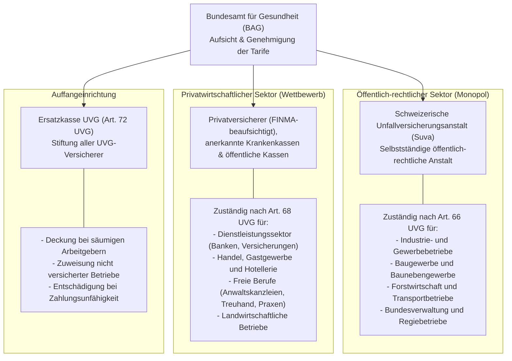
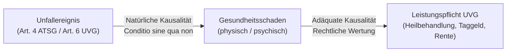
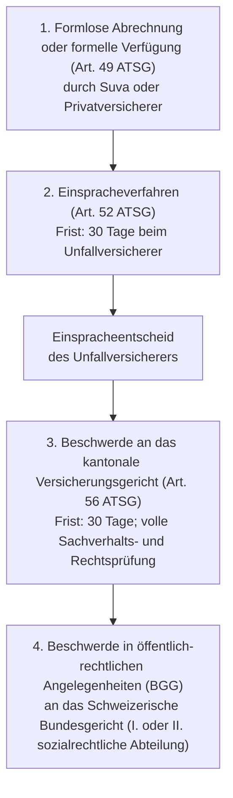

## Überblick {#ueberblick}

Die obligatorische Unfallversicherung nach dem Bundesgesetz über die Unfallversicherung (UVG) bildet eine zentrale Säule der schweizerischen Sozialversicherungsordnung. Als Kausalversicherung schützt sie alle in der Schweiz beschäftigten Arbeitnehmerinnen und Arbeitnehmer vor den gesundheitlichen, erwerblichen und immateriellen Folgen von Berufsunfällen, Nichtberufsunfällen und Berufskrankheiten.

Im System der sozialen Sicherheit nimmt die Unfallversicherung eine Vorzugsstellung ein: Im Vergleich zur Krankenversicherung (KVG) und zur Invalidenversicherung (IV) gewährt sie den versicherten Personen einen ausgebauten Vollkaskoschutz:

1. **Keine Kostenbeteiligung bei der Heilbehandlung**: Ärztliche Behandlungen, Spitalaufenthalte in der allgemeinen Abteilung, Medikamente und Hilfsmittel werden zu 100 Prozent vom Unfallversicherer übernommen — ohne Franchise, Selbstbehalt oder Spitalkostenbeitrag ([Art. 10 UVG](/kommentar/uvg/art-010/#abs-1--anspruchsvoraussetzungen-und-leistungskatalog)).
2. **Grosszügiger Erwerbsersatz**: Bei vorübergehender Arbeitsunfähigkeit richtet die Unfallversicherung ab dem dritten Tag nach dem Unfalltag ein Taggeld von 80 Prozent des versicherten Verdienstes aus (Art. 15 und 16 UVG), bis zum gesetzlichen Höchstbetrag von CHF 148'200.- pro Jahr.
3. **Umfassender Langzeitschutz**: Bei dauerhafter Invalidität gewährt das UVG eine lebenslange Rente von bis zu 80 Prozent ([Art. 18](/kommentar/uvg/art-018/#bemessung-des-invaliditätsgrades) und [Art. 20 UVG](/kommentar/uvg/art-020/#kommentierung)), die mit Renten der ersten Säule (AHV/IV) koordiniert wird ([Art. 22 UVG](/kommentar/uvg/art-022/#kommentierung)), sowie eine schadensunabhängige Genugtuungsleistung in Form der Integritätsentschädigung ([Art. 24 UVG](/kommentar/uvg/art-024/#kommentierung)).

Das Gesetz umreisst den Kreis der obligatorisch geschützten Personen in Art. 1a UVG:



| Kriterium | Unfallversicherung (UVG) | Krankenversicherung (KVG) | Invalidenversicherung (IV) |
|---|---|---|---|
| **Schadensursache** | Unfall, unfallähnliche Körperschädigung, Berufskrankheit | Krankheit, Mutterschaft, Unfall (subsidiär) | Dauernder Gesundheitsschaden (Krankheit oder Unfall) |
| **Kostenbeteiligung** | **Keine** (weder Franchise noch Selbstbehalt) | Franchise (CHF 300.- bis 2'500.-) plus 10 % Selbstbehalt | Keine direkte Heilbehandlung (ausser Geburtsgebrechen) |
| **Taggeldleistung** | **80 %** ab 3. Tag (gesetzlich obligatorisch) | Freiwillige Taggeldversicherung (nach VVG oder KVG) | Nur während beruflicher Eingliederungsmassnahmen |
| **Rentenbeginn** | Nach Abschluss der Heilbehandlung (Art. 19 UVG) | Keine Rentenleistungen | Nach einjähriger Wartezeit bei mind. 40 % Invalidität |
| **Erheblichkeitsschwelle Rente** | Bereits ab **10 %** Invaliditätsgrad (Art. 18 Abs. 1 UVG) | Keine | Ab **40 %** (stufenloses Rentensystem nach Art. 28b IVG) |
| **Immaterielle Unbill** | Integritätsentschädigung (Art. 24 UVG, bis CHF 148'200.-) | Keine Entschädigung | Keine Entschädigung |

## Rechtsgrundlagen und Finanzierung {#rechtsgrundlagen}

Die verfassungsrechtliche Kompetenz zur Regelung der Unfallversicherung stützt sich auf **Art. 110 Abs. 1 lit. a BV**, wonach der Bund Vorschriften über den Schutz der Arbeitnehmerinnen und Arbeitnehmer sowie über die Sozialversicherung erlässt. 

Das materielle und formelle Kernrecht ist verankert im:
- **Bundesgesetz über die Unfallversicherung (UVG, SR 832.20)** vom 20. März 1981 (in Kraft seit 1. Januar 1984, revidiert per 1. Januar 2017).
- **Verordnung über die Unfallversicherung (UVV, SR 832.202)** vom 20. Dezember 1982 mit detaillierten Ausführungsbestimmungen, namentlich der Liste der Berufskrankheiten (Anhang 1) und der Integritätstabelle (Anhang 3).
- **Bundesgesetz über den Allgemeinen Teil des Sozialversicherungsrechts (ATSG, SR 830.1)**: Gilt für die Unfallversicherung, soweit das UVG nicht ausdrücklich davon abweicht (Art. 1 Abs. 1 UVG). Das ATSG definiert übergeordnete Begriffe wie den Unfallbegriff (Art. 4 ATSG), die Arbeits- und Erwerbsunfähigkeit (Art. 6 und 7 ATSG) sowie die Invalidität (Art. 8 ATSG) und regelt das Verwaltungsverfahren (Art. 34–62 ATSG).

### Das Finanzierungssystem {#finanzierung}

Die Finanzierung der Unfallversicherung beruht auf dem Verursacherprinzip und unterscheidet strikt nach Schadensarten (Art. 91 und 92 UVG):

- **Berufsunfälle (BU) und Berufskrankheiten (BK)**: Die Prämien werden vollumfänglich durch die **Arbeitgeber** getragen (Art. 91 Abs. 1 UVG). Die Prämienbemessung richtet sich nach dem Gefahrtarif und der Risikoklasse des jeweiligen Betriebs (Art. 92 Abs. 1 UVG).
- **Nichtberufsunfälle (NBU)**: Die Prämien gehen grundsätzlich zulasten der **Arbeitnehmerinnen und Arbeitnehmer** (Art. 91 Abs. 2 UVG). Sie werden vom Lohn abgezogen, wobei abweichende vertragliche Vereinbarungen (z. B. Übernahme durch den Arbeitgeber im Gesamtarbeitsvertrag oder Einzelarbeitsvertrag) zulässig und in der Praxis weit verbreitet sind.

## Organisation und Trägerschaft: Das duale Durchführungsmodell {#organisation}

Anders als in den meisten anderen Zweigen des Schweizer Sozialversicherungsrechts existiert in der Unfallversicherung keine einheitliche staatliche Ausgleichskasse oder kantonale Behörde. Die Durchführung ist stattdessen aufgeteilt zwischen einer öffentlich-rechtlichen Anstalt und dem freien Privatversicherungsmarkt (Art. 58 UVG):



### Die Suva (Schweizerische Unfallversicherungsanstalt) {#suva}

Die Suva ist eine selbstständige Anstalt des öffentlichen Rechts mit eigener Rechtspersönlichkeit und Sitz in Luzern (Art. 61 UVG). Sie verwaltet sich selbst unter Mitwirkung der Sozialpartner (Arbeitgeber- und Arbeitnehmerverbände) und des Bundes. 

Der Zuständigkeitsbereich der Suva ist in **Art. 66 UVG** gesetzlich zwingend umschrieben (Monopolbereich): Alle Betriebe mit erhöhten Unfall- oder Betriebsgefahren — insbesondere das Baugewerbe, metallverarbeitende Betriebe, Industrieunternehmen, Transport- und Eisenbahnunternehmen sowie Betriebe der Bundesverwaltung — sind von Gesetzes wegen der Suva unterstellt. Ein Wechsel zu einem privaten Versicherer ist für diese Betriebe gesetzlich ausgeschlossen.



### Die privaten Versicherer und Krankenkassen {#privatversicherer}

Arbeitgeber von Betrieben, die nicht in den Anwendungsbereich von Art. 66 UVG fallen (namentlich Handel, Finanzdienstleistungen, Gastronomie, Bildung, Gesundheitswesen, freie Berufe und Landwirtschaft), müssen ihre Beschäftigten bei einer privaten Versicherungsgesellschaft nach dem Versicherungsaufsichtsgesetz (VAG), einer anerkannten Krankenkasse oder einer öffentlichen Unfallversicherungskasse versichern (Art. 68 Abs. 1 UVG). Auf diesem Markt herrscht freier Wettbewerb bei einheitlich vorgeschriebenen Mindestleistungen nach UVG.

### Die Ersatzkasse UVG {#ersatzkasse}

Die Ersatzkasse nach Art. 72 ff. UVG ist eine von allen zugelassenen Versicherern gemeinsam getragene Stiftung. Sie erfüllt eine unentbehrliche Auffang- und Schutzfunktion:
- Versäumt ein Arbeitgeber seine gesetzliche Versicherungspflicht, erbringt die Ersatzkasse die gesetzlichen Leistungen an den verunfallten Arbeitnehmer und nimmt beim säumigen Arbeitgeber Regress (Ersatzprämien mit Strafzuschlag).
- Sie weist Arbeitgeber, die keinen Versicherer finden, einem der zugelassenen Versicherungsträger zu.
- Sie springt ein, wenn ein zugelassener Unfallversicherer zahlungsunfähig wird (Art. 73 UVG).

## Versicherter Personenkreis und Versicherungsdeckung {#versicherte}

### Obligatorische und freiwillige Versicherung {#versicherungspflicht}

Obligatorisch versichert sind alle in der Schweiz beschäftigten Arbeitnehmerinnen und Arbeitnehmer einschliesslich der Heimarbeiter, Lehrlinge, Praktikanten und Volontäre (Art. 1a Abs. 1 UVG). Auf die Nationalität, den Wohnsitz oder die Dauer des Anstellungsverhältnisses kommt es nicht an; auch Temporärangestellte, Aushilfen und ausländische Grenzgänger sind ab Beginn des Arbeitsverhältnisses gedeckt.

**Selbstständigerwerbende** und ihre nicht lohnberechtigten mitarbeitenden Familienmitglieder unterstehen dem Obligatorium nicht. Sie haben jedoch das Recht, sich freiwillig bei der Suva (sofern ihr Betrieb einem Suva-Bereich entspricht) oder einem Privatversicherer nach den Regeln des UVG zu versichern (Art. 4 und 5 UVG).

### Beginn, Ende und Nachdeckung (Abredeversicherung) {#zeitliche-deckung}

Die Versicherungsdeckung beginnt an dem Tag, an dem die Arbeitnehmerin oder der Arbeitnehmer die Arbeit antritt oder erstmals den Arbeitsweg antritt (Art. 3 Abs. 1 UVG).

Die Deckung endet mit dem 31. Tag nach dem Tag, an dem der Anspruch auf mindestens den halben Lohn aufhört (Art. 3 Abs. 2 UVG). Diese **31-tägige Nachdeckungsfrist** schützt Beschäftigte bei Stellenwechseln oder kurzen Unterbrüchen. Durch Abschluss einer **Abredeversicherung** kann die Nichtberufsunfallversicherung um bis zu sechs aufeinanderfolgende Monate verlängert werden (Art. 3 Abs. 3 UVG). Erhält die versicherte Person Taggelder der Unfallversicherung oder der Arbeitslosenversicherung, bleibt der Versicherungsschutz von Gesetzes wegen aufrechterhalten ([BGE 150 V 188 E. 7.3](https://entscheidsuche.ch/docs/CH_BGE/CH_BGE_007_BGE-150-V-188_2024.html#consideration_7.3)).

### Unterscheidung: Berufsunfall (BU) und Nichtberufsunfall (NBU) {#bu-nbu}

Das Gesetz trennt streng zwischen Berufsunfällen und Nichtberufsunfällen:





Die Unterscheidung hat drei wesentliche praktische Konsequenzen:
1. **Prämienpflicht**: BU-Prämien zahlt der Arbeitgeber, NBU-Prämien der Arbeitnehmer (Art. 91 UVG).
2. **Kürzung bei Grobfahrlässigkeit**: Nur Taggelder bei Nichtberufsunfällen können wegen Grobfahrlässigkeit gekürzt werden (Art. 37 Abs. 2 UVG); bei Berufsunfällen ist eine solche Kürzung gesetzlich ausgeschlossen.
3. **Deckungsumfang bei Teilzeitbeschäftigung (Die 8-Stunden-Grenze)**: 
   - Arbeitnehmer mit einem wöchentlichen Pensum von **mindestens 8 Stunden** bei einem Arbeitgeber sind sowohl gegen BU als auch gegen NBU versichert (Art. 13 Abs. 1 UVV).
   - Arbeitnehmer mit einem Pensum von **weniger als 8 Stunden pro Woche** sind ausschliesslich gegen Berufsunfälle versichert; der Nichtberufsunfallschutz entfällt. Bei ihnen gilt jedoch der **Arbeitsweg von und zur Arbeitsstätte gesetzlich als Berufsunfall** (Art. 7 Abs. 2 UVG).
   - Nach der Rechtsprechung wird der notwendige Zusammenhang zwischen Weg und Arbeitsleistung durch eine verkehrs- oder freizeitbedingte Unterbrechung von bis zu einer Stunde nicht aufgehoben ([BGE 126 V 353 E. 4.](https://entscheidsuche.ch/docs/CH_BGE/CH_BGE_007_BGE-126-V-353_2000-10-23.html#consideration_4.)).
   - Besteht für eine teilzeitbeschäftigte Person eine obligatorische NBU-Deckung, erstreckt sich dieser Schutz grundsätzlich auch auf Unfälle, die sich während einer zusätzlich ausgeübten, nicht freiwillig versicherten selbstständigen Erwerbstätigkeit ereignen ([BGE 150 V 391 E. 7.](https://entscheidsuche.ch/docs/CH_BGE/CH_BGE_007_BGE-150-V-391_2024.html#consideration_7.)).

## Versicherte Risiken und Tatbestände {#risiken-tatbestaende}

Die Leistungspflicht des Unfallversicherers knüpft an vier eigenständige Tatbestände an: den Unfall im Rechtssinne, die unfallähnliche Listenverletzung, die Berufskrankheit sowie die Schädigung bei der Heilbehandlung ([Art. 6 UVG](/kommentar/uvg/art-006/#i-abs-2-die-diagnostizierte-listenverletzung)).

### 1. Der gesetzliche Unfallbegriff (Art. 4 ATSG) {#unfallbegriff}

Gemäss der Legaldefinition in Art. 4 ATSG ist ein Unfall die plötzliche, nicht beabsichtigte schädigende Einwirkung eines ungewöhnlichen äusseren Faktors auf den menschlichen Körper, die eine Beeinträchtigung der körperlichen, geistigen oder psychischen Gesundheit oder den Tod zur Folge hat.

Fünf Begriffsmerkmale müssen für die Bejahung eines Unfalls kumulativ erfüllt sein:

| Begriffsmerkmal | Dogmatischer Gehalt | Typische Ausschlussgründe |
|---|---|---|
| **Plötzlichkeit** | Einwirkung in einem einzigen, zeitlich eng begrenzten Moment oder kurzen Intervall | Dauer- und Abnützungsschäden, Überlastung über Tage oder Wochen |
| **Nicht beabsichtigt** | Das Ereignis trifft die versicherte Person unfreiwillig und ohne Vorsatz | Vorsätzliche Selbsttötung oder Selbstverstümmelung (Art. 37 Abs. 1 UVG) |
| **Äusserer Faktor** | Ursprung der Einwirkung ausserhalb des menschlichen Körpers | Rein endogene Krankheitsursachen (Herzinfarkt, Schlaganfall) |
| **Ungewöhnlichkeit** | Der äussere Faktor liegt ausserhalb dessen, was für den Lebensbereich üblich ist | Gewöhnliche Bewegungsabläufe, alltägliche Stolperer ohne Zusatzfaktor |
| **Schädigende Wirkung** | Eintritt eines pathologischen physischen oder psychischen Schadens | Reine Sachschäden oder vorübergehende Schreckmomente ohne Befund |

Der Kern des Streits liegt in der Praxis regelmässig beim Merkmal der **Ungewöhnlichkeit des äusseren Faktors**:
Das Bundesgericht hält in [BGE 134 V 72 E. 4.1](https://entscheidsuche.ch/docs/CH_BGE/CH_BGE_007_BGE-134-V-72_2008.html#consideration_4.1) fest: «Der äussere Faktor ist ungewöhnlich, wenn er - nach einem objektiven Massstab - nicht mehr im Rahmen dessen liegt, was für den jeweiligen Lebensbereich alltäglich und üblich ist». Dabei bezieht sich die Ungewöhnlichkeit ausschliesslich auf den schädigenden Faktor selbst, nicht auf die Schwere oder Unerwartetheit der Verletzungsfolge ([BGE 134 V 72 E. 4.3.1](https://entscheidsuche.ch/docs/CH_BGE/CH_BGE_007_BGE-134-V-72_2008.html#consideration_4.1)).

Bei rein körperinternen Bewegungen (Verdrehen des Knies, Verheben des Rückens) verlangt die Praxis ein **sinnfälliges Zusatzgeschehen** — ein Ausgleiten, Hängenbleiben, Stolpern oder einen plötzlichen Gegendruck —, damit die Programmwidrigkeit der Körperbewegung die Ungewöhnlichkeit begründet ([Art. 4 ATSG](/kommentar/atsg/art-004/#d-ungewöhnlichkeit-des-äusseren-faktors--das-kernmerkmal)).

### 2. Listenverletzungen / Körperschädigungen nach Art. 6 Abs. 2 UVG {#listenverletzungen}

Um die notorischen Abgrenzungsschwierigkeiten zwischen unfallbedingten Traumata und degenerativen Abnützungen bei typischen Gelenks- und Weichteilverletzungen zu entschärfen, hat der Bundesgesetzgeber mit der Revision per 1. Januar 2017 das Rechtsinstitut der sogenannten **Listenverletzungen** direkt in Art. 6 Abs. 2 UVG verankert:

Die Versicherung erbringt ihre Leistungen bei folgenden acht abschliessend aufgezählten Körperschädigungen, auch wenn kein ungewöhnlicher äusserer Faktor vorliegt:
- a. Knochenbrüche;
- b. Verrenkungen von Gelenken;
- c. Meniskusrisse;
- d. Muskelrisse;
- e. Muskelzerrungen;
- f. Sehnenrisse;
- g. Bandläsionen;
- h. Trommelfellverletzungen.

**Beweislast und Entlastungsbeweis nach BGE 146 V 51**:
In seinem Grundsatzentscheid [BGE 146 V 51 E. 8.6](https://entscheidsuche.ch/docs/CH_BGE/CH_BGE_007_BGE-146-V-51_2020.html#consideration_8.2) stellte das Bundesgericht klar: «Insoweit führt grundsätzlich bereits die Tatsache, dass eine in Art. 6 Abs. 2 lit. a-h UVG genannte Körperschädigung vorliegt, nunmehr zur Vermutung, es handle sich hierbei um eine unfallähnliche Körperschädigung, die vom Unfallversicherer übernommen werden muss.» 

Der Unfallversicherer kann sich von der Leistungspflicht nur dadurch befreien, dass er den **Entlastungsbeweis** erbringt: Er muss mit dem Beweisgrad der überwiegenden Wahrscheinlichkeit nachweisen, dass die diagnostizierte Schädigung *vorwiegend* — das heisst zu mehr als 50 Prozent — auf Abnützung oder Erkrankung zurückzuführen ist ([Art. 6 Abs. 2 UVG](/kommentar/uvg/art-006/#i-abs-2-die-diagnostizierte-listenverletzung)). Gelingt dieser Beweis nicht, verbleibt das finanzielle Risiko beim Unfallversicherer.

### 3. Berufskrankheiten (Art. 9 UVG) {#berufskrankheiten}

Berufskrankheiten sind Krankheiten, die bei der beruflichen Tätigkeit ausschliesslich oder vorwiegend durch schädigende Stoffe oder bestimmte Arbeiten verursacht worden sind ([Art. 9 UVG](/kommentar/uvg/art-009/#kommentierung)). Das UVG folgt einem zweistufigen System:

- **Listenstoffe und Listenarbeiten (Art. 9 Abs. 1 UVG i.V.m. Anhang 1 UVV)**: Für die im Anhang 1 zur UVV aufgeführten Stoffe (z. B. Asbest, Blei, Benzol, ionisierende Strahlen) gilt eine Beweiserleichterung: Es genügt der Nachweis, dass die Krankheit *vorwiegend* (zu mehr als 50 Prozent) durch die Einwirkung des gelisteten Stoffes verursacht wurde.
- **Generalklausel für Nicht-Listenkrankheiten (Art. 9 Abs. 2 UVG)**: Für alle übrigen Erkrankungen setzt die Anerkennung voraus, dass nachgewiesen wird, dass die Krankheit *ausschliesslich oder stark überwiegend* durch die berufliche Tätigkeit verursacht worden ist. Dies erfordert nach ständiger Rechtsprechung einen Kausalitätsanteil von **mindestens 75 Prozent** ([BGE 126 V 183 E. 2.](https://entscheidsuche.ch/docs/CH_BGE/CH_BGE_007_BGE-126-V-183_2000-08-03.html#consideration_2.)). Typische Zivilisations- und Volkskrankheiten (Bandscheibenvorfälle, Arthrosen, Burnout) können diese strenge Schwelle in aller Regel nicht erreichen.

### 4. Schädigung bei der Heilbehandlung (Art. 6 Abs. 3 UVG) {#behandlungsfehler}

Erleidet eine verunfallte Person im Rahmen der medizinischen Heilbehandlung der Unfallfolgen eine zusätzliche Gesundheitsschädigung, haftet dafür der Unfallversicherer (Art. 6 Abs. 3 UVG). Dies gilt selbst dann, wenn der behandelnde Arzt die Komplikation durch eine fehlerhafte Überdosierung herbeigeführt hat und die Komplikation nach medizinischer Erfahrung völlig aussergewöhnlich war ([BGE 118 V 286 E. 3.](https://entscheidsuche.ch/docs/CH_BGE/CH_BGE_007_BGE-118-V-286_1992-11-10.html#consideration_3.)).

## Die Kausalitätsprüfung: Grundpfeiler des Haftungssystems {#kausalitaet}

Die Leistungspflicht der Unfallversicherung setzt stets das Bestehen eines doppelten Kausalzusammenhangs zwischen dem Unfallereignis und dem eingetretenen Gesundheitsschaden voraus:

### 1. Natürlicher Kausalzusammenhang {#natuerliche-kausalitaet}

Eine Ursache ist natürlich kausal, wenn sie nicht weggedacht werden kann, ohne dass auch der eingetretene Erfolg entfiele (*Conditio sine qua non*). Im Sozialversicherungsrecht genügt die Teilursächlichkeit: Es ist nicht erforderlich, dass der Unfall die alleinige oder unmittelbare Ursache darstellt; Mitursächlichkeit reicht aus. Massgebend ist der Beweisgrad der **überwiegenden Wahrscheinlichkeit** — blosse Möglichkeiten genügen nicht.

**Erlöschen der Leistungspflicht: Status quo ante und Status quo sine**:
War vor dem Unfall bereits ein krankhafter Zustand vorhanden (z. B. eine degenerative Wirbelsäulenveränderung), den der Unfall lediglich vorübergehend aktiviert oder verschlimmert hat, endet die Leistungspflicht des Versicherers, sobald der Zustand erreicht ist, der auch ohne das Unfallereignis früher oder später eingetreten wäre (*Status quo sine*) oder der Zustand vor dem Unfall wiederhergestellt ist (*Status quo ante*). Erkrankt eine versicherte Person nach Zusprechung einer UVG-Rente an einer unfallfremden Krankheit, stellt die daraus resultierende Erwerbsunfähigkeit keinen Revisionsgrund für die UVG-Rente dar ([BGE 147 V 161 E. 4.](https://entscheidsuche.ch/docs/CH_BGE/CH_BGE_007_BGE-147-V-161_2021.html#consideration_4.)).

### 2. Adäquater Kausalzusammenhang {#adaequate-kausalitaet}

Die adäquate Kausalität ist ein normatives Zurechnungskriterium: Eine natürliche Ursache ist adäquat, wenn sie nach dem gewöhnlichen Lauf der Dinge und der allgemeinen Lebenserfahrung an sich geeignet ist, einen Erfolg von der Art des eingetretenen herbeizuführen.

In der Unfallversicherung differenziert die Rechtsprechung grundlegend nach der Art des Gesundheitsschadens:

#### A. Physische Gesundheitsschäden {#physische-schaeden}
Bei organisch nachweisbaren körperlichen Unfallfolgen deckt sich die adäquate Kausalität praktisch vollständig mit der natürlichen Kausalität. In [BGE 118 V 286 E. 3.](https://entscheidsuche.ch/docs/CH_BGE/CH_BGE_007_BGE-118-V-286_1992-11-10.html#consideration_3.) hielt das Bundesgericht ausdrücklich fest: «Bei physischen Unfallfolgen spielt indessen die Adäquanz als rechtliche Eingrenzung der aus dem natürlichen Kausalzusammenhang sich ergebenden Haftung des Unfallversicherers praktisch keine Rolle», da die Unfallversicherung auch für seltene Komplikationen einzustehen hat.

#### B. Psychische Fehlentwicklungen nach Unfall (BGE 115 V 133) {#psycho-praxis}
Treten im Nachgang zu einem Unfall psychische Beschwerden auf (Depressionen, somatoforme Schmerzstörungen), greift die sogenannte **Psycho-Praxis** gemäss [BGE 115 V 133 E. 6.](https://entscheidsuche.ch/docs/CH_BGE/CH_BGE_007_BGE-115-V-133_1989-06-16.html#consideration_6.): «Als geeigneter Anknüpfungspunkt für eine Einteilung der Unfälle mit psychischen Folgeschäden soll das (objektiv erfassbare) Unfallereignis selbst dienen.» 

Die Unfälle werden nach dem augenfälligen Geschehensablauf in drei Schweregrade eingeteilt:
1. **Leichte Unfälle** (z. B. Ausrutschen auf Treppenstufe, leichter Stoss): Die Adäquanz psychischer Folgeschäden wird ohne Weiteres verneint.
2. **Schwere Unfälle** (z. B. schwerste Karambolagen, Absturz aus grosser Höhe): Die Adäquanz wird in der Regel ohne Weiteres bejaht.
3. **Mittelschwere Unfälle** (mittlerer Bereich): Hier ist eine differenzierte Prüfung anhand von **sieben Adäquanzkriterien** vorzunehmen. Die Adäquanz ist zu bejahen, wenn entweder ein einzelnes Kriterium in besonders ausgeprägter Weise erfüllt ist oder mehrere Kriterien in gehäufter Form vorliegen:
   - Besonders dramatische Begleitumstände oder besondere Eindrücklichkeit des Unfalls;
   - Schwere oder besondere Art der erlittenen Verletzungen ([BGE 140 V 356 E. 5.](https://entscheidsuche.ch/docs/CH_BGE/CH_BGE_007_BGE-140-V-356_2014.html#consideration_5.));
   - Ungewöhnlich lange Dauer der ärztlichen Behandlung;
   - Körperliche Dauerschmerzen;
   - Ärztliche Fehlbehandlung, welche die Unfallfolgen erheblich verschlimmert;
   - Schwieriger Heilungsverlauf und erhebliche Komplikationen;
   - Grad und Dauer der physisch bedingten Arbeitsunfähigkeit.

#### C. Schleudertrauma der Halswirbelsäule und Schädel-Hirn-Trauma (BGE 134 V 109) {#schleudertrauma}
Bei Schleudertraumata der HWS, äquivalenten Verletzungen und Schädel-Hirn-Traumata ohne organisch objektivierbare Befunde gilt eine modifizierte Adäquanzprüfung: Es findet keine Trennung in physische und psychische Komponenten statt ([BGE 134 V 109 E. 10.1](https://entscheidsuche.ch/docs/CH_BGE/CH_BGE_007_BGE-134-V-109_2008.html#consideration_10.1)). Bei Unfällen des mittleren Bereichs wird derselbe Kriterienkatalog herangezogen, jedoch bezogen auf das typische diffuse Beschwerdebild (Kopfschmerzen, Schwindel, Konzentrationsstörungen).

## Das Leistungssystem der Unfallversicherung {#leistungen}

Das Leistungsspektrum des UVG gliedert sich in Sachleistungen, vorübergehende Geldleistungen und dauerhafte Langzeitleistungen:

### 1. Pflegeleistungen und Kostenvergütung (Art. 10–14 UVG) {#pflegeleistungen}

Der Versicherte hat Anspruch auf eine zweckmässige Behandlung der Unfallfolgen ([Art. 10 UVG](/kommentar/uvg/art-010/#abs-1--anspruchsvoraussetzungen-und-leistungskatalog)):
- Ambulante Behandlung durch Ärzte, Zahnärzte und Chiropraktiker;
- Stationäre Behandlung in der allgemeinen Abteilung eines Spitals bei freier Spitalwahl in der ganzen Schweiz;
- Verordnete Medikamente, Analysen und therapeutische Massnahmen (z. B. Physiotherapie);
- Medizinisch notwendige Hilfsmittel (Prothesen, Brillen, Hörgeräte nach Art. 11 UVG);
- Ersatz notwendiger Reise-, Transport- und Rettungskosten (Art. 13 UVG).

### 2. Taggeld (Art. 15–17 UVG) {#taggeld}

Das Taggeld sichert das laufende Einkommen bei vorübergehender Arbeitsunfähigkeit:



- **Anspruchsbeginn**: Ab dem dritten Tag nach dem Unfalltag (Art. 15 Abs. 1 UVG). Der Unfalltag und die beiden Folgetage bilden unbezahlte Karenztage des Versicherers; für diese Tage schuldet der Arbeitgeber Lohnfortzahlung nach Art. 324a OR (mindestens 80 Prozent).
- **Höhe**: Bei voller Arbeitsunfähigkeit **80 Prozent des versicherten Verdienstes** (Art. 16 Abs. 1 UVG). Bei teilweiser Arbeitsunfähigkeit wird das Taggeld verhältnismässig gekürzt (Art. 16 Abs. 2 UVG).
- **Berechnungsgrundlage**: Letzter vor dem Unfall bezogene Lohn, umgerechnet auf den Kalendertag, plafoniert beim UVG-Höchstbetrag von CHF 148'200.- (Art. 22 UVV).
- **Ende des Taggeldes**: Mit Wiedererlangung der vollen Arbeitsfähigkeit, mit Beginn einer Invalidenrente oder mit dem Tod der versicherten Person (Art. 15 Abs. 2 UVG).

### 3. Fallabschluss und Übergang zur Rente (Art. 19 Abs. 1 UVG) {#fallabschluss}

Von der Fortsetzung der Heilbehandlung ist keine namhafte Besserung des Gesundheitszustandes mehr zu erwarten, wenn der Zustand im Wesentlichen stabilisiert ist. In diesem Moment erfolgt der **Fallabschluss**:
- Die vorübergehenden Leistungen (Heilbehandlung und Taggeld) werden eingestellt.
- Gleichzeitig prüft der Unfallversicherer von Amtes wegen den Anspruch auf eine dauerhafte Invalidenrente sowie auf eine Integritätsentschädigung (Art. 19 Abs. 1 UVG). 
- Nach der bundesgerichtlichen Rechtsprechung bilden die Leistungseinstellung und die Rentenprüfung einen untrennbaren, einheitlichen Streitgegenstand ([BGE 144 V 354 E. 4.](https://entscheidsuche.ch/docs/CH_BGE/CH_BGE_007_BGE-144-V-354_2018.html#consideration_4.)).

### 4. Invalidenrente (Art. 18–21 UVG) {#invalidenrente}

Ist die versicherte Person infolge des Unfalls zu mindestens **10 Prozent invalid**, hat sie Anspruch auf eine Invalidenrente ([Art. 18 Abs. 1 UVG](/kommentar/uvg/art-018/#bemessung-des-invaliditätsgrades)):
- **Rentenhöhe**: Bei Vollinvalidität (100 Prozent) beträgt die Rente **80 Prozent des versicherten Verdienstes** ([Art. 20 Abs. 1 UVG](/kommentar/uvg/art-020/#kommentierung)). Bei Teilinvalidität entspricht die Rente dem prozentualen Invaliditätsgrad.
- **Bemessung des Invaliditätsgrades**: Erfolgt nach der allgemeinen sozialversicherungsrechtlichen Methode des **Einkommensvergleichs** ([Art. 16 ATSG](/kommentar/atsg/art-016/#kommentierung)): Gegenüberstellung des hypothetischen Valideneinkommens (Verdienst ohne Unfall) und des zumutbaren Invalideneinkommens (Verdienst nach zumutbarer Verwertung der Restarbeitsfähigkeit).

### 5. Komplementärrente und Überentschädigung (Art. 20 Abs. 2 und Art. 22 UVG) {#komplementaerrente}

Hat die verunfallte Person gleichzeitig Anspruch auf eine Rente der Invalidenversicherung (IV) oder der Alters- und Hinterlassenenversicherung (AHV), richtet der Unfallversicherer eine **Komplementärrente** aus ([Art. 22 UVG](/kommentar/uvg/art-022/#kommentierung)):
- Sie entspricht der Differenz zwischen dem Rentenbetrag der IV/AHV und **90 Prozent des versicherten Verdienstes** ([BGE 138 V 248 E. 4.](https://entscheidsuche.ch/docs/CH_BGE/CH_BGE_007_BGE-138-V-248_2012.html#consideration_4.)).
- Die Bestimmung verhindert eine Überentschädigung, stellt aber sicher, dass die verunfallte Person im Ergebnis finanziell deutlich bessergestellt ist als bei einer rein krankheitsbedingten Invalidität.

### 6. Integritätsentschädigung (Art. 24–25 UVG) {#integritaetsentschaedigung}

Erleidet die versicherte Person durch den Unfall eine dauernde erhebliche Schädigung der körperlichen, geistigen oder psychischen Integrität, hat sie Anspruch auf eine angemessene Integritätsentschädigung ([Art. 24 Abs. 1 UVG](/kommentar/uvg/art-024/#kommentierung)):
- **Rechtsnatur**: Es handelt sich um eine einmalige Kapitalleistung mit Genugtuungscharakter, die vollkommen unabhängig von einem Erwerbsschaden oder einer Erwerbsunfähigkeit geschuldet ist.
- **Bemessung nach Skala**: Die Bemessung richtet sich nach Anhang 3 zur UVV und den darauf aufbauenden Suva-Tabellen (z. B. Verlust eines Auges: 30 %, Verlust eines Daumens: 20 %, schwere Gehörlosigkeit: 30 %). Höchstbetrag ist der am Unfalltag geltende maximale versicherte Jahresverdienst (CHF 148'200.-).
- **Ausschluss subjektiver Faktoren**: Massgebend ist ausschliesslich der **objektive medizinische Befund**; individuelle Schmerzempfindlichkeit, Alter oder besondere berufliche Interessen (z. B. Verlust eines Fingerglieds bei einem Hobbymusiker) fallen bei der Bemessung ausser Betracht ([BGE 124 V 29 E. 1.](https://entscheidsuche.ch/docs/CH_BGE/CH_BGE_007_BGE-124-V-29_1998-03-03.html#consideration_1.)).

### 7. Weitere Leistungen: Hinterlassenenrenten und Hilflosenentschädigung {#hinterlassene-hilflosigkeit}

- **Hinterlassenenrenten (Art. 28–32 UVG)**: Stirbt die versicherte Person an den Folgen des Unfalls, erhalten die Witwe/der Witwer (40 Prozent) und die Halbwaisen (15 Prozent) bzw. Vollwaisen (25 Prozent) Hinterlassenenrenten, zusammen maximal 70 Prozent des versicherten Verdienstes (bzw. 90 Prozent bei Zusammentreffen mit AHV-Hinterlassenenrenten).
- **Hilflosenentschädigung (Art. 26–27 UVG)**: Bedarf die versicherte Person infolge der Invalidität für die alltäglichen Lebensverrichtungen (Ankleiden, Aufstehen, Essen, Körperpflege etc.) dauernd der Hilfe Dritter, wird eine monatliche Hilflosenentschädigung nach Schweregrad (leicht, mittelschwer, schwer) ausgerichtet.

## Leistungskürzungen und Leistungsverweigerung {#kuerzungen}

Trotz Vorliegens eines Unfalls können die Geldleistungen (Taggelder und Renten) in bestimmten Konstellationen gekürzt oder verweigert werden. Die Pflegeleistungen (Heilbehandlung) dürfen demgegenüber niemals gekürzt werden (Art. 36 Abs. 1 UVG).

| Tatbestand | Rechtsgrundlage | Voraussetzungen | Rechtsfolge |
|---|---|---|---|
| **Absichtliche Herbeiführung** | [Art. 36 UVG](/kommentar/uvg/art-036/#kommentierung), Art. 37 Abs. 1 UVG | Vorsätzliche Herbeiführung des Gesundheitsschadens oder Suizid (ausser bei voller Urteilsunfähigkeit) | **Vollständiger Ausschluss** sämtlicher Geldleistungen |
| **Grobfahrlässigkeit** | Art. 37 Abs. 2 UVG | Elementare Vorsichtsregeln missachtet (z. B. Fahren in angetrunkenem Zustand); **nur bei Nichtberufsunfällen!** | **Kürzung des Taggeldes** in den ersten zwei Jahren (üblicherweise 10–50 %) |
| **Verbrechen oder Vergehen** | Art. 37 Abs. 3 UVG | Verunfallung bei vorsätzlicher Verübung einer Straftat | Angemessene Kürzung oder Verweigerung von Geldleistungen |
| **Aussergewöhnliche Gefahren** | Art. 39 UVG, Art. 49 UVV | Betätigung im Ausland bei kriegerischen Ereignissen, Terrorismus etc. | Verweigerung aller Leistungen (auch Heilbehandlung) |
| **Wagnisse** | Art. 39 UVG, Art. 50 UVV | Eingehen unvertretbarer Risiken ohne Rettungsmöglichkeit (absolutes Wagnis: Base-Jumping, Motocrossrennen) | **Kürzung um mindestens 50 %** oder **vollständige Verweigerung** der Geldleistungen ([BGE 141 V 37 E. 2.1](https://entscheidsuche.ch/docs/CH_BGE/CH_BGE_007_BGE-141-V-37_2015.html#consideration_2.1)) |

## Verwaltungsverfahren, medizinische Begutachtung und Rechtsschutz {#verfahren}

### 1. Schadenmeldung und Untersuchungspflicht {#schadenmeldung-untersuchung}

Verunfallt eine versicherte Person, ist der Unfall unverzüglich dem Arbeitgeber bzw. dem zuständigen Versicherer zu melden (Art. 45 UVG). Für das anschliessende Verwaltungsverfahren gilt der sozialversicherungsrechtliche **Untersuchungsgrundsatz** ([Art. 43 Abs. 1 ATSG](/kommentar/atsg/art-043/#kommentierung)): Der Versicherungsträger klärt den Sachverhalt von Amtes wegen ab und holt die notwendigen ärztlichen Auskünfte ein.

### 2. Beweiswert ärztlicher Berichte: Suva-Kreisärzte vs. externe Gutachten {#beweiswert-gutachten}

Den medizinischen Berichten kommt bei der Feststellung von Unfallfolgen und Kausalität entscheidende Bedeutung zu ([Art. 44 ATSG](/kommentar/atsg/art-044/#kommentierung)). Hinsichtlich der Beweiswürdigung unterscheidet die Rechtsprechung:

- **Externe versicherungsunabhängige Gutachten (Art. 44 ATSG)**: Besitzen vollen Beweiswert, solange keine konkreten Mängel oder Widersprüche vorliegen ([BGE 125 V 351 E. 3.](https://entscheidsuche.ch/docs/CH_BGE/CH_BGE_007_BGE-125-V-351_1999-06-14.html#consideration_3.)).
- **Versicherungsinterne ärztliche Beurteilungen (insb. Suva-Kreisärzte)**: Berichte von angestellten Kreisärzten sind zwar verwertbar, ihnen kommt jedoch nicht dieselbe Beweiskraft zu wie unabhängigen Expertisen. Das Bundesgericht statuiert in [BGE 135 V 465 E. 4.4](https://entscheidsuche.ch/docs/CH_BGE/CH_BGE_007_BGE-135-V-465_2009.html#consideration_4.4): «Soll ein Versicherungsfall jedoch ohne Einholung eines externen Gutachtens entschieden werden, so sind an die Beweiswürdigung strenge Anforderungen zu stellen. Bestehen auch nur geringe Zweifel an der Zuverlässigkeit und Schlüssigkeit der versicherungsinternen ärztlichen Feststellungen, so sind ergänzende Abklärungen vorzunehmen».

### 3. Streitigkeiten über die Zuständigkeit: Die gesetzliche Vorleistungspflicht (Art. 70 ATSG) {#vorleistungspflicht}

Ist im Einzelfall streitig, ob eine Gesundheitsschädigung die Folge eines Unfalls (Zuständigkeit UVG) oder einer Krankheit (Zuständigkeit KVG) darstellt, darf die versicherte Person nicht zwischen den Institutionen zerrieben werden: Nach **Art. 70 Abs. 2 lit. b ATSG** ist der Krankenversicherer zur **Vorleistung verpflichtet**, wenn zweifelhaft ist, ob ein Unfall oder eine Krankheit vorliegt. Der leistende Versicherer kann anschliessend im Abrechnungsverfahren beim letztlich zuständigen Träger Regress nehmen.

### 4. Der Rechtsmittelweg {#instanzenzug}

Das Verfahren zum Rechtsschutz verläuft dreistufig:

Eine prozessuale Besonderheit vor dem **Bundesgericht**: Während das Bundesgericht in den übrigen Sozialversicherungszweigen an die Sachverhaltsfeststellung der kantonalen Vorinstanz gebunden ist (Art. 105 Abs. 1 BGG), gilt bei Streitigkeiten um Geldleistungen der Unfallversicherung **Art. 97 Abs. 2 und Art. 105 Abs. 3 BGG**: Das Bundesgericht prüft Sachverhalt und Beweiswürdigung frei und ist nicht an die Feststellungen des kantonalen Versicherungsgerichts gebunden.

## Praxishinweise {#praxishinweise}

### Für verunfallte Personen und Arbeitnehmer {#hinweise-versicherte}
- **Aussagen der ersten Stunde sichern**: Das Bundesgericht misst den Erstangaben im Unfallmeldeformular und den erstbehandelnden Notfallberichten überragende Beweiskraft bei («Aussagen der ersten Stunde»). Nachträgliche Schilderungen eines zusätzlichen Stolperns oder Ausgleitens werden von den Gerichten regelmässig als prozesstaktische Nachbesserung gewürdigt und verworfen.
- **Teilzeitpensen prüfen**: Arbeitnehmer mit Pensen unter 8 Wochenstunden müssen sich bewusst sein, dass Nichtberufsunfälle in der Freizeit nicht über das UVG, sondern über die Krankenkasse (mit Franchise und Selbstbehalt und ohne gesetzliches Taggeld) laufen. Der Arbeitsweg ist jedoch als Berufsunfall gedeckt.
- **Integritätsentschädigung aktiv verlangen**: Viele Versicherte versäumen es, beim Fallabschluss die Ausrichtung einer Integritätsentschädigung nach Art. 24 UVG einzufordern. Sie ist unabhängig von einer Erwerbseinbusse geschuldet und sollte bei verbleibenden Gelenksschäden oder Dauereinschränkungen stets ärztlich quantifiziert werden.

### Für Arbeitgeber {#hinweise-arbeitgeber}
- **Zuständigkeitsabgrenzung beachten**: Die zwingende Zuweisung nach Art. 66 UVG (Suva) lässt keinen vertraglichen Spielraum zu. Betriebe mit Mischstrukturen müssen rechtzeitig abklären, ob der gesamte Betrieb oder nur Betriebsteile unter das Suva-Monopol fallen.
- **Lückenlose Erfassung aller Beschäftigten**: Auch Aushilfen, Schnupperlehrlinge und Kurzzeitpraktikanten unterstehen ab der ersten Arbeitsminute dem UVG-Obligatorium. Versäumnisse führen zur subsidiären Inanspruchnahme durch die Ersatzkasse mit empfindlichen Nachzahlungszuschlägen.
- **Prämienabzüge korrekt abrechnen**: NBU-Prämien dürfen den Arbeitnehmern nur abgezogen werden, sofern deren Pensum mindestens 8 Wochenstunden erreicht.

### Für Rechtsberatung und Parteivertretung {#hinweise-rechtsberatung}
- **Entlastungsbeweis bei Listenverletzungen angreifen**: Beruft sich der Unfallversicherer bei einer Listenverletzung nach Art. 6 Abs. 2 UVG auf degenerative Abnützung, trägt er die volle Beweislast. Ein versicherungsinternes Aktenkonsilium genügt für diesen Entlastungsbeweis nach BGE 146 V 51 nur dann, wenn es bildgebend oder klinisch zweifelsfrei nachweist, dass die Verletzung zu mehr als 50 Prozent vorbestehend krankhaft war.
- **Unabhängige Begutachtung erzwingen**: Stützt der Unfallversicherer eine Leistungseinstellung ausschliesslich auf Berichte des eigenen Kreisarztes, genügen nach BGE 135 V 465 bereits *geringe Zweifel*, um die Einholung eines externen Gutachtens nach Art. 44 ATSG oder ein Gerichtsgutachten durchzusetzen.
- **Volle Kognition des Bundesgerichts nutzen**: Da das Bundesgericht bei UVG-Geldleistungen gemäss Art. 97 Abs. 2 BGG den Sachverhalt frei überprüft, lohnt sich eine sorgfältige Rekapitulation und Neugewichtung der medizinischen Beweismittel auch noch im letztinstanzlichen Beschwerdeverfahren.

## Leitentscheide {#leitentscheide}

| Entscheid | Gegenstand | Kernaussage und Bedeutung |
|---|---|---|
| [BGE 115 V 133 E. 6.](https://entscheidsuche.ch/docs/CH_BGE/CH_BGE_007_BGE-115-V-133_1989-06-16.html#consideration_6.) | Adäquanz bei psychischen Unfallfolgen | Begründung der dreiteiligen Psycho-Praxis (leichte, mittelschwere, schwere Unfälle) und Einführung des Katalogs von sieben Kriterien zur Beurteilung der Adäquanz im mittleren Bereich. |
| [BGE 118 V 286 E. 3.](https://entscheidsuche.ch/docs/CH_BGE/CH_BGE_007_BGE-118-V-286_1992-11-10.html#consideration_3.) | Kausalität bei physischen Schäden / Heilbehandlung | Bei rein physischen Unfallfolgen deckt sich die Adäquanz weitgehend mit der natürlichen Kausalität. Haftung des UVG-Versicherers für fehlerhafte Überdosierungen bei der medizinischen Heilbehandlung (Art. 6 Abs. 3 UVG). |
| [BGE 124 V 29 E. 1.](https://entscheidsuche.ch/docs/CH_BGE/CH_BGE_007_BGE-124-V-29_1998-03-03.html#consideration_1.) | Integritätsentschädigung | Für die Bemessung der Integritätsentschädigung nach Art. 24 f. UVG ist ausschliesslich der medizinische Befund nach den Skalen massgebend; persönliche Lebensumstände, Beruf oder Schmerzempfindlichkeit bleiben unberücksichtigt. |
| [BGE 125 V 351 E. 3.](https://entscheidsuche.ch/docs/CH_BGE/CH_BGE_007_BGE-125-V-351_1999-06-14.html#consideration_3.) | Beweiswert medizinischer Gutachten | Aufstellung der grundlegenden Anforderungen an die Beweiskraft ärztlicher Berichte und Gutachten im Sozialversicherungsrecht (Vollständigkeit, Nachvollziehbarkeit, Schlüssigkeit). |
| [BGE 126 V 183 E. 2.](https://entscheidsuche.ch/docs/CH_BGE/CH_BGE_007_BGE-126-V-183_2000-08-03.html#consideration_2.) | Berufskrankheiten unter der Generalklausel | Für die Anerkennung einer Berufskrankheit nach Art. 9 Abs. 2 UVG muss nachgewiesen werden, dass die Erkrankung zu mindestens 75 Prozent durch die berufliche Tätigkeit verursacht wurde. |
| [BGE 126 V 353 E. 4.](https://entscheidsuche.ch/docs/CH_BGE/CH_BGE_007_BGE-126-V-353_2000-10-23.html#consideration_4.) | Arbeitswegunfall bei Teilzeitbeschäftigten | Bei Teilzeitbeschäftigten unter 8 Wochenstunden gilt der Arbeitsweg als Berufsunfall; eine Unterbrechung des Weges von bis zu einer Stunde hebt den Kausalzusammenhang zur Arbeit nicht auf. |
| [BGE 134 V 72 E. 4.1](https://entscheidsuche.ch/docs/CH_BGE/CH_BGE_007_BGE-134-V-72_2008.html#consideration_4.1) | Unfallbegriff und Ungewöhnlichkeit | Der äussere Faktor ist ungewöhnlich, wenn er nicht mehr im Rahmen des im Alltag Üblichen liegt; ungewöhnliche Auswirkungen allein begründen keine Ungewöhnlichkeit des Geschehens (sog. Autoscooter-Entscheid). |
| [BGE 134 V 109 E. 10.1](https://entscheidsuche.ch/docs/CH_BGE/CH_BGE_007_BGE-134-V-109_2008.html#consideration_10.1) | HWS-Schleudertrauma | Präzisierung der Adäquanzprüfung bei Schleudertrauma der HWS und äquivalenten Traumata ohne organischen Befund; keine Differenzierung zwischen körperlichen und psychischen Komponenten. |
| [BGE 135 V 465 E. 4.4](https://entscheidsuche.ch/docs/CH_BGE/CH_BGE_007_BGE-135-V-465_2009.html#consideration_4.4) | Beweiswert von Suva-Kreisärzten | Berichten versicherungsinterner Kreisärzte kommt nicht dieselbe Beweiskraft zu wie Gerichtsgutachten; bei geringen Zweifeln an ihrer Zuverlässigkeit sind zwingend ergänzende Abklärungen anzuordnen. |
| [BGE 138 V 248 E. 4.](https://entscheidsuche.ch/docs/CH_BGE/CH_BGE_007_BGE-138-V-248_2012.html#consideration_4.) | Komplementärrente und Plafonierung | Die Komplementärrente nach Art. 20 Abs. 2 UVG garantiert der verunfallten Person zusammen mit Renten der IV oder AHV einen Gesamterwerbsersatz von 90 Prozent des versicherten Verdienstes. |
| [BGE 140 V 356 E. 5.](https://entscheidsuche.ch/docs/CH_BGE/CH_BGE_007_BGE-140-V-356_2014.html#consideration_5.) | Adäquanzkriterium der Schwere der Verletzung | Konkretisierung des Kriteriums der besonderen Schwere oder Art der erlittenen Verletzung im Rahmen der Psycho-Praxis nach BGE 115 V 133. |
| [BGE 141 V 37 E. 2.1](https://entscheidsuche.ch/docs/CH_BGE/CH_BGE_007_BGE-141-V-37_2015.html#consideration_2.1) | Wagnisse nach Art. 39 UVG | Qualifikation von Base-Jumping als absolutes Wagnis gemäss Art. 50 Abs. 2 UVV; vollständige Verweigerung aller NBU-Geldleistungen durch den Unfallversicherer ist bundesrechtskonform. |
| [BGE 144 V 354 E. 4.](https://entscheidsuche.ch/docs/CH_BGE/CH_BGE_007_BGE-144-V-354_2018.html#consideration_4.) | Fallabschluss nach Art. 19 UVG | Die Einstellung der vorübergehenden Leistungen (Taggeld, Heilbehandlung) und die Prüfung der Rentenfrage beim Fallabschluss bilden einen einheitlichen Streitgegenstand. |
| [BGE 146 V 51 E. 8.2](https://entscheidsuche.ch/docs/CH_BGE/CH_BGE_007_BGE-146-V-51_2020.html#consideration_8.2) | Listenverletzungen nach Art. 6 Abs. 2 UVG | Liegt eine diagnostizierte Listenverletzung vor, greift eine gesetzliche Vermutung für die Leistungspflicht; der Versicherer trägt die Beweislast für den Nachweis einer vorwiegenden Abnützung oder Erkrankung. |
| [BGE 147 V 161 E. 4.](https://entscheidsuche.ch/docs/CH_BGE/CH_BGE_007_BGE-147-V-161_2021.html#consideration_4.) | Rentenrevision und unfallfremde Krankheit | Eine nach der Rentenzusprache eingetretene vollständige Erwerbsunfähigkeit infolge einer unfallfremden Krankheit bildet keinen Grund zur Revision der UVG-Invalidenrente. |
| [BGE 150 V 188 E. 7.3](https://entscheidsuche.ch/docs/CH_BGE/CH_BGE_007_BGE-150-V-188_2024.html#consideration_7.3) | Fortbestand der Versicherungsdeckung | Der durch laufende Taggeldzahlungen aufrechterhaltene UVG-Versicherungsschutz erlischt bei einer rückwirkenden Leistungseinstellung nicht rückwirkend ohne rechtsbeständigen Rückkommenstitel. |
| [BGE 150 V 391 E. 7.](https://entscheidsuche.ch/docs/CH_BGE/CH_BGE_007_BGE-150-V-391_2024.html#consideration_7.) | Erstreckung der NBU-Deckung | Die obligatorische Nichtberufsunfalldeckung einer teilzeitangestellten Person erstreckt sich auch auf Unfälle, die sich bei einer zusätzlich ausgeübten, nicht separat versicherten selbstständigen Erwerbstätigkeit ereignen. |

## Literatur {#literatur}

- **Alfred Maurer**, *Schweizerisches Unfallversicherungsrecht*, Bern 1985 (zitiert nach BGE 118 V 286 E. 3b).
- **Jean-Maurice Frésard / Margit Moser-Szeless**, *L'assurance-accidents obligatoire*, in: Ulrich Meyer (Hrsg.), *Schweizerisches Bundesverwaltungsrecht (SBVR)*, Band XIV: Soziale Sicherheit, 3. Aufl., Basel 2016.
- **Alexandra Rumo-Jungo / André Pierre Holzer**, *Bundesgesetz über die Unfallversicherung (UVG)*, 4. Aufl., Zürich/Basel/Genf 2012.
- **Ueli Kieser**, *ATSG-Kommentar: Kommentar zum Bundesgesetz über den Allgemeinen Teil des Sozialversicherungsrechts*, 4. Aufl., Zürich/Basel/Genf 2020.
- **Ghislaine Frésard-Fellay / Barbara Klett / Susanne Leuzinger (Hrsg.)**, *Basler Kommentar zum Bundesgesetz über die Unfallversicherung*, Basel 2019.
