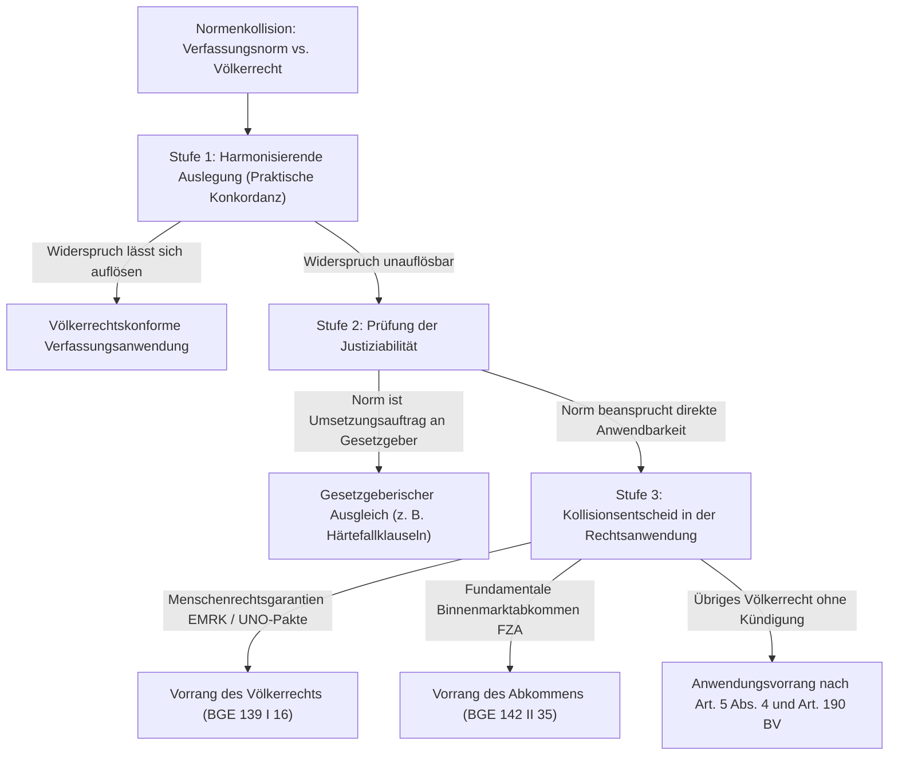

## Überblick {#ueberblick}

Das Verhältnis zwischen der schweizerischen Bundesverfassung und dem Völkerrecht bildet eine der zentralen verfassungsdogmatischen und rechtspolitischen Grundfragen des schweizerischen Bundesstaatsrechts. Während das Verhältnis zwischen Bundesrecht und kantonalem Recht durch den Grundsatz des Bundesrechtsvorrangs ([Art. 49 Abs. 1 BV](/themen/normenhierarchie/#vorrang-bundesrecht)) und das Verhältnis zwischen Bundesgesetz und Bundesverfassung durch das verfassungsrechtliche Anwendungsgebot ([Art. 190 BV](/kommentar/bv/art-190/#a-anwendungsgebot-für-bundesgesetze)) normiert sind, fehlt in der Bundesverfassung eine ausdrückliche Kollisionsregel für das Rangverhältnis zwischen Verfassungsrecht und nicht-zwingendem Völkerrecht.

Dieses normative Schweigen führte insbesondere infolge erfolgreicher Volksinitiativen, die zu völkerrechtlichen Verpflichtungen der Eidgenossenschaft in Widerspruch traten (namentlich Art. 123a BV über die lebenslange Verwahrung, Art. 72 Abs. 3 BV über das Minarettbauverbot, Art. 121 Abs. 3–6 BV über den automatischen Entzug des Aufenthaltsrechts bei Straftaten sowie Art. 121a BV über die Steuerung der Zuwanderung), zu intensiven Auseinandersetzungen. Klärungsversuche durch weitere Verfassungsinitiativen scheiterten an der Urne: Sowohl die Durchsetzungsinitiative (2016) als auch die Selbstbestimmungsinitiative (*Schweizer Recht statt fremde Richter*, 2018), welche einen generellen Vorrang des Verfassungsrechts vor nicht-zwingendem Völkerrecht statuieren wollte, wurden von Volk und Ständen deutlich verworfen.

Das Bundesgericht hat in einer differenzierten, über Jahrzehnte entwickelten Rechtsprechungslinie klare Massstäbe gesetzt. Seine Praxis folgt einem dreistufigen Prüfungs- und Lösungsmodell:

1. **Primat der völkerrechtskonformen Verfassungsauslegung**: Verfassungsbestimmungen werden nicht isoliert betrachtet, sondern im Sinne praktischer Konkordanz so interpretiert, dass ein Widerspruch zu bestehenden völkerrechtlichen Bindungen vermieden wird.
2. **Differenzierung nach Justiziabilität**: Verfassungsnormen mit offenem Wortlaut oder Programmnatur entfalten keine direkte gerichtliche Anwendbarkeit; sie richten sich als Umsetzungsauftrag an den Gesetzgeber, der die materiellen Grundsätze völkerrechtskonform zu harmonisieren hat.
3. **Rechtsanwendung bei unauflösbarem Konflikt**: Erweist sich ein Normenwiderspruch als unüberbrückbar, räumt das Bundesgericht den fundamentalen Menschenrechtsgarantien (insbesondere der EMRK) und internationalen Integrationsverträgen (namentlich dem Freizügigkeitsabkommen mit der EU) gestützt auf [Art. 190 BV](/kommentar/bv/art-190/#d-völkerrecht-und-bundesgesetz), [Art. 5 Abs. 4 BV](/kommentar/bv/art-005/#abs-4--beachtung-des-völkerrechts) und das völkerrechtliche Grundprinzip *pacta sunt servanda* den Vorrang vor entgegenstehendem nationalem Verfassungsrecht ein.

---

## Rechtsgrundlagen {#rechtsgrundlagen}

Die wesentlichen materiellen und prozeduralen Bestimmungen der Bundesverfassung für das Verhältnis zum Völkerrecht lauten wie folgt:













---

## Die verfassungsrechtliche Ausgangslage: Monismus und Stufenbau {#ausgangslage-monismus}

### Die monistische Tradition der Schweiz {#monistische-tradition}

Die schweizerische Rechtsordnung folgt traditionell dem **Monismus**: Völkerrecht und Landesrecht bilden keine zwei getrennten Rechtskreise, sondern eine funktionale Einheit. Völkerrechtliche Verträge werden mit ihrem Inkrafttreten für die Schweiz ohne separaten nationalen Transformationsakt (*Gesetz zur Transformation*) unmittelbar Bestandteil des innerstaatlichen Rechts ([BGE 142 II 35](https://entscheidsuche.ch/docs/CH_BGE/CH_BGE_004_BGE-142-II-35_2016.html#consideration_3.1) E. 3.1).

Voraussetzung für die unmittelbare Berufung vor Verwaltungsbehörden und Gerichten ist die **Justiziabilität** (*Self-Executing-Charakter*) der völkerrechtlichen Norm: Sie muss hinreichend bestimmt und inhaltlich so gefasst sein, dass sie als Basis für einen gerichtlichen Entscheid dienen kann und individuelle Rechte oder Pflichten der Rechtsunterworfenen begründet. Bestimmungen der EMRK oder des Freizügigkeitsabkommens (FZA) erfüllen diese Anforderung regelmässig.

### Das Anwendungsgebot von Art. 190 BV {#anwendungsgebot-art-190}

Nach [Art. 190 BV](/kommentar/bv/art-190/#a-anwendungsgebot-für-bundesgesetze) sind Bundesgesetze und das Völkerrecht für das Bundesgericht und die anderen rechtsanwendenden Behörden massgebend. Diese Bestimmung verpflichtet Gerichte und Behörden auf das überstaatliche Recht:

> «Diese Bestimmung gilt für das gesamte, für die Schweiz verbindliche Völkerrecht; dieses umfasst neben den Staatsverträgen auch das Völkergewohnheitsrecht, die allgemeinen Regeln des Völkerrechts und Beschlüsse von internationalen Organisationen, die für die Schweiz verbindlich sind»
>
> — [BGE 133 II 450](https://entscheidsuche.ch/docs/CH_BGE/CH_BGE_004_BGE-133-II-450_2007.html#consideration_6.1) E. 6.1

Während Bundesgesetze der Verfassungsgerichtsbarkeit weitgehend entzogen sind ([BGE 148 II 392](https://entscheidsuche.ch/docs/CH_BGE/CH_BGE_004_BGE-148-II-392_2022.html#consideration_4.2.1) E. 4.2.1), verpflichtet Art. 190 BV die Gerichte uneingeschränkt auf das Völkerrecht. Die Verfassung stellt das Völkerrecht damit auf dieselbe Stufe wie das Bundesgesetz, schweigt sich jedoch darüber aus, wie ein direkter Konflikt zwischen der Verfassung selbst und völkerrechtlichen Verträgen zu bewältigen ist.

---

## Der absolute Vorrang des zwingenden Völkerrechts (*ius cogens*) {#ius-cogens}

### Materielle Schranke jeder Verfassungsrevision {#schranke-verfassungsrevision}

Einen unbedingten Vorrang vor dem gesamten Landesrecht – einschliesslich aller Bestimmungen der Bundesverfassung – geniesst das **zwingende Völkerrecht** (*ius cogens*). Dies ist in der Verfassung selbst ausdrücklich statuiert:

* Volksinitiativen auf Teilrevision der Bundesverfassung, die zwingendes Völkerrecht verletzen, sind von der Bundesversammlung ganz oder teilweise für ungültig zu erklären (Art. 139 Abs. 3 BV).
* Eine Total- oder Teilrevision der Bundesverfassung darf die zwingenden Bestimmungen des Völkerrechts nicht verletzen (Art. 193 Abs. 4 und Art. 194 Abs. 2 BV).

Verletzt eine Initiative das ius cogens, darf sie Volk und Ständen überhaupt nicht zur Abstimmung vorgelegt werden.

### Begriffsbestimmung durch das Bundesgericht {#begriffsbestimmung-ius-cogens}

Das Bundesgericht definiert das zwingende Völkerrecht in ständiger Rechtsprechung restriktiv im Sinne des Art. 53 des Wiener Übereinkommens über das Recht der Verträge (VRK / WVK, SR 0.111):

> «Als ius cogens oder zwingendes Völkerrecht werden diejenigen Normen des Völkerrechts bezeichnet, von denen auch im gegenseitigen Einverständnis nicht abgewichen werden darf; entgegenstehende völkerrechtliche Verträge sind somit nichtig»
>
> — [BGE 133 II 450](https://entscheidsuche.ch/docs/CH_BGE/CH_BGE_004_BGE-133-II-450_2007.html#consideration_7.1) E. 7.1

Zum ius cogens zählen nach gefestigter Doktrin und Praxis ausschliesslich die fundamentalen Kerngehalte des internationalen Menschenrechtsschutzes und des humanitären Völkerrechts:
* das Verbot der Folter und der grausamen, unmenschlichen oder erniedrigenden Behandlung (Art. 3 EMRK, Art. 7 UNO-Pakt II);
* das Verbot von Sklaverei und Leibeigenschaft (Art. 4 Abs. 1 EMRK);
* das völkerrechtliche Non-Refoulement-Gebot bei drohender Folter oder Verfolgung (Art. 33 FK; [BGE 133 II 450](https://entscheidsuche.ch/docs/CH_BGE/CH_BGE_004_BGE-133-II-450_2007.html#consideration_7.3) E. 7.3);
* das Verbot des Völkermords und von Verbrechen gegen die Menschlichkeit;
* das Verbot von Angriffskriegen.

Die überwiegende Mehrheit internationaler Vertragsbestimmungen – einschliesslich weiter Teile der EMRK (z.B. Art. 8 EMRK) und des gesamten Freizügigkeitsrechts – stellt hingegen kein ius cogens dar, sondern gewöhnliches Vertragsrecht.

---

## Der dreistufige Lösungsansatz bei Konflikten mit Verfassungsrecht {#dreistufiger-loesungsansatz}

Tritt eine Verfassungsbestimmung zu einer nicht zwingenden völkerrechtlichen Verpflichtung in ein Spannungsverhältnis, wendet das Bundesgericht keine starre Hierarchie an, sondern geht methodisch in drei Stufen vor:

### Stufe 1: Grundsatz der völkerrechtskonformen Verfassungsauslegung {#stufe-1-auslegung}

Erster und oberster Grundsatz der Rechtsprechung ist das Gebot der **praktischen Konkordanz** und der **völkerrechtskonformen Auslegung**:

> «Die Verfassungsinterpretation ist einem möglichst schonenden Ausgleich der verschiedenen Verfassungs- und Grundrechtsinteressen verpflichtet; sie soll praktische Konkordanz schaffen»
>
> — [BGE 139 I 16](https://entscheidsuche.ch/docs/CH_BGE/CH_BGE_001_BGE-139-I-16_2013.html#consideration_4.2.2) E. 4.2.2

Das Bundesgericht geht davon aus, dass die Bundesverfassung eine Gesamtrechtsordnung bildet. Neue Verfassungsartikel, die durch Volksinitiativen eingeführt wurden, stehen nicht isoliert im Raum, sondern müssen im Lichte der bestehenden Grundrechte (Art. 7–36 BV), des Rechtsstaatsprinzips ([Art. 5 BV](/kommentar/bv/art-005/#abs-4--beachtung-des-völkerrechts)) und der völkerrechtlichen Bindungen interpretiert werden.

* **Beispiel Lebenslange Verwahrung (Art. 123a BV)**: Der Verfassungstext verlangt die Verwahrung nicht therapierbarer Sexual- und Gewaltstraftäter bis an ihr Lebensende ohne periodische Überprüfung. Das Bundesgericht legte Art. 123a BV und dessen gesetzliche Konkretisierung (Art. 64 Abs. 1bis StGB) konventionskonform im Lichte von Art. 3 und Art. 5 Ziff. 4 EMRK aus: Eine lebenslängliche Verwahrung darf nur angeordnet werden, wenn die verurteilte Person tatsächlich auf Lebzeiten jeder Behandlung unzugänglich ist ([BGE 140 IV 1](https://entscheidsuche.ch/docs/CH_BGE/CH_BGE_006_BGE-140-IV-1_2014.html#consideration_2.1) E. 2.1).

### Stufe 2: Prüfung der unmittelbaren Anwendbarkeit und Umsetzungsauftrag {#stufe-2-anwendbarkeit}

Lässt sich ein Spannungsverhältnis nicht schon durch Auslegung harmonisieren, prüft das Bundesgericht, ob die fragliche Verfassungsnorm unmittelbar von den Gerichten angewendet werden kann (*Self-Executing*) oder ob sie der Konkretisierung durch die Bundesversammlung bedarf.

Nach ständiger Rechtsprechung erfordern verfassungsrechtliche Eingriffe in grundlegende Rechtsstellungen zwingend eine präzise gesetzliche Grundlage (Legalitätsprinzip, Art. 5 Abs. 1 und Art. 36 Abs. 1 BV). Dies verneinte das Gericht sowohl bei der Ausschaffungsinitiative als auch bei der Masseneinwanderungsinitiative:

* **Ausschaffungsinitiative (Art. 121 Abs. 3–6 BV)**: Die Verfassungsbestimmung enthielt unbestimmte Rechtsbegriffe wie *Drogenhandel* oder *Sozialhilfemissbrauch*. Das Bundesgericht entschied in [BGE 139 I 16](https://entscheidsuche.ch/docs/CH_BGE/CH_BGE_001_BGE-139-I-16_2013.html#consideration_4.3.4) E. 4.3.4, dass Art. 121 Abs. 3 BV keinen justiziablen Ausweisungsautomatismus begründet, sondern einen Gesetzgebungsauftrag an das Parlament darstellt.
* **Masseneinwanderungsinitiative (Art. 121a BV)**: Die Verfassungsnorm statuiert die eigenständige Steuerung der Zuwanderung mittels Höchstzahlen und Kontingenten. Das Bundesgericht stellte klar, dass Art. 121a BV für den Richter im konkreten Einzelfall nicht direkt anwendbar ist, sondern erst der Ausführung durch Gesetzgebung und zwischenstaatliche Verhandlungen bedarf ([BGE 142 II 35](https://entscheidsuche.ch/docs/CH_BGE/CH_BGE_004_BGE-142-II-35_2016.html#consideration_3.1) E. 3.1).

### Stufe 3: Rechtsanwendung bei unauflösbarem Normenkonflikt {#stufe-3-normenkonflikt}

Besteht ein tatsächlicher, unüberbrückbarer Normenwiderspruch zwischen Verfassungsrecht und einer völkerrechtlichen Verpflichtung, greift der gerichtliche Kollisionsentscheid.

Das Bundesgericht leitet den Grundsatz des Völkerrechtsvorrangs direkt aus den übergeordneten völkerrechtlichen und verfassungsrechtlichen Prinzipien ab:

> «Besteht ein echter Normkonflikt zwischen Bundes- und Völkerrecht, so geht grundsätzlich die völkerrechtliche Verpflichtung der Schweiz vor […] Die Schweiz kann sich nicht auf ihr innerstaatliches Recht berufen, um die Nichterfüllung eines Vertrags zu rechtfertigen»
>
> — [BGE 139 I 16](https://entscheidsuche.ch/docs/CH_BGE/CH_BGE_001_BGE-139-I-16_2013.html#consideration_5.1) E. 5.1

> «In Übereinstimmung mit Art. 27 VRK gehen in der Rechtsanwendung völkerrechtliche Normen widersprechendem Landesrecht vor»
>
> — [BGE 142 II 35](https://entscheidsuche.ch/docs/CH_BGE/CH_BGE_004_BGE-142-II-35_2016.html#consideration_3.2) E. 3.2

Die dogmatische Begründung stützt sich auf folgende Pfeiler:
1. **Art. 26 und Art. 27 VRK (*pacta sunt servanda*)**: Das völkerrechtliche Grundprinzip verbietet es Staaten, sich auf Bestimmungen ihres internen Rechts – einschliesslich der Verfassung – zu berufen, um die Nichterfüllung völkerrechtlicher Verträge zu rechtfertigen ([BGE 122 II 485](https://entscheidsuche.ch/docs/CH_BGE/CH_BGE_004_BGE-122-II-485_1996-11-01.html#consideration_3.) E. 3a).
2. **Art. 5 Abs. 4 BV**: Das Verfassungsgebot verpflichtet alle Staatsorgane, einschliesslich der richterlichen Behörden, auf die Beachtung des Völkerrechts.
3. **Kündigungserfordernis**: Eine Verfassungsänderung bringt zwar den politischen Willen von Volk und Ständen zum Ausdruck, hebt aber bestehende internationale Verträge nicht ipso facto auf. Solange ein Vertrag von den zuständigen Bundesorganen (Bundesrat und Parlament) nicht völkerrechtskonform gekündigt worden ist, bleibt er innerstaatlich verbindlich.

---

## Die Praxis in Kernbereichen des Völkerrechts {#praxis-kernbereiche}

### Der Vorrang von Menschenrechtsgarantien (EMRK und UNO-Pakte) {#vorrang-menschenrechte}

Im Bereich des fundamentalen Menschenrechtsschutzes räumt das Bundesgericht dem Völkerrecht ausnahmslosen Vorrang vor entgegenstehendem Verfassungsrecht ein:

> «Das Bundesgericht ist auch bei Berücksichtigung von Art. 121 Abs. 3 BV hieran gebunden. Es hat die sich aus der Rechtsprechung des Europäischen Gerichtshofs für Menschenrechte ergebenden Vorgaben weiterhin umzusetzen»
>
> — [BGE 139 I 16](https://entscheidsuche.ch/docs/CH_BGE/CH_BGE_001_BGE-139-I-16_2013.html#consideration_5.3) E. 5.3

> «Diese Ausnahme gilt nicht, wenn menschenrechtliche Verpflichtungen der Schweiz in Frage stehen […] diesfalls geht die völkerrechtliche Norm der nationalen Regelung auch dann vor, wenn der schweizerische Gesetzgeber sie missachten will.»
>
> — [BGE 142 II 35](https://entscheidsuche.ch/docs/CH_BGE/CH_BGE_004_BGE-142-II-35_2016.html#consideration_3.2) E. 3.2

Die Richterinnen und Richter sind verfassungsrechtlich nicht befugt, eine Verfassungsbestimmung so anzuwenden, dass eine Konventionsverletzung im Sinne von Art. 8 EMRK (Recht auf Achtung des Familienlebens), Art. 3 EMRK (Folterverbot) oder Art. 6 EMRK (Fair Trial) bewirkt wird. Das Bundesgericht verweist hierbei auch auf den Überwachungs- und Vollzugsmechanismus des EGMR: Urteile des Strassburger Gerichtshofs verpflichten die Schweiz zur Beseitigung der Konventionsverletzung, weshalb eine konventionswidrige Rechtsanwendung von vornherein systemwidrig wäre ([BGE 139 I 16](https://entscheidsuche.ch/docs/CH_BGE/CH_BGE_001_BGE-139-I-16_2013.html#consideration_5.2.3) E. 5.2.3).

### Der Vorrang des Freizügigkeitsabkommens (FZA) {#vorrang-fza}

Ein analoger Grundsatz gilt für das bilaterale Abkommen über die Freizügigkeit mit der Europäischen Union:

> «Auch im Zusammenhang mit dem Freizügigkeitsabkommen hat das Bundesgericht entschieden, dass diesem gegenüber bewusst abweichendem Gesetzesrecht der Vorrang zukommt.»
>
> — [BGE 142 II 35](https://entscheidsuche.ch/docs/CH_BGE/CH_BGE_004_BGE-142-II-35_2016.html#consideration_3.2) E. 3.2

> «Im Falle eines tatsächlichen Normkonflikts aber ginge in der Rechtsanwendung gemäss den dargelegten Grundsätzen das FZA vor»
>
> — [BGE 142 II 35](https://entscheidsuche.ch/docs/CH_BGE/CH_BGE_004_BGE-142-II-35_2016.html#consideration_3.3) E. 3.3

Das Gericht begründet dies mit der Natur von Integrationsabkommen: Die sektorielle Teilhabe der Schweiz am europäischen Binnenmarkt setzt zwingend eine parallele und einheitliche Rechtslage voraus. Eine einseitige nationale Abweichung durch nachträgliches Verfassungsrecht (wie Art. 121a BV) würde die Funktionsfähigkeit des gemeinsamen Marktes untergraben.

### Ausschluss der Schubert-Praxis auf Verfassungsstufe {#ausschluss-schubert}

Die historische *Schubert-Praxis* ([BGE 99 Ib 39](https://entscheidsuche.ch/docs/CH_BGE/CH_BGE_003_BGE-99-IB-39_1973-03-02.html#consideration_3.) E. 3) besagte, dass ein Bundesgesetz ausnahmsweise einem älteren Staatsvertrag vorgeht, wenn der Bundesgesetzgeber einen Vertragsbruch bewusst in Kauf genommen hat.

Das Bundesgericht hat unmissverständlich klargestellt, dass die Schubert-Praxis auf das Verhältnis zwischen Verfassungsrecht und Völkerrecht **nicht anwendbar** ist:
1. Sie wurde für Konflikte zwischen formellen Bundesgesetzen und Staatsverträgen geschaffen, nicht für Verfassungsnormen.
2. Im Bereich der Menschenrechte ([BGE 125 II 417](https://entscheidsuche.ch/docs/CH_BGE/CH_BGE_004_BGE-125-II-417_1999-07-26.html#consideration_4.) E. 4d; [BGE 139 I 16](https://entscheidsuche.ch/docs/CH_BGE/CH_BGE_001_BGE-139-I-16_2013.html#consideration_5.1) E. 5.1) und des Binnenmarktrechts ([BGE 142 II 35](https://entscheidsuche.ch/docs/CH_BGE/CH_BGE_004_BGE-142-II-35_2016.html#consideration_3.2) E. 3.2) ist die Schubert-Ausnahme gänzlich ausgeschlossen.
3. Die Selbstbestimmungsinitiative, welche den Vorrang der Bundesverfassung vor dem Völkerrecht als Grundsatz und eine generelle Pflicht zur Vertragskündigung festschreiben wollte, wurde 2018 abgelehnt, womit der Verfassungsgeber die Rechtsprechung des Bundesgerichts demokratisch bestätigt hat.

---

## Die Vermittlungsrolle des Gesetzgebers: Härtefallklauseln {#gesetzgeber-haertefallklauseln}

Da das Bundesgericht weder den Verfassungsauftrag ignorieren noch das Völkerrecht verletzen darf, fällt dem Gesetzgeber die entscheidende Rolle zu: Er muss den Verfassungsauftrag so umsetzen, dass die völkerrechtlichen Mindeststandards gewahrt bleiben.

Das massgebliche Instrument hierfür bilden gesetzliche **Härtefallklauseln**.

### Die Umsetzung der Ausschaffungsinitiative in Art. 66a StGB {#umsetzung-art-66a-stgb}

Bei der Umsetzung von Art. 121 Abs. 3–6 BV schuf die Bundesversammlung in Art. 66a Abs. 1 StGB zwar einen Katalog von Delikten, die zwingend zur Ausweisung führen, fügte in Art. 66a Abs. 2 StGB jedoch eine Härtefallregelung ein.

Das Bundesgericht überprüfte diese Regelung und hielt fest:

> «Von der Anordnung der Landesverweisung kann nur "ausnahmsweise" unter den kumulativen Voraussetzungen abgesehen werden, dass sie (1.) einen schweren persönlichen Härtefall bewirken würde und (2.) die öffentlichen Interessen an der Landesverweisung gegenüber den privaten Interessen des Ausländers am Verbleib in der Schweiz nicht überwiegen.»
>
> — [BGE 146 IV 105](https://entscheidsuche.ch/docs/CH_BGE/CH_BGE_006_BGE-146-IV-105_2020.html#consideration_3.4.2) E. 3.4.2

Mit Art. 66a Abs. 2 StGB hat der Gesetzgeber den verfassungsrechtlichen Ausweisungsauftrag harmonisierend in Übereinstimmung mit dem völkerrechtlichen Verhältnismässigkeitsgebot nach Art. 8 EMRK gebracht. Bei der Interessenabwägung ist die Intensität der familiären Bindungen, die Dauer des Aufenthalts sowie der Grad der Integration im Lichte der Strassburger Rechtsprechung umfassend zu würdigen ([BGE 146 IV 105](https://entscheidsuche.ch/docs/CH_BGE/CH_BGE_006_BGE-146-IV-105_2020.html#consideration_4.3) E. 4.3).

---

## Würdigung und Entwicklung {#wuerdigung}

Die Praxis des Bundesgerichts zum Verhältnis von Verfassungs- und Völkerrecht zeichnet sich durch Pragmatismus und Treue zur völkerrechtlichen Rechtsgemeinschaft aus. Anstatt formelle Kompetenzkonflikte zwischen Volkssouveränität und übergeordnetem Recht eskalieren zu lassen, löst das Gericht Spannungsverhältnisse über methodische Ausgleichsinstrumente:

1. **Erhalt der völkerrechtlichen Vertragstreue**: Das Gericht verhindert, dass die Eidgenossenschaft durch innenpolitische Volksabstimmungen sehenden Auges vertragsbrüchig wird, solange die Bundesorgane nicht formell den Weg des Vertragsrücktritts beschreiten.
2. **Schutz der Gewaltenteilung**: Das Bundesgericht maasst sich keine politische Verfassungspolitik an, sondern verweist unausgegorene Verfassungsinitiativen zurück an das Parlament zur sachgerechten Gesetzgebung.
3. **Bestätigung durch Volk und Stände**: Die Rechtsprechungslinie des Bundesgerichts, wonach Völkerrecht und Verfassung einander nicht feindlich gegenüberstehen, sondern harmonisch abzustimmen sind, wurde an der Urne mehrfach demokratisch legitimiert (Verwerfung der Durchsetzungsinitiative 2016 und der Selbstbestimmungsinitiative 2018).

---

## Praxishinweise {#praxishinweise}

Für die juristische Argumentation in Prozessen, die das Spannungsfeld zwischen Verfassungsnormen und völkerrechtlichen Verträgen berühren, gelten folgende Grundregeln:

* **Völkerrechtskonforme Auslegung als primäre Rüge**: Gerichte sind stets gehalten, Verfassungsnormen und Ausführungsgesetze im Einklang mit völkerrechtlichen Garantien auszulegen. Anträge sollten daher immer aufzeigen, wie die nationale Norm rechtskonform so verstanden werden kann, dass kein völkerrechtlicher Verstoss vorliegt.
* **Keine Verfassungsdurchsetzung gegen die EMRK**: Gegenüber kantonalen Ausweisungs- oder Fernhaltemassnahmen, die sich schematisch auf Art. 121 Abs. 3 BV berufen, ist stets die Einzelfallprüfung nach Art. 8 EMRK (Schutz des Privat- und Familienlebens) einzufordern. Eine automatische Ausweisung ohne Prüfung der Verhältnismässigkeit ist unzulässig ([BGE 139 I 16](https://entscheidsuche.ch/docs/CH_BGE/CH_BGE_001_BGE-139-I-16_2013.html#consideration_5.3) E. 5.3).
* **Auslösen der gesetzlichen Härtefallklauseln**: In Straf- und Migrationsverfahren (z.B. Art. 66a Abs. 2 StGB oder Art. 96 AIG) muss der Sachverhalt detailliert entlang der Strassburger Integrationskriterien dargelegt werden (Aufenthaltsdauer, Geburt in der Schweiz, familiäre Beziehungen, wirtschaftliche Unabhängigkeit), um den Richterinnen und Richtern das Absehen von der Massnahme konventionskonform zu ermöglichen.
* **Berufung auf den Vorrang des FZA**: Bei Unionsbürgern geht das Freizügigkeitsabkommen nationalen Regelungen und Einschränkungen grundsätzlich vor ([BGE 142 II 35](https://entscheidsuche.ch/docs/CH_BGE/CH_BGE_004_BGE-142-II-35_2016.html#consideration_3.3) E. 3.3). Nationale Schutzklauseln oder Verfassungsaufträge vermögen die freizügigkeitsrechtlichen Ansprüche nicht auszuhebeln.

---

## Leitentscheide {#leitentscheide}

| Entscheid | Gegenstand | Kernaussage zum Verhältnis Verfassung / Völkerrecht |
|---|---|---|
| [BGE 139 I 16](https://entscheidsuche.ch/docs/CH_BGE/CH_BGE_001_BGE-139-I-16_2013.html#consideration_5.1) | Ausschaffungsinitiative (Art. 121 Abs. 3 BV) vs. Art. 8 EMRK | Art. 121 Abs. 3 BV ist mangels Bestimmtheit nicht direkt anwendbar. Menschenrechtsgarantien der EMRK gehen im Konfliktfall entgegenstehendem Verfassungsrecht vor. |
| [BGE 142 II 35](https://entscheidsuche.ch/docs/CH_BGE/CH_BGE_004_BGE-142-II-35_2016.html#consideration_3.2) | Masseneinwanderungsinitiative (Art. 121a BV) vs. Freizügigkeitsabkommen (FZA) | Art. 121a BV ist nicht direkt anwendbar. Das FZA geht nationalem Landes- und Verfassungsrecht vor; die Schubert-Praxis ist im Binnenmarktrecht ausgeschlossen. |
| [BGE 133 II 450](https://entscheidsuche.ch/docs/CH_BGE/CH_BGE_004_BGE-133-II-450_2007.html#consideration_7.1) | Sanktionen des UNO-Sicherheitsrats (Nada) vs. Grundrechte | Zwingendes Völkerrecht (*ius cogens*) setzt sich bedingungslos gegen jedes Landesrecht durch; Definition und Schranken des ius cogens. |
| [BGE 125 II 417](https://entscheidsuche.ch/docs/CH_BGE/CH_BGE_004_BGE-125-II-417_1999-07-26.html#consideration_4.) | PKK-Propaganda / Beschlagnahme vs. EMRK | Leitentscheid zur PKK-Praxis: Menschenrechtsverträge gehen entgegenstehendem Landesrecht ausnahmslos vor; Ausschluss der Schubert-Praxis bei Grundrechten. |
| [BGE 140 IV 1](https://entscheidsuche.ch/docs/CH_BGE/CH_BGE_006_BGE-140-IV-1_2014.html#consideration_2.1) | Verwahrungsinitiative (Art. 123a BV) vs. Art. 3 und 5 EMRK | Konventionskonforme Auslegung der Verfassungsnorm und von Art. 64 Abs. 1bis StGB: Lebenslange Verwahrung erfordert dauerhafte Unbehandelbarkeit nach wissenschaftlichem Stand. |
| [BGE 146 IV 105](https://entscheidsuche.ch/docs/CH_BGE/CH_BGE_006_BGE-146-IV-105_2020.html#consideration_3.4.2) | Obligatorische Landesverweisung (Art. 66a StGB) und Härtefallklausel | Art. 66a Abs. 2 StGB dient dem Ausgleich zwischen Art. 121 Abs. 3 BV und Art. 8 EMRK. Auslegung der Härtefallkriterien im Lichte der EGMR-Rechtsprechung. |
| [BGE 122 II 485](https://entscheidsuche.ch/docs/CH_BGE/CH_BGE_004_BGE-122-II-485_1996-11-01.html#consideration_3.) | Auslieferung / Monismus / Art. 26 und 27 VRK | Monistisches System der Schweiz: Staaten dürfen sich nicht auf innerstaatliches Recht berufen, um völkerrechtliche Verträge nicht zu erfüllen (*pacta sunt servanda*). |
| [BGE 148 II 392](https://entscheidsuche.ch/docs/CH_BGE/CH_BGE_004_BGE-148-II-392_2022.html#consideration_4.2.1) | Netzsperren / Geldspielgesetz / Art. 190 BV | Massgeblichkeit von Bundesgesetzen und Völkerrecht nach Art. 190 BV; Anwendungsgebot versus richterliche Normenkontrolle. |
| [BGE 99 Ib 39](https://entscheidsuche.ch/docs/CH_BGE/CH_BGE_003_BGE-99-IB-39_1973-03-02.html#consideration_3.) | Lex von Moos / Staatsvertrag von 1875 (Schubert) | Historische Schubert-Praxis zu Bundesgesetzen; gilt weder für Menschenrechte noch im Verhältnis zu Verfassungsbestimmungen. |
