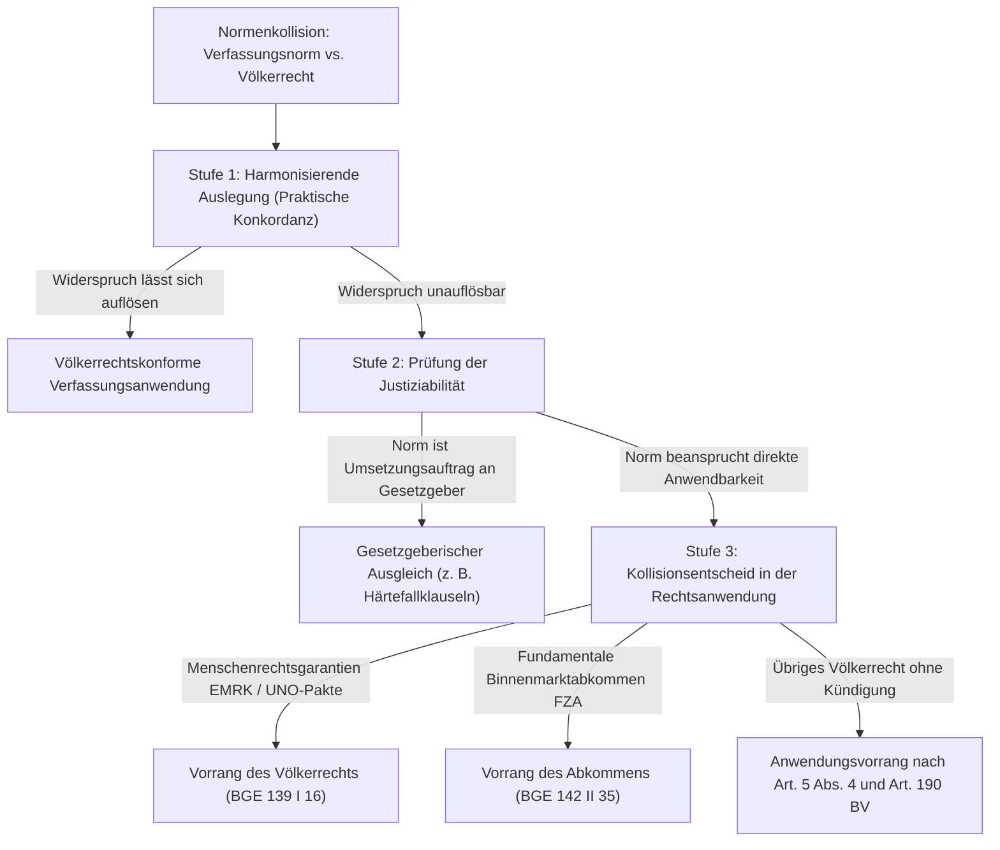

## Überblick {#ueberblick}

Das Verhältnis zwischen dem Völkerrecht und dem Landesrecht – sowohl auf Stufe der Bundesverfassung als auch auf Stufe der Bundesgesetze – bildet eine der zentralen verfassungsdogmatischen und rechtspolitischen Grundfragen des schweizerischen Bundesstaatsrechts. Während das Verhältnis zwischen Bundesrecht und kantonalem Recht durch den Grundsatz des Bundesrechtsvorrangs ([Art. 49 Abs. 1 BV](/themen/normenhierarchie/#vorrang-bundesrecht)) und das Verhältnis zwischen Bundesgesetz und Bundesverfassung durch das verfassungsrechtliche Anwendungsgebot ([Art. 190 BV](/kommentar/bv/art-190/#a-anwendungsgebot-für-bundesgesetze)) normiert sind, enthält die Bundesverfassung neben dem allgemeinen Beachtungsgebot von [Art. 5 Abs. 4 BV](/kommentar/bv/art-005/#abs-4--beachtung-des-völkerrechts) keine ausdrückliche Kollisionsregel für Konflikte zwischen Landesrecht und nicht-zwingendem Völkerrecht.

Dieses normative Schweigen führte zunächst infolge erfolgreicher Volksinitiativen, die zu völkerrechtlichen Verpflichtungen der Eidgenossenschaft in Widerspruch traten (namentlich Art. 123a BV über die lebenslange Verwahrung, Art. 72 Abs. 3 BV über das Minarettbauverbot, Art. 121 Abs. 3–6 BV über den automatischen Entzug des Aufenthaltsrechts bei Straftaten sowie Art. 121a BV über die Steuerung der Zuwanderung), zu intensiven Auseinandersetzungen. Versuche, einen generellen Vorrang des Landesrechts auf Verfassungsstufe zu erzwingen, scheiterten an der Urne: Sowohl die Durchsetzungsinitiative (2016) als auch die Selbstbestimmungsinitiative (*Schweizer Recht statt fremde Richter*, 2018) wurden von Volk und Ständen verworfen.

Gegenwärtig ist das Verhältnis von Völkerrecht und Landesrecht erneut Gegenstand einer **kontroversen gerichtlichen und politischen Debatte**. Im Zentrum steht die Frage, ob und inwieweit die Bundesversammlung mit einem Bundesgesetz bewusst von Binnenmarktabkommen mit der Europäischen Union abweichen kann (*Schubert*-Praxis, [BGE 99 Ib 39](https://entscheidsuche.ch/docs/CH_BGE/CH_BGE_003_BGE-99-IB-39_1973-03-02.html#consideration_3.) E. 3–4). Während die II. öffentlich-rechtliche Abteilung des Bundesgerichts die *Schubert*-Ausnahme im Anwendungsbereich des Freizügigkeitsabkommens (FZA) für unanwendbar erklärte ([BGE 142 II 35](https://entscheidsuche.ch/docs/CH_BGE/CH_BGE_004_BGE-142-II-35_2016.html#consideration_3.2) E. 3.2; [BGE 148 II 169](https://entscheidsuche.ch/docs/CH_BGE/CH_BGE_004_BGE-148-II-169_2022.html#consideration_5.2) E. 5.2), zog die IV. öffentlich-rechtliche Abteilung sie Ende 2024 im FZA-Kontext weiterhin als Prüfungsmassstab heran ([BGE 151 V 198](https://entscheidsuche.ch/docs/CH_BGE/CH_BGE_007_BGE-151-V-198_2025.html#consideration_8.2.3.1.3) E. 8.2.3.1.3), woraufhin das Verwaltungsgericht des Kantons Bern im September 2026 einem bewusst abweichenden Bundesgesetz (Art. 37 Abs. 1 KVG) den Vorrang vor dem FZA einräumte ([Urteil 100.2024.269U](https://entscheidsuche.ch/docs/BE_Verwaltungsgericht/BE_VG_001_100-2024-269_2026-09-07.pdf) E. 4.8). Parallel dazu hat die Staatspolitische Kommission des Ständerates (SPK-S) im Oktober 2026 mit Blick auf das Vertragspaket *Bilaterale III* die Vernehmlassung zu einer Vorlage eröffnet, welche die *Schubert*-Praxis auf Verfassungs- oder Gesetzesstufe kodifizieren soll (Pa. Iv. 26.425; vgl. unten [Aktuelle Kontroverse](#aktuelle-kontroverse)).

Für Kollisionen zwischen Verfassungsnormen und Völkerrecht folgt die bundesgerichtliche Rechtsprechung einem dreistufigen Prüfungs- und Lösungsmodell:

1. **Primat der völkerrechtskonformen Verfassungsauslegung**: Verfassungsbestimmungen werden nicht isoliert betrachtet, sondern im Sinne praktischer Konkordanz so interpretiert, dass ein Widerspruch zu bestehenden völkerrechtlichen Bindungen vermieden wird.
2. **Differenzierung nach Justiziabilität**: Verfassungsnormen mit offenem Wortlaut oder Programmnatur entfalten keine direkte gerichtliche Anwendbarkeit; sie richten sich als Umsetzungsauftrag an den Gesetzgeber, der die materiellen Grundsätze völkerrechtskonform zu harmonisieren hat.
3. **Rechtsanwendung bei unauflösbarem Konflikt**: Erweist sich ein Normenwiderspruch als unüberbrückbar, räumt das Bundesgericht den fundamentalen Menschenrechtsgarantien (insbesondere der EMRK, sog. *PKK*-Praxis) gestützt auf [Art. 190 BV](/kommentar/bv/art-190/#d-völkerrecht-und-bundesgesetz), [Art. 5 Abs. 4 BV](/kommentar/bv/art-005/#abs-4--beachtung-des-völkerrechts) und das Prinzip *pacta sunt servanda* den Vorrang ein; beim Freizügigkeitsabkommen hat die II. öffentlich-rechtliche Abteilung ebenfalls den Vorrang statuiert ([BGE 142 II 35](https://entscheidsuche.ch/docs/CH_BGE/CH_BGE_004_BGE-142-II-35_2016.html#consideration_3.2) E. 3.2), wobei umstritten ist, ob diese Erwägung für spätere Bundesgesetze tragend war oder ein *obiter dictum* darstellt.

---

## Rechtsgrundlagen {#rechtsgrundlagen}

Die wesentlichen materiellen und prozeduralen Bestimmungen der Bundesverfassung für das Verhältnis zum Völkerrecht lauten wie folgt:













---

## Die verfassungsrechtliche Ausgangslage: Monismus und Stufenbau {#ausgangslage-monismus}

### Die monistische Tradition der Schweiz {#monistische-tradition}

Die schweizerische Rechtsordnung folgt traditionell dem **Monismus**: Völkerrecht und Landesrecht bilden keine zwei getrennten Rechtskreise, sondern eine funktionale Einheit. Völkerrechtliche Verträge werden mit ihrem Inkrafttreten für die Schweiz ohne separaten nationalen Transformationsakt (*Gesetz zur Transformation*) unmittelbar Bestandteil des innerstaatlichen Rechts ([BGE 142 II 35](https://entscheidsuche.ch/docs/CH_BGE/CH_BGE_004_BGE-142-II-35_2016.html#consideration_3.1) E. 3.1).

Voraussetzung für die unmittelbare Berufung vor Verwaltungsbehörden und Gerichten ist die **Justiziabilität** (*Self-Executing-Charakter*) der völkerrechtlichen Norm: Sie muss hinreichend bestimmt und inhaltlich so gefasst sein, dass sie als Basis für einen gerichtlichen Entscheid dienen kann und individuelle Rechte oder Pflichten der Rechtsunterworfenen begründet. Bestimmungen der EMRK oder des Freizügigkeitsabkommens (FZA) erfüllen diese Anforderung regelmässig.

### Das Anwendungsgebot von Art. 190 BV {#anwendungsgebot-art-190}

Nach [Art. 190 BV](/kommentar/bv/art-190/#a-anwendungsgebot-für-bundesgesetze) sind Bundesgesetze und das Völkerrecht für das Bundesgericht und die anderen rechtsanwendenden Behörden massgebend. Diese Bestimmung verpflichtet Gerichte und Behörden auf das überstaatliche Recht:

> «Diese Bestimmung gilt für das gesamte, für die Schweiz verbindliche Völkerrecht; dieses umfasst neben den Staatsverträgen auch das Völkergewohnheitsrecht, die allgemeinen Regeln des Völkerrechts und Beschlüsse von internationalen Organisationen, die für die Schweiz verbindlich sind»
>
> — [BGE 133 II 450](https://entscheidsuche.ch/docs/CH_BGE/CH_BGE_004_BGE-133-II-450_2007.html#consideration_6.1) E. 6.1

Während Bundesgesetze der Verfassungsgerichtsbarkeit weitgehend entzogen sind ([BGE 148 II 392](https://entscheidsuche.ch/docs/CH_BGE/CH_BGE_004_BGE-148-II-392_2022.html#consideration_4.2.1) E. 4.2.1), verpflichtet Art. 190 BV die Gerichte uneingeschränkt auf das Völkerrecht. Die Verfassung stellt das Völkerrecht damit auf dieselbe Stufe wie das Bundesgesetz, schweigt sich jedoch darüber aus, wie ein direkter Konflikt zwischen der Verfassung selbst und völkerrechtlichen Verträgen zu bewältigen ist.

---

## Der absolute Vorrang des zwingenden Völkerrechts (*ius cogens*) {#ius-cogens}

### Materielle Schranke jeder Verfassungsrevision {#schranke-verfassungsrevision}

Einen unbedingten Vorrang vor dem gesamten Landesrecht – einschliesslich aller Bestimmungen der Bundesverfassung – geniesst das **zwingende Völkerrecht** (*ius cogens*). Dies ist in der Verfassung selbst ausdrücklich statuiert:

* Volksinitiativen auf Teilrevision der Bundesverfassung, die zwingendes Völkerrecht verletzen, sind von der Bundesversammlung ganz oder teilweise für ungültig zu erklären (Art. 139 Abs. 3 BV).
* Eine Total- oder Teilrevision der Bundesverfassung darf die zwingenden Bestimmungen des Völkerrechts nicht verletzen (Art. 193 Abs. 4 und Art. 194 Abs. 2 BV).

Verletzt eine Initiative das ius cogens, darf sie Volk und Ständen überhaupt nicht zur Abstimmung vorgelegt werden.

### Begriffsbestimmung durch das Bundesgericht {#begriffsbestimmung-ius-cogens}

Das Bundesgericht definiert das zwingende Völkerrecht in ständiger Rechtsprechung restriktiv im Sinne des Art. 53 des Wiener Übereinkommens über das Recht der Verträge (VRK / WVK, SR 0.111):

> «Als ius cogens oder zwingendes Völkerrecht werden diejenigen Normen des Völkerrechts bezeichnet, von denen auch im gegenseitigen Einverständnis nicht abgewichen werden darf; entgegenstehende völkerrechtliche Verträge sind somit nichtig»
>
> — [BGE 133 II 450](https://entscheidsuche.ch/docs/CH_BGE/CH_BGE_004_BGE-133-II-450_2007.html#consideration_7.1) E. 7.1

Zum ius cogens zählen nach gefestigter Doktrin und Praxis ausschliesslich die fundamentalen Kerngehalte des internationalen Menschenrechtsschutzes und des humanitären Völkerrechts:
* das Verbot der Folter und der grausamen, unmenschlichen oder erniedrigenden Behandlung (Art. 3 EMRK, Art. 7 UNO-Pakt II);
* das Verbot von Sklaverei und Leibeigenschaft (Art. 4 Abs. 1 EMRK);
* das völkerrechtliche Non-Refoulement-Gebot bei drohender Folter oder Verfolgung (Art. 33 FK; [BGE 133 II 450](https://entscheidsuche.ch/docs/CH_BGE/CH_BGE_004_BGE-133-II-450_2007.html#consideration_7.3) E. 7.3);
* das Verbot des Völkermords und von Verbrechen gegen die Menschlichkeit;
* das Verbot von Angriffskriegen.

Die überwiegende Mehrheit internationaler Vertragsbestimmungen – einschliesslich weiter Teile der EMRK (z.B. Art. 8 EMRK) und des gesamten Freizügigkeitsrechts – stellt hingegen kein ius cogens dar, sondern gewöhnliches Vertragsrecht.

---

## Der dreistufige Lösungsansatz bei Konflikten mit Verfassungsrecht {#dreistufiger-loesungsansatz}

Tritt eine Verfassungsbestimmung zu einer nicht zwingenden völkerrechtlichen Verpflichtung in ein Spannungsverhältnis, wendet das Bundesgericht keine starre Hierarchie an, sondern geht methodisch in drei Stufen vor:

### Stufe 1: Grundsatz der völkerrechtskonformen Verfassungsauslegung {#stufe-1-auslegung}

Erster und oberster Grundsatz der Rechtsprechung ist das Gebot der **praktischen Konkordanz** und der **völkerrechtskonformen Auslegung**:

> «Die Verfassungsinterpretation ist einem möglichst schonenden Ausgleich der verschiedenen Verfassungs- und Grundrechtsinteressen verpflichtet; sie soll praktische Konkordanz schaffen»
>
> — [BGE 139 I 16](https://entscheidsuche.ch/docs/CH_BGE/CH_BGE_001_BGE-139-I-16_2013.html#consideration_4.2.2) E. 4.2.2

Das Bundesgericht geht davon aus, dass die Bundesverfassung eine Gesamtrechtsordnung bildet. Neue Verfassungsartikel, die durch Volksinitiativen eingeführt wurden, stehen nicht isoliert im Raum, sondern müssen im Lichte der bestehenden Grundrechte (Art. 7–36 BV), des Rechtsstaatsprinzips ([Art. 5 BV](/kommentar/bv/art-005/#abs-4--beachtung-des-völkerrechts)) und der völkerrechtlichen Bindungen interpretiert werden.

* **Beispiel Lebenslange Verwahrung (Art. 123a BV)**: Der Verfassungstext verlangt die Verwahrung nicht therapierbarer Sexual- und Gewaltstraftäter bis an ihr Lebensende ohne periodische Überprüfung. Das Bundesgericht legte Art. 123a BV und dessen gesetzliche Konkretisierung (Art. 64 Abs. 1bis StGB) konventionskonform im Lichte von Art. 3 und Art. 5 Ziff. 4 EMRK aus: Eine lebenslängliche Verwahrung darf nur angeordnet werden, wenn die verurteilte Person tatsächlich auf Lebzeiten jeder Behandlung unzugänglich ist ([BGE 140 IV 1](https://entscheidsuche.ch/docs/CH_BGE/CH_BGE_006_BGE-140-IV-1_2014.html#consideration_2.1) E. 2.1).

### Stufe 2: Prüfung der unmittelbaren Anwendbarkeit und Umsetzungsauftrag {#stufe-2-anwendbarkeit}

Lässt sich ein Spannungsverhältnis nicht schon durch Auslegung harmonisieren, prüft das Bundesgericht, ob die fragliche Verfassungsnorm unmittelbar von den Gerichten angewendet werden kann (*Self-Executing*) oder ob sie der Konkretisierung durch die Bundesversammlung bedarf.

Nach ständiger Rechtsprechung erfordern verfassungsrechtliche Eingriffe in grundlegende Rechtsstellungen zwingend eine präzise gesetzliche Grundlage (Legalitätsprinzip, Art. 5 Abs. 1 und Art. 36 Abs. 1 BV). Dies verneinte das Gericht sowohl bei der Ausschaffungsinitiative als auch bei der Masseneinwanderungsinitiative:

* **Ausschaffungsinitiative (Art. 121 Abs. 3–6 BV)**: Die Verfassungsbestimmung enthielt unbestimmte Rechtsbegriffe wie *Drogenhandel* oder *Sozialhilfemissbrauch*. Das Bundesgericht entschied in [BGE 139 I 16](https://entscheidsuche.ch/docs/CH_BGE/CH_BGE_001_BGE-139-I-16_2013.html#consideration_4.3.4) E. 4.3.4, dass Art. 121 Abs. 3 BV keinen justiziablen Ausweisungsautomatismus begründet, sondern einen Gesetzgebungsauftrag an das Parlament darstellt.
* **Masseneinwanderungsinitiative (Art. 121a BV)**: Die Verfassungsnorm statuiert die eigenständige Steuerung der Zuwanderung mittels Höchstzahlen und Kontingenten. Das Bundesgericht stellte klar, dass Art. 121a BV für den Richter im konkreten Einzelfall nicht direkt anwendbar ist, sondern erst der Ausführung durch Gesetzgebung und zwischenstaatliche Verhandlungen bedarf ([BGE 142 II 35](https://entscheidsuche.ch/docs/CH_BGE/CH_BGE_004_BGE-142-II-35_2016.html#consideration_3.1) E. 3.1).

### Stufe 3: Rechtsanwendung bei unauflösbarem Normenkonflikt {#stufe-3-normenkonflikt}

Besteht ein tatsächlicher, unüberbrückbarer Normenwiderspruch zwischen Verfassungsrecht und einer völkerrechtlichen Verpflichtung, greift der gerichtliche Kollisionsentscheid.

Das Bundesgericht leitet den Grundsatz des Völkerrechtsvorrangs direkt aus den übergeordneten völkerrechtlichen und verfassungsrechtlichen Prinzipien ab:

> «Besteht ein echter Normkonflikt zwischen Bundes- und Völkerrecht, so geht grundsätzlich die völkerrechtliche Verpflichtung der Schweiz vor […] Die Schweiz kann sich nicht auf ihr innerstaatliches Recht berufen, um die Nichterfüllung eines Vertrags zu rechtfertigen»
>
> — [BGE 139 I 16](https://entscheidsuche.ch/docs/CH_BGE/CH_BGE_001_BGE-139-I-16_2013.html#consideration_5.1) E. 5.1

> «In Übereinstimmung mit Art. 27 VRK gehen in der Rechtsanwendung völkerrechtliche Normen widersprechendem Landesrecht vor»
>
> — [BGE 142 II 35](https://entscheidsuche.ch/docs/CH_BGE/CH_BGE_004_BGE-142-II-35_2016.html#consideration_3.2) E. 3.2

Die dogmatische Begründung stützt sich auf folgende Pfeiler:
1. **Art. 26 und Art. 27 VRK (*pacta sunt servanda*)**: Das völkerrechtliche Grundprinzip verbietet es Staaten, sich auf Bestimmungen ihres internen Rechts – einschliesslich der Verfassung – zu berufen, um die Nichterfüllung völkerrechtlicher Verträge zu rechtfertigen ([BGE 122 II 485](https://entscheidsuche.ch/docs/CH_BGE/CH_BGE_004_BGE-122-II-485_1996-11-01.html#consideration_3.) E. 3a).
2. **Art. 5 Abs. 4 BV**: Das Verfassungsgebot verpflichtet alle Staatsorgane, einschliesslich der richterlichen Behörden, auf die Beachtung des Völkerrechts.
3. **Kündigungserfordernis**: Eine Verfassungsänderung bringt zwar den politischen Willen von Volk und Ständen zum Ausdruck, hebt aber bestehende internationale Verträge nicht ipso facto auf. Solange ein Vertrag von den zuständigen Bundesorganen (Bundesrat und Parlament) nicht völkerrechtskonform gekündigt worden ist, bleibt er innerstaatlich verbindlich.

---

## Die Praxis in Kernbereichen des Völkerrechts {#praxis-kernbereiche}

### Der Vorrang von Menschenrechtsgarantien (EMRK und UNO-Pakte) {#vorrang-menschenrechte}

Im Bereich des fundamentalen Menschenrechtsschutzes räumt das Bundesgericht dem Völkerrecht ausnahmslosen Vorrang vor entgegenstehendem Verfassungsrecht ein:

> «Das Bundesgericht ist auch bei Berücksichtigung von Art. 121 Abs. 3 BV hieran gebunden. Es hat die sich aus der Rechtsprechung des Europäischen Gerichtshofs für Menschenrechte ergebenden Vorgaben weiterhin umzusetzen»
>
> — [BGE 139 I 16](https://entscheidsuche.ch/docs/CH_BGE/CH_BGE_001_BGE-139-I-16_2013.html#consideration_5.3) E. 5.3

> «Diese Ausnahme gilt nicht, wenn menschenrechtliche Verpflichtungen der Schweiz in Frage stehen […] diesfalls geht die völkerrechtliche Norm der nationalen Regelung auch dann vor, wenn der schweizerische Gesetzgeber sie missachten will.»
>
> — [BGE 142 II 35](https://entscheidsuche.ch/docs/CH_BGE/CH_BGE_004_BGE-142-II-35_2016.html#consideration_3.2) E. 3.2

Die Richterinnen und Richter sind verfassungsrechtlich nicht befugt, eine Verfassungsbestimmung so anzuwenden, dass eine Konventionsverletzung im Sinne von Art. 8 EMRK (Recht auf Achtung des Familienlebens), Art. 3 EMRK (Folterverbot) oder Art. 6 EMRK (Fair Trial) bewirkt wird. Das Bundesgericht verweist hierbei auch auf den Überwachungs- und Vollzugsmechanismus des EGMR: Urteile des Strassburger Gerichtshofs verpflichten die Schweiz zur Beseitigung der Konventionsverletzung, weshalb eine konventionswidrige Rechtsanwendung von vornherein systemwidrig wäre ([BGE 139 I 16](https://entscheidsuche.ch/docs/CH_BGE/CH_BGE_001_BGE-139-I-16_2013.html#consideration_5.2.3) E. 5.2.3).

### Der Vorrang des Freizügigkeitsabkommens (FZA) {#vorrang-fza}

Einen analogen Grundsatz formulierte die II. öffentlich-rechtliche Abteilung des Bundesgerichts für das bilaterale Abkommen über die Freizügigkeit mit der Europäischen Union:

> «Auch im Zusammenhang mit dem Freizügigkeitsabkommen hat das Bundesgericht entschieden, dass diesem gegenüber bewusst abweichendem Gesetzesrecht der Vorrang zukommt.»
>
> — [BGE 142 II 35](https://entscheidsuche.ch/docs/CH_BGE/CH_BGE_004_BGE-142-II-35_2016.html#consideration_3.2) E. 3.2

> «Im Falle eines tatsächlichen Normkonflikts aber ginge in der Rechtsanwendung gemäss den dargelegten Grundsätzen das FZA vor»
>
> — [BGE 142 II 35](https://entscheidsuche.ch/docs/CH_BGE/CH_BGE_004_BGE-142-II-35_2016.html#consideration_3.3) E. 3.3

Die Abteilung begründete dies mit der Natur von Integrationsabkommen: Die sektorielle Teilhabe der Schweiz am europäischen Binnenmarkt setze eine Angleichung der Rechtsordnung und eine einheitliche Auslegung des übernommenen *Acquis communautaire* voraus. Allerdings entschied das Gericht den konkreten Fall nicht über einen Kollisionsentscheid, sondern verneinte wegen der fehlenden direkten Anwendbarkeit von Art. 121a BV bereits das Vorliegen eines Normkonflikts (BGE 142 II 35 E. 3.3). Ob der in E. 3.2 postulierte Ausschluss der *Schubert*-Praxis für spätere Bundesgesetze eine verbindliche *ratio decidendi* oder ein blosses *obiter dictum* darstellt, ist seither Gegenstand einer grundlegenden Kontroverse (vgl. unten [Aktuelle Kontroverse](#aktuelle-kontroverse)).

### Tragweite und Grenzen der Schubert-Praxis {#ausschluss-schubert}

Die historische *Schubert*-Praxis ([BGE 99 Ib 39](https://entscheidsuche.ch/docs/CH_BGE/CH_BGE_003_BGE-99-IB-39_1973-03-02.html#consideration_3.) E. 3–4) besagt, dass ein jüngeres Bundesgesetz ausnahmsweise einem älteren Staatsvertrag vorgeht, wenn der Bundesgesetzgeber die völkerrechtliche Verpflichtung bewusst missachtet und die politische Verantwortung dafür übernommen hat.

In der Rechtsprechung sind dabei drei Ebenen zu unterscheiden:

1. **Strenge Anforderungen an ein bewusstes Abweichen**: Selbst dort, wo die *Schubert*-Ausnahme grundsätzlich in Betracht fällt, genügt es nicht, dass ein möglicher Konflikt in den eidgenössischen Räten bloss beiläufig erwähnt wird:

> «eine Kollision mit dem Staatsvertrag kann von vornherein nur in jenen Fällen "bewusst" oder beabsichtigt sein, in denen anlässlich der Beratung des Bundesgesetzes die völkerrechtlichen Aspekte und Auswirkungen […] resp. der mögliche Verstoss gegen Völkerrecht eingehend thematisiert wird»
>
> — [BGE 138 II 524](https://entscheidsuche.ch/docs/CH_BGE/CH_BGE_004_BGE-138-II-524_2012.html#consideration_5.3.2) E. 5.3.2

2. **Ausschluss auf Verfassungsstufe und bei Menschenrechtsgarantien (*PKK*-Praxis)**: Für Konflikte zwischen Verfassungsbestimmungen und Völkerrecht sowie im Bereich der völkerrechtlichen Menschenrechtsgarantien ([BGE 125 II 417](https://entscheidsuche.ch/docs/CH_BGE/CH_BGE_004_BGE-125-II-417_1999-07-26.html#consideration_4.) E. 4d; [BGE 139 I 16](https://entscheidsuche.ch/docs/CH_BGE/CH_BGE_001_BGE-139-I-16_2013.html#consideration_5.1) E. 5.1) ist die *Schubert*-Ausnahme unbestritten ausgeschlossen. Die Selbstbestimmungsinitiative, welche einen generellen Vorrang der Bundesverfassung vor nicht-zwingendem Völkerrecht und eine Pflicht zur Vertragskündigung festschreiben wollte, wurde 2018 von Volk und Ständen abgelehnt.
3. **Umstrittene Geltung im Binnenmarkt- und Freizügigkeitsrecht**: Ob die *Schubert*-Praxis auch gegenüber dem FZA und weiteren Binnenmarktabkommen mit der EU ausgeschlossen ist, wird zwischen den Abteilungen des Bundesgerichts, in der kantonalen Verwaltungsrechtsprechung und in der Bundespolitik kontrovers beurteilt.

---

## Aktuelle Kontroverse um die Schubert-Praxis und die Bilateralen III {#aktuelle-kontroverse}

Das Verhältnis zwischen Völkerrecht und Landesrecht steht aktuell im Mittelpunkt einer intensiven rechtlichen und politischen Auseinandersetzung. Auslöser sind einerseits divergierende Signale aus der bundesgerichtlichen und kantonalen Rechtsprechung zum Freizügigkeitsabkommen und andererseits die parlamentarische Beratung des Vertragspakets *Stabilisierung und Weiterentwicklung der Beziehungen Schweiz–EU (Bilaterale III)*.

### Uneinheitliche bundesgerichtliche Praxis zwischen den Abteilungen {#uneinheitliche-abteilungspraxis}

Ein Blick auf die Rechtsprechungslinie seit 1973 zeigt, dass zwischen den öffentlich-rechtlichen Abteilungen des Bundesgerichts bislang keine koordinierte Klärung im Verfahren nach Art. 23 BGG stattgefunden hat:

* **II. öffentlich-rechtliche Abteilung ([BGE 142 II 35](https://entscheidsuche.ch/docs/CH_BGE/CH_BGE_004_BGE-142-II-35_2016.html#consideration_3.2) E. 3.2 und [BGE 148 II 169](https://entscheidsuche.ch/docs/CH_BGE/CH_BGE_004_BGE-148-II-169_2022.html#consideration_5.2) E. 5.2)**: In BGE 142 II 35 E. 3.2 erklärte die II. öffentlich-rechtliche Abteilung die *Schubert*-Praxis im Anwendungsbereich des FZA wegen der sektoriellen Beteiligung der Schweiz am Binnenmarkt für unanwendbar, entschied den Fall aber über die fehlende direkte Anwendbarkeit von Art. 121a BV (E. 3.3). Im Entscheid zur Dublin-Renitenzhaft (Art. 76a Abs. 4 AIG vs. Art. 28 Dublin-III-Verordnung) ging dieselbe Abteilung noch weiter und relativierte die *Schubert*-Praxis insgesamt:

> «Dieser Grundsatz könnte nach einer älteren - weitgehend nicht mehr anwendbaren - Rechtsprechung lediglich allenfalls eine Ausnahme erfahren, wenn der Gesetzgeber bewusst die völkerrechtliche Verpflichtung missachten und insofern die politische Verantwortung hierfür übernehmen will»
>
> — [BGE 148 II 169](https://entscheidsuche.ch/docs/CH_BGE/CH_BGE_004_BGE-148-II-169_2022.html#consideration_5.2) E. 5.2

* **IV. öffentlich-rechtliche Abteilung ([BGE 151 V 198](https://entscheidsuche.ch/docs/CH_BGE/CH_BGE_007_BGE-151-V-198_2025.html#consideration_8.2.3.1.3) E. 8.2.3.1.3 und 8.2.3.2.2; Urteil 8C_36/2024 vom 25. November 2024)**: Im Kontrast dazu prüfte die IV. öffentlich-rechtliche Abteilung Ende 2024 bei der Frage, ob das Erfordernis der AHV-Beitragspflicht für IV-Taggelder (Art. 23 Abs. 3 IVG) Bezüger einer italienischen Invalidenpension entgegen Art. 4 der Verordnung (EG) Nr. 883/2004 (Anhang II FZA) indirekt diskriminiert, die *Schubert*-Praxis weiterhin als geltende Ausnahme vom Völkerrechtsvorrang – ohne sich mit BGE 142 II 35 oder BGE 148 II 169 auseinanderzusetzen:

> «Occorre infatti presumere che il legislatore federale abbia inteso rispettare le disposizioni dei trattati internazionali regolarmente conclusi, a meno che non abbia deciso - in piena conoscenza di causa - di emanare una norma interna contraria al diritto internazionale.»
>
> — [BGE 151 V 198](https://entscheidsuche.ch/docs/CH_BGE/CH_BGE_007_BGE-151-V-198_2025.html#consideration_8.2.3.1.3) E. 8.2.3.1.3

Die Abteilung verneinte ein bewusstes Abweichen im konkreten Fall nur deshalb, weil Art. 23 Abs. 3 IVG in der 4. IV-Revision ohne Debatte in den eidgenössischen Räten verabschiedet worden war (BGE 151 V 198 E. 8.2.3.2.2).

In der Staatsrechtslehre (vgl. die Nachweise im Berner Urteil unten) sowie seitens des Bundesrates und des Bundesamtes für Justiz (Bericht des BJ vom 20. April 2026 zuhanden der WAK-S; Botschaft *Bilaterale III*, BBl 2026 615, S. 1031) werden die Passagen in BGE 142 II 35 E. 3.2 und BGE 148 II 169 E. 5.2 als nicht entscheiderhebliche *obiter dicta* eingestuft, weil das Bundesgericht bislang noch nie einen Fall zu beurteilen hatte, in dem der Bundesgesetzgeber tatsächlich bewusst vom FZA abweichen wollte.

### Anwendung der Schubert-Praxis durch das Verwaltungsgericht Bern (2026) {#berner-kvg-urteil}

Dass die Streitfrage unmittelbare praktische Bedeutung hat, verdeutlicht das Urteil des Verwaltungsgerichts des Kantons Bern vom 7. September 2026 ([Urteil 100.2024.269U](https://entscheidsuche.ch/docs/BE_Verwaltungsgericht/BE_VG_001_100-2024-269_2026-09-07.pdf)):

* **Sachverhalt und Normkonflikt**: Zu beurteilen war die Zulassung einer in Deutschland ausgebildeten Fachärztin für Endokrinologie/Diabetologie zur Abrechnung zulasten der obligatorischen Krankenpflegeversicherung (OKP). Art. 37 Abs. 1 Satz 1 KVG verlangt hierfür eine mindestens dreijährige Tätigkeit im beantragten Fachgebiet an einer anerkannten schweizerischen Weiterbildungsstätte. Das Verwaltungsgericht nahm einen echten, nicht durch Auslegung auflösbaren Normenkonflikt mit Art. 55 der Richtlinie 2005/36/EG (Anhang III FZA) an, wonach Vertragsstaaten Ärztinnen und Ärzte mit ausländischem Diplom von einer solchen Berufserfahrungspflicht für die Kassenzulassung befreien müssen (Urteil 100.2024.269U E. 4.5–4.6).
* **Bejahung eines bewussten Abweichens des Gesetzgebers**: Anhand der Materialien wies das Gericht nach, dass die eidgenössischen Räte das dreijährige Praxisobligatorium in Kenntnis der ausdrücklichen Warnungen von Bundesrat Berset zur fehlenden FZA-Kompatibilität beschlossen und später (bei der eng befristeten Ausnahme in Art. 37 Abs. 1bis KVG, BBl 2023 343) trotz Kritik der EU im Gemischten Ausschuss bewusst daran festgehalten hatten (Urteil 100.2024.269U E. 3.5.4 und E. 4.8.1–4.8.2).
* **Anwendung des Bundesgesetzes**: Unter Verweis auf BGE 151 V 198 und die kontroverse Einordnung von BGE 142 II 35 als *obiter dictum* schloss das Verwaltungsgericht, dass die *Schubert*-Praxis weiterhin massgebend bleibe:

> «Dennoch steht aber nicht durch gefestigte (und unter den Abteilungen koordinierte) Rechtsprechung fest, dass diese Praxis in Bezug auf freizügigkeitsrechtliche Verpflichtungen nicht weiterhin Bestand hat.»
>
> — Verwaltungsgericht Bern, [Urteil 100.2024.269U](https://entscheidsuche.ch/docs/BE_Verwaltungsgericht/BE_VG_001_100-2024-269_2026-09-07.pdf) vom 7.9.2026 E. 4.8.3

> «Vor diesem Hintergrund ist es funktionell und kompetenziell nicht Sache des Verwaltungsgerichts, Art. 37 Abs. 1 Satz 1 KVG […] die Anwendung zu versagen.»
>
> — Verwaltungsgericht Bern, [Urteil 100.2024.269U](https://entscheidsuche.ch/docs/BE_Verwaltungsgericht/BE_VG_001_100-2024-269_2026-09-07.pdf) vom 7.9.2026 E. 4.8.3

### Politische Debatte: Kodifizierung der Schubert-Praxis (Pa. Iv. 26.425) {#politische-debatte-kodifizierung}

Parallel zur gerichtlichen Diskussion ist das Verhältnis zwischen Binnenmarktabkommen und Bundesgesetzen zum Gegenstand einer kontroversen parlamentarischen Debatte im Vorfeld der Beratung des Pakets *Schweiz–EU (Bilaterale III)* (Geschäft 26.023) geworden.

Im Rahmen der parlamentarischen Initiative **26.425 (*Verfassungsanpassung betreffend die Bilateralen III*)** hat die Staatspolitische Kommission des Ständerates (SPK-S) – nachdem sich bereits die Kommission für Wirtschaft und Abgaben des Ständerates (WAK-S) im Frühjahr 2026 mit 10 zu 3 Stimmen für eine Verfassungsbestimmung ausgesprochen hatte – am 15. Oktober 2026 mit 7 zu 3 Stimmen bei 1 Enthaltung Eintreten beschlossen und am 20. Oktober 2026 eine bis zum 4. Dezember 2026 laufende Vernehmlassung zur **Kodifizierung der *Schubert*-Praxis** eröffnet. Der Entwurf soll in der Frühjahrssession 2027 zusammen mit dem Paket *Bilaterale III* im Ständerat beraten werden.

In der Debatte stehen sich drei Grundpositionen gegenüber:

| Akteur / Position | Kernargumentation | Vorgeschlagene Lösung |
|---|---|---|
| **Kommissionsmehrheit der SPK-S** (und Mehrheit der WAK-S) | Die Aussage des Bundesgerichts in BGE 142 II 35 E. 3.2 sei nicht bloss beiläufig, sondern eingehend begründet und in der amtlichen Regeste als Bestätigung der Rechtsprechung ausgewiesen. Ohne ausdrückliche Positivierung sei ungewiss, ob das Bundesgericht künftig ein bewusst von einem EU-Binnenmarktabkommen abweichendes Bundesgesetz anwende; der innerstaatliche Handlungsspielraum des Parlaments müsse abgesichert werden. | Kodifizierung der *Schubert*-Praxis in zwei Vernehmlassungsvarianten: **Variante 1** (6 Stimmen) verankert die Praxis in der Bundesverfassung; **Variante 2** (5 Stimmen) verankert sie auf Gesetzesstufe (gekoppelt an das Inkrafttreten des Stabilisierungspakets). |
| **Bundesrat und Bundesamt für Justiz** (Bericht BJ vom 20.4.2026; Botschaft Bilaterale III, BBl 2026 615) | Die Erwägungen in BGE 142 II 35 und BGE 148 II 169 seien *obiter dicta*; ausser im Fall *Schubert* selbst seien die Voraussetzungen noch nie erfüllt gewesen. Zudem verändere der neue Streitbeilegungsmechanismus der *Bilateralen III* die Ausgangslage: Da bei Nichtbefolgung eines Schiedsspruchs verhältnismässige Ausgleichsmassnahmen vorgesehen sind, bestehe vertraglich ein Spielraum, unter Hinnahme solcher Massnahmen ausnahmsweise von einer Pflicht abzuweichen. Eine generelle Kodifizierung sei starr, schwäche die Einzelfallabwägung und stehe in Spannung zu *pacta sunt servanda* (Art. 26 und 27 VRK). | Verzicht auf eine generelle Verfassungs- oder Gesetzesnorm. Will das Parlament im Einzelfall bewusst von einem Abkommen abweichen, kann es den Anwendungsvorrang bereits heute direkt im betreffenden Bundesgesetz ausdrücklich anordnen. |
| **Kommissionsminderheit der SPK-S und Kritik aus Lehre / Justiz** | Eine Kodifizierung sei unnötig, weil die *Schubert*-Praxis nie förmlich (im Verfahren nach Art. 23 BGG) aufgegeben worden sei und das Parlament Abweichungen im Einzelgesetz regeln könne. Kritiker – darunter ehemalige Bundesrichter – betonen zudem, dass bereits BGE 99 Ib 39 dogmatisch dürftig begründet gewesen sei, eine Positivierung bewusste Vertragsbrüche belohne und vor der Abstimmung über die *Bilateralen III* ein aussenpolitisch schädliches Signal gegen die Vertragstreue sende. | Nichteintreten auf die Vorlage; Beibehaltung der offenen Verfassungsordnung von Art. 5 Abs. 4 und Art. 190 BV sowie Nutzung der vertraglich im Paket *Schweiz–EU* geregelten Schutz- und Streitbeilegungsmechanismen. |

---

## Die Vermittlungsrolle des Gesetzgebers: Härtefallklauseln {#gesetzgeber-haertefallklauseln}

Da das Bundesgericht weder einen Verfassungsauftrag ignorieren noch zwingende oder menschenrechtliche Garantien des Völkerrechts verletzen darf, fällt dem Gesetzgeber bei der Umsetzung konfliktträchtiger Verfassungsnormen eine Schlüsselrolle zu: Er muss den Verfassungsauftrag so konkretisieren, dass die völkerrechtlichen Mindeststandards gewahrt bleiben.

Das massgebliche Instrument hierfür bilden gesetzliche **Härtefallklauseln**.

### Die Umsetzung der Ausschaffungsinitiative in Art. 66a StGB {#umsetzung-art-66a-stgb}

Bei der Umsetzung von Art. 121 Abs. 3–6 BV schuf die Bundesversammlung in Art. 66a Abs. 1 StGB zwar einen Katalog von Delikten, die zwingend zur Ausweisung führen, fügte in Art. 66a Abs. 2 StGB jedoch eine Härtefallregelung ein.

Das Bundesgericht überprüfte diese Regelung und hielt fest:

> «Von der Anordnung der Landesverweisung kann nur "ausnahmsweise" unter den kumulativen Voraussetzungen abgesehen werden, dass sie (1.) einen schweren persönlichen Härtefall bewirken würde und (2.) die öffentlichen Interessen an der Landesverweisung gegenüber den privaten Interessen des Ausländers am Verbleib in der Schweiz nicht überwiegen.»
>
> — [BGE 146 IV 105](https://entscheidsuche.ch/docs/CH_BGE/CH_BGE_006_BGE-146-IV-105_2020.html#consideration_3.4.2) E. 3.4.2

Mit Art. 66a Abs. 2 StGB hat der Gesetzgeber den verfassungsrechtlichen Ausweisungsauftrag harmonisierend in Übereinstimmung mit dem völkerrechtlichen Verhältnismässigkeitsgebot nach Art. 8 EMRK gebracht. Bei der Interessenabwägung ist die Intensität der familiären Bindungen, die Dauer des Aufenthalts sowie der Grad der Integration im Lichte der Strassburger Rechtsprechung umfassend zu würdigen ([BGE 146 IV 105](https://entscheidsuche.ch/docs/CH_BGE/CH_BGE_006_BGE-146-IV-105_2020.html#consideration_4.3) E. 4.3).

---

## Würdigung und Entwicklung {#wuerdigung}

Die Entwicklung des Verhältnisses von Völkerrecht und Landesrecht zeigt ein doppeltes Bild: Während sich im Bereich der **Grund- und Menschenrechte** eine gefestigte und demokratisch bestätigte Vorrangordnung etabliert hat, ist das Verhältnis zwischen **Bundesgesetzen und wirtschaftlichen Integrationsabkommen** derzeit in Bewegung:

1. **Gefestigter Vorrang des Menschenrechtsschutzes**: Durch das Zusammenspiel von völkerrechtskonformer Auslegung, Verneinung der direkten Anwendbarkeit pauschaler Verfassungsinitiativen und der *PKK*-Rechtsprechung verhindert das Bundesgericht, dass die Schweiz durch innenpolitische Vorstösse menschenrechtliche Garantien der EMRK verletzt. Diese Linie wurde durch die Ablehnung der Durchsetzungsinitiative (2016) und der Selbstbestimmungsinitiative (2018) an der Urne bestätigt.
2. **Offene Koordinationsfrage beim Freizügigkeits- und Binnenmarktrecht**: Zwischen der II. öffentlich-rechtlichen Abteilung (BGE 142 II 35; BGE 148 II 169) und der IV. öffentlich-rechtlichen Abteilung (BGE 151 V 198) besteht eine spürbare Divergenz hinsichtlich des Fortbestands der *Schubert*-Praxis im FZA-Bereich, die das Verwaltungsgericht des Kantons Bern im September 2026 (Urteil 100.2024.269U) zur Anwendung eines FZA-widrigen Bundesgesetzes veranlasste.
3. **Spannungsfeld zwischen parlamentarischer Souveränität und Vertragstreue**: Die Vernehmlassungsvorlage der SPK-S vom Oktober 2026 (Pa. Iv. 26.425) verdeutlicht das politische Bestreben, dem Bundesgesetzgeber gegenüber den *Bilateralen III* ein letztes innerstaatliches Korrektiv zu sichern, offenbart zugleich aber das Dilemma jeder Positivierung der *Schubert*-Praxis: Eine generelle Verfassungs- oder Gesetzesklausel, welche die bewusste Missachtung völkerrechtlicher Verträge normiert, gerät unweigerlich in Konflikt mit Art. 26 und 27 VRK (*pacta sunt servanda*) und der bisherigen Flexibilität von Art. 5 Abs. 4 und Art. 190 BV.

---

## Praxishinweise {#praxishinweise}

Für die juristische Argumentation in Verfahren, die das Spannungsfeld zwischen Landesrecht und völkerrechtlichen Verträgen berühren, gelten folgende Grundregeln:

* **Völkerrechtskonforme Auslegung als primäre Rüge**: Gerichte sind stets gehalten, Verfassungsnormen und Bundesgesetze im Einklang mit völkerrechtlichen Garantien auszulegen. Anträge sollten daher primär aufzeigen, wie die nationale Norm so verstanden werden kann, dass kein völkerrechtlicher Verstoss vorliegt.
* **Keine Verfassungs- oder Gesetzesdurchsetzung gegen die EMRK**: Gegenüber Massnahmen, die sich auf restriktive Verfassungs- oder Gesetzesnormen stützen, ist im Anwendungsbereich der EMRK stets die Einzelfallprüfung (etwa nach Art. 8 EMRK) einzufordern; die *Schubert*-Praxis ist bei Menschenrechtsgarantien ausnahmslos ausgeschlossen ([BGE 125 II 417](https://entscheidsuche.ch/docs/CH_BGE/CH_BGE_004_BGE-125-II-417_1999-07-26.html#consideration_4.) E. 4d; [BGE 139 I 16](https://entscheidsuche.ch/docs/CH_BGE/CH_BGE_001_BGE-139-I-16_2013.html#consideration_5.3) E. 5.3).
* **Auslösen der gesetzlichen Härtefallklauseln**: In Straf- und Migrationsverfahren (z. B. Art. 66a Abs. 2 StGB oder Art. 96 AIG) muss der Sachverhalt detailliert entlang der Strassburger Integrationskriterien substantiiert werden (Aufenthaltsdauer, Geburt in der Schweiz, familiäre Beziehungen, wirtschaftliche Integration).
* **Differenzierte Argumentation bei Konflikten zwischen Bundesgesetz und FZA**: Beruft sich eine Behörde bei einem Widerspruch zum FZA auf ein jüngeres Bundesgesetz und die *Schubert*-Praxis (wie bei Art. 37 Abs. 1 KVG), sollte in der Beschwerde zweigleisig argumentiert werden: Erstens ist gestützt auf [BGE 138 II 524](https://entscheidsuche.ch/docs/CH_BGE/CH_BGE_004_BGE-138-II-524_2012.html#consideration_5.3.2) E. 5.3.2 streng zu prüfen, ob die Räte den konkreten Völkerrechtsverstoss und dessen Tragweite tatsächlich eingehend thematisiert und bewusst in Kauf genommen haben (blosse Randvoten genügen nicht; vgl. auch [BGE 151 V 198](https://entscheidsuche.ch/docs/CH_BGE/CH_BGE_007_BGE-151-V-198_2025.html#consideration_8.2.3.2.2) E. 8.2.3.2.2). Zweitens ist gestützt auf [BGE 142 II 35](https://entscheidsuche.ch/docs/CH_BGE/CH_BGE_004_BGE-142-II-35_2016.html#consideration_3.2) E. 3.2 und [BGE 148 II 169](https://entscheidsuche.ch/docs/CH_BGE/CH_BGE_004_BGE-148-II-169_2022.html#consideration_5.2) E. 5.2 geltend zu machen, dass das FZA aufgrund seiner Natur als Binnenmarktabkommen und seiner demokratischen Legitimation den Vorrang beansprucht und bei divergierender Abteilungspraxis eine Koordination nach Art. 23 BGG erforderlich ist.

---

## Leitentscheide {#leitentscheide}

| Entscheid | Gegenstand | Kernaussage zum Verhältnis Völkerrecht / Landesrecht |
|---|---|---|
| [BGE 99 Ib 39](https://entscheidsuche.ch/docs/CH_BGE/CH_BGE_003_BGE-99-IB-39_1973-03-02.html#consideration_3.) E. 3–4 | Lex von Moos / Staatsvertrag von 1875 (*Schubert*) | Begründung der *Schubert*-Praxis: Hat der Bundesgesetzgeber einen Verstoss gegen einen älteren Staatsvertrag bewusst in Kauf genommen, wenden die Gerichte das jüngere Bundesgesetz an. |
| [BGE 122 II 485](https://entscheidsuche.ch/docs/CH_BGE/CH_BGE_004_BGE-122-II-485_1996-11-01.html#consideration_3.) E. 3a | Auslieferung / Monismus / Art. 26 und 27 VRK | Monistisches System der Schweiz: Staaten dürfen sich nicht auf innerstaatliches Recht berufen, um völkerrechtliche Verträge nicht zu erfüllen (*pacta sunt servanda*). |
| [BGE 125 II 417](https://entscheidsuche.ch/docs/CH_BGE/CH_BGE_004_BGE-125-II-417_1999-07-26.html#consideration_4.) E. 4d | PKK-Propaganda / Beschlagnahme vs. EMRK | Leitentscheid zur *PKK*-Praxis: Menschenrechtsverträge gehen entgegenstehendem Landesrecht ausnahmslos vor; Ausschluss der *Schubert*-Praxis bei Grundrechten. |
| [BGE 133 II 450](https://entscheidsuche.ch/docs/CH_BGE/CH_BGE_004_BGE-133-II-450_2007.html#consideration_7.1) E. 7.1 | Sanktionen des UNO-Sicherheitsrats (*Nada*) vs. Grundrechte | Zwingendes Völkerrecht (*ius cogens*) setzt sich bedingungslos gegen jedes Landesrecht durch; Definition und Schranken des *ius cogens*. |
| [BGE 138 II 524](https://entscheidsuche.ch/docs/CH_BGE/CH_BGE_004_BGE-138-II-524_2012.html#consideration_5.3.2) E. 5.3.2 | Grenzzonenabkommen Schweiz–Italien vs. Art. 43 ZG | Hohe Hürde für die *Schubert*-Praxis: Ein bewusstes Abweichen liegt nur vor, wenn der Völkerrechtsverstoss und seine Folgen im Parlament eingehend thematisiert wurden; Randvoten genügen nicht. |
| [BGE 139 I 16](https://entscheidsuche.ch/docs/CH_BGE/CH_BGE_001_BGE-139-I-16_2013.html#consideration_5.1) E. 4.3.4, 5.1 | Ausschaffungsinitiative (Art. 121 Abs. 3 BV) vs. Art. 8 EMRK | Art. 121 Abs. 3 BV ist mangels Bestimmtheit nicht direkt anwendbar. Menschenrechtsgarantien der EMRK gehen im Konfliktfall entgegenstehendem Verfassungsrecht vor. |
| [BGE 140 IV 1](https://entscheidsuche.ch/docs/CH_BGE/CH_BGE_006_BGE-140-IV-1_2014.html#consideration_2.1) E. 2.1 | Verwahrungsinitiative (Art. 123a BV) vs. Art. 3 und 5 EMRK | Konventionskonforme Auslegung der Verfassungsnorm und von Art. 64 Abs. 1bis StGB: Lebenslange Verwahrung erfordert dauerhafte Unbehandelbarkeit nach wissenschaftlichem Stand. |
| [BGE 142 II 35](https://entscheidsuche.ch/docs/CH_BGE/CH_BGE_004_BGE-142-II-35_2016.html#consideration_3.2) E. 3.2–3.3 | Masseneinwanderungsinitiative (Art. 121a BV) vs. FZA | Art. 121a BV ist nicht direkt anwendbar (E. 3.3). Die II. öffentlich-rechtliche Abteilung erklärt die *Schubert*-Praxis im Freizügigkeitsrecht für unanwendbar (E. 3.2; Tragweite als *obiter dictum* umstritten). |
| [BGE 146 IV 105](https://entscheidsuche.ch/docs/CH_BGE/CH_BGE_006_BGE-146-IV-105_2020.html#consideration_3.4.2) E. 3.4.2 | Obligatorische Landesverweisung (Art. 66a StGB) und Härtefallklausel | Art. 66a Abs. 2 StGB dient dem Ausgleich zwischen Art. 121 Abs. 3 BV und Art. 8 EMRK. Auslegung der Härtefallkriterien im Lichte der EGMR-Rechtsprechung. |
| [BGE 148 II 169](https://entscheidsuche.ch/docs/CH_BGE/CH_BGE_004_BGE-148-II-169_2022.html#consideration_5.2) E. 5.2 | Dublin-Renitenzhaft (Art. 76a Abs. 4 AIG) vs. Art. 28 Dublin-III-VO | Vorrang der Dublin-III-Verordnung; die II. öffentlich-rechtliche Abteilung bezeichnet die *Schubert*-Praxis als ältere, weitgehend nicht mehr anwendbare Rechtsprechung. |
| [BGE 148 II 392](https://entscheidsuche.ch/docs/CH_BGE/CH_BGE_004_BGE-148-II-392_2022.html#consideration_4.2.1) E. 4.2.1 | Netzsperren / Geldspielgesetz / Art. 190 BV | Massgeblichkeit von Bundesgesetzen und Völkerrecht nach Art. 190 BV; Anwendungsgebot versus richterliche Normenkontrolle. |
| [BGE 151 V 198](https://entscheidsuche.ch/docs/CH_BGE/CH_BGE_007_BGE-151-V-198_2025.html#consideration_8.2.3.1.3) E. 8.2.3.1.3 | IV-Taggeld (Art. 23 Abs. 3 IVG) vs. VO (EG) Nr. 883/2004 (8C_36/2024) | Die IV. öffentlich-rechtliche Abteilung zieht die *Schubert*-Praxis im FZA-Kontext weiterhin als Prüfungsmassstab heran, verneint aber ein bewusstes Abweichen des Gesetzgebers. |
| [VGer BE 100.2024.269U](https://entscheidsuche.ch/docs/BE_Verwaltungsgericht/BE_VG_001_100-2024-269_2026-09-07.pdf) E. 4.8 | Kassenzulassung (Art. 37 Abs. 1 KVG) vs. RL 2005/36/EG (Anhang III FZA) | Das Verwaltungsgericht Bern wendet Art. 37 Abs. 1 KVG trotz echten Konflikts mit dem FZA gestützt auf die *Schubert*-Praxis an, da eine koordinierte bundesgerichtliche Praxis fehle. |

---

## Literatur und Materialien {#literatur}

* **Botschaft des Bundesrates** über das Paket *Stabilisierung und Weiterentwicklung der Beziehungen Schweiz–EU (Bilaterale III)*, BBl 2026 615, S. 1031 (zit. in [VGer BE 100.2024.269U](https://entscheidsuche.ch/docs/BE_Verwaltungsgericht/BE_VG_001_100-2024-269_2026-09-07.pdf) E. 4.8.3).
* **Bundesamt für Justiz (BJ)**, *Mögliche Verankerung der Schubert-Praxis im Schweizer Recht*, Bericht zuhanden der WAK-S vom 20. April 2026.
* **Staatspolitische Kommission des Ständerates (SPK-S)**, Parlamentarische Initiative 26.425 (*Verfassungsanpassung betreffend die Bilateralen III*): Eröffnung der Vernehmlassung zur Kodifizierung der *Schubert*-Praxis vom 20. Oktober 2026.
* **Giovanni Biaggini**, *«Schubert» und die «Bilateralen III»: ein neues Kapitel in der sonderbaren Geschichte eines obiter dictum*, in: ZBl 2026, S. 233 f. (zit. in [VGer BE 100.2024.269U](https://entscheidsuche.ch/docs/BE_Verwaltungsgericht/BE_VG_001_100-2024-269_2026-09-07.pdf) E. 4.8.3).
* **Giovanni Biaggini**, *Die «Immerhin liesse sich erwägen»-Erwägung im Urteil 2C_716/2014: über ein problematisches höchstrichterliches obiter dictum*, in: ZBl 2016, S. 169 f. (zit. in [VGer BE 100.2024.269U](https://entscheidsuche.ch/docs/BE_Verwaltungsgericht/BE_VG_001_100-2024-269_2026-09-07.pdf) E. 4.8.3).
* **Tschumi / Schindler**, in: St. Galler Kommentar zur BV, 4. Aufl. 2026, Art. 5 N. 94 (zit. in [VGer BE 100.2024.269U](https://entscheidsuche.ch/docs/BE_Verwaltungsgericht/BE_VG_001_100-2024-269_2026-09-07.pdf) E. 4.8.3).
* **Peter Karlen**, *Wie das Bundesgericht seine Urteile begründet*, in: 150 Jahre Bundesgericht, 2025, S. 469 ff., 484 (zit. in [VGer BE 100.2024.269U](https://entscheidsuche.ch/docs/BE_Verwaltungsgericht/BE_VG_001_100-2024-269_2026-09-07.pdf) E. 4.8.3).
* **Matthias Oesch**, *Kommentar zu BGE 142 II 35*, in: ZBl 2016, S. 197 ff., 208 ff. (zit. in [VGer BE 100.2024.269U](https://entscheidsuche.ch/docs/BE_Verwaltungsgericht/BE_VG_001_100-2024-269_2026-09-07.pdf) E. 4.8.3).
* **Pierre Tschannen**, *Staatsrecht der Schweizerischen Eidgenossenschaft*, 5. Aufl. 2021, N. 436 ff. (zit. in [VGer BE 100.2024.269U](https://entscheidsuche.ch/docs/BE_Verwaltungsgericht/BE_VG_001_100-2024-269_2026-09-07.pdf) E. 4.7).
