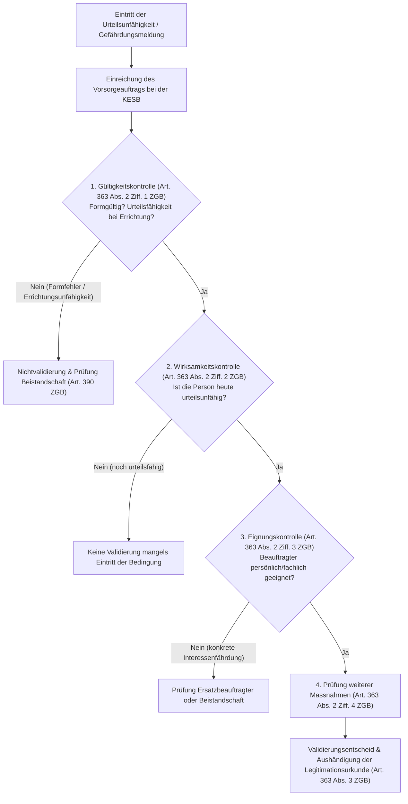

## Überblick {#ueberblick}

Das **Institut des Vorsorgeauftrags** ([Art. 360–369 ZGB](#rechtsgrundlagen)) bildet das Herzstück der mit der Revision des Zivilgesetzbuches per 1. Januar 2013 eingeführten *eigenen Vorsorge*. Es markiert einen fundamentalen Paradigmenwechsel im schweizerischen Zivilrecht: Weg von der behördlichen Bevormundung hilfsbedürftiger Personen nach dem vormaligen Vormundschaftsrecht von 1907, hin zur konsequenten Verwirklichung des **Selbstbestimmungsrechts** des Einzelnen im Hinblick auf den Verlust der Urteilsfähigkeit.

Mit einem Vorsorgeauftrag kann jede handlungsfähige Person im Voraus festlegen, wer im Fall einer dauernden oder vorübergehenden Urteilsunfähigkeit die notwendigen Massnahmen treffen und ihre Interessen wahrnehmen soll. Der Gesetzgeber stellt dem Bürger damit ein Instrument zur Seite, mit dem er eine staatliche Beistandschaft abwenden kann. 

Dieses Primat der privaten Vorsorge wird durch das im Erwachsenenschutzrecht verankerte **Subsidiaritätsprinzip** abgesichert: Gemäss [Art. 389 Abs. 1 Ziff. 2 ZGB](/kommentar/zgb/art-389/#2-vorrang-der-eigenen-vorsorge-und-gesetzlicher-vertretungsrechte-abs-1-ziff-2) darf eine behördliche Erwachsenenschutzmassnahme nur angeordnet werden, wenn keine oder keine ausreichende eigene Vorsorge getroffen wurde. Das Bundesgericht hielt in [BGE 140 III 49](https://entscheidsuche.ch/docs/CH_BGE/CH_BGE_005_BGE-140-III-49_2014.html#consideration_4.3.3) (E. 4.3.3) unmissverständlich fest: «Eine behördliche Massnahme darf nur angeordnet werden, wenn bei Urteilsunfähigkeit der hilfsbedürftigen Person keine oder keine ausreichende eigene Vorsorge getroffen worden ist und die Massnahmen von Gesetzes wegen nicht genügen ( Art. 389 Abs. 1 Ziff. 2 ZGB ).»

| Regelungsbereich | Bestimmung | Wesentlicher Inhalt | Form bzw. Zuständigkeit |
|---|---|---|---|
| **Errichtung & Form** | [Art. 361 ZGB](/kommentar/zgb/art-361/) | Eigenhändig (von Hand niedergeschrieben, datiert, unterzeichnet) oder öffentlich beurkundet | Auftraggeber / Notariat |
| **Registrierung** | [Art. 361 Abs. 3 ZGB](/kommentar/zgb/art-361/#v-zentrale-datenbank-abs-3) | Eintragung des Hinterlegungsortes im Zivilstandsregister (Infostar) | Zivilstandsamt |
| **Widerruf** | Art. 362 ZGB | Jederzeitiger Widerruf in einer der Errichtungsformen oder durch Vernichtung der Urkunde | Handlungsfähiger Auftraggeber |
| **Aufgabenbereiche** | Art. 360 ZGB | Personensorge, Vermögenssorge und Vertretung im Rechtsverkehr | Individuelle Umschreibung im Auftrag |
| **Wirksamwerden** | Art. 363 ZGB | Formelle Prüfung (Gültigkeit, Urteilsunfähigkeit, Eignung) und Ausstellung der Legitimationsurkunde | KESB (Kindes- und Erwachsenenschutzbehörde) |
| **Mandatsannahme** | Art. 365 ZGB | Annahme durch die beauftragte Person; keine Annahmepflicht | Beauftragte Person |
| **Entschädigung** | Art. 366 ZGB | Ausrichtung gemäss Auftrag oder Festsetzung einer angemessenen Entschädigung durch die KESB | Auftraggeber bzw. KESB |
| **Behördliche Aufsicht** | Art. 368 ZGB | Einschreiten bei Gefährdung der Interessen: Weisungen, Inventarpflicht, Rechnungsablage, Befugnisentzug | KESB (von Amtes wegen oder auf Antrag) |
| **Erlöschen** | Art. 369 ZGB | Gesetzliches Dahinfallen bei Wiedererlangung der Urteilsfähigkeit | Eintritt von Gesetzes wegen |

---

## Rechtsgrundlagen und gesetzliche Systematik {#rechtsgrundlagen}

### Gesetzliche Grundlage {#gesetzliche-grundlage}



### Dogmatische Einordnung und Gesetzeszweck {#dogmatik-und-zweck}

Der Vorsorgeauftrag ist im ersten Titel des vierten Abschnitts des Zivilgesetzbuches (*Der Erwachsenenschutz*) als erstes Institut der *eigenen Vorsorge* geregelt (Art. 360–369 ZGB). Die Bestimmung steht in engem Kontext mit den übrigen Elementen des Erwachsenenschutzrechts:

* **Patientenverfügung (Art. 370–373 ZGB)**: Die Patientenverfügung regelt spezifisch die Zustimmung oder Ablehnung künftiger medizinischer Massnahmen. Ein Vorsorgeauftrag kann sich auf persönliche und rechtliche Belange beschränken oder auch Anweisungen zu medizinischen Behandlungen enthalten bzw. auf eine separate Patientenverfügung verweisen.
* **Gesetzliche Vertretungsrechte (Art. 374–381 ZGB)**: Fehlt ein Vorsorgeauftrag, greifen von Gesetzes wegen subsidiäre Vertretungsbefugnisse des Ehegatten oder des eingetragenen Partners für den gewöhnlichen Unterhalt (Art. 374 ZGB) sowie eine gesetzliche Kaskade von Vertretungsberechtigten bei medizinischen Massnahmen (Art. 378 ZGB).
* **Behördliche Massnahmen (Art. 388 ff. ZGB)**: Die behördliche Beistandschaft (Begleit-, Vertretungs-, Mitwirkungs- oder umfassende Beistandschaft) ist gegenüber dem Vorsorgeauftrag zwingend subsidiär ([Art. 389 ZGB](/kommentar/zgb/art-389/)).

In [BGE 140 III 49](https://entscheidsuche.ch/docs/CH_BGE/CH_BGE_005_BGE-140-III-49_2014.html#consideration_4.3.1) (E. 4.3.1) präzisierte das Bundesgericht: «Subsidiarität ( Art. 389 Abs. 1 ZGB ) heisst, dass behördliche Massnahmen nur dann anzuordnen sind, wenn die Betreuung der hilfsbedürftigen Person auf andere Weise nicht angemessen sichergestellt ist». Ein wirksamer und zweckmässiger Vorsorgeauftrag schliesst die Anordnung einer behördlichen Beistandschaft somit grundsätzlich aus, solange die Interessen der hilfsbedürftigen Person durch den Beauftragten gewahrt werden.

---

## Errichtung und Formvorschriften {#errichtung-und-form}

### Die zwei gesetzlichen Errichtungsformen (Art. 361 Abs. 1 ZGB) {#errichtungsformen}



Der Vorsorgeauftrag ist ein formstrenges Rechtsgeschäft. Der Gesetzgeber lässt gemäss [Art. 361 Abs. 1 ZGB](/kommentar/zgb/art-361/#i-formerfordernisse-im-allgemeinen-abs-1) ausschliesslich zwei Errichtungsformen zu:

1. **Die eigenhändige Errichtung (Art. 361 Abs. 2 ZGB)**: Der Vorsorgeauftrag muss vom ersten bis zum letzten Wort vollständig von Hand geschrieben, datiert (Jahr, Monat, Tag) und eigenhändig unterzeichnet sein. Maschinenschriftliche Passagen, Vordrucke oder Formulare machen den gesamten Auftrag formungültig.
2. **Die öffentliche Beurkundung (Art. 361 Abs. 1 ZGB)**: Der Vorsorgeauftrag wird durch eine nach kantonalem Recht zuständige Urkundsperson (Notar) öffentlich beurkundet.

#### Keine Testamentszeugen bei der öffentlichen Beurkundung: Klärung in BGE 151 III 81 {#keine-testamentszeugen}

Lange Zeit war in der Schweizer Rechtslehre und kantonalen Praxis umstritten, ob für die öffentliche Beurkundung eines Vorsorgeauftrags analog zu letztwilligen Verfügungen (Art. 499 ff. ZGB) zwingend zwei Zeugen mitwirken müssen. Das Bundesgericht hat diese grundlegende Rechtsfrage in seinem Leitentscheid [BGE 151 III 81](https://entscheidsuche.ch/docs/CH_BGE/CH_BGE_005_BGE-151-III-81_2025.html#consideration_3.5.5) (E. 3.5.5) abschliessend geklärt:

> «Zusammenfassend ist der Wortlaut von Art. 361 Abs. 1 ZGB insofern eindeutig, als sich ihm kein Verweis auf Art. 499 ff. ZGB entnehmen lässt.»
>
> «Im Ergebnis bleibt damit festzuhalten, dass sich die öffentliche Beurkundung des Vorsorgeauftrags nach kantonalem Recht richtet.»

Da das kantonale Notariatsrecht der weitaus meisten Kantone (wie etwa St. Gallen, Zürich oder Bern) für gewöhnliche Beurkundungen keine Urkundszeugen vorschreibt, ist ein öffentlich beurkundeter Vorsorgeauftrag auch ohne Zeugen formgültig, sofern das massgebliche kantonale Beurkundungsrecht (Art. 55 SchlT ZGB) keinen Zeugenbeizug explizit verlangt ([BGE 151 III 81](https://entscheidsuche.ch/docs/CH_BGE/CH_BGE_005_BGE-151-III-81_2025.html#consideration_3.6) E. 3.6).

### Registrierung im Zivilstandsregister {#registrierung}

Gemäss [Art. 361 Abs. 3 ZGB](/kommentar/zgb/art-361/#v-zentrale-datenbank-abs-3) kann die auftraggebende Person die Tatsache der Errichtung und den Hinterlegungsort des Vorsorgeauftrags beim Zivilstandsamt in die zentrale Datenbank (*Infostar*) eintragen lassen. Die Registrierung ist keine Gültigkeitsvoraussetzung, stellt aber sicher, dass die Kindes- und Erwachsenenschutzbehörde bei Eintritt der Urteilsunfähigkeit von Amtes wegen von der Existenz der Urkunde erfährt (Art. 363 Abs. 1 ZGB).

### Widerruf und Erlöschen früherer Aufträge {#widerruf}



Der Vorsorgeauftrag kann vom handlungsfähigen Auftraggeber jederzeit widerrufen werden:
* Durch ausdrücklichen Widerruf in einer der Errichtungsformen (eigenhändig oder öffentlich beurkundet; Art. 362 Abs. 1 ZGB);
* Durch physische Vernichtung der Urkunde (Art. 362 Abs. 2 ZGB);
* Durch Errichtung eines neuen Vorsorgeauftrags, welcher einen früheren Auftrag ersetzt, sofern er nicht ausdrücklich eine blosse Ergänzung darstellt (Art. 362 Abs. 3 ZGB).

Wird die Urteilsfähigkeit beim Widerruf oder bei der Errichtung eines späteren Vorsorgeauftrags bestritten, greifen die allgemeinen zivilrechtlichen Beweisregeln ([Urteil des Bundesgerichts 5A_732/2021 vom 29. März 2022](https://entscheidsuche.ch/docs/CH_BGer/CH_BGer_005_5A-732-2021_2022-03-29.html)).

---

## Aufgabenbereiche und Ausgestaltung des Mandats {#aufgabenbereiche}

### Gesetzliche Aufgabenbereiche (Art. 360 Abs. 1 ZGB) {#gesetzliche-aufgabenbereiche}

Der Auftraggeber kann die Aufgaben der beauftragten Person umfassend oder modular umschreiben. Das Gesetz unterscheidet drei Hauptbereiche:

1. **Personensorge**: Umfasst die persönliche Unterstützung, die Regelung der Wohnverhältnisse (z. B. Eintritt in eine Betreuungseinrichtung, Kündigung des Mietvertrags), die Organisation der häuslichen Pflege und Spitex-Dienste sowie Entscheidungen im Zusammenhang mit der Gesundheit und Freizeitgestaltung.
2. **Vermögenssorge**: Beinhaltet die ordentliche und ausserordentliche Verwaltung des gesamten Einkommens und Vermögens, die Vornahme laufender Zahlungen, die Steuerdeklaration, die Führung von Bankkonten und Depots, die Verwaltung von Grundeigentum sowie die Geltendmachung von Sozialversicherungsleistungen (AHV, IV, EL, Ergänzungsleistungen).
3. **Vertretung im Rechtsverkehr**: Ermächtigt den Beauftragten zur Abgabe rechtsverbindlicher Erklärungen gegenüber Behörden, Gerichten, Versicherungsgesellschaften, Banken und Privaten.

### Ersatzverfügungen und Zuweisung an mehrere Personen {#ersatzverfuegungen}

Nach Art. 360 Abs. 2 und 3 ZGB empfiehlt es sich, genaue Weisungen für die Aufgabenerfüllung zu erteilen und **Ersatzpersonen** zu bezeichnen. Die Einsetzung von Ersatzbeauftragten verhindert, dass bei einer Verhinderung, Amtsunfähigkeit, Ablehnung oder Mandatsniederlegung der primär beauftragten Person das Instrument ins Leere läuft und dennoch eine Beistandschaft errichtet werden muss ([Urteil des Bundesgerichts 5A_559/2016 vom 1. März 2017](https://entscheidsuche.ch/docs/CH_BGer/CH_BGer_005_5A-559-2016_2017-03-01.html)).

Ebenso ist es zulässig, verschiedene Personen mit getrennten Aufgabenbereichen zu betrauen (z. B. ein Familienmitglied mit der Personensorge und eine Fachperson wie einen Treuhänder oder Rechtsanwalt mit der Vermögenssorge; [Urteil des Bundesgerichts 5A_419/2026 vom 23. Juli 2026](https://entscheidsuche.ch/docs/CH_BGer/CH_BGer_005_5A-419-2026_2026-07-23.html)).

### Entschädigung und Auslagenersatz (Art. 366 ZGB) {#entschaedigung}



Enthält der Vorsorgeauftrag keine Bestimmung über die Vergütung, setzt die Erwachsenenschutzbehörde eine angemessene Entschädigung fest, sofern dies mit Blick auf den Umfang der Aufgaben oder berufliche Dienstleistungen gerechtfertigt erscheint (Art. 366 ZGB). Bei der Einsetzung beruflicher Beauftragter (Rechtsanwälte, Treuhänder) ist die Vereinbarung stundenbasierter beruflicher Tarife im Vorsorgeauftrag zulässig und bildet die Grundlage der Abrechnung ([Urteil des Bundesgerichts 5A_18/2019 vom 6. Juni 2019](https://entscheidsuche.ch/docs/CH_BGer/CH_BGer_005_5A-18-2019_2019-06-06.html)).

---

## Das Validierungsverfahren bei Eintritt der Urteilsunfähigkeit {#validierungsverfahren}

### Gesetzliche Prüfpflicht der Erwachsenenschutzbehörde {#pruefpflicht-kesb}



Der Vorsorgeauftrag entfaltet zu Lebzeiten des gesunden Auftraggebers noch keine Rechtswirkungen. Erst wenn die auftraggebende Person **urteilsunfähig** wird, muss der Vorsorgeauftrag der zuständigen Kindes- und Erwachsenenschutzbehörde (KESB) am Wohnsitz der betroffenen Person eingereicht werden. Die KESB nimmt im formellen **Validierungsverfahren** eine vierfache Prüfung vor (Art. 363 Abs. 2 ZGB):

### 1. Gültigkeitskontrolle: Urteilsfähigkeit im Errichtungszeitpunkt {#gueltigkeitskontrolle}

Die Behörde hat abzuklären, ob die auftraggebende Person im Zeitpunkt der Niederschrift bzw. Beurkundung urteilsfähig war (Art. 16 ZGB). Das Bundesgericht fasste die Grundsätze der Beweislast in [Urteil 5A_419/2026 vom 23. Juli 2026](https://entscheidsuche.ch/docs/CH_BGer/CH_BGer_005_5A-419-2026_2026-07-23.html) (E. 3.1) zusammen:

> «Wer sich für die Unwirksamkeit einer Handlung auf die Urteilsunfähigkeit beruft, hat demnach einen der in Art. 16 ZGB umschriebenen Schwächezustände und die daraus folgende Beeinträchtigung der Fähigkeit vernunftgemässen Handelns zu beweisen»
>
> «Befand sich aber eine Person ihrer allgemeinen Verfassung nach zum Zeitpunkt der streitigen Handlung nachweislich in einem dauernden Schwächezustand gemäss Art. 16 ZGB , der nach allgemeiner Lebenserfahrung im Normalfall vernunftgemässes Handeln ausschliesst, dann wird vermutet, dass sie mit Bezug auf die streitige Handlung unfähig war, vernunftgemäss zu handeln.»

Befand sich die Person wegen fortgeschrittener Demenz in einem dauernden Zustand geistigen Abbaus, kehrt sich die Beweislast um: Die Gegenpartei muss diesfalls ein *lucidum intervallum* nachweisen ([BGer 5A_419/2026](https://entscheidsuche.ch/docs/CH_BGer/CH_BGer_005_5A-419-2026_2026-07-23.html) E. 3.1).

### 2. Wirksamkeitskontrolle: Nachweis der aktuellen Urteilsunfähigkeit {#wirksamkeitskontrolle}

Die Urteilsunfähigkeit im Zeitpunkt der Validierung ist die conditio sine qua non für das Wirksamwerden des Auftrags (Art. 363 Abs. 2 Ziff. 2 ZGB). Solange die auftraggebende Person geistig noch in der Lage ist, ihre Angelegenheiten selbst zu besorgen, ist eine Validierung ausgeschlossen ([Urteil des Bundesgerichts 5A_526/2019 vom 4. März 2020](https://entscheidsuche.ch/docs/CH_BGer/CH_BGer_005_5A-526-2019_2020-03-04.html) E. 3.2). Die KESB stützt sich hierbei auf detaillierte medizinische Berichte und Zeugnisse unabhängiger Fachärzte oder geriatrischer Kliniken ([Urteil des Appellationsgerichts Basel-Stadt VD.2020.69 vom 8. Oktober 2020](https://entscheidsuche.ch/docs/BS_Omni/BS_APG_001_VD-2020-69_2020-10-08.html) E. 2.2).

### 3. Eignungsprüfung der beauftragten Person {#eignungspruefung}

Die Eignung des Beauftragten ist anhand objektiver Kriterien prognostisch zu beurteilen ([Urteil des Bundesgerichts 5A_615/2021 vom 7. Dezember 2021](https://entscheidsuche.ch/docs/CH_BGer/CH_BGer_005_5A-615-2021_2021-12-07.html) E. 4.1):

> «Wie die Vorinstanz zutreffend ausführt, soll die Behörde die vorsorgebeauftragte Person nicht einsetzen, wenn dadurch die Interessen der auftraggebenden Person gefährdet werden (vgl. Art. 368 ZGB ). Über die Eignung der beauftragten Person ist prognostisch aufgrund von objektiv feststellbaren Kriterien zu entscheiden»
>
> «Massstab ist dabei die Gefährdung der Interessen der auftraggebenden Person.»

In der Rechtsprechung prallen hierbei regelmässig das **Selbstbestimmungsrecht** des Auftraggebers und **innerfamiliäre Konflikte** aufeinander:

* **Familienkonflikte schliessen die Eignung nicht per se aus**: Im Grundsatzurteil [BGE 151 III 529](https://entscheidsuche.ch/docs/CH_BGE/CH_BGE_005_BGE-151-III-529_2025.html#consideration_3.4) (E. 3.4) betonte das Bundesgericht den Vorrang der Selbstbestimmung:
  > «Die blosse Möglichkeit, dass sich der zwischen den Söhnen bestehende Konflikt verschärfen könnte, reicht mit Blick auf das Selbstbestimmungsrecht der Betroffenen jedoch nicht aus, um dem Beschwerdeführer 3 die Eignung als Vorsorgebeauftragter abzusprechen.»
* **Konkrete Interessenvermischung führt zur Nichtvalidierung**: Handelt der designierte Beauftragte hingegen nachweislich pflichtwidrig, begleicht er eigene Anwalts- und Gerichtskosten ab den Konten der betroffenen Person oder lässt er laufende Betreuungspflichten als Druckmittel im Erbstreit fallen, ist die Eignung zwingend zu verneinen ([Urteil des Bundesgerichts 5A_228/2025 vom 18. September 2025](https://entscheidsuche.ch/docs/CH_BGer/CH_BGer_005_5A-228-2025_2025-09-18.html) E. 3.3).

### Die Legitimationsurkunde (Art. 363 Abs. 3 ZGB) {#legitimationsurkunde}

Sind die Voraussetzungen erfüllt und nimmt die beauftragte Person den Auftrag an (Art. 365 ZGB), händigt ihr die Erwachsenenschutzbehörde eine offizielle **Legitimationsurkunde** aus (Art. 363 Abs. 3 ZGB). Diese Urkunde umschreibt die Vertretungsbefugnisse und dient im Rechtsverkehr als Ausweis gegenüber Banken, Behörden, Gerichten und Grundbuchämtern.

---

## Behördliche Aufsicht und Schutzmassnahmen {#behoerdliche-intervention}

### Gesetzliche Interventionspflicht der KESB {#interventionspflicht-kesb}



Im Gegensatz zur behördlichen Beistandschaft unterliegt der Vorsorgebeauftragte **keiner periodischen Rechnungslegungs- und Berichtspflicht** gegenüber der KESB. Dies ist der wesentliche Vorteil der Privatautonomie. 

Zum Schutz der hilflosen Person sieht Art. 368 ZGB jedoch ein behördliches Auffangnetz vor: Sobald Anhaltspunkte dafür vorliegen, dass die Interessen des Auftraggebers gefährdet oder verletzt werden, schreitet die Behörde von Amtes wegen oder auf Antrag einer nahestehenden Person ein.

### Massnahmenkatalog (Art. 368 Abs. 2 ZGB) {#massnahmenkatalog}

Die KESB verfügt über abgestufte Zwangsbefugnisse:

1. **Erteilung von verbindlichen Weisungen**: Anordnung bestimmter Verhaltensweisen bei der Pflege, Vermögensanlage oder Wohnsituation.
2. **Auskunfts- und Rechnungslegungspflicht**: Verpflichtung zur Einreichung eines Vermögensinventars und zur periodischen Rechenschaftsablage.
3. **Kontensperren und vorsorgliche Massnahmen**: Sicherung gefährdeter Gelder durch vorsorgliche Verfügungsbeschränkungen ([Urteil des Bundesgerichts 5A_614/2018 vom 12. September 2018](https://entscheidsuche.ch/docs/CH_BGer/CH_BGer_005_5A-614-2018_2018-09-12.html)).
4. **Teilweiser oder vollständiger Entzug der Befugnisse**: Ist der Beauftragte dauerhaft ungeeignet oder überfordert, entzieht ihm die KESB das Mandat und errichtet subsidiar eine behördliche Beistandschaft ([Urteil des Bundesgerichts 5A_559/2016 vom 1. März 2017](https://entscheidsuche.ch/docs/CH_BGer/CH_BGer_005_5A-559-2016_2017-03-01.html)).

---

## Abgrenzungen zu verwandten Rechtsinstituten {#abgrenzungen}

Zur präzisen rechtlichen Einordnung dient die Gegenüberstellung mit konkurrierenden Instrumenten:

| Kriterium | Vorsorgeauftrag (Art. 360 ff. ZGB) | Patientenverfügung (Art. 370 ff. ZGB) | Vertretung durch Ehegatten (Art. 374 ZGB) | Behördliche Beistandschaft (Art. 390 ff. ZGB) | Vollmacht nach OR (Art. 32 ff. OR) |
|---|---|---|---|---|---|
| **Zweck** | Umfassende Personen-, Vermögens- und Rechtsvorsorge | Festlegung medizinischer Behandlungen | Gesetzliche Minimalvertretung für den Alltag | Staatliche Schutzmassnahme bei Schwächezustand | Vertretung im geschäftlichen Rechtsverkehr |
| **Form** | Eigenhändig oder öffentlich beurkundet | Schriftlich (datiert und unterschrieben) | Gesetzliche Wirkung ohne Formakt | Behördlicher Beschluss (KESB) | Grundsätzlich formfrei (oft schriftlich) |
| **Wirksamkeit** | Erst ab Urteilsunfähigkeit und KESB-Validierung | Ab Urteilsunfähigkeit bei medizinischem Behandlungsbedarf | Ab Urteilsunfähigkeit bei gemeinsamem Haushalt | Ab Rechtskraft des KESB-Entscheids | Ab Erteilung; erlischt oft bei Urteilsunfähigkeit (Art. 35 OR) |
| **Behördliche Rolle** | Konstitutive Validierung und Intervention bei Gefährdung | Keine behördliche Genehmigung; KESB nur bei Streit | Feststellung der Vertretungsmacht bei ausserordentlichen Akten | Laufende behördliche Aufsicht, Berichte und Rechnungen | Keine staatliche Aufsicht |
| **Vorteil** | Maximale Selbstbestimmung; keine laufenden Amtskosten | Klare Anweisungen an behandelnde Ärzte | Kein Vorbereitungsaufwand erforderlich | Neutrale, professionelle Führung bei Streit | Unmittelbar wirksam im laufenden Geschäftsverkehr |

---

## Verfahren und Rechtsschutz {#verfahren-und-rechtsschutz}

### Das Verfahren vor der KESB {#verfahren-kesb}

Das Verfahren vor der Erwachsenenschutzbehörde richtet sich nach Art. 443 ff. ZGB sowie dem kantonalen Ausführungsrecht (Art. 450f ZGB). Es gilt die **Untersuchungsmaxime** (Art. 446 Abs. 1 ZGB): Die KESB erforscht den Sachverhalt von Amtes wegen und ist nicht an die Anträge der Beteiligten gebunden. Die betroffene Person ist in der Regel persönlich anzuhören (Art. 447 ZGB).

### Der kantonale Rechtsmittelweg (Art. 450 ZGB) {#kantonaler-rechtsmittelweg}

Gegen Entscheide der KESB kann innert 30 Tagen Beschwerde beim zuständigen kantonalen Gericht (je nach Kanton Obergericht, Kantonsgericht oder Verwaltungsgericht) erhoben werden. Zur Beschwerde legitimiert sind gemäss Art. 450 Abs. 2 ZGB:
1. Die am Verfahren beteiligten Personen (Auftraggeber, eingesetzter Vorsorgebeauftragter);
2. Personen, die der betroffenen Person **nahestehen** (Ehegatten, Kinder, Lebenspartner);
3. Personen, die ein rechtlich geschütztes Interesse haben.

### Die Beschwerde an das Bundesgericht (Art. 76 Abs. 1 BGG): Strenge Legitimationshürde {#bundesgericht-legitimation}

Gelangt ein Streit über die Validierung eines Vorsorgeauftrags an das Bundesgericht (Beschwerde in Zivilsachen, Art. 72 Abs. 2 lit. b Ziff. 6 BGG), gilt Art. 450 ZGB nicht mehr. Die Legitimation beurteilt sich ausschliesslich nach Art. 76 Abs. 1 BGG ([Urteil des Bundesgerichts 5A_932/2022 vom 3. März 2023](https://entscheidsuche.ch/docs/CH_BGer/CH_BGer_005_5A-932-2022_2023-03-03.html) E. 2):

* **Keine Wahrnehmung fremder Interessen**: Nahestehende Angehörige können vor Bundesgericht nicht mehr bloss die Interessen der betroffenen urteilsunfähigen Person einklagen ([Urteil des Bundesgerichts 5A_559/2016 vom 1. März 2017](https://entscheidsuche.ch/docs/CH_BGer/CH_BGer_005_5A-559-2016_2017-03-01.html) E. 2.4).
* **Keine Legitimation aus blosser Erbenstellung**: Die Aussicht auf ein künftiges Erbe oder die Befürchtung einer Verminderung des Nachlasses begründet kein eigenes schutzwürdiges Interesse ([BGer 5A_932/2022](https://entscheidsuche.ch/docs/CH_BGer/CH_BGer_005_5A-932-2022_2023-03-03.html) E. 2.2.2).
* **Eigenes Rechtsschutzinteresse nur bei eigener Einsetzung**: Ein Angehöriger ist vor Bundesgericht nur legitimiert, soweit er die Validierung des Auftrags zu seinen eigenen Gunsten bzw. seine eigene Einsetzung als Vorsorgebeauftragter anstrebt ([BGer 5A_932/2022](https://entscheidsuche.ch/docs/CH_BGer/CH_BGer_005_5A-932-2022_2023-03-03.html) E. 2.2.3; [Urteil des Bundesgerichts 5A_18/2019 vom 6. Juni 2019](https://entscheidsuche.ch/docs/CH_BGer/CH_BGer_005_5A-18-2019_2019-06-06.html) E. 3.2).

---

## Praxishinweise {#praxishinweise}

Aus der publizierten Rechtsprechung des Bundesgerichts und der kantonalen Gerichte ergeben sich für die Praxis folgende unverzichtbare Leitlinien:

1. **Formfehler vermeiden — Eigenhändigkeit strikt einhalten**: Wird die eigenhändige Form gewählt, darf kein einziges Wort maschinenschriftlich sein (keine ausgedruckten Textbausteine mit handschriftlicher Unterschrift). Das Dokument muss eigenhändig geschrieben, datiert (Tag, Monat, Jahr) und unterschrieben werden.
2. **Öffentliche Beurkundung bei komplexen Vermögen und Liegenschaften**: Bei umfangreichem Immobilienbesitz, Unternehmensbeteiligungen oder absehbaren Familienstreitigkeiten ist die öffentliche Beurkundung dringend vorzuziehen. Seit [BGE 151 III 81](https://entscheidsuche.ch/docs/CH_BGE/CH_BGE_005_BGE-151-III-81_2025.html#consideration_3.5.5) steht fest, dass dabei in den allermeisten Kantonen keine Zeugen erforderlich sind.
3. **Medizinische Begleitdokumentation bei beginnendem Abbau**: Bestehen im Zeitpunkt der Errichtung bereits Vorerkrankungen (z. B. leichte kognitive Beeinträchtigung, beginnende Demenz), sollte taggleich ein fachärztliches Zeugnis über die Urteilsfähigkeit eingeholt werden. Blosse Gefälligkeitsatteste des Hausarztes genügen vor Gericht oft nicht gegen fundierte neuropsychologische Gutachten ([BS APG VD.2020.69](https://entscheidsuche.ch/docs/BS_Omni/BS_APG_001_VD-2020-69_2020-10-08.html)).
4. **Zwingend Ersatzpersonen ernennen**: Ein Vorsorgeauftrag ohne Ersatzverfügung läuft ins Leere, wenn der Erstbeauftragte vorverstirbt, erkrankt, das Mandat ablehnt oder von der KESB wegen Interessenkonflikten abgewiesen wird ([BGer 5A_559/2016](https://entscheidsuche.ch/docs/CH_BGer/CH_BGer_005_5A-559-2016_2017-03-01.html)).
5. **Klare Vergütungsregelung treffen**: Um späteren Streitigkeiten zwischen Vorsorgebeauftragten und übrigen Erben vorzubeugen, sollte die Entschädigung (z. B. Pauschale oder Stundenansatz) und der Spesenersatz im Auftrag ausdrücklich geregelt werden ([BGer 5A_18/2019](https://entscheidsuche.ch/docs/CH_BGer/CH_BGer_005_5A-18-2019_2019-06-06.html)).
6. **Strikte Trennung von eigenem und fremdem Vermögen**: Eingesetzte Vorsorgebeauftragte müssen ab dem ersten Tag penibel Buch führen und eigene Interessen von denjenigen des Auftraggebers trennen. Wer Anwaltskosten für eigene Rechtsmittel aus dem Vermögen des Auftraggebers begleicht, riskiert die sofortige Absetzung ([BGer 5A_228/2025](https://entscheidsuche.ch/docs/CH_BGer/CH_BGer_005_5A-228-2025_2025-09-18.html)).
7. **Prozessuale Falle vor Bundesgericht beachten**: Angehörige, die eine KESB-Entscheidung anfechten wollen, müssen vor Bundesgericht darlegen, inwiefern sie in *eigenen* schutzwürdigen Interessen berührt sind (Art. 76 Abs. 1 BGG); eine Beschwerde zur blossen Wahrung der Interessen der betroffenen Person wird vom Bundesgericht mangels Legitimation nicht an die Hand genommen ([BGer 5A_932/2022](https://entscheidsuche.ch/docs/CH_BGer/CH_BGer_005_5A-932-2022_2023-03-03.html)).

---

## Leitentscheide {#leitentscheide}

| Entscheid | Gegenstand / Norm | Kernaussage und Bedeutung |
|---|---|---|
| [BGE 151 III 81](https://entscheidsuche.ch/docs/CH_BGE/CH_BGE_005_BGE-151-III-81_2025.html#consideration_3.5.5) | Art. 361 Abs. 1 ZGB, Art. 55 SchlT ZGB | Die öffentliche Beurkundung des Vorsorgeauftrags richtet sich nach kantonalem Recht; Art. 361 Abs. 1 ZGB verweist nicht auf Art. 499 ff. ZGB. Urkundszeugen sind nicht erforderlich, es sei denn das kantonale Recht verlangt dies. |
| [BGE 151 III 529](https://entscheidsuche.ch/docs/CH_BGE/CH_BGE_005_BGE-151-III-529_2025.html#consideration_3.4) | Art. 363 Abs. 2 Ziff. 3 ZGB | Die blosse Möglichkeit einer Verschärfung von Familienkonflikten reicht mit Blick auf das Selbstbestimmungsrecht der betroffenen Person nicht aus, um dem beauftragten Angehörigen die Eignung abzusprechen. |
| [BGE 140 III 49](https://entscheidsuche.ch/docs/CH_BGE/CH_BGE_005_BGE-140-III-49_2014.html#consideration_4.3.3) | Art. 389 Abs. 1 Ziff. 2 ZGB | Grundsatz der Subsidiarität und Verhältnismässigkeit: Staatliche Fürsorge nur soviel wie nötig; Vorrang der eigenen Vorsorge (Vorsorgeauftrag) vor behördlichen Massnahmen. |
| [BGer 5A_419/2026 vom 23.7.2026](https://entscheidsuche.ch/docs/CH_BGer/CH_BGer_005_5A-419-2026_2026-07-23.html) | Art. 16 ZGB, Art. 360, 363 ZGB | Relative Urteilsfähigkeit bei Errichtung des Vorsorgeauftrags. Beweislast und tatsächliche Vermutung der Urteilsunfähigkeit bei dauerndem altersbedingtem Abbau. |
| [BGer 5A_615/2021 vom 7.12.2021](https://entscheidsuche.ch/docs/CH_BGer/CH_BGer_005_5A-615-2021_2021-12-07.html) | Art. 363 Abs. 2 Ziff. 3, Art. 368 ZGB | Beurteilung der Eignung des Vorsorgebeauftragten anhand prognostischer und objektiv feststellbarer Kriterien; Gefährdung der Interessen der auftraggebenden Person als Massstab. |
| [BGer 5A_228/2025 vom 18.9.2025](https://entscheidsuche.ch/docs/CH_BGer/CH_BGer_005_5A-228-2025_2025-09-18.html) | Art. 363 Abs. 2 Ziff. 3 ZGB | Verneinung der Eignung einer Tochter wegen Begleichung eigener Anwaltskosten ab dem Konto der betroffenen Mutter und Gefährdung von deren Betreuung als Druckmittel. |
| [BGer 5A_932/2022 vom 3.3.2023](https://entscheidsuche.ch/docs/CH_BGer/CH_BGer_005_5A-932-2022_2023-03-03.html) | Art. 76 Abs. 1 BGG, Art. 363 ZGB | Beschwerdelegitimation naher Angehöriger vor Bundesgericht: Keine Vertretung von Fremdinteressen der Betroffenen; reine Erbinteressen begründen kein eigenes schutzwürdiges Interesse. |
| [BGer 5A_526/2019 vom 4.3.2020](https://entscheidsuche.ch/docs/CH_BGer/CH_BGer_005_5A-526-2019_2020-03-04.html) | Art. 363 Abs. 2 Ziff. 2 ZGB | Urteilsunfähigkeit als Wirksamkeitsvoraussetzung: Solange die betroffene Person noch urteilsfähig ist, scheidet eine Validierung des Vorsorgeauftrags begrifflich aus. |
| [BGer 5A_732/2021 vom 29.3.2022](https://entscheidsuche.ch/docs/CH_BGer/CH_BGer_005_5A-732-2021_2022-03-29.html) | Art. 362 ZGB | Widerruf eines Vorsorgeauftrags und Prüfung der Urteilsfähigkeit im Zeitpunkt des Widerrufs bei Errichtung eines Folgeauftrags. |
| [BGer 5A_614/2018 vom 12.9.2018](https://entscheidsuche.ch/docs/CH_BGer/CH_BGer_005_5A-614-2018_2018-09-12.html) | Art. 368, 445 ZGB | Behördliche Schutzmassnahmen nach Art. 368 ZGB: Kontensperren, Befugnisentzug und Rechenschaftsablage bei Gefährdung der Interessen des Auftraggebers. |
| [BGer 5A_18/2019 vom 6.6.2019](https://entscheidsuche.ch/docs/CH_BGer/CH_BGer_005_5A-18-2019_2019-06-06.html) | Art. 366 ZGB, Art. 76 BGG | Honorar und Entschädigung des gewerbsmässigen Vorsorgebeauftragten nach vertraglichem Tarif; Nichteintreten auf Beschwerde der Kinder vor Bundesgericht mangels eigenem Interesse. |
| [BGer 5A_559/2016 vom 1.3.2017](https://entscheidsuche.ch/docs/CH_BGer/CH_BGer_005_5A-559-2016_2017-03-01.html) | Art. 367, 368 ZGB, Art. 76 BGG | Niederlegung des Mandats durch die Ehefrau, Prüfung von Ersatzbeauftragten und Nichteintreten auf die Beschwerde des Sohnes mangels eigenem rechtlichem Interesse. |
| [BGer 5A_383/2025 vom 24.6.2025](https://entscheidsuche.ch/docs/CH_BGer/CH_BGer_005_5A-383-2025_2025-06-24.html) | Art. 363, 446 ZGB | Amtliche Untersuchungspflicht der KESB bei Vorliegen mehrerer widersprüchlicher Vorsorgeaufträge; unzureichende Begründung bei blossem Verweis auf Notariatsakt. |
| [BS APG VD.2020.69 vom 8.10.2020](https://entscheidsuche.ch/docs/BS_Omni/BS_APG_001_VD-2020-69_2020-10-08.html) | Art. 363 ZGB | Zweistufige KESB-Prüfung (Gültigkeits- vs. Wirksamkeitskontrolle) und Würdigung spezialisierter neuropsychologischer Abklärungen gegenüber hausärztlichen Zeugnissen. |

---

## Literatur {#literatur}

* **Basler Kommentar zum Schweizerischen Privatrecht (BSK)**: Thomas Geiser / Christiana Fountoulakis (Hrsg.), Zivilgesetzbuch I (Art. 1–456 ZGB), 7. Aufl., Basel 2022.
* **Berner Kommentar (BK)**: Heinz Hausheer / Walter Geiser / Regina E. Aebi-Müller (Hrsg.), Das Personenrecht, Bern 2012 / Heinz Hausheer / Peter Breitschmid (Hrsg.), Der Erwachsenenschutz, Bern 2014.
* **Zürcher Kommentar (ZK)**: Walter Boente, Der Vorsorgeauftrag (Art. 360–369 ZGB), Zürich 2015.
* **Hermann Schmid**: Erwachsenenschutz, Kommentar zu Art. 360–456 ZGB, Zürich 2010.
* **Daniel Rosch / Andrea Büchler / Dominique Jakob (Hrsg.)**: Das neue Erwachsenenschutzrecht, Bern 2011.
* **Philippe Meier**: Droit de la protection de l'adulte, 2. Aufl., Genf/Zürich 2022.
* **Nico Renz**: Der Vorsorgeauftrag und seine Validierung, Diss. Zürich, Bern 2020.
